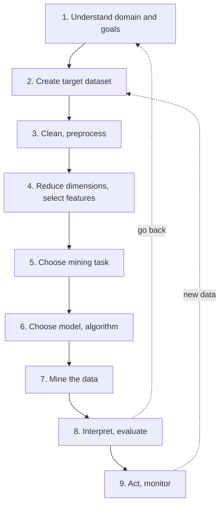

The knowledge discovery in databases (KDD) process has nine steps, and data mining is only the seventh (Fayyad et al., 1996a). Google Flu Trends (GFT) shows the difference better than any other example. Its algorithm was a plain linear regression, yet the system underestimated the 2009 flu pandemic and then, in February 2013, produced estimates more than double the CDC's figures (Cook et al., 2011; Lazer et al., 2014). The ARGO model is also linear, but it fixes the steps around the mining step, and from 2009 to 2015 it reached an RMSE of 0.608 times that of a naive model, against 2.216 times for GFT (Yang et al., 2015). This article is for students, data analysts and self-learners: you get a table that ties each GFT failure to a KDD step, a 9-question checklist, and Python code that replicates part of the analysis with public CDC data.

<div class="callout callout-note">
<p class="callout-title">Quick summary</p>

- KDD is the whole process from setting the goal to acting on results; data mining is the step where an algorithm extracts patterns.
- GFT: 50 million candidate queries, 45 selected, fitted to 1,152 data points; large errors in 2009 and in the 2012/13 season.
- GFT's failures span every group of steps except step 7: ARGO still uses linear regression.
- ARGO adds lagged CDC data and seasonality, and reselects search terms every week on a 104-week rolling window.
- A fair evaluation uses data "as it was known at the time"; Section 5 shows how much the error grows when you do this.

</div>

## 1. What KDD is: nine steps, with data mining as step seven

### 1.1. Definition

Fayyad, Piatetsky-Shapiro and Smyth (1996a) separate two terms that people often mix up. KDD is the *entire process* of finding useful knowledge in data. Data mining is *one step* in that process: applying a specific algorithm to extract patterns from data. The same year, the authors presented the framework to the computing community in *Communications of the ACM* (Fayyad et al., 1996b).

Their definition sets four requirements for a pattern. It must be **valid** on new data with some degree of certainty, **novel**, **potentially useful** and **ultimately understandable** (Fayyad et al., 1996a, p. 40). Note the word "potentially." A pattern is only *possibly* useful until someone tests it and puts it to real use. That work belongs to the final steps.

IDC projected that the global datasphere would grow from 33 ZB in 2018 to 175 ZB in 2025 (Reinsel et al., 2018). The more data there is, the easier it is to believe the data will "speak for itself." The KDD framework says the opposite: a mined pattern is not yet knowledge.

### 1.2. The nine steps of the KDD process

Fayyad et al. (1996a, pp. 41–42) describe the basic steps as follows:

1. Understand the application domain, prior knowledge and the user's goals.
2. Create a target dataset: select data, variables and samples.
3. Clean and preprocess: handle noise, missing values and time-related factors.
4. Reduce and project the data: select features, transform variables.
5. Choose a mining task that fits the goal: classification, regression, clustering…
6. Do exploratory analysis, choose a model or hypothesis, choose an algorithm.
7. Mine the data.
8. Interpret the patterns found, possibly returning to any of steps 1 through 7.
9. Act on the knowledge: build it into a system, report it, check it against prior knowledge for conflicts.



*Figure 1. The nine steps of the KDD process, redrawn from the description in Fayyad et al. (1996a). Dashed arrows are loops.*

Most of the practical work happens in step 3; documented data cleaning is covered in [Process data from Dirty to Clean](/en/blog/process-data-from-dirty-to-clean/).

### 1.3. An early warning: data dredging

Fayyad et al. (1996a, p. 39) note that statisticians once dismissed data mining as "data dredging": run algorithms blindly on data and you will easily find meaningless patterns. The authors give an example about testing many models (p. 49). If you test N models at a significance level of 0.001, on average about N/1000 of them will look "statistically significant" by chance alone. Keep that arithmetic in mind for Section 2, because GFT searched through 50 million candidate queries.

### 1.4. KDD and CRISP-DM

CRISP-DM, which appeared in the late 1990s, is another popular process model. Martínez-Plumed et al. (2021) argue that process models fit projects with clear goals, while exploratory projects need more flexible "data science trajectories." This article uses KDD because it isolates the mining step.

## 2. Google Flu Trends: rebuilding the chain of evidence

### 2.1. The original design

Ginsberg et al. (2009) published online in *Nature* on November 19, 2008 (print issue February 19, 2009) a method for estimating influenza-like illness (ILI) from search queries. This kind of "present-time" estimation later came to be called nowcasting. The data were weekly counts for the 50 million most common search queries in the United States from 2003 to 2008. The model was a linear regression between the logit of the ILI physician-visit rate and the logit of the ILI-related query rate:

$$\text{logit}(P) = \beta_0 + \beta_1 \cdot \text{logit}(Q) + \varepsilon$$

where $P$ is the share of physician visits for ILI and $Q$ is the share of related queries. The authors summed the 45 top-scoring queries into a single variable $Q$. They picked 45 because that number gave the best out-of-sample estimates in cross-validation. The model was trained on September 28, 2003, to March 11, 2007, which is 128 points per region across 9 US regions; 42 weeks through May 11, 2008, were held out for validation. The mean correlation across regions was 0.90 in the fit and 0.97 on the 42 validation points. The system lagged by about 1 day, 1–2 weeks ahead of CDC reports (Ginsberg et al., 2009).

The authors themselves issued warnings: the system does not replace traditional surveillance; during a pandemic, worried healthy people also search, so estimates may be inflated; and unusual events can trigger false alarms (Ginsberg et al., 2009).

### 2.2. The 2009 H1N1 pandemic: GFT came in low

The H1N1 pandemic was the first real test, and GFT missed on the **low** side. Cook et al. (2011) showed that the original model underestimated ILI during the pandemic; Google released an updated model in September 2009. In the first wave (summer 2009), the correlation with CDC ILINet data was 0.95 for the updated model, compared with 0.29 for the original. Cook et al. explain that search behavior changed during the pandemic and that the updated model used more queries.

Olson et al. (2013) reanalyzed the data at three geographic scales (national, regional, city). The original model missed the spring 2009 wave entirely, with estimates 30–40 times lower than ILI surveillance; both the original and the updated model had periods of large error.

Ginsberg et al. (2009) had worried that estimates would be *inflated* during a pandemic; 2009 brought the reverse. The wave arrived in spring and summer, and people searched differently than in the winters the model had learned from. A model chosen to fit the winters of 2003–2007 had no reason to be right about an off-season outbreak.

### 2.3. The 2012/13 season: GFT overshot by more than double

Four years later the error flipped direction. According to Lazer et al. (2014), citing a *Nature* news report (Butler, 2013), in February 2013 GFT predicted an ILI visit rate more than double the CDC's figure. It was not a one-week glitch: from August 2011, GFT overestimated in 100 of 108 weeks (Lazer et al., 2014). Olson et al. (2013) also recorded that GFT heavily overstated the intensity of the 2012/13 H3N2 epidemic.

Table 1 lists the key milestones.

**Table 1.** Timeline from GFT to ARGO

| Date | Event | Source |
| --- | --- | --- |
| Nov 19, 2008 | GFT published online in *Nature* (print Feb 19, 2009) | Ginsberg et al. (2009) |
| Spring–summer 2009 | H1N1 pandemic: original model underestimates | Cook et al. (2011); Olson et al. (2013) |
| Sep 2009 | Google releases an updated model | Cook et al. (2011) |
| Aug 2011–2013 | Overestimates in 100 of 108 weeks | Lazer et al. (2014) |
| Feb 2013 | Estimate more than double the CDC figure | Butler (2013); Lazer et al. (2014) |
| Mar 2014 | Lazer et al. analyze "traps in big data analysis" in *Science* | Lazer et al. (2014) |
| Aug 2015 | Google stops publishing public GFT estimates | O'Connor (2015) |
| Nov 2015 | ARGO published in *PNAS* | Yang et al. (2015) |

### 2.4. Lazer et al. (2014): three diagnoses

*The parable of Google Flu* offers three diagnoses.

The first is **big data hubris**: the implicit assumption that big data can *replace*, rather than *supplement*, traditional data collection and analysis.

The second is **overfitting**. GFT searched 50 million terms for the ones that best fit 1,152 data points. That number matches the Ginsberg et al. design exactly: 128 weeks × 9 regions. When candidates outnumber observations by tens of thousands to one, many queries will fit well purely because they share the season: they rise in winter like the flu but do not measure the flu. Omics data run into the same problem when features vastly outnumber observations (p ≫ n) (→ [ML in biology](/en/blog/machine-learning-va-ai-trong-sinh-hoc/)).

The third is **algorithm dynamics**: search results are not static data. The "blue team" is Google itself changing its search algorithm and services, which shifts user behavior; the "red team" is outside attempts to manipulate the system.

Lazer et al. (2014) made two more points. A model using only lagged CDC data already beat GFT, and combining GFT with lagged CDC data did better than either source alone. In addition, GFT's published documentation was not enough for outsiders to replicate it.

## 3. Mapping each GFT failure to a KDD step

The original papers do not use the KDD framework. The mapping below is an interpretation built on those papers' own arguments.

**Table 2.** GFT failures by KDD step and how ARGO fixes them

| KDD step | GFT failure | Evidence | ARGO fix |
| --- | --- | --- | --- |
| 1. Goal | Implicit goal drifts from "supplement" to "replace" CDC surveillance | Ginsberg et al. (2009) say it does not replace; Lazer et al. (2014) call it big data hubris | Lagged CDC data become a primary input (Yang et al., 2015) |
| 2. Target dataset | Search signals were not created to measure disease; they shift with user behavior and with the search engine itself | Cook et al. (2011); Olson et al. (2013); Lazer et al. (2014) | Search data only supplement CDC data |
| 3–4. Preprocessing, feature selection | 45 picked from 50 million candidates; summed into one variable, so queries that stop working cannot be tracked | Ginsberg et al. (2009); Lazer et al. (2014); Yang et al. (2015) | Keeps 100 terms as 100 separate variables; L1 reselects them weekly |
| 5–6. Task, model | Static model that ignores new CDC reports and drifts; ignores the seasonality of the ILI series | Yang et al. (2015) | Adds 52 ILI lags to capture seasonality; retrains weekly on a 104-week window |
| 7. Mining | Linear regression | Ginsberg et al. (2009) | Still linear regression, with L1 regularization added |
| 8. Interpretation, evaluation | A 42-week validation within one period could not test whether the model holds up when behavior changes | Ginsberg et al. (2009); Cook et al. (2011) | Six years of out-of-sample evaluation, season by season |
| 9. Action, monitoring | Public system, but not transparent enough for outside checks | Lazer et al. (2014) | Full model description, public data |

At **step 1**, the Ginsberg team stated clearly that GFT did not replace traditional surveillance, but a public system running 1–2 weeks ahead of the CDC is easy to treat as a replacement.

At **step 2**, you need to separate data *designed* to measure a phenomenon (ILINet) from data *produced as a byproduct* of a service (search queries). There is another layer: the CDC data used as "ground truth" are themselves revised (backfilled) for weeks after release. Delphi Epidata lets you retrieve each historical version through the `issues` or `lag` parameter (Delphi Research Group, n.d.). When Kandula and Shaman (2019) reappraised GFT, they kept real-time ILI separate from final ILI.

At **steps 3–4**, picking 45 queries out of 50 million candidates is exactly the kind of extremely broad search Fayyad et al. (1996a) warned about. Apply the arithmetic from Section 1.3: if all 50 million queries were tested at the 0.001 level, about 50,000 would look "significant" by chance. GFT did not test them that way, so the figure only illustrates the scale of the risk. Summing many queries into one variable also kept the model from tracking how individual queries changed over time (Yang et al., 2015).

At **steps 5–6**, GFT was a static model: new CDC reports arrived every week but were not fed back in, so the model gradually drifted from reality (model drift). The ILI series has strong seasonality, and the model did not use that structure (Yang et al., 2015).

At **step 8**, a 0.97 correlation over 42 weeks says nothing about whether the model can survive changes in search behavior. High correlation does not guarantee low error in level either: two series can move in step while one runs at twice the height of the other. The second risk at this step is data leakage. Kaufman et al. (2012) define leakage as introducing information about the target that should not legitimately be available at mining time, and they propose a learn-predict separation. Evaluating a real-time model against final CDC figures is a form of temporal leakage.

At **step 9**, the system ran publicly for years but lacked any mechanism for outsiders to check and replicate it (Lazer et al., 2014). Fayyad et al. (1996a) place in this step the check for conflicts between new and prior knowledge. For GFT, "prior knowledge" arrived every week: CDC ILINet data, 1–2 weeks late. Overestimating in 100 of 108 weeks is a signal you could catch early just by comparing estimates with CDC figures as they came in.

Looking across the table, step 7 is the only row ARGO leaves nearly unchanged: it is still linear regression, with L1 added for variable selection. Every other fix sits before or after it.

<div class="callout callout-warning">
<p class="callout-title">Don't conclude that "search data are useless"</p>

Kandula and Shaman (2019) used real-time ILI and corrected GFT with a random forest on the previous 3 weeks of ILI and GFT. Total error dropped by 44%, and by 80% for the 2012/13 season. GFT's failure was a failure of process, not of the data source.

</div>

## 4. ARGO: fixing the steps that broke

### 4.1. The model

ARGO (AutoRegression with GOogle search data), by Yang, Santillana and Kou (2015), starts by naming three limitations of GFT. The static model ignored new CDC reports, so it drifted (model drift). Queries were summed into one variable, so the model could not follow changes in search behavior. And it ignored time-series properties such as seasonality.

Let $y_t = \text{logit}(p_t)$, where $p_t$ is the CDC's weighted ILI level in week $t$, and let $X_{i,t}$ be the log search frequency of term $i$. The ARGO model is:

$$y_t = \mu_y + \sum_{j=1}^{52} \alpha_j \, y_{t-j} + \sum_{i=1}^{100} \beta_i \, X_{i,t} + \varepsilon_t$$

The first part is an autoregression with 52 lags, a full year, to capture seasonality. The second part is 100 search terms from public Google Trends and Google Correlate data. The number of parameters (153) exceeds the number of training observations, so the authors use L1 regularization (LASSO) with a single penalty for both groups of variables. All parameters are retrained every week on a 2-year (104-week) rolling window, and in each week the model uses CDC reports only through the previous week (Yang et al., 2015).

### 4.2. Results reported by the authors

Yang et al. (2015) produced retrospective estimates for March 29, 2009, to July 11, 2015, and compared them with final CDC ILI using RMSE, MAE, MAPE and correlation. The benchmarks were GFT (October 2014 version), the method of Santillana et al. (2014), GFT combined with AR(3) as suggested by Lazer et al. (2014), AR(3), and a naive model that uses last week's value.

**Table 3.** RMSE relative to the naive model (naive = 1), from Table 1 of Yang et al. (2015)

| Model | Whole period 2009–2015 | Off-season H1N1 2009 | 2012/13 |
| --- | --- | --- | --- |
| ARGO | 0.608 | 0.640 | 0.687 |
| GFT (Oct 2014) | 2.216 | 0.773 | 4.451 |
| Santillana et al. (2014) | 0.915 | 0.833 | 1.090 |
| GFT + AR(3) | 0.912 | 0.580 | 1.279 |
| AR(3) | 0.957 | 0.813 | 1.191 |
| Naive (absolute RMSE) | 1 (0.348) | 1 (0.600) | 1 (0.499) |


*Figure 2. Relative RMSE of four models by period; values copied from Table 1 of Yang et al. (2015). Bars below the dashed line beat the naive model.*

Over the whole period, ARGO was best on every metric. Period by period the picture is slightly different: during the off-season H1N1 wave, ARGO came second on RMSE (0.640), behind GFT + AR(3) (0.580). The authors also computed relative efficiency: ARGO was 12.85 times as efficient as GFT (95% confidence interval: 5.18–91.82), 2.02 times the Santillana et al. method, 2.17 times GFT + AR(3) and 2.40 times AR(3).

### 4.3. Which steps ARGO fixes

Compared with Table 2: ARGO fixes steps 1–2 by putting CDC data at the center and treating search as a supplement. Steps 3–4 are fixed by keeping each search term as its own variable for L1 to reselect. Steps 5–6 get a 52-lag time-series structure and weekly retraining. Step 8 gets six years of out-of-sample evaluation, split by season; step 9 gets a full model description on public data. Step 7 stays almost the same.

### 4.4. Limitations

ARGO is not perfect. Its seasonal component pulls estimates toward historical levels, so when the off-season H1N1 wave began (week ending May 2, 2009), ARGO underestimated, then corrected itself the following week (Yang et al., 2015). The model still depends on Google's data. When the authors submitted the paper, Google Correlate data did not cover the whole evaluation period, and they had to check ARGO's stability against 25 Google Trends downloads made on 25 different days in April 2015. The same term over the same period can return different data when downloaded at two different times, so if you use Google Trends, save the data snapshot and the download date.

ARGO's results are also retrospective: the model was rerun on the past, not operated as a live system for those six years. Table 3 compares against final ILI. The authors also checked the case of training ARGO on ILI as the CDC released it at each point in time, before backfill: accuracy was essentially unchanged and ARGO remained the best (Yang et al., 2015, supplementary information). The 12.85 relative efficiency over GFT has a very wide confidence interval (5.18–91.82). ARGO is clearly better, but how large the gap really is remains uncertain.

How was step 4 automated? Of the 100 terms taken from Google Correlate, ARGO kept on average only 14 each week (Yang et al., 2015). The selected set changed over time, something GFT's fixed summed variable could not do.

## 5. A small replication with public CDC data

This section illustrates steps 2 and 8 with real data. There are no search data here, so this is not a re-creation of GFT or ARGO.

### 5.1. Data and the as-of idea

The data are US national wILI from CDC ILINet, retrieved through the `fluview` endpoint of Delphi Epidata on November 28, 2026. Each epidemiological week (epiweek) has several releases; the `lag` parameter returns the release published exactly `lag` weeks later (Delphi Research Group, n.d.). The code below demonstrates the idea on a small made-up dataset.

```python
import pandas as pd

# Small example: the same week's ILI figure is released several times (backfill)
reports = pd.DataFrame({
    "epiweek": [201301, 201301, 201301, 201302, 201302, 201303],
    "issue":   [201302, 201303, 201310, 201303, 201310, 201304],
    "wili":    [4.30,   4.45,   4.52,   4.10,   4.21,   3.90],
})

def as_of(df, issue):
    """Latest value of each week that a user could see in week `issue`."""
    seen = df[df.issue <= issue]
    return seen.sort_values("issue").groupby("epiweek").wili.last()

final = reports.sort_values("issue").groupby("epiweek").wili.last()
print(as_of(reports, 201303))   # what was actually known in week 201303
print(final)                    # final version: only available later
```

In week 201303, a user saw 4.45 for week 201301 and 4.10 for week 201302. The final values are 4.52 and 4.21. A model evaluated on the final version has been allowed to "peek" at numbers nobody had at the time.

### 5.2. Models and evaluation

Three models estimate final wILI for week $t$ using only data through week $t-1$: naive (last week's value), AR(3) and LASSO on 52 lags (an "ARGO without search data"). The latter two are retrained every week on a 104-week rolling window, following the rolling-origin evaluation (time series cross-validation) described by Hyndman and Athanasopoulos (n.d., Section 5.10). Each model runs twice: once with the final version for all inputs (the leak-prone evaluation) and once with the as-of version for the three most recent lags.

```python
import numpy as np, pandas as pd, requests
from sklearn.linear_model import LassoCV

API = "https://api.delphi.cmu.edu/epidata/fluview/"
def get(lag=None):
    p = {"regions": "nat", "epiweeks": "200840-201530"}
    if lag: p["lag"] = lag                       # release published `lag` weeks later
    r = requests.get(API, params=p, timeout=60).json()["epidata"]
    return pd.Series({d["epiweek"]: d["wili"] for d in r})

final = get()                                    # final version, after backfill
first = {k: get(k) for k in (1, 2, 3)}           # as-of versions for the 3 latest lags
weeks = list(final.index)

def x_row(i, asof=True, p=52):
    # p values before week i; the 3 latest lags use the version actually released
    return [first[j].get(weeks[i-j], final[weeks[i-j]]) if asof and j <= 3
            else final[weeks[i-j]] for j in range(1, p + 1)]

err = {"naive": [], "lasso52": []}
for i, t in enumerate(weeks):
    if not (201240 <= t <= 201320):              # 2012/13 season only, for speed
        continue
    tr = range(i - 104, i)                       # 104-week rolling window
    X = np.array([x_row(k) for k in tr]); y = final[[weeks[k] for k in tr]].values
    m = LassoCV(cv=5, max_iter=50000, random_state=0).fit(X, y)
    err["lasso52"].append(m.predict([x_row(i)])[0] - final[t])
    err["naive"].append(x_row(i, p=1)[0] - final[t])
for k, e in err.items():
    print(k, "RMSE =", round(float(np.sqrt(np.mean(np.square(e)))), 3))
```

Running this for the 2012/13 season gives an RMSE of 0.545 (naive) and 0.505 (LASSO on 52 lags).

### 5.3. Results

Table 4 shows results for the four seasons 2011/12–2014/15 (week 40 through week 20 of the following year, 133 weeks).

**Table 4.** RMSE (wILI percentage points) of three models, evaluated on the final version and on the as-of version

| Model | All 4 seasons, final | All 4 seasons, as-of | 2012/13, final | 2012/13, as-of |
| --- | --- | --- | --- | --- |
| Naive | 0.390 | 0.417 | 0.499 | 0.545 |
| AR(3) | 0.410 | 0.423 | 0.594 | 0.618 |
| LASSO 52 lags | 0.358 | 0.372 | 0.475 | 0.505 |


*Figure 3. The 2012/13 US flu season: final wILI, first-release wILI and the as-of estimate from LASSO on 52 lags. CDC ILINet data via Delphi Epidata, retrieved November 28, 2026.*

Every model shows lower error when scored on the final version than on the as-of version, which means the final version paints a rosier picture than reality. LASSO on 52 lags beats naive by about 11% in RMSE (as-of), yet it still lags one beat behind at the epidemic peak (Figure 3). The peak is exactly where ARGO's search data add information. As a cross-check, the naive RMSE on final data for 2012/13 (0.499) matches the absolute naive RMSE in Table 1 of Yang et al. (2015), and so do the 2011/12 (0.163) and 2013/14 (0.350) seasons. The data and calculations here line up with the original paper.

Backfill in national wILI is small but not zero. Over 272 weeks from 2009/10 to 2014/15, the mean absolute difference between the 1-week-later release and the final version was 0.074 percentage points, with a maximum of 0.428 points. That is already enough to push up every model's RMSE; at the regional or state level, check separately.

This replication makes two simplifications. Lags 4 through 52 still come from the final version, since most backfill happens in the first few weeks; a full evaluation would rebuild every as-of version with the `issues` parameter. This makes the as-of columns slightly optimistic. The model is also trained on the raw wILI scale, without the logit transform ARGO uses, so the RMSEs in Table 4 are not directly comparable with Table 3.

<div class="callout callout-warning">
<p class="callout-title">Three common mistakes when evaluating time-series models</p>

1. Splitting train/test at random or using k-fold as if the data were independent, so the model learns from weeks that come after the week being predicted.
2. Using final figures as inputs when only the first release is available at prediction time.
3. Selecting features on the full dataset before splitting train/test, so test-set information leaks into the selection step.

</div>

## 6. Which algorithm matters? A second look at the ICDM top 10

In December 2006, the IEEE ICDM conference selected the ten most influential data mining algorithms: C4.5, k-Means, SVM, Apriori, EM, PageRank, AdaBoost, kNN, Naive Bayes and CART (Wu et al., 2008).

**Table 5.** Algorithms in the GFT–ARGO case versus the ICDM 2006 list

| System | Core algorithm | In the ICDM 2006 top 10? |
| --- | --- | --- |
| GFT (Ginsberg et al., 2009) | Linear regression on logits | No |
| ARGO (Yang et al., 2015) | Linear regression with L1 regularization (LASSO) | No |
| GFT correction (Kandula & Shaman, 2019) | Random forest | No (CART is its building block) |

None of the algorithms in this case is on the list. Choosing an algorithm (step 6) is just one decision out of nine. GFT and ARGO used the same family of linear models and got results that were far apart (Table 3). In the replication in Section 5 (four seasons, 2011/12–2014/15), LASSO on 52 lags kept only about 9 lags per week on average. The "smart" part of the model lies in how it chooses inputs, not in the complexity of the algorithm.

When you see any "top 10" list, ask who chose it, in what year and by what criteria.

## 7. Discussion: lessons for people who work with data

Prediction is not causation. The correlation between queries and ILI does not explain why the two series move together. A query can rise because sick people look for medicine, because the news covers an outbreak, or just because it is winter. A forecasting model cannot tell these cases apart until they diverge, as they did in 2009 and in the 2012/13 season (→ Causal Inference).

Data generated by a platform change when the platform changes. On an online learning platform, video view counts may mean something different after an interface redesign; that is an open question for the article on AI in Education, not a conclusion. Data quality before running a regression is discussed in [Statistic and Regression](/en/blog/statistic-and-regression/).

Transparency is part of reliability. Lazer et al. (2014) pointed out that GFT's published documentation was not enough for outsiders to replicate it. ARGO describes its formula, configuration and data sources fully enough for others to rerun. In the sense of Fayyad et al. (1996a), a pattern is only "valid on new data" when other people can feed in new data and test it.

Search data still have value when they play the right role. Santillana et al. (2015) combined search, social media and traditional data sources in a machine-learning ensemble and estimated ILI accurately up to 4 weeks ahead of CDC reports.

## 8. Conclusion and a 9-question checklist

In the GFT–ARGO case, the algorithm is what changed least. The outcome was decided by the goal, the data, feature selection, evaluation and monitoring. Before you trust a data mining model, run through these nine questions, one per step:

1. Is the goal to replace or to supplement the reference data source?
2. Can the way the input data are generated change?
3. Are the "ground truth" figures revised after release, and do you have the as-of versions?
4. How many candidate features did you search compared with the number of observations?
5. Does the mining task match the goal?
6. Does the model use known structure in the data (seasonality, lags)?
7. Can the algorithm be explained and replicated?
8. Does the evaluation use only information available at prediction time?
9. Who monitors the model after deployment?

## Frequently asked questions

**What is data mining?** Data mining is the step of applying algorithms to find patterns in data, such as association rules, clusters or predictive models. According to Fayyad et al. (1996a), it is the seventh step in the nine-step KDD process.

**Are KDD and data mining the same thing?** No. KDD is the whole process from goal to action; data mining is one step within it.

**What is nowcasting?** It is estimating the value of the *present* or the very recent past before official figures are available. GFT and ARGO nowcast this week's ILI level while CDC reports lag by 1–2 weeks.

**Why did Google Flu Trends fail?** Lazer et al. (2014) give three reasons: big data hubris, overfitting and changes in the search engine itself (Section 2.4). In KDD terms, the failures span every group of steps except step 7.

**Is Google Flu Trends still running?** No. In August 2015, Google stopped publishing public estimates and switched to providing data to research groups, including the CDC (O'Connor, 2015).

## References

Butler, D. (2013). When Google got flu wrong. *Nature, 494*(7436), 155–156. https://doi.org/10.1038/494155a

Cook, S., Conrad, C., Fowlkes, A. L., & Mohebbi, M. H. (2011). Assessing Google Flu Trends performance in the United States during the 2009 influenza virus A (H1N1) pandemic. *PLoS ONE, 6*(8), e23610. https://doi.org/10.1371/journal.pone.0023610

Delphi Research Group, Carnegie Mellon University. (n.d.). *FluView (ILINet)* [API documentation]. Delphi Epidata API. Retrieved November 28, 2026, from https://cmu-delphi.github.io/delphi-epidata/api/fluview.html

Fayyad, U., Piatetsky-Shapiro, G., & Smyth, P. (1996a). From data mining to knowledge discovery in databases. *AI Magazine, 17*(3), 37–54. https://doi.org/10.1609/aimag.v17i3.1230

Fayyad, U., Piatetsky-Shapiro, G., & Smyth, P. (1996b). The KDD process for extracting useful knowledge from volumes of data. *Communications of the ACM, 39*(11), 27–34. https://doi.org/10.1145/240455.240464

Ginsberg, J., Mohebbi, M. H., Patel, R. S., Brammer, L., Smolinski, M. S., & Brilliant, L. (2009). Detecting influenza epidemics using search engine query data. *Nature, 457*(7232), 1012–1014. https://doi.org/10.1038/nature07634

Hyndman, R. J., & Athanasopoulos, G. (n.d.). *Forecasting: Principles and practice* (3rd ed.). OTexts. Retrieved November 28, 2026, from https://otexts.com/fpp3/

Kandula, S., & Shaman, J. (2019). Reappraising the utility of Google Flu Trends. *PLoS Computational Biology, 15*(8), e1007258. https://doi.org/10.1371/journal.pcbi.1007258

Kaufman, S., Rosset, S., Perlich, C., & Stitelman, O. (2012). Leakage in data mining: Formulation, detection, and avoidance. *ACM Transactions on Knowledge Discovery from Data, 6*(4), 1–21. https://doi.org/10.1145/2382577.2382579

Lazer, D., Kennedy, R., King, G., & Vespignani, A. (2014). The parable of Google Flu: Traps in big data analysis. *Science, 343*(6176), 1203–1205. https://doi.org/10.1126/science.1248506

Martínez-Plumed, F., Contreras-Ochando, L., Ferri, C., Hernández-Orallo, J., Kull, M., Lachiche, N., Ramírez-Quintana, M. J., & Flach, P. (2021). CRISP-DM twenty years later: From data mining processes to data science trajectories. *IEEE Transactions on Knowledge and Data Engineering, 33*(8), 3048–3061. https://doi.org/10.1109/TKDE.2019.2962680

O'Connor, F. (2015, August 20). Google Flu Trends calls out sick, indefinitely. *PCWorld*. https://www.pcworld.com/article/423173/google-flu-trends-calls-out-sick-indefinitely.html

Olson, D. R., Konty, K. J., Paladini, M., Viboud, C., & Simonsen, L. (2013). Reassessing Google Flu Trends data for detection of seasonal and pandemic influenza: A comparative epidemiological study at three geographic scales. *PLoS Computational Biology, 9*(10), e1003256. https://doi.org/10.1371/journal.pcbi.1003256

Reinsel, D., Gantz, J., & Rydning, J. (2018). *The digitization of the world: From edge to core* (IDC White Paper #US44413318). IDC. https://www.seagate.com/files/www-content/our-story/trends/files/idc-seagate-dataage-whitepaper.pdf

Santillana, M., Nguyen, A. T., Dredze, M., Paul, M. J., Nsoesie, E. O., & Brownstein, J. S. (2015). Combining search, social media, and traditional data sources to improve influenza surveillance. *PLoS Computational Biology, 11*(10), e1004513. https://doi.org/10.1371/journal.pcbi.1004513

Santillana, M., Zhang, D. W., Althouse, B. M., & Ayers, J. W. (2014). What can digital disease detection learn from (an external revision to) Google Flu Trends? *American Journal of Preventive Medicine, 47*(3), 341–347. https://doi.org/10.1016/j.amepre.2014.05.020

Wu, X., Kumar, V., Quinlan, J. R., Ghosh, J., Yang, Q., Motoda, H., McLachlan, G. J., Ng, A., Liu, B., Yu, P. S., Zhou, Z.-H., Steinbach, M., Hand, D. J., & Steinberg, D. (2008). Top 10 algorithms in data mining. *Knowledge and Information Systems, 14*(1), 1–37. https://doi.org/10.1007/s10115-007-0114-2

Yang, S., Santillana, M., & Kou, S. C. (2015). Accurate estimation of influenza epidemics using Google search data via ARGO. *Proceedings of the National Academy of Sciences, 112*(47), 14473–14478. https://doi.org/10.1073/pnas.1515373112
