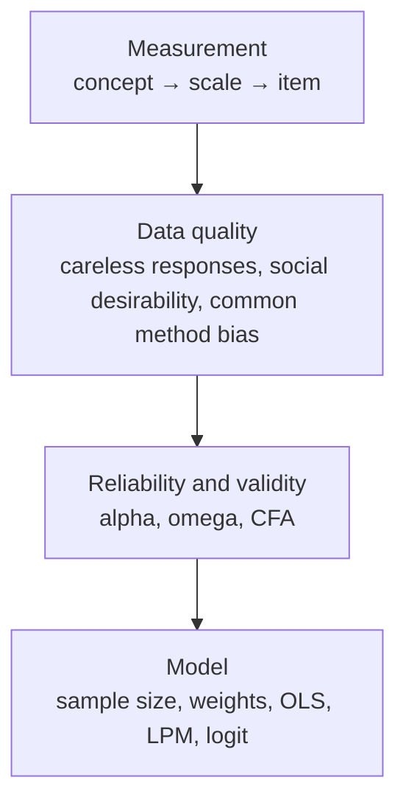

Before you run a regression on Likert-scale survey data, you need to check four things: the measurement scales, careless responses, systematic bias (social desirability and common method bias), and how sampling weights enter the model. Familiar cutoffs such as Cronbach's alpha ≥ 0.70, a first Harman factor under 50%, or CFI above 0.90 are necessary conditions only: with 145 items, an average inter-item correlation of just 0.25 already yields an alpha of 0.98, and Harman's test still "passes" when every item shares the same source of bias. This article uses a university student survey as its running example and sets each rule of thumb next to the methods literature it came from. It is written for graduate students, education survey researchers, and data analysts, and it ends with a 12-question checklist and a runnable R simulation.

<div class="callout callout-note">
<p class="callout-title">Quick summary</p>

- Alpha rises with the number of items; a very high alpha on a long instrument does not prove the scale is good.
- If Harman's test finds no single factor accounting for most of the variance, that does not mean common method bias is absent.
- Screen careless responses with at least two kinds of indices, set thresholds in advance, and report results with and without screening.
- Sampling weights change regression coefficients when effects differ across strata; report both versions.
- The LPM coefficient is close to the logit's average marginal effect (AME), not its marginal effect at the mean.

</div>

## 1. What pre-regression survey checking means

The credibility of a quantitative finding rests on three pillars: the identification strategy (a design that separates the effect you want from everything else), the data collection process, and the analysis process. This article covers the second pillar and the bridge into the third. The first pillar, the question of whether one variable causes another, belongs to the article on causal inference.

Checking survey data before regression is a sequence of steps that runs from how a concept is measured, through the quality of each questionnaire, to how the data go into a model. Each stage has its own test, and each test has its own blind spot.



The argument of this article: a regression result on survey data is only as trustworthy as the weakest link in this chain. A "single-number" test (alpha, Harman, one fit index) is a minimum requirement, not sufficient evidence.

The sections follow the chain above. Section 2 covers measurement, Sections 3–5 cover data quality and bias, Section 6 covers reliability, Section 7 covers modeling, and Section 8 is a simulation that ties everything together. If you already have data and only need to decide whether to screen responses or use weights, you can go straight to Sections 3 and 7. If you are still designing a questionnaire, Section 2 will save you the most work.

The running example is the university student survey. The National Survey of Student Engagement (NSSE) in the United States measures how much students take part in educationally effective activities, rather than only measuring an institution's resources or reputation (Kuh, 2001). The China College Student Survey (CCSS), developed by the Institute of Education at Tsinghua University from NSSE, was adapted for China and has national data from 2012 onward (Shi et al., 2014); the team reviewed 15 years of the project in a 2024 paper (Shi et al., 2024). Surveys of this kind are long, self-reported, and built on many Likert scales, so they run into every problem in this article.

To show how to read the numbers, the article uses a **hypothetical report** from a large student survey, with figures of the kind often seen in technical reports: 8.87% of questionnaires removed under three criteria, a first Harman factor explaining 32.57% of the variance, an alpha of 0.98 for the whole instrument, CFI and TLI of 0.91, and RMSEA and SRMR of 0.05. These are not published figures from any specific survey.

## 2. From concept to scale

### 2.1. Concepts, constructs, and items

An abstract concept such as "academic engagement" cannot be measured with one question. The designer has to define the concept as a construct with specific dimensions, then write several items for each dimension. A simple check is a research question × item matrix: read across a row to see which research question lacks items, and read down a column to see which item serves no question.

**Table 1.** Example research question (RQ) × item matrix

| Item | RQ1: Student–faculty interaction | RQ2: Academic challenge | RQ3: Learning outcomes |
| :--- | :---: | :---: | :---: |
| Q1. Instructors give timely feedback on assignments | ✓ | | |
| Q2. You discuss ideas with instructors outside class | ✓ | | |
| Q3. Courses push you to work at your full ability | | ✓ | |
| Q4. You have improved your writing | | | ✓ |
| Q5. You like the campus cafeteria | | | |

The Q5 row is empty: the item serves no research question and should go. If RQ3 has only one item, the learning-outcomes scale is too short to compute reliability.

### 2.2. Writing items

The three most common item-writing mistakes are double-barreled questions ("The instructor is enthusiastic and grades fairly"), leading questions ("Do you agree that large classes lower the quality of learning?"), and jargon respondents don't understand. A harder mistake to spot is asking respondents to estimate a causal effect themselves, for example "How much did small classes raise your grades?" Respondents don't have the information to answer that. The right approach is to measure class size and grades separately and let the model estimate the relationship.

Reverse-keyed items help catch respondents who agree with everything, but they come at a cost. Weijters et al. (2013) showed that reversed items introduce systematic bias, and in confirmatory factor analysis a separate method factor can appear for the reversed items. Before computing total scores or alpha, every reversed item must be recoded (on a 1–5 scale: new score = 6 − old score). Skipping this step produces negative inter-item correlations and drags alpha down.

### 2.3. Social desirability in scale design

Social desirability (the tendency to answer in ways that others view favorably) is the reason many surveys add a separate scale for it. The Marlowe–Crowne scale was one of the first, designed to measure this tendency independently of psychopathology (Crowne & Marlowe, 1960). Paulhus (1984) split socially desirable responding into two components: self-deceptive enhancement (respondents genuinely believe their positive self-image) and impression management (deliberately presenting themselves well). This is the basis of the two-dimensional Balanced Inventory of Desirable Responding (BIDR).

Paulhus (2002) later extended this into a two-tier model: each content bias has a self-deceptive part and an impression-management part.

**Table 2.** The two-tier model of socially desirable responding (after Paulhus, 2002)

| Type of bias | Self-deception (unconscious) | Impression management (deliberate) |
| :--- | :--- | :--- |
| Egoistic bias: exaggerating competence and status | Self-deceptive enhancement | Agency management |
| Moralistic bias: exaggerating virtue and decency | Self-deceptive denial | Communion management |

For an analyst, the model has one concrete consequence: the two biases inflate different items. A student high in egoistic bias will rate themselves high on "critical thinking ability"; a student high in moralistic bias will rate themselves high on "respecting classmates." Background on self-presentation is covered in social psychology.

### 2.4. Pilot testing and cognitive interviews

A pilot survey and cognitive interviewing are the last checks before fielding. Cognitive interviewing asks a small group of respondents to think aloud or answer probe questions so the designer learns how they interpret each item; Beatty and Willis (2007) reviewed this practice and showed it has become a common step in questionnaire pretesting. If a misunderstood item slips through this stage, no statistical technique applied later can fix it.

## 3. Screening careless responses

### 3.1. Three criteria and the index types behind them

Careless responding (also called insufficient effort responding) happens when respondents don't read the questions carefully. Meade and Craig (2012) grouped detection methods into consistency indices (comparing items with the same meaning), response-pattern indices such as long-string, multivariate outlier indices (Mahalanobis distance), response time, and embedded attention-check items. Curran (2016) and Huang et al. (2012) added ways to combine indices and to prevent careless responding at the design stage; Zhong et al. (2021) review the same topic in Chinese.

The hypothetical report in Section 1 uses three criteria. Table 3 places them in that framework.

**Table 3.** Three screening criteria, their index types, and blind spots

| Criterion | Rate (hypothetical) | Index type | Blind spot |
| :--- | ---: | :--- | :--- |
| Two items with the same meaning ("instructors give timely feedback on assignments," asked twice in different places) differ by ≥ 2 points | 3.16% | Consistency | A single item pair can easily flag genuine respondents who read the two questions differently |
| More than 2/3 of the main section left blank | 0.12% | Missing data | The rate is low because the online form requires answers; forcing answers can itself push respondents to just get through it |
| Same answer on ≥ 30 consecutive questions | 5.8% | Long-string | Identical answers can be valid when the items measure the same attribute |
| Total questionnaires removed | 8.87% | | |

The second row needs one more concept. Krosnick (1991) called the strategy of giving a "good enough" answer instead of the best one satisficing; it happens when answering optimally takes a lot of cognitive effort. Forcing responses to every question reduces missing data, but it does not make respondents pay closer attention.

The third row is the biggest blind spot. Reuning and Plutzer (2020) showed that straightlining (choosing the same answer for a whole block of questions) is not always bad data: when the items measure the same attribute and the respondent holds consistent views, identical answers are valid. Mechanically deleting every straightlined questionnaire can remove exactly the people with the clearest attitudes.

### 3.2. Overlapping criteria

Add up the three rates: 3.16 + 0.12 + 5.8 = 9.08%, which is more than the 8.87% total. Because a questionnaire can only be removed once, at least 0.21 percentage points of questionnaires were caught by more than one criterion. The overlap is worth putting in the report. Different types of indices tend to catch different groups of questionnaires, and little overlap means they complement each other.

The simulation in Section 8 shows the same pattern (Figure 1). The code sets a 5% probability for straight-liners and 3% for random responders; across 5,000 simulated questionnaires, this produced 285 straight-liners (5.7%) and 160 random responders (3.2%), for 8.90% careless questionnaires in total. The three indices flag 6.14%, 1.82%, and 3.08% of questionnaires respectively. Those add up to 11.04%, but only 10.36% of questionnaires are flagged by at least one index.


*Figure 1. Share of questionnaires flagged by each index in simulated data (n = 5,000, seed 2026). Source: the article's simulation; code in Section 8.*

Together the three indices catch all 285 straight-liners and 151 of the 160 random responders, but they also wrongly flag 82 of the 4,555 normal questionnaires (1.8%). Long-string catches straight-liners and Mahalanobis distance catches most random responders; each index misses cases on its own.

A common mistake is choosing the threshold after seeing the results. If a 15-question long-string cutoff gives "nicer" coefficients than a 10-question cutoff, it is easy to pick 15 without realizing you are optimizing on the outcome. The second mistake is deleting questionnaires without keeping the flags, so nobody can later check which questionnaire was removed and why. The safe approach is not to delete anything but to add a flag column for each index, following the same principle of keeping raw data as in the article on [data cleaning](/en/blog/process-data-from-dirty-to-clean/).

### 3.3. Recommendations

Drawing on Meade and Craig (2012), Huang et al. (2012), and Curran (2016):

1. Use at least two different types of index (for example, long-string plus a consistency or outlier index).
2. Set removal thresholds in the analysis plan, before looking at the regression results.
3. Report the removal rate for each criterion and the overlap.
4. Report the main results on both screened and unscreened data.
5. Put prevention first: clear instructions, a questionnaire that isn't too long, and attention-check items.

## 4. Social desirability: measure it, control for it, or leave it alone

People with high social desirability (SD) scores tend to rate themselves high on many scales at once: interaction with instructors, level of challenge, institutional support. If both the independent and dependent variables are inflated by the same tendency, the correlation between them is inflated too. A common fix is to measure SD with a separate scale and add the SD score to the regression as a control variable.

That works when SD really is pure bias. In the Section 8 simulation, SD is built exactly that way: a factor with no real content, added to every self-rated item. The coefficient of the "student–faculty interaction" scale on the "learning outcomes" scale after screening is 0.499; adding the SD score as a control lowers it to 0.414.

Outside a simulation, more caution is needed. Paulhus's model (1984, 2002) separates self-deception from impression management, and the two components mean different things. A student who genuinely believes in their own ability (moderate self-deception) may really be a more active learner. If the SD score contains some real personality trait related to the outcome, controlling for SD can also remove real variance. This is a conditional argument; how much it matters depends on the specific SD scale. The practical implication is clear: report models with and without the SD variable, and state which component the SD scale measures.

Podsakoff et al. (2003, 2012) classify social desirability as one source of method bias (bias caused by the measurement method), alongside acquiescence and measuring every variable from the same respondent. That view leads directly into Section 5.

## 5. Common method bias and the limits of Harman's test

### 5.1. What common method bias is

Common method bias (CMB) is the share of variance that comes from the way something is measured rather than from the construct being measured. When the same person answers every question, at the same time, in the same Likert format, correlations between constructs can be inflated or distorted (Podsakoff et al., 2003). Podsakoff et al. (2012) summarize the sources: respondent characteristics (such as social desirability), item characteristics (wording, scale format), item context (order, position), and measurement context (timing, medium).

### 5.2. Harman's single-factor test

Harman's single-factor test puts all items into one unrotated factor analysis. If a single factor explains more than 50% of the variance, that signals CMB. The hypothetical report has a first factor with an eigenvalue of 47.23 explaining 32.57% of the variance, below the 50% cutoff.

Podsakoff et al. (2003) examined this test closely and concluded that it is insensitive: passing Harman's test does not mean there is no CMB. Tang and Wen (2020) brought a similar critique to psychological research in China and proposed alternatives.

The hypothetical figures carry one more piece of information. When the analysis uses the correlation matrix, the eigenvalues sum to the number of variables, so the number of variables ≈ 47.23 / 0.3257 ≈ 145. With 145 items measuring five different dimensions, the first factor would struggle to exceed 50% even with method variance present, so the 32.57% figure says very little about CMB.

The Section 8 simulation shows this directly. Every item in the simulation contains the same SD component, so CMB is present by design; the first factor still explains only 48.3% of the variance, below 50%. In the raw data the figure is 49.8%, right at the edge, so Harman's verdict also depends on whether the questionnaires were screened.

### 5.3. What to do instead of Harman's test

Podsakoff et al. (2003, 2012) divide remedies into two groups. Procedural remedies: obtain the independent and dependent variables from different sources (for example, grades from the university's records), separate the measurement occasions, guarantee anonymity, and vary the scale format across sections. Statistical remedies: a marker variable (a variable theoretically unrelated to the constructs but subject to the same measurement method), a latent method factor in CFA, and bifactor models. Tang and Wen's (2020) recommendations also move away from relying on a single test.

In practice, the cheapest procedural remedy is separating sources. In a student survey, grade point average, on-time graduation, or post-graduation employment can come from the university's administrative data instead of student self-reports. When the dependent variable doesn't come from the same questionnaire, most of the CMB between the two sides of the regression disappears, because the method bias is no longer shared.

A properly hedged conclusion for a Harman result reads: "Factor analysis found no single general factor accounting for most of the variance; this result does not rule out common method bias."

## 6. Reliability and validity: reading alpha and CFA

### 6.1. What alpha tells you

Cronbach (1951) defined coefficient alpha for a scale of k items:

$$\alpha = \frac{k}{k-1}\left(1 - \frac{\sum_{i=1}^{k}\sigma_i^2}{\sigma_X^2}\right)$$

where $\sigma_i^2$ is the variance of item i and $\sigma_X^2$ is the variance of the total score. Alpha measures internal consistency: whether the items vary together.

### 6.2. Alpha rises with the number of items

The standardized version of alpha depends on only two quantities, the number of items k and the average inter-item correlation $\bar r$:

$$\alpha_{std} = \frac{k\bar r}{1 + (k-1)\bar r}$$

**Table 4.** Standardized alpha by number of items and average correlation

| Number of items k | $\bar r$ = 0.10 | $\bar r$ = 0.25 |
| ---: | ---: | ---: |
| 10 | 0.53 | 0.77 |
| 30 | 0.77 | 0.91 |
| 145 | 0.94 | 0.98 |


*Figure 2. Standardized alpha by number of items at four levels of average correlation; vertical line at k = 145, horizontal line at 0.70. Source: computed from the formula.*

With about 145 items, an average correlation of only 0.25, a weak correlation, is enough for an alpha of 0.98. Cortina (1993) illustrates exactly this: a high alpha can come from a large number of items rather than from tightly related items.

### 6.3. What alpha does not measure

Alpha does not measure unidimensionality. A set of items measuring five different dimensions can still produce a very high alpha if it is long enough (Cortina, 1993; Sijtsma, 2009). That is why a single "overall" alpha for a five-dimension instrument means little; report alpha for each subscale.

A very high alpha isn't always good news either. Streiner (2003) rejected the idea that "the higher the alpha, the better": on a short scale, an alpha above 0.90 often signals that several items nearly repeat each other, meaning the scale has redundant items.

Alpha assumes the items have equal factor loadings (tau-equivalence). McNeish (2018) showed that this assumption rarely holds and proposed omega, computed from a factor model, as the default reliability index.

What about the 0.70 cutoff? Lance et al. (2006) traced the sources of four frequently cited cutoffs, including the 0.70 alpha usually attributed to Nunnally, and showed that they are often quoted out of their original context. The alpha rating tables (excellent, good, acceptable…) common in software manuals are rules of thumb, not standards with a theoretical basis.

### 6.4. Reading CFA results

Confirmatory factor analysis (CFA) tests whether the data fit a hypothesized factor structure. Hu and Bentler (1999) proposed combined cutoffs: CFI and TLI around 0.95 or higher, RMSEA around 0.06 or lower, and SRMR around 0.08 or lower. Marsh et al. (2004) warned against turning these cutoffs into "golden rules": they came from specific simulation conditions and should not be applied mechanically to every model.

Reading the hypothetical report (CFI and TLI 0.91; RMSEA and SRMR 0.05) against this framework: RMSEA and SRMR look good, while CFI and TLI fall below Hu and Bentler's 0.95. A properly hedged conclusion is that the model fits acceptably but not excellently; the next step is to look at factor loadings and modification indices. CFA and SEM are covered in more detail in applied SEM.

A concrete example shows why CFI alone is not enough. A five-factor model on 145 items has a great many parameters and a great many correlations to reproduce. A CFI of 0.91 may come from a few groups of items with correlated errors, such as items with the same stem or items on the same screen. Modification indices point to those pairs, and the question then is whether there is a substantive reason to let them correlate, not how many parameters to add until CFI clears 0.95.

### 6.5. Types of validity

**Table 7.** Three types of validity and how to check them

| Type of validity | Question | Common check |
| :--- | :--- | :--- |
| Content validity | Do the items cover the full content of the concept? | Expert review, RQ × item matrix |
| Construct validity | Does the scale measure the intended construct? | CFA, convergence and discrimination between scales |
| Criterion validity | Is the scale score related to an external criterion? | Correlation with grades, employment outcomes |

## 7. Into the model: sample size, weights, OLS, LPM, and logit

### 7.1. Sample size

The sample size formula for estimating a proportion under simple random sampling (Cochran, 1977):

$$n_0 = \frac{z^2 p(1-p)}{e^2}, \qquad n = \frac{n_0}{1 + \frac{n_0 - 1}{N}}$$

With z = 1.96 (95% confidence), p = 0.5, and margin of error e = 0.05, $n_0$ ≈ 384. The finite population correction gives n ≈ 278 for N = 1,000 and 370 for N = 10,000; the resulting table looks like Krejcie and Morgan's (1970).


*Figure 3. Minimum sample size by population size. Source: computed from Cochran's (1977) formula.*

The "about 400 is enough" figure is right for exactly one job: estimating one proportion within ±5% under simple random sampling. Subgroup comparisons, multiple regression, and cluster samples all need larger samples.

### 7.2. Sampling weights

The base weight is the inverse of the selection probability. A non-response adjustment multiplies the weight by the ratio of selected to responding units within each group. Post-stratification is a separate step: it adjusts weights so that group totals (sex, region, field of study) match known population totals; raking does this iteratively over several variables.

Example: four schools, students randomly selected within each school, height measured.

**Table 5.** Four-school example: three ways to compute the mean

| School | Mean $\bar y_j$ (cm) | Sample size $n_j$ | Weight $w_j$ | $n_j \times w_j$ |
| :--- | ---: | ---: | ---: | ---: |
| 1 | 155 | 82 | 5 | 410 |
| 2 | 143 | 92 | 3 | 276 |
| 3 | 157 | 66 | 4 | 264 |
| 4 | 160 | 80 | 5 | 400 |

- Unweighted: 49,028 / 320 = **153.21 cm**.
- Weighting only the school means: 2,632 / 17 = 154.82 cm. This is wrong because it ignores how many students each school contributes.
- Correct: (155 × 410 + 143 × 276 + 157 × 264 + 160 × 400) / 1,350 = 208,466 / 1,350 = **154.42 cm**.

```python
y, n, w = [155, 143, 157, 160], [82, 92, 66, 80], [5, 3, 4, 5]
num = sum(a * b * c for a, b, c in zip(y, n, w))
print(num, round(num / sum(b * c for b, c in zip(n, w)), 2))   # 208466 154.42
```

### 7.3. Weights in regression

Weights change descriptive means, but should you use them in a regression? Solon et al. (2015) answer: it depends on the goal. If you want descriptive statistics for the population, use weights. If you want to estimate a causal effect and the model is correctly specified, weights are not needed for consistency and can inflate standard errors. When weighted and unweighted estimates differ substantially, that signals effects that vary across groups, and that variation should be modeled. The practical recommendation: report both.

The Section 8 simulation builds exactly that situation. The effect of student–faculty interaction on learning outcomes is 0.6 in the oversampled stratum and 0.3 in the other. The unweighted regression on the latent variables gives 0.454, close to the sample average (the two strata are about equal in size); the weighted one gives 0.360, close to the population average (the second stratum makes up 80%). Neither number is "wrong." They answer two different questions, and the gap between them is information in its own right. As for standard errors, the more unequal the weights, the larger the standard errors tend to be; to get standard errors that reflect the sampling design (strata, clusters), you need survey-specific tools such as R's `survey` package or Stata's `svyset`, not just robust standard errors.

### 7.4. An empirical example: EMI and MMI

Luo et al. (2018) used 2012 CCSS data to test the effectively maintained inequality (EMI) hypothesis in China. Under EMI (Lucas, 2001), when quantitative differences in education between groups narrow, advantaged groups shift to competing on quality: type of institution, field, track. Raftery and Hout's (1993) maximally maintained inequality (MMI) holds that inequality in access persists until the top group is saturated. Luo et al. (2018) concluded that higher education expansion did not reduce inequality, especially in the chances of low socioeconomic status (SES) students to enter elite universities and get good jobs.

A study of this kind usually has three types of dependent variable: a binary one (admitted to an elite university or not) modeled with an LPM or logit; learning experience scores from Likert scales modeled with OLS on a composite index; and employment outcomes, modeled according to the variable's form. SES and learning experience are both self-reported, so every problem in Sections 2–6 flows straight into the estimated coefficients.

### 7.5. LPM and logit

For a binary dependent variable, the linear probability model (LPM) runs OLS directly, and its coefficient is a change in probability. The LPM is always heteroskedastic, so it needs robust standard errors, and it can predict probabilities outside [0, 1]. Logit uses a log-odds link; $e^{\beta}$ is the odds ratio. A logit's pseudo R² is not read like an OLS R²; it only has meaning when comparing models that predict the same outcome on the same data (UCLA Statistical Consulting Group, n.d.).

On the simulated data in Section 8 (5,000 students, with the probability of entering an elite university rising with a standardized exam score z), the LPM coefficient is 0.198; the logit coefficient is 2.055, an odds ratio of 7.81. The logit's marginal effect at the mean (MEM) is 0.148, while the average marginal effect across the sample (AME) is 0.197.


*Figure 4. Predicted probabilities from the LPM and logit on simulated data. Source: the article's simulation.*

0.198 and 0.148 do not contradict each other: they are two different estimands. The LPM coefficient approximates the average change in probability across the sample, so compare it with the AME (0.197), not the MEM. In the simulation, 17.7% of the LPM's predicted probabilities fall outside [0, 1], right in the two tails of Figure 4.

## 8. Simulation demo in R

The simulation uses base R; no packages are needed. Design: 5,000 students in two disproportionately sampled strata (weights 1 and 4); two constructs, each with 10 five-point Likert items; an SD factor added to every item; 5% straight-liners and 3% random responders injected. The effect of student–faculty interaction on learning outcomes is larger in the oversampled stratum.

```r
# Simulation: careless responding, social desirability and regression (base R only)
set.seed(2026)
n <- 5000
likert <- function(x) pmin(5, pmax(1, round(3 + x)))          # clip to a 1–5 scale

# 1. Disproportionate stratified design: stratum A is oversampled 4x
stratum <- rbinom(n, 1, 0.5)                                   # 1 = stratum A
w <- ifelse(stratum == 1, 1, 4)                                # weight = 1/selection probability (relative)

# 2. Latent variables
ses <- rnorm(n) + 0.5 * stratum
T   <- 0.3 * ses + rnorm(n)                                    # student-faculty interaction
Y   <- 0.3 * T + 0.2 * ses + 0.3 * stratum * T + rnorm(n)      # effect differs between strata
sd_ <- rnorm(n)                                                # tendency to look good (social desirability)

# 3. Observed items: 10 items per construct, plus an SD component
make_items <- function(f, k = 10, load = 0.8, sdl = 0.4)
  sapply(1:k, function(j) likert(load * f + sdl * sd_ + rnorm(n, 0, 0.7)))
X <- cbind(make_items(T), make_items(Y))
SDscale <- rowMeans(sapply(1:6, function(j) likert(0.8 * sd_ + rnorm(n, 0, 0.7))))
X_true <- X

# 4. Inject 5% straight-liners and 3% random responders
type <- sample(c("ok", "straight", "random"), n, TRUE, c(0.92, 0.05, 0.03))
X[type == "straight", ] <- sample(3:5, sum(type == "straight"), TRUE)
X[type == "random", ]   <- sample(1:5, sum(type == "random") * 20, TRUE)

# 5. Three careless-responding indices
longstring <- apply(X, 1, function(r) max(rle(r)$lengths))
pair_gap   <- abs(X[, 1] - X[, 2])                             # pair of near-synonymous items
D2 <- mahalanobis(X, colMeans(X), cov(X))
flag <- data.frame(longstring = longstring >= 15,
                   pair = pair_gap >= 3,
                   mahal = D2 > qchisq(0.999, ncol(X)))
flag$any <- rowSums(flag) > 0
print(round(100 * colMeans(flag), 2))
print(table(flagged = flag$any, type))

# 6. Alpha, Harman and regression across scenarios
alpha <- function(M) { k <- ncol(M); k / (k - 1) * (1 - sum(apply(M, 2, var)) / var(rowSums(M))) }
harman <- function(M) { e <- eigen(cor(M))$values; 100 * e[1] / sum(e) }
hc1 <- function(fit) {                                         # HC1 robust standard errors
  wt <- if (is.null(weights(fit))) 1 else weights(fit)
  Xm <- model.matrix(fit) * sqrt(wt); u <- residuals(fit) * sqrt(wt); k <- ncol(Xm); N <- nrow(Xm)
  B <- solve(crossprod(Xm)); V <- B %*% crossprod(Xm * u) %*% B * N / (N - k)
  sqrt(diag(V)) }
run <- function(M, keep, sd_ctrl = FALSE, wt = NULL) {
  d <- data.frame(t = rowMeans(M[keep, 1:10]), y = rowMeans(M[keep, 11:20]),
                  ses = ses[keep], sdv = SDscale[keep])
  f <- if (sd_ctrl) y ~ t + ses + sdv else y ~ t + ses
  fit <- if (is.null(wt)) lm(f, d) else lm(f, d, weights = wt[keep])
  c(n = sum(keep), alpha_T = alpha(M[keep, 1:10]), harman = harman(M[keep, ]),
    b_t = unname(coef(fit)["t"]), se_hc1 = unname(hc1(fit)["t"])) }
all <- rep(TRUE, n)
lat <- function(wt = NULL) { d <- data.frame(Y, T, ses)
  fit <- if (is.null(wt)) lm(Y ~ T + ses, d) else lm(Y ~ T + ses, d, weights = wt)
  c(n = n, alpha_T = NA, harman = NA, b_t = unname(coef(fit)["T"]), se_hc1 = unname(hc1(fit)["T"])) }
res <- rbind(
  "Latent, unweighted"            = lat(),
  "Latent, weighted"              = lat(w),
  "Clean data (no careless)"      = run(X_true, type == "ok"),
  "Raw data"                      = run(X, all),
  "After screening"               = run(X, !flag$any),
  "Screened + SD control"        = run(X, !flag$any, sd_ctrl = TRUE),
  "Screened + weights"            = run(X, !flag$any, wt = w))
print(round(res, 3))

# 7. LPM and logit for a binary outcome (admitted to an elite university)
z <- rnorm(n)                                                  # standardized exam score
elite <- rbinom(n, 1, plogis(-2.5 + 2 * z))
lpm <- lm(elite ~ z); lg <- glm(elite ~ z, family = binomial)
b <- coef(lg)
cat("LPM:", round(coef(lpm)["z"], 3), " SE HC1:", round(hc1(lpm)["z"], 4), "\n")
cat("Logit b:", round(b["z"], 3), " OR:", round(exp(b["z"]), 2), "\n")
cat("MEM:", round(dlogis(b[1] + b[2] * mean(z)) * b[2], 3),
    " AME:", round(mean(dlogis(b[1] + b[2] * z)) * b[2], 3), "\n")
cat("LPM predictions outside [0,1]:", round(100 * mean(fitted(lpm) < 0 | fitted(lpm) > 1), 1), "%\n")
cat("McFadden R2:", round(1 - logLik(lg) / logLik(glm(elite ~ 1, family = binomial)), 3), "\n")
grid <- data.frame(z = seq(-3, 3, 0.05))
write.csv(data.frame(grid, lpm = predict(lpm, grid), logit = predict(lg, grid, type = "response")),
          "pred.csv", row.names = FALSE)
write.csv(data.frame(round(100 * colMeans(flag[, 1:3]), 2)), "flags.csv")
```

Run it with `Rscript demo.R` (tested with R 4.4.3). The `hc1()` function computes HC1 robust standard errors with matrix algebra so the script doesn't depend on external packages; with weights, it multiplies both the design matrix and the residuals by the square root of the weights. Results with seed 2026:

**Table 6.** Simulation results

| Scenario | n | Alpha (T scale) | Harman (%) | t coefficient | SE (HC1) |
| :--- | ---: | ---: | ---: | ---: | ---: |
| Latent variables, unweighted | 5,000 | | | 0.454 | 0.015 |
| Latent variables, weighted | 5,000 | | | 0.360 | 0.016 |
| Data without careless responses | 4,555 | 0.935 | 48.9 | 0.510 | 0.014 |
| Raw data | 5,000 | 0.934 | 49.8 | 0.556 | 0.013 |
| After screening | 4,482 | 0.934 | 48.3 | 0.499 | 0.014 |
| Screened + SD control | 4,482 | 0.934 | 48.3 | 0.414 | 0.015 |
| Screened + weights | 4,482 | 0.934 | 48.3 | 0.431 | 0.016 |

Table 6 shows four things.

First, alpha barely moves (0.934–0.935) across the raw data, the screened data, and the data without careless responses. Alpha does not detect careless responding: straight-liners actually make items correlate more, and random responders make up only 3%.

Second, careless responses bias the coefficient. The raw data give 0.556, about 9% higher than the 0.510 from data without careless responses. Straight-liners answer the same way on both scales, which creates a spurious correlation between "interaction" and "outcomes." After screening, the coefficient drops back to 0.499, close to 0.510.

Third, Harman's first factor stays under 50% in every scenario, even though every item contains the same SD component. Controlling for SD pulls the coefficient from 0.499 down to 0.414, which shows that SD had inflated the coefficient substantially without Harman's test raising any flag.

Fourth, weighting moves the coefficient from 0.499 to 0.431, in the same direction as the gap between the two latent-variable rows (0.454 and 0.360). The coefficients on the scales don't match those on the latent variables because the scales carry measurement error and contain SD; what is worth comparing is the direction and size of the change across scenarios.

This simulation is deliberately simple: SD is built as pure bias, so controlling for it is guaranteed to help, and real data never tell you that in advance. To extend it, you can swap the hand-written functions for dedicated packages: `careless` for careless-responding indices, `psych` for alpha and omega, `lavaan` for CFA with method factors, and `survey` for design-based regression. The Stata equivalents are `alpha ..., item`, `regress ..., robust`, `logit` with `margins, dydx(*)`, and `svyset`.

## 9. A 12-question checklist before running a regression

1. Does each research question have enough items, and does any item serve no question? (Section 2)
2. Have you run a pilot and cognitive interviews? (Section 2)
3. Did you set screening criteria in advance, using at least two types of index? (Section 3)
4. How much do the criteria overlap, and how do results change without screening? (Section 3)
5. Did you measure social desirability, and did you report models with and without it? (Section 4)
6. Do you have procedural remedies for CMB beyond Harman's test? (Section 5)
7. Are alpha or omega reported for each subscale, and have you looked for redundant items? (Section 6)
8. Are CFA fit indices fully reported and interpreted without "golden rules"? (Section 6)
9. Is the sample large enough for subgroup analysis and regression, not just one proportion? (Section 7)
10. Are you using the right type of weight, and have you compared weighted and unweighted results? (Section 7)
11. Does the LPM have robust standard errors, and does the logit report the AME or odds ratio correctly? (Section 7)
12. Do your conclusions go beyond what the identification design supports? (see causal inference)

## Frequently asked questions

**How high does Cronbach's alpha need to be?** No single number fits every case. The 0.70 cutoff is popular but often quoted out of context (Lance et al., 2006). Report alpha or omega for each subscale along with the number of items; on a short scale, an alpha above 0.90 is a reason to look for redundant items (Streiner, 2003).

**Is a Harman result under 50% enough to rule out common method bias?** No. The test is insensitive (Podsakoff et al., 2003), and in the Section 8 simulation the first factor explains only 48.3% even though every item shares the same source of bias. Combine procedural remedies with models that include a method factor.

**Should you delete every straightlined questionnaire?** Not mechanically. Straightlining can be valid when the items measure the same attribute (Reuning & Plutzer, 2020). Flag it, combine it with other indices, and report results with and without removal.

**Do you need sampling weights in a regression?** It depends on the goal. To describe the population, yes; to estimate an effect, report both weighted and unweighted results and treat a large difference as a sign of heterogeneous effects (Solon et al., 2015).

## 10. Conclusion

An alpha of 0.98, a Harman figure of 32.57%, and a CFI of 0.91 tell you the data passed the usual tests. They don't tell you the data are free of bias. A regression result on survey data is only as trustworthy as the weakest link in the measurement → cleaning → modeling chain. None of this lowers the value of large surveys like CCSS. Careful scale design, rule-based screening, bias checks, and factor-structure checks are a solid foundation. The rest of the work falls to the analyst. With your own dataset, go through the 12 questions in Section 9, then report what a single number can't answer: at least two kinds of careless-responding indices, models with and without the SD variable, alpha or omega for each subscale, and weighted and unweighted results.

Even when every step above is done well, a regression still gives only a conditional association. Luo et al. (2018) can speak to inequality between SES groups, but the question "if a given student had higher SES, how much would that student's chances change" requires an identification strategy. That is the subject of the article on causal inference: instrumental variables, randomized experiments, difference-in-differences, and regression discontinuity.

## References

Beatty, P. C., & Willis, G. B. (2007). Research synthesis: The practice of cognitive interviewing. *Public Opinion Quarterly, 71*(2), 287–311. https://doi.org/10.1093/poq/nfm006

Cochran, W. G. (1977). *Sampling techniques* (3rd ed.). Wiley. https://openlibrary.org/works/OL1351802W

Cortina, J. M. (1993). What is coefficient alpha? An examination of theory and applications. *Journal of Applied Psychology, 78*(1), 98–104. https://doi.org/10.1037/0021-9010.78.1.98

Cronbach, L. J. (1951). Coefficient alpha and the internal structure of tests. *Psychometrika, 16*(3), 297–334. https://doi.org/10.1007/BF02310555

Crowne, D. P., & Marlowe, D. (1960). A new scale of social desirability independent of psychopathology. *Journal of Consulting Psychology, 24*(4), 349–354. https://doi.org/10.1037/h0047358

Curran, P. G. (2016). Methods for the detection of carelessly invalid responses in survey data. *Journal of Experimental Social Psychology, 66*, 4–19. https://doi.org/10.1016/j.jesp.2015.07.006

Hu, L., & Bentler, P. M. (1999). Cutoff criteria for fit indexes in covariance structure analysis: Conventional criteria versus new alternatives. *Structural Equation Modeling, 6*(1), 1–55. https://doi.org/10.1080/10705519909540118

Huang, J. L., Curran, P. G., Keeney, J., Poposki, E. M., & DeShon, R. P. (2012). Detecting and deterring insufficient effort responding to surveys. *Journal of Business and Psychology, 27*(1), 99–114. https://doi.org/10.1007/s10869-011-9231-8

Krejcie, R. V., & Morgan, D. W. (1970). Determining sample size for research activities. *Educational and Psychological Measurement, 30*(3), 607–610. https://doi.org/10.1177/001316447003000308

Krosnick, J. A. (1991). Response strategies for coping with the cognitive demands of attitude measures in surveys. *Applied Cognitive Psychology, 5*(3), 213–236. https://doi.org/10.1002/acp.2350050305

Kuh, G. D. (2001). Assessing what really matters to student learning: Inside the National Survey of Student Engagement. *Change: The Magazine of Higher Learning, 33*(3), 10–17. https://doi.org/10.1080/00091380109601795

Lance, C. E., Butts, M. M., & Michels, L. C. (2006). The sources of four commonly reported cutoff criteria: What did they really say? *Organizational Research Methods, 9*(2), 202–220. https://doi.org/10.1177/1094428105284919

Lucas, S. R. (2001). Effectively maintained inequality: Education transitions, track mobility, and social background effects. *American Journal of Sociology, 106*(6), 1642–1690. https://doi.org/10.1086/321300

Luo, Y., Guo, F., & Shi, J. (2018). Expansion and inequality of higher education in China: How likely would Chinese poor students get to success? *Higher Education Research & Development, 37*(5), 1015–1034. https://doi.org/10.1080/07294360.2018.1474856

Marsh, H. W., Hau, K.-T., & Wen, Z. (2004). In search of golden rules: Comment on hypothesis-testing approaches to setting cutoff values for fit indexes and dangers in overgeneralizing Hu and Bentler's (1999) findings. *Structural Equation Modeling, 11*(3), 320–341. https://doi.org/10.1207/s15328007sem1103_2

McNeish, D. (2018). Thanks coefficient alpha, we'll take it from here. *Psychological Methods, 23*(3), 412–433. https://doi.org/10.1037/met0000144

Meade, A. W., & Craig, S. B. (2012). Identifying careless responses in survey data. *Psychological Methods, 17*(3), 437–455. https://doi.org/10.1037/a0028085

Paulhus, D. L. (1984). Two-component models of socially desirable responding. *Journal of Personality and Social Psychology, 46*(3), 598–609. https://doi.org/10.1037/0022-3514.46.3.598

Paulhus, D. L. (2002). Socially desirable responding: The evolution of a construct. In H. I. Braun, D. N. Jackson, & D. E. Wiley (Eds.), *The role of constructs in psychological and educational measurement* (pp. 61–84). Erlbaum. https://doi.org/10.4324/9781410607454-10

Podsakoff, P. M., MacKenzie, S. B., Lee, J.-Y., & Podsakoff, N. P. (2003). Common method biases in behavioral research: A critical review of the literature and recommended remedies. *Journal of Applied Psychology, 88*(5), 879–903. https://doi.org/10.1037/0021-9010.88.5.879

Podsakoff, P. M., MacKenzie, S. B., & Podsakoff, N. P. (2012). Sources of method bias in social science research and recommendations on how to control it. *Annual Review of Psychology, 63*, 539–569. https://doi.org/10.1146/annurev-psych-120710-100452

Raftery, A. E., & Hout, M. (1993). Maximally maintained inequality: Expansion, reform, and opportunity in Irish education, 1921–75. *Sociology of Education, 66*(1), 41–62. https://doi.org/10.2307/2112784

Reuning, K., & Plutzer, E. (2020). Valid vs. invalid straightlining: The complex relationship between straightlining and data quality. *Survey Research Methods, 14*(5), 439–459. https://doi.org/10.18148/srm/2020.v14i5.7641

Shi, J., Wen, W., Li, Y., & Chu, J. (2014). China College Student Survey (CCSS): Breaking open the black box of the process of learning. *International Journal of Chinese Education, 3*(1), 132–159. https://doi.org/10.1163/22125868-12340033

Shi, J. [史静寰], Zhang, H. [张华峰], & Guo, F. [郭菲]. (2024). 探讨中国学习者现象与建构教育学自主知识的努力——以中国大学生学习与发展追踪研究（CCSS）项目十五年探索为案例 [Exploring the phenomenon of the Chinese learner and efforts in constructing original China educational knowledge: A fifteen-year case study of the China College Student Survey (CCSS) project]. *华东师范大学学报（教育科学版） [Journal of East China Normal University (Educational Sciences)], 42*(11), 12–29. https://doi.org/10.16382/j.cnki.1000-5560.2024.11.002

Sijtsma, K. (2009). On the use, the misuse, and the very limited usefulness of Cronbach's alpha. *Psychometrika, 74*(1), 107–120. https://doi.org/10.1007/s11336-008-9101-0

Solon, G., Haider, S. J., & Wooldridge, J. M. (2015). What are we weighting for? *Journal of Human Resources, 50*(2), 301–316. https://doi.org/10.3368/jhr.50.2.301

Streiner, D. L. (2003). Starting at the beginning: An introduction to coefficient alpha and internal consistency. *Journal of Personality Assessment, 80*(1), 99–103. https://doi.org/10.1207/S15327752JPA8001_18

UCLA Statistical Consulting Group. (n.d.). *FAQ: What are pseudo R-squareds?* UCLA Office of Advanced Research Computing. https://stats.oarc.ucla.edu/other/mult-pkg/faq/general/faq-what-are-pseudo-r-squareds/

Tang, D. [汤丹丹], & Wen, Z. [温忠麟]. (2020). 共同方法偏差检验：问题与建议 [Common method bias testing: Problems and suggestions]. *心理科学 [Journal of Psychological Science], 43*(1), 215–223. https://doi.org/10.16719/j.cnki.1671-6981.20200130

Weijters, B., Baumgartner, H., & Schillewaert, N. (2013). Reversed item bias: An integrative model. *Psychological Methods, 18*(3), 320–334. https://doi.org/10.1037/a0032121

Zhong, X. [钟晓钰], Li, M. [李铭尧], & Li, L. [李凌艳]. (2021). 问卷调查中被试不认真作答的控制与识别 [Preventing and detecting insufficient effort survey responding]. *心理科学进展 [Advances in Psychological Science], 29*(2), 225–237. https://doi.org/10.3724/SP.J.1042.2021.00225
