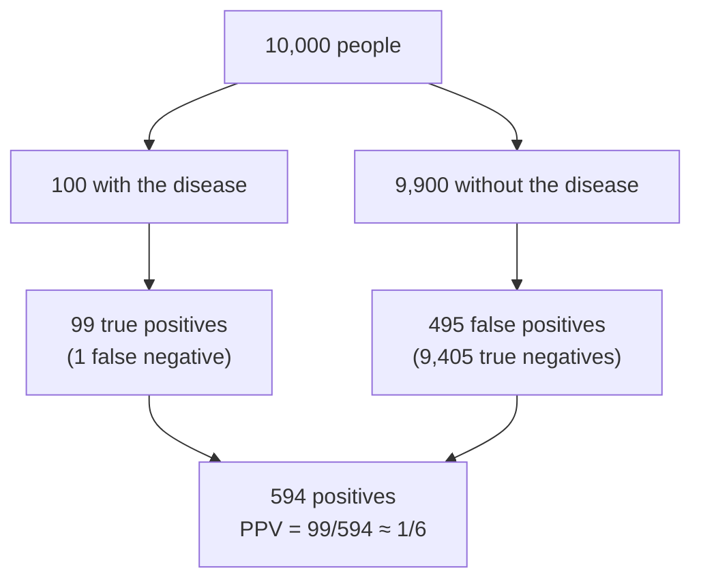

A test with 99% sensitivity and 95% specificity comes back positive. If the disease affects only 1% of the population, the probability that the person actually has it is only about 1 in 6, and the calculation behind that number uses the same product and sum rules familiar from Mendelian cross problems. This opening article in the series *Probability Foundations for Bioinformatics* goes from Kolmogorov's three axioms to Bayes' theorem, ties each concept to an example from genetics or diagnosis, and ends with two simulations in Python and R so you can rerun every number yourself.

The 3 : 1 and 9 : 3 : 3 : 1 ratios and the formula $p^2 + 2pq + q^2$ are all probabilities, but they are rarely taught together with their conditions of use. The thesis of this article: most probability errors in biology are not arithmetic errors; they come from applying a rule when its condition does not hold. The three typical errors are multiplying when events are not independent, adding when events are not disjoint, and reversing the conditioning, that is, reading $P(\text{positive} \mid \text{disease})$ as if it were $P(\text{disease} \mid \text{positive})$.

## 1. Introduction: probability is the language of uncertainty

Probability is the mathematical language for quantifying uncertainty. It runs from model to data: given that both parents are heterozygous $Aa$, what is the probability that a child shows the recessive phenotype? Statistical inference runs the other way: having seen 105 recessive seeds out of 400, which model of the parents is plausible (Wasserman, 2004)?

Two historical milestones: in 1763, Thomas Bayes's essay was communicated to the *Philosophical Transactions* by Richard Price after Bayes's death (Bayes, 1763). In 1933, Andrey Kolmogorov published the axioms of probability theory in German; the English translation appeared in 1950 (Kolmogorov, 1933/1950).

The number $P(A)$ has two common readings. Under the **frequentist interpretation**, $P(A)$ is the long-run proportion of times that event $A$ occurs when the experiment is repeated many times: sow a very large number of F2 seeds from an $Aa \times Aa$ cross, and the proportion showing the recessive phenotype approaches 1/4. Under the **Bayesian interpretation** (degree of belief), $P(A)$ measures how strongly an observer believes that $A$ is true. The statement "the probability that a patient's unaffected sister is a carrier is 2/3" is not about a repeatable experiment; the 2/3 describes current knowledge and will change as information arrives, for example a test result (Ogino & Wilson, 2004). Both readings obey the same three axioms, and according to Wasserman (2004) the difference between them matters only once we turn to statistical inference (section 9).

This article covers only discrete probability on finite or countable sample spaces and does not go into measure theory (σ-algebras), which Kolmogorov (1933/1950) and Wasserman (2004) do treat.

## 2. Sample spaces, events, and set algebra

The **sample space** $\Omega$ is the set of all possible outcomes of an experiment. Each element $\omega \in \Omega$ is an **outcome**, and each subset $A \subseteq \Omega$ is an **event**.

The first step is to write $\Omega$ down. In an $Aa \times Aa$ cross, if the allele from the mother is written first and the allele from the father second, then $\Omega = \{AA, Aa, aA, aa\}$, four outcomes with equal probability. If $Aa$ and $aA$ are merged so that $\Omega = \{AA, Aa, aa\}$, the three outcomes are **no longer equally likely**: their probabilities are 1/4, 1/2, 1/4. Taking "favorable outcomes divided by total outcomes" on the merged space gives $P(aa) = 1/3$, a wrong answer without a single wrong calculation.

Events are sets, so operations on events are set operations (Table 1; Wasserman, 2004).

**Table 1.** Set notation read in the language of events

| Notation | Meaning |
| --- | --- |
| $\Omega$ | the sure event |
| $\emptyset$ | the impossible event |
| $A^c$ (complement) | $A$ does not occur |
| $A \cup B$ (union) | $A$ or $B$, or both |
| $A \cap B$ or $AB$ (intersection) | both $A$ and $B$ |
| $A - B$ (difference) | $A$ occurs, $B$ does not |
| $A \subset B$ | if $A$ occurs, $B$ occurs |

Events $A_1, A_2, \dots$ are **disjoint** (mutually exclusive) if $A_i \cap A_j = \emptyset$ for all $i \neq j$. A **partition** of $\Omega$ is a sequence of pairwise disjoint events that covers the sample space: $\bigcup_{i=1}^{\infty} A_i = \Omega$. The three genotypes $AA$, $Aa$, $aa$ form a partition of the genotype space at a locus with two alleles.


**Figure 1.** Two disjoint events (left) and two events with a nonempty intersection (right).

The **indicator function** of $A$ turns a yes-or-no question into a number:

$$I_A(\omega) = I(\omega \in A) = \begin{cases} 1 & \text{if } \omega \in A \\ 0 & \text{if } \omega \notin A. \end{cases}$$

The number of individuals carrying allele $a$ in a sample is a sum of indicator functions, one per individual; this is the bridge to random variables.

Finally, limits of sequences of events. A **monotone increasing** sequence ($A_1 \subset A_2 \subset \cdots$) has as its limit the union of the whole sequence; a **monotone decreasing** sequence ($A_1 \supset A_2 \supset \cdots$) has as its limit the intersection:

$$\lim_{n\to\infty} A_n = \bigcup_{i=1}^{\infty} A_i \ \ (\text{increasing}), \qquad \lim_{n\to\infty} A_n = \bigcap_{i=1}^{\infty} A_i \ \ (\text{decreasing}).$$

In both cases we write $A_n \to A$. For example, the events $A_n$ = "a cell lineage has had no mutation after $n$ generations" form a decreasing sequence whose limit is "no mutation ever occurs."

## 3. The three axioms and their consequences

A function $P$ that assigns a real number $P(A)$ to each event $A$ is a **probability distribution** if it satisfies three axioms (Kolmogorov, 1933/1950; Wasserman, 2004):

1. $P(A) \ge 0$ for every event $A$.
2. $P(\Omega) = 1$.
3. If $A_1, A_2, \dots$ are pairwise disjoint, then

$$P\left(\bigcup_{i=1}^{\infty} A_i\right) = \sum_{i=1}^{\infty} P(A_i).$$

Axiom 3 is the only axiom about how events **combine**, and it speaks only about disjoint events. The "sum rule" of genetics is this axiom applied to two disjoint events. The everyday consequences can each be proved in a line or two:

- $P(A^c) = 1 - P(A)$, because $A$ and $A^c$ are disjoint and together make up $\Omega$.
- $P(\emptyset) = 0$: take $A = \Omega$ in the previous line.
- If $A \subset B$ then $P(A) \le P(B)$, because $B = A \cup (B - A)$ and $P(B - A) \ge 0$.
- $0 \le P(A) \le 1$, because $\emptyset \subset A \subset \Omega$.

When two events are **not** disjoint, adding directly counts the intersection twice. The **general addition rule** subtracts it:

$$P(A \cup B) = P(A) + P(B) - P(AB).$$

Example: in an $AaBb \times AaBb$ cross with two independently assorting genes, the probability that a child shows **at least one** recessive trait is $1/4 + 1/4 - 1/16 = 7/16$. Adding directly to get $1/2$ is wrong, because genotype $aabb$ belongs to both events. The complement gives a quick check: "at least one recessive trait" is the complement of "dominant for both," so the probability is $1 - (3/4)^2 = 7/16$.

The last consequence is the **continuity of probability**: if $A_n \to A$ then $P(A_n) \to P(A)$ as $n \to \infty$ (Wasserman, 2004). For the cell lineage of section 2, if each generation has mutation probability $\mu > 0$ and generations are independent, then $P(A_n) = (1 - \mu)^n \to 0$: "no mutation ever occurs" has probability 0.

## 4. Finite sample spaces and counting in genetics

When $\Omega$ is finite and all outcomes are **equally likely**, we have the **uniform distribution**: $P(A) = |A| / |\Omega|$, where $|A|$ is the number of elements of $A$. Computing probabilities becomes a counting problem: there are $n! = n(n-1)\cdots 2 \cdot 1$ ways to order $n$ objects, with the convention $0! = 1$. The number of ways to choose $k$ objects from $n$, ignoring order, is

$$\binom{n}{k} = \frac{n!}{k!\,(n-k)!}, \qquad \binom{n}{0} = \binom{n}{n} = 1, \qquad \binom{n}{k} = \binom{n}{n-k}.$$

**Counting gametes and genotypes.** An individual heterozygous for $n$ independently assorting gene pairs produces $2^n$ kinds of gametes. When two such individuals are crossed, there are $4^n$ equally likely gamete combinations, which fall into $3^n$ genotypes and, under complete dominance, $2^n$ phenotypes (Table 2; IGNOU, n.d.-a). See also gamete problems.

**Table 2.** A cross between two individuals heterozygous for $n$ independently assorting gene pairs, complete dominance

| $n$ | Gametes $2^n$ | Combinations $4^n$ | Genotypes $3^n$ | Phenotypes $2^n$ | Phenotype ratio |
| --- | --- | --- | --- | --- | --- |
| 1 | 2 | 4 | 3 | 2 | 3 : 1 |
| 2 | 4 | 16 | 9 | 4 | 9 : 3 : 3 : 1 |
| 3 | 8 | 64 | 27 | 8 | (3 : 1)³ |

Figure 2 is the sample space for $n = 2$: the 9 : 3 : 3 : 1 ratio is simply the result of counting 16 equally likely cells by color. Gene interaction changes how cells are grouped into phenotypes, giving ratios such as 9 : 7, but the 16-cell sample space stays the same.


**Figure 2.** Punnett square for the $AaBb \times AaBb$ cross: 16 equally likely gamete combinations, colored by phenotype.

**The binomial.** An $Aa \times Aa$ couple has $n$ children; each child shows the recessive phenotype with probability 1/4, independently of the others. The probability of exactly $k$ recessive children is

$$P(k) = \binom{n}{k} \left(\frac14\right)^k \left(\frac34\right)^{n-k}.$$

The coefficient $\binom{n}{k}$ counts the birth orders that give the same result; the orders are disjoint, so they add, and within each order the births are independent, so they multiply. With $n = 4$, $k = 1$: $P = 4 \times (1/4) \times (3/4)^3 = 27/64 \approx 0.42$. An "exact 3 : 1" result occurs in fewer than half of four-child families: 3 : 1 is a probability, not a promise to each family.

**Mendel's data.** Mendelian ratios show up only when enough is counted. In his experiment on seed shape, Mendel counted 7,324 F2 seeds, 5,474 round and 1,850 wrinkled, a ratio of 2.96 : 1 (as given in the annotated translation by Abbott & Fairbanks, 2016). Those data are also the source of a long-running debate: Fisher (1936) asked whether they agree with expectation more closely than random variation would allow. The simulation in section 8 shows how much an honest experiment fluctuates around 3 : 1.

## 5. Independent events: Mendel, Hardy–Weinberg, and when independence breaks down

### 5.1. Definition

Toss a fair coin twice, and the probability of two heads is $0.5 \times 0.5$. This multiplication is a definition: two events $A$ and $B$ are **independent** if

$$P(AB) = P(A)\,P(B).$$

A family of events $\{A_i : i \in I\}$ is independent if the product identity holds for **every** finite subset $J \subseteq I$ (Wasserman, 2004):

$$P\left(\bigcap_{i \in J} A_i\right) = \prod_{i \in J} P(A_i).$$

Pairwise independence is not enough. Consider a family with two children, each birth giving a boy or a girl with probability 1/2, independently. Let $A$ be "the first child is a girl," $B$ "the second child is a girl," and $C$ "both children are the same sex." Each event has probability 1/2 and each pair has joint probability 1/4, so they are pairwise independent; but $P(ABC) = 1/4$, not $1/8$.

Independence arises in two ways (Wasserman, 2004). The first is by **assumption**: a coin has no memory of the previous toss; the father's and the mother's gametes meet at random. The second is by **calculation**: roll a die with $A = \{2, 4, 6\}$ and $B = \{1, 2, 3, 4\}$; then $P(AB) = 2/6$, which equals $P(A)P(B) = (1/2)(2/3)$, so $A$ and $B$ turn out to be independent. In biology, most multiplications of probabilities are of the first kind: they are valid only while the biological assumption behind them holds.

### 5.2. Independent does not mean disjoint

<div class="callout callout-warning">
<p class="callout-title">The two concepts most easily confused</p>

If $P(A) > 0$, $P(B) > 0$, and $A \cap B = \emptyset$, then $P(AB) = 0$ while $P(A)P(B) > 0$. Two disjoint events with positive probability are **never** independent: knowing that $A$ occurred tells you for certain that $B$ did not.

</div>

The product rule requires independence and answers an "and" question; the sum rule requires disjointness and answers an "or" question (Table 3). The phrase "independent, mutually exclusive events" is therefore self-contradictory for events with positive probability; the sum rule needs only disjointness.

**Table 3.** Independent versus disjoint

|  | Independent | Disjoint |
| --- | --- | --- |
| Definition | $P(AB) = P(A)P(B)$ | $A \cap B = \emptyset$ |
| Rule that goes with it | product, for "and" | sum, for "or" |
| Knowing $A$ occurred | leaves $P(B)$ unchanged | means $B$ certainly did not occur |
| Example | sex of the first and second child | genotypes $AA$ and $aa$ in the same individual |

### 5.3. Hardy–Weinberg is a statement about independence

Consider a locus with two alleles $A$ and $a$ at frequencies $p$ and $q = 1 - p$. Under random mating, the allele an individual receives from the father is independent of the allele received from the mother, so the product rule gives $P(AA) = p^2$ and $P(aa) = q^2$. The heterozygous genotype arises in two ways, "$A$ from the father, $a$ from the mother" or "$a$ from the father, $A$ from the mother"; each has probability $pq$, and the two are disjoint, so they add: $P(Aa) = 2pq$. The formula $p^2 + 2pq + q^2 = 1$ contains both rules: product because of independence, sum because of disjointness. Hardy (1908) set out this result in a note in *Science*; Wilhelm Weinberg reached the same conclusion independently in the same year (IGNOU, n.d.-c); Crow (1999) wrote about the history of the law and the language barrier between the two authors. See also Population genetics.

A familiar exercise: an autosomal recessive disease such as phenylketonuria (PKU) occurs in 1 in 2,000 births (IGNOU, n.d.-c). If the population is in equilibrium, then $q = \sqrt{1/2000} \approx 0.0224$ and the carrier frequency is $2pq \approx 0.044$, about 1 person in 23. This number is used again in section 7.

### 5.4. When independence breaks down

Mendel's independent assortment is an independence assumption between two loci: an $AaBb$ individual produces four kinds of gametes at $1/4$ each (Mendel's laws). The assumption fails when two genes lie close together on the same chromosome. In 1905, Bateson, Saunders, and Punnett crossed sweet peas (*Lathyrus odoratus*) and found that about 89% of F2 plants carried the parental combinations of traits (IGNOU, n.d.-b), whereas independent assortment gives only $9/16 + 1/16 = 62.5\%$.

The corrected model is compact. An individual carrying $AB$ on one chromosome and $ab$ on its homolog produces each parental gamete type at frequency $(1 - r)/2$ and each recombinant type ($Ab$, $aB$) at frequency $r/2$, where $r$ is the recombination frequency. Independent assortment is the special case $r = 1/2$ (Linkage and crossing over).

At the population level, **linkage disequilibrium** (LD) is the nonrandom association of alleles at different loci (Slatkin, 2008). The usual coefficient is the definition of independence written as a difference, $D = p_{AB} - p_A\,p_B$, where $p_{AB}$ is the frequency of gametes carrying both $A$ and $B$; $D = 0$ if and only if the two alleles are independent (Table 4).

**Table 4.** Gamete frequencies when $p_A = p_B = 0.5$ (illustrative values, corresponding to $r = 0.5$ and $r = 0.12$)

| Gamete | Independent | With LD |
| --- | --- | --- |
| $AB$ | 0.25 | 0.44 |
| $Ab$ | 0.25 | 0.06 |
| $aB$ | 0.25 | 0.06 |
| $ab$ | 0.25 | 0.44 |
| $D$ | 0 | 0.19 |

This breakdown of independence is a source of information: LD is used to map genes associated with quantitative traits and inherited diseases (Slatkin, 2008). The independence assumption in Hardy–Weinberg is also used in reverse: a SNP that departs from the $p^2 : 2pq : q^2$ proportions may reflect genotyping error, so exact tests of Hardy–Weinberg equilibrium help assess the quality of genotype data (Wigginton et al., 2005).

## 6. Conditional probability and the law of total probability

New information shrinks the sample space. For $P(B) > 0$, the **conditional probability** of $A$ given $B$ is

$$P(A \mid B) = \frac{P(AB)}{P(B)}.$$

For fixed $B$, $P(\cdot \mid B)$ satisfies all three axioms, so every consequence in section 3 still holds inside the condition. Three things to remember:

- $P(AB) = P(A \mid B)\,P(B)$ is the **general** product rule, valid for any pair of events.
- When $P(B) > 0$, $A$ and $B$ are independent if and only if $P(A \mid B) = P(A)$: knowing $B$ does not change the probability of $A$.
- In general $P(A \mid B) \neq P(B \mid A)$ (Wasserman, 2004).

Example: in an $Aa \times Aa$ cross, given that a child has the dominant phenotype, what is the probability that the child is heterozygous? On $\{AA, Aa, aA, aa\}$, the condition "dominant" removes $aa$ and leaves three equally likely outcomes, two of them heterozygous:

$$P(\text{heterozygous} \mid \text{dominant}) = \frac{1/2}{3/4} = \frac23.$$

This is the 2/3 of section 1. Both parents of a patient with an autosomal recessive disease are carriers, so the patient's unaffected siblings have a carrier probability of 2/3, not 1/2 (Ogino & Wilson, 2004); the 1/2 answers a different question, asked before knowing that the sibling is unaffected (Human genetics).

The **law of total probability**: if $A_1, \dots, A_k$ is a partition of $\Omega$, then for any event $B$ (Wasserman, 2004),

$$P(B) = \sum_{i=1}^{k} P(B \mid A_i)\,P(A_i).$$

The formula follows from axiom 3, because the pieces $BA_1, \dots, BA_k$ are disjoint and together make up $B$. For example, the proportion of positive results in a population equals the positive rate among the diseased times the proportion diseased, plus the positive rate among the non-diseased times the proportion non-diseased. That is exactly the denominator of Bayes' theorem.

## 7. Bayes' theorem: genetic counseling and diagnostic tests

Bayes' theorem reverses the conditioning: given $P(B \mid A_i)$, find $P(A_i \mid B)$. For a partition $A_1, \dots, A_k$ with every $P(A_i) > 0$, and $P(B) > 0$:

$$P(A_i \mid B) = \frac{P(B \mid A_i)\,P(A_i)}{\sum_{j} P(B \mid A_j)\,P(A_j)}.$$

The proof takes two lines: the numerator is $P(A_iB)$ by the general product rule, and the denominator is $P(B)$ by the law of total probability. The idea goes back to Bayes (1763). $P(A_i)$ is the **prior**, the belief before seeing data; $P(B \mid A_i)$ is the **likelihood**, how well the data fit each hypothesis; $P(A_i \mid B)$ is the **posterior**, the belief after updating (López Puga et al., 2015).

### 7.1. Genetic counseling

Bayesian analysis plays a central role in genetic risk assessment: it computes the probability that a person is affected or is a carrier from pedigree information and test results (Ogino & Wilson, 2004), usually laid out as a four-row table: prior, conditional probability, joint probability, and posterior.

Consider an example with **illustrative numbers**. A healthy woman has a brother with an autosomal recessive disease, so her prior is 2/3. She takes a mutation test; suppose the test detects 80% of carriers and gives no false positives. The result is negative (Table 5).

**Table 5.** Bayesian table for the genetic counseling example (illustrative numbers)

|  | Carrier | Not a carrier |
| --- | --- | --- |
| Prior | 2/3 | 1/3 |
| $P(\text{negative} \mid \text{hypothesis})$ | 0.2 | 1 |
| Joint = prior × conditional | 2/15 | 5/15 |
| Posterior = joint / sum of joints | 2/7 ≈ 0.29 | 5/7 ≈ 0.71 |

The negative result lowers her carrier probability from 2/3 to 2/7, not to 0, because the test misses 20% of carriers. The calculation can be chained: if her husband has no family history and the population carrier frequency is 0.044 (section 5.3), the probability that a child of theirs is affected is

$$\frac27 \times 0.044 \times \frac14 \approx 0.0031 \approx \frac1{320},$$

compared with $\frac23 \times 0.044 \times \frac14 \approx 1/137$ before the test.

### 7.2. Diagnostic tests

Let $D$ be the event "has the disease," and $T^+$ and $T^-$ a positive and a negative result. The five quantities that describe a test are all probabilities (Altman & Bland, 1994a, 1994b):

- **Sensitivity**: $\text{Se} = P(T^+ \mid D)$.
- **Specificity**: $\text{Sp} = P(T^- \mid D^c)$.
- **Prevalence**: $\pi = P(D)$.
- **Positive predictive value** (PPV): $P(D \mid T^+)$.
- **Negative predictive value** (NPV): $P(D^c \mid T^-)$.

Sensitivity and specificity condition on disease status; PPV and NPV condition on the result, and are what the person holding the result needs to know. Bayes' theorem with the partition $\{D, D^c\}$ connects the two groups:

$$\text{PPV} = \frac{\text{Se}\cdot\pi}{\text{Se}\cdot\pi + (1 - \text{Sp})(1 - \pi)}, \qquad \text{NPV} = \frac{\text{Sp}\,(1 - \pi)}{\text{Sp}\,(1 - \pi) + (1 - \text{Se})\,\pi}.$$

Prevalence appears in both formulas: predictive values depend on the population being tested, not on the test alone (Altman & Bland, 1994b).

A **hypothetical** example from a biostatistics textbook (IGNOU, n.d.-d): a lung cancer test is tried on 2,000 men over 45. Of 140 men with the disease, 120 test positive; of 1,860 without it, 1,680 test negative. So $\text{Se} \approx 0.857$ and $\text{Sp} \approx 0.903$ (Table 6).

**Table 6.** The same test (Se ≈ 0.857; Sp ≈ 0.903) in two populations

| Prevalence | PPV | NPV | Note |
| --- | --- | --- | --- |
| 0.07 | 0.400 | 0.988 | prevalence in the sample (140/2,000); equal to the direct counts 120/300 and 1,680/1,700 |
| 0.05 | 0.318 | 0.992 | target population, computed with Bayes' formula |

Counting directly from the 2 × 2 table is correct only for a population with the same prevalence as the study sample. When the test is taken to a different population, prevalence has to be replaced, and that replacement requires Bayes' formula.

**Base-rate fallacy.** Reversing the conditioning in diagnosis has its own name: ignoring the base rate and reading sensitivity as if it were PPV. With the illustrative numbers from the opening, $\text{Se} = 0.99$, $\text{Sp} = 0.95$, $\pi = 0.01$:

$$\text{PPV} = \frac{0.99 \times 0.01}{0.99 \times 0.01 + 0.05 \times 0.99} = \frac{0.0099}{0.0594} \approx 0.167.$$

Most positive results are false positives: 5% of the non-diseased group, which is 99 times larger, still outnumbers 99% of the diseased group.

**Natural frequencies.** The same calculation is far easier to follow when written in counts of people (Figure 3). Of 10,000 people, 100 have the disease, and 99 of them test positive. Of the 9,900 without the disease, 495 also test positive. So among 594 positives only 99 have the disease: $99/594 = 1/6$.



**Figure 3.** Natural frequency tree for the illustrative numbers Se = 0.99, Sp = 0.95, prevalence = 1%.

Gigerenzer and Hoffrage (1995) showed that when information is presented in a frequency format, people without statistical training reach Bayesian solutions in about half of the problems, far more often than with a probability format. Hoffrage et al. (2000) proposed natural frequencies for medical communication, because this representation substantially reduces the difficulty of the inference, even for experts; Gigerenzer (2002) gives further examples for general readers.

### 7.3. Bayes in bioinformatics

The same formula runs underneath many tools in computational biology (Eddy, 2004). The Naive Bayes classifier multiplies likelihoods under the assumption that features are conditionally independent, an assumption that deserves the same scrutiny as in section 5 (Bayes classifier). Bayesian variant calling and Bayesian phylogenetic inference also compute posteriors with the structure of Table 5: prior, likelihood, normalization. The odds form of the theorem, with likelihood ratios, is another way of writing the same calculation (IGNOU, n.d.-d).

## 8. Reproducible simulations in Python and R

Monte Carlo simulation checks a probability calculation in exactly the frequentist sense: repeat the experiment many times on a computer and count. The code below runs with Python 3.13, NumPy 2.4, and R 4.4; the seed is fixed, so with the same versions you will get exactly the numbers in this article.

### 8.1. Simulation 1: Mendelian crosses, with and without linkage

The function `gametes` generates gametes from an $AB/ab$ individual following the model in section 5.4; `r` is the recombination frequency.

```python
import numpy as np

rng = np.random.default_rng(2026)

def gametes(n, r=0.5):
    """n gametes from an AB/ab individual; r = recombination frequency (0.5: independent assortment)."""
    a = rng.integers(0, 2, n)               # 1 = allele A, 0 = allele a
    recomb = rng.random(n) < r
    b = np.where(recomb, 1 - a, a)          # no recombination: B travels with A
    return a, b

def cross(n, r=0.5):
    """n offspring of AB/ab x AB/ab; returns dominant phenotype (True) at each gene."""
    a1, b1 = gametes(n, r)
    a2, b2 = gametes(n, r)
    return (a1 + a2) > 0, (b1 + b2) > 0

# 1. Aa x Aa: proportion of recessive phenotype by number of offspring N
for n in [100, 1_000, 10_000, 100_000]:
    dom_a, _ = cross(n)
    print(f"N = {n:>6}: recessive proportion = {1 - dom_a.mean():.4f}")

# 2. AaBb x AaBb, two genes assorting independently (r = 0.5) and linked (r = 0.12)
for r in [0.5, 0.12]:
    dom_a, dom_b = cross(100_000, r)
    freq = [np.mean(dom_a & dom_b), np.mean(dom_a & ~dom_b),
            np.mean(~dom_a & dom_b), np.mean(~dom_a & ~dom_b)]
    a, b = gametes(100_000, r)
    d = np.mean((a == 1) & (b == 1)) - np.mean(a == 1) * np.mean(b == 1)
    print(f"r = {r}: A_B_, A_bb, aaB_, aabb =", np.round(freq, 4),
          f"| parental types = {freq[0] + freq[3]:.4f} | D = {d:.4f}")

# 3. Chi-square for 10,000 experiments of 400 seeds each, expected 300 : 100
rec = rng.binomial(400, 0.25, 10_000)
chi2 = (rec - 100) ** 2 / 100 + ((400 - rec) - 300) ** 2 / 300
obs = (105 - 100) ** 2 / 100 + (295 - 300) ** 2 / 300
print(f"chi2 for 295 : 105 = {obs:.2f}")
print(f"Share of experiments with chi2 no larger than that: {np.mean(chi2 <= obs + 1e-9):.3f}")
print(f"Share of experiments with chi2 > 3.84: {np.mean(chi2 > 3.84):.3f}")
```

```text
N =    100: recessive proportion = 0.2800
N =   1000: recessive proportion = 0.2430
N =  10000: recessive proportion = 0.2543
N = 100000: recessive proportion = 0.2518
r = 0.5: A_B_, A_bb, aaB_, aabb = [0.5611 0.1879 0.1886 0.0624] | parental types = 0.6235 | D = -0.0003
r = 0.12: A_B_, A_bb, aaB_, aabb = [0.6949 0.0556 0.0567 0.1928] | parental types = 0.8877 | D = 0.1904
chi2 for 295 : 105 = 0.33
Share of experiments with chi2 no larger than that: 0.472
Share of experiments with chi2 > 3.84: 0.055
```

First, the recessive proportion fluctuates widely when $N$ is small (0.28 with 100 offspring) and approaches 0.25 as $N$ grows (Figure 4): that is the frequentist interpretation, and the content of the law of large numbers in the article on convergence of random variables. Second, with $r = 0.5$ the four phenotype classes are close to 9/16, 3/16, 3/16, 1/16 and $D \approx 0$. With $r = 0.12$, the parental proportion rises to 0.89 and $D \approx 0.19$, matching Table 4. With a single added parameter $r$, the model reproduces a departure of the size observed in sweet peas; using 1/4 for each gamete type here is the "multiplying without independence" error.


**Figure 4.** Cumulative proportion of the recessive phenotype in five simulated runs of the $Aa \times Aa$ cross, 100,000 offspring each (simulated data, seed 2026).

Third, the chi-square part. A textbook example gives 295 dominant and 105 recessive seeds out of 400, against an expected 300 : 100, for $\chi^2 = 0.33$ (IGNOU, n.d.-a). In 10,000 honestly simulated experiments of the same size, 47% give a $\chi^2$ no larger than that, and about 5.5% exceed the 3.84 threshold of the 5% significance level. A fit that good is ordinary; Fisher's (1936) question concerns the data set as a whole, not a single experiment (see hypothesis testing).

An R version of the first part (the numbers differ from Python because the random number generators differ):

```r
set.seed(2026)

# Aa x Aa: each parent transmits allele A (1) or a (0) with probability 1/2
for (n in c(1e2, 1e3, 1e4, 1e5)) {
  mat <- rbinom(n, 1, 0.5)
  pat <- rbinom(n, 1, 0.5)
  cat(sprintf("N = %6d: recessive proportion = %.4f\n", n, mean(mat + pat == 0)))
}

# PPV from Bayes' theorem
ppv <- function(se, sp, prev) se * prev / (se * prev + (1 - sp) * (1 - prev))
cat(sprintf("PPV = %.4f\n", ppv(0.99, 0.95, 0.01)))
cat(sprintf("PPV = %.4f\n", ppv(120 / 140, 1680 / 1860, 0.05)))
```

```text
N =    100: recessive proportion = 0.3700
N =   1000: recessive proportion = 0.2320
N =  10000: recessive proportion = 0.2537
N = 100000: recessive proportion = 0.2468
PPV = 0.1667
PPV = 0.3179
```

### 8.2. Simulation 2: PPV as a function of prevalence

```python
import numpy as np

def ppv(se, sp, prev):
    return se * prev / (se * prev + (1 - sp) * (1 - prev))

def npv(se, sp, prev):
    return sp * (1 - prev) / (sp * (1 - prev) + (1 - se) * prev)

# Hypothetical example: 2,000 people, 140 diseased (120 positive), 1,860 non-diseased (1,680 negative)
se, sp = 120 / 140, 1680 / 1860
print(f"Se = {se:.4f}, Sp = {sp:.4f}")
for prev in [0.05, 0.07]:
    print(f"prevalence = {prev}: PPV = {ppv(se, sp, prev):.4f}, NPV = {npv(se, sp, prev):.4f}")

# Illustrative numbers: Se = 0.99, Sp = 0.95, prevalence = 1%
print(f"Analytic PPV = {ppv(0.99, 0.95, 0.01):.4f}")

# Monte Carlo: a simulated population of 1,000,000 people
rng = np.random.default_rng(2026)
n = 1_000_000
disease = rng.random(n) < 0.01
positive = np.where(disease, rng.random(n) < 0.99, rng.random(n) < 1 - 0.95)
print(f"Positives = {positive.sum()}, of whom diseased = {(disease & positive).sum()}")
print(f"Simulated PPV = {disease[positive].mean():.4f}")
print(f"Simulated NPV = {(~disease[~positive]).mean():.5f}, analytic = {npv(0.99, 0.95, 0.01):.5f}")
```

```text
Se = 0.8571, Sp = 0.9032
prevalence = 0.05: PPV = 0.3179, NPV = 0.9917
prevalence = 0.07: PPV = 0.4000, NPV = 0.9882
Analytic PPV = 0.1667
Positives = 59268, of whom diseased = 9881
Simulated PPV = 0.1667
Simulated NPV = 0.99990, analytic = 0.99989
```

The simulation does not use Bayes' theorem: it assigns disease to 1% of the population, gives each person a result according to sensitivity and specificity, and counts. Of 59,268 positives, 9,881 have the disease, a proportion of 0.1667, matching the formula. Figure 5 plots the formula across the full range of prevalence. PPV drops very quickly when the disease is rare, and in that region specificity matters more than sensitivity: raising specificity from 0.95 to 0.999 lifts PPV at 1% prevalence from 0.17 to about 0.91. NPV moves in the opposite direction.


**Figure 5.** PPV (solid) and NPV (dashed) as functions of prevalence for three sensitivity–specificity pairs; the marked point is the illustrative example of section 7.2 (computed from Bayes' formula).

Limitations: the numbers 0.99, 0.95, and 1% are illustrative values, not the parameters of a real test, and the lung cancer example is hypothetical data.

## 9. Frequentist and Bayesian: one debate, two toolkits

Everything from section 2 through section 8 holds under both interpretations of probability: Bayes' theorem is a theorem of probability theory, and using it to compute PPV is not controversial. The two schools part ways over a different question: whether to assign probabilities to an unknown **parameter**.

In frequentist inference, a parameter, such as the true allele frequency of a population, is a constant; probability attaches only to data and to repeatable procedures, as with p-values and confidence intervals. In Bayesian inference, the parameter also has a probability distribution: a prior is updated by the data into a posterior using the formula of section 7 (Eddy, 2004; Wasserman, 2004). Bland and Altman (1998) introduced this difference to medical readers in the BMJ's *Statistics Notes* series.

The 2/3 prior of section 7.1 comes from Mendel's laws, that is, from a verifiable frequency, so it is not controversial. The debate begins when the prior has to be chosen by judgment. According to Efron (2013), Bayes' theorem plays an increasingly prominent role in statistical applications but remains controversial among statisticians.

For biologists, these can be seen as two toolkits built on the shared foundation of this article; the second is covered in Bayesian inference.

## 10. Conclusion and checklist

Three axioms, the definition of independence, and the definition of conditional probability are enough to rebuild the probability "tricks" of genetics: the sum rule is axiom 3 for disjoint events, the product rule is the definition of independence, $p^2 + 2pq + q^2$ is both at once, the 2/3 in pedigrees is a conditional probability, and predictive values are Bayes' theorem. The three errors named at the start are all cases of forgetting a rule's condition.

Before computing a probability, answer five questions:

1. What is the sample space? Write it down.
2. Are the outcomes equally likely? If not, do not count.
3. Are the events independent, and why: by which biological assumption, or by calculation?
4. Are the events disjoint? If not, subtract the intersection or use the complement.
5. What is being conditioned on: $P(A \mid B)$ or $P(B \mid A)$?

When in doubt, simulate: simulated frequencies will not agree with an answer computed from a rule whose condition fails. The next article in the series, random variables, reuses the indicator functions of section 2 and the binomial formula of section 4 under the name of distributions.

## References

Abbott, S., & Fairbanks, D. J. (2016). Experiments on plant hybrids by Gregor Mendel. *Genetics, 204*(2), 407–422. https://doi.org/10.1534/genetics.116.195198

Altman, D. G., & Bland, J. M. (1994a). Diagnostic tests. 1: Sensitivity and specificity. *BMJ, 308*(6943), 1552. https://doi.org/10.1136/bmj.308.6943.1552

Altman, D. G., & Bland, J. M. (1994b). Diagnostic tests 2: Predictive values. *BMJ, 309*(6947), 102. https://doi.org/10.1136/bmj.309.6947.102

Bayes, T. (1763). LII. An essay towards solving a problem in the doctrine of chances. By the late Rev. Mr. Bayes, F. R. S. communicated by Mr. Price, in a letter to John Canton, A. M. F. R. S. *Philosophical Transactions of the Royal Society of London, 53*, 370–418. https://doi.org/10.1098/rstl.1763.0053

Bland, J. M., & Altman, D. G. (1998). Bayesians and frequentists. *BMJ, 317*(7166), 1151–1160. https://doi.org/10.1136/bmj.317.7166.1151

Crow, J. F. (1999). Hardy, Weinberg and language impediments. *Genetics, 152*(3), 821–825. https://doi.org/10.1093/genetics/152.3.821

Eddy, S. R. (2004). What is Bayesian statistics? *Nature Biotechnology, 22*(9), 1177–1178. https://doi.org/10.1038/nbt0904-1177

Efron, B. (2013). Bayes' theorem in the 21st century. *Science, 340*(6137), 1177–1178. https://doi.org/10.1126/science.1236536

Fisher, R. A. (1936). Has Mendel's work been rediscovered? *Annals of Science, 1*(2), 115–137. https://doi.org/10.1080/00033793600200111

Gigerenzer, G. (2002). *Calculated risks: How to know when numbers deceive you*. Simon & Schuster.

Gigerenzer, G., & Hoffrage, U. (1995). How to improve Bayesian reasoning without instruction: Frequency formats. *Psychological Review, 102*(4), 684–704. https://doi.org/10.1037/0033-295X.102.4.684

Hardy, G. H. (1908). Mendelian proportions in a mixed population. *Science, 28*(706), 49–50. https://doi.org/10.1126/science.28.706.49

Hoffrage, U., Lindsey, S., Hertwig, R., & Gigerenzer, G. (2000). Communicating statistical information. *Science, 290*(5500), 2261–2262. https://doi.org/10.1126/science.290.5500.2261

Indira Gandhi National Open University. (n.d.-a). *BBCCT-121 Concepts in genetics, Block 1: Mendelism* (Unit 2). IGNOU.

Indira Gandhi National Open University. (n.d.-b). *BBCCT-121 Concepts in genetics, Block 2: Gene mapping* (Unit 6: Linkage, crossing over and mapping techniques). IGNOU.

Indira Gandhi National Open University. (n.d.-c). *BBCCT-121 Concepts in genetics, Block 4: Genetic basis of evolution* (Unit 11: Inheritance of complex traits and population genetics). IGNOU.

Indira Gandhi National Open University. (n.d.-d). *MSTE-004 Biostatistics-II, Block 1: Categorical data analysis* (Unit 3: Statistical measures for diagnostic tests). IGNOU.

Kolmogorov, A. N. (1950). *Foundations of the theory of probability* (N. Morrison, Trans.). Chelsea Publishing Company. (Original work published 1933) https://openlibrary.org/works/OL16820335W

López Puga, J., Krzywinski, M., & Altman, N. (2015). Bayes' theorem. *Nature Methods, 12*(4), 277–278. https://doi.org/10.1038/nmeth.3335

Ogino, S., & Wilson, R. B. (2004). Bayesian analysis and risk assessment in genetic counseling and testing. *The Journal of Molecular Diagnostics, 6*(1), 1–9. https://doi.org/10.1016/S1525-1578(10)60484-9

Slatkin, M. (2008). Linkage disequilibrium — understanding the evolutionary past and mapping the medical future. *Nature Reviews Genetics, 9*(6), 477–485. https://doi.org/10.1038/nrg2361

Wasserman, L. (2004). *All of statistics: A concise course in statistical inference*. Springer. https://doi.org/10.1007/978-0-387-21736-9

Wigginton, J. E., Cutler, D. J., & Abecasis, G. R. (2005). A note on exact tests of Hardy-Weinberg equilibrium. *The American Journal of Human Genetics, 76*(5), 887–893. https://doi.org/10.1086/429864
