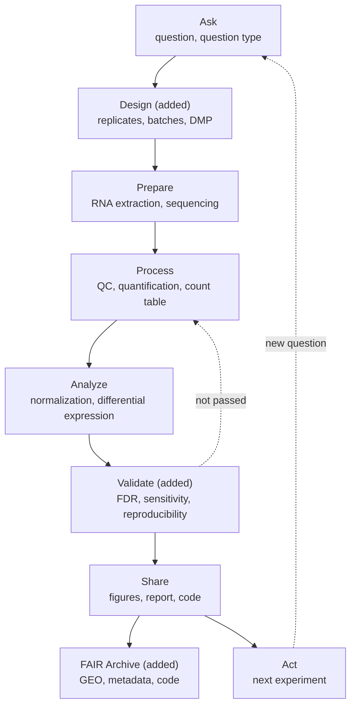

Ask – Prepare – Process – Analyze – Share – Act is the first process many people meet when they start learning data analysis, but it is neither the only model nor the earliest one. This opening article of the series *Evidence-based Data Analytics* sets the six-phase model next to KDD, CRISP-DM, the statistical PPDAC cycle, and two research data life cycles, from USGS and DCC. Comparing the models by function reveals two steps that a scientific project cannot do without: design before any data exist, and validation before anyone acts. The article ends with an RNA-seq project that goes all the way around, from the question to archiving under the FAIR principles.

## 1. Introduction: why data analysis needs a process

The Google Data Analytics certificate program defines data analysis as the collection, transformation, and organization of data in order to draw conclusions, make predictions, and drive informed decision-making (Google, n.d.). The emphasis is on the **decision**: analysis starts from an organization's problem and ends when the organization acts.

Science has a different tradition. Box (1976) describes the scientific method as a **motivated iteration** between theory and practice: theory suggests which data to collect, and the data force the theory to change. On this view, a good process has to allow going back.

Fayyad et al. (1996a) separate **data mining**, the step that applies algorithms to find patterns, from the overall process of **knowledge discovery in databases (KDD)**, and note that the other steps, such as data selection, cleaning, and interpretation, matter just as much to practical success, and possibly more. In computational biology, Buffalo (2015) sets out two requirements, **robust** and **reproducible**, in the very first chapter, and treats never fully trusting your tools or your data as the golden rule of bioinformatics. A process is therefore also where the checkpoints are built in.

The article introduces five families of models (Section 2), compares them by function (Section 3), examines four important differences (Section 4), applies them to an RNA-seq project (Section 5), and recommends which model to use when (Section 6).

## 2. Five families of process models

Each model is introduced along the same lines: who proposed it, what it is for, what the steps are, and whether it loops. This is a selective overview; the broader picture is in the two surveys by Kurgan and Musilek (2006) and Mariscal et al. (2010).

### 2.1. Google's six-phase process

The data analysis process of the Google Data Analytics program has six phases (Google, n.d.):

- **Ask**: define the problem, meaning the gap between the current state and the desired state, and understand what the stakeholders expect.
- **Prepare**: identify sources, collect the data, and check that the data are accurate and useful; the program's materials also place creating, storing, and managing data in this phase.
- **Process**: clean the data, handle missing values, convert formats, and combine datasets; outliers are detected, diagnosed, and removed only for a reason that can be documented ([Part 4](/blog/process-data-from-dirty-to-clean/)).
- **Analyze**: run calculations and look for trends and patterns.
- **Share**: present and interpret the results for decision-makers.
- **Act**: put the results to work.

The model starts from a **stakeholder** and a **business task**, that is, a question usually handed over from outside, and it folds several functions into other phases: designing how the data are generated sits inside Prepare, and interpretation sits inside Share. How the six phases fit into the execution stage of a project in general is discussed in Project Execution.

The business world divides the work in other ways too. EMC Education Services (2015) describes a six-phase **Data Analytics Lifecycle**: discovery, data preparation, model planning, model building, communicate results, and operationalize, in which planning the model is a phase of its own.

### 2.2. The KDD process

Fayyad et al. (1996a) describe KDD as an **interactive and iterative** process with nine steps:

1. understanding the application domain, the relevant prior knowledge, and the goals;
2. creating a target dataset;
3. cleaning and preprocessing;
4. data reduction and projection;
5. matching the goals to a data mining method;
6. exploratory analysis and model and hypothesis selection;
7. data mining;
8. interpreting the mined patterns, possibly returning to any of steps 1–7;
9. acting on the discovered knowledge, including checking for and resolving conflicts with existing knowledge.

The process can loop between any two steps. A shorter version appeared the same year in *Communications of the ACM* (Fayyad et al., 1996b). A closer look at KDD is in the Data Mining article.

### 2.3. CRISP-DM

CRISP-DM (Cross-Industry Standard Process for Data Mining) was developed by a consortium of companies and dates from around 2000, as the title "CRISP-DM twenty years later" suggests (Martínez-Plumed et al., 2021). According to IBM's guide (n.d.), CRISP-DM has six phases: **Business understanding, Data understanding, Data preparation, Modeling, Evaluation**, and **Deployment**. The order of the phases is not rigid; most projects move back and forth between phases as needed.

The main difference from the six-phase model is that **Evaluation** comes before Deployment. Modeling has already checked that the model is technically sound; Evaluation assesses the results against the **success criteria set at the start of the project** and reviews the whole process before deployment. Deployment also covers planning for monitoring and maintenance and the final report (IBM, n.d.).

Martínez-Plumed et al. (2021) argue that a process model still suits projects with clear goals, while exploratory projects need a more flexible view, which they call **data science trajectories**. The systematic review by Schröer et al. (2021) found that most studies applying CRISP-DM do not address the Deployment phase.

### 2.4. PPDAC: the statistical investigative cycle

Wild and Pfannkuch (1999) built a four-dimensional framework for statistical thinking in empirical enquiry, drawing on the literature and on interviews with students and practicing statisticians. The first dimension is the **investigative cycle**, adapted from the **PPDAC** model of MacKay and Oldford: **Problem, Plan, Data, Analysis, Conclusions**. The statisticians interviewed stressed the **early stages**: grasping the dynamics of the system, formulating the problem, and planning and measurement. Knowledge gained and needs identified in one cycle can start a **new cycle**. MacKay and Oldford (2000) later laid out the common elements of statistical investigations as a structure, using Michelson's measurement of the speed of light as the example.

The key feature of PPDAC is the **Plan** phase: designing how to measure and how to sample **before** any data exist. Among the analysis models covered here, only PPDAC makes study design a phase of its own.

### 2.5. Data life cycles

The fifth family follows **one dataset** rather than one question.

The Google Data Analytics program uses the life cycle **Plan – Capture – Manage – Analyze – Archive – Destroy** (Google, n.d.). Plan decides what data are needed, how they will be managed, and who is responsible; Capture brings data from various sources into the organization; Manage is storing, securing, and maintaining the data; Archive keeps the data somewhere they remain accessible; Destroy removes the data from storage **and deletes every shared copy**.

The **USGS Science Data Lifecycle Model** came out of a review of more than 50 life cycle models by its authors (Faundeen et al., 2014). It has six primary elements, **Plan, Acquire, Process, Analyze, Preserve, Publish/Share**, and three cross-cutting elements, **Describe** (metadata, documentation), **Manage Quality**, and **Backup and Secure**. The recommended product of Plan is a **data management plan (DMP)**. The model is deliberately drawn as linear so that it has a clear starting point, Preserve is placed before Publish/Share as a reminder to think about preservation early, and there is no destruction step.

The **DCC Curation Lifecycle Model** comes from the digital curation community (Higgins, 2008). Its actions fall into three groups: full-lifecycle actions (description of the data, preservation planning, community watch, and curate and preserve); sequential actions (Conceptualise, Create and Receive, Appraise and Select, Ingest, Preservation Action, Store, Access Use and Reuse, Transform); and occasional actions (Dispose, Reappraise, Migrate). **Dispose** applies to data not selected for preservation: usually that means transfer to another custodian, sometimes destruction, and in some cases secure destruction for legal reasons.

Life cycle models have limits of their own. Cox and Tam (2018) analyze nine models and show that they tend to hide complexity, portraying research as a sequential, one-directional, self-contained process. Wing (2019) presents a life cycle that runs from data generation to data interpretation and stresses privacy and ethics at every phase.

## 3. A comparison by function

Step names are easy to confuse (Google's Manage and USGS's Manage Quality are two different jobs), so Table 1 arranges the steps by **function**. Each cell gives the name of the corresponding step; "—" means there is none; a name in parentheses means the function is implicit in a broader step. The first four columns are analysis models and the last three are data life cycles; the numbers in the KDD column are the step numbers from Section 2.2.

**Table 1.** Seven process models compared by function

| Function | Google six-phase | KDD | CRISP-DM | PPDAC | Google life cycle | USGS | DCC |
| --- | --- | --- | --- | --- | --- | --- | --- |
| Problem definition | Ask | 1 | Business underst. | Problem | — | — | — |
| Design, planning | (Prepare) | — | (project plan) | Plan | Plan | Plan | (Conceptualise) |
| Collection | Prepare | 2 | Data underst. | Data | Capture | Acquire | Create, Receive |
| Cleaning, transformation | Process | 3, 4 | Data prep. | (Data) | — | Process | — |
| Exploration | (Analyze) | 6 | Data underst. | (Analysis) | (Analyze) | (Analyze) | — |
| Modeling, analysis | Analyze | 5, 7 | Modeling | Analysis | Analyze | Analyze | — |
| Evaluation, validation | — | 8, 9 | Evaluation | (Conclusions) | — | (Manage Quality) | — |
| Communication | Share | (9) | (Deployment) | (Conclusions) | — | Publish/Share | (Access, Use) |
| Action, deployment | Act | 9 | Deployment | (new cycle) | — | — | — |
| Metadata description | — | — | — | — | — | Describe | Description |
| Storage, security in use | (Prepare) | — | — | — | Manage | Backup, Secure | Store |
| Long-term archiving, preservation | — | — | — | — | Archive | Preserve | Preservation Action |
| Destruction | — | — | — | — | Destroy | — | (Dispose) |


**Figure 1.** Table 1 as a heatmap. Dark cells: an explicit step (a main step or a cross-cutting element); light cells: the function is implicit in another step or is only an occasional action; gray cells: absent. The dashed line separates the analysis models (left) from the data life cycles (right). Sources: Fayyad et al. (1996a); Wild and Pfannkuch (1999); Higgins (2008); Faundeen et al. (2014); Google (n.d.); IBM (n.d.).

The table shows four things.

**A shared core.** Every analysis model includes understanding the problem, preparing the data, analyzing, and communicating; moving from one model to another is mostly a matter of renaming.

**Two empty rows in the six-phase model.** Design is only implicit in Prepare, and the evaluation and validation row is entirely empty, whereas KDD has steps 8 and 9, CRISP-DM has Evaluation, and PPDAC has the interpretation part of Conclusions.

**The two halves of the table barely overlap at either end.** The analysis models have no metadata, long-term archiving, or destruction; the life cycle models have no question-driven problem definition step. One side follows a question, and the other follows a dataset that may outlive many questions and many projects.

**Destruction is a rare function.** Only Google's life cycle has a formal destruction step; DCC's Dispose is an occasional action and usually means transfer; USGS, the model written specifically for scientific data, has no destruction step.

The two families are therefore **complementary**: an analysis process answers "what do we do to answer this question," and a data life cycle answers "who is responsible for this dataset from beginning to end." Merging the two into a single diagram tends to blur the work of describing, archiving, and sharing data, which still has to be done after the question has been answered.

## 4. Four important differences

### 4.1. A loop or a straight line

KDD allows looping between any two steps (Fayyad et al., 1996a); CRISP-DM says most projects move back and forth between phases (IBM, n.d.); PPDAC treats the outcome of one cycle as the start of the next (Wild & Pfannkuch, 1999). All three are close to Box's (1976) motivated iteration. USGS, by contrast, **chose** a linear drawing in order to have a clear starting point (Faundeen et al., 2014): drawing a model as linear is a communication choice and does not mean that practice never loops.

The six-phase model is usually presented as an ordered sequence; when using it, read each arrow as "the next step if all goes well," and be ready to return to Ask when Analyze shows that the question was framed wrongly.

### 4.2. The validation step

KDD requires the analyst to interpret the mined patterns and check for conflicts with existing knowledge before acting (Fayyad et al., 1996a); CRISP-DM measures the results against success criteria set at the outset (IBM, n.d.). Both build in a stopping point for asking whether the result is real and whether it answers the right question. The six-phase model has no such stopping point. For biological research, validation has at least three layers:

- **Controlling error under multiple testing.** A differential expression analysis tests thousands of genes at once, so the false discovery rate (FDR) has to be controlled; Conesa et al. (2016) compare how well differential expression methods control the FDR.
- **Sensitivity checks.** The choice of method, and even the software version, can change the results, so the analysis settings need to be recorded in full (Conesa et al., 2016) and the analysis repeated with another reasonable choice.
- **Reproducibility.** The first rule in Sandve et al. (2013) is to keep track, for every result, of how it was produced; the USGS Describe element helps others validate results by reproducing them (Faundeen et al., 2014).

Confirmation with a different measurement method or an independent dataset is also worth considering, but the sources cited here set no standard for it, so it remains a suggestion.

### 4.3. Found data or designed data

The Prepare phase quietly assumes that **the data already exist somewhere**, which fits business, where transaction data are recorded every day. In a biological experiment, the data are **generated by design**, and the design determines which questions can be answered; that is why PPDAC separates **Plan** from **Data**.

Conesa et al. (2016) list **experimental design** first among the major steps of RNA-seq analysis and hold that no single pipeline works for every case. Good design includes choosing the library type, the sequencing depth, and the number of biological replicates; when samples are split across several batches or lanes, they need to be randomized so that technical factors are not confounded with the experimental factors. When batch coincides exactly with treatment group, no downstream processing step can separate the two sources of variation.

The code below builds a sample sheet for 12 samples, 6 drug-treated and 6 controls, split across two library preparation batches, in two ways:

```python
import numpy as np
import pandas as pd

rng = np.random.default_rng(2026)

# 12 samples: 6 drug-treated, 6 controls
samples = pd.DataFrame({
    "sample_id": [f"S{i:02d}" for i in range(1, 13)],
    "condition": ["treated"] * 6 + ["control"] * 6,
})

# Error-prone design: prepare libraries in collection order, first 6 samples go to batch A
naive = samples.assign(batch=["A"] * 6 + ["B"] * 6)

# Balanced design: within each group, shuffle, then split evenly across the two batches
def assign_balanced(df, batches=("A", "B")):
    out = []
    for _, grp in df.groupby("condition"):
        grp = grp.sample(frac=1, random_state=rng)          # shuffle within the group
        grp = grp.assign(batch=[batches[i % len(batches)] for i in range(len(grp))])
        out.append(grp)
    return pd.concat(out).sort_values("sample_id")

balanced = assign_balanced(samples)

for name, df in [("In collection order", naive), ("Balanced", balanced)]:
    print(name)
    print(pd.crosstab(df["condition"], df["batch"]), "\n")

balanced.to_csv("sample_sheet.csv", index=False)   # keep with the project's metadata
```

```text
In collection order
batch      A  B
condition
control    0  6
treated    6  0

Balanced
batch      A  B
condition
control    3  3
treated    3  3
```

The first crosstab has two zero cells: the difference between the two batches is also the difference between drug and control. The second is balanced, so the batch effect can be estimated. This check has to happen **before** library preparation, and `sample_sheet.csv` is the sample metadata that travels with the data until they are submitted to a public repository.

Also at this early stage, the type of question determines the type of analysis. Leek and Peng (2015) divide data analysis questions into six types: **descriptive, exploratory, inferential, predictive, causal**, and **mechanistic** (Peng & Matsui, 2015). The inferential question "which genes are expressed differently between the two groups" cannot answer a causal question; two co-expressed genes are not necessarily causally related. Asking "why" five times (the five whys) or running a gap analysis helps clarify the problem but does not replace identifying the type of question ([Part 2](/en/blog/ask-questions-to-make-data-driven-decisions/)); sampling bias is covered in [Part 3](/blog/prepare-data-for-exploration/).

### 4.4. Archiving and destroying data

Google's life cycle ends with Archive and Destroy (Google, n.d.); USGS has Preserve and Publish/Share but no destruction (Faundeen et al., 2014); DCC's Dispose usually means transfer and only sometimes destruction (Higgins, 2008). In business, customer data are both an asset and a liability, so timely destruction is a normal step; in research, the default is to **keep and share**: the **FAIR** principles ask that scientific data and metadata be **Findable**, **Accessible**, **Interoperable**, and **Reusable**, for both people and machines (Wilkinson et al., 2016). For gene expression data, NCBI's Gene Expression Omnibus (GEO) is a public repository built specifically for this kind of data (Edgar et al., 2002; Biological data formats and databases).

Destruction in research is the exception, and it arises mainly for data that can identify participants; the scope and timing of destruction have to be checked against the consent form and the applicable data protection rules, and the legal side is beyond the scope of this article. Data that have served as the basis for a scientific conclusion need to be kept so that others can check it.

Buffalo (2015) adds three habits that connect the Process phase to archiving: treat raw data as **read-only**, letting programs read the data and write results to new files; release code and data as the minimum requirement for reproducibility; and document every step.

## 5. An RNA-seq project, all the way around

A hypothetical example: comparing gene expression between drug-treated tissue and control tissue with RNA-seq (Transcriptomics). The framework used here is Google's six phases plus three more: **Design** before Prepare, **Validate** before Share, and **FAIR Archive** after Share. It is this article's own proposal, assembled from the models in Section 2, and not a published model (Figure 2).



**Figure 2.** The "six phases + Design + Validate + FAIR Archive" framework for an RNA-seq project (this article's proposal).

**Table 2.** Each phase of the RNA-seq project: specific tasks, deliverables, and the risk of skipping it

| Phase | Specific tasks | Deliverable | Risk if skipped |
| --- | --- | --- | --- |
| Ask | Write down the question and identify its type (Leek & Peng, 2015); define success, for example a list of differentially expressed genes at a given FDR threshold | Question, hypothesis | A causal conclusion from an inferential question |
| Design (added) | Choose replicates, sequencing depth, and library type; balance samples across batches and lanes (Conesa et al., 2016); write a DMP (Michener, 2015) | Sample sheet, DMP | Batch confounded with treatment group |
| Prepare | Extract RNA, prepare libraries, sequence; record sample metadata from the start (Faundeen et al., 2014) | FASTQ files, sample metadata | Not knowing which sample was processed where and when |
| Process | QC, alignment or quantification, count table (Conesa et al., 2016); raw data read-only (Buffalo, 2015) | Count table, QC report | Technical errors slipping into the analysis |
| Analyze | Normalization, differential expression, functional analysis (Conesa et al., 2016) | List of differentially expressed genes | Reading co-expression as causation |
| Validate (added) | Control the FDR; rerun with a different choice of method (Conesa et al., 2016); record how every result was produced (Sandve et al., 2013) | Sensitivity report | A conclusion that depends on one arbitrary choice |
| Share | Figures and tables generated by scripts; version-controlled code (Sandve et al., 2013) | Report, code repository | Figures that cannot be regenerated |
| FAIR Archive (added) | Submit data and metadata to a public repository such as GEO (Edgar et al., 2002; Wilkinson et al., 2016); archive the code and environment | Repository accession number | Data that cannot be found or reused |
| Act | Select candidate genes for the next experiment | Plan for a new experiment | Results that stop at the report |
| Destroy | Only for copies containing information that identifies participants, according to the consent form | Disposal record | Exposure of personal data |

**Design** is where a project fails most easily and least visibly: too few replicates or a batch confounded with treatment group does not make the code throw an error, and the pipeline still returns a list of genes. The flaw surfaces only when someone asks whether the difference comes from the drug or from the day the libraries were prepared. This is the author's judgment, based on the fact that Conesa et al. (2016) put design first among the analysis steps, and not a statistic. For a small project, the DMP (Michener, 2015) can be a single page stating what data will be generated, where they will be stored, what metadata will describe them, and which repository they will go to.

**Validate** is where analysts argue against their own results, like Evaluation in CRISP-DM or step 9 in KDD, but with the tools of statistics and reproducibility. **Share** includes making the figures checkable by others: avoid manual data manipulation and store the raw data behind every figure (Sandve et al., 2013). **Archive** comes after Share but should be prepared for from Design onward, the same reason USGS places Preserve before Publish/Share; the code and the software environment need archiving as well (Reproducible workflows). **Act** in research is usually the next experiment, just as in PPDAC: the outcome of this cycle starts the next one (Wild & Pfannkuch, 1999).

Each row of Table 2 corresponds to a later article, so the table doubles as the table of contents for the series: Ask in Part 2, Prepare in Part 3, Process in [Part 4](/blog/process-data-from-dirty-to-clean/), Analyze in [Part 5](/blog/analyze-data-to-answer-questions/), Share in [Part 6](/blog/share-data-through-the-art-of-visualization/), and the whole loop on real data in [Part 8](/en/blog/case-study/). The big picture of a bioinformatics project is in Introduction to Bioinformatics.

## 6. Discussion: which model to use, and when

- **A business question with data already available**: the six-phase model is enough, with an added evaluation step before Act, meaning the results are checked against the success criteria written down in the Ask phase, in the spirit of CRISP-DM's Evaluation (IBM, n.d.).
- **Data mining and predictive modeling**: CRISP-DM or KDD, because both have an explicit evaluation step and treat going back as normal (Fayyad et al., 1996a; IBM, n.d.). For exploratory projects, treat the order of the steps as flexible (Martínez-Plumed et al., 2021).
- **Experiments and scientific investigations**: PPDAC as the thinking framework, because it has a separate Plan and treats conclusions as the start of a new cycle (Wild & Pfannkuch, 1999), paired with a research data life cycle such as USGS or DCC to take care of metadata, preservation, and FAIR sharing (Higgins, 2008; Faundeen et al., 2014; Wilkinson et al., 2016). The framework in Section 5 is essentially a way of combining PPDAC with a data life cycle while keeping the familiar phase names.

The article has three limitations. Every life cycle model, the framework proposed here included, is a simplification that tends to portray research as a sequential, self-contained process (Cox & Tam, 2018); the USGS team itself notes that existing models differ widely in their level of detail and in the perspective of each community (Faundeen et al., 2014). Table 1 assigns steps to functions according to the author's reading, so the cells in parentheses could be placed differently. The Google and EMC models are training materials, not peer-reviewed publications, so they are described only as their source documents present them.

## 7. Conclusion

Process models come from different traditions: the six-phase model and EMC serve decision-making in business, KDD and CRISP-DM serve data mining, PPDAC serves statistical investigation, and USGS and DCC serve the management and preservation of research data. They are alike at the core (understanding the problem, preparing the data, analyzing, communicating) and differ at the two ends: the six-phase model lacks a design phase and a validation phase, and analysis models in general lack data description, archiving, and preservation. The RNA-seq example shows that the two missing phases are exactly where a biology project fails most easily.

For biology students, the "six phases + Design + Validate + FAIR Archive" framework is enough: it keeps the familiar phase names and adds the three places that science requires. The next article starts with the first phase: asking a question that data can answer ([Part 2](/en/blog/ask-questions-to-make-data-driven-decisions/)).

## References

Box, G. E. P. (1976). Science and statistics. *Journal of the American Statistical Association, 71*(356), 791–799. https://doi.org/10.1080/01621459.1976.10480949

Buffalo, V. (2015). *Bioinformatics data skills: Reproducible and robust research with open source tools*. O'Reilly Media.

Conesa, A., Madrigal, P., Tarazona, S., Gomez-Cabrero, D., Cervera, A., McPherson, A., Szcześniak, M. W., Gaffney, D. J., Elo, L. L., Zhang, X., & Mortazavi, A. (2016). A survey of best practices for RNA-seq data analysis. *Genome Biology, 17*, 13. https://doi.org/10.1186/s13059-016-0881-8

Cox, A. M., & Tam, W. W. T. (2018). A critical analysis of lifecycle models of the research process and research data management. *Aslib Journal of Information Management, 70*(2), 142–157. https://doi.org/10.1108/AJIM-11-2017-0251

Edgar, R., Domrachev, M., & Lash, A. E. (2002). Gene Expression Omnibus: NCBI gene expression and hybridization array data repository. *Nucleic Acids Research, 30*(1), 207–210. https://doi.org/10.1093/nar/30.1.207

EMC Education Services. (2015). Data analytics lifecycle. In EMC Education Services (Ed.), *Data science & big data analytics: Discovering, analyzing, visualizing and presenting data* (pp. 25–62). Wiley. https://doi.org/10.1002/9781119183686.ch2

Faundeen, J. L., Burley, T. E., Carlino, J. A., Govoni, D. L., Henkel, H. S., Holl, S. L., Hutchison, V. B., Martín, E., Montgomery, E. T., Ladino, C. C., Tessler, S., & Zolly, L. S. (2014). *The United States Geological Survey science data lifecycle model* (Open-File Report 2013-1265). U.S. Geological Survey. https://doi.org/10.3133/ofr20131265

Fayyad, U., Piatetsky-Shapiro, G., & Smyth, P. (1996a). From data mining to knowledge discovery in databases. *AI Magazine, 17*(3), 37–54. https://doi.org/10.1609/aimag.v17i3.1230

Fayyad, U., Piatetsky-Shapiro, G., & Smyth, P. (1996b). The KDD process for extracting useful knowledge from volumes of data. *Communications of the ACM, 39*(11), 27–34. https://doi.org/10.1145/240455.240464

Google. (n.d.). *Foundations: Data, data, everywhere* [Online course, Google Data Analytics Professional Certificate]. Coursera. https://www.coursera.org/learn/foundations-data

Higgins, S. (2008). The DCC curation lifecycle model. *International Journal of Digital Curation, 3*(1), 134–140. https://doi.org/10.2218/ijdc.v3i1.48

IBM. (n.d.). *IBM SPSS Modeler CRISP-DM guide* (Version 18.4). https://www.ibm.com/docs/en/SS3RA7_18.6.0/pdf/ModelerCRISPDM.pdf

Kurgan, L. A., & Musilek, P. (2006). A survey of knowledge discovery and data mining process models. *The Knowledge Engineering Review, 21*(1), 1–24. https://doi.org/10.1017/S0269888906000737

Leek, J. T., & Peng, R. D. (2015). What is the question? *Science, 347*(6228), 1314–1315. https://doi.org/10.1126/science.aaa6146

MacKay, R. J., & Oldford, R. W. (2000). Scientific method, statistical method and the speed of light. *Statistical Science, 15*(3), 254–278. https://doi.org/10.1214/ss/1009212817

Mariscal, G., Marbán, Ó., & Fernández, C. (2010). A survey of data mining and knowledge discovery process models and methodologies. *The Knowledge Engineering Review, 25*(2), 137–166. https://doi.org/10.1017/S0269888910000032

Martínez-Plumed, F., Contreras-Ochando, L., Ferri, C., Hernández-Orallo, J., Kull, M., Lachiche, N., Ramírez-Quintana, M. J., & Flach, P. (2021). CRISP-DM twenty years later: From data mining processes to data science trajectories. *IEEE Transactions on Knowledge and Data Engineering, 33*(8), 3048–3061. https://doi.org/10.1109/TKDE.2019.2962680

Michener, W. K. (2015). Ten simple rules for creating a good data management plan. *PLOS Computational Biology, 11*(10), e1004525. https://doi.org/10.1371/journal.pcbi.1004525

Peng, R. D., & Matsui, E. (2015). *The art of data science*. Leanpub. https://bookdown.org/rdpeng/artofdatascience/

Sandve, G. K., Nekrutenko, A., Taylor, J., & Hovig, E. (2013). Ten simple rules for reproducible computational research. *PLoS Computational Biology, 9*(10), e1003285. https://doi.org/10.1371/journal.pcbi.1003285

Schröer, C., Kruse, F., & Gómez, J. M. (2021). A systematic literature review on applying CRISP-DM process model. *Procedia Computer Science, 181*, 526–534. https://doi.org/10.1016/j.procs.2021.01.199

Wild, C. J., & Pfannkuch, M. (1999). Statistical thinking in empirical enquiry. *International Statistical Review, 67*(3), 223–248. https://doi.org/10.1111/j.1751-5823.1999.tb00442.x

Wilkinson, M. D., Dumontier, M., Aalbersberg, I. J., Appleton, G., Axton, M., Baak, A., Blomberg, N., Boiten, J.-W., da Silva Santos, L. B., Bourne, P. E., Bouwman, J., Brookes, A. J., Clark, T., Crosas, M., Dillo, I., Dumon, O., Edmunds, S., Evelo, C. T., Finkers, R., … Mons, B. (2016). The FAIR Guiding Principles for scientific data management and stewardship. *Scientific Data, 3*, 160018. https://doi.org/10.1038/sdata.2016.18

Wing, J. M. (2019). The data life cycle. *Harvard Data Science Review, 1*(1). https://doi.org/10.1162/99608f92.e26845b4
