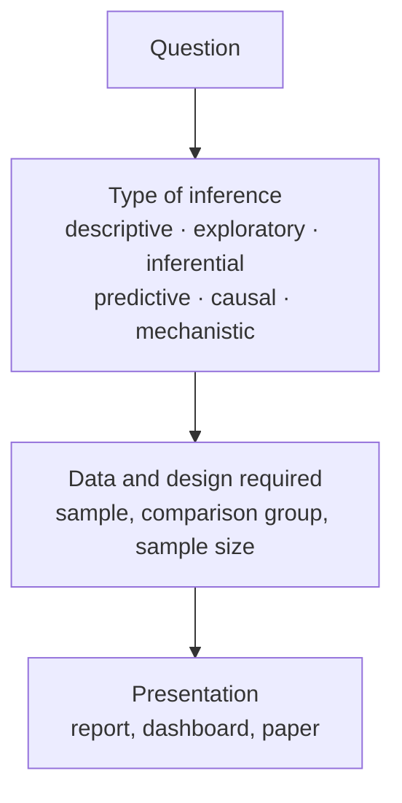

According to Leek and Peng (2015), the most common error in data analysis is mistaking the type of question being asked. This second article of the series *Evidence-based Data Analytics* traces the tools of the Ask phase back to their sources (the SMART framework, the PICO framework, Leek and Peng's question types, data-driven decision-making, big data, and dashboards) and looks at how strong the evidence behind them is. At the end, a vague question about a drought and Darwin's finches is rewritten as a measurable one and answered with measurements from 100 birds, followed by an eight-question checklist for your own project.

## 1. Introduction: the question determines what an analysis is worth

The data analysis process is usually described in six phases: ask, prepare, process, analyze, share, and act (→ [article 01](/en/blog/foundations-data-data-everywhere/)). The Ask phase comes first but is often rushed, and the consequences show up only at the end, when a result that is computationally correct turns out not to answer what people needed to know.

Leek and Peng (2015) argue that the most common error in data analysis lies neither in the code nor in the statistical test, but in mistaking the **type** of question. A correlation read as a causal relationship and an exploratory analysis reported as if it had tested a hypothesis are the same kind of error: answering one question while making claims about another.

In science, every research process begins with defining the problem (→ The scientific research method); the Ask phase is the same task under a different name. This article discusses question frameworks (Section 2), the evidence on data-driven decision-making (Section 3), and big data and dashboards (Section 4), then applies all of it to an example with real data (Section 5).

## 2. From management objectives to research questions

### 2.1. Where SMART comes from

SMART originated in a two-page article by George T. Doran in *Management Review* in 1981, with a title that states its purpose plainly: how to write **management's goals and objectives** well (Doran, 1981). According to sources that cite the original, Doran's five letters were Specific (target a specific area), Measurable (quantify, or at least suggest an indicator of progress), **Assignable** (specify who is responsible), **Realistic** (achievable with the available resources), and Time-related (specify when). Later versions replaced the A and the R with Achievable, Relevant, and others. In data analytics training today, a common variant is Specific, Measurable, **Action-oriented**, **Relevant**, Time-bound, used to evaluate **questions** rather than objectives. SMART is therefore better understood as a memorable acronym than as a framework with a fixed definition.

The closest theoretical foundation is goal-setting theory, summarized by Locke and Latham (2002) after 35 years of empirical research. Its central finding is that specific, sufficiently difficult goals tend to go with higher performance than the general instruction to "do your best," partly because a specific goal reduces ambiguity about what is to be achieved. The S and the M of SMART fit this idea; the other letters do not come from that theory.

Swann et al. (2023) reviewed the use of SMART for setting physical activity goals and concluded that the acronym is not based on scientific theory, is not consistent with empirical evidence, does not consider the **type of goal** being set, has redundant criteria, is not used as originally intended, and risks causing harm. The review covers physical activity, so it cannot be generalized directly to data analysis, but the point about not considering the type of goal has a clear counterpart in the Ask phase (Section 2.3). In program evaluation, Bjerke and Renger (2017) likewise argue that there is no single way to write SMART objectives for every context.

When SMART is carried over from objectives to questions, its most useful parts are the demands for **measurability** and a **time frame**. But a scientific question needs two things SMART does not ask for: **compared with what**, and which **type of inference** may be drawn.

### 2.2. PICO: the question framework of evidence-based medicine

Evidence-based medicine addresses exactly the first gap with the PICO framework. Richardson et al. (1995) proposed that a well-built clinical question has four parts: **P** (patient or population), **I** (intervention or exposure), **C** (comparison), and **O** (outcome). The piece is an editorial, which makes it a proposal rather than a research finding. The C is the most important difference from SMART: "Does drug A work?" cannot be answered until someone says whether the comparison is a placebo, drug B, or no treatment, and writing the C down forces the person asking to think about a control group.

PICO has been tested as a literature-searching tool. Schardt et al. (2007) ran a **pilot** randomized trial with 31 interns and residents, comparing a PubMed interface that had a PICO template with the standard interface. Precision was higher in the PICO group for all three questions, but the 95% confidence intervals overlapped and the difference was not statistically significant. The lesson: a framework that sounds reasonable is not yet a framework that has been shown to work. Section 5 carries PICO over to data analysis, where the "outcome" is a metric.

### 2.3. Types of data analysis questions

Leek and Peng (2015) classify questions by the **type of inference** the answer permits, in six types from easiest to hardest (Leek & Peng, 2015; Peng & Matsui, 2015):

- **Descriptive**: summarize a characteristic of a data set, with no further interpretation.
- **Exploratory**: look for patterns and relationships in order to **generate** hypotheses.
- **Inferential**: test whether a relationship seen in the sample holds in a larger population.
- **Predictive**: predict the outcome for an individual, without needing to explain why.
- **Causal**: ask whether changing one factor changes another, **on average**.
- **Mechanistic**: ask **how** one factor leads to the other.

The paper includes a flowchart for identifying the question type from the data and design at hand, and it lays out the kind of error that occurs when the question type claimed differs from the type actually answered. Each step up demands more of the design: a causal question usually needs a randomized experiment or a carefully argued observational design, whereas data that already exist are usually enough only for descriptive, exploratory, or inferential questions.

In business analytics, problems are usually sorted by **task** (making predictions, categorizing things, spotting something unusual, finding connections, finding patterns, and so on) or along the four levels descriptive, diagnostic, predictive, and prescriptive. These schemes help in choosing a technique but say nothing about the level of inference: "finding connections" can be an exploratory or a causal question depending on the design, and the diagnostic level (why?) and the prescriptive level (what should be done?) are in substance causal questions, which often go beyond what existing data allow.



**Figure 1.** From question to presentation: the type of inference determines the data and design required.

### 2.4. Questions that start from a hypothesis or from the data

Post-genomic biology ran into this issue early, when omics began producing data faster than hypotheses could be formulated. Kell and Oliver (2004) argued that inductive, data-driven research and hypothesis-driven research **complement** each other: large data sets suggest hypotheses, and hypotheses direct the next experiment. Kitchin (2014) criticized the claim of "the end of theory" and argued that data do not speak for themselves: how they are collected, which variables are chosen, and how they are interpreted all carry assumptions. For people working in bioinformatics, a screen of thousands of genes "to see which ones differ" still has a question, and that question is exploratory. Saying so explicitly keeps readers from treating the result as if it had tested a prespecified hypothesis (→ Introduction to bioinformatics).

### 2.5. Questions to avoid

When asking people directly, as in stakeholder interviews or surveys, avoid **leading** questions, **closed-ended** questions when the goal is to understand reasons, **vague** questions, and **unfair** questions that have an assumption built in. They make the answer reflect the way the question was asked more than the reality.

**Table 1.** Question frameworks compared

| Framework | Created for | Components | Comparison group | Type of inference | Evidence of effectiveness |
| --- | --- | --- | --- | --- | --- |
| SMART (Doran, 1981) | writing management objectives | Specific, Measurable, Assignable, Realistic, Time-related | no | no | not tested; criticized for lacking a theoretical basis (Swann et al., 2023) |
| SMART in analytics training | evaluating questions | Specific, Measurable, Action-oriented, Relevant, Time-bound | no | no | no empirical evaluation found |
| PICO (Richardson et al., 1995) | clinical questions | Population, Intervention, Comparison, Outcome | **yes** | implicit | pilot RCT, n = 31, not statistically significant (Schardt et al., 2007) |
| Leek and Peng (2015) | identifying the question type | 6 types, descriptive → mechanistic | depends on the type | **yes** | conceptual framework, not tested |

The three frameworks answer three different questions. SMART asks, "Is it measurable, and is there a deadline?" PICO asks, "Compared with what, in whom, and for which outcome?" Leek and Peng ask, "How far may the conclusion go?" They complement one another; none replaces the others.

## 3. The evidence on data-driven decision-making

### 3.1. Definition

Data-driven decision-making (DDD) can be understood as basing decisions on the analysis of data rather than on intuition alone. Provost and Fawcett (2013) argue that data science is hard to define partly because it is so closely tied to big data and DDD, and they propose identifying its fundamental principles as a way to separate it from those two concepts.

### 3.2. The study of 179 firms

The most often cited quantitative evidence is the study by Brynjolfsson et al. (2011), which combined survey data on the business practices and information technology (IT) investments of **179 large publicly traded firms**. Firms that adopted DDD had output and productivity about **5–6%** higher than what would be **expected** given their other inputs and their IT usage; the relationship also appeared in asset utilization, return on equity, and market value.

The 5–6% figure is **not** the raw gap between firms with and without DDD. It is the difference from the value a model predicts after accounting for capital, labor, and IT. The worry is reverse causality: firms that perform better may simply be the ones able to adopt DDD. The authors used instrumental variables as an additional check and argue that the results are not due to reverse causality; the validity of instrumental variables, however, rests on assumptions that are hard to verify. DDD was also measured by a self-reported survey, in a sample made up only of large firms. On Leek and Peng's scale, this is an **inferential** study that makes an effort to move toward causal, not yet direct causal evidence.

### 3.3. DDD spread quickly

Brynjolfsson and McElheran (2016) used U.S. Census Bureau data on a large, representative sample of U.S. manufacturing plants: adoption of DDD nearly tripled, from **11% to 30%**, between 2005 and 2010. Adoption was associated with size, with complements such as IT and educated workers, and with learning within the firm. The authors write only that the results are consistent with case-based evidence that DDD tends to raise productivity. The main message: DDD **comes with complementary capabilities**; data alone are not enough.

### 3.4. Data-driven, data-informed, and qualitative data

Some training materials distinguish data-driven decisions, in which data lead to the decision, from data-inspired or data-informed decisions, in which data are one input alongside domain expertise and qualitative information. This is a practical distinction more than a concept with a standard definition, and it is best seen as a **spectrum**. The data-driven end fits when the data are complete, measure the right thing, and the decision is made many times over; the data-informed end fits when the data are incomplete or biased and the decision is rare but carries large consequences.

**Quantitative** data are measurements and counts and answer questions such as how many and how often; they usually come from surveys and polls with fixed response options, structured interviews with closed-ended questions, and measurements. **Qualitative** data describe characteristics, reasons, and experiences; interviews and focus groups are the two most common data collection methods in qualitative research (Gill et al., 2008), alongside the analysis of text such as social media comments. The boundary lies in the **form of the answer** more than in the name of the method: a questionnaire with open-ended questions yields qualitative data, and social media text in which keywords are counted becomes quantitative data.

### 3.5. When data mislead

Sections 3.2 and 3.3 quietly assume that the data measure what they are supposed to measure. The three cases below show what happens when that assumption fails.

**Google Flu Trends** estimated flu prevalence from Google searches. In February 2013 the system predicted **more than double** the proportion of doctor visits for influenza-like illness reported by the Centers for Disease Control and Prevention (CDC), and from August 2011 to September 2013 it overestimated in **100 out of 108 weeks** (Lazer et al., 2014). Lazer et al. argue that most of the error could have been avoided, and they name one cause "big data hubris": the implicit assumption that big data are a **substitute** for, rather than a **supplement** to, traditional data collection and analysis. The question was "How many people have the flu?" The data measured "How many people are searching about the flu?"

**The wrong proxy.** Obermeyer et al. (2019) analyzed a commercial algorithm that selects patients for extra-care programs. The algorithm predicted health care **costs**, using cost as a proxy for **need**. Because less money is spent on the care of Black patients, at the same risk score they were sicker than White patients; removing this disparity would raise the share of Black patients receiving additional help from **17.7% to 46.5%**. This is an Ask-phase error: "Who needs care the most?" was silently replaced with "Who will cost the most?"

**Data you cannot see.** Hand (2020) calls the data we do not have or cannot see "dark data," from missing values to cases that were never recorded at all, and argues that this is the very part that can distort conclusions. Incomplete data, data whose definitions do not match across groups, and dirty data all belong here (→ [article 03](/blog/prepare-data-for-exploration/), [article 04](/blog/process-data-from-dirty-to-clean/)).

**Table 2.** An evidence map for DDD

| Study | Design | Main result | Level of inference |
| --- | --- | --- | --- |
| Brynjolfsson et al. (2011) | survey of 179 firms, regression, instrumental variables | output and productivity 5–6% higher than expected | inferential |
| Brynjolfsson and McElheran (2016) | Census data, U.S. manufacturing plants | DDD adoption 11% → 30% (2005–2010) | descriptive, inferential |
| Lazer et al. (2014) | analysis of one forecasting system | overestimated in 100 of 108 weeks | case study |
| Obermeyer et al. (2019) | analysis of one algorithm | cost proxy produces racial bias | inferential |

The evidence in favor of DDD is real but mostly **correlational**, at the level of firms and plants, while the failures all come from one place: the data measured something close to, but not the same as, the thing that needed measuring.

## 4. Big data and how results are presented

### 4.1. The 3Vs in the original

The definition of big data by three Vs goes back to a research note by Doug Laney at META Group, dated February 6, 2001, on managing data along three dimensions: volume, velocity, and variety (Laney, 2001). Laney reposted the note in 2012.

**Volume** is the amount of data, and **variety** is the diversity of formats, structures, and sources. **Velocity** is not just how fast machines process data: Laney describes it as the pace at which data are **created and used** at the point of interaction, as e-commerce sped up interactions with customers, and he stresses that managing velocity is more than a matter of bandwidth. **Veracity** (trustworthiness, quality) is often added as a fourth V; in the repost, Laney treats it as one of the Vs proposed later, important but not a **defining** characteristic of big data.

Later academic definitions kept Laney's frame and added a consequence. De Mauro et al. (2016) propose that big data is the information asset whose volume, velocity, and variety are so high that it requires specific **technology** and **analytical methods** to be turned into **value**; this definition does not include veracity. Gandomi and Haider (2015) put the emphasis on analytical methods, especially for unstructured data.

**Table 3.** The Vs of big data

| V | Meaning | Role |
| --- | --- | --- |
| Volume | amount of data | original definition (Laney, 2001) |
| Velocity | pace at which data are created and used at the point of interaction | original definition (Laney, 2001) |
| Variety | diversity of formats, structures, and sources | original definition (Laney, 2001) |
| Veracity | trustworthiness, quality | added V, not defining (Laney, 2001) |
| Value | value created through technology and analysis | consequence (De Mauro et al., 2016) |

Next-generation sequencing data illustrate all three original Vs: each run produces a very large amount of data, the instruments generate data continuously while the lab needs results soon, and a project typically combines sequences with expression, imaging, and clinical data (→ NGS and genomics).

### 4.2. Small data and big data

Small data usually fit in a spreadsheet; big data live in databases and are queried (→ Data and databases). This is a practical description, and the boundary moves with technology; the useful question is "How much data does this question need, and which tool is enough?"

### 4.3. Report or dashboard

A report is a static collection of data sent to stakeholders periodically; a dashboard monitors data as they are updated. In Few's (2004) definition, a dashboard is a visual display of the most important information needed to achieve one or more objectives, consolidated on **a single screen** so that it can be monitored at a glance. Few treats the dashboard as a type of display, not a type of information or technology, and draws three consequences: a dashboard mostly shows high-level summaries and exceptions, telling you what is happening but **not** why; it has to be designed for a specific person, group, or function; and it needs real-time data only if its users really do, since otherwise a periodic snapshot is enough.

Without a clear objective there is no way to know what "the most important information" is, and a dashboard answers only descriptive questions well. The claim that dashboards are "low maintenance" is practical experience, with no empirical evidence found for it; a dashboard connected directly to live data can also show uncleaned data to many people at once.

**Table 4.** Criteria for choosing a report or a dashboard (a proposal)

| Criterion | Leans toward a report | Leans toward a dashboard |
| --- | --- | --- |
| Decision frequency | rare, quarterly or yearly | frequent, daily or weekly |
| Type of question | explanatory, needs context and argument | tracking descriptive indicators, spotting exceptions |
| Rate of change of the data | slow, needs a snapshot at one point in time | fast, users need to know right away |
| Data risk | needs cleaning and checking before each use | stable pipeline with automated checks |

Dashboards are commonly divided by user into **strategic** (long-term goals), **operational** (short-term tracking), and **analytical** (data detail, for the analytics team). Whatever the type, each panel should correspond to one **metric**: a single, quantifiable type of data. A metric tied to a target level becomes a **metric goal**, such as a target customer retention rate, or ROI calculated as net profit over a period divided by the cost of the investment. The M in SMART means something only when the question points to a metric with a unit and a way to calculate it; the spreadsheet functions for calculating metrics are in [article 05](/blog/analyze-data-to-answer-questions/), and how to choose a chart is in [article 06](/blog/share-data-through-the-art-of-visualization/).

## 5. Illustration: turning a vague question into a measurable one

### 5.1. A drought and Darwin's finches

Since 1973, Peter and Rosemary Grant have followed the medium ground finch *Geospiza fortis* on the island of Daphne Major in the Galápagos, measuring body mass, wing length, tarsus length, and beak size every year. In 1977, a drought that lasted 18 months killed more than 80% of the roughly 1,200 birds on the island; small, soft seeds became scarce, and the food that remained was mostly the large, hard seeds of caltrop (*Tribulus cistoides*) (HHMI BioInteractive, 2021).

Put through SMART, the vague question "Does drought affect finches?" becomes:

- **Specific**: *G. fortis* on Daphne Major; the trait is **beak depth**.
- **Measurable**: beak depth (mm), comparing the means of two groups.
- **Action-oriented / Relevant**: test a prediction of natural selection: a deeper beak helps crack the large, hard seeds left during the drought (→ Evidence and mechanisms of evolution).
- **Time-bound**: birds hatched in 1973–1976; the nonsurvivors died in 1977, and the survivors were alive in 1978.

Now add PICO and Leek and Peng. **P** is the 100 birds in the HHMI BioInteractive educational data set, drawn from the Grants' data: 50 survivors and 50 nonsurvivors (HHMI BioInteractive, 2021). The role of **I** is filled by "survived the drought"; **C** is the nonsurvivor group; **O** is mean beak depth. This is an **inferential** question, not a **causal** one: the data show an association between a trait and survival, while the mechanism (large, hard seeds) comes from independent ecological observation.

<div class="callout callout-example">
<p class="callout-title">The rewritten question</p>

In a sample of 100 *G. fortis* hatched in 1973–1976 on Daphne Major, does mean beak depth differ between the birds that survived the 1977 drought and those that did not, at α = 0.05, and by how many millimeters?

</div>

The clause "by how many millimeters" forces the answer to include an **effect size**, not just a p-value. The nonsurvivors had a mean beak depth of 9.111 mm (SD 0.880) and the survivors 9.674 mm (SD 0.842), a difference of 0.563 mm. A two-sample t-test gives t = 3.27, df = 98, p = 0.0015; Welch's test, which does not assume equal variances, gives the same t and p (df ≈ 97.8). Cohen's d ≈ 0.65, a medium-sized effect. The result can be recomputed from the summary statistics:

```python
from math import sqrt
from scipy import stats

# Summary statistics for beak depth (mm), n = 50 per group
m_ns, sd_ns, n_ns = 9.111, 0.880, 50   # nonsurvivors
m_sv, sd_sv, n_sv = 9.674, 0.842, 50   # survivors

student = stats.ttest_ind_from_stats(m_sv, sd_sv, n_sv, m_ns, sd_ns, n_ns)
welch = stats.ttest_ind_from_stats(m_sv, sd_sv, n_sv, m_ns, sd_ns, n_ns,
                                   equal_var=False)
sd_pooled = sqrt(((n_ns - 1) * sd_ns**2 + (n_sv - 1) * sd_sv**2)
                 / (n_ns + n_sv - 2))
d = (m_sv - m_ns) / sd_pooled

print(f"Mean difference: {m_sv - m_ns:.3f} mm")
print(f"Student: t = {student.statistic:.2f}, p = {student.pvalue:.4f}")
print(f"Welch:   t = {welch.statistic:.2f}, p = {welch.pvalue:.4f}")
print(f"Cohen's d = {d:.2f}")
```

```text
Mean difference: 0.563 mm
Student: t = 3.27, p = 0.0015
Welch:   t = 3.27, p = 0.0015
Cohen's d = 0.65
```


**Figure 2.** Beak depth of the 50 *G. fortis* that did not survive and the 50 that survived the 1977 drought. The 95% confidence intervals, based on the t distribution (df = 49), are 8.86–9.36 mm and 9.43–9.91 mm. Data: HHMI BioInteractive (2021), drawn from the data of P. R. Grant and B. R. Grant.

Figure 2 shows what "p = 0.0015" hides: the two groups overlap a great deal; selection shifts the population mean rather than setting a threshold between life and death. That is why the difference, the confidence interval, and the effect size should be reported next to the p-value (→ Statistical hypothesis testing). The result points in the same direction as the original study: Boag and Grant (1981) reported that large birds, especially males with large beaks, survived best because they could crack the large, hard seeds that predominated during the drought.

**Table 5.** Four traits in the two groups (n = 50 per group; two-sample t-test, df = 98)

| Trait | Nonsurvivors, mean (SD) | Survivors, mean (SD) | t | p | d |
| --- | --- | --- | --- | --- | --- |
| Body mass (g) | 15.71 (1.36) | 16.99 (1.76) | 4.08 | < 0.001 | 0.82 |
| Wing length (mm) | 67.79 (2.28) | 69.30 (2.33) | 3.27 | 0.0015 | 0.65 |
| Tarsus length (mm) | 19.04 (0.84) | 19.35 (0.86) | 1.82 | 0.072 | 0.36 |
| Beak depth (mm) | 9.11 (0.88) | 9.67 (0.84) | 3.27 | 0.0015 | 0.65 |

The survivors were larger on all four traits, and the difference was significant for body mass, wing length, and beak depth. Because all of these traits are correlated with body size, the table does **not** support a conclusion about which trait "matters most"; that is a different question, and it needs a multivariable model. A question that states the direction of the comparison also helps catch a difference written the wrong way around, especially when the software returns a negative t.

One limitation has to be stated: these are 100 birds selected for teaching purposes, not all of the roughly 1,200 birds on the island, and how they were selected is not described, so the result should not be generalized beyond the sample. Sample size should be **planned** from the question, according to the effect size you want to detect (→ Mathematics and statistics for biology).

### 5.2. A hypothetical business example

The second example is hypothetical. Put through SMART, "How can we increase revenue?" becomes "Over the next quarter, will the online store's repeat purchase rate rise to the target level?" That question has a metric and a time frame, but if the rate does rise, nobody will know why. PICO supplies the missing piece: compare a **group that receives a reminder email** with a **group that does not**, assigned at random, so that the question has a chance of becoming a causal one. The metric can be calculated with a short query, here on 10 hypothetical customers:

```python
import sqlite3

con = sqlite3.connect(":memory:")
con.executescript("""
CREATE TABLE customers (id INTEGER PRIMARY KEY, grp TEXT, orders_next_qtr INTEGER);
INSERT INTO customers VALUES
  (1,'email',2),(2,'email',0),(3,'email',1),(4,'email',3),(5,'email',0),
  (6,'control',0),(7,'control',1),(8,'control',0),(9,'control',0),(10,'control',2);
""")
rows = con.execute("""
SELECT grp,
       COUNT(*)                                        AS n,
       SUM(orders_next_qtr >= 1)                       AS repeat_buyers,
       ROUND(100.0 * SUM(orders_next_qtr >= 1) / COUNT(*), 1) AS repeat_rate_pct
FROM customers
GROUP BY grp
ORDER BY grp DESC;
""").fetchall()
for r in rows:
    print(r)
```

```text
('email', 5, 3, 60.0)
('control', 5, 2, 40.0)
```

With five customers per group, 60% versus 40% says nothing: one customer changing their mind is enough to flip the result. A real project needs a sample size calculated in advance.

The last step is to write the question down as a **scope of work** (SOW): the **purpose** (assess whether a reminder email raises the repeat purchase rate); the **deliverables** (a table of rates by group with confidence intervals, and a short report with recommendations); the **milestones** (assign groups in week 1, send the emails during the first month, lock the data at the end of the quarter, report two weeks later); and what is **out of scope** (no evaluation of the email content, no analysis of first-time buyers, no dashboard).

**Table 6.** The questions before and after rewriting

| Step | Biology example | Business example (hypothetical) |
| --- | --- | --- |
| Vague question | Does drought affect finches? | How can we increase revenue? |
| After SMART | Does the beak depth of *G. fortis* hatched in 1973–1976 differ between the birds that survived the 1977 drought and those that did not? | Will the repeat purchase rate rise to the target level over the next quarter? |
| Adding a comparison and a type of inference | Survivors versus nonsurvivors; inferential | Email group versus no-email group, randomized; causal |

## 6. Discussion and a question checklist

SMART is a checklist for measurability and a time frame (Swann et al., 2023), PICO adds the **comparison group** (Richardson et al., 1995), and Leek and Peng add the **type of inference** (Leek & Peng, 2015). The evidence on DDD depends on data that measure the right thing and on complementary capabilities (Brynjolfsson & McElheran, 2016; Obermeyer et al., 2019). The checklist below combines these points.

<div class="callout callout-note">
<p class="callout-title">An eight-question checklist before you analyze</p>

1. Who, or what, is being studied?
2. What is measured, in what unit, and how is the metric calculated?
3. Compared with what: a control group, an earlier baseline, or a preset target?
4. Over what time period?
5. What type of question is it: descriptive, exploratory, inferential, predictive, causal, or mechanistic? How far does the current design allow the conclusion to go?
6. Do the data measure the right thing, or only a proxy? If a proxy, in which direction could it be biased?
7. Who will use the result, and in what form: a report, a dashboard, or a one-time decision?
8. What is out of scope?

</div>

Questions 3, 5, and 6 are the three that SMART does not ask. Question 6 is the lesson of Google Flu Trends and of the algorithm that used cost as a proxy: no checklist can replace understanding how the data were generated.

## 7. Conclusion

A good question does more than any tool to determine what an analysis is worth. SMART makes a question measurable and gives it a deadline, but it does not make the person asking say what the comparison is or how far the conclusion may go; PICO and Leek and Peng's classification fill those two gaps. Data-driven decision-making is associated with better performance in large firms, but when the data are incomplete or are the wrong proxy, "relying on the data" can amplify bias. Once the question is set, the next question is whether the data can be trusted, the subject of [article 03](/blog/prepare-data-for-exploration/).

## References

Bjerke, M. B., & Renger, R. (2017). Being smart about writing SMART objectives. *Evaluation and Program Planning, 61*, 125–127. https://doi.org/10.1016/j.evalprogplan.2016.12.009

Boag, P. T., & Grant, P. R. (1981). Intense natural selection in a population of Darwin's finches (Geospizinae) in the Galápagos. *Science, 214*(4516), 82–85. https://doi.org/10.1126/science.214.4516.82

Brynjolfsson, E., Hitt, L. M., & Kim, H. H. (2011). Strength in numbers: How does data-driven decision-making affect firm performance? In *ICIS 2011 Proceedings* (Paper 13). https://aisel.aisnet.org/icis2011/proceedings/economicvalueIS/13 (working paper: https://doi.org/10.2139/ssrn.1819486)

Brynjolfsson, E., & McElheran, K. (2016). The rapid adoption of data-driven decision-making. *American Economic Review, 106*(5), 133–139. https://doi.org/10.1257/aer.p20161016

De Mauro, A., Greco, M., & Grimaldi, M. (2016). A formal definition of Big Data based on its essential features. *Library Review, 65*(3), 122–135. https://doi.org/10.1108/LR-06-2015-0061

Doran, G. T. (1981). There's a S.M.A.R.T. way to write management's goals and objectives. *Management Review, 70*(11), 35–36.

Few, S. (2004, March 20). *Dashboard confusion*. Perceptual Edge (originally published in *Intelligent Enterprise*). https://www.perceptualedge.com/articles/ie/dashboard_confusion.pdf

Gandomi, A., & Haider, M. (2015). Beyond the hype: Big data concepts, methods, and analytics. *International Journal of Information Management, 35*(2), 137–144. https://doi.org/10.1016/j.ijinfomgt.2014.10.007

Gill, P., Stewart, K., Treasure, E., & Chadwick, B. (2008). Methods of data collection in qualitative research: Interviews and focus groups. *British Dental Journal, 204*(6), 291–295. https://doi.org/10.1038/bdj.2008.192

Hand, D. J. (2020). *Dark data: Why what you don't know matters*. Princeton University Press.

HHMI BioInteractive. (2021). *Evolution in action: Data analysis* [Student handout, version 2]. Howard Hughes Medical Institute. https://www.biointeractive.org/classroom-resources/evolution-action-data-analysis

Kell, D. B., & Oliver, S. G. (2004). Here is the evidence, now what is the hypothesis? The complementary roles of inductive and hypothesis-driven science in the post-genomic era. *BioEssays, 26*(1), 99–105. https://doi.org/10.1002/bies.10385

Kitchin, R. (2014). Big Data, new epistemologies and paradigm shifts. *Big Data & Society, 1*(1). https://doi.org/10.1177/2053951714528481

Laney, D. (2001, February 6). *3-D data management: Controlling data volume, velocity and variety* [Research note]. META Group. Reposted 2012: https://community.aiim.org/blogs/doug-laney/2012/08/25/deja-vvvu-gartners-original-volume-velocity-variety-definition-of-big-data

Lazer, D., Kennedy, R., King, G., & Vespignani, A. (2014). The parable of Google Flu: Traps in big data analysis. *Science, 343*(6176), 1203–1205. https://doi.org/10.1126/science.1248506

Leek, J. T., & Peng, R. D. (2015). What is the question? *Science, 347*(6228), 1314–1315. https://doi.org/10.1126/science.aaa6146

Locke, E. A., & Latham, G. P. (2002). Building a practically useful theory of goal setting and task motivation: A 35-year odyssey. *American Psychologist, 57*(9), 705–717. https://doi.org/10.1037/0003-066X.57.9.705

Obermeyer, Z., Powers, B., Vogeli, C., & Mullainathan, S. (2019). Dissecting racial bias in an algorithm used to manage the health of populations. *Science, 366*(6464), 447–453. https://doi.org/10.1126/science.aax2342

Peng, R. D., & Matsui, E. (2015). *The art of data science: A guide for anyone who works with data*. Leanpub. https://bookdown.org/rdpeng/artofdatascience/

Provost, F., & Fawcett, T. (2013). Data science and its relationship to big data and data-driven decision making. *Big Data, 1*(1), 51–59. https://doi.org/10.1089/big.2013.1508

Richardson, W. S., Wilson, M. C., Nishikawa, J., & Hayward, R. S. (1995). The well-built clinical question: A key to evidence-based decisions. *ACP Journal Club, 123*(3), A12–A13. https://doi.org/10.7326/ACPJC-1995-123-3-A12

Schardt, C., Adams, M. B., Owens, T., Keitz, S., & Fontelo, P. (2007). Utilization of the PICO framework to improve searching PubMed for clinical questions. *BMC Medical Informatics and Decision Making, 7*, 16. https://doi.org/10.1186/1472-6947-7-16

Swann, C., Jackman, P. C., Lawrence, A., Hawkins, R. M., Goddard, S. G., Williamson, O., Schweickle, M. J., Vella, S. A., Rosenbaum, S., & Ekkekakis, P. (2023). The (over)use of SMART goals for physical activity promotion: A narrative review and critique. *Health Psychology Review, 17*(2), 211–226. https://doi.org/10.1080/17437199.2021.2023608
