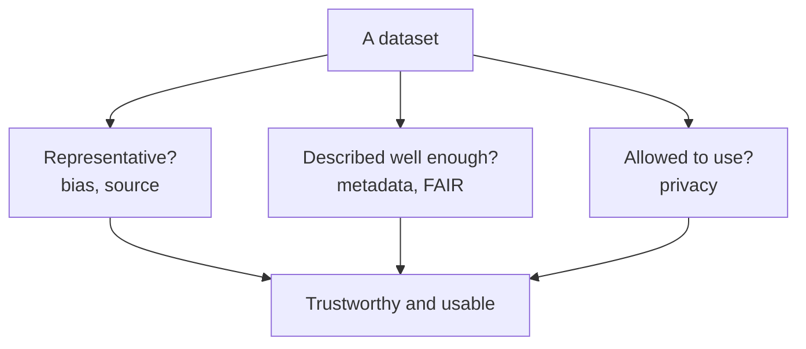
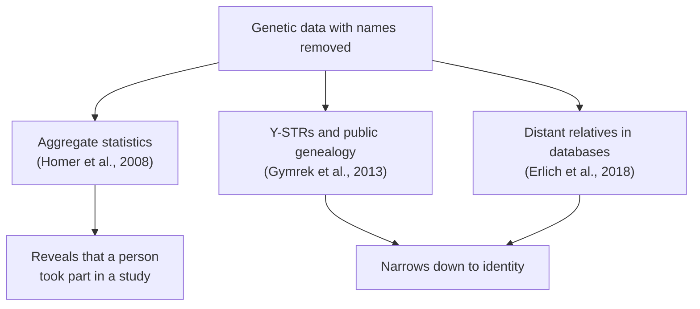

You have deleted the patients' names from a data file, yet a model published in 2019 estimates that 99.98% of Americans would still be correctly re-identified from just 15 demographic attributes (Rocher et al., 2019). This third article in the series *Evidence-based Data Analytics* examines the data preparation phase through three questions: is the data biased, is it described well enough to be reused, and can the people in it still be recognized? The answers draw on the epidemiology literature, the FAIR principles, the original text of the GDPR, and re-identification studies, with simulation code and a checklist for public biological data.

## 1. Introduction: from "veracity" to "trustworthy"

Discussions of big data often mention a fourth V, veracity, meaning the quality and reliability of data ([article 02](/en/blog/ask-questions-to-make-data-driven-decisions/)). The concept is useful but too broad to check, so this article splits it into three questions (Figure 1). **Representation**: does the data correctly reflect the population, and does it measure the phenomenon you care about (Part 1)? **Description**: can someone else tell where the data came from, what it was measured with, which version it is, and whether it can be reused (Part 2)? **Permission**: does sharing or analyzing it match what the people who provided the data agreed to, and what the law allows (Part 3)?



**Figure 1.** Three questions for assessing a dataset before analysis.

The same three questions appear in materials for research participants: a Vietnamese-language information sheet on donating cells for stem cell research suggests that donors ask whether their information will be linked to the cell line and whether the cell line will be shared with other researchers, and it states plainly that a cell line contains genetic information that can be linked back to the donor's identity (*Nghiên cứu tế bào gốc*, n.d.).

The article covers only assessing, describing, and protecting data **before** cleaning, which is the subject of [article 04](/en/blog/process-data-from-dirty-to-clean/). It is a selective review, not legal advice.

## 2. Part 1: Bias and source reliability

### 2.1. Bias is systematic error, and big data cannot fix it

Epidemiology defines bias as **systematic error** arising in the design, conduct, or analysis of a study that pushes an estimate above or below the true value. It differs from **random error**, which fluctuates around the true value and shrinks as sample size grows (Indira Gandhi National Open University [IGNOU], n.d.). Collecting more data reduces random error, but it does not reduce systematic error.

Meng (2018) proves this with an identity: for a dataset of any size n, the difference between the sample mean and the population mean is the product of three components: **data quality** (the correlation between a person's value and whether that person gets recorded), **data quantity** (which depends on the fraction of the population that is recorded), and **problem difficulty** (the variability of the quantity being estimated). Probability sampling keeps the correlation in the first component very small. Without that control, the error (relative to the standard one-over-root-n rate) grows with the square root of the population size N, so the "bigness" of big data must be measured by the ratio n/N, not by n.

Meng's example: in self-reported data on voting intentions in the 2016 US presidential election, the correlation between self-reporting and supporting Donald Trump was only about −0.005. That was enough for a sample of roughly 2.3 million people (1% of eligible voters) to have the same mean squared error as a simple random sample of about 400 people, a 99.98% reduction in effective sample size (Meng, 2018). The simulation below reproduces the idea on a synthetic population of 1 million people, 30% of whom carry a trait; carriers have a 10.5% chance of being recorded and non-carriers 10%:

```python
import numpy as np

rng = np.random.default_rng(2026)
N = 1_000_000                                   # simulated population
x = rng.binomial(1, 0.30, N)                    # 30% carry a trait
true_p = x.mean()

# Self-selected sample: trait carriers are slightly more likely to be recorded
p_record = np.where(x == 1, 0.105, 0.100)
recorded = rng.random(N) < p_record
rho = np.corrcoef(recorded, x)[0, 1]
big = x[recorded]
print(f"Self-selected sample: n = {len(big):,}, rho = {rho:.4f}, error = {abs(big.mean() - true_p):.4f}")

# Compare with much smaller simple random samples
for n in (100, 400, 1_000, 2_000):
    errs = [abs(rng.choice(x, n, replace=False).mean() - true_p) for _ in range(500)]
    print(f"SRS n = {n:>5,}: mean error = {np.mean(errs):.4f}")
```

```text
Self-selected sample: n = 101,218, rho = 0.0062, error = 0.0085
SRS n =   100: mean error = 0.0369
SRS n =   400: mean error = 0.0174
SRS n = 1,000: mean error = 0.0115
SRS n = 2,000: mean error = 0.0085
```

More than 100,000 self-selected records, with a correlation of only 0.006, give the same error as a random sample of 2,000 people. Figure 2 repeats the comparison across many sample sizes: the error of the random sample falls steadily, while the error of the self-selected sample levels off at around 1 percentage point.


**Figure 2.** Error in an estimated proportion by sample size: simple random sample versus a slightly biased self-selected sample (simulated data, same model as the code above).

Sample-size and margin-of-error calculators all assume random sampling, so they measure only random error: the "±1%" attached to an online survey with a huge number of respondents says nothing about self-selection bias (→ sampling and statistical inference).

### 2.2. Four common types of bias, compared with the scientific literature

Introductory data analytics materials usually list four types of bias. Each has a corresponding, more rigorous concept in the scientific literature (Table 1).

**Table 1.** Four types of bias, the corresponding scientific terms, and biological examples

| Common name | In the scientific literature | Biological example | How to reduce it |
| --- | --- | --- | --- |
| Sampling bias | selection bias | GWAS skewed toward people of European ancestry | probability sampling, recruiting underrepresented groups |
| Observer bias | measurement/detection bias | assessor knows which group a patient is in | blinding |
| Interpretation bias | tendency in interpreting ambiguous information | reading a faint gel band according to expectations | predefined reading criteria |
| Confirmation bias | seeking evidence that supports existing beliefs | rechecking only the "inconvenient" samples | looking for disconfirming evidence |

**Sampling bias.** In epidemiology, selection bias occurs when the people selected into a study differ systematically from those not selected, because of non-random sampling, a sample too small to cover the study population, or exposed and unexposed groups that are not comparable (IGNOU, n.d.). A sample is only a subset of the population; whether it is representative is something that has to be achieved through design.

Genomics is the clearest example. Popejoy and Fullerton (2016) argue that genomics is failing on diversity. A 2009 analysis found that 96% of participants in genome-wide association studies (GWAS) were of European ancestry. By 2016, according to the GWAS Catalog (2,511 studies, nearly 35 million samples), the share of non-European participants had risen to nearly 20%, but mostly thanks to studies in Asia; people of African, Latin American, and Hispanic ancestry and Indigenous peoples together made up less than 4% of samples. A huge dataset can still represent most of humanity poorly.

**Observer bias.** In clinical research, the concept is tied to a specific mechanism: the assessor knows which group a patient belongs to, and expectations skew the scoring. Hróbjartsson et al. (2012) pooled 21 randomized trials (4,391 patients) that had both blinded and non-blinded assessors for the same binary outcome. Non-blinded assessors exaggerated odds ratios by an average of 36% (ratio of odds ratios 0.64; 95% confidence interval 0.43–0.96), even though the two sides agreed on a median of 78% of assessments.

**Interpretation bias and confirmation bias.** Interpretation bias comes from clinical psychology: people with emotional disorders such as anxiety or depression tend to interpret ambiguous situations negatively, whereas people without these disorders tend to lean toward positive interpretations (Hirsch et al., 2016). Borrowed into data analysis, the point worth keeping is that ambiguous results are easily read through the reader's existing frame. Confirmation bias is the tendency to seek and interpret evidence in ways that support existing beliefs, a ubiquitous phenomenon that appears in many guises (Nickerson, 1998).

These four types are only one slice; epidemiology also recognizes recall bias, reporting bias, loss-to-follow-up bias, and many others (IGNOU, n.d.).

### 2.3. ROCCC and data quality frameworks

A popular introductory checklist for choosing sources is **ROCCC**, used in the Google Data Analytics certificate program: a good source should be Reliable, Original, Comprehensive, Current, and Cited. ROCCC is easy to remember, but it is a teaching tool, not a published and validated data quality framework.

A widely cited framework is that of Wang and Strong (1996), which builds data quality dimensions **from the perspective of data consumers** and shows that quality is more than accuracy. The framework has four categories: **intrinsic** (the data is correct and credible in itself), **contextual** (it fits the specific task), **representational** (it is presented clearly and consistently), and **accessibility** (it can be accessed, with appropriate security). Table 2 places ROCCC next to these four categories; the mapping is this article's interpretation.

**Table 2.** ROCCC, the closest data quality category, and questions to ask when opening a GEO series

| ROCCC | Closest category | Question for a GEO series |
| --- | --- | --- |
| Reliable | intrinsic | Who produced the data, and is there an accompanying peer-reviewed paper? |
| Original | intrinsic | Is it raw data, or has a third party reprocessed it? |
| Comprehensive | contextual | Are there enough controls and clinical variables for your question? |
| Current | contextual | Are the platform and annotation still in use? |
| Cited | intrinsic | Has the dataset been reused in other studies? |
| *(missing)* sampling design | contextual | How were patients recruited, and who was excluded? |
| *(missing)* metadata, license | representational, accessibility | Are protocols, units, versions, and reuse conditions given? |

The last two rows are the two things ROCCC leaves out: "Original" does not tell you how the sample was selected, and "Cited" does not tell you what the data was measured with, which version it is, or under what conditions it can be reused. That is the job of metadata. Also, do not confuse "Current" (the data is up to date) with "currency" in data ethics principles, which refers to people being aware of financial transactions arising from their personal data (→ data ethics in project management).

## 3. Part 2: Metadata and the FAIR principles

### 3.1. From "data about data" to metadata good enough for reuse

Metadata is usually defined as data about data and divided into three types: **descriptive** (title, author, keywords), **structural** (how the data is organized and which part belongs to which set), and **administrative** (technical source, access rights, creation date). This definition does not say how detailed metadata needs to be.

In bioinformatics, metadata also means **provenance**. Buffalo (2015) advises recording the origin of every piece of data in a project, including reference genomes and annotation tracks; recording the download date, because external sources can change; recording versions, such as TAIR10 or WormBase WS231; and recording how the data was downloaded. The same gene name can have different coordinates in different annotation releases, so a result without a version is a result that cannot be reproduced (→ biological data formats and databases).

### 3.2. The FAIR principles

The FAIR principles were published in 2016 in *Scientific Data*, drafted jointly by representatives of academia, industry, funding agencies, and publishers (Wilkinson et al., 2016). What was new is that FAIR emphasizes the ability of **machines** to find and use data automatically, in addition to supporting humans. The original paper sets out fifteen sub-principles, paraphrased here:

- **Findable.** Data and metadata have a globally unique and persistent identifier (F1) and are described with rich metadata (F2); the metadata clearly includes the identifier of the data it describes (F3); both are indexed in a searchable resource (F4).
- **Accessible.** They are retrievable by their identifier through a standardized protocol (A1); the protocol is open, free, and universally implementable (A1.1) and allows authentication and authorization where necessary (A1.2); metadata remains accessible even when the data is no longer available (A2).
- **Interoperable.** They use a formal, broadly shared language for knowledge representation (I1), vocabularies that themselves follow FAIR (I2), and qualified references to other data (I3).
- **Reusable.** They are described with many accurate and relevant attributes (R1), have a clear usage license (R1.1), detailed provenance (R1.2), and meet domain-relevant community standards (R1.3).

Principle A1.2 shows that "Accessible" does not mean open to everyone: the protocol must be open and standard, but the data can sit behind an authentication step. Wilkinson et al. (2016) even give an example of a repository that achieves a high degree of FAIRness through good metadata, even when the data itself is not published in a FAIR way; later, some of the original authors wrote a retrospective to clarify what FAIR is and is not (Mons et al., 2017). A table of crop growth measurements should be both FAIR and open; a table of patient genotypes should be FAIR but under controlled access.

### 3.3. Applying FAIR to GEO and SRA

NCBI's **GEO** (Gene Expression Omnibus) organizes data around three entities: **platform** (the probe list, which defines which molecules can be measured), **sample**, and **series** (a set of samples that forms one experiment) (Edgar et al., 2002). This is structural metadata in concrete form: which experiment each sample belongs to and which platform it was measured on. GEO stores raw data, processed data, and metadata; records are indexed, cross-linked, and freely downloadable (Barrett et al., 2013). **MIAME** is the standard for the minimum information that must be reported about a microarray experiment so that others can interpret and reproduce it (Brazma et al., 2001); the "minimum information" idea is how the community turns principle R1.3 into a checkable requirement.

**SRA** (Sequence Read Archive) stores raw sequencing reads and is part of the International Nucleotide Sequence Database Collaboration (Leinonen et al., 2011). GEO usually holds the processed expression matrix, while SRA holds the original reads from which the matrix was computed (Table 3).

**Table 3.** FAIR principles and the corresponding components in GEO and SRA

| Principle | In GEO and SRA | What you should check |
| --- | --- | --- |
| F | stable accessions for platforms, samples, series, runs | record the accession and download date |
| A | download via web, FTP, or command-line tools | is human data held in a controlled-access repository? |
| I | standard formats such as FASTQ, platform tables | do tissue, disease, and unit names follow standard vocabularies? |
| R | sample descriptions, protocols, papers; MIAME | is it enough to reproduce the work, and what is the license? |

### 3.4. Having a repository does not make data FAIR

FAIR infrastructure does not guarantee that each record is well described. Gonçalves and Musen (2019) examined 11.4 million biological sample metadata records in NCBI BioSample and EBI BioSamples: most field names and values were not standardized, binary or numeric fields were often filled with values of the wrong type, and the same attribute was recorded in many different ways. Before using public data, check the metadata the way you would check the data: count the labels in the tissue or disease column, look for values of the wrong type, and compare the number of samples with the paper.

## 4. Part 3: The limits of anonymization

### 4.1. What the GDPR says: pseudonymization is not anonymization

Data anonymization is often understood as masking, hashing, or replacing identifying fields with codes. The legal outcome of these techniques is set out in the European Union's General Data Protection Regulation (GDPR) (Regulation (EU) 2016/679, 2016).

Article 4(1) defines personal data as information relating to an identified or **identifiable** person, directly or indirectly; the identifying factors include genetic factors. Article 4(5) defines **pseudonymisation** as processing such that the data can no longer be attributed to a person without the use of **additional information**, provided that information is kept separately and protected. Recital 26 is explicit: pseudonymized data that can be re-attributed using additional information is still information about an identifiable person. One must consider all means "reasonably likely to be used", including singling out a person, taking into account cost, time, and available technology. Only **truly anonymous** information falls outside the GDPR.

Genetic data (Article 4(13); Recital 34 specifies analysis of chromosomes, DNA, or RNA) and data concerning health (Article 4(15)) belong to the special categories whose processing Article 9(1) prohibits, subject to the exceptions in Article 9(2). For research, Article 89(1) requires safeguards in line with the principle of data minimisation, and if the purpose can be achieved with data that no longer identifies anyone, it must be done that way.

The Article 29 Working Party, a group of representatives of European data protection authorities, states plainly in Opinion 05/2014 (WP216) that pseudonymization is **not** a method of anonymization; it merely reduces the linkability of data to the original identity and is a useful security measure. WP216 assesses every technique against three questions: can a person still be **singled out**, can records about the same person still be **linked** (linkability), and can information about a person still be **inferred** (inference) (Article 29 Data Protection Working Party, 2014). WP216 was written under Directive 95/46/EC, before the GDPR, but it points in the same direction as Article 4(5) and Recital 26. Table 4 applies these criteria to the techniques commonly lumped together as "anonymization".

**Table 4.** Processing techniques and their typical outcome under the GDPR and WP216 (each case needs its own assessment)

| Technique | Typical outcome | Who can still re-attribute the data |
| --- | --- | --- |
| Deleting names and ID numbers | still personal data if quasi-identifiers remain | anyone with outside data to match against |
| Partial masking | pseudonymized or still identifiable | anyone who knows the remaining part |
| Hashing identifiers | pseudonymized; the same input gives the same code, so records remain linkable | anyone who can hash every possible value |
| Tokenization with a mapping table | pseudonymized, matching Article 4(5) | whoever holds the mapping table |
| Encryption | a security measure; still personal data | whoever holds the key |
| Generalization, k-anonymity with risk assessment | can approach anonymization | depends on the level of generalization and on outside data |

**Data security** has to be kept separate from **anonymization**: encryption protects data from people without the key, for example when a server is breached (→ Cybersecurity Primer), but for whoever holds the key, it is still personal data.

In the United States, the HIPAA rule at 45 C.F.R. § 164.514(b) likewise does not treat deleting columns as sufficient: either a statistical expert determines that the risk of identifying an individual is very small, or the 18 categories of identifiers are removed **and** the disclosing party has no actual knowledge that the remaining information could be used to identify the person.

### 4.2. k-anonymity: the idea and its limits

Sweeney (2002) framed the problem: a hospital or bank wants to share person-level data with a scientifically grounded guarantee that no one can be re-identified, while keeping the data useful. The solution is **k-anonymity**: a release satisfies k-anonymity if each person's information cannot be distinguished from that of at least k − 1 other people in the release.

The key concept is the **quasi-identifier**: an attribute that does not identify anyone on its own but can do so in combination, such as ZIP code, date of birth, and sex. Using 1990 US census data, about 87% of the population (216 of 248 million) likely had a unique combination of {5-digit ZIP code, sex, date of birth} (Sweeney, 2000). Golle (2006) redid the calculation with the 2000 census and obtained a lower figure, about 63%. Whichever number you take, three harmless-looking attributes are enough to recognize most of the population. The simulation below shows the mechanism on 100,000 synthetic people in 30 districts:

```python
import numpy as np, pandas as pd

rng = np.random.default_rng(2026)
n = 100_000                                      # 100,000 SIMULATED people in one province
pop = pd.DataFrame({
    "sex": rng.choice(["F", "M"], n),
    "birth_date": pd.Timestamp("1945-01-01")
                  + pd.to_timedelta(rng.integers(0, 60 * 365, n), unit="D"),
    "district": rng.integers(1, 31, n),          # 30 districts
})
pop["birth_year"] = pop["birth_date"].dt.year

def share_unique(cols):
    size = pop.groupby(cols)[cols[0]].transform("size")
    return (size == 1).mean()

for cols in (["sex", "birth_year"],
             ["sex", "birth_year", "district"],
             ["sex", "birth_date"],
             ["sex", "birth_date", "district"]):
    print(f"{' + '.join(cols):<28}{share_unique(cols):>8.1%}")
```

```text
sex + birth_year                0.0%
sex + birth_year + district     0.0%
sex + birth_date               10.2%
sex + birth_date + district    92.7%
```


**Figure 3.** Share of people with a unique combination of attributes in a simulated population of 100,000 (output of the code above, not real data).

With birth year, no one is unique; with full date of birth plus district, more than 90% of people are unique. The exact figures depend on the simulation's assumptions, but the trend does not: each added level of detail multiplies the number of possible combinations, while the number of people stays fixed.

The usual ways to achieve k-anonymity are **generalization**, such as grouping ages into 10-year bands, and **suppression** of rare values. The code below applies generalization to 20 simulated patients whose names have already been removed, then computes k and the number of distinct diagnoses in each group:

```python
import pandas as pd

# 20 SIMULATED patients (not real data); names already removed
df = pd.DataFrame({
    "age":      [23, 27, 25, 34, 38, 31, 36, 45, 41, 47, 44, 52, 58, 55, 51, 63, 67, 61, 69, 66],
    "sex":      ["F","F","F","M","M","M","M","F","F","F","F","M","M","M","M","F","F","F","F","F"],
    "district": ["D01","D02","D03","D11","D12","D11","D13","D01","D04","D02","D03",
                 "D14","D12","D11","D13","D02","D05","D01","D04","D03"],
    "diagnosis": ["asthma", "diabetes", "asthma", "hypertension", "hypertension",
                  "hypertension", "hepatitis B", "asthma", "diabetes", "hepatitis B",
                  "hypertension", "diabetes", "diabetes", "diabetes",
                  "diabetes", "asthma", "hypertension", "hepatitis B", "diabetes", "asthma"],
})
QI = ["age", "sex", "district"]          # quasi-identifiers

def k_of(d, qi):
    return d.groupby(qi).size().min()

print("k before generalization:", k_of(df, QI))

# Generalization: age into 10-year bands, district code into province code (D0x -> P0, D1x -> P1)
g = df.assign(age=(df["age"] // 10 * 10).astype(str) + "–" + (df["age"] // 10 * 10 + 9).astype(str),
              district=df["district"].str[:2].str.replace("D", "P"))
print("k after generalization:", k_of(g, QI))

# l-diversity: how many distinct diagnoses does each group contain?
summary = g.groupby(QI).agg(n=("diagnosis", "size"), l=("diagnosis", "nunique"),
                            diagnosis=("diagnosis", lambda s: ", ".join(sorted(set(s)))))
print(summary.to_string())
```

```text
k before generalization: 1
k after generalization: 3
                    n  l                                    diagnosis
age   sex district                                                   
20–29 F   P0        3  2                             asthma, diabetes
30–39 M   P1        4  2                    hepatitis B, hypertension
40–49 F   P0        4  4  asthma, diabetes, hepatitis B, hypertension
50–59 M   P1        4  1                                     diabetes
60–69 F   P0        5  4  asthma, diabetes, hepatitis B, hypertension
```

Before generalization, k = 1: knowing a person's age, sex, and district is enough to find their exact row, even though the name has been deleted. After generalization, the table reaches 3-anonymity. But in the group "50–59, male, P1", all 4 people have diabetes: if you know your neighbor is a 55-year-old man living in province P1 and is in the table, you cannot tell which row is his, yet you know his diagnosis for certain. This is an inference attack that k-anonymity does not block. The same check in SQL (SQLite, where the table `patients` is the generalized table `g`):

```sql
-- Groups with k < 5 or only one diagnosis (l < 2)
SELECT age, sex, district,
       COUNT(*)                  AS k_group,
       COUNT(DISTINCT diagnosis) AS l_group
FROM patients
GROUP BY age, sex, district
HAVING COUNT(*) < 5 OR COUNT(DISTINCT diagnosis) < 2;
```

```text
('20–29', 'F', 'P0', 3, 2)
('30–39', 'M', 'P1', 4, 2)
('40–49', 'F', 'P0', 4, 4)
('50–59', 'M', 'P1', 4, 1)
```

Sweeney (2002) herself showed that a k-anonymous release can still be attacked if the accompanying policies are not followed. Later research added two more limits: when the sensitive values within a group lack diversity, as in the diabetes group above, **l-diversity** is needed (Machanavajjhala et al., 2007); when the distribution of sensitive values within a group differs greatly from the overall distribution, **t-closeness** is needed (Li et al., 2007). WP216 places aggregation, k-anonymity, l-diversity, and t-closeness in the **generalization** family, and noise addition, permutation, and differential privacy in the **randomization** family. **Differential privacy** (Dwork, 2006) places its guarantee on the **release algorithm** rather than on the dataset: the output is almost unchanged whether or not any one person's data is included.

### 4.3. Evidence of re-identification in "anonymized" data

On real data, Narayanan and Shmatikov (2008) de-anonymized the Netflix Prize dataset, which contained the anonymized movie ratings of 500,000 subscribers: knowing just a little about a subscriber was enough to find their record, and by cross-referencing with IMDb they identified the records of some users, exposing even their apparent political leanings. de Montjoye et al. (2013) analyzed 15 months of mobile phone data from 1.5 million people, with hourly locations at the resolution of cell antennas: 4 spatio-temporal points were enough to uniquely identify 95% of people, and coarsening the data reduced uniqueness only very slowly.

The argument that "the dataset is only a small sample, so a matching record is not necessarily the right person" does not hold up either. Rocher et al. (2019) built a copula-based generative model to estimate the probability of correct re-identification even in highly incomplete datasets; across 210 populations, the model predicted uniqueness with an AUC of 0.84–0.97. They estimated that 99.98% of Americans would be correctly re-identified from 15 demographic attributes, and argued that the "de-identify and release" approach is unlikely to meet the GDPR's standard for anonymity.

The counterpoint needs to be stated clearly too. El Emam et al. (2011) systematically reviewed and pooled 14 attacks: on average about 26% of records were re-identified (95% confidence interval 4.6–47.8%), and 34% for health data (0–74.4%). But only 2 of the 14 attacks targeted data that had been de-identified according to existing standards, and the only one on standards-based de-identified health data had a success rate of 0.013%. The two sides do not contradict each other: de-identification **to a standard, with risk assessment**, is very different from **just deleting names**.

### 4.4. Genetic data: the genome is an identifier

With genetic data, the problem is harder because the DNA sequence itself is an identifier: nearly unique, unchanging throughout life, and partly shared with relatives (Figure 4).



**Figure 4.** Three routes to re-identifying genetic data, drawn from Homer et al. (2008), Gymrek et al. (2013), and Erlich et al. (2018).

**Aggregate statistics leak too.** Homer et al. (2008) used high-density SNP genotyping microarrays to determine whether a person had contributed DNA to a complex mixture, even when that person contributed less than 0.1% of the total DNA. The authors noted that aggregate statistics such as allele frequencies or genotype counts in a GWAS do not conceal identity; if the study group is a disease group, knowing that a person "took part" already discloses health information.

**Inferring surnames from the Y chromosome.** Gymrek et al. (2013) recovered surnames from genomes by matching short tandem repeats on the Y chromosome against public recreational genealogy databases, combined this with age and state of residence to narrow down identity, and traced the identities of some participants in public sequencing projects, using only free resources on the Internet.

**Searching through distant relatives.** Erlich et al. (2018) analyzed data from 1.28 million people who had taken consumer genetic tests and estimated that about 60% of searches for a person of European descent would turn up a relative at the level of third cousin or closer. You can be identified through your relatives' DNA, even if you have never been tested yourself.

Erlich and Narayanan (2014) systematized the routes for breaching genetic privacy and the corresponding protections; Shabani and Marelli (2019) analyzed the re-identifiability of genomic data under the GDPR. Personal genome data, even with names removed, should be treated as personal data in a special category, but it can still be shared. NCBI's dbGaP stores phenotype, exposure, genotype, and sequence data **at the individual level**, assigns stable identifiers, and groups participants by similar types of consent (Mailman et al., 2007). The European Genome-phenome Archive (EGA) stores genetic and phenotypic data consented for specific research purposes; the data is **not** released fully openly, and access is governed jointly with the organizations that provided the data (Lappalainen et al., 2015). This is exactly the spirit of principle A1.2: the metadata is publicly findable, while the data reaches only those who have been granted access.

## 5. Discussion: a "can I trust this data?" checklist

**Layer 1: Representation**
- Who was sampled, and who was left out (Popejoy & Fullerton, 2016)? Does the data come from probability sampling or from self-registration? Without probability sampling, a large sample size cannot make up for bias (Meng, 2018).
- Were the people measuring or assessing outcomes blinded (Hróbjartsson et al., 2012)?
- If the data is used to train a model, bias in the sample becomes bias in the predictions (→ machine learning in biology).

**Layer 2: Description**
- Are there stable accessions, download dates, and genome, annotation, and platform versions (Buffalo, 2015)?
- Are there protocols, units, an accompanying paper, and MIAME compliance (Brazma et al., 2001)? Is the metadata standardized (Gonçalves & Musen, 2019)? What is the license (Wilkinson et al., 2016)?

**Layer 3: Permission**
- Is the data truly anonymous or only pseudonymized, and who holds the key (Article 29 Data Protection Working Party, 2014)?
- Which quasi-identifiers remain: date of birth, area code, admission date, rare disease?
- Is it genetic data or data concerning health, and for which purposes was consent given (Regulation (EU) 2016/679, 2016; Lappalainen et al., 2015)? Do you actually need this level of detail?

Try it on the GEO series **GSE2034** (published in 2005): 286 breast cancer samples on platform GPL96, with raw files in CEL format, a link to the original paper, and a table of clinical parameters (Wang et al., 2005; National Center for Biotechnology Information [NCBI], 2005). Layer 2 is well satisfied. Layer 1 asks: where were the patients recruited, by what criteria, and do they resemble the population you care about? Layer 3 asks: which variables in the clinical table are quasi-identifiers, and what are the conditions for reuse? The checklist does not answer for you, but it shows what you need to read before the first line of analysis code.

Back to the central question: is deleting names enough to protect health and genetic data when it is shared publicly? No. Data in which identifiers have merely been replaced with codes is still personal data if it can be re-attributed; a few indirect attributes are enough to recognize most of a population (Rocher et al., 2019); and the genome is itself an identifier (Gymrek et al., 2013). What is needed is a risk assessment against the three WP216 criteria, reducing the data to the level that is actually necessary, and using controlled access when true anonymization is not possible (Erlich & Narayanan, 2014), even though, when de-identification follows a standard, the recorded re-identification rates are very low (El Emam et al., 2011). The legal discussion here rests only on the GDPR and HIPAA; each country's regulations, including Vietnam's, need to be read in the original texts, and the simulations only illustrate mechanisms; they are no substitute for a risk assessment on real data.

## 6. Conclusion

Bias is systematic error and does not shrink as data grows; without probability sampling, the size of a dataset must be measured as a fraction of the population (Meng, 2018). Metadata is the precondition for reusing data, and FAIR does not mean open (Wilkinson et al., 2016). Deleting names, masking, hashing, or tokenizing usually produces only pseudonymized data, not anonymous data, especially with genetic data (Article 29 Data Protection Working Party, 2014). Once a dataset has passed all three layers of checks, the next step is cleaning it, the subject of [article 04](/en/blog/process-data-from-dirty-to-clean/).

## References

Article 29 Data Protection Working Party. (2014). *Opinion 05/2014 on anonymisation techniques* (0829/14/EN, WP216). European Commission. https://ec.europa.eu/justice/article-29/documentation/opinion-recommendation/files/2014/wp216_en.pdf

Barrett, T., Wilhite, S. E., Ledoux, P., Evangelista, C., Kim, I. F., Tomashevsky, M., Marshall, K. A., Phillippy, K. H., Sherman, P. M., Holko, M., Yefanov, A., Lee, H., Zhang, N., Robertson, C. L., Serova, N., Davis, S., & Soboleva, A. (2013). NCBI GEO: Archive for functional genomics data sets—update. *Nucleic Acids Research, 41*(D1), D991–D995. https://doi.org/10.1093/nar/gks1193

Brazma, A., Hingamp, P., Quackenbush, J., Sherlock, G., Spellman, P., Stoeckert, C., Aach, J., Ansorge, W., Ball, C. A., Causton, H. C., Gaasterland, T., Glenisson, P., Holstege, F. C. P., Kim, I. F., Markowitz, V., Matese, J. C., Parkinson, H., Robinson, A., Sarkans, U., … Vingron, M. (2001). Minimum information about a microarray experiment (MIAME)—toward standards for microarray data. *Nature Genetics, 29*(4), 365–371. https://doi.org/10.1038/ng1201-365

Buffalo, V. (2015). *Bioinformatics data skills: Reproducible and robust research with open source tools*. O'Reilly Media.

de Montjoye, Y.-A., Hidalgo, C. A., Verleysen, M., & Blondel, V. D. (2013). Unique in the crowd: The privacy bounds of human mobility. *Scientific Reports, 3*, 1376. https://doi.org/10.1038/srep01376

Dwork, C. (2006). Differential privacy. In M. Bugliesi, B. Preneel, V. Sassone, & I. Wegener (Eds.), *Automata, languages and programming: 33rd International Colloquium, ICALP 2006, Proceedings, Part II* (pp. 1–12). Springer. https://doi.org/10.1007/11787006_1

Edgar, R., Domrachev, M., & Lash, A. E. (2002). Gene Expression Omnibus: NCBI gene expression and hybridization array data repository. *Nucleic Acids Research, 30*(1), 207–210. https://doi.org/10.1093/nar/30.1.207

El Emam, K., Jonker, E., Arbuckle, L., & Malin, B. (2011). A systematic review of re-identification attacks on health data. *PLoS ONE, 6*(12), e28071. https://doi.org/10.1371/journal.pone.0028071

Erlich, Y., & Narayanan, A. (2014). Routes for breaching and protecting genetic privacy. *Nature Reviews Genetics, 15*(6), 409–421. https://doi.org/10.1038/nrg3723

Erlich, Y., Shor, T., Pe'er, I., & Carmi, S. (2018). Identity inference of genomic data using long-range familial searches. *Science, 362*(6415), 690–694. https://doi.org/10.1126/science.aau4832

Golle, P. (2006). Revisiting the uniqueness of simple demographics in the US population. In *Proceedings of the 5th ACM Workshop on Privacy in Electronic Society* (pp. 77–80). ACM. https://doi.org/10.1145/1179601.1179615

Gonçalves, R. S., & Musen, M. A. (2019). The variable quality of metadata about biological samples used in biomedical experiments. *Scientific Data, 6*, 190021. https://doi.org/10.1038/sdata.2019.21

Gymrek, M., McGuire, A. L., Golan, D., Halperin, E., & Erlich, Y. (2013). Identifying personal genomes by surname inference. *Science, 339*(6117), 321–324. https://doi.org/10.1126/science.1229566

Hirsch, C. R., Meeten, F., Krahé, C., & Reeder, C. (2016). Resolving ambiguity in emotional disorders: The nature and role of interpretation biases. *Annual Review of Clinical Psychology, 12*, 281–305. https://doi.org/10.1146/annurev-clinpsy-021815-093436

Homer, N., Szelinger, S., Redman, M., Duggan, D., Tembe, W., Muehling, J., Pearson, J. V., Stephan, D. A., Nelson, S. F., & Craig, D. W. (2008). Resolving individuals contributing trace amounts of DNA to highly complex mixtures using high-density SNP genotyping microarrays. *PLoS Genetics, 4*(8), e1000167. https://doi.org/10.1371/journal.pgen.1000167

Hróbjartsson, A., Thomsen, A. S. S., Emanuelsson, F., Tendal, B., Hilden, J., Boutron, I., Ravaud, P., & Brorson, S. (2012). Observer bias in randomised clinical trials with binary outcomes: Systematic review of trials with both blinded and non-blinded outcome assessors. *BMJ, 344*, e1119. https://doi.org/10.1136/bmj.e1119

Indira Gandhi National Open University. (n.d.). *MSTE-003 Bio-statistics-I, Block 3: Epidemiology* (Unit 11: Design, conduct and analysis of epidemiological studies). IGNOU.

Lappalainen, I., Almeida-King, J., Kumanduri, V., Senf, A., Spalding, J. D., ur-Rehman, S., Saunders, G., Kandasamy, J., Caccamo, M., Leinonen, R., Vaughan, B., Laurent, T., Rowland, F., Marin-Garcia, P., Barker, J., Jokinen, P., Torres, A. C., de Argila, J. R., Llobet, O. M., … Flicek, P. (2015). The European Genome-phenome Archive of human data consented for biomedical research. *Nature Genetics, 47*(7), 692–695. https://doi.org/10.1038/ng.3312

Leinonen, R., Sugawara, H., Shumway, M., & International Nucleotide Sequence Database Collaboration. (2011). The Sequence Read Archive. *Nucleic Acids Research, 39*(Database issue), D19–D21. https://doi.org/10.1093/nar/gkq1019

Li, N., Li, T., & Venkatasubramanian, S. (2007). t-Closeness: Privacy beyond k-anonymity and l-diversity. In *2007 IEEE 23rd International Conference on Data Engineering* (pp. 106–115). IEEE. https://doi.org/10.1109/ICDE.2007.367856

Machanavajjhala, A., Kifer, D., Gehrke, J., & Venkitasubramaniam, M. (2007). L-diversity: Privacy beyond k-anonymity. *ACM Transactions on Knowledge Discovery from Data, 1*(1), Article 3. https://doi.org/10.1145/1217299.1217302

Mailman, M. D., Feolo, M., Jin, Y., Kimura, M., Tryka, K., Bagoutdinov, R., Hao, L., Kiang, A., Paschall, J., Phan, L., Popova, N., Pretel, S., Ziyabari, L., Lee, M., Shao, Y., Wang, Z. Y., Sirotkin, K., Ward, M., Kholodov, M., … Sherry, S. T. (2007). The NCBI dbGaP database of genotypes and phenotypes. *Nature Genetics, 39*(10), 1181–1186. https://doi.org/10.1038/ng1007-1181

Meng, X.-L. (2018). Statistical paradises and paradoxes in big data (I): Law of large populations, big data paradox, and the 2016 US presidential election. *The Annals of Applied Statistics, 12*(2), 685–726. https://doi.org/10.1214/18-AOAS1161SF

Mons, B., Neylon, C., Velterop, J., Dumontier, M., da Silva Santos, L. O. B., & Wilkinson, M. D. (2017). Cloudy, increasingly FAIR; revisiting the FAIR Data guiding principles for the European Open Science Cloud. *Information Services & Use, 37*(1), 49–56. https://doi.org/10.3233/ISU-170824

Narayanan, A., & Shmatikov, V. (2008). Robust de-anonymization of large sparse datasets. In *2008 IEEE Symposium on Security and Privacy* (pp. 111–125). IEEE. https://doi.org/10.1109/SP.2008.33

National Center for Biotechnology Information. (2005). *GSE2034: Breast cancer relapse free survival* [Data set]. Gene Expression Omnibus. https://www.ncbi.nlm.nih.gov/geo/query/acc.cgi?acc=GSE2034

*Nghiên cứu tế bào gốc: Tham gia vào nghiên cứu là lựa chọn của bạn* [Stem cell research: Taking part in research is your choice] [Information sheet for research participants]. (n.d.).

Nickerson, R. S. (1998). Confirmation bias: A ubiquitous phenomenon in many guises. *Review of General Psychology, 2*(2), 175–220. https://doi.org/10.1037/1089-2680.2.2.175

Other requirements relating to uses and disclosures of protected health information, 45 C.F.R. § 164.514. https://www.law.cornell.edu/cfr/text/45/164.514

Popejoy, A. B., & Fullerton, S. M. (2016). Genomics is failing on diversity. *Nature, 538*(7624), 161–164. https://doi.org/10.1038/538161a

Regulation (EU) 2016/679 of the European Parliament and of the Council of 27 April 2016 on the protection of natural persons with regard to the processing of personal data and on the free movement of such data, and repealing Directive 95/46/EC (General Data Protection Regulation). (2016). *Official Journal of the European Union, L 119*, 1–88. https://eur-lex.europa.eu/legal-content/EN/TXT/?uri=CELEX:32016R0679

Rocher, L., Hendrickx, J. M., & de Montjoye, Y.-A. (2019). Estimating the success of re-identifications in incomplete datasets using generative models. *Nature Communications, 10*, 3069. https://doi.org/10.1038/s41467-019-10933-3

Shabani, M., & Marelli, L. (2019). Re-identifiability of genomic data and the GDPR: Assessing the re-identifiability of genomic data in light of the EU General Data Protection Regulation. *EMBO Reports, 20*(6), e48316. https://doi.org/10.15252/embr.201948316

Sweeney, L. (2000). *Simple demographics often identify people uniquely* (Data Privacy Working Paper 3). Carnegie Mellon University. https://dataprivacylab.org/projects/identifiability/

Sweeney, L. (2002). k-anonymity: A model for protecting privacy. *International Journal of Uncertainty, Fuzziness and Knowledge-Based Systems, 10*(5), 557–570. https://doi.org/10.1142/S0218488502001648

Wang, R. Y., & Strong, D. M. (1996). Beyond accuracy: What data quality means to data consumers. *Journal of Management Information Systems, 12*(4), 5–33. https://doi.org/10.1080/07421222.1996.11518099

Wang, Y., Klijn, J. G. M., Zhang, Y., Sieuwerts, A. M., Look, M. P., Yang, F., Talantov, D., Timmermans, M., Meijer-van Gelder, M. E., Yu, J., Jatkoe, T., Berns, E. M. J. J., Atkins, D., & Foekens, J. A. (2005). Gene-expression profiles to predict distant metastasis of lymph-node-negative primary breast cancer. *The Lancet, 365*(9460), 671–679. https://doi.org/10.1016/S0140-6736(05)17947-1

Wilkinson, M. D., Dumontier, M., Aalbersberg, I. J., Appleton, G., Axton, M., Baak, A., Blomberg, N., Boiten, J.-W., da Silva Santos, L. B., Bourne, P. E., Bouwman, J., Brookes, A. J., Clark, T., Crosas, M., Dillo, I., Dumon, O., Edmunds, S., Evelo, C. T., Finkers, R., … Mons, B. (2016). The FAIR Guiding Principles for scientific data management and stewardship. *Scientific Data, 3*, 160018. https://doi.org/10.1038/sdata.2016.18
