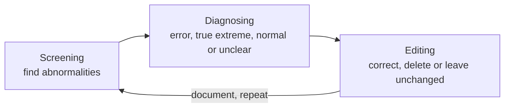
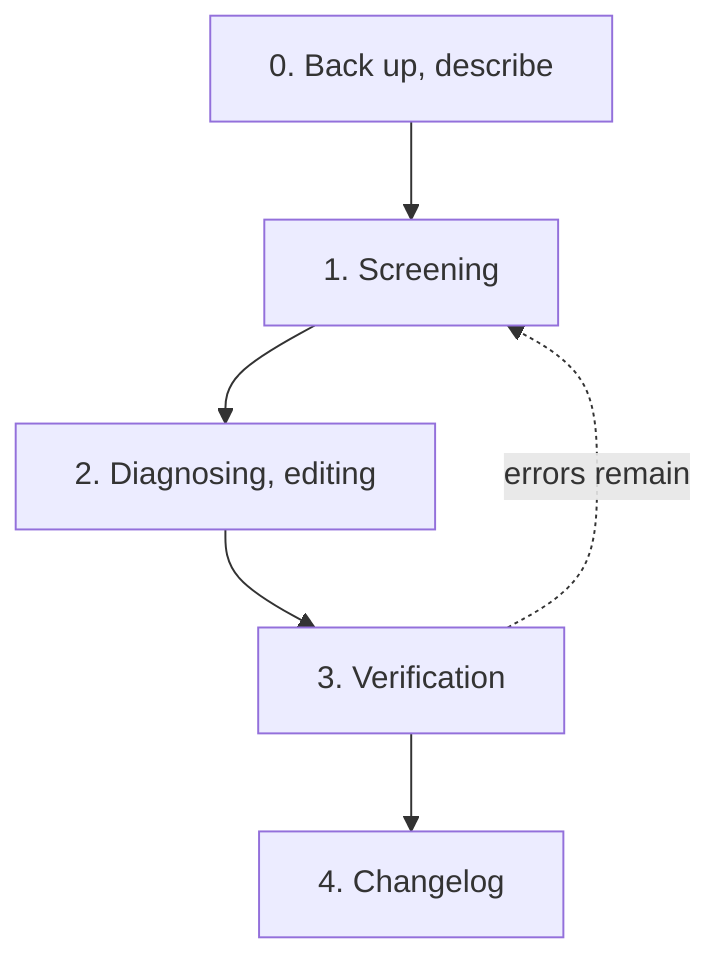
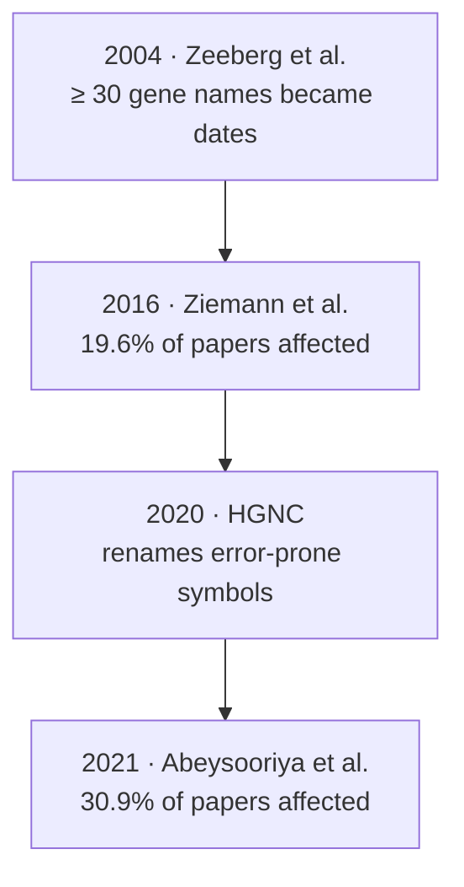

Scientific data can be dirty in ways that are hard to spot, and familiar tools can introduce the errors themselves: 30.9% of papers on PubMed Central from 2014–2020 with gene lists in Excel files contained gene names that had been converted into dates or numbers (Abeysooriya et al., 2021). This fourth article in the *Evidence-based Data Analytics* series walks through a documented data cleaning workflow grounded in the methodological literature, with examples in spreadsheets, SQL and Python; a case study of gene-name errors; and a correct reading of “n ≥ 30,” the 95% confidence interval and statistical power. It ends with a checklist, a changelog template and code you can run yourself.

## 1. Introduction: dirty data is a scientific problem, not just a business one

Paste the gene name DEC1 into Excel and the cell shows “1-DEC,” because Excel reads it as December 1; the RIKEN identifier “2310009E13” becomes the floating-point number 2.31 × 10¹³. Zeeberg et al. (2004) ran into both kinds of error while processing microarray data: at least 30 gene names were converted into dates, and at least 2,000 identifiers were converted into floating-point numbers once RIKEN IDs were counted. Both conversions are **irreversible**, and both had found their way into carefully curated public databases.

Introductory material on data analytics usually frames dirty data from a business angle: it costs money and leads to bad decisions. In science, the price is wrong conclusions and results that cannot be reproduced. The thesis running through this article comes from Van den Broeck et al. (2005): data cleaning is an essential part of research and belongs in the **study design**, because no matter how carefully a study is designed, every study has to deal with errors. The authors note that data cleaning was once regarded as a suspect activity, bordering on data manipulation, and they recommend that papers describe how the data were cleaned, the types and rates of errors, and the rates of corrections and deletions.

[Article 03](/en/blog/prepare-data-for-exploration/) asked whether a data source can be trusted; this article asks the next question: are the data clean yet, and did the cleaning leave a trail? The argument here is that the line between responsible cleaning and data manipulation lies in exactly that trail: rules set in advance, an untouched original, and a reason for every change. Sections 2–4 are for analysts, Section 5 for biologists, and Section 6 covers the statistics.

## 2. Conceptual framework: data integrity, data quality and data constraints

### 2.1. Data integrity and data quality

Data integrity is usually understood as the accuracy, completeness, consistency and trustworthiness of data across its entire life cycle. Data quality is a broader concept. Wang and Strong (1996) observed that efforts to improve data quality often focused narrowly on accuracy, while data consumers understood quality much more broadly. From a survey of data users, they built a hierarchical framework with four categories: **intrinsic** (the data have quality in their own right), **contextual** (quality judged in the context of the task at hand), **representational** and **accessibility** (clearly presented and accessible). The contextual category is a reminder that data must fit the question being answered: a gene expression table measured accurately but on an irrelevant tissue is still poor data **for that question**.

### 2.2. Data constraints

A data constraint determines whether a value is valid. Table 1 lists nine commonly used constraints, with a biological example and a way to check each one.

**Table 1.** Data constraints, definitions and biological examples

| Constraint             | The value must…                                     | Biological example                                 | Quick check                        |
| ---------------------- | --------------------------------------------------- | -------------------------------------------------- | ---------------------------------- |
| Data type              | be of the right type                                | glucose concentration is a number, not “5.6 mmol/L” | `ISNUMBER()`; `pd.to_numeric()`    |
| Data range             | fall within a predefined range                      | OD within the instrument’s linear range            | Data validation; `BETWEEN`         |
| Mandatory              | not be blank                                        | sample ID                                          | `COUNTBLANK()`; `isna()`           |
| Unique                 | not repeat                                          | sample tube codes within a batch                   | `COUNTIF()`; `HAVING COUNT(*) > 1` |
| Regular expression     | match a text pattern                                | GEO accession of the form GSE + digits             | `REGEXMATCH()`; `str.fullmatch()`  |
| Cross-field validation | satisfy a condition across several columns          | cell-type proportions add up to 100%               | compare the sum with 100           |
| Set-membership         | belong to a discrete set                            | genotype AA, Aa, aa                                | drop-down list; `isin()`           |
| Primary key            | be unique **for each row**                          | sample ID in the sample information table          | Unique plus Mandatory              |
| Foreign key            | **match** a key in another table, **need not** be unique | sample ID in the measurement results table    | `LEFT JOIN`, look for unmatched rows |

The last two rows need a clear distinction. A primary key identifies a record, so it must be unique for each row and must not be blank. A foreign key only has to match an existing key in the other table and does not need to be unique: a sample measured ten times appears ten times in the results table (→ SQL: Subquery & CASE WHEN, [article 05](/en/blog/analyze-data-to-answer-questions/)). Accuracy, completeness and consistency are not in the table because they are quality dimensions (Section 2.1), not rules that a single formula can check.

### 2.3. Types of dirty data and the three phases of cleaning

Dirty data are usually classified by the form the error takes: **duplicate**, **outdated** (such as an old gene symbol that HGNC has since changed), **incomplete**, **incorrect** and **inconsistent** (such as “Male,” “M” and “nam,” Vietnamese for “male,” in the same column). To these one can add **misfielded** data and **system-introduced** errors (Section 5).

Van den Broeck et al. (2005) use the concept of a data flow: after measurement, data are successively recorded, extracted, transferred to storage, edited, transformed, summarized and presented, and errors can appear at any stage, including during cleaning itself. Errors in sex and in dates deserve priority because they propagate into derived variables: in a nutrition study, a wrong date leads to a wrong age, then to a wrong weight-for-age index, and a child is misclassified as underweight or overweight.

A classification tells you what an error looks like, not what to do about it. Van den Broeck et al. (2005) describe cleaning as repeated cycles of three phases (Figure 1).



**Figure 1.** The three phases of data cleaning, redrawn from Van den Broeck et al. (2005).

**Screening** looks for four kinds of oddity: missing or excess data; outliers and inconsistencies; strange patterns in distributions; and unexpected analysis results. The authors advise defining expectations in advance about normal ranges, distribution shapes and the strength of relationships, then partly automating the comparison so that values get flagged. The tools can be very simple: sorting and scanning a table, range and consistency checks, box plots, histograms, scatter plots, frequency tables and summary statistics. An *erroneous inlier*, a wrong value that falls inside the valid range, usually slips through and only shows up when checked against another variable.

**Diagnosing** assigns each suspect point one of four diagnoses: an error, a true extreme, a normal value (the initial expectation was wrong), or undetermined. You can set a soft cutoff to flag values and a hard cutoff beyond which a value is immediately judged an error, such as a biologically impossible value. Points between the two cutoffs are diagnosed by tracing back through earlier stages of the data flow, which is why the original and the reason for every change must be kept; by looking for confirming information, for example a child with an abnormally low weight-for-age should also have very low values on other nutritional indicators; or by asking the person who took the measurement and remeasuring while that is still possible. Placeholder codes for missing values, such as −99, must be converted to true missing values before analysis.

**Editing** has only three options: correct, delete or leave unchanged. Impossible values are never left unchanged: correct them if the true value can be found, otherwise delete them. For true extremes or points that remain suspect, examine their influence on the results; if they are excluded, report them as “excluded from analysis,” and consider presenting the results both with and without them.

Example: a table of serum calcium (mg/L) for 100 healthy people has values of roughly 80–130, except for one value of 6.0. That single point pushes the kurtosis up to 19.1 and the skewness down to −2.9, distorting every sample statistic computed afterwards (sample statistics). A value more than ten times smaller than the rest suggests a typo, but it still has to be diagnosed: check the result sheet or the file exported from the analyzer, correct it if the true value can be found, otherwise exclude it, and record what was done.

## 3. Organizing data so there is less to clean

### 3.1. Tidy data

According to Wickham (2014), tidy data follow three rules: each variable is a column, each observation is a row, and each type of observational unit is a table. Wickham lists five common kinds of untidy data (Table 2).

**Table 2.** Five common kinds of untidy data according to Wickham (2014), with biological examples

| Kind of untidiness | Biological example | Fix |
| --- | --- | --- |
| Column headers are values, not variable names | gene × sample count matrix, one column per sample | gather columns into rows (`melt`, `pivot_longer`) |
| Multiple variables stored in one column | sample name “WT_24h” holds both genotype and time point | split the string into two columns |
| Variables stored in both rows and columns | each row is a type of measurement (OD600, fluorescence), each column a time point | gather time points into rows, then spread measurement types into columns |
| Multiple types of observational unit in one table | patient age and sex repeated on every lab-result row | split into a patient table and a lab-test table, joined by a key |
| One observational unit stored in multiple tables | each instrument run saved as a separate file | combine the files and add a column for the run |

Wide and long formats differ in where the variables sit, not in whether there are more rows than columns: in wide format, the values of a variable such as “sample” are spread across many columns; in long format, they are gathered into one column. Transposing only swaps rows and columns: that is enough to fix a table that puts each observation in a column, but it is not the same as gathering columns. An RNA-seq gene × sample count matrix is in wide format; to plot by sample group, gather it into long format with pandas’ `melt()` and then join it to the sample information table (→ [Python for data analysis](/blog/introduction-to-data-analysis-using-python/)):

```python
import pandas as pd

counts = pd.DataFrame({"gene": ["TP53", "MYC"],
                       "WT_1": [120, 45], "WT_2": [98, 51], "KO_1": [15, 60]})
samples = pd.DataFrame({"sample": ["WT_1", "WT_2", "KO_1"],
                        "genotype": ["WT", "WT", "KO"]})

long = counts.melt(id_vars="gene", var_name="sample", value_name="count")
# sample: primary key in samples, foreign key in long
long = long.merge(samples, on="sample", how="left", validate="many_to_one")
print(long.to_string(index=False))
```

```text
gene sample  count genotype
TP53   WT_1    120       WT
 MYC   WT_1     45       WT
TP53   WT_2     98       WT
 MYC   WT_2     51       WT
TP53   KO_1     15       KO
 MYC   KO_1     60       KO
```

The argument `validate="many_to_one"` raises an error if a sample ID is duplicated in the sample information table, so it also checks the primary key constraint from Table 1.

### 3.2. Spreadsheets done right, following Broman and Woo

Broman and Woo (2018) set out principles for entering and storing data in spreadsheets: be consistent; write dates as YYYY-MM-DD; don’t leave cells empty; put just one thing in a cell; make the data a rectangle (subjects as rows, variables as columns) with a single header row; create a data dictionary; don’t include calculations in the raw data file; don’t use font color or highlighting as data; choose good names; make backups; use data validation; and save the data in plain text files. These principles block errors at the moment of entry, before any cleaning is needed.

The YYYY-MM-DD rule removes a very common ambiguity: “1/6/19” can mean January 6 or June 1 depending on the convention. In Excel and Google Sheets, a date cell actually stores an **internal day count** (a serial number), for example 43471 for 2019-01-06; changing the display format to yyyy-mm-dd removes the ambiguity without changing the underlying value. This five-digit number will come up again in Section 5.

### 3.3. Treat raw data as read-only

Buffalo (2015) advises treating all data as read-only: instead of editing Excel cells and saving over the file, let a program read the original and write its output to a new file. Wilson et al. (2017) include data management and change tracking among their “good enough” practices for researchers, with specific recommendations:

- Save raw data exactly as the instrument or survey produced them, back them up in more than one place, and consider making them read-only. For large, stable databases, record how the data were obtained, the version and the download date instead of copying them locally.
- Convert to open formats such as CSV, give variables self-explanatory names, replace missing-value codes such as −99 with NA, and record units in a separate column (“3.4,” not “3.4kg”).
- Record every processing step, preferably in a script; for manual operations, write down exactly what was done.
- Give each record a unique identifier, in the same format in every table: “14025” in one table and “014025” in another will make a join miss.

Ellis and Leek (2018) recommend giving the analyst the raw data, together with information about the experiment and every preprocessing step. Tracing back through the data flow during diagnosis requires an intact original, such as the read-only `data/raw/` folder in Reproducible workflows.

## 4. A documented cleaning workflow: a runnable example

This section combines the steps above into a five-step workflow (Figure 2) and runs it on a sample dataset: a 7-row table of office-supply orders that already contains the usual errors. Sales data were chosen because the errors are easy to see; the method applies unchanged to a table of lab results.



**Figure 2.** A documented cleaning workflow.

### 4.1. Step 0: back up and describe the data

Keep the original read-only, work on a copy, and then describe the data: dimensions, number of labels in each categorical column, missing data, formats and data types. The sample table has 7 orders × 8 variables; Region has 5 distinct strings for 3 regions, and Item has 7 strings for 5 products: the first sign of inconsistent data.

### 4.2. Step 1: screening against constraints

The Python code below reads every column as text so the software does not guess the types, avoiding exactly the kind of error described in Section 5, and then checks each constraint:

```python
import io
import pandas as pd

raw_csv = """Number,Order Date,Region,Name,Item,Units,Unit Cost,Total
1,1/6/19,East,Jones,Pencil,40,1.99,79.60
2,1/23/19,CENTRAL,KIVELL,BINDER,12,19.99,239.88
3,2/9/19,Central,Gill,Pen,30,4.99,149.70
5,3/15/19,East   ,Parent,Binder,70,19.99,"1,399.30"
6,4/1/19,West,Sorvino,Pen    Set,20,15.99,319.80
8,4/20/19,Central,Smith,Desk,3,125,357
9,1/6/19,West,Howard,Pen Set,20,15.99,319.80
"""
raw = pd.read_csv(io.StringIO(raw_csv), dtype=str)   # every column as text

# 1. Gaps in the order numbers
num = raw["Number"].astype(int)
print("Missing order numbers:", sorted(set(range(num.min(), num.max() + 1)) - set(num)))

# 2. Extra whitespace, inconsistent capitalization
def normalize(s):
    return s.str.strip().str.replace(r"\s+", " ", regex=True).str.title()

for col in ["Region", "Name", "Item"]:
    bad = raw[col] != normalize(raw[col])
    print(f"{col}: needs normalizing in orders", raw.loc[bad, "Number"].tolist())

# 3. Cross-field validation: Total = Units × Unit Cost
total = pd.to_numeric(raw["Total"].str.replace(",", "", regex=False))
expected = raw["Units"].astype(int) * raw["Unit Cost"].astype(float)
print("Total mismatch in orders", raw.loc[(expected - total).abs() > 0.01, "Number"].tolist())

# 4. Exact and partial duplicates
print("Exact duplicate rows:", raw.drop(columns="Number").duplicated().sum())
keyed = raw.assign(Item=normalize(raw["Item"]), Total=total)
suspects = keyed[keyed.duplicated(["Item", "Units", "Unit Cost", "Total"], keep=False)]
print(suspects[["Number", "Order Date", "Region", "Name", "Item", "Total"]].to_string(index=False))
```

```text
Missing order numbers: [4, 7]
Region: needs normalizing in orders ['2', '5']
Name: needs normalizing in orders ['2']
Item: needs normalizing in orders ['2', '6']
Total mismatch in orders ['8']
Exact duplicate rows: 0
Number Order Date Region    Name    Item  Total
     6     4/1/19   West Sorvino Pen Set  319.8
     9     1/6/19   West  Howard Pen Set  319.8
```

Google Sheets’ Remove duplicates and `SELECT DISTINCT` only catch rows that are identical in every column, so order 9 (which differs from order 6 in Name and date) slips through: a typical erroneous inlier, findable only with a combination of columns chosen as a key. The two corresponding checks in SQL (SQLite, table `orders`; BigQuery uses `STRING_AGG` instead of `GROUP_CONCAT`):

```sql
-- Extra whitespace: LENGTH reveals characters the eye cannot see
SELECT number, region, LENGTH(region) AS len_region, item, LENGTH(item) AS len_item
FROM orders
WHERE region <> TRIM(region) OR item <> TRIM(item) OR item LIKE '%  %';

-- Suspected partial duplicates: same normalized item, units, unit_cost, total
SELECT REPLACE(UPPER(item), ' ', '') AS item_key, units, unit_cost, total,
       COUNT(*) AS n, GROUP_CONCAT(number) AS orders
FROM orders
GROUP BY item_key, units, unit_cost, total
HAVING COUNT(*) > 1;
```

```text
number  region   len_region  item        len_item
------  -------  ----------  ----------  --------
5       East     7           Binder      6
6       West     4           Pen    Set  10

item_key  units  unit_cost  total   n  orders
--------  -----  ---------  ------  -  ------
PENSET    20     15.99      319.80  2  6,9
```

In Google Sheets (data in A1:H8), four helper columns entered in row 2 and filled down give the same result:

```text
I2  =OR(LEN(C2)<>LEN(TRIM(C2)), LEN(E2)<>LEN(TRIM(E2)))        TRUE for orders 5, 6
J2  =UPPER(TRIM(E2))                                            Item key
K2  =ABS(F2*G2-H2)>0.01                                         TRUE for order 8
L2  =COUNTIFS(J$2:J$8,J2,F$2:F$8,F2,G$2:G$8,G2,H$2:H$8,H2)>1   TRUE for orders 6, 9
```

In a spreadsheet, “1,399.30” is a number displayed with a thousands separator, but once exported to CSV and read with pandas or SQL it may become a string; that is why the code above strips the comma before converting the type.

### 4.3. Step 2: diagnosing and editing

**Table 3.** Abnormalities in the sample dataset and the decisions taken

| Abnormality | Order | Decision | Reason |
| --- | --- | --- | --- |
| Inconsistent capitalization | 2 (Region, Name, Item) | Correct | the right value is obvious |
| Extra whitespace | 5 (Region), 6 (Item) | Correct with TRIM, collapse spaces | meaning unchanged |
| Missing order numbers | 4, 7 | Keep, ask the data owner | unclear whether deleted or lost |
| Total differs from Units × Unit Cost | 8 | Flag, do not correct yet | unknown which column is wrong |
| Suspected partial duplicate | 9 vs. 6 | Flag, do not delete yet | same Item, Units, Unit Cost, Total; date out of sequence |
| Ambiguous dates | Order Date column | Convert to date type, display as YYYY-MM-DD | record the M/D/YY assumption in the changelog |
| Number with thousands separator | 5 (Total) | Strip the comma when converting the type | avoids becoming a string on CSV export |

Two rows need careful diagnosis. In order 8, 3 × 125 = 375 but Total says 357: two transposed digits, a familiar kind of typo, but it is also possible that Units or Unit Cost is the wrong value, so check the original invoice before correcting anything. Order 9 comes after order 8 (2019-04-20) yet carries the date 2019-01-06, the same date as order 1, and matches order 6 on Item, Units, Unit Cost and Total. Several signs point to a copying error, but as long as it cannot be diagnosed, flag it and ask whoever created the data rather than deleting it (Van den Broeck et al., 2005). The editing step, run after the code in Section 4.2:

```python
clean = raw.copy()                                   # raw stays untouched
for col in ["Region", "Name", "Item"]:
    clean[col] = normalize(clean[col])
clean["Total"] = pd.to_numeric(clean["Total"].str.replace(",", "", regex=False))
clean["Units"] = clean["Units"].astype(int)
clean["Unit Cost"] = clean["Unit Cost"].astype(float)
# Assumes M/D/YY; recorded in the changelog
clean["Order Date"] = pd.to_datetime(clean["Order Date"], format="%m/%d/%y")

# Do not delete suspect rows, only flag them
clean["flag"] = ""
clean.loc[clean["Number"] == "8", "flag"] = "Total differs from Units × Unit Cost"
clean.loc[clean["Number"] == "9", "flag"] = "suspected duplicate of order 6"
```

`str.title()`, like PROPER in Sheets, turns “McDonald” into “Mcdonald” and the human gene symbol “BRCA1” into “Brca1,” so personal names and gene names must be normalized against a list of standard labels (set-membership in Table 1), not by a capitalization rule. The same operations in R: [Data manipulation in R](/en/blog/cac-thao-tac-voi-du-lieu-trong-r/).

### 4.4. Step 3: verification

A verification checklist should cover: null values, misspellings, mistyped numbers, extra spaces, duplicates, mismatched data types, messy strings and dates, misleading labels, truncated data, business or biological logic, and **automatic conversions by the software** (Section 5). Beyond the checklist, compare before and after:

```python
for col in ["Region", "Name", "Item"]:
    print(f"{col}: {raw[col].nunique()} -> {clean[col].nunique()} labels")
print("Rows:", len(raw), "->", len(clean))
print("Sum of Total:", round(clean["Total"].sum(), 2))
```

```text
Region: 5 -> 3 labels
Name: 7 -> 7 labels
Item: 7 -> 5 labels
Rows: 7 -> 7
Sum of Total: 2865.08
```

Region drops from 5 to 3 labels and Item from 7 to 5, while Name keeps 7 labels because only one name changed case. The row count and the sum of Total stay the same because no row was deleted and Total only changed type. If the sum changes and the changelog cannot explain it, the cleaning step itself introduced an error.

### 4.5. Step 4: changelog

Version history records **what** changed; a changelog also records **why**. Keep a Changelog (Lacan, n.d.) sets out these principles: changelogs are for humans; one entry per version, latest first, with a date; changes grouped as Added, Changed, Deprecated, Removed, Fixed and Security; and an Unreleased section kept at the top. A template for the dataset above:

```markdown
## [Unreleased]
- Awaiting confirmation from the data owner on orders 8 and 9 and the missing order numbers (4, 7).

## [1.0.0] - 2026-11-13
### Added
- flag column: order 8 (Total differs from Units × Unit Cost), order 9 (suspected duplicate of order 6).
### Changed
- Order Date: converted to date type, displayed as YYYY-MM-DD (assuming M/D/YY).
### Fixed
- Region, Name, Item: removed extra whitespace (orders 5, 6), normalized capitalization (order 2).
- Total: removed the thousands separator (order 5), converted to numeric type.
### Removed
- None: still 7 rows, sum of Total 2,865.08.
```

Wilson et al. (2017) suggest two ways to track changes: a CHANGELOG.txt file that records changes with dates, latest first, serving as the project’s lab notebook; or version control such as Git. This article adds an argument of its own, not one made by Wilson et al.: even with Git, a data changelog is still needed, because a commit shows which code changed, while the changelog explains why order 9 was kept. The table of cleaning steps in the [Cyclistic case study](/projects/cyclistic-bike-share/phan-tich-chi-tiet-casual-riders-va-annual-members-dung-xe-cyclistic-khac-nhau-t/) is a condensed changelog of exactly this kind.

For research, Van den Broeck et al. (2005) recommend more detail: the protocol should include a cleaning plan (staff, the expectations used for screening, diagnostic procedures, decision rules), and each suspect data point should be documented with the type of flag, the diagnosis, the type of edit, the date and the person responsible. The `flag` column in Section 4.3 is a minimal version of this record.

## 5. Case study: when Excel silently renames genes

System-introduced errors are real, measurable, and have persisted in the scientific literature for nearly two decades (Figure 3).



**Figure 3.** Timeline of gene-name errors. Sources: Zeeberg et al. (2004); Ziemann et al. (2016); Bruford et al. (2020); Abeysooriya et al. (2021).

### 5.1. From discovery (2004) to measurement (2016)

Following Zeeberg et al. (2004), Ziemann et al. (2016) scanned 35,175 supplementary Excel files from 18 journals published in 2005–2015 and found 7,467 gene lists belonging to 3,597 papers. Errors were confirmed in 987 files from 704 papers, that is, **19.6%** of papers with gene lists in Excel files, for example SEPT2 becoming “2-Sep.” On GEO, 228 of 574 Excel files containing gene lists (39.7%) were affected. The proportion of affected gene lists correlated positively with the journal’s 2015 impact factor (Spearman rho = 0.52; two-sided p = 0.03), possibly because these journals publish larger and more numerous datasets.

### 5.2. “Lessons not learned” (2021)

Abeysooriya et al. (2021) scanned supplementary files on PubMed Central from 2014–2020 with improved software: **30.9%** (3,436/11,117) of papers with gene lists in Excel files were affected, and errors kept accumulating after 2016. The higher rate is partly due to an additional kind of error, gene names converted into five-digit **internal day counts**, exactly the kind of number described in Section 3.2.

The team also tested Microsoft Excel 365, Google Sheets (2021 version), LibreOffice 6.4.6.2 and Gnumeric 1.12.46. Excel and **Google Sheets** converted gene names into dates with all three input methods (opening a text file, pasting, typing directly); LibreOffice and Gnumeric did not; formatting the target cells as plain text before pasting or typing prevented the conversion. This matters because many people learning data cleaning start with Google Sheets. Software behavior may have changed since 2021, so test it yourself.

### 5.3. The community’s response

According to Abeysooriya et al. (2021), HGNC renamed the symbols prone to conversion, for example SEPT1 to SEPTIN1 and MARCH1 to MARCHF1. The 2020 guidelines for human gene nomenclature state that HGNC may update widely used symbols that cause significant problems, and recommend citing the HGNC ID (of the form HGNC:number), which essentially never changes when the symbol does (Bruford et al., 2020). In a DEG table, always keep a stable ID column such as the HGNC ID or Ensembl ID next to the gene symbol column.

Microsoft’s support page advises formatting cells as Text before entering data, or typing an apostrophe (or a space) first, and states plainly: “there is no way to turn this off” (Microsoft, n.d.). Since 2022, Excel has offered an Automatic Data Conversion setting to stop removing leading zeros, truncating numbers longer than 15 digits, and turning digit strings around the letter “E” into scientific notation (exactly the RIKEN ID error), but the announcement says that control over conversion to **dates** was still planned (Fifadra, 2022). No official documentation has yet been found confirming that date conversion can be turned off, so the safest approach remains formatting gene-name columns as Text, or keeping genomics data in standard text formats (Biological data formats).

### 5.4. Check for yourself: scanning a DEG file

Differentially expressed gene (DEG) tables are often exported to Excel at the end of an RNA-seq pipeline (Transcriptomics). Read the file as text and search the gene symbol column for values that look like dates or numbers. With `pd.read_excel(path, dtype=str)`, a cell that has become a date comes back as “2021-09-02 00:00:00,” an internal day count as “44075,” and 2.31 × 10¹³ as “23100000000000”; the search pattern has to catch these forms too:

```python
import pandas as pd

SUSPECT = (r"^\d{1,2}-[a-z]{3}$"                  # "2-Sep", "1-DEC" in a text/CSV file
           r"|^\d{4}-\d{2}-\d{2}( 00:00:00)?$"    # cell already turned into a date, read from .xlsx
           r"|^\d+(\.\d+)?e\+\d+$"                # "2.31E+13"
           r"|^\d{5,}$")                          # date serial number (44075) or long number

def scan(genes):
    genes = pd.Series(genes).dropna().astype(str).str.strip()
    return genes[genes.str.match(SUSPECT, case=False)].tolist()

cells = ["TP53", "2021-09-02 00:00:00", "MARCHF1", "44075",
         "23100000000000", "2-Sep", "1-DEC", "2.31E+13", "BRCA1"]
print(scan(cells))
```

```text
['2021-09-02 00:00:00', '44075', '23100000000000', '2-Sep', '1-DEC', '2.31E+13']
```

Use this pattern only on the gene symbol column, since Entrez Gene IDs are numeric by design. If you scan a few files on GEO, report the number of files checked, the number with errors and the genes affected; a small sample cannot be compared with the rates above.

## 6. Sample size, confidence intervals and power: reading the rules of thumb correctly

Once the data are clean, the next question is whether there is enough of it to draw a conclusion. Rules of thumb about sample size, confidence intervals and power are widespread but easy to misread; Greenland et al. (2016) observe that misinterpretations of tests, confidence intervals and power have been criticized for decades yet remain rampant. Table 4 summarizes the correct readings.

**Table 4.** Some common misreadings of sample size, confidence intervals and power

| Common reading | Correct reading | Source |
| --- | --- | --- |
| Never use a sample size below 30; from 30 on, the CLT holds | The CLT is an asymptotic result; the sample size depends on the distribution and the goal | Hesterberg (2015); Lakens (2022) |
| 95%: rerun 100 times and 95 runs give similar results | 95% is how often intervals produced by the same method contain the true value | Greenland et al. (2016) |
| Significant means real, not due to chance | A P value is not the probability that a hypothesis is true | Greenland et al. (2016) |
| You need power ≥ 0.8 for a result to be significant | Power is a pre-study probability, used for planning | Greenland et al. (2016); Hoenig and Heisey (2001) |

### 6.1. The “n ≥ 30” rule

This rule is usually justified by the central limit theorem (CLT). In fact, the CLT is an **asymptotic** result: the sample mean approaches a normal distribution as n grows, at a rate that depends on the shape of the underlying distribution, so there is no threshold at which the CLT “starts to hold.”

In the preprint version of Hesterberg (2015), for an exponential distribution (skewness 2), the asymptotic approximation requires n > 4,578 for a 95% t-interval to be off by no more than 10% on each side (a one-sided miss rate within 2.25–2.75%); his simulation gives 4,815, about 5,000, and he notes that “n ≥ 30” is nowhere near this number. Lakens (2022) lists six ways to justify a sample size: measuring (nearly) the entire population, resource constraints, a-priori power analysis, desired accuracy, heuristics, or stating explicitly that there is no justification; “n ≥ 30” belongs to the heuristics.

The simulation below draws 10,000 samples for each size n from three distributions, then counts the proportion of 95% t-intervals that lie entirely below or entirely above the true mean μ:

```python
import numpy as np
from scipy import stats

rng = np.random.default_rng(2026)
reps = 10_000
dists = {   # name: (sampling function, true mean μ)
    "normal":      (lambda size: rng.normal(0, 1, size),    0.0),
    "exponential": (lambda size: rng.exponential(1, size),  1.0),
    "log-normal":  (lambda size: rng.lognormal(0, 1, size), np.exp(0.5)),
}
print(f"{'distribution':<13}{'n':>5}{'covers μ':>10}{'miss low':>10}{'miss high':>11}")
for name, (draw, mu) in dists.items():
    for n in (10, 30, 100, 1000):
        x = draw((reps, n))
        mean, se = x.mean(axis=1), x.std(axis=1, ddof=1) / np.sqrt(n)
        half = stats.t.ppf(0.975, df=n - 1) * se
        below = (mean + half < mu).mean()   # whole interval below μ
        above = (mean - half > mu).mean()   # whole interval above μ
        print(f"{name:<13}{n:>5}{1 - below - above:>10.1%}{below:>10.1%}{above:>11.1%}")
```

```text
distribution     n  covers μ  miss low  miss high
normal          10     95.0%      2.5%       2.6%
normal          30     94.8%      2.5%       2.7%
normal         100     95.3%      2.4%       2.3%
normal        1000     94.9%      2.5%       2.6%
exponential     10     90.1%      9.6%       0.4%
exponential     30     92.9%      6.4%       0.7%
exponential    100     94.0%      4.6%       1.4%
exponential   1000     94.7%      3.0%       2.3%
log-normal      10     83.8%     16.2%       0.1%
log-normal      30     88.5%     11.3%       0.2%
log-normal     100     91.6%      7.9%       0.4%
log-normal    1000     94.2%      4.3%       1.5%
```


**Figure 4.** Proportion of 95% t-intervals lying entirely on one side of μ (output of the code above).

For the normal distribution, each side misses about 2.5% at every n. For the exponential at n = 30, the overall coverage of 92.9% looks acceptable, but the errors are lopsided: 6.4% of intervals lie below μ and only 0.7% above it; the log-normal misses by as much as 11.3%. At n = 1,000, the exponential still misses 3.0% on the low side, outside the 2.25–2.75% band. Concentrations, counts and survival times are often right-skewed, so this is not merely theoretical.

### 6.2. Confidence level and confidence interval

According to Greenland et al. (2016), a 95% confidence level is the frequency with which **intervals produced by the same method** contain the true value when all assumptions are correct, that is, a property of the method rather than of any particular interval. A specific 95% confidence interval (CI) therefore does not have a 95% chance of containing the true value (misinterpretation no. 19), does not predict where 95% of the estimates from future studies will fall (no. 22), and two overlapping CIs do not mean the difference is not significant (no. 21). Misreading CIs is very common: Hoekstra et al. (2014) presented six false statements about CIs to 120 researchers and 442 psychology students, and on average each person still endorsed more than three.


**Figure 5.** One hundred 95% confidence intervals, each from a sample of n = 30 from a normal distribution (a single run; averaged over 200 runs, 4.8 intervals miss μ).

Nor is there an “ideal” confidence level: on the same data, a 99% interval is about 31% wider than a 95% interval (2.576 versus 1.960 standard errors), and keeping it as narrow as before requires about 1.73 times the sample size. Choosing a level is a trade-off that depends on the consequences of being wrong.

### 6.3. Statistical significance and statistical power

On statistical significance, Greenland et al. (2016) point out that a P value is not the probability that the test hypothesis is true (misinterpretation no. 1), and that significant does not mean scientifically important, since in a large study even a tiny effect can be significant (no. 7). Conversely, P > 0.05 does not mean the test hypothesis is true (no. 4) or that there is no effect (no. 6). For the definition of a P value, see Math and statistics for biology and Statistical hypothesis testing.

Power is the **pre-study** probability that a test will reject the test hypothesis when a specific alternative hypothesis is true (Greenland et al., 2016). A level of 0.8 is a target when **planning** the sample size, not a condition for calling a result significant. Using power to interpret a nonsignificant result is also wrong (misinterpretations no. 24 and 25); Hoenig and Heisey (2001) call this practice “fundamentally flawed.” Low power is still dangerous, though: according to Button et al. (2013), it reduces the chance of detecting a true effect, reduces the likelihood that a significant result reflects a true effect, and inflates estimated effect sizes.

### 6.4. Some basic terms

A sample is the part of a population selected for study; the sample size is the **number of units** in the sample. Distortion caused by the way a sample is selected is called sampling bias ([article 03](/en/blog/prepare-data-for-exploration/)). Simple random sampling is a selection method in which every subset of size n has the same probability of being chosen. The margin of error reflects only random sampling error, not sampling bias or measurement error. Increasing the sample size increases power and the precision of estimates; “significance” is not a target to optimize.

### 6.5. Sample size for estimating a proportion

To estimate a proportion, such as the proportion of people carrying an allele, with a given margin of error, the sample size is $n_0 = z^2 p(1-p)/e^2$, where z corresponds to the confidence level and e is the margin of error. If nothing is known about the proportion, choose p = 0.5, since p(1 − p) is largest there. For a finite population of size N, the correction is $n = n_0 / [1 + (n_0 - 1)/N]$:

```python
import math
from scipy.stats import norm

def sample_size(conf, moe, N=None, p=0.5):
    z = norm.ppf(1 - (1 - conf) / 2)
    n = z**2 * p * (1 - p) / moe**2           # n0, infinite population
    if N is not None:
        n = n / (1 + (n - 1) / N)             # finite population correction
    return math.ceil(n)

print(f"{'conf.':<7}{'e':>5}{'N infinite':>12}{'N = 80 million':>16}{'N = 1,000':>11}")
for conf in (0.90, 0.95, 0.99):
    for moe in (0.05, 0.03):
        row = [sample_size(conf, moe, N) for N in (None, 80_000_000, 1_000)]
        print(f"{conf:<7.0%}{moe:>5.0%}{row[0]:>12}{row[1]:>16}{row[2]:>11}")
```

```text
conf.      e  N infinite  N = 80 million  N = 1,000
90%       5%         271             271        214
90%       3%         752             752        430
95%       5%         385             385        278
95%       3%        1068            1068        517
99%       5%         664             664        400
99%       3%        1844            1843        649
```

Sample size depends mainly on the confidence level and the acceptable margin of error: 99% with ±5% needs 664 people, and ±3% needs about 1,840. When the population is large, its size hardly matters; only a small population such as N = 1,000 reduces the sample size noticeably. This is the desired-accuracy justification of Lakens (2022); hypothesis testing calls for a power analysis instead. The formula accounts only for random sampling error and treats each row as a separate unit, so it cannot compensate for sampling bias, while duplicate records (Section 4) make the sample look larger than it really is.

## 7. Consolidated checklist and discussion

**Before entering data**
- Tidy data (Wickham, 2014); a single rectangular table, a data dictionary, data validation, YYYY-MM-DD dates, plain-text storage (Broman & Woo, 2018).
- Unique identifiers, in the same format in every table; units in a separate column; no codes such as −99 for missing values (Wilson et al., 2017).
- Gene-name columns formatted as Text before pasting or typing, with a stable ID column alongside (Abeysooriya et al., 2021; Bruford et al., 2020).
- A cleaning plan in the protocol: expectations, soft and hard cutoffs, decision rules (Van den Broeck et al., 2005).

**While cleaning**
- Read-only originals, every change made through a script (Buffalo, 2015; Wilson et al., 2017).
- Screening against constraints, including partial duplicates and automatic conversions to dates or numbers.
- Diagnose before correcting; if unclear, flag rather than delete (Van den Broeck et al., 2005).

**After cleaning**
- Verification checklist; compare row counts, label counts and totals before and after.
- A changelog with reasons (Lacan, n.d.); report the types and rates of errors, the number of rows corrected or deleted, and the results with and without outliers (Van den Broeck et al., 2005).

This article has three limitations: the dataset in Section 4 is a small sales table, chosen so the errors are easy to see; the GEO scan is only a suggestion; and the simulations are illustrative and do not replace a real power analysis.

Two points call for caution when applying all this. First, when data are insufficient, proxy data are an option, but proxies can carry their own biases ([article 02](/en/blog/ask-questions-to-make-data-driven-decisions/)). Second, automation can replace only part of the cleaning work: flagging against screening criteria or comparing data versions can be automated, but diagnosis requires domain knowledge about the relationships between variables and about the data flow (Van den Broeck et al., 2005).

## 8. Conclusion

Data cleaning is part of study design, not a final tidying-up step. Errors are fewest when data are organized correctly from the start, the original is kept intact, and every change goes through a script with a changelog. The gene-name case shows that a familiar tool can silently corrupt the data of thousands of papers, and that one warning paper is not enough to change habits. Rules of thumb such as “n ≥ 30” should give way to reasoning based on the goal of the analysis. The next step is combining tables: [article 05](/en/blog/analyze-data-to-answer-questions/) covers lookup functions and JOINs, where a key in the wrong format or a wrong column index can create new errors.

## References

Abeysooriya, M., Soria, M., Kasu, M. S., & Ziemann, M. (2021). Gene name errors: Lessons not learned. *PLOS Computational Biology, 17*(7), e1008984. https://doi.org/10.1371/journal.pcbi.1008984

Broman, K. W., & Woo, K. H. (2018). Data organization in spreadsheets. *The American Statistician, 72*(1), 2–10. https://doi.org/10.1080/00031305.2017.1375989

Bruford, E. A., Braschi, B., Denny, P., Jones, T. E. M., Seal, R. L., & Tweedie, S. (2020). Guidelines for human gene nomenclature. *Nature Genetics, 52*(8), 754–758. https://doi.org/10.1038/s41588-020-0669-3

Buffalo, V. (2015). *Bioinformatics data skills: Reproducible and robust research with open source tools*. O'Reilly Media.

Button, K. S., Ioannidis, J. P. A., Mokrysz, C., Nosek, B. A., Flint, J., Robinson, E. S. J., & Munafò, M. R. (2013). Power failure: Why small sample size undermines the reliability of neuroscience. *Nature Reviews Neuroscience, 14*(5), 365–376. https://doi.org/10.1038/nrn3475

Ellis, S. E., & Leek, J. T. (2018). How to share data for collaboration. *The American Statistician, 72*(1), 53–57. https://doi.org/10.1080/00031305.2017.1375987

Fifadra, C. (2022, July 5). *Control data conversions in Excel*. Microsoft 365 Insider Blog. https://techcommunity.microsoft.com/blog/microsoft365insiderblog/control-data-conversions-in-excel/4215348

Greenland, S., Senn, S. J., Rothman, K. J., Carlin, J. B., Poole, C., Goodman, S. N., & Altman, D. G. (2016). Statistical tests, P values, confidence intervals, and power: A guide to misinterpretations. *European Journal of Epidemiology, 31*(4), 337–350. https://doi.org/10.1007/s10654-016-0149-3

Hesterberg, T. C. (2015). What teachers should know about the bootstrap: Resampling in the undergraduate statistics curriculum. *The American Statistician, 69*(4), 371–386. https://doi.org/10.1080/00031305.2015.1089789 (preprint: https://arxiv.org/abs/1411.5279)

Hoekstra, R., Morey, R. D., Rouder, J. N., & Wagenmakers, E.-J. (2014). Robust misinterpretation of confidence intervals. *Psychonomic Bulletin & Review, 21*(5), 1157–1164. https://doi.org/10.3758/s13423-013-0572-3

Hoenig, J. M., & Heisey, D. M. (2001). The abuse of power: The pervasive fallacy of power calculations for data analysis. *The American Statistician, 55*(1), 19–24. https://doi.org/10.1198/000313001300339897

Lacan, O. (n.d.). *Keep a Changelog* (Version 1.1.0). https://keepachangelog.com/en/1.1.0/

Lakens, D. (2022). Sample size justification. *Collabra: Psychology, 8*(1), 33267. https://doi.org/10.1525/collabra.33267

Microsoft. (n.d.). *Stop automatically changing numbers to dates*. Microsoft Support. https://support.microsoft.com/en-us/office/stop-automatically-changing-numbers-to-dates-452bd2db-cc96-47d1-81e4-72cec11c4ed8

Van den Broeck, J., Argeseanu Cunningham, S., Eeckels, R., & Herbst, K. (2005). Data cleaning: Detecting, diagnosing, and editing data abnormalities. *PLoS Medicine, 2*(10), e267. https://doi.org/10.1371/journal.pmed.0020267

Wang, R. Y., & Strong, D. M. (1996). Beyond accuracy: What data quality means to data consumers. *Journal of Management Information Systems, 12*(4), 5–33. https://doi.org/10.1080/07421222.1996.11518099

Wickham, H. (2014). Tidy data. *Journal of Statistical Software, 59*(10). https://doi.org/10.18637/jss.v059.i10

Wilson, G., Bryan, J., Cranston, K., Kitzes, J., Nederbragt, L., & Teal, T. K. (2017). Good enough practices in scientific computing. *PLOS Computational Biology, 13*(6), e1005510. https://doi.org/10.1371/journal.pcbi.1005510

Zeeberg, B. R., Riss, J., Kane, D. W., Bussey, K. J., Uchio, E., Linehan, W. M., Barrett, J. C., & Weinstein, J. N. (2004). Mistaken identifiers: Gene name errors can be introduced inadvertently when using Excel in bioinformatics. *BMC Bioinformatics, 5*, 80. https://doi.org/10.1186/1471-2105-5-80

Ziemann, M., Eren, Y., & El-Osta, A. (2016). Gene name errors are widespread in the scientific literature. *Genome Biology, 17*, 177. https://doi.org/10.1186/s13059-016-1044-7
