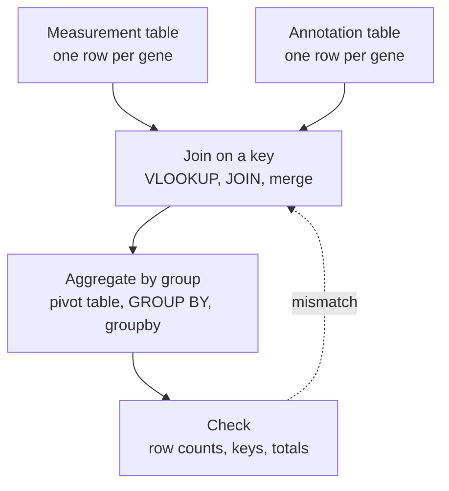

VLOOKUP raises no error when it returns the wrong value, and neither does a JOIN. This fifth article in the *Evidence-based Data Analytics* series runs the same join and aggregation in a spreadsheet, in SQL and in pandas, on public gene data from HGNC and GTEx, to show why the three tools can produce three different answers: duplicate keys, mismatched keys, NULLs and approximate lookups. The risk is real in the scientific literature: 30.9% of papers on PubMed Central from 2014–2020 that shipped gene lists as Excel files contained gene names that had been converted into dates or numbers (Abeysooriya et al., 2021), meaning the keys were broken before any join took place. The article ends with a reconciliation checklist and a quick-reference table across tools.

## 1. Introduction: analysis is joining and aggregating

Introductory data analytics material usually splits the analyze phase into four tasks: organize the data, format and adjust it, get input from others, and transform it. This article focuses on the first and the last. In biology, most analyses start by joining tables: measurements with sample information, gene lists with annotation tables.

Data aggregation, gathering data from several sources into one summarized set, is really two different operations. **Joining** (VLOOKUP, JOIN, `merge`) adds columns from another table based on a shared key. **Aggregating** (pivot table, SUMIF, GROUP BY) collapses many rows into one summary row with aggregate functions such as SUM, AVERAGE and COUNT. Errors made while joining spill into the aggregation, and the aggregation hides them: an average does not tell you how many rows it came from, which rows were duplicated or which ones fell out. A wrong value is hidden the same way: if five DNA samples measure 62, 71, 58, 66 and 64 ng/µL but the last cell is typed as 640, the mean becomes 179.4 instead of 64.2, and no formula flags it.

The central question of this article: why can spreadsheets, SQL and pandas give different results when joining and aggregating the same data, and how do you check for it? The running argument is that most aggregation errors are **key errors**, not formula errors. Part 1 sets out the relational foundations of the join, Part 2 runs the same aggregation in three tools, Part 3 looks at the evidence on risk, and Section 5 collects everything into a checklist for the checking step in Figure 1.



**Figure 1.** Join, aggregate, then check: errors made at the join step only surface when there is a reconciliation step.

## 2. Part 1: The relational foundations of JOIN

### 2.1. Codd's relational model

Codd (1970) proposed a data model based on n-ary relations so that users would not need to know how data is organized inside the machine. In the same paper he discussed normal forms and operations on relations, including projection, join and restriction, as a way to handle redundancy and consistency. A table in this sense is a **relation**: each row is a record and each column is an attribute. For spreadsheet users, the model has three consequences.

First, it is exactly Wickham's (2014) tidy data principle: each variable is a column, each observation is a row, and each type of observational unit is a table ([article 04](/en/blog/process-data-from-dirty-to-clean/)). Second, in a relation the order of rows carries no meaning and all rows are distinct (Codd, 1970). VLOOKUP, by contrast, returns the **first** matching row (Google, n.d.), so its result depends on row order: re-sorting the lookup table can change the answer. Third, an operation on relations produces a new relation, so operations can be nested. This is the basis for subqueries and the WITH clause in Section 3.3.

SQL grew out of this model. According to Chamberlin (2012), after meeting Codd in 1972, he and Raymond Boyce became convinced that a relational language could be designed for people without training in mathematics or programming; their language Sequel at IBM later developed into the international SQL standard.

### 2.2. Keys: primary key, foreign key and cardinality

Codd (1970) defined a primary key as an attribute, or combination of attributes, whose values uniquely identify each record of a relation. A foreign key is an attribute of a relation R that is not R's primary key but whose values are primary key values of some relation S. In other words, the foreign key sits in the **referencing** table and may repeat: a sample measured ten times has its sample ID repeated ten times in the results table, but only one row in the sample information table.

These two concepts determine the **cardinality** of a join: one-to-one, many-to-one or many-to-many. A many-to-one join (many measurement rows to one annotation row) is the safe case: each row on the "many" side meets at most one row on the "one" side, so the row count does not change. When the key on the "one" side is duplicated, the join silently becomes many-to-many and each row is multiplied by the number of matching rows in the other table. This is called **fan-out**, and it inflates every SUM and COUNT computed afterward.

This article uses two public biological data tables. The HGNC annotation table assigns each human gene an approved symbol and a unique HGNC ID (Bruford et al., 2020); the database held more than 43,000 approved symbols at the time of its 2023 review (Seal et al., 2023). The expression table comes from GTEx v8, a dataset of 15,201 RNA-seq samples from 49 tissues of 838 donors (GTEx Consortium, 2020); its public summary file records the median TPM (transcripts per million) of each gene in each tissue. The key shared by the two tables is the **Ensembl gene ID** (on gene identifiers: Data formats and biological databases; on expression tables: Transcriptomics).

### 2.3. Four JOINs and VLOOKUP on the same table

To see what each join does, start with a small extract: six rows of the GTEx file (Liver column) and seven rows of the HGNC file. Every value is real and comes from the two files; the rows were chosen deliberately to expose common traps. The SQL below runs in DuckDB:

```sql
-- Table B: six rows extracted from the GTEx v8 median TPM file (Liver column)
CREATE TABLE expr (name VARCHAR, description VARCHAR, liver DOUBLE);
INSERT INTO expr VALUES
  ('ENSG00000163631.16', 'ALB',           25201.3),
  ('ENSG00000168385.17', 'SEPT2',         29.4708),
  ('ENSG00000002586.18', 'CD99',          55.6289),
  ('ENSG00000250413.1',  'RP11-448G15.1', 0.131268),
  ('ENSG00000112096.16', 'SOD2',          85.3207),
  ('ENSG00000251562.7',  'MALAT1',        41.9456);

-- Table A: seven rows extracted from the HGNC annotation set (archive of 2026-10-06)
CREATE TABLE annot (hgnc_id VARCHAR, symbol VARCHAR, locus_group VARCHAR, ensembl_gene_id VARCHAR);
INSERT INTO annot VALUES
  ('HGNC:399',   'ALB',        'protein-coding gene', 'ENSG00000163631'),
  ('HGNC:7729',  'SEPTIN2',    'protein-coding gene', 'ENSG00000168385'),
  ('HGNC:7082',  'CD99',       'protein-coding gene', 'ENSG00000002586'),
  ('HGNC:40636', 'SLC2A9-AS1', 'non-coding RNA',      'ENSG00000250413'),
  ('HGNC:59109', 'SLC2A9-AS3', 'non-coding RNA',      'ENSG00000250413'),
  ('HGNC:11180', 'SOD2',       'protein-coding gene', 'ENSG00000291237'),
  ('HGNC:29665', 'MALAT1',     'non-coding RNA',      'ENSG00000251562');
```

According to the GoogleSQL documentation (Google Cloud, n.d.-a), the four kinds of JOIN differ in which rows they keep. **INNER JOIN** keeps only the pairs of rows that satisfy the join condition. **LEFT JOIN** keeps every row of the left table (the one written first); unmatched rows get NULL in the right table's columns, and unmatched rows of the right table are dropped. **RIGHT JOIN** does the reverse. **FULL OUTER JOIN** keeps **every row of both tables**: joined where they match, filled with NULL where they do not. LEFT, RIGHT and FULL are all outer joins, and JOIN is a clause, not a function ([JOIN: combining tables](/en/blog/join-ket-hop-nhieu-bang/)). A FULL OUTER JOIN query shows every case at once:

```sql
SELECT e.description, e.liver, a.symbol, a.locus_group
FROM expr AS e
FULL OUTER JOIN annot AS a
  ON split_part(e.name, '.', 1) = a.ensembl_gene_id    -- strip the version suffix ".16"
ORDER BY e.liver DESC NULLS LAST, a.symbol;
```

```text
description    liver     symbol      locus_group
-------------  --------  ----------  -------------------
ALB            25201.3   ALB         protein-coding gene
SOD2           85.3207   NULL        NULL
CD99           55.6289   CD99        protein-coding gene
MALAT1         41.9456   MALAT1      non-coding RNA
SEPT2          29.4708   SEPTIN2     protein-coding gene
RP11-448G15.1  0.131268  SLC2A9-AS1  non-coding RNA
RP11-448G15.1  0.131268  SLC2A9-AS3  non-coding RNA
NULL           NULL      SOD2        protein-coding gene
```

ALB, CD99 and MALAT1 match normally. SEPT2 matches through its Ensembl ID even though its current symbol is SEPTIN2. RP11-448G15.1 appears **twice**, because its Ensembl ID corresponds to two HGNC entries. SOD2 is present in both tables but does not match: the GTEx v8 file records ENSG00000112096, while HGNC now records ENSG00000291237. Figure 2 counts the rows each join returns.


**Figure 2.** Composition of the results of VLOOKUP and the four JOINs on the extract (real values from GTEx v8 and HGNC).

INNER JOIN returns 6 rows, exactly the number of rows in the left table, but they are not the original six: SOD2 has dropped out and RP11-448G15.1 is counted twice. Matching row counts therefore prove nothing. The Venn diagrams commonly used to illustrate JOINs do not show this, because they draw sets of keys, not counts of rows.

VLOOKUP, for its part, looks for the key in the **first column** of the lookup range, returns **one** value, and if several rows match it takes the first one; its `is_sorted` argument defaults to TRUE, meaning approximate match (Google, n.d.). With `FALSE` (exact match), VLOOKUP is equivalent to a LEFT JOIN that takes a single column and only the first match: it does not fan out, but it silently ignores the remaining matches. The pandas `merge` function is closer to SQL: its `how` argument accepts inner, left, right, outer and cross, and since version 3.0 also left_anti and right_anti (pandas development team, n.d.-b).

## 3. Part 2: One aggregation, three tools

### 3.1. Exercise design

**Data.** Table A is the full HGNC annotation set, archive of 2026-10-06: 45,233 entries, using four columns, `hgnc_id`, `symbol`, `locus_group` and `ensembl_gene_id`. Table B is the GTEx v8 median-TPM-by-tissue file: 56,200 gene rows and 54 tissue columns (counted directly in the file); the article uses the Liver column. Both were downloaded on 2026-11-15 from:

```text
https://storage.googleapis.com/public-download-files/hgnc/archive/archive/monthly/tsv/hgnc_complete_set_2026-10-06.txt
https://storage.googleapis.com/adult-gtex/bulk-gex/v8/rna-seq/GTEx_Analysis_2017-06-05_v8_RNASeQCv1.1.9_gene_median_tpm.gct.gz
```

For large, stable databases, Wilson et al. (2017) recommend recording exactly how the data were obtained, along with the version number or download date; this is also the spirit of source documentation in [article 03](/en/blog/prepare-data-for-exploration/).

**Question.** The mean liver median TPM for each HGNC `locus_group` (protein-coding gene, non-coding RNA, pseudogene, other), keeping only groups that are large enough. The question only serves to illustrate how joining and aggregating work, not to draw biological conclusions: TPM is very strongly right-skewed (ALB alone is at 25,201 TPM), so the arithmetic mean is not an appropriate statistic for describing these data.

**Reconciliation criteria.** Row count after the join, number of unmatched keys on each side, total TPM before and after the join, and final results agreeing to 6 decimal places. The spreadsheet part works on the extract from Section 2.3; SQL and pandas run on both the extract and the two full files.

### 3.2. Spreadsheet: VLOOKUP and AVERAGEIF

In Google Sheets, put the GTEx extract in a sheet named `expr` (A: name, B: description, C: liver) and the HGNC extract in a sheet named `annot`. Because VLOOKUP only searches the first column of the lookup range, the `ensembl_gene_id` column has to be moved to column A of `annot` (B: hgnc_id, C: symbol, D: locus_group). Before pasting, format the text columns as Plain text so that symbols are not converted into dates (Abeysooriya et al., 2021; Section 4.3). The formulas in columns D and E are typed in row 2 and filled down:

```text
D2  =LEFT(A2, FIND(".", A2) - 1)                                   key: strip the version suffix
E2  =IFNA(VLOOKUP(D2, annot!$A$2:$D$8, 4, FALSE), "no match")      locus_group
G2  =COUNTIF(E2:E7, "no match")                                    1 (SOD2)
G3  =AVERAGEIF(E2:E7, "protein-coding gene", C2:C7)                8428.7999 (3 rows)
G4  =AVERAGEIF(E2:E7, "non-coding RNA", C2:C7)                     21.038434 (2 rows)
G5  =COUNTIF(annot!A2:A8, annot!A5)                                2: duplicate key in the lookup table
```

LEFT and FIND cut ".16" off "ENSG00000163631.16"; the `$` signs lock the lookup range (absolute reference) so it does not shift when the formula is filled down. AVERAGEIF and SUMIF take the same three arguments (range to test, criterion, range to aggregate) and are equivalent to a pivot table grouped by column E.

There are three easy mistakes here. First, if you forget to strip the version suffix, every row comes back "no match." Second, RP11-448G15.1 receives the annotation of the HGNC entry that comes first (SLC2A9-AS1), with no sign that a second entry exists; you have to count duplicate keys deliberately, as in G5. Third, if you leave out the fourth argument, VLOOKUP switches to approximate match: when the key column is sorted in ascending order, a key that is not in the table receives the value of the nearest smaller key, so SOD2 picks up CD99's annotation and there is no "no match" left to count; when the key column is not sorted, the documentation warns that the returned value may be wrong. Google advises always specifying FALSE (Google, n.d.).

**Table 1.** Common errors when joining tables in a spreadsheet, and how to detect them

| Error | Symptom | How to detect it |
| --- | --- | --- |
| Keys in different formats (version suffix, spaces, capitalization) | many "no match" rows | count "no match"; `LEN`, `TRIM` |
| Duplicate keys in the lookup table | none | `COUNTIF` on the lookup table's key column |
| Key missing from the lookup table | #N/A, or a neighboring row's value under approximate match | always specify `FALSE`; count #N/A |
| Symbol converted into a date | "2-Sep" in place of SEPT2 | Plain text formatting; look for date-typed cells |
| Out-of-range values | unusual total or mean | `MIN`, `MAX`; data validation |

A "number in range" data validation rule blocks the 640 cell from Section 1 at the moment of entry. Filtering rows with Filter or Advanced Filter corresponds to the WHERE clause in the next section ([Database analysis in Excel](/en/blog/phan-tich-co-so-du-lieu/)).

Every step above can be done in a spreadsheet. The weakness lies elsewhere: filling formulas down, sorting and pasting over cells leave no trace that can be read back. That is why Broman and Woo (2018) advise against putting calculations in the raw data file, and Wilson et al. (2017) advise recording every processing step.

### 3.3. SQL: JOIN, GROUP BY, HAVING and WITH

The SQL part uses DuckDB, an analytical database management system that runs embedded inside another process (Raasveldt & Mühleisen, 2019). DuckDB reads CSV files directly, detects their configuration automatically and handles gzip-compressed files based on the file extension (DuckDB, n.d.). To run on the two full files, replace the two tables from Section 2.3 with:

```sql
CREATE OR REPLACE TABLE expr AS
SELECT Name AS name, Description AS description, Liver AS liver
FROM read_csv('GTEx_Analysis_2017-06-05_v8_RNASeQCv1.1.9_gene_median_tpm.gct.gz',
              skip = 2, delim = '\t', header = true);       -- the first two lines are the GCT format header

CREATE OR REPLACE TABLE annot AS
SELECT hgnc_id, symbol, locus_group, ensembl_gene_id
FROM read_csv('hgnc_complete_set_2026-10-06.txt',
              delim = '\t', header = true, all_varchar = true);   -- every column as text
```

The queries below run unchanged on both the extract and the full files:

```sql
-- Join result reused several times: store it as a temp table
CREATE OR REPLACE TEMP TABLE joined AS
WITH e AS (                          -- normalize the key: strip the version suffix
    SELECT split_part(name, '.', 1) AS gene_id, description, liver
    FROM expr
)
SELECT e.gene_id, e.description, e.liver, a.hgnc_id, a.symbol, a.locus_group
FROM e
LEFT JOIN annot AS a ON e.gene_id = a.ensembl_gene_id;

-- Main question: mean median TPM by locus group
SELECT locus_group, COUNT(*) AS n_rows, ROUND(AVG(liver), 6) AS mean_tpm
FROM joined
GROUP BY locus_group
HAVING COUNT(*) >= 1                 -- filter groups after aggregating; full files: >= 1000
ORDER BY mean_tpm DESC;
```

```text
-- Extract
locus_group          n_rows  mean_tpm
-------------------  ------  ---------
protein-coding gene  3       8428.7999
NULL                 1       85.3207
non-coding RNA       3       14.069379

-- Two full files (HAVING COUNT(*) >= 1000)
locus_group          n_rows  mean_tpm
-------------------  ------  ---------
protein-coding gene  19125   44.895542
non-coding RNA       8037    3.236297
pseudogene           13298   0.698546
NULL                 15221   0.24605
```

**WITH** gives a name to the key-normalization step, which makes the query readable from top to bottom (CTE). It does not store results: in BigQuery, non-recursive CTEs are not materialized, and each reference runs the CTE again, so WITH is useful mainly for readability (Google Cloud, n.d.-a). To keep an intermediate result for repeated use, like the `joined` table here, use CREATE TEMP TABLE. **WHERE** and **HAVING** differ in when they filter: a query is generally evaluated in the order FROM, WHERE, GROUP BY, HAVING, so WHERE filters **rows** before aggregation and HAVING filters **groups** after aggregation (Google Cloud, n.d.-a; GROUP BY and HAVING). On the extract the threshold is set to 1 to keep every group; on the full files, a threshold of 1,000 removes the `other` group (522 rows), while the 15,221 unannotated rows are collected by GROUP BY into a single NULL group and stay in.

Both results look plausible, so three check queries are needed:

```sql
-- (1) Duplicate keys in the annotation table
SELECT ensembl_gene_id, COUNT(*) AS n
FROM annot
WHERE ensembl_gene_id IS NOT NULL
GROUP BY ensembl_gene_id
HAVING COUNT(*) > 1
ORDER BY ensembl_gene_id;

-- (2) Anti-join: expression rows with no annotation
SELECT COUNT(*) AS n_unmatched, ROUND(SUM(liver), 6) AS tpm_unmatched
FROM joined
WHERE hgnc_id IS NULL;

-- (3) Fan-out: row count and total TPM before and after the join
SELECT (SELECT COUNT(*) FROM expr)               AS rows_before,
       (SELECT COUNT(*) FROM joined)             AS rows_after,
       (SELECT ROUND(SUM(liver), 6) FROM expr)   AS tpm_before,
       (SELECT ROUND(SUM(liver), 6) FROM joined) AS tpm_after;
```

```text
-- Two full files
ensembl_gene_id  n
---------------  -
ENSG00000175658  2
ENSG00000230417  2
ENSG00000250413  2

n_unmatched  tpm_unmatched
-----------  -------------
15221        3745.122216

rows_before  rows_after  tpm_before     tpm_after
-----------  ----------  -------------  -------------
56200        56203       899230.442013  899230.573281
```

Query (1) finds duplicate keys on the "one" side: three Ensembl IDs, each corresponding to two HGNC entries. Query (2) is an anti-join: it counts rows on the left that find no row on the right. Query (3) shows the row count rising from 56,200 to 56,203 and the total TPM rising by 0.131268, exactly the TPM of RP11-448G15.1 counted twice. On the extract, the three queries return one duplicate key, one unmatched row (SOD2), and 6 rows turning into 7.

The checks can also be written with subqueries, that is, a query nested inside another query (Subqueries and CASE WHEN):

```sql
-- Keys present in the annotation table: filter with a subquery, no row duplication
SELECT COUNT(*) AS n FROM expr
WHERE split_part(name, '.', 1) IN (SELECT ensembl_gene_id FROM annot);

-- Keys missing from the annotation table: two ways to write it
SELECT COUNT(*) AS n FROM expr
WHERE split_part(name, '.', 1) NOT IN (SELECT ensembl_gene_id FROM annot);

SELECT COUNT(*) AS n FROM expr AS e
WHERE NOT EXISTS (SELECT 1 FROM annot AS a
                  WHERE a.ensembl_gene_id = split_part(e.name, '.', 1));
```

```text
-- Two full files:  IN: 40979     NOT IN: 0     NOT EXISTS: 15221
```

IN only filters, so it does not fan out: 40,979 rows, not 40,982. NOT IN, however, returns 0 instead of 15,221, because the HGNC table has 2,685 entries without an Ensembl ID: when no equal value is found and the list contains a NULL, NOT IN yields NULL rather than TRUE (PostgreSQL Global Development Group, n.d.), and WHERE keeps only TRUE rows. NOT EXISTS, or adding `WHERE ensembl_gene_id IS NOT NULL` to the subquery, gives the correct answer. The familiar picture of a subquery that "runs first" and hands its result to the outer query only holds for the first two queries. NOT EXISTS is a correlated subquery: it references a column of the outer query, so logically it has to be re-evaluated for each set of parameter values (Google Cloud, n.d.-b).

### 3.4. pandas: merge with validate, indicator and groupby

pandas provides data structures for statistical computing in Python (McKinney, 2010), with the DataFrame playing the role of a table ([article 07](/en/blog/introduction-to-data-analysis-using-python/)). The `merge` function has two safety arguments that beginners rarely use (pandas development team, n.d.-b):

```python
import io
import pandas as pd

expr = pd.read_csv(io.StringIO("""name,description,liver
ENSG00000163631.16,ALB,25201.3
ENSG00000168385.17,SEPT2,29.4708
ENSG00000002586.18,CD99,55.6289
ENSG00000250413.1,RP11-448G15.1,0.131268
ENSG00000112096.16,SOD2,85.3207
ENSG00000251562.7,MALAT1,41.9456
"""))
annot = pd.read_csv(io.StringIO("""hgnc_id,symbol,locus_group,ensembl_gene_id
HGNC:399,ALB,protein-coding gene,ENSG00000163631
HGNC:7729,SEPTIN2,protein-coding gene,ENSG00000168385
HGNC:7082,CD99,protein-coding gene,ENSG00000002586
HGNC:40636,SLC2A9-AS1,non-coding RNA,ENSG00000250413
HGNC:59109,SLC2A9-AS3,non-coding RNA,ENSG00000250413
HGNC:11180,SOD2,protein-coding gene,ENSG00000291237
HGNC:29665,MALAT1,non-coding RNA,ENSG00000251562
"""))
min_rows = 1
# Two full files: uncomment the six lines below
# expr = pd.read_csv("GTEx_Analysis_2017-06-05_v8_RNASeQCv1.1.9_gene_median_tpm.gct.gz", sep="\t",
#                    skiprows=2, usecols=["Name", "Description", "Liver"])
# expr.columns = ["name", "description", "liver"]
# annot = pd.read_csv("hgnc_complete_set_2026-10-06.txt", sep="\t", dtype=str,
#                     usecols=["hgnc_id", "symbol", "locus_group", "ensembl_gene_id"])
# min_rows = 1000

expr["gene_id"] = expr["name"].str.split(".").str[0]        # strip the version suffix
keys = dict(left_on="gene_id", right_on="ensembl_gene_id")

# 1. validate: right-hand keys must be unique, otherwise stop
try:
    expr.merge(annot, how="left", validate="many_to_one", **keys)
except pd.errors.MergeError as err:
    print("MergeError:", str(err).splitlines()[0])

# 2. indicator: which table each row came from
outer = expr.merge(annot, how="outer", indicator=True, **keys)
print(outer["_merge"].value_counts().to_string())

# 3. LEFT JOIN, then GROUP BY; filtering groups after aggregation is the HAVING step
joined = expr.merge(annot, how="left", **keys)
print(len(expr), "->", len(joined), "rows")
for dropna in (True, False):          # default dropna=True: groups with a NaN key are dropped
    summary = joined.groupby("locus_group", dropna=dropna)["liver"].agg(n_rows="size", mean_tpm="mean")
    print(summary[summary["n_rows"] >= min_rows].round(6).to_string())
```

```text
MergeError: Merge keys are not unique in right dataset; not a many-to-one merge
_merge
both          6
left_only     1
right_only    1
6 -> 7 rows
                     n_rows     mean_tpm
locus_group                             
non-coding RNA            3    14.069379
protein-coding gene       3  8428.799900
                     n_rows     mean_tpm
locus_group                             
non-coding RNA            3    14.069379
protein-coding gene       3  8428.799900
NaN                       1    85.320700
```

`validate="many_to_one"` checks whether the keys in the right table are unique and stops with a MergeError instead of fanning out silently. `indicator=True` adds a `_merge` column that tells you which table each row's key was found in (`both`, `left_only`, `right_only`), which also counts the unmatched rows on each side. `groupby(...).agg(...)` corresponds to GROUP BY, and filtering the summary table corresponds to HAVING. On the two full files, this code reports 40,982 `both` rows, 15,221 `left_only` and 4,287 `right_only`.

Two differences from SQL are easy to trip over. First, `groupby` defaults to `dropna=True`, which drops rows whose group key is NaN (pandas development team, n.d.-a), whereas DuckDB's GROUP BY collects them into a NULL group. On the same data, the pandas summary simply lacks the "no annotation" row unless you write `dropna=False`. Second, when both tables have rows whose join key is null, pandas **joins those rows to each other**; the documentation warns that this differs from SQL and can produce unexpected results (pandas development team, n.d.-b). In SQL, NULL does not equal NULL, so these rows do not match:

```python
import duckdb
import pandas as pd

od = pd.DataFrame({"sample_id": ["S1", None], "od600": [0.42, 0.51]})
meta = pd.DataFrame({"sample_id": ["S1", None], "group": ["control", "treated"]})

print(od.merge(meta, on="sample_id", how="inner").to_string(index=False))                      # pandas
print(duckdb.sql("SELECT * FROM od JOIN meta USING (sample_id)").df().to_string(index=False))  # SQL
```

```text
sample_id  od600   group
       S1   0.42 control
      NaN   0.51 treated
sample_id  od600   group
       S1   0.42 control
```

In this hypothetical example, the sample missing its ID in the measurement table is assigned to the "treated" group by pandas only because the sample information table also has a row with a missing ID. The HGNC table has 2,685 entries without an Ensembl ID; the GTEx file has no empty keys, so the problem does not occur here, but a few rows with missing IDs in the left table would be enough. The safeguard is to handle rows with missing keys **before** joining.

### 3.5. Comparing the results

On the extract, the three tools have already produced three different summary tables. The spreadsheet reports a non-coding RNA mean of 21.038434 (2 rows); SQL and pandas report 14.069379 (3 rows), because RP11-448G15.1 is duplicated. SQL has an extra NULL group containing SOD2, pandas drops that group by default, and the spreadsheet leaves SOD2 outside every group. Table 2 repeats the comparison on the two full files.

**Table 2.** The same aggregation on the two full files (mean and row count for each group). The VLOOKUP column follows the function's rules (exact match, first matching row), simulated in pandas.

| Measure | VLOOKUP FALSE, AVERAGEIF | SQL: LEFT JOIN, GROUP BY | pandas: merge, groupby |
| --- | --- | --- | --- |
| Rows after the join | 56,200 | 56,203 | 56,203 |
| Total TPM after the join | 899,230.442013 | 899,230.573281 | 899,230.573281 |
| protein-coding gene | 44.895542 (19,125) | 44.895542 (19,125) | 44.895542 (19,125) |
| non-coding RNA | 3.237086 (8,035) | 3.236297 (8,037) | 3.236297 (8,037) |
| pseudogene | 0.698598 (13,297) | 0.698546 (13,298) | 0.698546 (13,298) |
| 15,221 unmatched rows | "no match," outside every group | NULL group, mean 0.246050 | dropped from the summary table |

Every discrepancy traces back to one of five causes:

1. **Duplicate keys (fan-out).** Three Ensembl IDs have two HGNC entries each, so JOIN and `merge` add 3 rows and 0.131268 TPM. VLOOKUP adds no rows, but it does not report anything either.
2. **Keys in different formats.** With the version suffix left in place, no row matches (Figure 3). Once the suffix is stripped, 44 rows ending in `_PAR_Y` share their keys with 44 other rows: even after normalizing, you still have to check uniqueness.
3. **NULLs.** The 2,685 HGNC entries without an Ensembl ID make NOT IN return 0, and in pandas they would join with every row that is missing its key.
4. **Approximate match.** Simulating the "nearest smaller key" rule on the sorted Ensembl ID column, all 15,221 unmatched rows pick up the annotation of a neighboring gene: there are no errors left to count, and the protein-coding group mean drops from 44.90 to 41.62 TPM.
5. **Renamed genes.** Joining on symbol matches only 34,667 rows and gives a third answer, 47.00 TPM (Section 4.3).


**Figure 3.** Top: rows of the GTEx v8 file that match HGNC under three choices of key. Bottom: mean liver median TPM of the protein-coding gene group under three ways of joining; the "approximate match" bar simulates VLOOKUP's rule on a sorted key column. Data: GTEx v8 and HGNC (2026-10-06 release).

The three tools only give the same number when the keys are handled explicitly: drop entries with missing keys, keep one HGNC entry per Ensembl ID (here the smaller HGNC ID; any rule will do as long as it is recorded), and keep the unannotated group instead of letting it disappear. In SQL:

```sql
CREATE OR REPLACE TEMP TABLE annot_1 AS       -- keep one HGNC entry per Ensembl ID
SELECT *
FROM annot
WHERE ensembl_gene_id IS NOT NULL
QUALIFY ROW_NUMBER() OVER (
    PARTITION BY ensembl_gene_id
    ORDER BY CAST(replace(hgnc_id, 'HGNC:', '') AS INTEGER)    -- compare as numbers, not strings
) = 1;

WITH e AS (
    SELECT split_part(name, '.', 1) AS gene_id, liver FROM expr
)
SELECT COALESCE(a.locus_group, '(no annotation)') AS locus_group,
       COUNT(*) AS n_rows, ROUND(AVG(e.liver), 6) AS mean_tpm
FROM e
LEFT JOIN annot_1 AS a ON e.gene_id = a.ensembl_gene_id
GROUP BY 1
ORDER BY mean_tpm DESC;
```

And in pandas, continuing from the code in Section 3.4:

```python
annot_1 = (annot.dropna(subset=["ensembl_gene_id"])
                .assign(num=lambda d: d["hgnc_id"].str.replace("HGNC:", "").astype(int))
                .sort_values("num")                      # keep the smaller HGNC ID
                .drop_duplicates("ensembl_gene_id"))
fixed = expr.merge(annot_1, how="left", validate="many_to_one", indicator=True, **keys)
print(fixed["_merge"].value_counts().to_string())
print(fixed.groupby("locus_group", dropna=False)["liver"]
           .agg(n_rows="size", mean_tpm="mean").round(6).to_string())
```

```text
-- DuckDB, two full files
locus_group          n_rows  mean_tpm
-------------------  ------  ---------
protein-coding gene  19125   44.895542
non-coding RNA       8035    3.237086
other                522     2.986257
pseudogene           13297   0.698598
(no annotation)      15221   0.24605

-- pandas, two full files
_merge
both          40979
left_only     15221
right_only        0
                     n_rows   mean_tpm
locus_group                           
non-coding RNA         8035   3.237086
other                   522   2.986257
protein-coding gene   19125  44.895542
pseudogene            13297   0.698598
NaN                   15221   0.246050
```

After this step the row count stays at 56,200, total TPM is the same before and after the join, the five group totals add up to the overall total, and the DuckDB and pandas group means differ by less than 10⁻¹². What remains is a question of domain judgment, not technique: the 15,221 unannotated rows make up 27.1% of the rows but only 0.42% of total liver TPM; 738 of them have a TPM of 1 or more, led by CTD-3128G10.7 (166.2 TPM) and SOD2 (85.3 TPM). Whether to drop them, keep them as a separate group or find a way to rejoin them is a decision that has to be stated in the methods section.

## 4. Part 3: The risks of aggregating in spreadsheets

### 4.1. How common are spreadsheet errors?

Panko (2000) synthesized fifteen years of research and concluded that spreadsheet errors are both common and non-trivial. Seven field audits found errors in 24% of 367 spreadsheets; but most of the older audits used techniques that would miss most errors, while audits from 1997 onward found errors in 91% of the 54 spreadsheets examined. In experiments, about a thousand participants were asked to build spreadsheets from problem statements with known answers: 51% of the spreadsheets contained errors, even though most had only 25–50 cells. In three large spreadsheets that were carefully inspected, the cell error rate ranged from 1% to 2.5%.

These figures need to be read with two caveats. First, they depend on how errors were defined and how the checking was done: some audits counted only "serious errors," some only errors large enough to require additional tax payments, some only spreadsheets that were off by at least 5%; the gap between 24% and 91% therefore reflects methods more than a change in reality. Second, all of the figures predate 2000, and this article is not a systematic review of spreadsheet errors. The message stands without precise numbers: errors are not rare, most of them do not reveal themselves, and the people who build spreadsheets tend to be overconfident. In one experiment, developers estimated the probability that their spreadsheet contained an error at 10% (median), while 86% of the spreadsheets did contain errors (Panko, 2000).

### 4.2. The Reinhart–Rogoff case: omitted rows and an average of averages

Reinhart and Rogoff (2010) compared real GDP growth in 20 advanced economies after World War II across levels of public debt. Herndon et al. (2014) replicated the analysis and found three kinds of problems: coding errors, selective exclusion of available data, and unconventional weighting of summary statistics. By their account, computed correctly, average growth for countries with public debt above 90% of GDP is 2.2%, not the published −0.1%.

The authors' working paper (Herndon et al., 2013) gives more detail. Only once they had the working spreadsheet supplied by Reinhart and Rogoff themselves could the team find the causes. The spreadsheet error was a formula that averaged cells in rows 30–44 instead of 30–49, dropping five countries (Australia, Austria, Belgium, Canada and Denmark) from the calculation entirely: rows that fell out of the aggregation, much like SOD2 in Section 2.3. Most of the discrepancy, however, came from two other choices: excluding certain years for a few countries, and taking an **average of country averages** instead of an average over all country-year observations. Averaging by country, a single year of New Zealand (−7.6%) weighs as much as 19 years of the United Kingdom (average 2.4%). Together these two choices lowered the figure by nearly 2 percentage points, while the spreadsheet error and a transcription error added another 0.4 points.

An average of averages is not a typo but a methodological choice, and the same GROUP BY can answer two different questions. In the data from Section 3.5, the average of the four group means is 12.95 TPM, while the mean over all 40,979 annotated rows is 21.85 TPM. The case illustrates the value of replication rather than any economic conclusion: the errors only came to light when someone else could rerun the aggregation.

### 4.3. Gene name errors: when keys break before the join

With biological data, keys can break the moment a file is opened. Zeeberg et al. (2004) showed that Excel with default settings converts at least 30 gene names into dates and, counting RIKEN IDs, at least 2,000 identifiers into floating-point numbers, and that the conversion cannot be reversed. Ziemann et al. (2016) found this error in about one fifth (704/3,597) of papers with gene lists in Excel files across 18 journals; Abeysooriya et al. (2021) found it in 30.9% (3,436/11,117) of papers on PubMed Central from 2014–2020. [Article 04](/en/blog/process-data-from-dirty-to-clean/) covers this in detail; here the only concern is the effect on joins: a symbol that has turned into "2-Sep" no longer matches the annotation table, so INNER JOIN makes that gene disappear and VLOOKUP returns #N/A.

HGNC has renamed every symbol that Excel auto-converts into a date, for example SEPT1 to SEPTIN1 and MARCH1 to MARCHF1, and recommends citing the HGNC ID alongside the symbol to avoid ambiguity (Bruford et al., 2020). The renaming prevents the Excel error but sets another trap for joins. The GTEx v8 file still carries 25 old-style names (13 SEPT names, 11 MARCH names and DEC1), all of which now have different symbols in HGNC; for SEPTIN2, the HGNC file records the symbol change date as 2019-04-04. Joining the two files on symbol matches only 34,667 of 56,200 rows, compared with 40,979 when joining on Ensembl ID (Figure 3). Among the rows matched by ID, 6,856 (16.7%) carry a name that differs from the current symbol; conversely, 440 rows matched by symbol are joined to an HGNC entry with a different Ensembl ID.

IDs are more stable than symbols, but not immutable: SOD2 matches by symbol but not by Ensembl ID, because its ID changed between two data releases several years apart. The practical rule therefore has two parts: join on stable IDs (HGNC ID, Ensembl ID) rather than symbols, **and** always read the list of unmatched rows, sorted by value in descending order, before aggregating.

## 5. Reconciliation checklist: six types of data validation for JOIN and GROUP BY

Data validation is commonly divided into six types: the first five check the data (type, range, constraints, consistency, structure), and the sixth checks the code itself. Table 3 applies each type to joining and aggregating.

**Table 3.** Six types of data validation applied to JOIN and GROUP BY

| Check type | Question to answer | How it is checked in this article |
| --- | --- | --- |
| Data type | Are the keys in both tables of the same string type? Are IDs being read as numbers or dates? | `all_varchar`, `dtype=str`, `CAST`; Plain text formatting |
| Data range | Are measured values within a plausible range (TPM non-negative)? | `MIN`, `MAX`; data validation |
| Data constraint | Are keys on the "one" side unique and non-empty? | `HAVING COUNT(*) > 1`; `validate="many_to_one"`; `COUNTIF` |
| Data consistency | Does the row count after a LEFT JOIN equal the left table's row count? Are totals equal before and after the join? | `COUNT`, `SUM` before and after; `indicator=True` |
| Data structure | Is the table tidy before aggregating? | the GTEx file is in wide format (54 tissue columns): select one column or reshape to long format with `melt()` |
| Code validation | Does a rerun from scratch give the same result? Is the code correct on a small table with known answers? | the extract in Section 2.3; compare two independent tools |

Each type catches only one kind of error. A key of the right type can still be duplicated; a unique key can still be out of date; matching row counts and totals still do not tell you whether the join paired the right genes. Data that passes the whole checklist can still be wrong, so the checklist does not replace reading the list of unmatched rows. For organizing a project so it can be rerun from scratch, see Reproducible workflows.

## 6. Conclusion

VLOOKUP, JOIN and `merge` are the same idea, going back to Codd's (1970) relational model: joining two tables through a key. They differ in which tool forces you to be explicit about the key. VLOOKUP takes the first matching row, or even an approximately matching one. SQL duplicates rows when keys repeat and keeps a NULL group. pandas also duplicates rows and drops the NaN group by default, but offers `validate` and `indicator` to catch errors if you use them. On the same two GTEx and HGNC files, the three approaches produced three different summary tables, and they only agreed after the keys were normalized, duplicate entries were removed and the unmatched group was kept.

Three habits are enough to avoid most of the errors in this article. First, join on stable IDs in the same format in every table. Second, count rows and compute totals before and after every join, then read the list of unmatched rows. Third, keep every important aggregation as rerunnable code, leave the raw data untouched and record versions (Broman & Woo, 2018; Wilson et al., 2017). Spreadsheets are not inherently wrong; they are just hard to check.

Presenting aggregated results so that readers see both the numbers and their limits is the subject of [article 06](/en/blog/share-data-through-the-art-of-visualization/); [article 07](/en/blog/introduction-to-data-analysis-using-python/) returns to Python for scientific analysis.

## Appendix: quick-reference table

**Table 4.** The same operation in four tools (R column: [Data manipulation in R](/en/blog/cac-thao-tac-voi-du-lieu-trong-r/))

| Operation | Google Sheets | SQL | pandas | R |
| --- | --- | --- | --- | --- |
| Look up, join | `VLOOKUP(…, FALSE)` | `LEFT JOIN … ON` | `merge(how="left")` | `match()`, `merge(all.x = TRUE)` |
| Filter rows | Filter | `WHERE` | `df[df["x"] > 0]` | `subset()` |
| Aggregate by group | `SUMIF`, `AVERAGEIF`, pivot table | `GROUP BY` with `SUM`, `AVG` | `groupby().agg()` | `aggregate()` |
| Filter groups after aggregating | filter on the pivot table | `HAVING` | filter the summary table | filter the `aggregate()` result |
| Find unmatched rows | count #N/A | `NOT EXISTS`; `LEFT JOIN … IS NULL` | `indicator=True`; `how="left_anti"` | `is.na(match())` |
| Find duplicate keys | `COUNTIF` | `GROUP BY … HAVING COUNT(*) > 1` | `duplicated()`; `validate=` | `duplicated()` |

R's `match()` function, like VLOOKUP, returns only the position of the first matching row (R Core Team, n.d.); `merge()`, by contrast, duplicates rows the way JOIN does.

## References

Abeysooriya, M., Soria, M., Kasu, M. S., & Ziemann, M. (2021). Gene name errors: Lessons not learned. *PLOS Computational Biology, 17*(7), e1008984. https://doi.org/10.1371/journal.pcbi.1008984

Broman, K. W., & Woo, K. H. (2018). Data organization in spreadsheets. *The American Statistician, 72*(1), 2–10. https://doi.org/10.1080/00031305.2017.1375989

Bruford, E. A., Braschi, B., Denny, P., Jones, T. E. M., Seal, R. L., & Tweedie, S. (2020). Guidelines for human gene nomenclature. *Nature Genetics, 52*(8), 754–758. https://doi.org/10.1038/s41588-020-0669-3

Chamberlin, D. D. (2012). Early history of SQL. *IEEE Annals of the History of Computing, 34*(4), 78–82. https://doi.org/10.1109/MAHC.2012.61

Codd, E. F. (1970). A relational model of data for large shared data banks. *Communications of the ACM, 13*(6), 377–387. https://doi.org/10.1145/362384.362685

DuckDB. (n.d.). *CSV import*. DuckDB documentation. https://duckdb.org/docs/stable/data/csv/overview

Google. (n.d.). *VLOOKUP*. Google Docs Editors Help. https://support.google.com/docs/answer/3093318

Google Cloud. (n.d.-a). *Query syntax*. GoogleSQL for BigQuery. https://docs.cloud.google.com/bigquery/docs/reference/standard-sql/query-syntax

Google Cloud. (n.d.-b). *Subqueries*. GoogleSQL for BigQuery. https://docs.cloud.google.com/bigquery/docs/reference/standard-sql/subqueries

GTEx Consortium. (2020). The GTEx Consortium atlas of genetic regulatory effects across human tissues. *Science, 369*(6509), 1318–1330. https://doi.org/10.1126/science.aaz1776

Herndon, T., Ash, M., & Pollin, R. (2013). *Does high public debt consistently stifle economic growth? A critique of Reinhart and Rogoff* (PERI Working Paper No. 322). Political Economy Research Institute, University of Massachusetts Amherst. https://peri.umass.edu/images/WP322.pdf

Herndon, T., Ash, M., & Pollin, R. (2014). Does high public debt consistently stifle economic growth? A critique of Reinhart and Rogoff. *Cambridge Journal of Economics, 38*(2), 257–279. https://doi.org/10.1093/cje/bet075

McKinney, W. (2010). Data structures for statistical computing in Python. In *Proceedings of the 9th Python in Science Conference* (pp. 56–61). https://doi.org/10.25080/Majora-92bf1922-00a

pandas development team. (n.d.-a). *pandas.DataFrame.groupby*. pandas 3.1.1 documentation. https://pandas.pydata.org/docs/reference/api/pandas.DataFrame.groupby.html

pandas development team. (n.d.-b). *pandas.DataFrame.merge*. pandas 3.1.1 documentation. https://pandas.pydata.org/docs/reference/api/pandas.DataFrame.merge.html

Panko, R. R. (2000). Spreadsheet errors: What we know. What we think we can do. In *Proceedings of the European Spreadsheet Risks Interest Group (EuSpRIG) 2000* (pp. 7–17). https://arxiv.org/abs/0802.3457

PostgreSQL Global Development Group. (n.d.). *Subquery expressions*. PostgreSQL documentation. https://www.postgresql.org/docs/current/functions-subquery.html

R Core Team. (n.d.). *match: Value matching*. R documentation, package base. https://stat.ethz.ch/R-manual/R-devel/library/base/html/match.html

Raasveldt, M., & Mühleisen, H. (2019). DuckDB: An embeddable analytical database. In *Proceedings of the 2019 International Conference on Management of Data (SIGMOD '19)* (pp. 1981–1984). ACM. https://doi.org/10.1145/3299869.3320212

Reinhart, C. M., & Rogoff, K. S. (2010). Growth in a time of debt. *American Economic Review, 100*(2), 573–578. https://doi.org/10.1257/aer.100.2.573

Seal, R. L., Braschi, B., Gray, K., Jones, T. E. M., Tweedie, S., Haim-Vilmovsky, L., & Bruford, E. A. (2023). Genenames.org: The HGNC resources in 2023. *Nucleic Acids Research, 51*(D1), D1003–D1009. https://doi.org/10.1093/nar/gkac888

Wickham, H. (2014). Tidy data. *Journal of Statistical Software, 59*(10), 1–23. https://doi.org/10.18637/jss.v059.i10

Wilson, G., Bryan, J., Cranston, K., Kitzes, J., Nederbragt, L., & Teal, T. K. (2017). Good enough practices in scientific computing. *PLOS Computational Biology, 13*(6), e1005510. https://doi.org/10.1371/journal.pcbi.1005510

Zeeberg, B. R., Riss, J., Kane, D. W., Bussey, K. J., Uchio, E., Linehan, W. M., Barrett, J. C., & Weinstein, J. N. (2004). Mistaken identifiers: Gene name errors can be introduced inadvertently when using Excel in bioinformatics. *BMC Bioinformatics, 5*, 80. https://doi.org/10.1186/1471-2105-5-80

Ziemann, M., Eren, Y., & El-Osta, A. (2016). Gene name errors are widespread in the scientific literature. *Genome Biology, 17*, 177. https://doi.org/10.1186/s13059-016-1044-7
