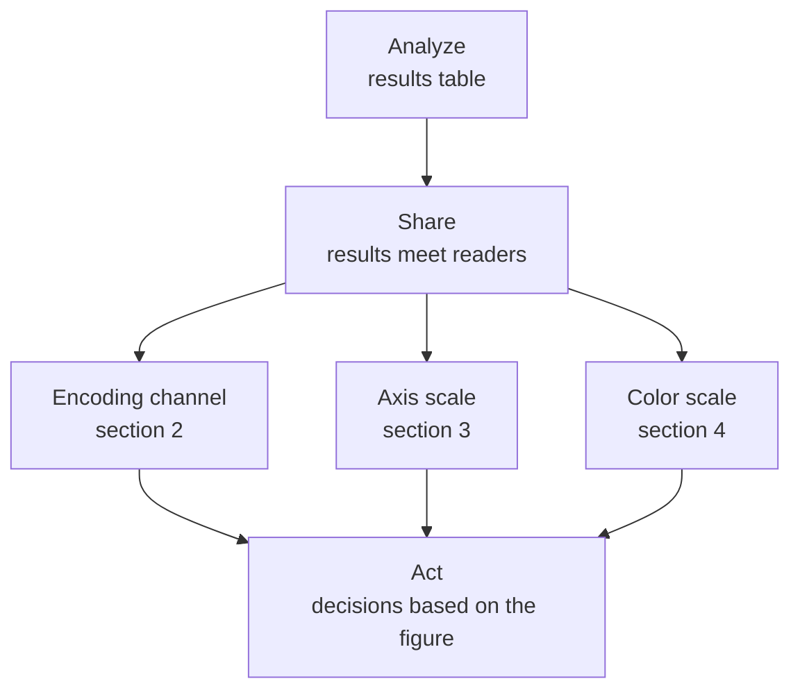

Truncating the y-axis of a bar chart makes viewers see a bigger difference than the data contain: across five studies by Yang et al. (2021), 83.5% of participants fell for it, and the effect persisted after they were taught about truncated axes. This sixth article in the *Evidence-based Data Analytics* series holds familiar visualization rules up against experimental research on graphical perception, then applies the results to PCA, volcano plots, MA plots, heatmaps and two biological datasets redrawn from scratch.

## Summary

This is a selective evidence review, not a systematic review. Four main conclusions:

1. When precise comparison matters, encode the most important quantity as position along a common scale; length, angle, area and color are progressively less accurate (Cleveland & McGill, 1984; Heer & Bostock, 2010).
2. Truncating the y-axis makes effects look larger, and warnings do not undo that impression (Correll et al., 2020; Yang et al., 2021); but "always start at zero" is only mandatory for bar charts.
3. Rainbow color maps and red–green pairs distort data and cause problems for people with color vision deficiency (Crameri et al., 2020); diverging scales belong only to data with a meaningful midpoint.
4. With small-sample biological data, show readers every data point (Weissgerber et al., 2015).

## 1. Introduction: why visualization needs evidence

In the six-phase process Ask → Prepare → Process → Analyze → Share → Act ([article 01](/en/blog/foundations-data-data-everywhere/)), Share is the phase where the results of an analysis meet their readers. [Article 05](/en/blog/analyze-data-to-answer-questions/) ended with a summarized table of numbers; this article picks up at the point where that table has to become a picture. A bad chart can ruin a sound analysis, because decisions in the Act phase rest on what readers see (Figure 1).



**Figure 1.** Three design choices in the Share phase, covered in sections 2, 3 and 4.

Visualization advice is usually handed down as rules of thumb: understandable in five seconds, y-axis starts at zero, pie charts with fewer than seven slices. Most of it sounds reasonable, but it rarely comes with a source or with the conditions under which it applies. As early as 1984, Cleveland and McGill wrote that graphical methods need a scientific foundation built on experiments that measure how viewers decode information encoded in a graph (Cleveland & McGill, 1984). The review by Franconeri et al. (2021) sums up the picture: the visual system extracts global statistics from a display very quickly, but comparisons between subsets of values are slow, and poorly designed displays cause confusion and misinterpretation, especially among readers with low graph literacy.

Biology is no exception. Weissgerber et al. (2015) reviewed 703 papers published in early 2014 in top physiology journals: 85.6% contained at least one bar graph of continuous data, while only 13.4% included a univariate scatterplot and 5.3% a box plot, even though many very different distributions produce the same bar graph.

The article works through four questions: how accurate the visual encoding channels are (section 2), how a truncated y-axis misleads (section 3), which color scales distort data and for whom they cause trouble (section 4), and how the standard charts of bioinformatics should be drawn (section 5). Section 6 redraws two datasets, and section 7 grades the familiar rules by the strength of their evidence. The argument of the article: most of those rules point in the right direction but leave out the conditions under which they apply.

## 2. How charts are "read": the ranking of encoding channels

### 2.1. Cleveland and McGill's original experiment

Drawing a chart is encoding: each number becomes the position of a point, the length of a bar, the angle of a pie slice or the shade of a colored cell. Reading a chart is decoding in reverse. Cleveland and McGill (1984) called these decoding operations elementary perceptual tasks and ranked them by accuracy, from highest to lowest:

1. position along a common scale;
2. position along non-aligned scales;
3. length, direction, angle;
4. area;
5. volume, curvature;
6. shading, color saturation.

The ranking is partly theoretical and partly tested by experiment; according to the authors themselves, the experiments confirmed the parts that were tested and suggested that the set of tasks needed to be extended. The principle that follows: a chart should use tasks as high in the ranking as possible. On that basis they argued that bar charts, divided bar charts (now usually called stacked bars), pie charts and shaded maps needed fundamental revision, and they proposed the dot chart as a replacement.

### 2.2. Replication and extension

Heer and Bostock (2010) replicated the experiment on Amazon Mechanical Turk with seven kinds of judgment: position along a common scale, length, angle (pie charts) and circular area (bubble charts). For each chart, 50 people identified the smaller of two marked values and then estimated what percentage of the larger value it was. The ranking matched the original experiment: position clearly beat length; area did worse than angle, and both did much worse than position. One point did not match the theory: angle was no worse than length, which the original experiment had not found either.

Talbot et al. (2014) ran four experiments specifically on bar charts and broadly confirmed Cleveland and McGill's ranking: judgments on stacked bars were clearly worse than on bars sharing a common baseline, and comparing two adjacent bars was more accurate than comparing two bars far apart. The practical consequence: put the bars to be compared next to each other, and sort bars by value unless the groups have a natural order.

### 2.3. How bad are pie charts?

By the ranking above, pie charts (angle, area) should lose to bar charts. The evidence is more complicated. In the series of experiments by Spence and Lewandowsky (1991) on proportion data, pies and bars performed about equally, pies did slightly better on complex judgments, and both beat tables. Skau and Kosara (2016) separated the three cues a pie chart uses (arc length, central angle, slice area) and found the central angle mattered least; donut charts, which lack the center altogether, were just as accurate as pies.

A reasonable reading: the tasks differ. Cleveland and McGill's experiment and its replication measured comparisons between two values, and for that task position wins. When the question is "how much of the whole is this part," pies are not as bad as their reputation. Figure 2 draws the same five proportions three ways: on the pie chart it is hard to tell whether A or B is larger; on the stacked bar only segment A, which sits on the axis, can be read against a common scale; on the dot chart the ranking is obvious at a glance.


**Figure 2.** The same five proportions (23, 22, 20, 18, 17%; illustrative data) drawn as a pie chart, a stacked bar and a dot chart.

3D effects have also been tested directly. Siegrist (1996) found that participants estimated better from 2D pie charts than from 3D ones, and that 3D bar charts took them longer. Zacks et al. (1998) found that perspective depth cues reduced accuracy when reading bar charts, but the drop faded after a short delay and was much smaller than the influence of neighboring graphical elements. 3D adds no information and carries a small cost: reason enough to avoid it, not reason to exaggerate the harm.

### 2.4. From encoding channels to chart choice

Chart-selection diagrams usually sort charts by purpose. That is a useful starting point but says nothing about accuracy; Table 1 adds a column for the encoding channel.

**Table 1.** Purpose, recommended chart and main encoding channel

| Purpose | Recommended chart | Main encoding channel | Notes |
| --- | --- | --- | --- |
| Compare values across groups | dot chart, sorted bar chart | position along a common scale (bars add length) | bars start at 0; place bars to be compared side by side |
| Distribution of one variable | strip plot, box plot, histogram | position | with small samples, plot every point |
| Composition of a whole | stacked bar with few segments, pie with a few slices | length; arc, angle, area | to compare parts with each other, use a dot chart |
| Relationship between two variables | scatter plot | position on two axes | correlation is not causation |
| Trend over time | line chart | position, direction (slope) | axis range: see section 3 |
| Patterns in a large matrix | heatmap | color | exact values cannot be read |

Two rows need comment. A scatter plot shows that two variables move together, and viewers easily read it as causation (→ Causal Inference). A heatmap encodes with color, the channel at the bottom of the ranking, so it suits seeing overall patterns rather than reading individual values; Gehlenborg and Wong (2012) note that heatmaps are useful for multivariate data but must be used correctly. The R syntax for each chart type is in Visualizations (R).

### 2.5. Data-ink ratio and "chart junk"

Tufte (1983) introduced the data-ink ratio, the share of a graphic's total "ink" that represents data, and advised removing elements that carry no data, such as frames around legends or drop shadows. The experimental evidence is not one-sided. Bateman et al. (2010) found that viewers described charts with pictorial embellishments no less accurately than plain charts, and remembered them better after two to three weeks; the authors themselves stayed cautious and did not recommend drawing every chart that way. Borkin et al. (2013), with a set of 2,070 charts from news media, reports, scientific journals and infographics, found that color and recognizable images made charts more memorable. Memorable is not the same as correctly understood: scientific figures, where readers need to read numbers, should be minimal; infographics can be decorated as long as the decoration does not distort the data.

## 3. Truncated y-axes: when they mislead and when they are acceptable

### 3.1. Evidence on the truncation effect

Pandey et al. (2015) classified misleading charts by the kind of misconception they create, built four charts using common distortion techniques, and then measured how deceptive each technique was in crowdsourced experiments.

Two later studies focused on the y-axis. Correll et al. (2020) showed that truncation increases subjective judgments of effect size across many chart types, even in designs with visual cues that clearly signal the axis has been cut. Yang et al. (2021) ran five studies with bar graphs: 83.5% of participants perceived a larger difference when the axis was truncated; the effect remained after they were taught about truncation; and graph literacy scores did not predict who was affected more. The uncomfortable consequence: a caption line saying "the y-axis does not start at 0" does not fix the problem.

### 3.2. "Always start at zero" is not right for every chart

Concluding "so always start at zero" goes too far in the other direction. Correll et al. (2020) themselves give examples where truncation helps, and recommend choosing the scale according to the size of the meaningful effect to be communicated, whatever the encoding channel. Witt (2019) turned that idea into a number: an axis set tight around the data makes every effect look large, an axis spanning the full scale makes every effect look small, and when the axis range is one to two standard deviations (SD) long, viewers are more sensitive to effect size and less biased. Witt's recommendation for fields that use standardized effects: the y-axis range should be no shorter than 1 SD and preferably at least 1.5 SD.

Combined with section 2, this gives two cases. A bar chart encodes value as bar length measured from a baseline; truncating the axis cuts off part of that length, so the ratio between bars no longer equals the ratio between values, and the axis must start at 0. Dot plots and line charts encode with position, so the axis does not have to include zero, as long as the scale is clearly labeled and the axis range matches the size of the effect. For quantities where zero has no practical meaning, such as pH or the size of a body part, forcing the axis to zero only flattens every difference (Figure 3).


**Figure 3.** One comparison, four ways to draw it: beak depth in 50 *Geospiza fortis* that did not survive and 50 that survived the 1977 drought. 95% confidence intervals from the t distribution (df = 49). Data: HHMI BioInteractive (2021), drawn from the data of P. R. Grant and B. R. Grant; analysis in section 6.1.

### 3.3. Other distortions

Other familiar warnings include dual y-axes with two different scales, plotting only the portion of the data that supports the conclusion, binning that hides a trend, and composition charts that do not add up to 100%. Not every warning has its own experiment, but the advice of Rougier et al. (2014) covers the whole group: choose the simplest type of figure that still conveys the message, label everything with full labels and tick marks, and use the full range of values when that is meaningful.

## 4. Color: rainbow scales, types of color map and color vision deficiency

### 4.1. Why the rainbow scale is harmful

The rainbow (or jet) color map runs from blue through green and yellow to red. Borland and Taylor (2007) summarized the properties that make it a poor choice and proposed alternatives. Crameri et al. (2020) explain the mechanism: yellow is the brightest and most eye-catching color but sits neither at the end nor in the middle of the scale, while the greens occupy a wide, low-contrast band. The color map therefore creates boundaries that are not in the data in one place and hides small variations in another, and by the group's estimate the visual error can exceed 7% of the data range.

The fix is a perceptually uniform color map: the same change in the data corresponds to the same perceived change along every part of the scale, and lightness increases steadily so that viewers can rank the colors (Crameri et al., 2020). Viridis and cividis belong to this group; jet's lightness, by contrast, swings sharply along the scale (Matplotlib Development Team, n.d.).


**Figure 4.** The same 14-gene × 8-sample matrix (simulated data) with five color maps, in normal color vision and under simulated deuteranopia using the model of Machado et al. (2009). Bottom row: lightness L* along each scale.

In Figure 4, the top five genes increase in the treated group, the middle five decrease, and the last four are unchanged. With jet, the four unchanged genes become the most vivid region, and lightness L* climbs from 13 to 96 and then drops to 25: printed in black and white, the lowest and highest values become two similar grays. Viridis and cividis brighten steadily from about 15 to 91. Under simulated deuteranopia, the green–black–red scale, common in gene-expression heatmaps, loses all information about direction: increases and decreases both turn yellowish brown. RdBu_r still keeps the two sides apart, and cividis barely changes.

### 4.2. How many readers are affected

Color vision deficiency (CVD), commonly called color blindness, is mostly the inherited red–green type. Birch's (2012) review gives prevalences of about 8% in men and 0.4% in women of European descent, and 4–6.5% in men of Chinese and Japanese descent. Wong (2011) puts it memorably: if a manuscript goes to three reviewers who are men of Northern European descent, the probability that at least one of them is color blind is 22%.

Data for Vietnam are scarce. Giang et al. (2026) screened 1,491 first-year health science students at a Vietnamese medical university with an online Ishihara test followed by a confirmatory examination: 1.9% had CVD, and men had about 16 times the odds of women. This is a single-university sample and the prevalence pools both sexes, so it cannot be compared directly with the figures above. Using Birch's (2012) range of 4–6.5%, a class with 40 male students would on average include about two who cannot tell red from green in your figure.

### 4.3. Choosing the right type of color map

Three types of color map match three types of data (Rougier et al., 2014; Matplotlib Development Team, n.d.):

- **Sequential**: one hue going from light to dark, for ordered quantities from low to high, such as TPM or density.
- **Diverging**: two hues spreading out from a midpoint, only for data with a meaningful middle value, such as a log2 fold change of 0, a z-score of 0 or a correlation coefficient of 0.
- **Qualitative**: clearly distinct colors, for unordered discrete groups, such as tissue type or experimental condition.

The advice "use a diverging palette to create contrast" is therefore right only when the data diverge around a central value (Crameri et al., 2020); applied to data without a midpoint, it draws a false boundary right in the middle of the scale. If the goal is to highlight one element, color that element and leave the rest gray (Rougier et al., 2014).

"Green is good, red is bad" is a real cultural convention, and figures should respect conventions readers already know (Franconeri et al., 2021). But it uses exactly the pair of colors that the most common form of CVD cannot distinguish, and success criterion 1.4.1 of WCAG 2.2 requires that color not be the only means of conveying information (World Wide Web Consortium, 2024). Keep the convention but add a second channel: lightness, marker shape or a text label. Switching a choropleth map from red-to-green to a light-to-dark blue ramp is a valid fix: a single-hue sequential scale carries the information in lightness.

### 4.4. Check before you publish

Three quick tests from Crameri et al. (2020): do adjacent colors differ by the same amount along the whole scale; does the figure contain red and green of the same lightness; is a rainbow scale used. In addition, always include a color bar, and view the figure under CVD simulation and in grayscale before submitting; the code in the Appendix does this with the matrix from Machado et al. (2009). Cividis was optimized to look nearly the same to people with and without red–green CVD (Nuñez et al., 2018).

## 5. Applying this to standard bioinformatics charts

### 5.1. Small-sample continuous data: drop the "bar + error bar"

Weissgerber et al. (2015) identify three problems with bar graphs for continuous data: many different distributions produce the same bar and the same error bar; with paired data, a bar graph implicitly suggests two independent groups; and a mean with SE or SD leads readers to assume the data are normally distributed without outliers. Among the papers with bar graphs that the group reviewed, 77.6% used mean ± SE, and in 75% of papers the smallest group in the figure had only two to six observations. With sample sizes like these, the group recommends plotting all of the data as a univariate scatterplot (strip plot, dot plot).

With larger samples, the box plot is the next step, but it should be avoided for very small samples (n < 5) (Krzywinski & Altman, 2014); histograms, density plots and violin plots are other options (Bruce & Bruce, 2017; → [Box plots and outliers](/en/blog/data-exploration-using-descriptive-statistics/)). Whatever the form, the figure legend must state n and the type of error bar, because SD, SE and the 95% confidence interval answer three different questions (→ [Sample statistics and estimation](/en/blog/3-dac-trung-thong-ke-cua-mot-mau-va-uoc-luong-tham-so-cua-tong-the/)).

### 5.2. PCA plots

Principal component analysis (PCA) projects high-dimensional data onto a few axes that retain the most variance; Ringnér's (2008) primer introduces its use for gene-expression data. In RNA-seq, the PCA plot is often the first quality-control figure: do the samples separate by condition, are there outlier samples or batch effects (Transcriptomics)?


**Figure 5.** Four standard charts on a simulated RNA-seq dataset (2,982 genes × 8 samples, negative binomial counts, 10% of genes assigned a true change; p-values from t-tests on log2 counts, Benjamini–Hochberg adjusted). The figure only illustrates encoding channels; a real analysis needs DESeq2, edgeR or limma.

The PCA plot uses the best channel, position on two axes, but three details decide how faithful it is. Axis labels must give the percentage of variance for each component. The aspect ratio must be preserved: PC1 always has more variance than PC2, so the plot is usually wider than it is tall, and squeezing it into a square is misleading (Holmes & Huber, 2019). And color should encode condition while marker shape encodes batch, so the information does not rely on color alone (Figure 5a).

### 5.3. Volcano plots

Cui and Churchill (2003) describe the volcano plot as a scatter plot of −log10 p-value against fold change, which lets you see two criteria at once: how large the change is and how strong the statistical evidence is. Both are on position axes (Figure 5b); the risk lies elsewhere. The two threshold lines are the analyst's decisions, so their values must be stated. The vertical axis should use p-values adjusted for multiple testing, because with tens of thousands of genes, a 0.05 cutoff on raw p-values will color a great many false positives (Math and statistics for biology). Genes of interest should be labeled directly next to their points.

### 5.4. MA plots

A volcano plot hides one variable: expression level. An MA plot, as used in DESeq2, plots log fold change against mean expression intensity and highlights genes with low adjusted p-values (Love et al., 2014). This reveals a property of count data: fold changes for genes with few reads are very noisy, so weakly expressed genes appear to change more than strongly expressed ones; DESeq2 handles this by shrinking the estimates toward zero. In the simulated data of Figure 5c, 18.7% of genes that were assigned no change and had a mean below 10 counts still showed |log2 fold change| ≥ 1, compared with 0.7% of the remaining genes. Ranking genes by fold change alone would push many noisy genes to the top of the list.

### 5.5. Heatmaps

Eisen et al. (1998) described a system for clustering genome-wide expression data in which the results are displayed graphically, showing the clusters and the underlying data together. For heatmaps, sections 2.4 and 4 give three rules. Data standardized per gene (z-scores) have a midpoint of 0 and should use a diverging scale centered on 0 (Figure 5d); non-negative values such as TPM use a sequential scale. Avoid red–green pairs. And do not expect readers to read numbers off colored cells: Crameri et al. (2020) note that adjacent colored cells also shift how the color of each cell is perceived.

### 5.6. Ten rules for figures, and what is left out

Rougier et al. (2014) distilled the experience of making scientific figures into ten rules, including: know your message, do not trust the defaults, use color effectively, do not mislead the reader, and avoid chartjunk. This is practitioners' advice, but many of the rules coincide with the evidence in sections 2–4. This article does not cover dimensionality-reduction plots for single-cell data (UMAP, t-SNE) or network visualization.

## 6. Two redrawn examples

### 6.1. Darwin's finches: the y-axis, and bar charts versus dot plots

The HHMI BioInteractive (2021) teaching dataset, drawn from the data of Peter and Rosemary Grant, covers 100 medium ground finches, *Geospiza fortis*: 50 that died in the 1977 drought and 50 that survived (→ Natural selection in Darwin's finches). Mean beak depth was 9.111 mm (SD 0.880) in non-survivors and 9.674 mm (SD 0.842) in survivors; the difference is 0.563 mm (95% CI 0.22–0.90), Cohen's d = 0.65. A few lines of Python show how the axis of a bar chart changes the impression this number makes:

```python
import math

# Beak depth (mm): non-survivors and survivors, n = 50 per group
m1, s1, m2, s2 = 9.111, 0.880, 9.674, 0.842
sp = math.sqrt((s1**2 + s2**2) / 2)          # pooled SD for equal group sizes
d = (m2 - m1) / sp                           # Cohen's d
centre, span = (m1 + m2) / 2, 1.5 * sp       # y-axis spanning 1.5 SD, centered between the two means

print(f"Pooled SD = {sp:.3f} mm, Cohen's d = {d:.2f}")
print(f"y-axis spanning 1.5 SD: {centre - span / 2:.2f} to {centre + span / 2:.2f} mm")
print(f"Bars cut at 9.0 mm: height ratio {(m2 - 9.0) / (m1 - 9.0):.1f}x, true ratio {m2 / m1:.2f}x")
```

```text
Pooled SD = 0.861 mm, Cohen's d = 0.65
y-axis spanning 1.5 SD: 8.75 to 10.04 mm
Bars cut at 9.0 mm: height ratio 6.1x, true ratio 1.06x
```

In panel (a) of Figure 3, the axis is cut at 9.0 mm: the survivors' bar is 6.1 times as tall as the other, while the value is only 6% larger. In panel (b), the axis starts at 0: the height ratio is correct, but the difference nearly vanishes, and most of the ink goes into drawing the range from 0 to 7 mm, where there is not a single bird. The two panels fail in exactly the two directions Witt (2019) describes; the root of the problem is using length to encode a quantity for which zero is meaningless. Panel (c) switches to position: two means with 95% confidence intervals on an axis spanning 1.5 SD, where the difference takes up less than half the height of the plot. Panel (d) plots all 100 individuals, as Weissgerber et al. (2015) recommend, and only here can readers see what the means hide: the two groups overlap almost entirely; the drought shifted the distribution by a step rather than splitting the population in two.

### 6.2. Zebrafish embryos and propylene glycol: from means to a dose–response curve

The second example uses data from a lab practical testing propylene glycol toxicity on zebrafish (*Danio rerio*) embryos, in the style of the fish embryo acute toxicity test (OECD, 2013): six concentrations from 0 to 500 mg/L, 15 embryos per concentration, with dead embryos counted every 24 hours up to 96 hours (→ Propylene glycol toxicity).

A table like this invites three easy mistakes. The first is averaging mortality across the six concentrations at each time point and plotting bars with SE (Figure 6a): the four bars are nearly equal, about 51–54% with an SE of about 21 percentage points, and the dose–response relationship has been averaged away. The second is treating each concentration as a separate, evenly spaced bar, when concentration is a quantitative variable spanning almost two orders of magnitude and belongs on a continuous x-axis, usually a log scale. The third is plotting percentages as if they were precise measurements, when each one is a count out of 15 embryos with a calculable uncertainty:

```python
import math

def wilson(k, n, z=1.96):
    """95% Wilson confidence interval for the proportion k/n."""
    p = k / n
    centre = (p + z**2 / (2 * n)) / (1 + z**2 / n)
    half = z * math.sqrt(p * (1 - p) / n + z**2 / (4 * n**2)) / (1 + z**2 / n)
    return max(0.0, centre - half), min(1.0, centre + half)

conc = [0, 10, 50, 150, 350, 500]        # mg/L
dead_96h = [3, 1, 0, 15, 15, 15]         # dead embryos at 96 h, 15 embryos per concentration
for c, k in zip(conc, dead_96h):
    lo, hi = wilson(k, 15)
    print(f"{c:>3} mg/L: {k:>2}/15 = {k / 15:>4.0%}, 95% CI {lo:>3.0%} to {hi:>4.0%}")
```

```text
  0 mg/L:  3/15 =  20%, 95% CI  7% to  45%
 10 mg/L:  1/15 =   7%, 95% CI  1% to  30%
 50 mg/L:  0/15 =   0%, 95% CI  0% to  20%
150 mg/L: 15/15 = 100%, 95% CI 80% to 100%
350 mg/L: 15/15 = 100%, 95% CI 80% to 100%
500 mg/L: 15/15 = 100%, 95% CI 80% to 100%
```

For small n, Brown et al. (2001) recommend the Wilson or Jeffreys interval instead of the familiar Wald interval. The result changes how the table reads: the 20% mortality in the control group (3/15) has a confidence interval of 7–45%, which overlaps the 0–20% interval of the 50 mg/L group, so you cannot say 50 mg/L is "safer" than the control, and 0/15 does not mean the true mortality is zero either. From 150 mg/L upward, the lower bound of the confidence interval is 80%, clearly separated from the low concentrations.


**Figure 6.** One dataset on propylene glycol toxicity in zebrafish embryos (15 embryos per concentration): (a) mean mortality across the six concentrations ± SE; (b) mortality by concentration with 95% Wilson confidence intervals.

Figure 6b combines all three corrections: concentration on a log axis with the control group placed separately, mortality with binomial confidence intervals, and one series per time point. A y-axis from 0 to 100% is the natural range of a proportion. The figure also exposes a limitation of the design: mortality jumps from 0% at 50 mg/L to nearly 100% at 150 mg/L, so the concentration lethal to 50% of embryos (LC50) lies between these two levels, but there are no points in the transition zone from which to estimate the slope. The next step is a dose–response model, for example with the R package drc (Ritz & Streibig, 2005), over a denser range of concentrations in that interval.

## 7. The familiar rules: how strong is the evidence?

Table 2 grades the rules common in introductory material by the level of evidence this review found. "Rule of thumb" does not mean wrong, only that no experiment behind it turned up.

**Table 2.** Familiar rules, level of evidence and suggested adjustment

| Rule | Level of evidence | Source | Adjustment |
| --- | --- | --- | --- |
| Bar chart y-axis starts at 0 | Strong | Correll et al. (2020); Yang et al. (2021) | Keep; for dot plots and line charts, choose the axis range by effect size (Witt, 2019) |
| Use 2D, avoid 3D | Moderate: few experiments, small effects | Siegrist (1996); Zacks et al. (1998) | Keep |
| Avoid pie charts; pies under 7 slices | Mixed; the number 7 is a rule of thumb | Spence & Lewandowsky (1991); Skau & Kosara (2016) | Pie for part-of-whole reading; dot chart for comparing parts |
| Diverging palette for contrast | Not supported as a general rule | Crameri et al. (2020) | Only when the data have a midpoint |
| Green is good, red is bad | Cultural convention, conflicts with CVD | Franconeri et al. (2021); Birch (2012) | Add lightness, shape or labels |
| Maximize the data-ink ratio | Design principle; mixed experiments | Tufte (1983); Bateman et al. (2010) | Minimal for scientific figures |
| Understandable in 5 seconds | Communication rule of thumb | Franconeri et al. (2021) | Depends on the task: global statistics are fast, subset comparisons slow |
| Four elements of a good visualization | Design viewpoint | McCandless (n.d.) | Use as a checklist |
| Direct labels instead of legends; alt text | Accessibility standard | World Wide Web Consortium (2024) | Keep |

Two presentation rules belong to communication rather than graphical perception. The "five-second rule" has two meanings that often get mixed up: viewers should understand a chart within five seconds, and presenters should pause for five seconds after showing a chart. The five-step sequence for introducing a chart to an audience (name the figure, answer the obvious question first, state the finding, cite the numbers, say why it matters), often called the McCandless Method, is a good outline. This review found no experiments behind either. On accessibility, WCAG 2.2 requires a text alternative for all non-text content (World Wide Web Consortium, 2024); the alt text of a chart should state the chart type, the two axes and the main finding.

## 8. Conclusion and checklist

Position along a common scale is the most accurate channel, and this result has been replicated; pie charts lose clearly only when parts must be compared with each other. Truncating the y-axis of a bar chart makes differences look bigger, and warnings do not fix it; for dot plots and line charts, 1.5 SD is an experimentally grounded benchmark for the axis range. Rainbow scales and red–green pairs distort data and cause problems for about 4–8% of men. And in biological figures, most errors come down to hiding data: bars hide distributions, volcano plots hide expression level, means hide the dose–response relationship.

<div class="callout callout-note">
<p class="callout-title">Checklist before a figure goes into a report</p>

1. Which question does the figure answer: comparison, distribution, composition, relationship or trend?
2. Is the most important quantity on a common position scale?
3. Bar chart: does the axis start at 0? If zero is meaningless, switch to a dot plot.
4. Does the axis range match the effect size (about 1.5 SD), or is it set tight around the data?
5. Small sample: is every data point plotted?
6. Are n and the type of error bar (SD, SE or 95% CI) stated? Do proportions from counts have binomial confidence intervals?
7. Is the color map the right type: sequential, diverging (only with a midpoint) or qualitative? Is there a color bar?
8. Is the figure still readable under CVD simulation and in grayscale? Is there a channel other than color?
9. Are labels placed next to the data, with units, and is there alt text?
10. Have the numbers on the figure been recomputed from the raw data with a script?

</div>

The review has three limitations: it is a selective review; most of the experiments cited used Mechanical Turk participants and simple tasks, so they may not generalize to experts reading omics heatmaps; and the simulated figures (Figures 2, 4, 5) are illustrations only. [Article 07](/en/blog/introduction-to-data-analysis-using-python/) moves on to Python, the tool for redrawing these figures with reproducible code.

## Appendix: simulating deuteranopia for a color map

The code converts sRGB colors to linear RGB, multiplies by the deuteranopia matrix from Machado et al. (2009), converts back, and then computes CIE L* lightness along four Matplotlib color maps.

```python
import numpy as np
import matplotlib

# Deuteranopia simulation matrix (severity 1.0) from Machado et al. (2009)
M = np.array([(0.367322, 0.860646, -0.227968),
              (0.280085, 0.672501, 0.047413),
              (-0.011820, 0.042940, 0.968881)])

def to_linear(c):                          # sRGB -> linear RGB
    return np.where(c <= 0.04045, c / 12.92, ((c + 0.055) / 1.055) ** 2.4)

def to_srgb(c):                            # linear RGB -> sRGB
    c = np.clip(c, 0, 1)
    return np.where(c <= 0.0031308, 12.92 * c, 1.055 * c ** (1 / 2.4) - 0.055)

def deuteranopia(rgb):
    return to_srgb(to_linear(rgb) @ M.T)

def lightness(rgb):                        # CIE L* lightness, 0 to 100
    y = to_linear(rgb) @ np.array([0.2126, 0.7152, 0.0722])
    f = np.where(y > (6 / 29) ** 3, np.cbrt(y), y / (3 * (6 / 29) ** 2) + 4 / 29)
    return 116 * f - 16

for name in ["jet", "viridis", "cividis", "RdBu_r"]:
    ramp = matplotlib.colormaps[name](np.linspace(0, 1, 256))[:, :3]
    L = lightness(deuteranopia(ramp))
    mono = bool(np.all(np.diff(L) > -0.05))
    print(f"{name:8s} L* start {L[0]:3.0f}, middle {L[128]:3.0f}, end {L[-1]:3.0f}, monotonic: {mono}")
```

```text
jet      L* start  17, middle  89, end  29, monotonic: False
viridis  L* start  16, middle  53, end  92, monotonic: True
cividis  L* start  13, middle  52, end  92, monotonic: True
RdBu_r   L* start  19, middle  97, end  23, monotonic: False
```

Under simulated deuteranopia, viridis and cividis still brighten steadily; jet gets lighter and then darker again. RdBu_r is not monotonic because it is a diverging scale, lightest at the midpoint.

## References

Bateman, S., Mandryk, R. L., Gutwin, C., Genest, A., McDine, D., & Brooks, C. (2010). Useful junk? The effects of visual embellishment on comprehension and memorability of charts. In *Proceedings of the SIGCHI Conference on Human Factors in Computing Systems* (pp. 2573–2582). ACM. https://doi.org/10.1145/1753326.1753716

Birch, J. (2012). Worldwide prevalence of red-green color deficiency. *Journal of the Optical Society of America A, 29*(3), 313–320. https://doi.org/10.1364/JOSAA.29.000313

Borkin, M. A., Vo, A. A., Bylinskii, Z., Isola, P., Sunkavalli, S., Oliva, A., & Pfister, H. (2013). What makes a visualization memorable? *IEEE Transactions on Visualization and Computer Graphics, 19*(12), 2306–2315. https://doi.org/10.1109/TVCG.2013.234

Borland, D., & Taylor, R. M., II. (2007). Rainbow color map (still) considered harmful. *IEEE Computer Graphics and Applications, 27*(2), 14–17. https://doi.org/10.1109/MCG.2007.323435

Brown, L. D., Cai, T. T., & DasGupta, A. (2001). Interval estimation for a binomial proportion. *Statistical Science, 16*(2), 101–133. https://doi.org/10.1214/ss/1009213286

Bruce, P., & Bruce, A. (2017). *Practical statistics for data scientists: 50 essential concepts*. O'Reilly Media.

Cleveland, W. S., & McGill, R. (1984). Graphical perception: Theory, experimentation, and application to the development of graphical methods. *Journal of the American Statistical Association, 79*(387), 531–554. https://doi.org/10.1080/01621459.1984.10478080

Correll, M., Bertini, E., & Franconeri, S. (2020). Truncating the y-axis: Threat or menace? In *Proceedings of the 2020 CHI Conference on Human Factors in Computing Systems* (pp. 1–12). ACM. https://doi.org/10.1145/3313831.3376222

Crameri, F., Shephard, G. E., & Heron, P. J. (2020). The misuse of colour in science communication. *Nature Communications, 11*, 5444. https://doi.org/10.1038/s41467-020-19160-7

Cui, X., & Churchill, G. A. (2003). Statistical tests for differential expression in cDNA microarray experiments. *Genome Biology, 4*(4), 210. https://doi.org/10.1186/gb-2003-4-4-210

Eisen, M. B., Spellman, P. T., Brown, P. O., & Botstein, D. (1998). Cluster analysis and display of genome-wide expression patterns. *Proceedings of the National Academy of Sciences, 95*(25), 14863–14868. https://doi.org/10.1073/pnas.95.25.14863

Franconeri, S. L., Padilla, L. M., Shah, P., Zacks, J. M., & Hullman, J. (2021). The science of visual data communication: What works. *Psychological Science in the Public Interest, 22*(3), 110–161. https://doi.org/10.1177/15291006211051956

Gehlenborg, N., & Wong, B. (2012). Points of view: Heat maps. *Nature Methods, 9*(3), 213. https://doi.org/10.1038/nmeth.1902

Giang, L. C., Bui, Y. V., Nguyen, H. L., Nguyen, D. T., Nguyen, D. D., Bui, T. Q. A., Hoang, V. T., & Hoang, N. T. (2026). Prevalence of color vision deficiency among first-year health science students at a medical university in Vietnam. *Scientific Reports, 16*(1), 23398. https://doi.org/10.1038/s41598-026-53435-1

Heer, J., & Bostock, M. (2010). Crowdsourcing graphical perception: Using Mechanical Turk to assess visualization design. In *Proceedings of the SIGCHI Conference on Human Factors in Computing Systems* (pp. 203–212). ACM. https://doi.org/10.1145/1753326.1753357

HHMI BioInteractive. (2021). *Evolution in action: Data analysis* [Student handout, version 2]. Howard Hughes Medical Institute. https://www.biointeractive.org/classroom-resources/evolution-action-data-analysis

Holmes, S., & Huber, W. (2019). *Modern statistics for modern biology*. Cambridge University Press. https://www.huber.embl.de/msmb/

Krzywinski, M., & Altman, N. (2014). Visualizing samples with box plots. *Nature Methods, 11*(2), 119–120. https://doi.org/10.1038/nmeth.2813

Love, M. I., Huber, W., & Anders, S. (2014). Moderated estimation of fold change and dispersion for RNA-seq data with DESeq2. *Genome Biology, 15*(12), 550. https://doi.org/10.1186/s13059-014-0550-8

Machado, G. M., Oliveira, M. M., & Fernandes, L. A. F. (2009). A physiologically-based model for simulation of color vision deficiency. *IEEE Transactions on Visualization and Computer Graphics, 15*(6), 1291–1298. https://doi.org/10.1109/TVCG.2009.113

Matplotlib Development Team. (n.d.). *Choosing colormaps in Matplotlib*. https://matplotlib.org/stable/users/explain/colors/colormaps.html

McCandless, D. (n.d.). *What makes a good data visualization?* Information is Beautiful. https://informationisbeautiful.net/visualizations/what-makes-a-good-data-visualization/

Nuñez, J. R., Anderton, C. R., & Renslow, R. S. (2018). Optimizing colormaps with consideration for color vision deficiency to enable accurate interpretation of scientific data. *PLOS ONE, 13*(7), e0199239. https://doi.org/10.1371/journal.pone.0199239

OECD. (2013). *Test No. 236: Fish embryo acute toxicity (FET) test*. OECD Guidelines for the Testing of Chemicals, Section 2. OECD Publishing. https://doi.org/10.1787/9789264203709-en

Pandey, A. V., Rall, K., Satterthwaite, M. L., Nov, O., & Bertini, E. (2015). How deceptive are deceptive visualizations? An empirical analysis of common distortion techniques. In *Proceedings of the 33rd Annual ACM Conference on Human Factors in Computing Systems* (pp. 1469–1478). ACM. https://doi.org/10.1145/2702123.2702608

Ringnér, M. (2008). What is principal component analysis? *Nature Biotechnology, 26*(3), 303–304. https://doi.org/10.1038/nbt0308-303

Ritz, C., & Streibig, J. C. (2005). Bioassay analysis using R. *Journal of Statistical Software, 12*(5). https://doi.org/10.18637/jss.v012.i05

Rougier, N. P., Droettboom, M., & Bourne, P. E. (2014). Ten simple rules for better figures. *PLoS Computational Biology, 10*(9), e1003833. https://doi.org/10.1371/journal.pcbi.1003833

Siegrist, M. (1996). The use or misuse of three-dimensional graphs to represent lower-dimensional data. *Behaviour & Information Technology, 15*(2), 96–100. https://doi.org/10.1080/014492996120300

Skau, D., & Kosara, R. (2016). Arcs, angles, or areas: Individual data encodings in pie and donut charts. *Computer Graphics Forum, 35*(3), 121–130. https://doi.org/10.1111/cgf.12888

Spence, I., & Lewandowsky, S. (1991). Displaying proportions and percentages. *Applied Cognitive Psychology, 5*(1), 61–77. https://doi.org/10.1002/acp.2350050106

Talbot, J., Setlur, V., & Anand, A. (2014). Four experiments on the perception of bar charts. *IEEE Transactions on Visualization and Computer Graphics, 20*(12), 2152–2160. https://doi.org/10.1109/TVCG.2014.2346320

Tufte, E. R. (1983). *The visual display of quantitative information*. Graphics Press.

Weissgerber, T. L., Milic, N. M., Winham, S. J., & Garovic, V. D. (2015). Beyond bar and line graphs: Time for a new data presentation paradigm. *PLOS Biology, 13*(4), e1002128. https://doi.org/10.1371/journal.pbio.1002128

Witt, J. K. (2019). Graph construction: An empirical investigation on setting the range of the y-axis. *Meta-Psychology, 3*. https://doi.org/10.15626/MP.2018.895

Wong, B. (2011). Points of view: Color blindness. *Nature Methods, 8*(6), 441. https://doi.org/10.1038/nmeth.1618

World Wide Web Consortium. (2024). *Web Content Accessibility Guidelines (WCAG) 2.2* [W3C Recommendation]. https://www.w3.org/TR/WCAG22/

Yang, B. W., Vargas Restrepo, C., Stanley, M. L., & Marsh, E. J. (2021). Truncating bar graphs persistently misleads viewers. *Journal of Applied Research in Memory and Cognition, 10*(2), 298–311. https://doi.org/10.1016/j.jarmac.2020.10.002

Zacks, J., Levy, E., Tversky, B., & Schiano, D. J. (1998). Reading bar graphs: Effects of extraneous depth cues and graphical context. *Journal of Experimental Psychology: Applied, 4*(2), 119–138. https://doi.org/10.1037/1076-898X.4.2.119
