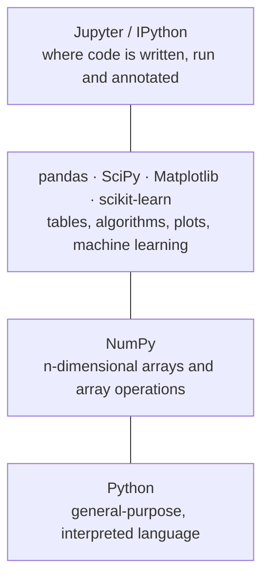
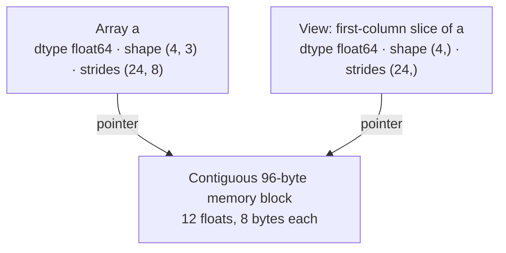
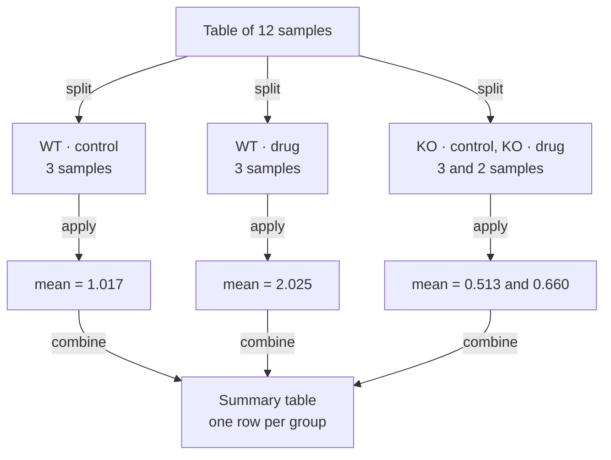

Of the 10,388 Python Jupyter notebooks accompanying biomedical papers for which Samuel and Mietchen (2024) managed to install every dependency, only 1,203 ran to completion without errors and 879 produced the same results as the original. Being able to write Python code, in other words, is not enough to make an analysis fast, correct and re-runnable. This seventh article in the *Evidence-based Data Analytics* series walks through three tools scientists use every day: NumPy arrays and vectorization, with timings measured on a real machine; pandas data frames and their missing-value traps; and Jupyter notebooks, together with the evidence on how reproducible they are. At the end, all three come together in a Biopython example that computes the GC content of the human mitochondrial genome, with code you can run yourself.

## 1. Introduction: from spreadsheets and SQL to Python

[Article 05](/en/blog/analyze-data-to-answer-questions/) ended with joining tables using lookup functions and JOIN. Spreadsheets, SQL and Python can all filter data and all compute with functions; they differ in where the data lives and how operations are recorded (Table 1).

**Table 1.** Three tools for the same kind of job

| Tool | Data lives in | Filter with | Operations are recorded in |
| --- | --- | --- | --- |
| Spreadsheet | the spreadsheet file itself | column filters | formulas in cells; manual edits leave no trace |
| SQL | tables in a database | a `WHERE` clause | the query |
| Python | CSV files, spreadsheets, databases, APIs | pandas Boolean masks | a script or notebook |

Python becomes necessary as data grows: a gene expression table has tens of thousands of rows, a sequence file has millions of reads, and at that scale editing cells one by one in a spreadsheet or writing a loop over every element is both slow and error-prone.

Python is a general-purpose, interpreted language suited to tasks such as cleaning data, working with web resources and processing text; add fast array computation and scientists can do everything in a single language (Harris et al., 2020). The "fast array computation" comes from NumPy, the foundation library for SciPy (Virtanen et al., 2020), Matplotlib (Hunter, 2007), pandas (McKinney, 2010) and scikit-learn (Harris et al., 2020); IPython and Jupyter are the interactive environments for writing and running all of it (Pérez & Granger, 2007; Kluyver et al., 2016) (Figure 1). This article does not reteach basic syntax (the Appendix has two quick-reference tables); visualization belongs to [article 06](/en/blog/share-data-through-the-art-of-visualization/).



**Figure 1.** The layers of the scientific Python ecosystem used in this article, drawn from the description in Harris et al. (2020). Each layer builds on the one below.

Buffalo (2015) points out a difference between the lab bench and the computer: a failed electrophoresis gel is obvious at a glance, whereas in scientific computing errors can be silent, meaning the program still runs and still prints a result; the result is simply wrong. Silent errors are the thread running through this article: each part shows where NumPy, pandas or a notebook gives a wrong result without warning, and how to catch it.

<div class="callout callout-note">
<p class="callout-title">Environment used for the code in this article</p>

The code and results in this article were run on November 15, 2026 with Python 3.13.2, NumPy 2.4.6, pandas 3.0.3 and Biopython 1.87; other versions may print slightly different output.

</div>

## 2. Part 1: ndarray and vectorization

### 2.1. Anatomy of an ndarray

According to Harris et al. (2020), a NumPy array (ndarray, n-dimensional array) consists of a pointer to a block of memory holding the data, plus metadata for interpreting that memory: the data type (dtype), the shape and the strides. The code below creates a 4-row × 3-column array and then probes each property in turn (Figure 2):

```python
import numpy as np

a = np.arange(12, dtype=np.float64).reshape(4, 3)   # 12 floats, 4 rows × 3 columns
print(a.dtype, a.shape, a.strides, a.nbytes)

col = a[:, 0]                          # slice of the first column: a view, no copy
print(col.strides, np.shares_memory(a, col))
col[0] = -1                            # modifying the view...
print(a[0])                            # ...modifies the original array

mixed = np.array([1.5, 2, "NA"])       # mixing numbers and text
print(mixed, mixed.dtype)

x = np.array([1, 2, 3])
y = np.append(x, 4)                    # returns a new array
print(x, y)
```

```text
float64 (4, 3) (24, 8) 96
(24,) True
[-1.  1.  2.]
['1.5' '2' 'NA'] <U32
[1 2 3] [1 2 3 4]
```



**Figure 2.** Array `a` and the view `a[:, 0]` point to the same block of memory; only the metadata differ.

- **One dtype for the whole array.** Every element has the same type and occupies the same number of bytes (Harris et al., 2020): 12 float64 values, 8 bytes each, sitting side by side in 96 bytes. That is why, when it meets a text value like "NA", NumPy raises no error but converts the entire array to strings (`<U32`), and numerical operations on it no longer make sense.
- **Shape and number of dimensions.** A vector of numbers is a 1-dimensional array, a table of numbers is a 2-dimensional array, and a color video is a 4-dimensional array (Harris et al., 2020).
- **Strides.** Memory stores the elements as one flat sequence; strides say how many bytes to jump to reach the next element along each dimension. For an array of 8-byte floats with shape (4, 3), moving to the next column is 8 bytes and moving to the next row is 3 × 8 = 24 bytes, so the strides are (24, 8) (Harris et al., 2020).
- **Views.** The slice `a[:, 0]` does not copy data: it is a view, that is, another ndarray pointing to the same memory with its own strides of (24,). Modifying the view modifies the original array, as the line `[-1.  1.  2.]` shows. Selecting elements with a mask or an index array returns a copy (Harris et al., 2020). If you need an independent copy, call `.copy()`; if you are not sure, ask `np.shares_memory()`.
- **Fixed size.** `np.append(x, 4)` allocates a new array and returns a copy, while `x` still has its three elements (NumPy Developers, n.d.-a). An ndarray also has no `.append()` method the way a list does: `x.append(4)` raises an `AttributeError`.

### 2.2. Vectorization and broadcasting

Vectorization means operating on a whole array instead of on individual elements (Harris et al., 2020). The phrase easily suggests that every element is processed at the same instant. In fact the loop is still there; it has just moved out of your Python code and into NumPy's precompiled C code (NumPy Developers, n.d.-b), where the iteration is organized close to optimally and takes strides into account to make good use of the CPU cache (Harris et al., 2020). The example below corrects optical density (OD) readings for the dilution factor:

```python
od = [0.12, 0.25, 0.51]                # measured optical density
dilution = [10, 10, 100]               # dilution factor

try:
    od * dilution                      # lists do not multiply element by element
except TypeError as err:
    print("TypeError:", err)

corrected = []                         # loop: one element at a time
for i in range(len(od)):
    corrected.append(od[i] * dilution[i])
print(corrected)

print(np.array(od) * np.array(dilution))   # vectorized: the whole array in one operation
```

```text
TypeError: can't multiply sequence by non-int of type 'list'
[1.2, 2.5, 51.0]
[ 1.2  2.5 51. ]
```

With lists you have to write a loop; with arrays, a single multiplication does the job for the whole sequence. The code is shorter, leaves fewer places to get an index wrong and, as Section 2.3 will measure, is much faster when the data are already in an array.

Broadcasting extends this idea to two arrays of different shapes: the smaller array is virtually replicated to match the larger one without copying any data in memory (Harris et al., 2020). A familiar example from RNA-seq data is dividing a gene × sample count matrix by each sample's total number of reads and multiplying by one million (counts per million, CPM) so that samples can be compared (Transcriptomics):

```python
counts = np.array([[120,   98,  15],       # 3 genes (rows) × 3 samples (columns)
                   [ 45,   51,  60],
                   [835, 1851, 425]])
lib_size = counts.sum(axis=0)              # total reads per sample
cpm = counts / lib_size * 1e6              # (3, 3) divided by (3,): broadcasting
print(lib_size)
print(cpm.round(0))
```

```text
[1000 2000  500]
[[120000.  49000.  30000.]
 [ 45000.  25500. 120000.]
 [835000. 925500. 850000.]]
```

```text
  counts (3, 3)          lib_size (3,)        counts / lib_size (3, 3)
[[120   98   15]                            [[120/1000   98/2000   15/500]
 [ 45   51   60]    ÷   [1000 2000 500]  =   [ 45/1000   51/2000   60/500]
 [835 1851  425]]                            [835/1000 1851/2000  425/500]]
```

**Figure 3.** Broadcasting: the vector `lib_size` is reused for all three rows of `counts` without being copied.

`counts.sum(axis=0)` is a reduction, that is, it combines elements along one axis (Harris et al., 2020): `axis=0` returns one value per column, `axis=1` one value per row. pandas follows the same convention. Anyone who has learned R will find this familiar: Buffalo (2015) devotes a section to vectors, vectorization and indexing in the introductory R chapter (R Tutorial).

### 2.3. Measurement: list loops versus NumPy

How much is "faster"? The measurement below answers that for one machine and one specific computation.

**Method.** The computation is the dot product of two sequences of n random floats (seed 2026), with n from 10² to 10⁷, done four ways: (a) a `for` loop with `append` on lists; (b) a list comprehension; (c) NumPy on two existing arrays; (d) like (c) but starting from two lists, so the time to convert the lists into arrays is included. `np.dot` serves as a reference. Timing uses the `timeit` module: `autorange()` picks the number of calls so that each measurement lasts at least 0.2 seconds, each configuration is measured 7 times and the minimum is kept, because according to the `timeit` documentation that value is a lower bound on how fast the machine can run the code, while higher values are usually caused by other processes interfering (Python Software Foundation, n.d.-c). All four methods must give the same result according to `np.isclose`. The test machine is a laptop with an Intel Core i5-5350U 1.8 GHz CPU (2 cores, 3 MB L3 cache), 8 GB of RAM, running macOS 12.7.6.

```python
import sys
import timeit

import numpy as np

def loop_append(a, b):                 # (a) for loop + append on lists
    out = []
    for i in range(len(a)):
        out.append(a[i] * b[i])
    return sum(out)

def list_comp(a, b):                   # (b) list comprehension
    return sum([a[i] * b[i] for i in range(len(a))])

def numpy_vec(a, b):                   # (c) NumPy on existing arrays
    return (a * b).sum()

def numpy_from_lists(a, b):            # (d) convert lists to arrays, then compute
    return (np.array(a) * np.array(b)).sum()

def best_time(fn, *args, repeat=7):
    timer = timeit.Timer(lambda: fn(*args))
    number, _ = timer.autorange()      # number of calls so each measurement lasts at least 0.2 s
    return min(timer.repeat(repeat=repeat, number=number)) / number

print("Python", sys.version.split()[0], "| NumPy", np.__version__)
rng = np.random.default_rng(2026)      # fixed seed
print(f"{'n':>9}{'(a)':>10}{'(b)':>10}{'(c)':>10}{'(d)':>10}{'np.dot':>10}{'(a)/(c)':>9}")
for exp in range(2, 8):
    n = 10 ** exp
    arr_a, arr_b = rng.random(n), rng.random(n)
    list_a, list_b = arr_a.tolist(), arr_b.tolist()
    ref = np.dot(arr_a, arr_b)
    results = [loop_append(list_a, list_b), list_comp(list_a, list_b),
               numpy_vec(arr_a, arr_b), numpy_from_lists(list_a, list_b)]
    assert all(np.isclose(r, ref) for r in results)        # all four methods give the same result
    t = [best_time(loop_append, list_a, list_b), best_time(list_comp, list_a, list_b),
         best_time(numpy_vec, arr_a, arr_b), best_time(numpy_from_lists, list_a, list_b),
         best_time(np.dot, arr_a, arr_b)]
    print(f"{n:>9}" + "".join(f"{x:>10.2e}" for x in t) + f"{t[0] / t[2]:>9.1f}", flush=True)
```

**Table 2.** Minimum time per computation across 7 measurements (output of the code above, converted to readable units)

| n | (a) `for` + `append` | (b) list comprehension | (c) NumPy, existing arrays | (d) NumPy, from lists | `np.dot` | (a)/(c) |
| --- | --- | --- | --- | --- | --- | --- |
| 10² | 8.7 µs | 7.0 µs | 3.2 µs | 14.6 µs | 1.0 µs | 2.7 |
| 10³ | 100 µs | 87 µs | 4.9 µs | 106 µs | 1.2 µs | 20 |
| 10⁴ | 1.05 ms | 0.92 ms | 18.7 µs | 1.01 ms | 3.8 µs | 56 |
| 10⁵ | 11.8 ms | 9.8 ms | 0.15 ms | 10.2 ms | 29 µs | 78 |
| 10⁶ | 131 ms | 114 ms | 3.7 ms | 102 ms | 0.95 ms | 35 |
| 10⁷ | 1.40 s | 1.24 s | 38 ms | 1.03 s | 9.1 ms | 37 |


**Figure 4.** Computation time versus n on a log–log scale (data from Table 2). The list comprehension is not plotted because it nearly overlaps the `for` loop.

Table 2 and Figure 4 show three things.

First, when the data are already in arrays, NumPy beats the loop at every size, but the gap depends on n: about 3 times at n = 100, 20 times at n = 1,000, peaking at 78 times at n = 10⁵ (68–69 times in three other runs), then dropping to 35–37 times from n = 10⁶ on. At small n, the fixed overhead of each NumPy call dominates the running time. At large n, a plausible explanation is that three 8 MB arrays (the two inputs plus the temporary array `a * b`) no longer fit in the CPU's 3 MB cache. `np.dot` computes the dot product directly without creating a temporary array and is 3 to 5 times faster than `(a * b).sum()`, consistent with the three techniques van der Walt et al. (2011) list for improving NumPy performance: vectorizing calculations, avoiding copying data in memory and minimizing the number of operations.

Second, column (d) is the most important warning: converting two lists into arrays costs nearly as much as the loop itself. At n ≤ 1,000, converting and then computing is even slower than the `for` loop; at n = 10⁷ it is only 1.4 times faster. NumPy pays off only when the data are in arrays from the start, for example when a file is read straight into an array or a DataFrame.

Third, the list comprehension was 11–20% faster than the `for` loop with `append` in this run (typically 5–10% in three other runs, with a few points reversed): a gain, but not the order-of-magnitude change that vectorization brings.

The mechanism was described in Sections 2.1 and 2.2: one dtype, contiguous memory, and a loop in compiled code (Harris et al., 2020; NumPy Developers, n.d.-b). Limitations: this is one machine and one computation, measured while the machine was running other work; the numbers on your machine will differ, so rerun the code rather than reading Table 2 as a conclusion that "NumPy is X times faster."

### 2.4. Three silent traps in NumPy

The three properties that make NumPy fast are also three places where it gives wrong results without warning:

1. **Implicit type coercion.** An array has only one dtype, so a single odd value changes the type of the whole array (`<U32` in Section 2.1). Print the `dtype` right after creating or loading data.
2. **Views.** Modifying a slice modifies the original data. When you need to keep the original, use `.copy()`.
3. **Unintended broadcasting.** Subtracting arrays of shape (n,) and (n, 1) raises no error: they are broadcast into an n × n matrix.

```python
y = np.array([1.0, 2.0, 3.0, 4.0])                  # observed values, shape (4,)
y_hat = np.array([[1.1], [1.9], [3.2], [3.8]])      # predicted values, shape (4, 1)

residual = y - y_hat                                # no error raised
print(residual.shape, round((residual ** 2).mean(), 3))
print(round(((y - y_hat.ravel()) ** 2).mean(), 3))  # bring to the same shape (4,)
```

```text
(4, 4) 2.375
0.025
```

The correct mean squared error is 0.025; the mismatched-shape version gives 2.375, 95 times larger, with no warning at all. Print the `shape` after every step, or add a line such as `assert residual.shape == y.shape`.

## 3. Part 2: tabular data with pandas

### 3.1. Series and DataFrame

McKinney (2010) introduced pandas as a set of data structures for statistical computing in Python; the author's own book *Python for Data Analysis* (McKinney, 2022) is the hands-on reference for going further. pandas belongs to the group of libraries built on NumPy (Harris et al., 2020) and adds one thing to arrays: labels. A **Series** is a one-dimensional labeled array (the labels form its index). A **DataFrame** is a two-dimensional table with row labels and column labels, in which each column is a Series.

The running example in this part is a **simulated** table of 12 samples: the relative expression of one gene (`expr`) in wild-type (WT) and knockout (KO) cells, with or without drug treatment. The table deliberately lacks one measurement (sample S06) and one genotype label (sample S11).

```python
import io

import pandas as pd

csv_text = """sample,genotype,treatment,batch,expr
S01,WT,control,1,1.02
S02,WT,control,1,0.95
S03,WT,control,2,1.08
S04,WT,drug,1,1.90
S05,WT,drug,2,2.15
S06,WT,drug,2,
S07,KO,control,1,0.48
S08,KO,control,2,0.55
S09,KO,control,2,0.51
S10,KO,drug,1,0.62
S11,,drug,1,0.58
S12,KO,drug,2,0.70
"""
df = pd.read_csv(io.StringIO(csv_text))
df.info()
```

```text
<class 'pandas.DataFrame'>
RangeIndex: 12 entries, 0 to 11
Data columns (total 5 columns):
 #   Column     Non-Null Count  Dtype
---  ------     --------------  -----
 0   sample     12 non-null     str
 1   genotype   11 non-null     str
 2   treatment  12 non-null     str
 3   batch      12 non-null     int64
 4   expr       11 non-null     float64
dtypes: float64(1), int64(1), str(3)
memory usage: 738.0 bytes
```

`info()` should be the first command after `read_csv`: it shows right away that `genotype` and `expr` have only 11 non-null values. pandas represents missing values as NaN (not a number). Three things to know before going further:

- Each Series has exactly one dtype, just like a NumPy array. String columns have the `str` dtype as of pandas 3.0; in earlier versions they showed up as `object` (pandas development team, 2026).
- `object` can hold anything: `pd.Series([1.5, "NA", 2])` has a single dtype, `object`, but its elements are still a Python float, str and int. This is the pandas version of the type-coercion trap from Section 2.4: one cell reading `<0.05` in a CSV file turns a whole numeric column into a text column, so `mean()` raises an error and `describe()` quietly skips the column. `pd.to_numeric(column, errors="coerce")` turns such cells into NaN so you can count and handle them ([article 04](/en/blog/process-data-from-dirty-to-clean/)).
- `loc` selects by label, `iloc` selects by position, and their slices differ at the endpoint: `df.loc[0:2]` returns 3 rows because it includes label 2, while `df.iloc[0:2]` returns 2 rows like an ordinary Python slice. An off-by-one difference like this raises no error; it just gives you a different subset.

```python
print(pd.Series([1.5, "NA", 2]).dtype)         # one dtype: object
print(len(df.loc[0:2]), len(df.iloc[0:2]))     # by label: 3 rows; by position: 2 rows
```

```text
object
3 2
```

### 3.2. Boolean masking, WHERE and filters

A Boolean mask is a Series of type bool sharing the table's index; put it inside square brackets and only the `True` rows are kept. This is the same operation as a column filter in a spreadsheet and a `WHERE` clause in SQL (SQL). Finding the drug-treated samples with expression above 1.5:

```python
high = (df["treatment"] == "drug") & (df["expr"] > 1.5)
print(df.loc[high, ["sample", "genotype", "expr"]])
```

```text
  sample genotype  expr
3    S04       WT  1.90
4    S05       WT  2.15
```

```sql
SELECT sample, genotype, expr
FROM samples
WHERE treatment = 'drug' AND expr > 1.5;    -- also returns S04 and S05
```

Conditions are combined with `&` (and), `|` (or) and `~` (not), and each condition must sit in its own parentheses. The reason lies in the language itself: in Python, comparisons have lower precedence than bitwise operators such as `&` (Python Software Foundation, n.d.-b), so without parentheses Python evaluates `"drug" & df["expr"]` first and raises a `TypeError`.

The silent trap here is NaN: the comparisons `==`, `>`, `>=`, `<` and `<=` with NaN all return `False`, while `!=` returns `True`.

```python
print((df["expr"] > 1.5).sum(), (df["expr"] <= 1.5).sum(), len(df))
print((~(df["expr"] > 1.5)).sum())
print((df["genotype"] != "WT").sum())
```

```text
2 9 12
10
6
```

The "high" and "low" groups add up to only 11 samples: S06 belongs to neither. Write the negation with `~` and the opposite happens: S06 lands in the "not high" group even though it was never measured. And `!= "WT"` returns 6 rows: the 5 KO samples plus S11, whose genotype is unknown. SQL handles this detail differently: a comparison with NULL yields NULL, so on SQLite the clause `WHERE NOT (expr > 1.5)` still excludes S06 and returns 9 rows, whereas pandas returns 10.

<div class="callout callout-warning">
<p class="callout-title">Count missing values before filtering</p>

Run `df.isna().sum()` before any filtering and decide explicitly where the missing rows belong: drop them, put them in a separate group, or recover the original values. Otherwise each tool will decide for you, each in its own way.

</div>

### 3.3. groupby and agg: split-apply-combine

Wickham (2011) named a general data-analysis strategy split-apply-combine: break a big problem into manageable pieces, operate on each piece independently, then put the results back together. The paper illustrates the strategy with R's plyr package, but pandas `groupby`, SQL `GROUP BY` and spreadsheet pivot tables are all ways of writing the same idea ([article 05](/en/blog/analyze-data-to-answer-questions/)) (Figure 5).



**Figure 5.** Split-apply-combine on the simulated sample table: split by genotype and treatment, compute each group's mean, combine.

```python
summary = (df.groupby(["genotype", "treatment"])["expr"]
             .agg(["size", "count", "mean"]))
print(summary.round(3))
print(summary["size"].sum(), "of", len(df), "samples")
```

```text
                    size  count   mean
genotype treatment
KO       control       3      3  0.513
         drug          2      2  0.660
WT       control       3      3  1.017
         drug          3      2  2.025
11 of 12 samples
```

`size` counts rows, while `count` counts non-null values: the WT · drug group has 3 samples but its mean is computed from only 2. The last line is the second trap: the `size` total is 11, not 12. With the default `dropna=True`, `groupby` drops every row whose group key is NA (pandas development team, n.d.-a), so S11 disappears without a single warning and the KO · drug group is left with only 2 samples. SQL does the opposite: `GROUP BY` collects NULLs into a group of their own, and the same table on SQLite yields 5 groups. The cheapest check is to compare the `size` total with `len(df)`; to see the dropped group, add `dropna=False`:

```python
def cv(x):                                   # coefficient of variation, user-defined function
    return x.std() / x.mean()

table3 = (df.groupby(["genotype", "treatment"], dropna=False, as_index=False)
            .agg(n=("expr", "size"), n_valid=("expr", "count"),
                 mean=("expr", "mean"), cv=("expr", cv)))
print(table3.round(3))
```

**Table 3.** `groupby` output with `dropna=False` on the simulated sample table

| genotype | treatment | n | n_valid | mean | cv |
| --- | --- | --- | --- | --- | --- |
| KO | control | 3 | 3 | 0.513 | 0.068 |
| KO | drug | 2 | 2 | 0.660 | 0.086 |
| WT | control | 3 | 3 | 1.017 | 0.064 |
| WT | drug | 3 | 2 | 2.025 | 0.087 |
| NaN | drug | 1 | 1 | 0.580 | NaN |

`agg` accepts several computations at once: built-in functions are called by name as strings, and user-defined functions such as `cv` are passed directly as function objects. `as_index=False` keeps the group keys as ordinary columns instead of a hierarchical index (MultiIndex). Two caveats. First, calling `mean()` on the whole table, as in `df.groupby("genotype").mean()`, raises a `TypeError` in pandas 3.0.3 because string columns cannot be averaged; select columns before aggregating, or add `numeric_only=True`. Second, each group has only 1–3 samples, and a one-sample group has no standard deviation, so its `cv` is NaN. Always print the group size next to the mean: the mean or proportion of a very small group swings sharply when a single sample is added or removed.

### 3.4. concat and merge: combining tables

`pd.concat` stacks tables with the same structure along an axis, for example combining the files from two experimental batches into one long table. `merge` joins two tables on a key, and its `how` parameter accepts `inner`, `left`, `right` and `outer`, corresponding to SQL's INNER, LEFT, RIGHT and FULL OUTER JOIN (pandas development team, n.d.-b); details are in [article 05](/en/blog/analyze-data-to-answer-questions/). Suppose a table of RNA concentrations for the same batch of samples, also simulated, has three common problems: S07 was measured twice, S12 is missing and an extra S13 is present.

```python
qc = pd.DataFrame({
    "sample":    ["S01", "S02", "S03", "S04", "S05", "S06", "S07", "S07",
                  "S08", "S09", "S10", "S11", "S13"],
    "rna_ng_ul": [210, 195, 188, 201, 176, 35, 142, 205,
                  199, 183, 190, 187, 204],
})

for how in ("inner", "left", "right", "outer"):
    print(how, len(df.merge(qc, on="sample", how=how)))

left = df.merge(qc, on="sample", how="left")
ko_control = left[(left["genotype"] == "KO") & (left["treatment"] == "control")]
print(len(ko_control), round(ko_control["expr"].mean(), 3))

checked = df.merge(qc, on="sample", how="outer", indicator=True)
print(checked["_merge"].value_counts().to_dict())

try:
    df.merge(qc, on="sample", how="left", validate="one_to_one")
except pd.errors.MergeError as err:
    print("MergeError:", str(err).splitlines()[0])
```

```text
inner 12
left 13
right 13
outer 14
4 0.505
{'both': 12, 'left_only': 1, 'right_only': 1}
MergeError: Merge keys are not unique in right dataset; not a one-to-one merge
```

The inner join returns exactly 12 rows, the same as the original row count, even though S12 was lost and S07 was doubled: counting rows before and after a join is the minimum habit, but it is not enough. The left join returns 13 rows: the duplicate key in the right table multiplies the S07 row (fan-out), so the KO · control group becomes 4 rows and its mean shifts from 0.513 to 0.505 with no error at all. Two parameters catch both problems. `indicator=True` adds a `_merge` column showing which table each row came from: 12 rows `both`, 1 row `left_only` (S12) and 1 row `right_only` (S13). `validate="one_to_one"` checks whether the key is unique in both tables and stops with a `MergeError` if it is not (pandas development team, n.d.-b).

NaNs produced by unmatched keys flow on into masks and `groupby`, exactly the two traps from Sections 3.2 and 3.3; why keys fail to match (different formats, renamed identifiers) is the subject of [article 04](/en/blog/process-data-from-dirty-to-clean/).

## 4. Part 3: Jupyter and the reproducibility problem

### 4.1. From IPython to Jupyter

Pérez and Granger (2007) described IPython as a system for interactive scientific computing. Kluyver et al. (2016) presented the Jupyter Notebook as a document format for publishing code, results and explanations in a form that can be both read and executed. Rule et al. (2019) connect this idea to Knuth's literate programming: a notebook combines executable code and descriptive text into a "computational narrative" that others can read and rerun. According to them, by December 2018 there were more than 3 million public Jupyter notebooks on GitHub. Table 4 summarizes three concepts needed for the sections that follow.

**Table 4.** Three Jupyter Notebook concepts

| Concept | Meaning |
| --- | --- |
| Cell | a block holding code or Markdown text (headings, lists, formulas); each cell can be run on its own |
| Kernel | the process that runs code and keeps every variable in memory until it is restarted |
| `In [n]` counter | the order in which cells were run, not the cell's position in the notebook |

### 4.2. Hidden state: execution order determines the result

The kernel remembers every variable it has created, regardless of the order in which the cells that created them were run or whether those cells still exist in the notebook. Rule et al. (2019) warn that running and editing code interactively in a notebook can lose important steps or create hidden state, which confuses the analysis and makes things hard for readers. Pimentel et al. (2019) distinguish three sources: re-running a cell, editing a cell after it has been run, and deleting a cell that has been run. A unit conversion is enough to illustrate the first:

```text
In [1]: conc = np.array([0.12, 0.25, 0.51])   # mg/mL
In [2]: conc = conc * 1000                    # convert to µg/mL
In [3]: print(round(conc.mean(), 2))
293.33
```

Suppose you go back to edit the comment in the second cell, then rerun it and the third cell:

```text
In [1]: conc = np.array([0.12, 0.25, 0.51])   # mg/mL
In [4]: conc = conc * 1000                    # convert to µg/mL
In [5]: print(round(conc.mean(), 2))
293333.33
```

Not a single character of the code on screen has changed, but the result is 1,000 times larger, because `conc` in the kernel has been multiplied twice. The only trace is the counter jumping from 1 to 4. The third source is even harder to spot: a variable such as `threshold` created in a deleted cell still lives in the kernel, so the notebook runs fine today and hits a `NameError` when someone else opens it.

Two habits block most of these cases. First, write each cell so that rerunning it any number of times gives the same result: instead of overwriting a variable, give it a new name, such as `conc_ug = conc * 1000`. This is the notebook version of Buffalo's (2015) principle of treating data as read-only: a program only reads the original data and writes its results somewhere new. Second, before trusting a number, choose Restart Kernel and Run All Cells so the notebook runs again from the top in a clean kernel.

### 4.3. The evidence: how many notebooks can be rerun?

Two large-scale studies have measured this by rerunning notebooks automatically.

Pimentel et al. (2019) collected more than 1.4 million notebooks from GitHub repositories created between January 2013 and April 2018. Among notebooks whose execution order could be determined, 36.36% had cells run out of top-to-bottom order and 76.90% had at least one skip in the execution counter, exactly the kind of trace described in Section 4.2. When they tried to rerun 863,878 valid notebooks, only 24.11% ran to completion without errors and 4.03% produced the same results as the saved version. The largest group of errors was missing libraries (`ImportError` and `ModuleNotFoundError`, 29.23% of runs), followed by `NameError` (14.53%), the kind of error the authors linked to hidden state and cells run out of order.

Samuel and Mietchen (2024) did something similar with notebooks associated with papers in PubMed Central: 27,271 notebooks from 2,660 GitHub repositories, linked to 3,467 papers. Of these, 22,578 notebooks were written in Python; 15,817 declared their dependencies in standard files; 10,388 had all dependencies installed successfully and were rerun. The result: 1,203 notebooks ran to completion without errors, of which 879 produced the same results as the original and 324 produced different results (Figure 6). Computed from these figures, 879/10,388 ≈ 8.5% of the rerun notebooks reproduced the original results; relative to all 22,578 Python notebooks, the rate is about 3.9%. These two percentages are this article's own calculations from the figures in the paper's abstract.


**Figure 6.** Number of notebooks remaining at each step of the rerun, plotted from the figures in the abstract of Samuel and Mietchen (2024); percentages calculated by this article.

These numbers have limitations. Both studies reran notebooks automatically (Pimentel et al. allowed 5 minutes per notebook), so a notebook that needs data not stored in the repository, or that requires manual steps, counts as a failure even if the original analysis may still be correct. Pimentel et al. (2019) also note that some notebooks on GitHub, such as student assignments, may not have been written to be reproducible. Even so, the two datasets paint the same picture: most public notebooks cannot be rerun using only what their authors left behind.

### 4.4. A reproducibility checklist for notebooks

Rule et al. (2019) proposed ten rules for writing and sharing analyses in Jupyter Notebooks. Table 5 turns them into concrete actions.

**Table 5.** The ten rules of Rule et al. (2019), translated into actions

| Rule | Concrete action |
| --- | --- |
| 1. Tell a story for an audience | Open by introducing the topic, describe the steps in the middle, interpret the results at the end; the most frequent reader is your future self |
| 2. Document the process, not just the results | Write notes as you work: why you chose this parameter, including the directions you tried and abandoned |
| 3. Use cell divisions to make steps clear | One meaningful step per cell; a cell over 100 lines is too long |
| 4. Modularize code | Gather repeated code into functions with docstrings |
| 5. Record dependencies | Manage libraries with pip or Conda; export `requirements.txt` or `environment.yml` |
| 6. Use version control | Put notebooks in Git; notebook files are JSON, so diffs are hard to read, and nbdime can help |
| 7. Build a pipeline | Put important parameters at the top of the notebook; restart the kernel and rerun every cell often |
| 8. Share and explain your data | Include the data or a sample of it; describe the input data and the preprocessing steps |
| 9. Design notebooks to be read, run and explored | Use a public repository with a README and an open license; leave a static HTML or PDF version |
| 10. Advocate for open research | Ask colleagues to test-run your notebooks and test-run theirs |

General recommendations for scientific computing point the same way. Sandve et al. (2013) call for tracking how every result was produced, avoiding manual data manipulation, archiving the exact versions of the programs used and recording random seeds. Wilson et al. (2014) advise letting the computer do repetitive work, using version control and modularizing code instead of copying and pasting; Wilson et al. (2017) condensed this into a set of "good enough" practices for every researcher. From the data they collected, Pimentel et al. (2019) add four concrete steps: pin the version of every library, put import statements at the top of the notebook, use relative paths to data, and rerun the notebook from top to bottom before committing. Larger-scale setups, with workflow managers and containers, are covered in Reproducible workflows.

## 5. Part 4: combining the three tools in a Biopython example

Biopython is an open-source project providing Python libraries for many bioinformatics tasks: reading and writing sequence and alignment formats, working with 3D structures, calling tools such as BLAST and accessing online databases (Cock et al., 2009). The example below uses the human mitochondrial genome, NCBI reference sequence NC_012920.1, 16,569 bp long, downloaded on November 15, 2026 in two FASTA forms: the 13 protein-coding sequences (CDS) and the complete genome (National Center for Biotechnology Information, n.d.). The FASTA format is introduced in Biological data formats.

**Step 1: read the FASTA files into a DataFrame.** `SeqIO.parse` iterates over the records one by one, like the GC-counting code in Computational foundations. `gc_fraction` returns the G + C fraction. Gene and protein names are taken from each record's header line.

```python
import re
from urllib.request import urlretrieve

import numpy as np
import pandas as pd
from Bio import SeqIO
from Bio.SeqUtils import gc_fraction

base = ("https://eutils.ncbi.nlm.nih.gov/entrez/eutils/efetch.fcgi"
        "?db=nuccore&id=NC_012920.1&retmode=text&rettype=")
urlretrieve(base + "fasta_cds_na", "mt_cds.fasta")     # 13 protein-coding genes
urlretrieve(base + "fasta", "mt_genome.fasta")         # complete genome

rows = []
for record in SeqIO.parse("mt_cds.fasta", "fasta"):
    gene = re.search(r"\[gene=([^\]]+)\]", record.description).group(1)
    protein = re.search(r"\[protein=([^\]]+)\]", record.description).group(1)
    rows.append({"gene": gene, "protein": protein,
                 "length": len(record.seq), "gc": gc_fraction(record.seq)})
genes = pd.DataFrame(rows)
print(genes[["gene", "length", "gc"]].round(3).to_string(index=False))
```

```text
gene  length    gc
 ND1     956 0.477
 ND2    1042 0.430
COX1    1542 0.462
COX2     684 0.462
ATP8     207 0.396
ATP6     681 0.442
COX3     784 0.466
 ND3     346 0.402
ND4L     297 0.431
 ND4    1378 0.443
 ND5    1812 0.449
 ND6     525 0.427
CYTB    1141 0.463
```

**Step 2: mask and groupby.** The protein family is derived from the protein name in the FASTA header itself by stripping the "subunit …" part, so the grouping comes from the data rather than being typed by hand.

```python
genes["family"] = genes["protein"].str.replace(r"\s+(F0\s+)?subunit.*$", "", regex=True)
print(genes.loc[genes["gc"] > 0.46, "gene"].tolist())            # Boolean mask

by_family = genes.groupby("family").agg(n=("gene", "size"), bp=("length", "sum"),
                                        gc_mean=("gc", "mean"))
print(by_family.round(3))
pooled = (genes["gc"] * genes["length"]).sum() / genes["length"].sum()
print(f"{genes['gc'].mean():.3f} {pooled:.3f}")
```

```text
['ND1', 'COX1', 'COX2', 'COX3', 'CYTB']
                      n    bp  gc_mean
family
ATP synthase          2   888    0.419
NADH dehydrogenase    7  6356    0.437
cytochrome b          1  1141    0.463
cytochrome c oxidase  3  3010    0.463
0.442 0.450
```

**Table 6.** GC content of the 13 protein-coding genes in the human mitochondrial genome (NC_012920.1), grouped by protein family: the output printed above, where `n` is the number of genes, `bp` the total length and `gc_mean` the mean GC.

Five genes have GC above 46%: ND1, COX1, COX2, COX3 and CYTB. The cytochrome c oxidase and cytochrome b families have a mean GC of 46.3%, and the ATP synthase family is lowest at 41.9%. Table 6 is a description, not a statistical test: the cytochrome b family has only one gene, exactly the "group too small" situation from Section 3.3. The last printed line adds a point about pooling: the mean of the 13 fractions is 44.2%, while the fraction computed over all 11,395 bp of CDS is 45.0%, because longer genes contribute more bases. The mean of the ratios is not the ratio of the totals.

**Step 3: vectorization on a real sequence.** The measurement from Section 2.3 is repeated on the complete genome, with three ways of computing GC:

```python
import timeit

genome = SeqIO.read("mt_genome.fasta", "fasta")
seq = str(genome.seq).upper()            # FASTA files may contain lowercase letters

def gc_loop(seq):                        # one character at a time
    gc = valid = 0
    for base in seq:
        if base in "ACGT":
            valid += 1
            if base in "GC":
                gc += 1
    return gc / valid

def gc_numpy(seq):                       # the whole sequence in a few array operations
    codes = np.frombuffer(seq.encode("ascii"), dtype=np.uint8)   # 1 byte per base
    n = np.bincount(codes, minlength=256)                        # count every character
    a, c, g, t = (n[ord(b)] for b in "ACGT")
    return (g + c) / (a + c + g + t)

def gc_count(seq):                       # built-in str method
    a, c, g, t = (seq.count(b) for b in "ACGT")
    return (g + c) / (a + c + g + t)

codes = np.frombuffer(seq.encode("ascii"), dtype=np.uint8)
not_acgt = ~np.isin(codes, [ord(b) for b in "ACGT"])
print(len(seq), (np.flatnonzero(not_acgt) + 1).tolist(), seq[3106])
print(np.isclose(gc_loop(seq), gc_numpy(seq)), np.isclose(gc_numpy(seq), gc_count(seq)),
      np.isclose(gc_numpy(seq), gc_fraction(genome.seq)))
print(f"{gc_numpy(seq):.5f} {(seq.count('G') + seq.count('C')) / len(seq):.5f}")

for fn in (gc_loop, gc_numpy, gc_count):
    timer = timeit.Timer(lambda: fn(seq))
    number, _ = timer.autorange()
    best = min(timer.repeat(repeat=7, number=number)) / number
    print(f"{fn.__name__:<9}{best * 1e6:>7.0f} µs")
```

```text
16569 [3107] N
True True True
0.44363 0.44360
gc_loop     1965 µs
gc_numpy      43 µs
gc_count     205 µs
```

All three methods give the same value, 44.36%, and agree with `gc_fraction`. On 16,569 bp, the Python loop takes almost 2 ms and the NumPy version 43 µs, about 45 times faster, the same order as the results in Table 2. The built-in `str.count` method takes 205 µs, almost 10 times faster than the loop without any library. It is a reminder that vectorization is a principle, not a NumPy privilege: push the loop down into compiled code. Buffalo (2015) uses the very same problem, counting nucleotides from FASTA and FASTQ files, as an example in the chapter on sequence data.

The last silent trap sits in the data itself. Position 3107 of the reference sequence is the character N, kept to preserve the legacy position numbering (National Center for Biotechnology Information, n.d.). The familiar formula (G + C) / len(seq) counts that N in the denominator. Here the discrepancy appears only in the fifth decimal place (0.44360 versus 0.44363), but it grows with the proportion of characters other than A, C, G and T in the sequence. That is why the three functions above count only the four standard bases, and `gc_fraction` by default also excludes ambiguous characters from the denominator (Biopython Contributors, n.d.).

This example also applies Table 5 to itself: the accession and download URLs are right in the code, the original files are never overwritten, and every number is printed by the code.

## 6. Conclusion

NumPy is fast because of its data structure, not its syntax: one dtype for the whole array, contiguous memory and a loop that lives in compiled code (Harris et al., 2020; NumPy Developers, n.d.-b). On this article's test machine, the advantage over a list loop ranged from 3 to 78 times depending on data size, and almost vanished when lists had to be converted to arrays before computing.

pandas turns familiar spreadsheet and SQL operations into code that can be reread, following the same split-apply-combine strategy (Wickham, 2011). The error-prone spots are missing values and keys: masks treat NaN as `False`, `groupby` drops groups with NA keys by default (pandas development team, n.d.-a), and `merge` multiplies rows when keys are duplicated.

Notebooks help tell a story but do not guarantee reproducibility on their own: of 10,388 notebooks that were rerun, 879 reproduced the original results (Samuel & Mietchen, 2024). Reproducibility is a habit made up of recording dependencies, not overwriting variables and rerunning from the top in a clean kernel (Rule et al., 2019).

What all three parts share is checking the things that do not report errors on their own: dtype, shape, row counts, missing-value counts and execution order. The article has three limitations: the timings come from a single machine and two computations; the sample table in Section 3 is simulated, chosen so the traps are easy to see; and the article does not compare Python with R, two languages that share many ideas such as vectorization and split-apply-combine. The next step is [article 08](/en/blog/case-study/), where the series' entire workflow is applied to a case study with real data.

## Appendix: two quick-reference tables

**Table A1.** Python's four built-in data structures

| Structure | Example | Mutable | Order and access |
| --- | --- | --- | --- |
| list | `[1, 2, 2]` | yes | ordered; accessed by position `x[0]` |
| tuple | `(1, 2)` | no | ordered; accessed by position; can be a dict key |
| dict | `{"gene": "TP53"}` | yes | accessed by key, not position; preserves insertion order since Python 3.7 (Python Software Foundation, n.d.-a) |
| set | `{1, 2}` | yes | unordered, no index; no duplicate elements |

**Table A2.** One operation, four ways to write it

| Operation | Spreadsheet | SQL | pandas | R (base) |
| --- | --- | --- | --- | --- |
| Filter rows | column filter | `WHERE` | `df[mask]` | `subset()` |
| Summarize by group | pivot table | `GROUP BY` | `groupby().agg()` | `aggregate()` |
| Join tables on a key | lookup function | `JOIN` | `merge()` | `merge()` |
| Add a column computed from other columns | formula in a new column | expression in `SELECT` | `df["new_col"] = ...` | `df$new_col <- ...` |

## References

Biopython Contributors. (n.d.). *Bio.SeqUtils package* (Biopython 1.88 documentation). Retrieved November 15, 2026, from https://biopython.org/docs/latest/api/Bio.SeqUtils.html

Buffalo, V. (2015). *Bioinformatics data skills: Reproducible and robust research with open source tools*. O'Reilly Media.

Cock, P. J. A., Antao, T., Chang, J. T., Chapman, B. A., Cox, C. J., Dalke, A., Friedberg, I., Hamelryck, T., Kauff, F., Wilczynski, B., & de Hoon, M. J. L. (2009). Biopython: Freely available Python tools for computational molecular biology and bioinformatics. *Bioinformatics, 25*(11), 1422–1423. https://doi.org/10.1093/bioinformatics/btp163

Harris, C. R., Millman, K. J., van der Walt, S. J., Gommers, R., Virtanen, P., Cournapeau, D., Wieser, E., Taylor, J., Berg, S., Smith, N. J., Kern, R., Picus, M., Hoyer, S., van Kerkwijk, M. H., Brett, M., Haldane, A., del Río, J. F., Wiebe, M., Peterson, P., … Oliphant, T. E. (2020). Array programming with NumPy. *Nature, 585*(7825), 357–362. https://doi.org/10.1038/s41586-020-2649-2

Hunter, J. D. (2007). Matplotlib: A 2D graphics environment. *Computing in Science & Engineering, 9*(3), 90–95. https://doi.org/10.1109/MCSE.2007.55

Kluyver, T., Ragan-Kelley, B., Pérez, F., Granger, B., Bussonnier, M., Frederic, J., Kelley, K., Hamrick, J., Grout, J., Corlay, S., Ivanov, P., Avila, D., Abdalla, S., Willing, C., & Jupyter Development Team. (2016). Jupyter Notebooks – a publishing format for reproducible computational workflows. In *Positioning and power in academic publishing: Players, agents and agendas* (pp. 87–90). IOS Press. https://doi.org/10.3233/978-1-61499-649-1-87

McKinney, W. (2010). Data structures for statistical computing in Python. In *Proceedings of the 9th Python in Science Conference* (pp. 56–61). https://doi.org/10.25080/Majora-92bf1922-00a

McKinney, W. (2022). *Python for data analysis: Data wrangling with pandas, NumPy, and Jupyter* (3rd ed.). O'Reilly Media.

National Center for Biotechnology Information. (n.d.). *Homo sapiens mitochondrion, complete genome* (NCBI Reference Sequence NC_012920.1). Retrieved November 15, 2026, from https://www.ncbi.nlm.nih.gov/nuccore/NC_012920.1

NumPy Developers. (n.d.-a). *numpy.append* (NumPy v2.5 Manual). Retrieved November 15, 2026, from https://numpy.org/doc/stable/reference/generated/numpy.append.html

NumPy Developers. (n.d.-b). *What is NumPy?* (NumPy v2.5 Manual). Retrieved November 15, 2026, from https://numpy.org/doc/stable/user/whatisnumpy.html

pandas development team. (n.d.-a). *pandas.DataFrame.groupby* (pandas 3.1.1 documentation). Retrieved November 15, 2026, from https://pandas.pydata.org/docs/reference/api/pandas.DataFrame.groupby.html

pandas development team. (n.d.-b). *pandas.DataFrame.merge* (pandas 3.1.1 documentation). Retrieved November 15, 2026, from https://pandas.pydata.org/docs/reference/api/pandas.DataFrame.merge.html

pandas development team. (2026). *What's new in 3.0.0 (January 21, 2026)* (pandas 3.1.1 documentation). https://pandas.pydata.org/docs/whatsnew/v3.0.0.html

Pérez, F., & Granger, B. E. (2007). IPython: A system for interactive scientific computing. *Computing in Science & Engineering, 9*(3), 21–29. https://doi.org/10.1109/MCSE.2007.53

Pimentel, J. F., Murta, L., Braganholo, V., & Freire, J. (2019). A large-scale study about quality and reproducibility of Jupyter notebooks. In *2019 IEEE/ACM 16th International Conference on Mining Software Repositories (MSR)* (pp. 507–517). IEEE. https://doi.org/10.1109/MSR.2019.00077

Python Software Foundation. (n.d.-a). *Built-in types* (Python 3.15 documentation). Retrieved November 15, 2026, from https://docs.python.org/3/library/stdtypes.html

Python Software Foundation. (n.d.-b). *6. Expressions* (Python 3.15 documentation, The Python language reference). Retrieved November 15, 2026, from https://docs.python.org/3/reference/expressions.html

Python Software Foundation. (n.d.-c). *timeit — Measure execution time of small code snippets* (Python 3.15 documentation). Retrieved November 15, 2026, from https://docs.python.org/3/library/timeit.html

Rule, A., Birmingham, A., Zuniga, C., Altintas, I., Huang, S.-C., Knight, R., Moshiri, N., Nguyen, M. H., Rosenthal, S. B., Pérez, F., & Rose, P. W. (2019). Ten simple rules for writing and sharing computational analyses in Jupyter Notebooks. *PLOS Computational Biology, 15*(7), e1007007. https://doi.org/10.1371/journal.pcbi.1007007

Samuel, S., & Mietchen, D. (2024). Computational reproducibility of Jupyter notebooks from biomedical publications. *GigaScience, 13*, giad113. https://doi.org/10.1093/gigascience/giad113

Sandve, G. K., Nekrutenko, A., Taylor, J., & Hovig, E. (2013). Ten simple rules for reproducible computational research. *PLoS Computational Biology, 9*(10), e1003285. https://doi.org/10.1371/journal.pcbi.1003285

van der Walt, S., Colbert, S. C., & Varoquaux, G. (2011). The NumPy array: A structure for efficient numerical computation. *Computing in Science & Engineering, 13*(2), 22–30. https://doi.org/10.1109/MCSE.2011.37

Virtanen, P., Gommers, R., Oliphant, T. E., Haberland, M., Reddy, T., Cournapeau, D., Burovski, E., Peterson, P., Weckesser, W., Bright, J., van der Walt, S. J., Brett, M., Wilson, J., Millman, K. J., Mayorov, N., Nelson, A. R. J., Jones, E., Kern, R., Larson, E., … Vázquez-Baeza, Y. (2020). SciPy 1.0: Fundamental algorithms for scientific computing in Python. *Nature Methods, 17*(3), 261–272. https://doi.org/10.1038/s41592-019-0686-2

Wickham, H. (2011). The split-apply-combine strategy for data analysis. *Journal of Statistical Software, 40*(1). https://doi.org/10.18637/jss.v040.i01

Wilson, G., Aruliah, D. A., Brown, C. T., Chue Hong, N. P., Davis, M., Guy, R. T., Haddock, S. H. D., Huff, K. D., Mitchell, I. M., Plumbley, M. D., Waugh, B., White, E. P., & Wilson, P. (2014). Best practices for scientific computing. *PLoS Biology, 12*(1), e1001745. https://doi.org/10.1371/journal.pbio.1001745

Wilson, G., Bryan, J., Cranston, K., Kitzes, J., Nederbragt, L., & Teal, T. K. (2017). Good enough practices in scientific computing. *PLOS Computational Biology, 13*(6), e1005510. https://doi.org/10.1371/journal.pcbi.1005510
