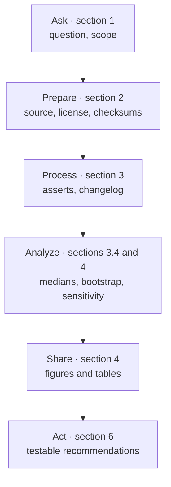

Across 6,128,575 bike-share rides in Chicago from November 2025 through October 2026, rides by casual riders were 49% longer than rides by annual members when measured by the mean, but only 28% longer by the median: 11.1 versus 8.7 minutes. The sharper differences are in timing and place: 37.6% of casual rides fall on weekends compared with 23.7% of member rides, members have a morning commute peak that casual riders largely lack, and the two groups' ten busiest stations do not overlap at all. This eighth and final article in the series *Evidence-based Data Analytics* walks through all six phases (Ask, Prepare, Process, Analyze, Share, Act) on Divvy's public trip data, with a cleaning changelog that reports row counts at every step, day-level bootstrap confidence intervals, and a sensitivity analysis. This is a descriptive study: the unit is the ride, not the person, and none of its conclusions is causal.

## 1. Introduction: the question and its context (Ask)

The scenario is familiar to anyone learning data analysis: Cyclistic, a bike-share company in Chicago, wants to convert customers who buy single-ride and day passes (casual riders) into annual members, and its marketing team needs to know how the two groups use the bikes differently (Google, n.d.). Cyclistic and the characters in the scenario are fictional; the data are real trip records from the Divvy system. This article uses the name Divvy only to describe the data source. It is not affiliated with, or endorsed by, Lyft, Divvy, or the City of Chicago.

Framed with the SMART criteria from [article 02](/en/blog/ask-questions-to-make-data-driven-decisions/), the task is: describe how the two groups differ in ride length, day and hour, season, bike type, and station over the most recent 12 months, using measures that come with confidence intervals, so the marketing team has a basis for forming hypotheses about a conversion campaign. The scenario poses two more questions: why casual riders would buy an annual membership, and how digital media could influence them. Trip data cannot answer either.

The research literature already offers some predictions. Fishman's (2016) review, following an earlier synthesis (Fishman et al., 2013), reports that convenience is the main motivation for using bike share and that commuting is the most common trip purpose for annual members. In Washington, D.C., a survey by Buck et al. (2013) found that short-term users rode for recreation more often than annual members did; GPS data from 94 bikes in 2015 showed that short-term users' trips were longer, slower, and concentrated around the National Mall (Wergin & Buehler, 2017). On the Divvy system itself, Zhou (2015) analyzed 2013–2014 data and found different patterns on weekdays versus weekends and for customers versus subscribers.

This article adds three things a descriptive analysis can easily skip: comparing medians alongside means, recording how many rows are dropped at each step, and checking whether the conclusions change when the filtering thresholds change. There are six questions to answer: ride length (RQ1), day and hour (RQ2), season (RQ3), bike type (RQ4), stations (RQ5), and which conclusions are robust or sensitive to cleaning decisions (RQ6). Figure 1 maps the six phases of the process, introduced in [article 01](/en/blog/foundations-data-data-everywhere/), to the sections of this article.



**Figure 1.** The six phases of the analysis process and the matching sections of this article.

## 2. Data (Prepare)

### 2.1. Source and organization

The data consist of 12 monthly ZIP files, 2025-11 through 2026-10, downloaded on 2026-11-16 from Divvy's public bucket (Divvy, n.d.-b). Each row is one ride, with 13 columns: `ride_id`, `rideable_type`, `started_at`, `ended_at`, start and end station names and IDs, start and end coordinates, and `member_casual`. Table 1 lists each file's size, last-modified date on the bucket, row count, and the first 12 characters of its SHA-256 hash, so you can confirm you have the same files analyzed here, following Buffalo's (2015) advice to record the source, download date, and version of your data.

**Table 1.** The 12 source files (6,294,451 rows in total)

| ZIP file | MB | LastModified | Rows | SHA-256 (first 12 characters) |
| --- | ---: | --- | ---: | --- |
| 202511 | 13.59 | 2025-12-08 | 356,628 | `7d873352d710` |
| 202512 | 5.70 | 2026-01-05 | 140,534 | `bd171dbffa69` |
| 202601 | 5.91 | 2026-02-04 | 137,787 | `c72e49ced87e` |
| 202602 | 8.20 | 2026-03-04 | 201,450 | `daaccc57e080` |
| 202603 | 13.17 | 2026-04-03 | 317,037 | `7553befd3f66` |
| 202604 | 17.07 | 2026-05-04 | 448,252 | `af16f7c43ddc` |
| 202605 | 24.93 | 2026-06-04 | 653,704 | `880e4ff17b03` |
| 202606 | 28.47 | 2026-07-06 | 762,550 | `34bde1eddace` |
| 202607 | 32.91 | 2026-08-05 | 869,051 | `4e6bc8725a92` |
| 202608 | 32.61 | 2026-09-09 | 868,191 | `3f4de338ee56` |
| 202609 | 29.54 | 2026-10-05 | 770,562 | `c4d77fa960be` |
| 202610 | 37.68 | 2026-11-05 | 768,705 | `01e45b008790` |

Three details of how the files are packaged bear directly on the analysis. First, `202601-divvy-tripdata.zip` contains a CSV named `202501-divvy-tripdata.csv`, although its contents are rides from January 2026; a script that names files after the inner CSV will file them under the wrong year. Second, ten files are split by the time a ride **ended**, while the 2026-04 and 2026-10 files are split by the time it **started**. As a result, 35 rides that started on April 30 and ended on May 1 appear in both the April and May files, and rides that crossed midnight on March 31 and September 30 are in no file at all: the dataset has no ride that started on March 31 and ended on April 1, whereas the June 30–July 1 boundary has 120 such rides. Third, `started_at` and `ended_at` are local times with no time zone: all 29 rides with a negative length fall between 1 and 2 a.m. on November 2, 2025, when Chicago set its clocks back at the end of daylight saving time.

### 2.2. License

Under the Data License Agreement, the licensor is Lyft Bikes and Scooters, LLC, and the City of Chicago owns the data (Lyft Bikes and Scooters, LLC, n.d.). The license is “non-exclusive, royalty-free, limited, perpetual”; it permits analyzing, copying, and modifying the data and using it as a source in analyses or reports published for non-commercial purposes. Four prohibitions matter directly for a portfolio piece: redistributing the data “as a stand-alone dataset,” attempting to link the data to customers' identities, implying endorsement, and using the DIVVY trademark without permission. For that reason this article does not republish the cleaned data; you download it from the original bucket and compare checksums with Table 1.

### 2.3. ROCCC assessment

Table 2 rates the source on the five ROCCC criteria discussed in [article 03](/en/blog/prepare-data-for-exploration/).

**Table 2.** ROCCC assessment

| Criterion | Assessment |
| --- | --- |
| Reliable | The system logs every ride automatically; all 12 files share the same 13-column structure, but the monthly split is inconsistent (section 2.1) |
| Original | First-party data from the operator |
| Comprehensive | System-wide, with time, bike type, and stations; no user ID, fare, or trip purpose |
| Current | Updated monthly; October 2026 has been on the bucket since 2026-11-05 |
| Cited | Has a license page and a data description page |

### 2.4. What the provider has already processed, and privacy

The data description page states that trips taken by maintenance staff and trips shorter than 60 seconds have been removed, and it lists three user types: Member, Single Ride, and Day Pass (Divvy, n.d.-a). The actual files differ on both points. The `member_casual` column has only two labels, so `casual` pools single-ride and day-pass customers. And 159,643 rides shorter than 60 seconds remain (2.5% of rows), every one of them an `electric_bike`. A provider's statement is a starting point for checking, not a substitute for it.

The data contain no user ID or payment information. Even so, mobility data in general are easy to re-identify: in mobile phone data, four spatio-temporal points are enough to uniquely identify 95% of individuals (de Montjoye et al., 2013). This article does not join the data with any other source and reports only aggregates by group, hour, month, and station.

## 3. Methods (Process and the Analyze plan)

### 3.1. Environment

The analysis ran on Python 3.13.2, pandas 3.0.3, NumPy 2.4.6, pyarrow 24.0.0, and matplotlib 3.11.0 on macOS 12.7. Recording exact versions is one of the basic rules of reproducibility (Sandve et al., 2013; Rule et al., 2019), and [article 07](/blog/introduction-to-data-analysis-using-python/) discussed why notebooks are hard to rerun; Pimentel et al. (2019) analyzed 1.4 million notebooks on GitHub to identify the characteristics that affect reproducibility.

### 3.2. Derived variables

From `started_at` and `ended_at` come `ride_min` (ride length in minutes), day of week, start hour, and month. A round trip (`round_trip`) is a ride whose start station name equals its end station name, considered only when both names are present. Coordinates are not used to compute distance: every ride not attached to a station has coordinates rounded to two decimal places, a rounding step of about one kilometer, too coarse for the length of many rides.

### 3.3. Cleaning with a changelog

The principles come from [article 04](/blog/process-data-from-dirty-to-clean/): the raw data are never edited, every step lives in code, each row is one ride in keeping with tidy data (Wickham, 2014; Broman & Woo, 2018; Wilson et al., 2017), and implicit assumptions are written as `assert` statements so errors surface early (Buffalo, 2015). The code below loads the 12 files, checks the assumptions, and prints the changelog.

```python
import re, zipfile, pathlib
import numpy as np, pandas as pd

DATA = pathlib.Path("data")                      # folder holding the 12 ZIP files
MONTHS = ["202511", "202512"] + [f"2026{m:02d}" for m in range(1, 11)]
ID_COLS = {c: "string" for c in ["ride_id", "start_station_id", "end_station_id"]}

frames = []
for ym in MONTHS:
    with zipfile.ZipFile(DATA / f"{ym}-divvy-tripdata.zip") as z:
        inner = [n for n in z.namelist() if n.endswith(".csv") and "MACOSX" not in n]
        assert len(inner) == 1                   # go by the ZIP's month, not the CSV name
        df = pd.read_csv(z.open(inner[0]), dtype=ID_COLS,
                         parse_dates=["started_at", "ended_at"])
    assert df.shape[1] == 13, ym
    assert set(df["member_casual"]) == {"member", "casual"}, ym
    frames.append(df.assign(file_month=ym))
raw = pd.concat(frames, ignore_index=True)       # raw is never modified

raw["ride_min"] = (raw["ended_at"] - raw["started_at"]).dt.total_seconds() / 60
SERVICE = re.compile(r"depot|warehouse|test|repair|charging", re.I)
service = (raw["start_station_name"].str.contains(SERVICE, na=False)
           | raw["end_station_name"].str.contains(SERVICE, na=False))

steps = [("duplicate ride_id", lambda t: t["ride_id"].duplicated()),
         ("length <= 0", lambda t: t["ride_min"] <= 0),
         ("under 1 minute", lambda t: t["ride_min"] < 1),
         ("over 24 hours", lambda t: t["ride_min"] > 1440),
         ("service stations", lambda t: service.loc[t.index])]
clean = raw
for name, rule in steps:                         # changelog: one line per step
    drop = rule(clean)
    print(f"{name:18s} {len(clean):>9,} -> {(~drop).sum():>9,}  (dropped {drop.sum():,})")
    clean = clean[~drop]
```

```text
duplicate ride_id  6,294,451 -> 6,294,416  (dropped 35)
length <= 0        6,294,416 -> 6,294,387  (dropped 29)
under 1 minute     6,294,387 -> 6,134,744  (dropped 159,643)
over 24 hours      6,134,744 -> 6,129,596  (dropped 5,148)
service stations   6,129,596 -> 6,128,575  (dropped 1,021)
```

**Table 3.** Cleaning changelog: rows dropped by group, and why

| Step | Dropped | Member | Casual | Reason |
| --- | ---: | ---: | ---: | --- |
| Duplicate `ride_id` | 35 | 23 | 12 | Same ride present in the April and May files (section 2.1) |
| Length ≤ 0 | 29 | 20 | 9 | Local time during the clock change on November 2, 2025 |
| Under 1 minute | 159,643 | 86,261 | 73,382 | Most likely unlocked and returned right away; all e-bikes |
| Over 24 hours | 5,148 | 1,078 | 4,070 | All `classic_bike`; 98.1% have no end station |
| Service stations | 1,021 | 882 | 139 | 9 station names containing depot, warehouse, test, repair, charging |
| **Remaining** | **6,128,575** | **3,966,774** | **2,161,801** | 97.4% of the original rows |

Two steps need more explanation. Of the 5,148 rides longer than 24 hours, 5,035 have a length between 1,499 and 1,500 minutes, almost exactly 25 hours, and the maximum is 1,560 minutes. That pattern is consistent with the system automatically closing unreturned rides at the 25-hour mark, but Divvy's public documentation does not confirm this, so it remains a guess. Whatever the reason, these rows do not measure time spent riding. In the last step, the list of nine service-station names was read by eye after the regex filter; stations with the suffix `(Temp)`, `Public Rack`, or `Corral` are parking locations for riders and were kept.

Rides with a missing station name were not dropped. A missing start station name affects 27.8% of `electric_bike` rides and 0% of `classic_bike` rides, because e-bikes can be locked away from a station. Dropping those rides would skew every comparison by bike type, so they are absent only from the station analysis.

### 3.4. Statistical plan

Ride length is summarized with the median, the interquartile range (IQR), P90, and P99; the mean is reported alongside for comparison. The median is a location estimate that is robust to outliers and the mean is not (Bruce & Bruce, 2017), and [article 05](/blog/analyze-data-to-answer-questions/) discussed why that choice matters for right-skewed distributions. The maximum is used only to detect data errors.

Effect sizes are the difference and ratio of medians (casual versus member) and, for categorical variables, differences in proportions expressed in percentage points. The 95% confidence intervals come from 2,000 bootstrap replicates in which the resampling unit is the **day**, not the ride, stratified by weekday and weekend, with a fixed seed of 20261116. Rides on the same day share the same weather and events, so treating them as independent would produce artificially narrow intervals. The article does not use p-values as a criterion: with very large samples, p-values quickly approach zero and any difference, however small, becomes “statistically significant” (Lin et al., 2013). The following code, continuing from `clean`, computes the confidence interval for the difference in weekend share.

```python
day = clean["started_at"].dt.normalize()
per_day = clean.groupby([day, "member_casual"]).size().unstack(fill_value=0)
weekend = per_day.index.dayofweek >= 5

def weekend_gap(t, we):
    share = t[we].sum() / t.sum()
    return share["casual"] - share["member"]

rng = np.random.default_rng(20261116)
idx_wd, idx_we = np.where(~weekend)[0], np.where(weekend)[0]
boot = []
for _ in range(2000):                            # resample days, stratified
    pick = np.r_[rng.choice(idx_wd, idx_wd.size), rng.choice(idx_we, idx_we.size)]
    boot.append(weekend_gap(per_day.iloc[pick], weekend[pick]))
print(round(weekend_gap(per_day, weekend), 4), np.percentile(boot, [2.5, 97.5]).round(4))
```

```text
0.1392 [0.1169 0.1607]
```

Hour-by-day patterns are normalized to shares of each group's total rides, to compare shapes rather than absolute counts. The station analysis uses only stations with at least 1,000 starting rides. The sensitivity analysis repeats the main results with different lower thresholds (none, 1 minute, 2 minutes), upper thresholds (3 hours, 24 hours, none), with and without service stations, and with months assigned by `started_at` or by file.

## 4. Results (Analyze and Share)

### 4.1. Data after cleaning

What remains is 6,128,575 rides over 366 days: 3,966,774 member rides (64.7%) and 2,161,801 casual rides (35.3%; 95% confidence interval: 34.3–36.3%).

### 4.2. Ride length (RQ1)

**Table 4.** Ride length by group (minutes)

| Group | Median | IQR | P90 | P99 | Mean | Over 30 minutes |
| --- | ---: | --- | ---: | ---: | ---: | ---: |
| Member | 8.68 | 5.19–14.61 | 23.36 | 51.36 | 12.12 | 5.4% |
| Casual | 11.09 | 6.46–19.85 | 35.44 | 108.84 | 18.02 | 13.2% |

The typical casual ride is 2.4 minutes longer than the typical member ride (2.25–2.58), a ratio of 1.28 (1.26–1.30). By the mean, the gap is 5.9 minutes, a ratio of 1.49 (1.47–1.51). The difference between the two measures comes from the right tail: the casual P99 is twice the member P99, and 3.8% of casual rides last more than an hour compared with 0.6% of member rides (Figure 2). Both numbers are correct, but they answer different questions: the median describes a typical ride, the mean describes total minutes of use. The statement “casual riders ride one and a half times as long” describes total usage time, not a commonly observed ride.


**Figure 2.** Cumulative distribution of ride length by group, log-scaled x-axis. Dashed lines are medians, dotted lines are means.

### 4.3. Day and hour (RQ2)

Weekend rides make up 37.6% of casual rides and 23.7% of member rides, a gap of 13.9 percentage points (11.7–16.1). Per day, members average 11,595 rides on a weekday and 8,956 on a weekend day; casual riders show the reverse, 5,166 and 7,747. Saturday is the busiest day for casual riders (21.5% of rides) and Tuesday for members (16.3%).

On weekdays, 18.6% of member rides start between 6 and 9 a.m., compared with 9.5% of casual rides, a gap of 9.1 points (8.9–9.3). In the afternoon the two groups are close: 30.7% and 29.2% of weekday rides start between 4 and 7 p.m., and both peak at 5 p.m. Figure 3 shows that members have two weekday peaks, while casual riders have one weekday afternoon peak and a broad band from midday through the afternoon on Saturday and Sunday. Across all 168 day-hour cells, the dissimilarity index is 0.18: 18% of one group's rides would have to move to another cell for the two distributions to match.


**Figure 3.** Share of rides by day of week and start hour, out of each group's total rides.

### 4.4. Season (RQ3)

Both groups ride more in the warm season, but casual riders swing far more. The busiest casual month (July, 345,533 rides) is 14.5 times the quietest (January, 23,876 rides); for members the ratio is 4.7 (August versus December). The casual share of rides therefore rises from 17.9% in January to 40.9% in July (Figure 4).


**Figure 4.** Rides per month by group (top) and the casual share of rides (bottom), with months assigned by `started_at`; the 108 rides that started on October 31, 2025 are not plotted.

### 4.5. Bike type (RQ4)

E-bikes account for the majority in both groups: 75.4% of casual rides and 69.2% of member rides, a gap of 6.2 points (5.9–6.5). Compared with the differences by day, hour, and season, this one is small.

### 4.6. Stations and round trips (RQ5)

About four-fifths of rides have a start station name; the missing rate is nearly the same in both groups (19.6% for members, 20.4% for casual riders). There are 649 stations that meet the 1,000-ride threshold, covering 96.0% of rides with a station name. At a typical station, casual riders account for 32.1% of rides (IQR 28.7–37.8%), and at only 54 stations do they account for more than half.

The two groups' ten busiest stations have no station in common. On the casual side are Navy Pier (49,970 casual rides, 75.8% of the station's rides), DuSable Lake Shore Dr & Monroe St (78.4%), Michigan Ave & Oak St, Millennium Park, Shedd Aquarium (81.8%), Field Museum (81.0%), and other lakefront stations. On the member side are stations on Canal St, Clinton St, Kingsbury St, and Wells St in the downtown area, where casual riders make up only about 19–33%. The top ten stations account for 11.5% of casual rides with a station name but only 6.2% of member rides: casual riding is more concentrated in space. In Figure 5, stations with a high casual share line up in a strip along the lakefront.


**Figure 5.** The 649 stations with at least 1,000 starting rides, placed by their coordinates, with no basemap. Color is the casual share of rides; dot size is the number of rides.

Among rides with both station names, round trips make up 7.4% of casual rides and 2.2% of member rides, a gap of 5.2 points (5.0–5.3). Round trips are also longer: a median of 16.2 minutes for casual riders and 14.2 minutes for members, compared with 11.8 and 8.6 minutes for one-way rides.

### 4.7. Sensitivity (RQ6)

**Table 5.** Main results under each filtering scenario

| Scenario | Rides | Casual | Median C / M | Median ratio | Mean ratio | Weekend gap |
| --- | ---: | ---: | --- | ---: | ---: | ---: |
| Main (1 minute–24 hours) | 6,128,575 | 35.3% | 11.09 / 8.68 | 1.28 | 1.49 | 13.9 |
| No lower threshold | 6,288,194 | 35.6% | 10.71 / 8.50 | 1.26 | 1.47 | 14.0 |
| Lower threshold 2 minutes | 5,990,401 | 35.5% | 11.29 / 8.89 | 1.27 | 1.48 | 13.9 |
| Upper threshold 3 hours | 6,118,782 | 35.2% | 11.06 / 8.67 | 1.28 | 1.44 | 13.9 |
| No upper threshold | 6,133,723 | 35.3% | 11.11 / 8.68 | 1.28 | 1.66 | 13.9 |
| Service stations kept | 6,129,596 | 35.3% | 11.09 / 8.68 | 1.28 | 1.49 | 13.9 |
| No filtering | 6,294,387 | 35.6% | 10.73 / 8.50 | 1.26 | 1.64 | 14.0 |

No conclusion changes direction. The median ratio stays within 1.26–1.28 in every scenario, and the weekend gap barely moves. The only measure sensitive to cleaning decisions is the mean: removing the upper threshold raises the casual mean from 18.0 to 20.8 minutes and the mean ratio jumps from 1.49 to 1.66, because of just 5,148 rows, less than 0.1% of the data. Assigning months by `started_at` or by file changes any month's casual share by at most 0.006 percentage points.

## 5. Discussion

### 5.1. Compared with the literature

The results match what is already known about bike share. Members have two weekday rush-hour peaks, in line with the finding that commuting is the most common trip purpose for annual members (Fishman, 2016). The differences between weekdays and weekends and between the two user types that Zhou (2015) found on Divvy in 2013–2014 are still there more than a decade later, even though most rides are now made on e-bikes. Casual rides are longer, include more round trips, and cluster at the lakefront, museums, and parks, much like the picture in Washington, D.C., where short-term users' trips were longer, slower, and gathered around the National Mall (Wergin & Buehler, 2017), and where a survey found they rode for recreation more often (Buck et al., 2013). Keep in mind that both of those studies come from a different city and from before the e-bike era.

On season, studies with weather data found that cold temperatures, rain, and high humidity went with fewer and shorter trips in Washington, D.C. (Gebhart & Noland, 2014), and that temperature correlated with trip activity in Toronto (El-Assi et al., 2017). The 14.5-fold swing among casual riders points the same way, but this article has no weather data and cannot separate the share due to weather from the share due to tourism, holidays, or events.

What is new relative to the usual telling is the magnitude. The difference in typical ride length is real but modest, 2.4 minutes; the “one and a half times” figure is a product of the right tail and of the filtering threshold. The large, robust differences are in the calendar and on the map. An earlier descriptive analysis of the same data in the [Cyclistic report](/projects/cyclistic-bike-share/phan-tich-chi-tiet-casual-riders-va-annual-members-dung-xe-cyclistic-khac-nhau-t/) arrived at a similar picture.

### 5.2. Limitations

First, this is a descriptive study. The two groups may differ in where they live, why they ride, what fare they pay, and many other factors the data do not record; none of the 13 columns allows those to be separated. Hernán et al. (2019) classify data science tasks as description, prediction, and counterfactual prediction (which includes causal inference); this article does only the first. Hernán (2018) also argues for stating the research goal plainly instead of using euphemisms, so the article avoids words like “causes” or “affects”: a membership does not “make” people commute by bike, and the reverse has not been shown either.

Second, the unit is the ride, not the person. The number of casual riders cannot be counted, a small number of very frequent riders may drive the proportions, and there is no way to know who switched from casual to member during the year.

Third, the `casual` label pools single-ride and day-pass customers, two groups that may behave differently.

Fourth, data quality: leftover rides under 60 seconds, one-fifth of rides without a station name, rounded coordinates, two ways of splitting months that lose the rides crossing midnight on March 31 and September 30, and wrong lengths for rides that span the clock change. These errors are small next to 6.1 million rides, and the sensitivity analysis shows they do not change the conclusions, but an analysis at the level of a single day or a single station would need more care.

Fifth, there is only one year of data; an unusual winter or summer would leave its mark on every monthly figure.

## 6. Recommendations (Act)

The three recommendations below are for the Cyclistic scenario, and all are **hypotheses to test**, written in the order result, hypothesis, action, metric, and test.

1. **A seasonal and weekend plan.** Casual rides concentrate on weekends (37.6%) and in the warm season (a 14.5-fold gap between July and January). Hypothesis: for some casual riders, a year-round plan does not match how they use the bikes. Action: test a message or membership plan that emphasizes summer and weekends, starting in May. Metric: the share of casual riders who buy a membership within 30 days. Test: an A/B test randomized by account.
2. **Outreach at lakefront stations.** At 54 stations casual riders account for more than half of rides, led by Navy Pier and the stations around the museums. Hypothesis: these stations mix tourists, who are unlikely to become annual members, with locals out for the weekend. Action: show the offer only to accounts that have already taken several rides within a few weeks. Metric: conversions per impression. Test: a staggered rollout across randomly chosen groups of stations.
3. **Casual riders who look like commuters.** On weekday afternoons casual riders ride almost like members (29.2% versus 30.7% of weekday rides), though not in the morning. Hypothesis: one segment of casual riders uses the bikes regularly for the afternoon trip home. Action: send accounts with many rush-hour rides in a month a cost comparison between single fares and an annual membership. Metric and test: as in recommendation 1.

The “why” question needs other data: a user survey, as Buck et al. (2013) did, together with the pass type and fare for each ride, safely anonymized user IDs, and daily weather.

## 7. Reproducibility statement

Every number in this article was produced by three Python scripts: loading and checking the data, the analysis, and the figures. The core of the first two is printed in sections 3.3 and 3.4 and runs as written. To reproduce the results, download the 12 ZIP files from the original bucket (Divvy, n.d.-b), compare the first 12 characters of each SHA-256 hash with Table 1, install the library versions listed in section 3.1, and keep the seed 20261116 with 2,000 bootstrap replicates. Neither the raw nor the cleaned data are republished, because the license does not allow distributing them as a stand-alone dataset. Figures 2–5 were drawn with matplotlib, using a fixed Okabe–Ito color pair for the two groups and the cividis and viridis colormaps, following the principles in [article 06](/blog/share-data-through-the-art-of-visualization/). If the bucket replaces a file, its checksum will differ and the numbers may shift; in that case Table 1 shows which version was used here.

## 8. Conclusion

Casual riders and annual members of Chicago's bike-share system differ first of all in **when** and **where** they ride: weekends versus commute hours, the lakefront and museums versus downtown, summer versus year-round. The typical casual ride is about 2.4 minutes longer, not one and a half times as long. These conclusions hold under every filtering threshold tested, and only the mean wobbles. They are enough to form marketing hypotheses; finding out which hypothesis is right takes an experiment.

## References

Broman, K. W., & Woo, K. H. (2018). Data organization in spreadsheets. *The American Statistician, 72*(1), 2–10. https://doi.org/10.1080/00031305.2017.1375989

Bruce, P., & Bruce, A. (2017). *Practical statistics for data scientists: 50 essential concepts*. O'Reilly Media.

Buck, D., Buehler, R., Happ, P., Rawls, B., Chung, P., & Borecki, N. (2013). Are bikeshare users different from regular cyclists? A first look at short-term users, annual members, and area cyclists in the Washington, D.C., region. *Transportation Research Record, 2387*(1), 112–119. https://doi.org/10.3141/2387-13

Buffalo, V. (2015). *Bioinformatics data skills: Reproducible and robust research with open source tools*. O'Reilly Media.

de Montjoye, Y.-A., Hidalgo, C. A., Verleysen, M., & Blondel, V. D. (2013). Unique in the crowd: The privacy bounds of human mobility. *Scientific Reports, 3*, 1376. https://doi.org/10.1038/srep01376

Divvy. (n.d.-a). *Divvy data: Historical trip data available to the public*. Retrieved November 11, 2026, from https://divvybikes.com/system-data

Divvy. (n.d.-b). *divvy-tripdata* [Data repository]. Retrieved November 16, 2026, from https://divvy-tripdata.s3.amazonaws.com/index.html

El-Assi, W., Salah Mahmoud, M., & Nurul Habib, K. (2017). Effects of built environment and weather on bike sharing demand: A station level analysis of commercial bike sharing in Toronto. *Transportation, 44*(3), 589–613. https://doi.org/10.1007/s11116-015-9669-z

Fishman, E. (2016). Bikeshare: A review of recent literature. *Transport Reviews, 36*(1), 92–113. https://doi.org/10.1080/01441647.2015.1033036

Fishman, E., Washington, S., & Haworth, N. (2013). Bike share: A synthesis of the literature. *Transport Reviews, 33*(2), 148–165. https://doi.org/10.1080/01441647.2013.775612

Gebhart, K., & Noland, R. B. (2014). The impact of weather conditions on bikeshare trips in Washington, DC. *Transportation, 41*(6), 1205–1225. https://doi.org/10.1007/s11116-014-9540-7

Google. (n.d.). *Google Data Analytics Capstone: Complete a case study* [MOOC]. Coursera. https://www.coursera.org/learn/google-data-analytics-capstone

Hernán, M. A. (2018). The C-word: Scientific euphemisms do not improve causal inference from observational data. *American Journal of Public Health, 108*(5), 616–619. https://doi.org/10.2105/AJPH.2018.304337

Hernán, M. A., Hsu, J., & Healy, B. (2019). A second chance to get causal inference right: A classification of data science tasks. *CHANCE, 32*(1), 42–49. https://doi.org/10.1080/09332480.2019.1579578

Lin, M., Lucas, H. C., & Shmueli, G. (2013). Research commentary—Too big to fail: Large samples and the p-value problem. *Information Systems Research, 24*(4), 906–917. https://doi.org/10.1287/isre.2013.0480

Lyft Bikes and Scooters, LLC. (n.d.). *Data license agreement*. Divvy. Retrieved November 11, 2026, from https://divvybikes.com/data-license-agreement

Pimentel, J. F., Murta, L., Braganholo, V., & Freire, J. (2019). A large-scale study about quality and reproducibility of Jupyter notebooks. In *2019 IEEE/ACM 16th International Conference on Mining Software Repositories (MSR)* (pp. 507–517). IEEE. https://doi.org/10.1109/MSR.2019.00077

Rule, A., Birmingham, A., Zuniga, C., Altintas, I., Huang, S.-C., Knight, R., Moshiri, N., Nguyen, M. H., Rosenthal, S. B., Pérez, F., & Rose, P. W. (2019). Ten simple rules for writing and sharing computational analyses in Jupyter Notebooks. *PLOS Computational Biology, 15*(7), e1007007. https://doi.org/10.1371/journal.pcbi.1007007

Sandve, G. K., Nekrutenko, A., Taylor, J., & Hovig, E. (2013). Ten simple rules for reproducible computational research. *PLoS Computational Biology, 9*(10), e1003285. https://doi.org/10.1371/journal.pcbi.1003285

Wergin, J., & Buehler, R. (2017). Where do bikeshare bikes actually go? Analysis of Capital Bikeshare trips with GPS data. *Transportation Research Record, 2662*(1), 12–21. https://doi.org/10.3141/2662-02

Wickham, H. (2014). Tidy data. *Journal of Statistical Software, 59*(10). https://doi.org/10.18637/jss.v059.i10

Wilson, G., Bryan, J., Cranston, K., Kitzes, J., Nederbragt, L., & Teal, T. K. (2017). Good enough practices in scientific computing. *PLOS Computational Biology, 13*(6), e1005510. https://doi.org/10.1371/journal.pcbi.1005510

Zhou, X. (2015). Understanding spatiotemporal patterns of biking behavior by analyzing massive bike sharing data in Chicago. *PLOS ONE, 10*(10), e0137922. https://doi.org/10.1371/journal.pone.0137922
