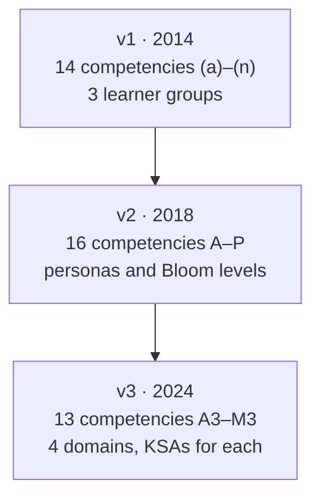
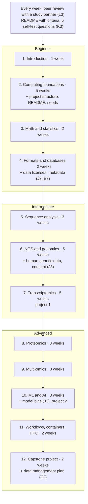

The self-study roadmap behind the Vietnamese-language series *Bioinformatics from Beginner to Advanced* has 12 parts spread over 36 weeks, at 8–10 hours a week (roughly 288–360 hours). It runs from Linux, Python, R and statistics to NGS, RNA-seq, multi-omics and machine learning. Is that enough? To find out, this article sets each part against the ISCB v3 core competency framework (Brooksbank et al., 2024), which defines 13 competencies, A3–M3, across four domains. The roadmap covers the technical competencies thoroughly. Professional conduct gets only about 1.7 of the 36 weeks, and no part teaches data ethics (J3) or teamwork (L3). The article is written for biology students who want to teach themselves, and it includes the full mapping table so you can check it, a revised roadmap and a sample study week.

<div class="callout callout-note">
<p class="callout-title">Quick summary</p>

- Roadmap: 12 parts, 36 weeks, three levels; the goal is 3–4 projects on GitHub.
- Yardstick: the ISCB v3 framework (2024), 13 competencies in four domains, written as a minimum standard.
- Strong: D3, F3, H3, B3. Missing: J3, L3. Thin: E3 (FAIR), K3 (communication).
- Fixes that add no weeks: move reproducibility habits up to Part 2, spread ethics and FAIR across Parts 4, 6 and 10, and turn READMEs into communication exercises.

</div>

## 1. What the 36-week roadmap covers

### 1.1. Three levels, 12 parts

The roadmap has three levels: **Beginner** (weeks 1–11, Parts 1–4), **Intermediate** (weeks 12–24, Parts 5–7) and **Advanced** (weeks 25–36, Parts 8–12). Each level builds on the one before it.

**Table 1.** The twelve parts of the roadmap

| Part | Weeks | Main content |
| --- | --- | --- |
| 1. Introduction | 1 | Omics layers, the 7 steps of a project, careers |
| 2. Computing foundations | 2–7 | Linux, Bash, Python, R, Bioconductor, conda, Git |
| 3. Math and statistics | 8–9 | Hypothesis tests, multiple testing, normalization, dimensionality reduction, regression |
| 4. Formats and databases | 10–11 | FASTA, FASTQ, BAM, VCF; NCBI, Ensembl, UniProt; SRA, GEO |
| 5. Sequence analysis | 12–14 | Alignment, BLAST, MSA, phylogenetics |
| 6. NGS and genomics | 15–19 | QC, read mapping, variant calling and annotation, assembly |
| 7. Transcriptomics | 20–24 | Experimental design, DESeq2, enrichment, single-cell |
| 8. Proteomics | 25–27 | Mass-spec proteomics, protein structure, docking |
| 9. Multi-omics | 28–30 | Epigenomics, metagenomics, integration |
| 10. Machine learning and AI | 31–33 | scikit-learn, validation pitfalls, deep learning |
| 11. Reproducible workflows | 34 | Workflow managers, containers, HPC, cloud |
| 12. Projects and portfolio | 35–36 | Capstone project, repo, presentation, interviews |

Nearly half the time goes to two blocks: computing foundations (6 weeks) and NGS plus transcriptomics (10 weeks). Both get reused in every later part. Metabolomics shows up in [Part 1](/en/blog/nhap-mon-bioinformatics/) as one of the omics layers but sits outside the roadmap's scope.

### 1.2. Outcomes, audience and how each part is built

After 36 weeks you should be able to do four things. First, work comfortably in Linux and write Python and R scripts for biological data. Second, run an NGS pipeline on your own, from raw FASTQ to a list of variants or differentially expressed genes. Third, understand the algorithms well enough to choose parameters for a reason. Fourth, have 3–4 projects on GitHub: the first in Part 7, the second in Part 10, and a capstone in Part 12.

The roadmap assumes a background in molecular biology (DNA, RNA, protein, PCR, gene expression). You don't need to know how to program, because [Part 2](/en/blog/nen-tang-tinh-toan/) starts from your first command. Each part follows the same template: **Goals → Core concepts → Practice → Exercises → Resources**. Part 12 swaps the exercises for an end-of-roadmap checklist. The goals and exercises of each part are its learning outcomes, and they are what gets mapped in section 3.

### 1.3. Why compare against a competency framework

A review of training-needs surveys found that bioinformatics has become essential to life-science research, yet the expertise remains in persistently short supply. Basic data stewardship is rarely taught, and the most urgent call is to build bioinformatics into undergraduate curricula themselves (Attwood et al., 2019). A survey of 1,260 US life-science faculty found that the most common barrier was faculty lacking expertise or training (Williams et al., 2019).

Nobody on a curriculum committee asks a self-learner, "When you finish, what will you be able to do that employers need?" A competency framework answers exactly that question, and ISCB recommends using its framework to design, evaluate and revise curricula (Brooksbank et al., 2024). This article asks three questions: which competencies the roadmap **covers**, what **level** it reaches compared with the career profiles, and whether the **order** of topics makes sense.

## 2. The ISCB competency framework across three versions

The International Society for Computational Biology (ISCB) built its competency framework in three versions over ten years.



### 2.1. Version 1 (2014)

The first version drew on a survey of 29 core facility directors (heads of bioinformatics service units) and 75 job postings. From these, the authors derived 14 competencies, (a)–(n), for three groups: bioinformatics users, scientists and engineers (Welch et al., 2014). New master's-level hires often lacked experience analyzing **real biological data**. PhD-level hires more often lacked **communication** skills, the ability to synthesize information and the ability to finish projects. Teamwork (g), ethics and law (h), communication (i) and lifelong learning (k) were marked for all three groups. From the very first version, these skills were treated as everyone's job, not just senior scientists'.

### 2.2. Version 2 (2018)

After a period of trial use and refinement (Welch et al., 2016), version 2 listed 16 competencies, A–P (Mulder et al., 2018). The three learner groups grew into a set of personas (career archetypes) such as physician, biocurator, discovery biologist and engineer. Each persona has its own required level, rated on **Bloom's taxonomy** from Knowledge, Comprehension and Application up to higher levels such as Synthesis and Evaluation.

In the same paper, EMBL-EBI and the University of Cambridge mapped 71 short courses (50 + 21) onto the framework; 68 of the 71 trained competency F (using tools), and the two organizations proposed adding a **data curation** competency (Mulder et al., 2018). The NIBLSE network also published its own framework for undergraduate life-science education (Wilson Sayres et al., 2018).

### 2.3. Version 3 (2024)

The current version has 13 competencies, A3–M3, in four domains: life science, data science, computer science and professional conduct. Each competency comes with a list of knowledge, skills and attitudes (KSAs), and the framework is written as a **minimum standard** (Brooksbank et al., 2024). Compared with v2, there are two big changes. A new competency, **E3**, covers managing data to community standards, to encourage the FAIR principles (Findable, Accessible, Interoperable, Reusable; Wilkinson et al., 2016). And D3 now extends to AI/ML.

**Table 2.** The thirteen ISCB v3 competencies (paraphrased from Brooksbank et al., 2024)

| Domain | Code | Competency |
| --- | --- | --- |
| Life science | A3 | In-depth knowledge of an area of biology |
| | B3 | Prepare life-science data for analysis |
| | C3 | Contribute to scientific discovery |
| Data science | D3 | Data science methods suited to the data, including AI/ML |
| | E3 | Manage data to community standards |
| | F3 | Use bioinformatics tools and resources |
| Computer science | G3 | Contribute to designing user-focused tools |
| | H3 | Program effectively |
| | I3 | Build and run computing infrastructure |
| Professional conduct | J3 | Follow ethical, legal and social standards |
| | K3 | Communicate with diverse audiences |
| | L3 | Work in teams |
| | M3 | Keep developing professionally |

This article uses three of the framework's career profiles: **Discovery biologist** (a biologist who uses data to make discoveries), **Bioinformatics researcher** and **Core facility scientist**.

## 3. How the roadmap is mapped onto the framework

The mapping follows the curriculum review process laid out in ISCB v3 (Brooksbank et al., 2024):

1. **Pick a target career profile.** The stated outcome is "get a job or go on to a master's," so the main benchmark is Discovery biologist, with the other two profiles for comparison.
2. **Collect the learning outcomes:** the goals and exercises of each part.
3. **Assign competencies and Bloom levels** based on the verbs in each exercise ("run," "compare," "write your own," "evaluate").
4. **Look for gaps:** competencies that no part teaches, that are crammed together, or that show up too late.

The coverage scale is borrowed from the Wellcome Genome Campus case in the v3 paper: "mostly covered" (●), "partly covered" (◐) and "not covered" (○). That case also chose the Discovery biologist persona (Brooksbank et al., 2024). You can score your own roadmap with the code below. Enter the scores (2 = ●, 1 = ◐, 0 = ○), and the code prints the total score, the number of parts that teach each competency and the first part where each one appears.

```python
import pandas as pd

# One row per part of the roadmap: weeks and coverage of each competency
# 2 = mostly covered (●), 1 = partly covered (◐), 0 = not covered (○)
data = {
    "part": ["2 Computing foundations", "4 Formats and databases", "11 Reproducibility", "12 Project"],
    "weeks": [6, 2, 1, 2],
    "E3":   [0, 1, 1, 1],
    "H3":   [2, 1, 1, 0],
    "J3":   [0, 0, 0, 0],
    "K3":   [0, 0, 0, 2],
}
df = pd.DataFrame(data)
competencies = ["E3", "H3", "J3", "K3"]

total_score = df[competencies].sum()
parts_covering = (df[competencies] > 0).sum()
first_part = {c: (df.loc[df[c] > 0, "part"].iloc[0] if (df[c] > 0).any() else "none")
              for c in competencies}

report = pd.DataFrame({"total_score": total_score,
                       "n_parts": parts_covering,
                       "first_appears": pd.Series(first_part)})
print(report)
print("Gaps:", list(report.index[report["total_score"] == 0]))
# With these four sample rows: J3 is a gap; K3 appears only in Part 12
```

The `first_appears` column matters as much as the total. A competency that only shows up in the final weeks never gets practiced in the projects that come before.

The mapping has three limitations. It is **one person's assessment**, while ISCB recommends that a team do the review; that is why the full mapping table is published here for you to check. The Bloom levels are **estimated from the exercises** and have not been confirmed by any outcome assessment. And the ISCB framework comes mostly from the international training community, so it can't say much with confidence about hiring needs in Vietnam, where this series' readers mostly are.

## 4. Results: which competencies the roadmap builds

### 4.1. Mapping table: 12 parts × 13 competencies

**Table 3.** ISCB v3 competency coverage by part (● mostly covered, ◐ partly, ○ not covered)

| Part (weeks) | A3 | B3 | C3 | D3 | E3 | F3 | G3 | H3 | I3 | J3 | K3 | L3 | M3 |
| --- | -- | -- | -- | -- | -- | -- | -- | -- | -- | -- | -- | -- | -- |
| 1 Introduction (1) | ◐ | ◐ | ◐ | ○ | ○ | ○ | ○ | ○ | ○ | ○ | ○ | ○ | ◐ |
| 2 Computing foundations (2–7) | ○ | ○ | ○ | ○ | ○ | ◐ | ○ | ● | ◐ | ○ | ○ | ○ | ○ |
| 3 Math and statistics (8–9) | ○ | ○ | ○ | ● | ○ | ○ | ○ | ◐ | ○ | ○ | ○ | ○ | ○ |
| 4 Formats and databases (10–11) | ○ | ● | ○ | ○ | ◐ | ● | ○ | ◐ | ○ | ○ | ○ | ○ | ○ |
| 5 Sequence analysis (12–14) | ◐ | ○ | ○ | ◐ | ○ | ● | ○ | ● | ○ | ○ | ○ | ○ | ○ |
| 6 NGS and genomics (15–19) | ◐ | ● | ◐ | ◐ | ○ | ● | ○ | ◐ | ○ | ○ | ○ | ○ | ○ |
| 7 Transcriptomics (20–24) | ◐ | ● | ◐ | ● | ○ | ● | ○ | ◐ | ○ | ○ | ○ | ○ | ○ |
| 8 Proteomics (25–27) | ◐ | ◐ | ○ | ◐ | ○ | ● | ○ | ◐ | ○ | ○ | ○ | ○ | ○ |
| 9 Multi-omics (28–30) | ◐ | ◐ | ◐ | ● | ○ | ● | ○ | ◐ | ○ | ○ | ○ | ○ | ○ |
| 10 ML and AI (31–33) | ○ | ○ | ◐ | ● | ○ | ◐ | ○ | ● | ○ | ○ | ◐ | ○ | ○ |
| 11 Reproducibility (34) | ○ | ○ | ○ | ○ | ◐ | ◐ | ◐ | ◐ | ● | ○ | ○ | ○ | ○ |
| 12 Projects, portfolio (35–36) | ○ | ○ | ● | ◐ | ◐ | ○ | ○ | ○ | ○ | ○ | ● | ○ | ● |

The J3 and L3 columns are completely empty. The F3 column is nearly full, which fits a roadmap aimed at being able to run pipelines. Figure 1 converts the 36 weeks into the four domains: each part's weeks are split by cell weight (● = 1, ◐ = 0.5, ○ = 0) and then summed by domain.


*Figure 1. Weeks allocated to the four ISCB v3 domains, calculated from Table 3.*

This conversion is rough, since a week of Git is not "equal" to a week of DESeq2. But the ranking is clear: about 95% of the time goes to the three technical domains and less than 5% (1.7 weeks) to professional conduct.

### 4.2. Domain by domain

**Life science.** A3 is a prerequisite. The roadmap assumes you already have a biology background and draws on it when you interpret results in Parts 5–9. B3 appears in Part 4 (formats, downloading data), Part 6 (QC, read trimming), Part 7 (replicates, batch effects), and Parts 8 and 9. C3 shows up in Part 1's 7-step workflow, from a biological question to experimental validation, and in the capstone project.

**Data science.** D3 is the densest: statistics in [Part 3](/en/blog/toan-va-thong-ke-cho-sinh-hoc/), alignment algorithms in [Part 5](/en/blog/phan-tich-trinh-tu/), differential expression, multi-omics integration and machine learning. F3 appears in almost every part. E3, on the other hand, exists only in fragments. You download data from SRA and GEO in [Part 4](/en/blog/dinh-dang-du-lieu-va-co-so-du-lieu-sinh-hoc/), set up a read-only `data/raw/` folder in Part 11, and record the data source and download date in a README in Part 12. No part covers FAIR, repository-standard metadata or how to submit data.

**Computer science.** H3 is strong thanks to the 6 weeks in Part 2. I3 appears in Part 11 and partly in Part 2 (conda). G3 is almost absent, which is acceptable because a Discovery biologist only needs the Knowledge level.

**Professional conduct.** J3 and L3 are missing. L3's absence is a natural result of studying alone. K3 only really appears in Part 12 (presenting projects, interviews) and partly in Part 10's exercise of grading a chatbot against a rubric. M3 appears in Part 1's careers section, Part 12's community section and the resource lists.

### 4.3. Bloom levels and career profiles

Most exercises sit at the **Application** level, meaning you run a pipeline by following instructions on real data. A few reach Analysis or Evaluation: writing Needleman–Wunsch yourself and comparing it with Biopython's `PairwiseAligner` (Part 5), splitting training and test sets by clusters of similar sequences instead of at random, and grading a chatbot with 20 questions that have reference answers (Part 10).

**Table 4.** Minimum Bloom level by career profile (Brooksbank et al., 2024) and the roadmap's estimated level

| Competency | Discovery biologist | Bioinformatics researcher | Core facility scientist | Roadmap (estimated) |
| --- | --- | --- | --- | --- |
| A3 | Evaluation | Evaluation | Evaluation | Prerequisite |
| B3 | Evaluation | Evaluation | Evaluation | Application |
| C3 | Application | Synthesis | Application | Application |
| D3 | Application | Synthesis | Application | Application, partly Analysis |
| E3 | Application | Application | Evaluation | Knowledge |
| F3 | Application | Synthesis | Application | Application |
| G3 | Knowledge | Comprehension | Evaluation | Below Knowledge |
| H3 | Knowledge | Application | Evaluation | Application, partly Analysis |
| I3 | N/A | Synthesis | Evaluation | Knowledge–Application |
| J3 | Application | Application | Application | None |
| K3 | Application | Application | Application | Application, only in Part 12 |
| L3 | Application | Application | Application | None |
| M3 | Application | Application | Application | Knowledge |

Against the Discovery biologist profile, the roadmap meets or exceeds the bar for C3, D3, F3 and H3. It falls short on B3 (which requires Evaluation, meaning you judge data quality yourself instead of just running QC), E3, J3, L3 and M3. A Bioinformatics researcher needs Synthesis for C3, D3, F3 and I3, which means designing new analyses and infrastructure on your own, and 36 weeks of self-study is unlikely to get you there. With 288–360 hours, the realistic goal is a **solid Discovery biologist**. The roadmap comes close to that bar if the professional-conduct domain gets patched.

## 5. Three gaps and the order of topics

### 5.1. Ethics, law and data privacy (J3)

All three versions of the ISCB framework treat ethics and law as a competency for every learner (Welch et al., 2014; Mulder et al., 2018; Brooksbank et al., 2024). The roadmap, meanwhile, puts you in front of human data fairly early: exomes from SRA in Part 6, tumor and normal-tissue RNA-seq from GEO in Part 7, and TCGA data in Parts 9 and 10.

Sequencing data is usually shared after names are removed. But "anonymous" does not mean a person can't be traced. Gymrek et al. (2013) showed that a person's surname can be inferred from their personal genome using short tandem repeats on the Y chromosome (Y-STRs) and public genealogy databases. Combining the surname with age and state of residence is enough to narrow down an identity. The authors identified a number of participants in public sequencing projects using nothing but free resources on the internet. Zook et al. (2017) distilled lessons like this into ten rules for responsible big data research. The first few say that data are people and can do harm, that privacy is more than a binary, that you should guard against re-identification and that data should be shared ethically.

Each fix only needs a short section. **Part 4** adds licenses and controlled-access data. **Part 6** adds human genetic data, consent and incidental findings when interpreting variants. **Part 10** adds bias that arises when the training set doesn't represent the population the model will be used on.

### 5.2. Managing data the FAIR way (E3)

E3 is new in v3 and is meant to encourage FAIR (Brooksbank et al., 2024; Wilkinson et al., 2016). It follows on from the data curation competency that EMBL-EBI and Cambridge proposed (Mulder et al., 2018).

For a self-learner, FAIR can start with two small exercises. In Part 4, after downloading a dataset from GEO, you work in reverse: write a metadata table for a hypothetical dataset using the fields a repository requires at submission (sample description, experimental conditions, sequencing platform). In Part 12, you write a one-page **data management plan**: where the data came from, where it's stored, who can use it, under what license and for how long. These two exercises connect E3 to [the habit of documented data cleaning](/en/blog/process-data-from-dirty-to-clean/).

### 5.3. Teamwork (L3) and communication (K3)

Version 1 found that communication was a skill new PhD-level hires often lacked, and it marked teamwork and communication for all three learner groups (Welch et al., 2014). Among their ten rules for biologists learning to program, Carey and Papin (2018) include "Phone a friend." Documentation and forums like Stack Overflow and Biostars are plentiful, but nothing replaces help from a friend or colleague. There are three ways to bring L3 and K3 into the roadmap:

- **A study partner:** starting in Part 2, open one pull request on GitHub each week for your partner to review, then review theirs. That's L3 at the Application level for almost no cost.
- **READMEs with criteria:** grade the README at the end of each part against the repo checklist from Part 12 (goal, data, how to run, results, limitations).
- **One plain-language write-up per level:** explain the results of one exercise to someone outside the field, because K3 calls for communicating with diverse audiences.

### 5.4. The order of topics

Most of the ordering has a clear rationale. Computing and statistics come before real data, so by the time you meet a FASTQ file you can already use the command line and you understand why multiple testing needs correcting. DNA (Part 6) comes before RNA (Part 7) because the two share QC and read mapping. Machine learning comes after the omics parts so that you train models on data you already understand.

The place to change is **reproducibility**. Git and conda arrive in week 7, but how to organize a reproducible project (folder structure, read-only raw data, README, random seeds) doesn't come until week 34. Sandve et al. (2013) open their ten rules for reproducibility with "for every result, keep track of how it was produced," along with version control for every script, recording seeds and storing the raw data behind every figure. Wilson et al. (2017) write that computational work should meet the standards of a lab project: organized data, documented steps and a project structured so it can be reproduced. Carey and Papin (2018) have a whole rule on building good habits early. Buffalo (2015) places the chapter on setting up and managing a project right after the opening chapter.

So project organization should move up to Part 2, next to Git and conda, while workflow managers, containers, HPC and cloud stay in Part 11. Part 11 currently packs four big topics into **1 week**, so borrow 1 week from Part 2. The total stays at 36 weeks.

### 5.5. Review and self-testing

Dunlosky et al. (2013), in their review of ten learning techniques, rate practice testing and distributed practice as high-utility. A meta-analysis by Cepeda et al. (2006) pooled 839 assessments from 317 experiments in 184 articles on spaced learning. Those experiments mostly involved verbal recall tasks, so applying them to programming skills is an extrapolation. At the classroom level, a meta-analysis of 225 studies found that active learning raised STEM exam scores by about 0.47 standard deviations, and students in traditional lecture courses had 1.95 times the odds of failing (Freeman et al., 2014).

Putting this into practice is simple: end each part with 5 self-test questions built on Bloom verbs ("explain why…," "which parameter would you choose when…"), and in the next week's review session, answer the previous part's questions again.

### 5.6. The revised roadmap

The diagram keeps all 12 parts and 36 weeks. It only adds short sections for J3, E3, K3 and L3 and moves reproducibility habits earlier.



## 6. How to use this roadmap

You can use the roadmap in four steps:

1. **Score your starting point** on EMBL-EBI's Competency Hub (competency.ebi.ac.uk): choose the ISCB v3 framework and compare your profile with the career profile you're aiming for (Brooksbank et al., 2024).
2. **Pick a target.** Biology students who want to use data in their research should aim for Discovery biologist.
3. **Follow the revised roadmap** in section 5.6 and the weekly schedule in Appendix A.
4. **Rescore after each level** (weeks 11, 24 and 36) using the code in section 3. Any competency still at 0 goes into the plan for the next level.

The next article, [Part 1 – Introduction to Bioinformatics](/en/blog/nhap-mon-bioinformatics/), starts with what bioinformatics is, the omics layers and the 7 steps of a project.

## 7. Appendix

### A. A sample study week

The five fixed sessions add up to 8–9 hours. Add an optional 1-hour self-test midweek and you reach 9–10 hours.

**Table 5.** Sample weekly schedule and the competencies it builds

| Session | Time | Activity | Main competencies |
| --- | --- | --- | --- |
| Monday | 1.5 hours | Read the theory, take notes | Depends on the part |
| Tuesday | 1.5 hours | Retype code examples and commands | H3, F3 |
| Wednesday (optional) | 1 hour | 5 self-test questions | M3 |
| Thursday | 2 hours | Exercises, log errors and fixes | B3, D3, F3 |
| Saturday | 2–3 hours | Mini-project or portfolio project | C3, F3, H3 |
| Sunday | 1 hour | Review, commit, weekly summary, peer review | K3, L3, M3 |

### B. Learning resources

**Table 6.** Resources and their main competencies (links checked November 25, 2026)

| Resource | Competencies |
| --- | --- |
| Rosalind (rosalind.info): programming problems by level | H3, D3 |
| Galaxy Training Network (training.galaxyproject.org) | F3, B3 |
| EMBL-EBI Training (ebi.ac.uk/training) | F3, E3 |
| Data Carpentry (datacarpentry.org) | H3, B3 |
| Buffalo (2015), *Bioinformatics Data Skills* | H3, I3 |
| Compeau and Pevzner (2014), *Bioinformatics Algorithms* | D3, H3 |
| Holmes and Huber (2018), *Modern Statistics for Modern Biology*, free to read online | D3 |
| Ramsundar et al. (2019), *Deep Learning for the Life Sciences* | D3 |
| Biostars, Bioconductor Support, Stack Overflow, r/bioinformatics | K3, L3, M3 |

For a quick lookup of commands and tools, see the [programming and bioinformatics tools cheat sheet](/en/blog/programming-bang-tra-cuu-lenh-r-sql-cong-cu-tin-sinh-va-hoa-chat/).

### C. Glossary

The series has an English–Vietnamese glossary of 16 terms for the technical material; Table 7 adds the curriculum-design terms.

**Table 7.** Curriculum-design terms

| Term | Meaning in this article |
| --- | --- |
| competency framework | The competencies a practitioner needs, with required levels |
| career profile, persona | A career archetype, each with its own required levels |
| learning outcome | What a learner can do after finishing a unit |
| Bloom's taxonomy | Levels of cognition from Knowledge (recall) to Evaluation (judgment) |
| FAIR | Data that are findable, accessible, interoperable and reusable (Wilkinson et al., 2016) |
| data management plan | A plan covering data sources, storage, who may use the data, license and retention period |
| controlled access | Data released only to people who apply and are approved |
| incidental findings | Health-relevant results that fall outside the original question |

### D. Setting up your environment

You need Linux, macOS or Windows with WSL2 (Ubuntu), at least 8 GB of RAM (16 GB recommended), plus Miniconda, VS Code, RStudio and Git. If your computer is underpowered, Google Colab runs Python in the cloud, and Galaxy (usegalaxy.org) runs NGS tools through a web interface.

## References

Attwood, T. K., Blackford, S., Brazas, M. D., Davies, A., & Schneider, M. V. (2019). A global perspective on evolving bioinformatics and data science training needs. *Briefings in Bioinformatics, 20*(2), 398–404. https://doi.org/10.1093/bib/bbx100

Brooksbank, C., Brazas, M. D., Mulder, N., Schwartz, R., Ras, V., Morgan, S. L., Lloret Llinares, M., Carvajal López, P., Larcombe, L., Ghouila, A., Hancocks, T., Satagopam, V., De Las Rivas, J., Mazandu, G., & Gaeta, B. (2024). The ISCB competency framework v. 3: A revised and extended standard for bioinformatics education and training. *Bioinformatics Advances, 4*(1), vbae166. https://doi.org/10.1093/bioadv/vbae166

Buffalo, V. (2015). *Bioinformatics data skills: Reproducible and robust research with open source tools*. O'Reilly Media.

Carey, M. A., & Papin, J. A. (2018). Ten simple rules for biologists learning to program. *PLOS Computational Biology, 14*(1), e1005871. https://doi.org/10.1371/journal.pcbi.1005871

Cepeda, N. J., Pashler, H., Vul, E., Wixted, J. T., & Rohrer, D. (2006). Distributed practice in verbal recall tasks: A review and quantitative synthesis. *Psychological Bulletin, 132*(3), 354–380. https://doi.org/10.1037/0033-2909.132.3.354

Compeau, P., & Pevzner, P. (2014). *Bioinformatics algorithms: An active learning approach*. Active Learning Publishers.

Dunlosky, J., Rawson, K. A., Marsh, E. J., Nathan, M. J., & Willingham, D. T. (2013). Improving students' learning with effective learning techniques: Promising directions from cognitive and educational psychology. *Psychological Science in the Public Interest, 14*(1), 4–58. https://doi.org/10.1177/1529100612453266

Freeman, S., Eddy, S. L., McDonough, M., Smith, M. K., Okoroafor, N., Jordt, H., & Wenderoth, M. P. (2014). Active learning increases student performance in science, engineering, and mathematics. *Proceedings of the National Academy of Sciences, 111*(23), 8410–8415. https://doi.org/10.1073/pnas.1319030111

Gymrek, M., McGuire, A. L., Golan, D., Halperin, E., & Erlich, Y. (2013). Identifying personal genomes by surname inference. *Science, 339*(6117), 321–324. https://doi.org/10.1126/science.1229566

Holmes, S., & Huber, W. (2018). *Modern statistics for modern biology*. Cambridge University Press. https://www.huber.embl.de/msmb/

Mulder, N., Schwartz, R., Brazas, M. D., Brooksbank, C., Gaeta, B., Morgan, S. L., Pauley, M. A., Rosenwald, A., Rustici, G., Sierk, M., Warnow, T., & Welch, L. (2018). The development and application of bioinformatics core competencies to improve bioinformatics training and education. *PLOS Computational Biology, 14*(2), e1005772. https://doi.org/10.1371/journal.pcbi.1005772

Ramsundar, B., Eastman, P., Walters, P., & Pande, V. (2019). *Deep learning for the life sciences*. O'Reilly Media.

Sandve, G. K., Nekrutenko, A., Taylor, J., & Hovig, E. (2013). Ten simple rules for reproducible computational research. *PLoS Computational Biology, 9*(10), e1003285. https://doi.org/10.1371/journal.pcbi.1003285

Welch, L., Brooksbank, C., Schwartz, R., Morgan, S. L., Gaeta, B., Kilpatrick, A. M., Mietchen, D., Moore, B. L., Mulder, N., Pauley, M., Pearson, W., Radivojac, P., Rosenberg, N., Rosenwald, A., Rustici, G., & Warnow, T. (2016). Applying, evaluating and refining bioinformatics core competencies (an update from the curriculum task force of ISCB's education committee). *PLOS Computational Biology, 12*(5), e1004943. https://doi.org/10.1371/journal.pcbi.1004943

Welch, L., Lewitter, F., Schwartz, R., Brooksbank, C., Radivojac, P., Gaeta, B., & Schneider, M. V. (2014). Bioinformatics curriculum guidelines: Toward a definition of core competencies. *PLoS Computational Biology, 10*(3), e1003496. https://doi.org/10.1371/journal.pcbi.1003496

Wilkinson, M. D., Dumontier, M., Aalbersberg, I. J., Appleton, G., Axton, M., Baak, A., Blomberg, N., Boiten, J.-W., da Silva Santos, L. B., Bourne, P. E., Bouwman, J., Brookes, A. J., Clark, T., Crosas, M., Dillo, I., Dumon, O., Edmunds, S., Evelo, C. T., Finkers, R., … Mons, B. (2016). The FAIR Guiding Principles for scientific data management and stewardship. *Scientific Data, 3*, 160018. https://doi.org/10.1038/sdata.2016.18

Williams, J. J., Drew, J. C., Galindo-Gonzalez, S., Robic, S., Dinsdale, E., Morgan, W. R., Triplett, E. W., Burnette, J. M., Donovan, S. S., Fowlks, E. R., Goodman, A. L., Grandgenett, N. F., Goller, C. C., Hauser, C., Jungck, J. R., Newman, J. D., Pearson, W. R., Ryder, E. F., Sierk, M., … Pauley, M. A. (2019). Barriers to integration of bioinformatics into undergraduate life sciences education: A national study of US life sciences faculty uncover significant barriers to integrating bioinformatics into undergraduate instruction. *PLOS ONE, 14*(11), e0224288. https://doi.org/10.1371/journal.pone.0224288

Wilson, G., Bryan, J., Cranston, K., Kitzes, J., Nederbragt, L., & Teal, T. K. (2017). Good enough practices in scientific computing. *PLOS Computational Biology, 13*(6), e1005510. https://doi.org/10.1371/journal.pcbi.1005510

Wilson Sayres, M. A., Hauser, C., Sierk, M., Robic, S., Rosenwald, A. G., Smith, T. M., Triplett, E. W., Williams, J. J., Dinsdale, E., Morgan, W. R., Burnette, J. M., Donovan, S. S., Drew, J. C., Elgin, S. C. R., Fowlks, E. R., Galindo-Gonzalez, S., Goodman, A. L., Grandgenett, N. F., Goller, C. C., … Pauley, M. A. (2018). Bioinformatics core competencies for undergraduate life sciences education. *PLOS ONE, 13*(6), e0196878. https://doi.org/10.1371/journal.pone.0196878

Zook, M., Barocas, S., boyd, d., Crawford, K., Keller, E., Gangadharan, S. P., Goodman, A., Hollander, R., Koenig, B. A., Metcalf, J., Narayanan, A., Nelson, A., & Pasquale, F. (2017). Ten simple rules for responsible big data research. *PLOS Computational Biology, 13*(3), e1005399. https://doi.org/10.1371/journal.pcbi.1005399
