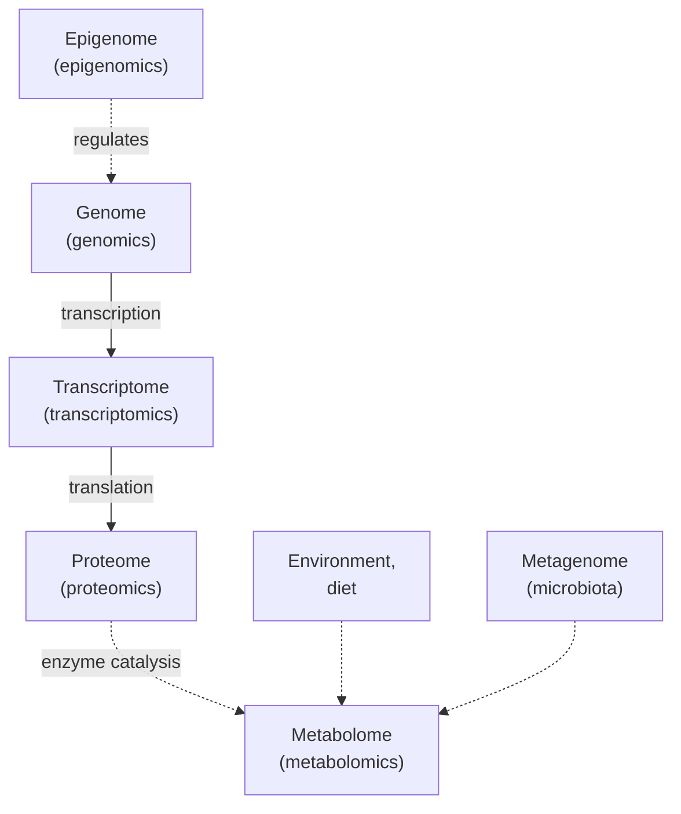
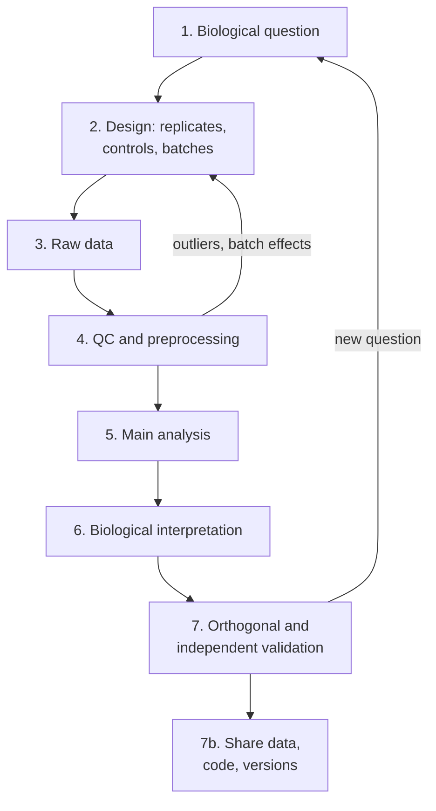

Bioinformatics is the field that develops and applies computational tools to acquire, store, analyze and visualize biological data; computational biology leans toward mathematical modeling and simulation, and the two overlap substantially (NIH BISTIC Definition Committee [NIH], 2000). Most of the field's data come from six omics layers, each measuring a different class of molecules. A project moves through 7 steps from question to validation, and the design step limits every conclusion that follows: in one RNA-seq experiment, 3 replicates recovered only 20–40% of the differentially expressed genes (Schurch et al., 2016). This article is written for biology students who are just starting out, and it uses a liver cancer proteomics study as a running example (Dong et al., 2022).

<div class="callout callout-note">
<p class="callout-title">Quick summary</p>

- **Definition:** bioinformatics leans toward tools and data, computational biology toward models and questions (NIH, 2000).
- **History:** the word "bioinformatics" dates to around 1970, with a much broader meaning than it has today.
- **Omics:** the six omics layers are six layers of measurement; only the genome, transcriptome and proteome sit on the information axis of the central dogma.
- **Projects:** the 7 steps form a loop; the number of replicates and the batch layout decide from the start which conclusions are possible.

</div>

A 2015 analysis projected that by 2025 genomics would match or exceed astronomy, YouTube and Twitter in all four stages of data acquisition, storage, distribution and analysis (Stephens et al., 2015). That is a projection, not a measurement, but the direction is clear.

## 1. What is bioinformatics? Three definitions and a short history

### 1.1. The NIH definition of 2000

On July 17, 2000, the definition committee of BISTIC at the U.S. National Institutes of Health (NIH) released two working definitions (NIH BISTIC Definition Committee, 2000):

- **Bioinformatics:** research, development or application of computational tools that expand the use of biological, medical, behavioral or health data, including acquiring, storing, organizing, archiving, analyzing and visualizing them.
- **Computational biology:** development and application of data-analytical and theoretical methods, mathematical modeling and simulation to study "biological, behavioral, and social systems".

The two definitions split the work along one axis. On the bioinformatics side are tools and data: read aligners, variant databases, mass spectrometry pipelines. On the computational biology side are models and questions: a kinetic model of a gene regulatory network, a simulation of how a gene family evolved. The NIH states plainly that the two fields overlap substantially. In practice the terms are often used interchangeably, and a single project usually needs both.

### 1.2. The original 1970 meaning and how it narrowed

Paulien Hogeweg and Ben Hesper used the word "bioinformatics" from around 1970 to mean "the study of informatic processes in biotic systems", including dynamic models at several levels of biological organization (Hogeweg, 2011). The Oxford English Dictionary (OED) cites two of their 1978 papers as the origin of the term. The narrower meaning familiar today only caught on in the late 1980s, when sequence data began to grow exponentially: computational methods for sequences, protein structure, function prediction by homology, and phylogeny (Hogeweg, 2011).

Comparing sequences actually predates the name. In 1957 Francis Crick foresaw a field of "protein taxonomy" that would compare amino acid sequences across species, although histories of the field usually start with Eck, Dayhoff, Zuckerkandl and Pauling in the early 1960s (Cobb, 2017). Margaret Dayhoff spread protein sequences through atlases printed every year (Hogeweg, 2011).


*Figure 1.* Milestones of the term "bioinformatics"; 196x and 198x mark the early 1960s and the late 1980s. Drawn from Hogeweg (2011), Cobb (2017), NIH (2000) and Luscombe et al. (2001).

### 1.3. The definition by Luscombe and colleagues (2001)

Luscombe, Greenbaum and Gerstein (2001) define bioinformatics as conceptualizing biology in terms of macromolecules and then applying informatics techniques from applied mathematics, computer science and statistics to organize information about those molecules on a large scale. The three main data types are macromolecular structures, genome sequences and functional genomics results such as expression data. Analyzing one gene by hand is not bioinformatics in this sense; analyzing every gene in a genome is.

**Table 1.** Three ways to define the field

| Definition | Year | Scope | Focus |
| --- | --- | --- | --- |
| Hogeweg and Hesper | ~1970 | Every level of living organization | Information processes, dynamic models |
| NIH – bioinformatics | 2000 | Biological, medical and health data | Tools to acquire, store, analyze |
| NIH – computational biology | 2000 | Biological, behavioral, social systems | Mathematical models, simulation |
| Luscombe et al. | 2001 | Macromolecules, large scale | Structure, sequence, expression |

## 2. The omics layers: what they measure and how they relate to the central dogma

### 2.1. What "omics" means

Adding "-omics" to the name of a class of molecules means assessing that whole set of molecules at once. Genomics was the first omics field: it studies the entire genome, whereas traditional genetics usually studies one gene at a time (Hasin et al., 2017).

### 2.2. What the central dogma actually says

Omics layers are often introduced as a chain, "DNA → RNA → protein → metabolites," as if each layer were one step of the central dogma. Crick said something different. His 1956 notes read: "Once information has got into a protein it can't get out again" (quoted in Cobb, 2017). "Information" here means **sequence**. The dogma separates the sequence transfers that can occur among DNA, RNA and protein from three transfers Crick considered impossible: protein → protein, protein → RNA and protein → DNA. After reverse transcriptase was discovered, Crick's 1970 paper restated that RNA → DNA does not contradict the dogma (Crick, 1970; Cobb, 2017).

Cobb (2017) points out that teaching the central dogma as the chain "DNA → RNA → protein" is a common misreading, spread widely by Watson's 1965 textbook. That chain describes replication, transcription and translation (→ DNA replication, transcription and translation) but drops the main point: information does not flow out of protein. Vietnamese-language textbooks call the concept "học thuyết trung tâm" (central theory) or "giáo lý trung tâm của sinh học phân tử" (central dogma of molecular biology) (Hoàng Trọng Phán, 2012).

Three things follow for omics. Metabolites carry no sequence, so the metabolome sits outside the information axis. DNA methylation does not change the sequence, so the epigenome is a regulatory layer. And the metagenome is the genome of other organisms living with the host.

### 2.3. Six omics layers are six layers of measurement

Figure 2 redraws the layers as layers of measurement. The genome, transcriptome and proteome lie on the information axis; the epigenome regulates transcription; the metabolome sits downstream, shaped by enzymes, the environment and the microbiota.


*Figure 2.* The six omics layers. Solid arrows: flow of sequence information; dashed arrows: regulation or metabolism. Original diagram.

**Table 2.** The six omics layers: what is measured, with what, and in which format (formats are explained in Part 4)

| Layer | What it measures | Main technologies | Format |
| --- | --- | --- | --- |
| Genomics | DNA sequence, variants | WGS, WES, long-read | FASTQ, BAM, VCF |
| Epigenomics | Methylation, chromatin | Bisulfite-seq, ChIP-seq, ATAC-seq | BED, bigWig |
| Transcriptomics | RNA expression | RNA-seq, scRNA-seq | FASTQ, count matrix |
| Proteomics | Proteins, post-translational modifications | LC-MS/MS | mzML, intensity table |
| Metabolomics | Metabolites | LC-MS, NMR | mzML (mass spec), peak table |
| Microbiome | Microbial communities | 16S rRNA amplicon; shotgun | FASTQ, OTU/ASV table |

*Compiled for this article; the two microbiome methods follow Ranjan et al. (2016) and Quince et al. (2017).*

The last row combines two different ways of measuring. 16S rRNA amplicon sequencing reads only one conserved marker gene to identify bacteria; shotgun metagenomics reads DNA from every genome in the sample. On the same human stool samples, shotgun detected more species, measured higher diversity and predicted more genes (Ranjan et al., 2016), at the cost of a more complex computational pipeline (Quince et al., 2017). Part 9 analyzes the two with different tools.

### 2.4. One landmark study per layer

Table 3 picks six classic studies, one per layer. This is not a systematic review; all six are in humans, and the numbers come from the abstracts.

**Table 3.** Six layers, six studies

| Layer | Study | Question | Scale, result |
| --- | --- | --- | --- |
| Genomics | 1000 Genomes (2015) | How is variation distributed across populations? | 2,504 people, 26 populations; over 88 million variants |
| Epigenomics | Roadmap (2015) | Which regulatory regions are active in each tissue? | 111 reference epigenomes |
| Transcriptomics | GTEx v8 (2020) | How do variants affect expression in each tissue? | 15,201 RNA-seq samples, 49 tissues, 838 donors |
| Proteomics | Jiang et al. (2019) | Does the proteome split early liver cancer into subtypes? | 110 paired tissues; 3 subtypes; target SOAT1 |
| Metabolomics | Wang et al. (2011) | Do metabolites predict diabetes? | 2,422 people, 12 years, 201 cases |
| Metagenomics | Qin et al. (2010) | Which genes does the gut microbiota carry? | 124 people; 3.3 million genes |

Of the more than 88 million variants in the 1000 Genomes Project, 84.7 million are SNPs, 3.6 million are indels and 60,000 are structural variants (1000 Genomes Project Consortium, 2015). Roadmap found that trait-associated variants cluster in tissue-specific epigenomic marks (Roadmap Epigenomics Consortium, 2015). GTEx notes that the cell type composition of a tissue sample is an important factor in interpretation (GTEx Consortium, 2020). In Jiang et al. (2019), subtype S-III showed disrupted cholesterol homeostasis and had the worst prognosis. Five branched-chain and aromatic amino acids (isoleucine, leucine, valine, tyrosine, phenylalanine) were associated with diabetes risk, and the result replicated in an independent cohort (Wang et al., 2011). The catalogue of 3.3 million gut microbial genes is about 150 times larger than the human gene set (Qin et al., 2010).

### 2.5. Multi-omics: why one layer is not enough

A single omics layer usually yields a list of differences between disease and control. According to Hasin et al. (2017), analyzing one data type mostly yields **correlations**, which largely reflect reactive processes rather than causes. Integrating several layers helps narrow down causal candidates, starting from one of three entry points:

1. **Genome first:** start from a GWAS locus and find the gene and the mechanism it acts through.
2. **Phenotype first:** start from a phenotype and trace related pathways across layers.
3. **Environment first:** start from a factor such as diet and see how it changes each layer.

One layer cannot stand in for another. Transcript and protein levels correlate only moderately for most pairs, because of translational regulation, post-translational modification and protein degradation rates (Hasin et al., 2017; → Part 8). RNA-seq data can be compared across studies only when they use the same genome build, annotation and tools (→ Part 11). And proof of causation still requires in vivo or in vitro experiments (Hasin et al., 2017). Manzoni et al. (2018) is a readable review of genomics, transcriptomics and proteomics data for newcomers.

## 3. The 7-step life cycle, illustrated with a liver cancer proteomics study

The seven steps of a project connect into a **loop** (Figure 3): poor QC at step 4 can send you back to step 2, and the results of step 7 raise new questions for step 1. Step 7b, sharing data and code, lets others check the results.


*Figure 3.* The life cycle of a biological data analysis project. Original diagram.

The running example is an open-access study by Dong et al. (2022) on the proteome of small extracellular vesicles (sEVs) in the plasma of patients with hepatocellular carcinoma (HCC).

### Step 1. The biological question

A good question names the population, the comparison and the outcome measure (→ [SMART questions](/en/blog/ask-questions-to-make-data-driven-decisions/)). The question in Dong et al. (2022): do proteins in plasma sEVs separate patients with HCC from controls well enough to serve as liquid biopsy markers? That question already fixed the sample type, the omics layer and the comparison.

### Step 2. Design: replicates and batch effects

This is the hardest step to fix later, because no tool can make up for data collected the wrong way.

**Replicates.** Schurch et al. (2016) ran RNA-seq in yeast with 48 biological replicates per group. With 3 replicates, 9 of 11 tools found only 20–40% of the differentially expressed genes identified by the "clean" set of 42 replicates. The authors recommend at least 6 replicates, and 12 when you need to find differentially expressed genes at every fold change. Human samples vary more than cultured yeast, so treat this as a floor. On a tight budget, adding samples usually pays off more than sequencing deeper (Hasin et al., 2017).

**Batch effects** are technical differences caused by lab conditions, reagent lots or the person doing the work. They are most dangerous when they line up with the outcome variable, because technical differences then get read as biological ones (Leek et al., 2010). The code below simulates exactly that: 12 samples, one protein that does **not** truly differ between HCC and control, and batch 2 reading one log2 unit higher than batch 1.

```python
import numpy as np
import pandas as pd
from scipy import stats

rng = np.random.default_rng(1)
# 12 samples: 6 HCC, 6 controls; this protein has NO true difference between groups
group = ["HCC"] * 6 + ["Control"] * 6

def simulate(batch):
    df = pd.DataFrame({"group": group, "batch": batch})
    # log2 intensity = baseline 10 + biological variation + 1.0 if run in batch 2
    df["log2_int"] = 10 + rng.normal(0, 0.4, 12) + np.where(df["batch"] == 2, 1.0, 0.0)
    return df

designs = {
    "Confounded": [2] * 6 + [1] * 6,         # every HCC sample runs in batch 2
    "Balanced": [1, 1, 1, 2, 2, 2] * 2,      # each batch has 3 HCC and 3 controls
}
results = {}
for name, batch in designs.items():
    df = simulate(batch)
    # subtract each batch's mean (the simplest batch correction)
    df["corrected"] = df["log2_int"] - df.groupby("batch")["log2_int"].transform("mean")
    for col in ["log2_int", "corrected"]:
        a = df.loc[df.group == "HCC", col]
        b = df.loc[df.group == "Control", col]
        p = stats.ttest_ind(a, b).pvalue
        print(f"{name:10} | {col:9} | difference = {a.mean() - b.mean():5.2f} | p = {p:.2g}")
    results[name] = df
```

```text
Confounded | log2_int  | difference =  1.02 | p = 4.3e-05
Confounded | corrected | difference =  0.00 | p = 1
Balanced   | log2_int  | difference = -0.14 | p = 0.76
Balanced   | corrected | difference = -0.14 | p = 0.26
```


*Figure 4.* Simulated data (12 samples, seed = 1) generated by the code above: when batch is confounded with group, a protein with no true difference still gives p < 0.0001.

When batch is confounded with group, the protein is "up" 1.02 log2 units in HCC with p = 4.3 × 10⁻⁵, all of it from the batch. Correction does not rescue the design either: subtracting each batch's mean drives the difference to exactly 0, because it also wipes out every difference between groups, including a real one. With balanced batches the result is not significant, which matches the truth that was simulated. Batch effects are therefore handled mainly through design, which is why Hasin et al. (2017) advise planning the analysis while you plan sample collection (→ [dirty data and how to clean it](/en/blog/process-data-from-dirty-to-clean/)).

**Applied to the example.** Dong et al. (2022) had a discovery cohort of 21 HCC patients and 15 controls, plus a separate validation cohort of 7 and 7. For mass spectrometry the samples were **pooled** into 3 samples per group (7 patients or 5 controls per pool) to reduce individual variation and cost. The trade-off: pooling erases information about person-to-person variation, and the statistics run on n = 3 per group, far below recommendations like those of Schurch et al. (2016). The authors themselves list the small sample size and the pooling as limitations.

### Step 3. Raw data

Raw data come from your own instrument or from public databases (→ Part 4); for downloaded data, read the batch and sample-type information that comes with them. In the example, the instrument recorded 850,808 MS/MS spectra, of which 77,850 matched UniProt (Dong et al., 2022): fewer than one in ten spectra were assigned to a known peptide.

### Step 4. Quality control and preprocessing

Quality control (QC) is a step of its own: the RNA-seq best-practice review by Conesa et al. (2016) lists it alongside design, alignment, quantification, differential expression and functional analysis. Dong et al. (2022) ran QC at two levels. At the sample level, they confirmed that they had isolated sEVs using transmission electron microscopy (TEM), nanoparticle tracking analysis (NTA) and Western blot markers (CD63, CD81 and TSG101 positive; calnexin negative). At the data level, they used MaxQuant with an FDR below 1% for peptides and proteins, and removed contaminant proteins such as keratin, bovine serum albumin and trypsin.

### Step 5. Main analysis

In the example, 335 proteins were identified and 281 quantified. A fold change ≥ 1.5 or < 0.66 picked out 54 proteins; 27 of them had p < 0.05, with 13 up and 14 down (Dong et al., 2022). When you read a list like this, ask whether the p-values were corrected for multiple testing. Test 281 proteins at a 0.05 threshold and, even with no true differences at all, about 14 proteins will come out "significant" by chance on average (→ [Part 3: FDR](/en/blog/toan-va-thong-ke-cho-sinh-hoc/)). The paper applies a Benjamini–Hochberg correction at the enrichment step (Step 6); for the threshold that selected the 27 proteins, check the figure legends and supplementary files yourself.

### Step 6. Biological interpretation

Gene Ontology (GO) and KEGG enrichment analyses showed the differentially expressed proteins concentrated in the complement (C1QB, C1QC, C4BPA, C4BPB) and coagulation (F13B, FGA, FGB, FGG) pathways; the protein interaction network was built with STRING (Dong et al., 2022). The authors used all quantified proteins as the background and adjusted p with Benjamini–Hochberg, a practice worth copying: use the whole proteome of the species as the background, and proteins that are naturally abundant in plasma can look "enriched." Still, a list of 27 proteins is short, so the results are sensitive to each individual protein.

### Step 7. Validation and reproducibility

Validation has two meanings. **Orthogonal confirmation** re-measures the same samples with a different technique to rule out technical error. **Independent validation** asks whether the result holds in different people. Dong et al. (2022) did both: Western blots on the pooled samples themselves, then on a cohort of 7 HCC patients and 7 controls.

For RNA-seq, qPCR is not always needed. When 5 RNA-seq workflows were compared with qPCR across all protein-coding genes, about 85% of genes had consistent fold changes; inconsistent genes tended to be short, have few exons and be expressed at low levels (Everaert et al., 2017). Coenye (2021) sums it up: only about 1.8% of genes were severely inconsistent, and qPCR adds value when a conclusion rests on a few low-expression genes or small differences, or when you need measurements under other conditions.

**Step 7b: share data, code and versions.** When two independent teams tried to repeat the analyses of 18 microarray papers, only 2 could be reproduced in principle, 6 partially and 10 not at all; the main reason was unavailable data (Ioannidis et al., 2009). The example is no exception: participant-level data from Dong et al. (2022) are available only on request, if the corresponding author agrees. Deposit raw data in a public repository, publish your code, and record the genome build, annotation and tool versions (→ Part 11, Part 12).

**Table 4.** Dong et al. (2022) read through the 7 steps

| Step | What the study did | Done well | Caution |
| --- | --- | --- | --- |
| 1. Question | sEV proteins as HCC markers | Clear, applied | Not tied to tumor stage |
| 2. Design | 21 + 15, pooled into 3 + 3 | Validation cohort 7 + 7 | Pooling, n = 3 |
| 3. Raw data | 850,808 MS/MS spectra | Detailed instrument settings | Raw data only on request |
| 4. QC | FDR < 1%; TEM, NTA, WB | QC of both samples and data | |
| 5. Analysis | FC and p < 0.05 → 27 proteins | Thresholds stated | Check whether p was corrected when selecting the 27 proteins |
| 6. Interpretation | GO, KEGG, STRING | Background = quantified proteins; BH correction | Short list |
| 7. Validation | WB on pools, then 7 + 7 | Orthogonal and independent | Small cohort |

## 4. Who does bioinformatics?

The NIH (2000) "tools or questions" axis also separates job roles. A **bioinformatician** builds and runs pipelines and databases. A **computational biologist** uses models and analysis to answer research questions. A **data scientist in pharma or biotech** combines omics data with other data sources for drug development. A **clinical bioinformatician** processes sequencing data for genetic diagnosis. The ISCB competency framework v3 describes 13 core competencies of the field (Brooksbank et al., 2024), and the [series introduction](/en/blog/gioi-thieu-va-cach-dung-giao-trinh/) maps a 36-week self-study roadmap against it.

## 5. Conclusion and exercise

Three ideas are worth carrying into the next parts: bioinformatics is the field of tools and data, overlapping with computational biology (NIH, 2000); a single omics layer mostly yields correlations; and of the seven steps in a project, design decides which conclusions you can still draw.

Exercise: pick an open-access omics paper on PubMed, copy Table 4 with the last three columns blank, fill it in for that paper and mark its weakest step. [Part 2](/en/blog/nen-tang-tinh-toan/) moves on to the tools you need to work through steps 3–5 yourself.

## Frequently asked questions

**What is bioinformatics, in plain terms?** It is the field that builds and uses computational tools to store, analyze and visualize biological data such as DNA sequences or gene expression data. In Vietnamese it is called "tin sinh học."

**What should I learn before getting into bioinformatics?** This series goes in order: molecular biology in this article, programming in [Part 2](/en/blog/nen-tang-tinh-toan/), statistics in [Part 3](/en/blog/toan-va-thong-ke-cho-sinh-hoc/). The [introduction](/en/blog/gioi-thieu-va-cach-dung-giao-trinh/) arranges the parts into a 36-week roadmap and maps it against the ISCB competency framework.

**What is a batch effect?** It is a technical difference between groups of samples processed on different days, with different reagent lots or by different people. The most effective prevention is to spread the groups you are comparing evenly across every batch at the design stage.

## References

1000 Genomes Project Consortium, Auton, A., Brooks, L. D., Durbin, R. M., Garrison, E. P., Kang, H. M., Korbel, J. O., Marchini, J. L., McCarthy, S., McVean, G. A., & Abecasis, G. R. (2015). A global reference for human genetic variation. *Nature, 526*(7571), 68–74. https://doi.org/10.1038/nature15393

Brooksbank, C., Brazas, M. D., Mulder, N., Schwartz, R., Ras, V., Morgan, S. L., Lloret Llinares, M., Carvajal López, P., Larcombe, L., Ghouila, A., Hancocks, T., Satagopam, V., De Las Rivas, J., Mazandu, G., & Gaeta, B. (2024). The ISCB competency framework v. 3: A revised and extended standard for bioinformatics education and training. *Bioinformatics Advances, 4*(1), vbae166. https://doi.org/10.1093/bioadv/vbae166

Cobb, M. (2017). 60 years ago, Francis Crick changed the logic of biology. *PLOS Biology, 15*(9), e2003243. https://doi.org/10.1371/journal.pbio.2003243

Coenye, T. (2021). Do results obtained with RNA-sequencing require independent verification? *Biofilm, 3*, 100043. https://doi.org/10.1016/j.bioflm.2021.100043

Conesa, A., Madrigal, P., Tarazona, S., Gomez-Cabrero, D., Cervera, A., McPherson, A., Szcześniak, M. W., Gaffney, D. J., Elo, L. L., Zhang, X., & Mortazavi, A. (2016). A survey of best practices for RNA-seq data analysis. *Genome Biology, 17*, 13. https://doi.org/10.1186/s13059-016-0881-8

Crick, F. (1970). Central dogma of molecular biology. *Nature, 227*(5258), 561–563. https://doi.org/10.1038/227561a0

Dong, W., Xia, Z., Chai, Z., Qiu, Z., Wang, X., Yang, Z., Wang, J., Zhang, T., Zhang, Q., & Jin, J. (2022). Proteomic analysis of small extracellular vesicles from the plasma of patients with hepatocellular carcinoma. *World Journal of Surgical Oncology, 20*(1), 387. https://doi.org/10.1186/s12957-022-02849-y

Everaert, C., Luypaert, M., Maag, J. L. V., Cheng, Q. X., Dinger, M. E., Hellemans, J., & Mestdagh, P. (2017). Benchmarking of RNA-sequencing analysis workflows using whole-transcriptome RT-qPCR expression data. *Scientific Reports, 7*(1), 1559. https://doi.org/10.1038/s41598-017-01617-3

GTEx Consortium. (2020). The GTEx Consortium atlas of genetic regulatory effects across human tissues. *Science, 369*(6509), 1318–1330. https://doi.org/10.1126/science.aaz1776

Hasin, Y., Seldin, M., & Lusis, A. (2017). Multi-omics approaches to disease. *Genome Biology, 18*(1), 83. https://doi.org/10.1186/s13059-017-1215-1

Hoàng Trọng Phán. (2012). *Sinh học phân tử: Khái niệm, nguyên lý & quá trình* [Molecular biology: Concepts, principles and processes]. Đại học Huế.

Hogeweg, P. (2011). The roots of bioinformatics in theoretical biology. *PLoS Computational Biology, 7*(3), e1002021. https://doi.org/10.1371/journal.pcbi.1002021

Ioannidis, J. P. A., Allison, D. B., Ball, C. A., Coulibaly, I., Cui, X., Culhane, A. C., Falchi, M., Furlanello, C., Game, L., Jurman, G., Mangion, J., Mehta, T., Nitzberg, M., Page, G. P., Petretto, E., & van Noort, V. (2009). Repeatability of published microarray gene expression analyses. *Nature Genetics, 41*(2), 149–155. https://doi.org/10.1038/ng.295

Jiang, Y., Sun, A., Zhao, Y., Ying, W., Sun, H., Yang, X., Xing, B., Sun, W., Ren, L., Hu, B., Li, C., Zhang, L., Qin, G., Zhang, M., Chen, N., Zhang, M., Huang, Y., Zhou, J., Zhao, Y., . . . He, F. (2019). Proteomics identifies new therapeutic targets of early-stage hepatocellular carcinoma. *Nature, 567*(7747), 257–261. https://doi.org/10.1038/s41586-019-0987-8

Leek, J. T., Scharpf, R. B., Bravo, H. C., Simcha, D., Langmead, B., Johnson, W. E., Geman, D., Baggerly, K., & Irizarry, R. A. (2010). Tackling the widespread and critical impact of batch effects in high-throughput data. *Nature Reviews Genetics, 11*(10), 733–739. https://doi.org/10.1038/nrg2825

Luscombe, N. M., Greenbaum, D., & Gerstein, M. (2001). What is bioinformatics? A proposed definition and overview of the field. *Methods of Information in Medicine, 40*(4), 346–358. https://doi.org/10.1055/s-0038-1634431

Manzoni, C., Kia, D. A., Vandrovcova, J., Hardy, J., Wood, N. W., Lewis, P. A., & Ferrari, R. (2018). Genome, transcriptome and proteome: The rise of omics data and their integration in biomedical sciences. *Briefings in Bioinformatics, 19*(2), 286–302. https://doi.org/10.1093/bib/bbw114

NIH BISTIC Definition Committee. (2000, July 17). *NIH working definition of bioinformatics and computational biology*. National Institutes of Health. http://web.archive.org/web/20090927132535/http://www.bisti.nih.gov/docs/CompuBioDef.pdf

Qin, J., Li, R., Raes, J., Arumugam, M., Burgdorf, K. S., Manichanh, C., Nielsen, T., Pons, N., Levenez, F., Yamada, T., Mende, D. R., Li, J., Xu, J., Li, S., Li, D., Cao, J., Wang, B., Liang, H., Zheng, H., . . . Wang, J. (2010). A human gut microbial gene catalogue established by metagenomic sequencing. *Nature, 464*(7285), 59–65. https://doi.org/10.1038/nature08821

Quince, C., Walker, A. W., Simpson, J. T., Loman, N. J., & Segata, N. (2017). Shotgun metagenomics, from sampling to analysis. *Nature Biotechnology, 35*(9), 833–844. https://doi.org/10.1038/nbt.3935

Ranjan, R., Rani, A., Metwally, A., McGee, H. S., & Perkins, D. L. (2016). Analysis of the microbiome: Advantages of whole genome shotgun versus 16S amplicon sequencing. *Biochemical and Biophysical Research Communications, 469*(4), 967–977. https://doi.org/10.1016/j.bbrc.2015.12.083

Roadmap Epigenomics Consortium, Kundaje, A., Meuleman, W., Ernst, J., Bilenky, M., Yen, A., Heravi-Moussavi, A., Kheradpour, P., Zhang, Z., Wang, J., Ziller, M. J., Amin, V., Whitaker, J. W., Schultz, M. D., Ward, L. D., Sarkar, A., Quon, G., Sandstrom, R. S., Eaton, M. L., . . . Kellis, M. (2015). Integrative analysis of 111 reference human epigenomes. *Nature, 518*(7539), 317–330. https://doi.org/10.1038/nature14248

Schurch, N. J., Schofield, P., Gierliński, M., Cole, C., Sherstnev, A., Singh, V., Wrobel, N., Gharbi, K., Simpson, G. G., Owen-Hughes, T., Blaxter, M., & Barton, G. J. (2016). How many biological replicates are needed in an RNA-seq experiment and which differential expression tool should you use? *RNA, 22*(6), 839–851. https://doi.org/10.1261/rna.053959.115

Stephens, Z. D., Lee, S. Y., Faghri, F., Campbell, R. H., Zhai, C., Efron, M. J., Iyer, R., Schatz, M. C., Sinha, S., & Robinson, G. E. (2015). Big data: Astronomical or genomical? *PLOS Biology, 13*(7), e1002195. https://doi.org/10.1371/journal.pbio.1002195

Wang, T. J., Larson, M. G., Vasan, R. S., Cheng, S., Rhee, E. P., McCabe, E., Lewis, G. D., Fox, C. S., Jacques, P. F., Fernandez, C., O'Donnell, C. J., Carr, S. A., Mootha, V. K., Florez, J. C., Souza, A., Melander, O., Clish, C. B., & Gerszten, R. E. (2011). Metabolite profiles and the risk of developing diabetes. *Nature Medicine, 17*(4), 448–453. https://doi.org/10.1038/nm.2307
