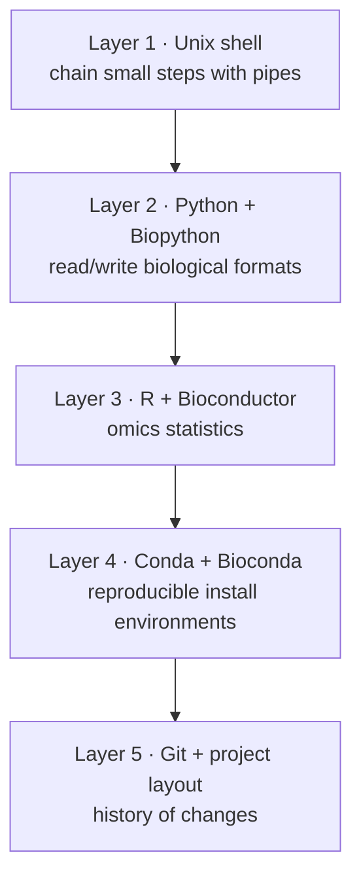

Five tools (the Unix shell, Python with Biopython, R with Bioconductor, Conda with Bioconda, and Git) make up the minimal computational infrastructure that bioinformatics curricula usually ask beginners to learn first. Each one exists to block a specific kind of failure: silent errors in long processing chains, file-format parsing mistakes, software that will not install (28% of 98 omics tools that researchers tried to install; Mangul et al., 2019), and losing track of changes. This article explains each layer through its original paper, with install commands and configuration that follow current documentation. The hands-on part computes the read count, mean length and GC content of the public FASTQ file SRR2589044 with awk, plain Python and Biopython, then checks the results against ENA metadata and the REL606 reference genome.

<div class="callout callout-note">
<p class="callout-title">Quick summary</p>

- **Shell**: chain small programs with pipes and check every step. Don't count reads with `grep -c '^@'`.
- **Biopython**: a shared parser for biological formats. Compute GC with `gc_fraction`, not a hand-rolled `seq.count("G")`.
- **Bioconductor**: 2,418 software packages in release 3.23 (April 29, 2026), each reviewed and tested automatically.
- **Bioconda**: more than 12,000 packages; give `conda-forge` top priority and set `channel_priority strict`.
- **Git**: track code and the README, not FASTQ files; GitHub blocks files larger than 100 MiB.

</div>

## 1. Five layers of infrastructure, four kinds of failure

Computational infrastructure, in this article, means the set of tools that sits underneath every analysis: where you type commands, the language you write the analysis in, the libraries that understand biological data, how you install software, and how you keep a history of changes. The article splits it into five layers (Figure 1).


*Figure 1. The five layers of computational infrastructure in a small bioinformatics project.*

Why these five tools? Because each one reduces a kind of risk that has been documented in the literature.

The first risk is the **silent error**. Buffalo (2015, ch. 1) calls this the "golden rule" of bioinformatics: the program still runs and prints output, but the output is wrong, and the intermediate data are too large to check by eye. The defense is to break the work into small steps and check each one.

The second risk is **format parsing errors**. FASTQ looks simple, yet it has details that break home-made parsers (Cock et al., 2010). A shared format library lowers this risk.

The third risk is **software that won't install**. Bioinformatics software is written in many languages and installed in many different ways, so managing it is error-prone and slow (Grüning, Dale, et al., 2018). Mangul et al. (2019) surveyed 36,702 omics software resources published between 2005 and 2017: nearly 28% could no longer be reached at the URL given in the original paper. Of the 98 tools the authors tried to install, 51% were "easy to install," while 28% could not be installed at all.

The fourth risk is **losing track of changes**: nobody remembers which version of which script, run on which data, produced a figure in the manuscript (Wilson et al., 2017).

Table 1 maps each tool to the problem it addresses and the evidence behind it.

| Layer | Tool | Problem addressed | Source | Current figures |
| --- | --- | --- | --- | --- |
| 1 | Bash, coreutils, awk | Chain small steps, check each one | Buffalo (2015) | – |
| 2 | Python + Biopython | Shared format readers/writers, database access | Cock et al. (2009) | Biopython 1.87 |
| 3 | R + Bioconductor | Reviewed, tested omics statistics packages | Gentleman et al. (2004); Huber et al. (2015) | 2,418 software packages, release 3.23 (April 29, 2026) |
| 4 | Conda + Bioconda | Install software without admin rights, reproduce environments | Grüning, Dale, et al. (2018) | More than 12,000 packages (November 2026) |
| 5 | Git + GitHub | Keep history, collaborate, make code citable | Blischak et al. (2016); Perez-Riverol et al. (2016) | 100 MiB file limit |

*Table 1. The five layers, the problem each one solves, and where it comes from.*

The article walks through each layer with three questions in mind. What problem was the tool designed to solve? What is the minimum a beginner needs to use? And when you compute the same metric three ways on the same real file, do the results agree with each other and with an outside source? The practice data set is run SRR2589044: Illumina reads from one *Escherichia coli* clone in Lenski's long-term evolution experiment (Tenaillon et al., 2016).

<div class="callout callout-note">
<p class="callout-title">What you need to follow along</p>

A macOS or Linux machine with a terminal; on Windows, use WSL (Windows Subsystem for Linux) to get a Linux environment. Python 3 with Biopython, R, and about 150 MB of free space for the FASTQ file. Every command and script in the article was run on macOS 12.7.6 with Python 3.13.2 and Biopython 1.87. Where a command differs between macOS and Linux, the difference is noted on the spot.

</div>

## 2. Layer 1 – The Unix shell: chaining small programs with pipes

### 2.1. Why bioinformatics starts at the command line

The Unix philosophy has two parts: each program does one thing well, and programs talk to each other through text streams. The `|` character (a pipe) feeds the output of one command into the next. Buffalo (2015, ch. 3, pp. 37–38) argues that a pipeline built from many small steps is easier to check than one big program: you can stop at any step, look at the output, and carry on. Most biological data live in very large text files (FASTA, FASTQ, SAM, VCF, BED), so line-by-line tools such as `grep`, `awk`, `cut` and `sort` can handle files of many gigabytes without loading the whole file into memory.

### 2.2. The minimal command set

| Group | Commands | What they do |
| --- | --- | --- |
| Navigation | `pwd`, `ls -lh`, `cd`, `mkdir -p` | Show the current directory, move around, create directories |
| Viewing files | `head`, `tail`, `less`, `wc -l` | Look at the first few lines, count lines |
| Searching | `grep`, `grep -c` | Filter lines, count matching lines |
| Column work | `cut`, `sort`, `uniq -c`, `awk` | Pick columns, sort, count, compute |
| Compression | `gzip`, `gzip -dc`, `tar` | Compress, decompress to stdout |
| Remote | `ssh`, `scp`, `curl`, `wget` | Work on a server, download data |

*Table 2. The minimal shell command set for beginners.*

Brandies and Hogg (2021) offer ten rules for people starting out with command-line bioinformatics. Three bear directly on this article: check and test your scripts at each step before running the whole pipeline (Rule 6), learn the basic bash commands (Rule 8), and document what you did (Rule 9). This article adds one more habit: try everything on a small subset of the data first.

Here is a pipe on the practice file. It decompresses to stdout, takes the sequence line of each record, prints its length, then counts reads by length.

```bash
gzip -dc SRR2589044_1.fastq.gz | awk 'NR % 4 == 2 { print length($0) }' | sort | uniq -c
#  1107090 150
```

Four programs, one job each. To check any step, cut the pipeline there and add `| head`. The result says that all 1,107,090 reads are 150 bp long, a fact you will use in Section 7 to double-check the total base count.

### 2.3. Why you shouldn't count reads with `grep -c '^@'`

A FASTQ record usually has four lines: a header starting with `@`, the sequence, a `+` line, and the quality string. This is the first record in the practice file (`gzip -dc SRR2589044_1.fastq.gz | head -4`):

```text
@SRR2589044.1 HWI-ST957:244:H73TDADXX:1:1101:10469:2228/1
GTGGAAACCAGCGACGGTGACGGCTATATCAACTGCGTGATTGAACATCAAAGCTCTGCAGAAAAGAATATGGCTTTTCGGCTAATGCGCTATGCCACTGCCGCCATGCAGCGTCACCTGGATAACTGTCTCTTATACACATCTCCGAGC
+
BBBFFFFFHHHHHJJJJIIGIIJJJJJGIJJIJJJIJIJGHIIJIIFFFGHHFFFFFEEEEEEDDDDDDDEEDCDDDDDD@BDDDDDDDDBDDDDDDDDDCABDDDDCDDCCDBDDDDDDDBDEDDDCCDCDCDDDDCDDDCDDDD@DDD
```

The `@` character already shows up twice in this read's quality string, just not at the start of the line. A common way to count reads is to count lines that start with `@`. That approach is wrong, because the quality string encodes Phred scores as ASCII characters 33–126, and `@` is character 64, which stands for Phred 31 (Cock et al., 2010). A quality line can start with `@`, and when it does, `grep` counts it as a header. Cock et al. (2010) state plainly that you cannot find records just by looking for lines that begin with `@`.

The safe way is to count lines and divide by 4, with a check on the four-line assumption. That assumption holds for current Illumina output, but the FASTQ specification allows line wrapping inside the sequence and inside the quality string (Cock et al., 2010). The script below checks three things: line 1 of every record starts with `@`, line 3 starts with `+`, and the total line count is divisible by 4. If any check fails, the script stops with an error. An empty file is also caught, instead of letting awk divide by zero.

```bash
#!/usr/bin/env bash
# count_reads.sh – count reads, total bases, mean length and GC
# for every *.fastq.gz file in the current directory
set -euo pipefail

printf "file\treads\tbases\tmean_len\tgc_pct\n"
for f in *.fastq.gz; do
  gzip -dc "$f" | awk -v name="$f" '
    NR % 4 == 1 && substr($0, 1, 1) != "@" { print "Format error at line " NR > "/dev/stderr"; exit 1 }
    NR % 4 == 3 && substr($0, 1, 1) != "+" { print "Format error at line " NR > "/dev/stderr"; exit 1 }
    NR % 4 == 2 {
      n++; len = length($0); bases += len
      s = toupper($0); gc += gsub(/[GC]/, "", s)
    }
    END {
      if (n == 0) { print "Empty file: " name > "/dev/stderr"; exit 1 }
      if (NR % 4 != 0) { print "Line count is not divisible by 4" > "/dev/stderr"; exit 1 }
      printf "%s\t%d\t%d\t%.2f\t%.3f\n", name, n, bases, bases / n, 100 * gc / bases
    }'
done
```

The line `set -euo pipefail` turns on a safer mode: stop when a command fails (`-e`), complain about unset variables (`-u`), and treat the whole pipeline as failed if any command in it fails (`pipefail`). Without `pipefail`, a corrupted `.gz` file can still produce a perfectly normal-looking line of output.

### 2.4. Common mistakes

| Command | Symptom | Fix | Source |
| --- | --- | --- | --- |
| `wc -l reads.fastq` | Gives the number of lines, not reads | Divide by 4 after checking the format | Cock et al. (2010) |
| `grep -c '^@' reads.fastq` | Overcounts because a quality line can start with `@` | Line count ÷ 4, or `grep -c '^@SRR'` when you know the prefix | Cock et al. (2010) |
| Assuming 4 lines per read | Silently wrong on wrapped FASTQ | Check that line 3 starts with `+` and the line count is divisible by 4 | Cock et al. (2010) |
| `zcat file.gz` on macOS | Fails looking for `file.gz.Z` (tested on macOS 12.7.6) | `gzip -dc file.gz` or `gzcat` | – |
| `grep -c ">" genome.fa` | Also counts lines with `>` in the middle | `grep -c '^>'` | – |

*Table 3. Common mistakes when counting reads and sequences at the command line.*

An off-the-shelf tool for the same job is `seqkit stats` (Shen et al., 2016), installed through Bioconda (Section 5). Once you have seqkit, you get one more independent check.

## 3. Layer 2 – Python and Biopython: a shared format parser

### 3.1. What Biopython is

Biopython is an international open-source project started in 1999 and supported by the Open Bioinformatics Foundation, alongside its sister projects BioPerl, BioJava and BioRuby (Cock et al., 2009). The library includes modules for reading and writing sequence and alignment formats, working with 3D protein structures, running programs such as BLAST, ClustalW and EMBOSS, and querying online databases such as NCBI Entrez (Cock et al., 2009). Biopython developers also worked with BioPerl, BioJava, BioRuby and EMBOSS to agree on the FASTQ specification (Cock et al., 2010). As a result, Biopython's parser follows the specification closely, down to details like `@` inside the quality string.

If you haven't learned Python yet, Ekmekci et al. (2016) wrote a programming primer aimed specifically at bioscientists. NumPy, pandas and Jupyter are covered in [Introduction to Data Analysis Using Python](/en/blog/introduction-to-data-analysis-using-python/).

### 3.2. Two ways to read FASTQ

`SeqIO.parse(handle, "fastq")` returns full `SeqRecord` objects with the sequence, numeric quality scores and description. `FastqGeneralIterator` returns just three strings (title, sequence, quality), so it is faster when all you need is a count. On the practice file, simply counting reads took 11.5 seconds with `SeqIO.parse` and 4.7 seconds with `FastqGeneralIterator` (one machine, for illustration only). The script below uses the second approach and writes the GC of every read to a TSV file for the plot in Section 4.

```python
"""fastq_stats_bio.py – FASTQ statistics with Biopython; writes per-read GC to a TSV."""
import gzip
import sys
from Bio.SeqIO.QualityIO import FastqGeneralIterator
from Bio.SeqUtils import gc_fraction

ADAPTER = "CTGTCTCTTATACACATCT"  # Illumina Prep/Nextera adapter trimming sequence

path, out_tsv = sys.argv[1], sys.argv[2]
n = bases = gc = 0
with gzip.open(path, "rt") as fh, open(out_tsv, "w") as out:
    out.write("read_id\tlength\tgc\thas_adapter\n")
    for title, seq, qual in FastqGeneralIterator(fh):
        seq = seq.upper()
        n += 1
        bases += len(seq)
        gc += seq.count("G") + seq.count("C")
        out.write(f"{title.split()[0]}\t{len(seq)}\t"
                  f"{gc_fraction(seq):.4f}\t{int(ADAPTER in seq)}\n")
print(f"reads={n} bases={bases} mean_len={bases / n:.2f} gc={100 * gc / bases:.3f}%")
```

### 3.3. Computing GC content correctly

The most common way to compute GC is `(seq.count("G") + seq.count("C")) / len(seq)`. That snippet has three problems. First, `count` is case-sensitive, so it misses lowercase bases, and many genome files use lowercase to mark repeats (soft-masking). Second, the denominator `len(seq)` includes ambiguous characters such as `N`, which drags GC down in N-rich regions. Third, an empty sequence causes a division by zero.

Biopython ships `Bio.SeqUtils.gc_fraction`, added in version 1.80 (released November 18, 2022; Biopython, n.d.). The function ignores case and, by default, removes ambiguous characters from the denominator. The old `GC()` function no longer exists in Biopython 1.87.

```python
from Bio import SeqIO
from Bio.SeqUtils import gc_fraction

for record in SeqIO.parse("tiny.fa", "fasta"):
    seq = record.seq
    if len(seq) == 0:
        print(f"{record.id}\tskipped (empty sequence)")
        continue
    naive = (seq.count("G") + seq.count("C")) / len(seq)   # error-prone approach
    print(f"{record.id}\tlen={len(seq)}\tnaive={naive:.3f}\t"
          f"gc_fraction={gc_fraction(seq):.3f}")
```

On a three-record test file (`ACGTacgtGCNN`, an empty record, and `GGCCATTA` wrapped after the sixth base), the hand count gives GC 0.333 for the first record, while `gc_fraction` gives 0.600: 6 G/C bases out of 10 unambiguous bases. The empty record is skipped instead of crashing the program. The third record gives 0.500 both ways, and `SeqIO` joins the two sequence lines on its own.

`gc_fraction` has an `ambiguous` parameter with three options. The default, `"remove"`, drops ambiguous characters from the denominator (0.600 in the example above). `"ignore"` keeps them in the denominator and gives 0.500, which treats N as a non-G/C base. `"weighted"` counts the partial contribution of ambiguity codes such as `S` (G or C), so `gc_fraction("GGSS", ambiguous="weighted")` returns 1.0. When you compare GC across files, say which option you used: for reads with many Ns, the gap between `"remove"` and `"ignore"` is not small.

### 3.4. When to use the shell, when to use Python

For one-line questions ("how many reads are in this file?", "how are read lengths distributed?"), a shell pipeline is usually short and good enough. When you need to keep state across many records, handle complex formats (GenBank, alignments, protein structures), or write tested code you will reuse, Python with Biopython is easier to read and to fix. The two layers don't replace each other: in Section 7, each one is used to cross-check the other.

## 4. Layer 3 – R and Bioconductor: reviewed and tested packages

### 4.1. What Bioconductor was built for

Gentleman et al. (2004) describe Bioconductor's goals: develop software collaboratively, lower the barriers to interdisciplinary research, and make it possible for others to reproduce results remotely.

Eleven years later, Huber et al. (2015) counted 934 interoperable Bioconductor packages. Every package goes through an initial review before acceptance and is then tested automatically on an ongoing basis. An ordinary package repository does neither.

Release 3.23 (April 29, 2026) contains 2,418 software packages, 437 experiment data packages, 928 annotation packages, 28 workflows and 8 books (Bioconductor, 2026). The figure "more than 2,000 packages" that you often see is accurate only for software packages; counting every package type, the total is much larger.

### 4.2. Shared data structures

Bioconductor packages fit together because they share data structures. A familiar example is `GenomicRanges`, which represents stretches of a genome (genes, exons, peaks) with chromosome, start, end and strand. A ChIP-seq peak caller and a gene annotation package can read the same object, so you don't have to convert formats back and forth.

Outside Bioconductor, the tidyverse is a set of R packages built on a shared design philosophy, including dplyr for transforming tables and ggplot2 for plotting (Wickham et al., 2019). For biologists, the tidyverse handles results tables, while Bioconductor handles omics data. The articles Introduction to tidyverse and Visualizations (R) go further.

### 4.3. An R example: reading a TSV and plotting the GC distribution

The R code below reads the TSV file produced by the Biopython script in Section 3.2 and draws a per-read GC histogram in base R, using only built-in functions.

```r
gc <- read.delim("gc_per_read.tsv")
summary(gc$gc)
png("gc_hist.png", width = 800, height = 500)
hist(gc$gc * 100, breaks = 50, main = "Per-read GC", xlab = "GC (%)")
abline(v = 50.77, col = "red", lwd = 2)   # REL606 genome GC
dev.off()
```

On the TSV for SRR2589044_1, `summary()` reports per-read GC from 0.1667 to 0.8067, with a median of 0.5133 and a mean of 0.5054. Read a table, summarize it, plot it: that is where R fits best in a pipeline, taking a results table from the shell or Python and describing it with statistics and figures. Figure 3 in Section 7 redraws the same data with the reads that contain the adapter sequence colored separately. If you already know ggplot2, you can rewrite this with `geom_histogram()`; the result is equivalent.

The split between the two languages comes down to this. Python is strong at reading, filtering and transforming large sequence files, calling other tools, and writing scripts you can rerun. R is strong at statistics, modeling and plotting, and Bioconductor has many packages for omics data, differential gene expression analysis for example. Many projects use both, joined by TSV files as in this article.

## 5. Layer 4 – Conda and Bioconda: isolated environments without admin rights

### 5.1. The "won't install" problem

Grüning, Dale, et al. (2018) describe how conda tackles installation: each piece of software is described by a "recipe" and a build script; conda creates an isolated environment for each project and needs no system administrator rights; and environments can be shared through a description file. Bioconda is a conda channel dedicated to biology software. When the paper came out in 2018, Bioconda had more than 3,000 packages for Linux and macOS, more than 200 contributors and more than 6.3 million downloads. Bioconda complements conda-forge, the channel that holds general-purpose packages such as Python, NumPy and zlib.

The Bioconda site now lists more than 12,000 packages and supports only Linux (64-bit and AArch64) and macOS (x86_64 and ARM64) (Bioconda, n.d.). Windows users run Bioconda through WSL or on a remote Linux machine.

### 5.2. Getting channel configuration right

Following current Bioconda documentation, you configure this once:

```bash
conda config --add channels bioconda
conda config --add channels conda-forge
conda config --set channel_priority strict
```

`--add` puts the new channel at the top of the list, so after these two commands conda-forge has the highest priority, followed by bioconda. `channel_priority strict` makes conda take a package from the higher-priority channel whenever that channel has it, which avoids mixing builds from several channels. The `defaults` channel was dropped from the recommended channel set in August 2024 (Bioconda, n.d.). A command like `conda create -n ngs -c bioconda -c conda-forge …` puts bioconda ahead of conda-forge, the reverse of the recommended order.

Then create a separate environment for the project and export it to a file:

```bash
conda create -n fastq-stats python=3.13 biopython seqkit
conda activate fastq-stats
conda env export --from-history > environment.yml
```

The `--from-history` option records only the packages you asked for when you created the environment (here python, biopython and seqkit), not every dependency with its OS-specific build. The file is shorter and easier to rebuild on another machine; the trade-off is that dependency versions may differ. So also write the version of your main tools in the README, for example "Biopython 1.87".

<div class="callout callout-warning">
<p class="callout-title">Three common conda mistakes</p>

Installing everything into the `base` environment makes all your projects share one set of packages, which invites version conflicts; each project should have its own environment. Forgetting `conda activate` before running a script means it runs on the system Python, without Biopython. Mixing `pip install` into a conda environment means `environment.yml` no longer fully describes the environment; if you must use pip, note it in the README.

</div>

The Bioconda site also documents Pixi, a newer frontend for conda packages. Containers and BioContainers are the next step when conda isn't enough for reproducibility; they belong to the article on reproducible workflows (Grüning, Chilton, et al., 2018).

## 6. Layer 5 – Git and a "good enough" project layout

### 6.1. "Good enough" practices

Wilson et al. (2017) group computing practices into six areas: data management, software, collaboration, project organization, tracking changes, and writing manuscripts. A few of their recommendations:

- Keep the raw data, possibly read-only; record every processing step.
- One directory per project; separate `doc/`, `data/`, `results/`, `src/` and `bin/`; give files names that reflect their content.
- Track changes with manual backups plus a `CHANGELOG.txt` file, or with a version control system.

Noble (2009) suggests a `results/` directory organized by date, an electronic lab notebook kept by date, and a driver script that reruns the whole experiment. Buffalo (2015, ch. 1, p. 14) advises treating data as read-only, because editing files in place can corrupt the data and erase the trail of changes.

```text
fastq-stats-tutorial/
├── README.md            # data source, md5, how to rerun
├── environment.yml      # conda environment
├── .gitignore           # keeps data/raw/ out of Git
├── data/
│   └── raw/             # original FASTQ, read-only (chmod a-w)
├── src/                 # count_reads.sh, fastq_stats_plain.py, fastq_stats_bio.py
├── results/
│   └── 2026-11-26/      # TSV tables, figures
└── doc/                 # dated notes
```
*Figure 2. Directory tree of the practice project, following Wilson et al. (2017) and Noble (2009).*

Making the raw data read-only takes one command: `chmod a-w data/raw/*.fastq.gz`. After that, any accidental overwrite (say, typing `>` instead of `<`) fails with "permission denied" instead of wiping the file. Intermediate results always go to `results/`, never to `data/raw/`. Keeping `results/` organized by date lets you compare today's run with last week's without guessing which file is newer (Noble, 2009).

### 6.2. Minimal Git

Blischak et al. (2016) introduce a Git workflow for scientists. Six commands are the minimum to put a project on GitHub:

```bash
git init
git add README.md environment.yml .gitignore src/
git commit -m "Add read-counting script and environment"
git branch -M main
git remote add origin https://github.com/<your-account>/fastq-stats-tutorial.git
git push -u origin main
```

With the default configuration, `git init` names the first branch `master`, so `git branch -M main` renames it to match the push command; skip that line and `git push -u origin main` fails with `src refspec main does not match any`. `git remote add` connects the local repository to the one on GitHub; without it, `git push` has nowhere to go. Create the GitHub repository first (empty, with no README) so the first push isn't rejected because the two histories differ.

After the first time, the daily loop is three commands: `git add` the files you just changed, `git commit -m` with a sentence that says *why* you changed them ("Fix read count: use line count ÷ 4 instead of grep '^@'"), and `git push`. Small, frequent commits let you return to the exact version of the script that produced a figure in your manuscript.

FASTQ files don't belong in Git. GitHub blocks files larger than 100 MiB (GitHub, n.d.), and SRR2589044_1 alone is 129 MB. Put the accession, URL and md5 of the data in the README, and keep the data directory out with `.gitignore`:

```text
data/raw/
*.fastq.gz
results/**/*.tsv
```

Perez-Riverol et al. (2016) give ten rules for using Git and GitHub in research, including using GitHub to track a project (Rule 1) and making code citable (Rule 8).

## 7. Hands-on: read count, mean length and GC content of SRR2589044

### 7.1. Data and expected values

Run SRR2589044 belongs to BioProject PRJNA295606, sample SAMN04096081, strain REL2181A: a clone from generation 5,000 of the Ara-3 population (European Nucleotide Archive [ENA], n.d.). The reads were sequenced on an Illumina HiSeq 2500, paired-end, from a WGS library. The data set is part of a study that sequenced 264 genomes from 12 populations over 50,000 generations (Tenaillon et al., 2016), deposited in the Sequence Read Archive (Leinonen et al., 2011). Data Carpentry's "Wrangling Genomics" lesson uses the same run (Data Carpentry, n.d.).

ENA metadata give `read_count` = 1,107,090 read pairs and `base_count` = 332,127,000 = 1,107,090 × 2 × 150. So the `_1` file should hold 1,107,090 reads of 150 bp, 166,063,500 bases in total. The file `SRR2589044_1.fastq.gz` is 129,138,426 bytes, md5 `21476c1587a76d4160b346fa3668561c`.

The reference value for GC is the genome of *E. coli* B str. REL606, the ancestor of the Lenski populations (Jeong et al., 2009). The NCBI record NC_012967.1 is 4,629,812 bp long (National Center for Biotechnology Information [NCBI], n.d.); computed from the FASTA, its GC is 50.77%.

### 7.2. Method

```bash
curl -O https://ftp.sra.ebi.ac.uk/vol1/fastq/SRR258/004/SRR2589044/SRR2589044_1.fastq.gz
md5 SRR2589044_1.fastq.gz          # Linux: md5sum
```

Check that the md5 matches the ENA value before any analysis. Then compute the same metrics three independent ways: (1) `count_reads.sh` (awk); (2) plain Python; (3) Biopython with `FastqGeneralIterator`. The plain Python version looks like this:

```python
"""fastq_stats_plain.py – FASTQ statistics in plain Python."""
import gzip
import sys

def fastq_stats(path):
    n = bases = gc = n_count = 0
    with gzip.open(path, "rt") as fh:
        for i, line in enumerate(fh):
            if i % 4 == 0 and not line.startswith("@"):
                raise ValueError(f"Line {i + 1} is not a FASTQ header")
            if i % 4 == 2 and not line.startswith("+"):
                raise ValueError(f"Line {i + 1} is not a '+' line")
            if i % 4 == 1:
                seq = line.strip().upper()
                n += 1
                bases += len(seq)
                gc += seq.count("G") + seq.count("C")
                n_count += seq.count("N")
    return n, bases, bases / n, 100 * gc / bases, n_count

if __name__ == "__main__":
    reads, bases, mean_len, gc_pct, n_count = fastq_stats(sys.argv[1])
    print(f"reads={reads} bases={bases} mean_len={mean_len:.2f} "
          f"gc={gc_pct:.3f}% N={n_count}")
```

Environment: macOS 12.7.6, Python 3.13.2, Biopython 1.87, the macOS awk version 20200816, run on November 26, 2026.

### 7.3. Results

The downloaded file's md5 matches the ENA value. All three methods agree to three decimal places (Table 4), and both counts match the ENA metadata.

| Metric | Expected (ENA/NCBI) | awk | Plain Python | Biopython |
| --- | --- | --- | --- | --- |
| Reads | 1,107,090 | 1,107,090 | 1,107,090 | 1,107,090 |
| Total bases | 166,063,500 | 166,063,500 | 166,063,500 | 166,063,500 |
| Mean length (bp) | 150 | 150.00 | 150.00 | 150.00 |
| Pooled GC (%) | 50.77 (genome) | 50.540 | 50.540 | 50.540 |
| Run time (s) | – | 38.4 | 6.5 | 15.5 |

*Table 4. Results on the full SRR2589044_1 file, run on November 26, 2026. Times were measured on one machine and are for illustration only; the Biopython script also writes a per-read TSV file.*

Every read is exactly 150 bp long. There are 8,480 N bases out of 166,063,500. Per-read GC has a mean of 50.54%, a standard deviation of 6.49 percentage points and a median of 51.33% (Figure 3).


*Figure 3. Per-read GC distribution of SRR2589044_1. Orange marks reads that contain the adapter trimming sequence. Solid line: REL606 genome GC; dashed line: pooled GC of all reads.*

The two "quick" counts disagree. `gzip -dc SRR2589044_1.fastq.gz | grep -c '^@'` returns 1,367,821, an excess of 260,731 lines, meaning 23.55% of reads have a quality line that starts with `@`. No error message appears; the problem shows up only when you compare against ENA. Adding the prefix, `grep -c '^@SRR'` gives exactly 1,107,090. The total line count (`wc -l`) is 4,428,360, exactly 4 × 1,107,090.

There are 130,011 reads (11.74%) that contain the 19-nt sequence `CTGTCTCTTATACACATCT`. This is the sequence Illumina recommends for adapter trimming with its Illumina Prep and Nextera kits (Illumina, n.d.). Dropping those reads, the pooled GC of the remaining 146,561,850 bases is 50.80%.

### 7.4. Interpretation

The pooled GC of all reads (50.54%) is 0.23 percentage points below the genome GC (50.77%). There are two hypotheses, and they should be labeled as hypotheses.

Hypothesis one: reads that contain adapter pull GC down. The numbers support it: reads containing the adapter sequence average 48.58% GC, lower than the rest (50.80%), and removing them brings the pooled GC very close to the genome value. However, the Methods section of Tenaillon et al. (2016) says only that libraries were prepared "using standard procedures" on Illumina Genome Analyzer and HiSeq instruments and does not name the kit, so this article does not claim which kit was used for this run.

Hypothesis two: Illumina GC bias. Benjamini and Speed (2012) showed that Illumina data under-represent both GC-rich and AT-rich fragments, and that PCR is probably the main cause. This effect can push read-based GC away from genome GC in either direction.

To tell the two apart, you would need to trim adapters with a dedicated tool and recompute, which is a job for the article on next-generation sequencing (NGS) and genomics. The GC number isn't the main thing to take away from this exercise. The method is: two independent calculations plus an outside reference value caught the `^@` error that no command reported, which is exactly the spirit of Buffalo's (2015) golden rule.

## 8. Discussion and conclusions

The first question is why these five tools became the standard. Table 1 gives the answer: not because they are the fastest, but because each one blocks a documented kind of risk, and each has a community mechanism that keeps quality up: review and automated testing at Bioconductor (Huber et al., 2015), public recipes at Bioconda (Grüning, Dale, et al., 2018), and a shared format specification that Biopython helped write (Cock et al., 2010).

The second question is what a beginner should do in the very first week. Following Wilson et al. (2017), Noble (2009) and Blischak et al. (2016):

1. Create a project directory with `data/raw/`, `src/`, `results/` and `doc/`.
2. Download the data, check the md5, make `data/raw/` read-only.
3. Write a README with the data source, accession and md5.
4. Configure the Bioconda channels, create a dedicated environment, export `environment.yml`.
5. `git init`, add a `.gitignore` for the data, commit, rename the branch to `main`, add the remote, push.

The third question is whether the three methods give the same result. They do: awk, plain Python and Biopython all report 1,107,090 reads, 166,063,500 bases and 50.540% GC, matching the ENA metadata. The errors don't come from the language. They come from **wrong assumptions about the format** (`^@` overcounting by 23.55%, the four-lines-per-read assumption) and from **operating-system differences** (`zcat` on macOS).

This standard toolkit has limits. Tools change quickly: Pixi now appears in the Bioconda docs, and the `defaults` channel was dropped in 2024. Conda does not guarantee perfect reproducibility, so the next step is containers and workflow managers (Grüning, Chilton, et al., 2018). This article is also not a speed benchmark.

Suggested exercises:

1. Solve the first 10 problems of the Bioinformatics Stronghold on [Rosalind](https://rosalind.info/problems/list-view/) in Python.
2. Modify `count_reads.sh` to also print the number of N bases and the min/max length.
3. Run `fastq_stats_bio.py` on the `_2` file and compare the GC of the two files.
4. Redraw the GC histogram with ggplot2 instead of base R.
5. Put the project on GitHub with a `.gitignore` that excludes the data.

The next article in the series covers math and statistics for biology; article 04 covers the FASTQ format, Phred scores and biological databases ([Data formats and biological databases](/en/blog/dinh-dang-du-lieu-va-co-so-du-lieu-sinh-hoc/)).

## Frequently asked questions

**How much Linux do I need for bioinformatics?** Enough to move between directories, view and filter large text files, chain commands with pipes, and write a short bash script that starts with `set -euo pipefail`. The command table in Section 2.2 is the starting point; the rest you pick up project by project.

**Why does `zcat` fail on a Mac?** On macOS (tested on 12.7.6), `zcat` looks for a file ending in `.Z` instead of reading the `.gz` file. Use `gzip -dc file.gz`, which works on both macOS and Linux; macOS also has `gzcat file.gz`.

**`Bio.SeqUtils.GC` is gone. What replaces it?** Use `gc_fraction` in `Bio.SeqUtils` (available since Biopython 1.80). It returns a fraction between 0 and 1 rather than a percentage, so multiply by 100 if you need one.

**Should I push FASTQ files to GitHub?** No. GitHub blocks files larger than 100 MiB, and public data already have an original copy in ENA/SRA. Recording the accession and md5 in the README is enough for others to download the exact same file.

**Should I learn Python or R first?** It depends on what you'll do first. For processing sequence files and building pipelines, Python; for statistics and plots on gene expression data, R with Bioconductor. In the long run, you'll need to read both.

## References

Benjamini, Y., & Speed, T. P. (2012). Summarizing and correcting the GC content bias in high-throughput sequencing. *Nucleic Acids Research, 40*(10), e72. https://doi.org/10.1093/nar/gks001

Bioconda. (n.d.). *Bioconda documentation*. Retrieved November 26, 2026, from https://bioconda.github.io/

Bioconductor. (2026). *Bioconductor 3.23 released*. Retrieved November 11, 2026, from https://bioconductor.org/news/bioc_3_23_release/

Biopython. (n.d.). *NEWS.rst* [Release notes]. GitHub. Retrieved November 11, 2026, from https://github.com/biopython/biopython/blob/master/NEWS.rst

Blischak, J. D., Davenport, E. R., & Wilson, G. (2016). A quick introduction to version control with Git and GitHub. *PLOS Computational Biology, 12*(1), e1004668. https://doi.org/10.1371/journal.pcbi.1004668

Brandies, P. A., & Hogg, C. J. (2021). Ten simple rules for getting started with command-line bioinformatics. *PLOS Computational Biology, 17*(2), e1008645. https://doi.org/10.1371/journal.pcbi.1008645

Buffalo, V. (2015). *Bioinformatics data skills: Reproducible and robust research with open source tools*. O'Reilly Media.

Cock, P. J. A., Antao, T., Chang, J. T., Chapman, B. A., Cox, C. J., Dalke, A., Friedberg, I., Hamelryck, T., Kauff, F., Wilczynski, B., & de Hoon, M. J. L. (2009). Biopython: Freely available Python tools for computational molecular biology and bioinformatics. *Bioinformatics, 25*(11), 1422–1423. https://doi.org/10.1093/bioinformatics/btp163

Cock, P. J. A., Fields, C. J., Goto, N., Heuer, M. L., & Rice, P. M. (2010). The Sanger FASTQ file format for sequences with quality scores, and the Solexa/Illumina FASTQ variants. *Nucleic Acids Research, 38*(6), 1767–1771. https://doi.org/10.1093/nar/gkp1137

Data Carpentry. (n.d.). *Wrangling genomics: Assessing read quality*. Retrieved November 11, 2026, from https://datacarpentry.github.io/wrangling-genomics/02-quality-control.html

Ekmekci, B., McAnany, C. E., & Mura, C. (2016). An introduction to programming for bioscientists: A Python-based primer. *PLOS Computational Biology, 12*(6), e1004867. https://doi.org/10.1371/journal.pcbi.1004867

European Nucleotide Archive. (n.d.). *Run SRR2589044* [Dataset]. EMBL-EBI. Retrieved November 26, 2026, from https://www.ebi.ac.uk/ena/browser/view/SRR2589044

Gentleman, R. C., Carey, V. J., Bates, D. M., Bolstad, B., Dettling, M., Dudoit, S., Ellis, B., Gautier, L., Ge, Y., Gentry, J., Hornik, K., Hothorn, T., Huber, W., Iacus, S., Irizarry, R., Leisch, F., Li, C., Maechler, M., Rossini, A. J., . . . Zhang, J. (2004). Bioconductor: Open software development for computational biology and bioinformatics. *Genome Biology, 5*(10), R80. https://doi.org/10.1186/gb-2004-5-10-r80

GitHub. (n.d.). *About large files on GitHub*. GitHub Docs. Retrieved November 11, 2026, from https://docs.github.com/en/repositories/working-with-files/managing-large-files/about-large-files-on-github

Grüning, B., Chilton, J., Köster, J., Dale, R., Soranzo, N., van den Beek, M., Goecks, J., Backofen, R., Nekrutenko, A., & Taylor, J. (2018). Practical computational reproducibility in the life sciences. *Cell Systems, 6*(6), 631–635. https://doi.org/10.1016/j.cels.2018.03.014

Grüning, B., Dale, R., Sjödin, A., Chapman, B. A., Rowe, J., Tomkins-Tinch, C. H., Valieris, R., Köster, J., & The Bioconda Team. (2018). Bioconda: Sustainable and comprehensive software distribution for the life sciences. *Nature Methods, 15*(7), 475–476. https://doi.org/10.1038/s41592-018-0046-7

Huber, W., Carey, V. J., Gentleman, R., Anders, S., Carlson, M., Carvalho, B. S., Bravo, H. C., Davis, S., Gatto, L., Girke, T., Gottardo, R., Hahne, F., Hansen, K. D., Irizarry, R. A., Lawrence, M., Love, M. I., MacDonald, J., Obenchain, V., Oleś, A. K., . . . Morgan, M. (2015). Orchestrating high-throughput genomic analysis with Bioconductor. *Nature Methods, 12*(2), 115–121. https://doi.org/10.1038/nmeth.3252

Illumina. (n.d.). *Sequences for Illumina Prep and Nextera kits* (Document No. 1000000002694 v22). Retrieved November 26, 2026, from https://support-docs.illumina.com/SHARE/AdapterSequences/Content/Nextera_Illumina-Sequences.htm

Jeong, H., Barbe, V., Lee, C. H., Vallenet, D., Yu, D. S., Choi, S.-H., Couloux, A., Lee, S.-W., Yoon, S. H., Cattolico, L., Hur, C.-G., Park, H.-S., Ségurens, B., Kim, S. C., Oh, T. K., Lenski, R. E., Studier, F. W., Daegelen, P., & Kim, J. F. (2009). Genome sequences of *Escherichia coli* B strains REL606 and BL21(DE3). *Journal of Molecular Biology, 394*(4), 644–652. https://doi.org/10.1016/j.jmb.2009.09.052

Leinonen, R., Sugawara, H., Shumway, M., & International Nucleotide Sequence Database Collaboration. (2011). The Sequence Read Archive. *Nucleic Acids Research, 39*(Database issue), D19–D21. https://doi.org/10.1093/nar/gkq1019

Mangul, S., Mosqueiro, T., Abdill, R. J., Duong, D., Mitchell, K., Sarwal, V., Hill, B., Brito, J., Littman, R. J., Statz, B., Lam, A. K.-M., Dayama, G., Grieneisen, L., Martin, L. S., Flint, J., Eskin, E., & Blekhman, R. (2019). Challenges and recommendations to improve the installability and archival stability of omics computational tools. *PLOS Biology, 17*(6), e3000333. https://doi.org/10.1371/journal.pbio.3000333

National Center for Biotechnology Information. (n.d.). *Escherichia coli B str. REL606, complete sequence* (NC_012967.1) [Dataset]. Retrieved November 26, 2026, from https://www.ncbi.nlm.nih.gov/nuccore/NC_012967.1

Noble, W. S. (2009). A quick guide to organizing computational biology projects. *PLoS Computational Biology, 5*(7), e1000424. https://doi.org/10.1371/journal.pcbi.1000424

Perez-Riverol, Y., Gatto, L., Wang, R., Sachsenberg, T., Uszkoreit, J., Leprevost, F. da V., Fufezan, C., Ternent, T., Eglen, S. J., Katz, D. S., Pollard, T. J., Konovalov, A., Flight, R. M., Blin, K., & Vizcaíno, J. A. (2016). Ten simple rules for taking advantage of Git and GitHub. *PLOS Computational Biology, 12*(7), e1004947. https://doi.org/10.1371/journal.pcbi.1004947

Shen, W., Le, S., Li, Y., & Hu, F. (2016). SeqKit: A cross-platform and ultrafast toolkit for FASTA/Q file manipulation. *PLOS ONE, 11*(10), e0163962. https://doi.org/10.1371/journal.pone.0163962

Tenaillon, O., Barrick, J. E., Ribeck, N., Deatherage, D. E., Blanchard, J. L., Dasgupta, A., Wu, G. C., Wielgoss, S., Cruveiller, S., Médigue, C., Schneider, D., & Lenski, R. E. (2016). Tempo and mode of genome evolution in a 50,000-generation experiment. *Nature, 536*(7615), 165–170. https://doi.org/10.1038/nature18959

Wickham, H., Averick, M., Bryan, J., Chang, W., McGowan, L., François, R., Grolemund, G., Hayes, A., Henry, L., Hester, J., Kuhn, M., Pedersen, T., Miller, E., Bache, S., Müller, K., Ooms, J., Robinson, D., Seidel, D., Spinu, V., . . . Yutani, H. (2019). Welcome to the tidyverse. *Journal of Open Source Software, 4*(43), 1686. https://doi.org/10.21105/joss.01686

Wilson, G., Bryan, J., Cranston, K., Kitzes, J., Nederbragt, L., & Teal, T. K. (2017). Good enough practices in scientific computing. *PLOS Computational Biology, 13*(6), e1005510. https://doi.org/10.1371/journal.pcbi.1005510
