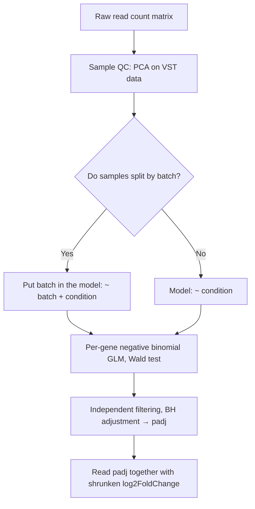

Test 20,000 genes at p < 0.05 when none of them has really changed, and you still get 1,000 "discoveries" on average. That is the arithmetic of multiple testing, not a software bug. This article covers four tools that keep a list of differentially expressed genes from filling up with false positives: false discovery rate (FDR) control with the Benjamini–Hochberg procedure, a correct reading of the p-value, the negative binomial model for read counts, and PCA for spotting batch effects. Each part comes with a Python simulation you can rerun with a fixed seed. It is written for biology students and wet-lab researchers who are about to read a DESeq2 or limma results table.

<div class="callout callout-note">
<p class="callout-title">Quick summary</p>

- **Filter on `padj`, not `pvalue`.** DESeq2's `padj` is a Benjamini–Hochberg adjusted p-value that controls the FDR; it is not Storey's q-value.
- **Bonferroni controls the FWER** (the probability of at least one false positive), so with 20,000 genes the threshold drops to 2.5 × 10⁻⁶ and nearly all power is gone.
- **A p-value measures how incompatible the data are with an entire model**, including H0 and every assumption; it is not the probability that H0 is true and it does not measure effect size.
- **Read counts across biological replicates are overdispersed** relative to Poisson, which is why DESeq2 and edgeR use the negative binomial with $\mathrm{Var} = \mu + \alpha\mu^2$.
- **Use PCA on VST data to detect batch effects and a balanced design to prevent them**; UMAP is for looking only.

</div>

## 1. Three columns in an RNA-seq results table

Say you receive a differential expression (DE) results table. Each row is a gene, and the three columns that matter most are `log2FoldChange`, `pvalue` and `padj`. `log2FoldChange` tells you how much the gene changed and in which direction. `pvalue` tells you how hard that gene's data are to explain if there were no difference. `padj` puts that p-value in the context of the tens of thousands of tests run at the same time.

Every gene is one test, and the human genome may have about 19,000 protein-coding genes (Ezkurdia et al., 2014), not counting non-coding genes. The airway study treated human airway smooth muscle cells from four cell lines with 1 µM dexamethasone for 18 hours and reported 316 differentially expressed genes at a Benjamini–Hochberg adjusted p < 0.05 (Himes et al., 2014). The number 316 only means something once you know how many genes it was picked from and by what procedure.



## 2. Multiple testing: FWER, FDR and the Benjamini–Hochberg procedure

### 2.1. Under H0, p-values are uniformly distributed

If a test is valid and the null hypothesis (H0) is true, the p-value is uniformly distributed on [0, 1]: the probability that p < 0.05 is exactly 0.05, and the probability that p < 0.01 is exactly 0.01. The Benjamini–Hochberg procedure relies on this property (Noble, 2009).

When you test m independent genes and every H0 is true, each gene is like a coin flip that comes up "heads" with probability α. The number of genes with p < α therefore follows a Binomial(m, α) distribution, with mean $m\alpha$ and standard deviation $\sqrt{m\alpha(1-\alpha)}$. With m = 20,000 and α = 0.05, the mean is 1,000 and the standard deviation is about 30.8; with m = 10,000, the mean is 500 and the standard deviation is about 21.8. The 1,000 is an **average**: repeat the experiment and the number of false positives wobbles around 1,000, mostly between 940 and 1,060.

Uniformity comes with conditions. At very low counts the test becomes discrete and p-values are no longer perfectly uniform, which is one reason DESeq2 filters out some genes before adjusting (Love et al., 2014). The basics of hypothesis testing are covered in the article on hypothesis testing and p-values.

### 2.2. FWER and the Bonferroni correction

The oldest correction is Bonferroni: with a threshold α and m tests, call a result significant only when $p \le \alpha/m$ (Noble, 2009). An equivalent form is adjusted p = min(1, m·p), compared against α.

Bonferroni controls the family-wise error rate (FWER): the probability of **at least one** false positive across the whole family of tests stays at or below α (Noble, 2009). With m = 20,000 the threshold becomes 0.05 / 20,000 = 2.5 × 10⁻⁶. A gene that truly doubles but has only three replicates per group can almost never reach a p-value that small. Bonferroni makes sense when a single false positive is very costly, for example when picking a handful of markers for a diagnostic assay. It is a poor fit for gene screening.

### 2.3. FDR and the Benjamini–Hochberg procedure

Benjamini and Hochberg (1995) proposed controlling a different quantity: the expected proportion of wrongly rejected hypotheses among all rejected hypotheses, called the FDR. If you publish 300 genes at 5% FDR, about 15 of them are false positives on average. You don't know which 15, because the FDR is a promise about the list as a whole. When every H0 is true, the FDR equals the FWER; in every other case the FDR is no larger than the FWER, so controlling the FDR buys more power (Benjamini & Hochberg, 1995).

The Benjamini–Hochberg (BH) procedure is a step-up procedure with three steps:

1. Sort the m p-values in increasing order: $p_{(1)} \le p_{(2)} \le \dots \le p_{(m)}$, where $H_{(k)}$ is the hypothesis that goes with $p_{(k)}$.
2. Find the largest k such that $p_{(k)} \le \frac{k}{m}\alpha$.
3. Reject $H_{(1)}, \dots, H_{(k)}$.

"Step-up" means that a gene sitting above the $k\alpha/m$ line at its own rank is still rejected if some lower-ranked gene falls below the line. The BH-adjusted p-value of the gene at rank k is $\min_{j \ge k} \min(1, m\,p_{(j)}/j)$; a gene has `padj` ≤ α exactly when BH rejects it at level α. Here is an eight-gene example:

```python
import pandas as pd

# Small results table, 8 genes, mimicking three columns of DESeq2::results()
res = pd.DataFrame({
    "gene":   ["G1", "G2", "G3", "G4", "G5", "G6", "G7", "G8"],
    "log2FoldChange": [2.1, -1.4, 0.15, 0.9, -0.2, 3.0, 0.05, -0.6],
    "pvalue": [0.0001, 0.0040, 0.0060, 0.0300, 0.0410, 0.0420, 0.6000, 0.9000],
})
m = len(res)
res = res.sort_values("pvalue").reset_index(drop=True)
res["rank"] = range(1, m + 1)
# BH-adjusted p: m·p/k, then a cumulative min from the bottom up to keep the order, capped at 1
res["padj"] = (res["pvalue"] * m / res["rank"])[::-1].cummin()[::-1].clip(upper=1)
res["BH_line"] = res["rank"] / m * 0.05          # the kα/m threshold for each rank
print(res.round(4).to_string(index=False))
print("Genes with padj < 0.05:", list(res.loc[res.padj < 0.05, "gene"]))
```

Six genes have p < 0.05, but only G1, G2 and G3 have `padj` < 0.05 (0.0008; 0.016; 0.016). G4 has p = 0.03 but sits above the BH line at rank 4 (0.025), so its `padj` is 0.056. The hand-computed column matches `scipy.stats.false_discovery_control(p, method="bh")`.

BH has conditions too. Benjamini and Hochberg (1995) proved that the procedure controls the FDR when the test statistics are independent. Benjamini and Yekutieli (2001) extended this to positive regression dependency (PRDS), which includes positively correlated multivariate normal statistics, and gave a more conservative version for arbitrary dependence (`method="by"` in SciPy). Genes in the same pathway often move together, so when you report an FDR you are implicitly assuming this kind of dependence.

<div class="callout callout-warning">
<p class="callout-title">A common mistake when adjusting</p>

- **Adjusting a subset selected by p-value.** Keeping only genes with p < 0.05 and then running BH on that subset defeats the purpose of the correction. Filtering is valid only when the criterion is independent of the p-value under H0, like the mean count that DESeq2 uses (Love et al., 2014).

</div>

### 2.4. A BH-adjusted p-value is not a q-value

DESeq2's `padj` column holds BH-adjusted p-values (Love et al., 2014). The q-value is a quantity proposed by Storey: the q-value of a gene is the smallest FDR at which that gene would be called significant (Storey & Tibshirani, 2003), an analog of the p-value for the positive FDR (Storey, 2002). The main difference is the proportion of true null hypotheses, $\pi_0$. Storey's method estimates $\pi_0$ from the p-value distribution, while BH implicitly sets $\pi_0 = 1$, which makes it more conservative when many genes really do change (Storey & Tibshirani, 2003).

| | FWER (Bonferroni) | FDR (Benjamini–Hochberg) | q-value (Storey) |
| --- | --- | --- | --- |
| What it controls | P(at least 1 false positive) | Expected proportion of false positives among discoveries | Smallest FDR at which the gene is called significant |
| How it is computed | p ≤ α/m | Step-up, compare $p_{(k)}$ with $k\alpha/m$ | FDR estimate that includes an estimate of $\pi_0$ |
| When to use it | Few tests, a single error is very costly | Gene screening, the DESeq2 default | Screening when you want to use an estimate of $\pi_0$ |

*Table 1. Three ways to control error under multiple testing (Benjamini & Hochberg, 1995; Noble, 2009; Storey & Tibshirani, 2003).*

### 2.5. Simulation 1: 10,000 tests when no gene changes

The simulation creates 10,000 "genes," each with 3 samples per group drawn from the same normal distribution N(0, 1), and runs a two-sample t-test for every gene. Using simulation to check a statistical method is covered in the article on simulation methods.

```python
import numpy as np
from scipy import stats

rng = np.random.default_rng(2026)        # fixed seed so the run is reproducible
m, n, alpha = 10_000, 3, 0.05            # 10,000 "genes", 3 samples per group
x = rng.normal(size=(m, n))
y = rng.normal(size=(m, n))
# Scenario 2: uncomment the line below to give the first 1,000 genes a real effect (δ = 2)
# y[:1000] += 2.0
p = stats.ttest_ind(x, y, axis=1).pvalue

raw  = (p < alpha).sum()
bonf = (np.minimum(1, p * m) <= alpha).sum()                           # Bonferroni
bh   = (stats.false_discovery_control(p, method="bh") <= alpha).sum()  # Benjamini–Hochberg
print(raw, bonf, bh)
```

This run prints `487 0 0`: 487 genes have p < 0.05, and none pass Bonferroni or BH. Over 200 repetitions, the number with p < 0.05 averages 499.6 (standard deviation 22.5; minimum 447, maximum 562), in line with the expected 500 ± 21.8. After adjustment, 4.0% of repetitions had at least one discovery, under both Bonferroni and BH. Under the complete null, the FDR equals the FWER.


*Figure 1. Histogram of 10,000 null p-values (simulation 1, n = 3 per group, seed 2026). Each 0.05-wide bin holds about 500 genes; the red bin is the 487 genes with p < 0.05.*

### 2.6. Simulation 2: 9,000 null genes and 1,000 real ones

The second simulation shifts the mean of 1,000 out of 10,000 genes by δ standard deviations in the treated group, with n ∈ {3, 6, 10} samples per group and δ ∈ {1.5, 2, 3}, and repeats each cell 100 times. Each method is scored on the number of false positives V, the realized false discovery proportion FDP = V / max(number of discoveries, 1), and power = real genes detected / 1,000.


*Figure 2. The BH procedure on a single run (n = 6, δ = 2): sorted p-values, the BH line kα/m (red) and the Bonferroni threshold α/m (blue). BH stops at rank 328; Bonferroni keeps only 7 genes.*

| n per group | Method | Discoveries | False positives V | FDP | Power |
| --- | --- | --- | --- | --- | --- |
| 3 | Unadjusted | 910.1 | 448.0 | 0.49 | 0.46 |
| 3 | BH | 0.3 | 0.1 | – | 0.000 |
| 6 | Unadjusted | 1,325.1 | 448.8 | 0.34 | 0.88 |
| 6 | Bonferroni | 5.8 | 0.0 | 0.007 | 0.006 |
| 6 | BH | 318.1 | 14.8 | 0.046 | 0.30 |
| 10 | Unadjusted | 1,441.7 | 453.5 | 0.31 | 0.99 |
| 10 | Bonferroni | 102.3 | 0.0 | 0.000 | 0.10 |
| 10 | BH | 910.2 | 41.1 | 0.045 | 0.87 |

*Table 2. Averages from simulation 2 with δ = 2 (100 repetitions per cell, seed 7). With n = 3, Bonferroni averages 0.2 discoveries.*


*Figure 3. Mean number of discoveries split into true (blue) and false (red), δ = 2.*

Without adjustment, about 450 null genes slip into the list at every sample size, so the FDP runs from 0.31 to 0.49. Bonferroni keeps the FDP near 0, but even at n = 10 it misses 90% of the real genes. BH holds the FDP around 0.045–0.046, which is the 0.05 level times the null proportion of 0.9, and its power climbs quickly with n. At n = 3, per-gene t-tests find almost nothing after adjustment, even at δ = 3 (1.3 discoveries on average).

The simulation assumes independent genes, normal data and the same δ for every real gene. With real data, where genes are correlated, the FDP of any one experiment can stray further from the nominal level.

### 2.7. What DESeq2 does with p-values

In DESeq2, each gene gets a p-value from a Wald test. Before adjusting, DESeq2 applies independent filtering to drop genes whose mean count is too low to have any real chance of significance; the p-values of the remaining genes are BH-adjusted and stored in the `padj` column (Love et al., 2014). Filtered genes have `padj` set to `NA`, so the number of genes that enter the BH step is usually smaller than the number of rows in the table.

## 3. Reading p-values correctly: the six ASA principles for omics results

In 2016 the American Statistical Association (ASA) released a statement on p-values made up of six principles (Wasserstein & Lazar, 2016).

A p-value is the probability, under a **specified statistical model**, that a summary statistic of the data would be equal to or more extreme than its observed value. That model includes H0 **and every assumption** of the test: the distribution of the data, independence between samples, and how the data were chosen for analysis. Greenland et al. (2016) stress that a p-value is computed by assuming the tested hypothesis is true, so it cannot be the probability that the hypothesis is true. The reverse reading is wrong too: p > 0.05 does not prove that a gene is unchanged. In simulation 2 with n = 3, nearly all 1,000 real genes had `padj` > 0.05; the experiment simply lacked power.

| ASA principle (paraphrased) | Misreading in omics | What to do |
| --- | --- | --- |
| 1. A p-value indicates how incompatible the data are with a specified model | Small p means the gene has definitely changed | Check the assumptions: a Poisson test on overdispersed data gives small p because **the model is wrong** (section 4.3) |
| 2. A p-value does not measure the probability that the hypothesis is true or that the result arose by chance alone | `padj` = 0.01 means the gene has a 1% chance of being wrong | Read the FDR as a promise about the whole list |
| 3. Conclusions should not rest only on whether p crosses a threshold | `padj` = 0.049 is "yes," 0.051 is "no" | Treat the two genes as having similar evidence |
| 4. Proper inference requires full, transparent reporting | Reporting only significant genes | Report the number of genes tested, filtering steps, correction method, software versions, code |
| 5. A p-value does not measure the size or importance of an effect | The gene with the smallest p matters most | Read it alongside the shrunken log2 fold change and its standard error |
| 6. A p-value alone is not a good measure of evidence | Ranking only by p | Combine effect size, sample quality and independent validation |

*Table 3. The six ASA principles (Wasserstein & Lazar, 2016) applied to a DE results table (Greenland et al., 2016).*

With sequencing data, principle 5 is the easiest one to slip on. The eight-gene table in section 2.3 shows both cases. G3 passes the FDR threshold with a log2 fold change of 0.15, a change of about 11%, while G6 rises eightfold and does not pass. Low-count genes can also show very large log2 fold changes from noise alone. DESeq2 handles this by shrinking the log2 fold changes of low-information genes toward 0 so the estimates are more stable (Love et al., 2014). The apeglm method uses a heavy-tailed (Cauchy) prior, so it shrinks noise hard while preserving large real differences (Zhu et al., 2019); in R that is `lfcShrink(dds, coef = ..., type = "apeglm")`.

## 4. Read counts: why negative binomial and not Poisson

### 4.1. Poisson describes technical variation

Counting the reads that land on a gene is like randomly sampling from a very large pool of cDNA fragments. The count is a binomial variable, and because each gene makes up a tiny fraction of all reads, it is well approximated by the Poisson distribution, whose variance equals its mean (Gierliński et al., 2015).

The evidence comes from a yeast RNA-seq experiment with 48 replicates per condition. Comparing the same library across 7 flow-cell lanes, the authors ran 630,850 overdispersion tests, and only 2 rejected the Poisson hypothesis after BH adjustment (Gierliński et al., 2015). Poisson is therefore right for **technical replicates**: the same sample sequenced more than once.

### 4.2. Biological replicates push the variance above the mean

Across **biological replicates**, meaning different individuals, cell lines or culture batches, the story changes. In the same 48-replicate data set, counts follow Poisson when they are low, but from roughly 10 reads per gene upward they drift away from Poisson and become overdispersed, which can be described by $\sigma^2 = \mu + \phi\mu^2$; the median dispersion is about 0.01, corresponding to a biological coefficient of variation of about 10% (Gierliński et al., 2015).

The same study found that the counts fit both a log-normal and a negative binomial distribution (Gierliński et al., 2015). So the negative binomial is not the only plausible model; it was chosen because it plugs into the generalized linear model framework. Poor-quality replicates also distort the distribution badly: in the Δsnf2 mutant strain, the share of genes that did not fit a log-normal rose from 5% to 54% when poor replicates were kept (Gierliński et al., 2015). Sample QC has to come before any testing.

| Distribution | Variance as a function of the mean | Used for |
| --- | --- | --- |
| Poisson | Var = μ | Read counts across repeated sequencing runs of the same sample (technical replicates) |
| Negative binomial (gamma-Poisson) | Var = μ + αμ² | Read counts across biological replicates; the model in DESeq2 and edgeR |
| Log-normal | log(count) roughly normal | Large enough counts; the basis of analyses on log-expression |

*Table 4. Three common distributions for RNA-seq read counts (Gierliński et al., 2015; Love et al., 2014).*


*Figure 4. Mean and variance of 3,000 genes simulated from a negative binomial (α = 0.05, 6 replicates). From about 1/α = 20 reads upward, the variance pulls away from the Poisson line.*

### 4.3. Simulation 3: a Poisson test on negative binomial data

Simulation 3 generates negative binomial counts with **no true difference** between two groups of 3 samples, with μ ∈ {10, 50, 200, 1,000} and α ∈ {0, 0.01, 0.05, 0.1, 0.2} (α = 0 is Poisson), 2,000 genes per cell. Each gene is tested with an exact conditional Poisson test and with a t-test on log2(count + 1).

```python
import numpy as np
from scipy import stats

rng = np.random.default_rng(11)
G, n, mu, a = 2_000, 3, 200, 0.1          # 2,000 genes, 3 vs 3 samples, μ = 200, α = 0.1
r = 1 / a                                 # numpy parameterizes the NB as (r, p)
x = rng.negative_binomial(r, r / (r + mu), size=(G, n))
y = rng.negative_binomial(r, r / (r + mu), size=(G, n))   # same distribution: no gene differs

# Exact conditional Poisson test: given the total T, the group-1 count ~ Binomial(T, 0.5)
k, T = x.sum(1), x.sum(1) + y.sum(1)
p_pois = np.minimum(1, 2 * np.minimum(stats.binom.cdf(k, T, 0.5), stats.binom.sf(k - 1, T, 0.5)))
# For comparison: t-test on log2(count + 1)
p_t = stats.ttest_ind(np.log2(x + 1), np.log2(y + 1), axis=1).pvalue
print(f"Poisson: {(p_pois < 0.05).mean():.1%}   t-test log: {(p_t < 0.05).mean():.1%}")
print("Mean var/mean:", round((x.var(1, ddof=1) / x.mean(1)).mean(), 1))
```

The code prints `Poisson: 66.8%   t-test log: 4.8%` and a variance-to-mean ratio of 20.0, close to the expected 1 + αμ = 21. Under the null, a valid test should give p < 0.05 about 5% of the time; the Poisson test gives two-thirds.


*Figure 5. Share of genes with p < 0.05 when a Poisson test is applied to negative binomial data with no true difference (2,000 genes per cell, 3 vs 3 samples, seed 11).*

The false-alarm rate grows with the product αμ, because the overdispersion term αμ² relative to the Poisson term μ is exactly αμ (Love et al., 2014). At α = 0, the Poisson test gives 4.0–4.9%. At α = 0.01, a typical dispersion for the yeast data, the rate rises to 24.6% at μ = 200 and 54.6% at μ = 1,000; at α = 0.2 and μ = 1,000 it reaches 89.4%. Across the whole grid, the t-test on log counts stays between 3.8% and 5.9%. This illustrates the first ASA principle: a small p here says **the Poisson model is wrong**, not that the gene changed.

### 4.4. DESeq2 is a negative binomial GLM

The generalized linear model (GLM), introduced by Nelder and Wedderburn (1972), extends linear regression to non-normal responses such as counts through a link function (see the article on linear and logistic regression). DESeq2 fits one GLM per gene (Love et al., 2014):

- The count $K_{ij}$ for gene i in sample j follows a negative binomial (gamma-Poisson) distribution with mean $\mu_{ij}$ and dispersion $\alpha_i$.
- $\mu_{ij} = s_j q_{ij}$: $s_j$ is the sample's size factor, estimated with the median-of-ratios method; $q_{ij}$ is proportional to the gene's cDNA concentration.
- Log link: $\log_2 q_{ij} = \sum_r x_{jr}\beta_{ir}$; the coefficient for the condition variable is the log2 fold change.
- $\mathrm{Var}\,K_{ij} = \mu_{ij} + \alpha_i\mu_{ij}^2$: the Poisson term μ plus the overdispersion term αμ².

The hard part is sample size. RNA-seq experiments often have only 2–3 replicates per condition, so a dispersion estimate from any single gene is very uncertain (Love et al., 2014). DESeq2 borrows information across genes with empirical Bayes: it fits a dispersion trend against mean count over all genes, then shrinks each gene's estimate toward that trend. The idea goes back to microarray analysis, where Smyth (2004) combined linear models with empirical Bayes to shrink each gene's sample variance, producing the moderated t-statistic. That is why DESeq2 works at n = 3, where the ordinary t-tests in simulation 2 fail.

The Wald test divides the estimated log2 fold change by its standard error to get a z-statistic and compares it with the normal distribution; samples whose Cook's distance exceeds the 0.99 quantile of the F(p, m − p) distribution are flagged as outliers (Love et al., 2014). In current DESeq2 releases, the `log2FoldChange` column from `results()` is the maximum likelihood estimate (MLE), and shrunken LFCs come from the separate `lfcShrink()` function (Love et al., n.d.).

### 4.5. What `~ batch + condition` means

The design formula is the right-hand side of the GLM. Writing `~ batch + condition` means the `condition` coefficient is estimated **after accounting for** mean differences between batches (Love et al., 2014).

This only works when batch does not overlap completely with condition. If every control sample sits in batch 1 and every treated sample in batch 2, the `batch` and `condition` columns of the design matrix are identical, and no method can separate the two effects (section 5.4).

One point people often get wrong: DESeq2 uses **raw counts** for inference. The variance stabilizing transformation (VST) and rlog are only for visualization, clustering and PCA (Love et al., 2014).

<div class="callout callout-warning">
<p class="callout-title">"n ≥ 30" is not a rule for omics</p>

The rule "the central limit theorem holds once the sample size reaches 30" is not a universal threshold. t-tests and t confidence intervals are less accurate than people tend to think when the data are skewed (Hesterberg, 2015). For an exponential population, you need n ≥ 5,000 for a two-sided t-test at α = 0.05 or a 95% t interval to be off by no more than 10% on each side (Hesterberg, 2014). In omics, the question about n is a question about **power**. DESeq2 was designed for 2–3 replicates per condition (Love et al., 2014), and simulation 1 shows that null p-values stay uniform at n = 3 as long as the test is valid. The recommended number of replicates comes from empirical power studies: at least 6 biological replicates per condition, and at least 12 if you need to catch genes at every fold-change level (Schurch et al., 2016). See also [the article on dirty data and "n ≥ 30"](/en/blog/process-data-from-dirty-to-clean/) and the article on the central limit theorem.

</div>

## 5. PCA, UMAP and batch effects

### 5.1. What a batch effect is and when it becomes dangerous

A batch effect is variation that comes from technical conditions rather than biology: the lab, the reagent lot, the person doing the work, the day the samples were processed. Leek et al. (2010) argue that batch effects are widespread and must be dealt with, and that they become a serious problem when they correlate with the outcome. One example in their paper: in a study of transitional cell carcinoma, whether a sample had carcinoma in situ lined up closely with its processing date. When batches and groups are unbalanced, the batch effect becomes a confounder and can create false differences between groups (Nygaard et al., 2016).

### 5.2. PCA for detection

Principal component analysis (PCA) builds new uncorrelated variables, each in turn capturing as much variance as possible; mathematically it is an eigenvalue and eigenvector problem (Jolliffe & Cadima, 2016). Leek et al. (2010) used principal components to quantify the influence of non-biological variables: if PC1 correlates strongly with processing date rather than with condition, that is a sign of batch.

When you plot PCA for RNA-seq, keep three rules. First, run it on VST or rlog data, because on an ordinary log scale low-count genes get too much weight (Love et al., 2014). Second, color by condition, change the point shape by batch and show the % variance on each axis; beyond the plot, compute the correlation between each PC's scores and batch and condition so you have a number you can check. Third, look at PC3–PC5 as well, because the batch can hide in a lower component.

### 5.3. UMAP and t-SNE: for looking, not for measuring

Squeezing data with thousands of dimensions into 2 inevitably distorts distances substantially, and Chari and Pachter (2023) argue that this distortion makes 2D embeddings counterproductive for exploratory analysis. t-SNE shows local structure well, but global structure is often wrong with default parameters (Kobak & Berens, 2019). UMAP (McInnes et al., 2018) is popular in single-cell work but shares the limits of every 2D embedding. Conclusions about batch should therefore rest on PCA and quantitative metrics, with UMAP used only for illustration. Integrating many samples in single-cell data is a separate problem (see [the article on transcriptomics](/en/blog/transcriptomics-rna-seq-va-single-cell/)).

### 5.4. Simulation 4: balanced versus confounded designs

Simulation 4 creates 2,000 genes × 12 samples with two conditions and two batches: 600 genes carry a batch effect, 220 genes carry a real condition effect, and 65 genes carry both. The **balanced** design puts 3 control and 3 treated samples in each batch; the **confounded** design puts all 6 controls in batch 1 and all 6 treated samples in batch 2. Each gene is tested with linear regression on log-expression using `~ condition` and `~ batch + condition`, then BH-adjusted at 0.05.


*Figure 6. PCA of the two designs (simulation 4, seed 42); color is condition, shape is batch. Balanced design: PC1 (41.1%) separates batch, PC2 (18.0%) separates condition. Confounded design: PC1 (55.2%) separates both at once.*

| Design | Model | Discoveries | False positives | FDP | Power |
| --- | --- | --- | --- | --- | --- |
| Balanced | `~ condition` | 168 | 4 | 0.024 | 0.745 |
| Balanced | `~ batch + condition` | 200 | 6 | 0.030 | 0.882 |
| Confounded | `~ condition` | 512 | 310 | 0.605 | 0.918 |
| Confounded | `~ batch + condition` | Cannot be estimated | | | |

*Table 5. Results of simulation 4 (a single run, BH at 0.05). In the confounded design, the design matrix for `~ batch + condition` is singular.*

In the balanced design, both models keep the FDP under 5%, and putting batch in the model raises power from 0.745 to 0.882 because the batch variance is pulled out of the residuals. In the confounded design, the PCA looks "nice": PC1 splits the two groups cleanly, but the absolute correlation of PC1 with both batch and condition is 0.9997, because the two variables are one and the same. The `~ condition` model reports 512 genes, 310 of which carry only a batch effect. The data contain no information that can separate batch from condition, and no software can fix that once the experiment has been run.

### 5.5. Design first, model second, "fix the data" last

Nygaard et al. (2016) advise making sure the design is balanced first; if the data are already partly unbalanced, put batch into the statistical model instead of correcting the data first and testing afterward. Batch-correction methods that preserve group differences, such as ComBat with group as a covariate, can produce artificially narrow confidence intervals and exaggerate confidence in between-group differences when the design is unbalanced (Nygaard et al., 2016). ComBat uses empirical Bayes to avoid overcorrecting small batches (Johnson et al., 2007), but that does not solve the design problem. Batch-corrected data are fine for visualization or as machine learning input, not for computing p-values; in machine learning, a model can learn the batch instead of the biology (see the article on machine learning in biology).

## 6. Checklist for reading a DE results table

1. **How many genes were tested, after which filtering step?** The number of genes with a non-`NA` `padj` is the number that went into BH (Love et al., 2014).
2. **Which correction method, at what FDR threshold?** BH, Bonferroni and Storey's q-value are three different quantities (Benjamini & Hochberg, 1995; Storey & Tibshirani, 2003).
3. **Does the count model have a dispersion parameter?** Don't use a Poisson test for biological replicates (Gierliński et al., 2015).
4. **Are there shrunken log2 fold changes and standard errors?** (Love et al., 2014; Zhu et al., 2019).
5. **Does PCA on VST data split by batch, and are batches balanced across groups?** (Leek et al., 2010; Nygaard et al., 2016).
6. **How many biological replicates per group, and were poor-quality samples removed?** (Schurch et al., 2016; Gierliński et al., 2015).
7. **Does any sentence say "p > 0.05 means no difference"?** That is a misreading (Greenland et al., 2016).
8. **Were the code and software versions published?** (Wasserstein & Lazar, 2016, principle 4).

If a table can't answer questions 1, 2 and 5, go back to whoever ran the analysis before you pick genes for follow-up work. Article 4 in this series covers data formats, that is, where the count matrix comes from ([Data formats and biological databases](/en/blog/dinh-dang-du-lieu-va-co-so-du-lieu-sinh-hoc/)); article 7 walks through a full RNA-seq pipeline.

## Frequently asked questions

**What is the difference between `pvalue` and `padj` in DESeq2?** `pvalue` is each gene's Wald p-value; `padj` is that p-value after Benjamini–Hochberg adjustment over the genes that passed independent filtering. Select genes by `padj`.

**Should I run ComBat and then feed the corrected data into DESeq2?** No. DESeq2 needs raw counts, and correcting for batch before testing can exaggerate confidence when the design is unbalanced (Nygaard et al., 2016). Put batch in the design formula instead.

**How many replicates does RNA-seq need?** At least 6 biological replicates per condition according to Schurch et al. (2016), more if you need to catch small changes.

## Appendix: rerunning the simulations

The four simulations use numpy 2.4.6, SciPy 1.17.1 and scikit-learn 1.9.0 on Python 3.13, with seeds 2026 (simulation 1), 7 (simulation 2), 11 (simulation 3) and 42 (simulation 4). `scipy.stats.false_discovery_control` has been available since SciPy 1.11; with statsmodels, `multipletests(p, method="fdr_bh")` gives the same result.

## References

Benjamini, Y., & Hochberg, Y. (1995). Controlling the false discovery rate: A practical and powerful approach to multiple testing. *Journal of the Royal Statistical Society: Series B (Methodological), 57*(1), 289–300. https://doi.org/10.1111/j.2517-6161.1995.tb02031.x

Benjamini, Y., & Yekutieli, D. (2001). The control of the false discovery rate in multiple testing under dependency. *The Annals of Statistics, 29*(4), 1165–1188. https://doi.org/10.1214/aos/1013699998

Chari, T., & Pachter, L. (2023). The specious art of single-cell genomics. *PLOS Computational Biology, 19*(8), e1011288. https://doi.org/10.1371/journal.pcbi.1011288

Ezkurdia, I., Juan, D., Rodriguez, J. M., Frankish, A., Diekhans, M., Harrow, J., Vazquez, J., Valencia, A., & Tress, M. L. (2014). Multiple evidence strands suggest that there may be as few as 19 000 human protein-coding genes. *Human Molecular Genetics, 23*(22), 5866–5878. https://doi.org/10.1093/hmg/ddu309

Gierliński, M., Cole, C., Schofield, P., Schurch, N. J., Sherstnev, A., Singh, V., Wrobel, N., Gharbi, K., Simpson, G., Owen-Hughes, T., Blaxter, M., & Barton, G. J. (2015). Statistical models for RNA-seq data derived from a two-condition 48-replicate experiment. *Bioinformatics, 31*(22), 3625–3630. https://doi.org/10.1093/bioinformatics/btv425

Greenland, S., Senn, S. J., Rothman, K. J., Carlin, J. B., Poole, C., Goodman, S. N., & Altman, D. G. (2016). Statistical tests, P values, confidence intervals, and power: A guide to misinterpretations. *European Journal of Epidemiology, 31*(4), 337–350. https://doi.org/10.1007/s10654-016-0149-3

Hesterberg, T. C. (2014). *What teachers should know about the bootstrap: Resampling in the undergraduate statistics curriculum* (arXiv:1411.5279). arXiv. https://doi.org/10.48550/arXiv.1411.5279

Hesterberg, T. C. (2015). What teachers should know about the bootstrap: Resampling in the undergraduate statistics curriculum. *The American Statistician, 69*(4), 371–386. https://doi.org/10.1080/00031305.2015.1089789

Himes, B. E., Jiang, X., Wagner, P., Hu, R., Wang, Q., Klanderman, B., Whitaker, R. M., Duan, Q., Lasky-Su, J., Nikolos, C., Jester, W., Johnson, M., Panettieri, R. A., Jr., Tantisira, K. G., Weiss, S. T., & Lu, Q. (2014). RNA-Seq transcriptome profiling identifies CRISPLD2 as a glucocorticoid responsive gene that modulates cytokine function in airway smooth muscle cells. *PLoS ONE, 9*(6), e99625. https://doi.org/10.1371/journal.pone.0099625

Johnson, W. E., Li, C., & Rabinovic, A. (2007). Adjusting batch effects in microarray expression data using empirical Bayes methods. *Biostatistics, 8*(1), 118–127. https://doi.org/10.1093/biostatistics/kxj037

Jolliffe, I. T., & Cadima, J. (2016). Principal component analysis: A review and recent developments. *Philosophical Transactions of the Royal Society A, 374*(2065), 20150202. https://doi.org/10.1098/rsta.2015.0202

Kobak, D., & Berens, P. (2019). The art of using t-SNE for single-cell transcriptomics. *Nature Communications, 10*(1), 5416. https://doi.org/10.1038/s41467-019-13056-x

Leek, J. T., Scharpf, R. B., Bravo, H. C., Simcha, D., Langmead, B., Johnson, W. E., Geman, D., Baggerly, K., & Irizarry, R. A. (2010). Tackling the widespread and critical impact of batch effects in high-throughput data. *Nature Reviews Genetics, 11*(10), 733–739. https://doi.org/10.1038/nrg2825

Love, M. I., Anders, S., & Huber, W. (n.d.). *Analyzing RNA-seq data with DESeq2* [Bioconductor vignette]. Retrieved November 26, 2026, from https://bioconductor.org/packages/release/bioc/vignettes/DESeq2/inst/doc/DESeq2.html

Love, M. I., Huber, W., & Anders, S. (2014). Moderated estimation of fold change and dispersion for RNA-seq data with DESeq2. *Genome Biology, 15*(12), 550. https://doi.org/10.1186/s13059-014-0550-8

McInnes, L., Healy, J., & Melville, J. (2018). *UMAP: Uniform manifold approximation and projection for dimension reduction* (arXiv:1802.03426). arXiv. https://doi.org/10.48550/arXiv.1802.03426

Nelder, J. A., & Wedderburn, R. W. M. (1972). Generalized linear models. *Journal of the Royal Statistical Society: Series A (General), 135*(3), 370–384. https://doi.org/10.2307/2344614

Noble, W. S. (2009). How does multiple testing correction work? *Nature Biotechnology, 27*(12), 1135–1137. https://doi.org/10.1038/nbt1209-1135

Nygaard, V., Rødland, E. A., & Hovig, E. (2016). Methods that remove batch effects while retaining group differences may lead to exaggerated confidence in downstream analyses. *Biostatistics, 17*(1), 29–39. https://doi.org/10.1093/biostatistics/kxv027

Schurch, N. J., Schofield, P., Gierliński, M., Cole, C., Sherstnev, A., Singh, V., Wrobel, N., Gharbi, K., Simpson, G. G., Owen-Hughes, T., Blaxter, M., & Barton, G. J. (2016). How many biological replicates are needed in an RNA-seq experiment and which differential expression tool should you use? *RNA, 22*(6), 839–851. https://doi.org/10.1261/rna.053959.115

Smyth, G. K. (2004). Linear models and empirical Bayes methods for assessing differential expression in microarray experiments. *Statistical Applications in Genetics and Molecular Biology, 3*(1), Article 3. https://doi.org/10.2202/1544-6115.1027

Storey, J. D. (2002). A direct approach to false discovery rates. *Journal of the Royal Statistical Society: Series B (Statistical Methodology), 64*(3), 479–498. https://doi.org/10.1111/1467-9868.00346

Storey, J. D., & Tibshirani, R. (2003). Statistical significance for genomewide studies. *Proceedings of the National Academy of Sciences, 100*(16), 9440–9445. https://doi.org/10.1073/pnas.1530509100

Wasserstein, R. L., & Lazar, N. A. (2016). The ASA statement on p-values: Context, process, and purpose. *The American Statistician, 70*(2), 129–133. https://doi.org/10.1080/00031305.2016.1154108

Zhu, A., Ibrahim, J. G., & Love, M. I. (2019). Heavy-tailed prior distributions for sequence count data: Removing the noise and preserving large differences. *Bioinformatics, 35*(12), 2084–2092. https://doi.org/10.1093/bioinformatics/bty895
