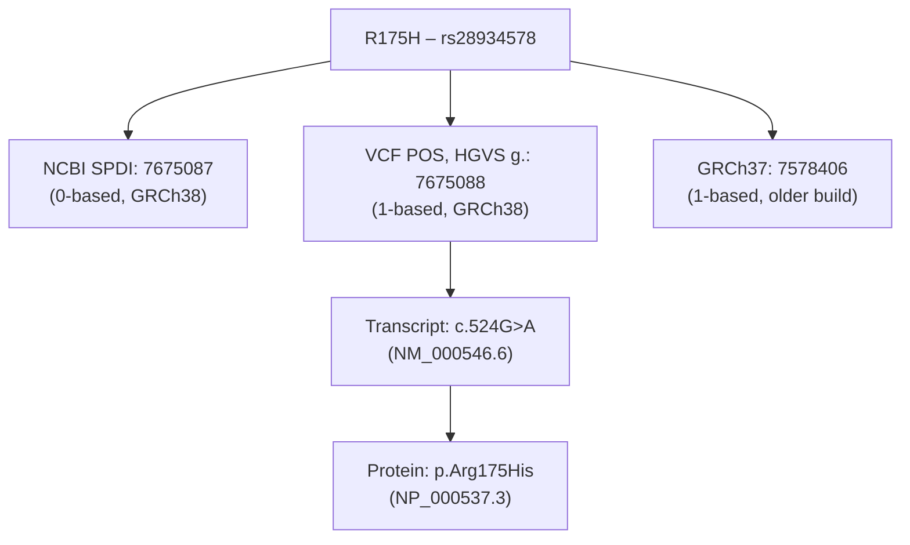

FASTA, FASTQ, SAM/BAM, VCF and BED are the five file formats that almost every sequencing analysis passes through, and each one has its own specification, maintained by the hts-specs group, UCSC or the Sequence Ontology. Two common mistakes with them never make a program throw an error: misreading Phred quality scores (Q = −10 log10 P, encoded with an offset of 33 or 64) and slipping by one base when moving between 0-based systems (BED, BAM, BCF) and 1-based ones (VCF, GFF, SAM). The running example is the TP53 mutation R175H: in a VCF it sits at POS 7675088 on GRCh38, but if you drop that number straight into a BED start, you pull out the G at 7675089, where ClinVar lists a different variant. The article is written for biology students new to bioinformatics and comes with runnable Python code, an 8-item checklist and a table of databases with how to record their versions.

<div class="callout callout-note">
<p class="callout-title">Quick summary</p>

- **Phred**: Q = −10 log10 P. Q30 means the probability of a wrong base call is 1/1,000. To summarize a read's quality, average **P**, not **Q**.
- **Offset**: Standard Sanger FASTQ and current Illumina output use offset 33; Solexa and Illumina 1.3+ use offset 64. Reading the wrong offset shifts every Q by 31 points.
- **Coordinates**: BED, BAM and BCF count from 0 and are half-open; SAM, VCF and GFF count from 1 and are closed. BED start = 1-based start − 1; BED end stays the same.
- **Four facts that travel with every coordinate**: counting system, genome build, sequence name (17 or chr17), transcript version.
- **Databases**: record the release number, the download date and a versioned accession (NM_000546.6, not NM_000546).

</div>

## 1. One mutation, five addresses

TP53 encodes p53, a tumor suppressor protein. TP53 mutations are very common in cancer. Most are missense mutations, about 70% of TP53 alterations, and some positions recur so often that they are called hotspots (Hassin & Oren, 2023). R175H, where arginine at position 175 is replaced by histidine, is a classic structural mutation: it makes p53 lose its normal fold (Hassin & Oren, 2023). At the DNA level it is a single base-pair substitution.

That same change is written as five different numbers, depending on which source you open:



None of these numbers is wrong. Each belongs to a convention: counting from 0 or from 1, GRCh37 or GRCh38, on the chromosome, the transcript or the protein. Errors happen when a number moves into another system and nobody converts the convention. Software usually says nothing. It still returns a base, a region, a variant; just not the one you wanted.

This kind of error has happened in real research. Re-analyzing papers that used cell lines to predict chemotherapy sensitivity, Baggerly and Coombes (2009) found that the most common errors were simple ones, such as row or column offsets. Buffalo (2015) recounts one detail of that case: an entire list of gene expression values was shifted by one row relative to the gene names.

Sections 2–7 walk through each format according to its specification, section 8 is hands-on work with TP53, and section 9 covers the databases and how to record their versions.

## 2. What a biological file format is and where its specification lives

A file format is an agreement on how data are laid out in a file so that other programs can read them. A specification is the written version of that agreement: which fields are required, which values are valid, where coordinate counting starts. Most biological formats began as the input format of one particular tool, caught on, and only later got written up as a specification.

**FASTA** was created by Bill Pearson as input for the FASTA sequence comparison tools (Pearson & Lipman, 1988). It grew by consensus without any formal standard, and some parsers break on very long header or sequence lines (Cock et al., 2010). **FASTQ** was created by Jim Mullikin at the Wellcome Trust Sanger Institute around 2000 and had no written definition until Cock et al. (2010) published a public one, based on the shared conventions of the Open Bioinformatics Foundation projects (Biopython, BioPerl, BioRuby, BioJava, EMBOSS).

**SAM/BAM** (Li et al., 2009) and **VCF** (Danecek et al., 2011) were designed for the 1000 Genomes Project and then became standards managed by the Global Alliance for Genomics and Health (GA4GH) (Bonfield et al., 2021). Their specifications live in the hts-specs repository. **BED** came out of the UCSC Genome Browser (Kent et al., 2002) and did not get a formal specification until 2022, BEDv1, written to standardize the reasonable readings of the original description (Niu et al., 2022). **GFF3** is maintained by the Sequence Ontology; the current version is 1.26 (Stein, 2020).

**Table 1.** Five core formats, original papers, current specifications and coordinate systems

| Format | What it holds | Original paper | Current specification | Coordinates | Main tools |
|---|---|---|---|---|---|
| FASTA | sequence | Pearson & Lipman (1988) | no formal specification | no coordinates | samtools faidx, Biopython |
| FASTQ | sequence + per-base quality | Cock et al. (2010) | definition in Cock et al. (2010) | no coordinates | seqkit, FastQC |
| SAM / BAM / CRAM | aligned reads and reads that could not be aligned | Li et al. (2009) | SAMv1, August 12, 2025 (SAM/BAM v1.6); CRAMv3 | SAM 1-based; BAM 0-based | samtools, HTSlib |
| VCF / BCF | SNPs, indels, structural variants | Danecek et al. (2011) | VCFv4.5 and BCFv2.2, February 25, 2026 | VCF 1-based; BCF 0-based | bcftools, tabix |
| BED | genomic regions | Kent et al. (2002) | BEDv1, January 5, 2022 | 0-based, half-open | bedtools |
| GFF3 / GTF | gene annotation | – | GFF3 1.26, August 18, 2020 | 1-based, closed | gffread, Ensembl |

When two tools give different results on the same file, open the specification before you search the forums. The hts-specs documents are PDFs with a date and a version number, so you can cite the exact section and page.

## 3. FASTA: simple, but no standard for the header line

A FASTA record starts with a `>` line holding an identifier and a description, followed by one or more sequence lines. What comes after the `>` has no common standard (Cock et al., 2010): NCBI writes the accession and then a description, Ensembl writes the ID along with a genomic location, and a homemade file can contain anything. So a script that splits the ID on whitespace may work on one file and quietly fail on another.

With a large genome, you should not read the whole file to get one stretch of sequence. `samtools faidx genome.fa` builds a `.fai` index that records the byte position of each sequence, and then `samtools faidx genome.fa chr17:7675083-7675093` pulls out exactly the 11 bases you need. Note that the region in that command is written 1-based and closed.

A detail that is easy to miss is the **accession version**. NM_000546 is the RefSeq ID for the TP53 mRNA, but that record has been revised several times; each time the sequence changes, the number after the dot goes up. On November 26, 2026, the unversioned ID pointed to NM_000546.6, 2,512 nt long. If you only write NM_000546, someone rerunning your work a few years from now may get a different sequence without knowing it. The code below fetches the exact version and closes the connection after reading:

```python
from Bio import Entrez

Entrez.email = "[email hidden]"        # NCBI asks for the user's email
handle = Entrez.efetch(db="nucleotide", id="NM_000546.6",
                       rettype="fasta", retmode="text")
fasta = handle.read()
handle.close()
print(fasta.splitlines()[0])
print(sum(len(l) for l in fasta.splitlines()[1:]), "nt")
```

Output from a run on November 26, 2026:

```text
>NM_000546.6 Homo sapiens tumor protein p53 (TP53), transcript variant 1, mRNA
2512 nt
```

## 4. FASTQ and Phred scores: reading the quality line correctly

### 4.1. Four kinds of lines

FASTQ stores a sequence together with a quality score for every base. According to Cock et al. (2010), each record has four kinds of lines: an `@` line with the read name; one or more sequence lines; a `+` line, which used to repeat the read name and is now usually left blank to keep files smaller; and a quality line exactly as long as the sequence. The specification allows line wrapping in both the sequence and the quality. Most tools write exactly 4 lines per read, but that is a convention, not a rule.

The `@` character is also a valid quality character and can sit at the start of a quality line. That is why `grep -c '^@'` can overcount reads; [part 02 of this series](/en/blog/nen-tang-tinh-toan/) has a concrete example and the right way to count.

Here is the first record of SRR390728_1, downloaded from the European Nucleotide Archive (ENA):

```text
@SRR390728.1 1/1
CATTCTTCACGTAGTTCTCGAGCCTTGGTTTTCAGC
+
????????????????????????????????????
```

### 4.2. What a Phred score is

The PHRED base caller assigns each base an estimated probability of being called wrong, P, and the quality score is defined as Q = −10 log10 P (Ewing & Green, 1998; Ewing et al., 1998; Cock et al., 2010). It is a log scale: Q10, Q20, Q30 and Q40 correspond to P = 0.1, 0.01, 0.001 and 0.0001. Q30 means, on average, 1 error per 1,000 bases. Every 10 additional Q points cut P tenfold (→ [part 03 on log scales](/en/blog/toan-va-thong-ke-cho-sinh-hoc/)).


*Figure 1. Relationship between the Phred score Q and the error probability P, plotted from Q = −10 log10 P. The y-axis is logarithmic, so the curve is a straight line.*

### 4.3. Three incompatible encodings

To keep each base to a single byte, Q is written as one ASCII character by adding a number called the offset. Cock et al. (2010) describe three variants:

**Table 2.** Three FASTQ quality encodings

| Variant | Offset | ASCII range | Score range | Formula |
|---|---|---|---|---|
| Sanger | 33 | 33–126 | Q 0–93 | Phred |
| Solexa / early Illumina | 64 | 59–126 | −5 to 62 | Solexa (log-odds) |
| Illumina 1.3+ | 64 | 64–126 | Q 0–62 | Phred |

Illumina's BaseSpace help documentation describes the company's FASTQ files as encoding each quality score as the character whose ASCII code equals Q + 33, the same offset as Sanger (Illumina, n.d.). You cannot tell the three apart from the file extension, because all of them are `.fastq`. Reading the wrong offset shifts every Q by 31 points.

A quick decode: `I` has ASCII code 73, so with offset 33 its Q is 40; `9` has ASCII code 57, so Q = 24 and P ≈ 0.004. Read with offset 64 by mistake, `I` drops to Q9.

### 4.4. Don't average Q

Q is a log scale, so the arithmetic mean of Q does not correspond to the mean error probability. Take the 20-base quality string `IIIIIIIIIIIIIIIIII9I` (19 bases at Q40 and one at Q24):

```python
import math

def phred_scores(qual, offset=33):
    """Convert a FASTQ quality string into a list of Q scores."""
    return [ord(ch) - offset for ch in qual]

qual = "IIIIIIIIIIIIIIIIII9I"           # 20 bases, one with the character '9'
q = phred_scores(qual)
p = [10 ** (-qi / 10) for qi in q]      # P = 10^(-Q/10)

mean_q = sum(q) / len(q)
mean_p = sum(p) / len(p)
q_from_mean_p = -10 * math.log10(mean_p)
expected_errors = sum(p)

print(f"Q of 'I' = {ord('I') - 33}, Q of '9' = {ord('9') - 33}")
print(f"Mean Q                : {mean_q:.1f}")
print(f"Mean P                : {mean_p:.2e}")
print(f"Q from mean P         : {q_from_mean_p:.1f}")
print(f"Expected errors / read: {expected_errors:.4f}")
print(f"Wrong offset 64       : Q of 'I' = {ord('I') - 64}")
```

```text
Q of 'I' = 40, Q of '9' = 24
Mean Q                : 39.2
Mean P                : 2.94e-04
Q from mean P         : 35.3
Expected errors / read: 0.0059
Wrong offset 64       : Q of 'I' = 9
```

The mean Q is 39.2, but the mean error probability is 2.94 × 10⁻⁴, which corresponds to Q35.3. The single Q24 base contributes about twice as much to the total error as the 19 Q40 bases combined, and averaging Q nearly erases it. To summarize quality, sum or average P, or report the expected number of errors per read (0.0059 here).

### 4.5. The quality line may have been simplified

SRR390728 is a human RNA-seq dataset sequenced on an Illumina Genome Analyzer IIx, paired-end 2 × 36 bp, 7,178,576 spots, made public on December 23, 2011 (per ENA). Counting the quality characters in the first 10,000 reads of the _1 file downloaded from ENA (November 26, 2026) turns up only two characters, `?` (Q30) and `$` (Q3). Each read carries exactly one level across all of its bases: 9,875 reads are all Q30, and 125 reads are all Q3.

```python
import gzip
from collections import Counter

def quality_profile(path, max_reads=10_000):
    """Count quality characters and the number of distinct quality levels per read."""
    chars, levels = Counter(), Counter()
    with gzip.open(path, "rt") as fh:
        for i, line in enumerate(fh):
            if i // 4 >= max_reads:
                break
            if i % 4 == 3:                  # 4th line of each record
                qual = line.rstrip("\n")
                chars.update(qual)
                levels[len(set(qual))] += 1
    return chars, levels

chars, levels = quality_profile("SRR390728_1.fastq.gz")
for ch, n in sorted(chars.items()):
    print(f"'{ch}'  Q{ord(ch) - 33:<3} {n:>8} bases")
print("Quality levels per read:", dict(levels))
```

```text
'$'  Q3       4500 bases
'?'  Q30    355500 bases
Quality levels per read: {1: 10000}
```

That pattern matches the rule used by **SRA Lite**, NCBI's reduced format: each read gets Q30 if it passed the filter and Q3 if it was rejected, and files shrink by about 60% (NCBI, 2022). The result above is not enough to prove that the ENA file was produced from SRA Lite; to know for sure you would need to download the full version with `fasterq-dump` and compare. The consequence is clear, though: running FastQC on a file like this produces a "nice" quality plot that says nothing about the real quality of each base. So before you interpret quality scores, check where the file was downloaded from and in which format.

There are two ways to get this file. From NCBI, `fasterq-dump SRR390728 --split-files` (from the SRA Toolkit) splits the two mates into `SRR390728_1.fastq` and `SRR390728_2.fastq`. From ENA, you download the `.fastq.gz` files directly; ENA's filereport page lists an md5 checksum for each file, and checking it after download is worth doing before any analysis. Then `seqkit stats` gives you read count, total bases and read length to compare against the metadata.

## 5. SAM, BAM, CRAM: where an aligned read sits

SAM (Sequence Alignment/Map) is a generic format for storing reads aligned to a reference sequence, short or long, from many sequencing platforms; the accompanying SAMtools suite handles indexing, alignment viewing and variant calling (Li et al., 2009). SAMtools and BCFtools have been maintained continuously since 2009 on top of a shared library, HTSlib (Danecek et al., 2021; Bonfield et al., 2021).

Each alignment line has 11 mandatory columns: QNAME (read name), FLAG, RNAME (reference sequence name), POS, MAPQ, CIGAR, RNEXT, PNEXT, TLEN, SEQ and QUAL. Three fields are easy to misread:

- **FLAG** is a sum of bits. Bit 0x4 is the only reliable way to tell that a read is unmapped (SAM/BAM Format Specification Working Group, 2025, §1.4). So a SAM/BAM file holds unmapped reads too, not just aligned ones.
- **MAPQ** also uses the Phred scale: −10 log10 of the probability that the mapping position is wrong (§1.4).
- **CIGAR** describes how the read lines up with the reference: how many bases match (M), are inserted (I), deleted (D) or clipped (S).

On coordinates specifically, **the SAM POS column is 1-based, but BAM stores `pos` 0-based** (that is, POS − 1) (§1.4, §4.2). If you use `samtools view`, you never see the difference, because samtools converts for you. If you write code that reads BAM directly, say with pysam, you need to know which system a value is in before comparing it with a VCF or GFF. The SAMv1 specification (§1.2) spells it out: SAM, VCF, GFF and Wiggle are 1-based; BAM, BCFv2, BED and PSL are 0-based.

Why do BAM and CRAM exist? In the original paper, aligning 112 Gbp of Illumina GA data took 116 GB of BAM, about 1 byte per input base, most of it spent on quality scores (Li et al., 2009). CRAM saves space by storing only where reads differ from the reference (Hsi-Yang Fritz et al., 2011); version 3.1 added new compression codecs (Bonfield, 2022). The trade-off is that reading a CRAM file requires the exact reference used to compress it, one more reason to record the genome build.

## 6. VCF and BCF: variants, genotypes and the padding base

VCF (Variant Call Format) stores SNPs, indels and structural variants along with annotations, and is usually compressed with bgzip and indexed with tabix for fast region queries (Danecek et al., 2011). After the header lines that start with `##` come 8 fixed columns: CHROM, POS (1-based), ID, REF, ALT, QUAL (Phred scale), FILTER and INFO; then a FORMAT column and one column per sample, holding genotypes such as `0/1`.

R175H as a VCF line (first 8 columns):

```text
#CHROM  POS      ID          REF  ALT  QUAL  FILTER  INFO
17      7675088  rs28934578  C    T    .     .       .
```

REF is C and ALT is T because VCF records alleles on the genome's + strand. TP53 lies on the − strand, so on the transcript the same change is G → A, that is, c.524G>A.

A rule that trips people up is the **padding base**. For simple indels, REF and ALT must include the base **before** the event, and POS points to that base; the exception is an event at position 1 of a contig, where the base after it is used instead (VCFv4.5, 2026, §1.6.1). An illustration: in the sequence ACTGCG, deleting the G at position 4 is written `POS=3 REF=TG ALT=T`. The same deletion in BED is `start=3 end=4`. The two "3"s match but point to different bases, even though both files follow their conventions correctly. This is a second source of offset, independent of the 0-versus-1 question.

BCF is the binary version of VCF, and like BAM it stores 0-based coordinates (SAM/BAM Format Specification Working Group, 2025, §1.2). `bcftools view` converts back to 1-based when it prints.

## 7. BED, GFF3/GTF and bigWig: two ways of counting

### 7.1. BED: counting the gaps between bases

Under BEDv1, BED uses a **0-based, half-open** system: the first base of a chromosome has index 0, and an interval includes its start but not its end (Niu et al., 2022, §1.3). The specification's own example: in the sequence ACTGCG, the interval [2, 4) is TG. An easy way to remember it is that BED counts the **gaps** between bases, while VCF and GFF count the **bases** themselves.

BED has 3 to 12 fields; the first 3 (chrom, chromStart, chromEnd) are required, and BED10 and BED11 are prohibited (§1.5). When chromStart equals chromEnd, the line represents an insertion point between two bases (§1.6). The system has advantages: a region's length is simply end − start, and for two adjacent regions the end of the first equals the start of the second.


*Figure 2. The stretch chr17:7675083–7675093 (GRCh38, + strand). The top row shows 0-based gap indices, the bottom row 1-based base indices (last four digits). The green base is the R175H position (7675088); the red base is what you get when you use the VCF POS as the BED start by mistake. Sequence from Ensembl REST (release 116, November 26, 2026).*

### 7.2. GFF3, GTF, Wiggle and bedGraph

GFF3 uses **1-based** coordinates with start ≤ end; a zero-length feature, such as an insertion site, is written with start = end, and the site is understood to lie to the right of that base (Stein, 2020). GTF is 1-based as well. The UCSC Genome Browser displays coordinates 1-based and closed but stores its data tables and BED files 0-based and half-open; to go from table to display, add 1 to the start and keep the end (UCSC Genome Browser, 2016). Wiggle is 1-based, while bedGraph is 0-based. bigWig and bigBed are indexed binary versions that let a browser fetch only the part on screen instead of the whole file (Kent et al., 2010).

**Table 3.** Converting between BED and 1-based systems (VCF, GFF, SAM)

| Task | Formula |
|---|---|
| 1-based → BED | start₀ = start₁ − 1; end₀ = end₁ |
| BED → 1-based | start₁ = start₀ + 1; end₁ = end₀ |
| Length of a BED region | end − start |
| Length of a 1-based region | end − start + 1 |
| One base at VCF POS | BED: POS − 1, POS |

To compare, intersect or extend regions across BED, GFF and BAM, the standard tool is BEDTools, built to chain with other Unix commands through pipes (Quinlan & Hall, 2010). The mistake is usually not inside the tool but in the step where you write your own script to build a BED file from a 1-based table, such as a variant table exported from Excel or from a database's website.

<div class="callout callout-warning">
<p class="callout-title">Three signs a BED file may be off by one</p>

- Every single-base region has `end − start = 0` instead of 1: the start was copied straight from a 1-based system.
- Computed region lengths are exactly 1 bp shorter than the lengths in the database.
- The base at a variant position does not match the VCF REF column.

</div>

## 8. Hands-on: moving the TP53 region between GFF3, BED and VCF

This section pulls real TP53 data from Ensembl REST (release 116), NCBI and ClinVar and shows what an off-by-one error looks like. All coordinates are GRCh38.

### 8.1. The gene region

Ensembl lists the TP53 gene (ENSG00000141510.21) as `17  ensembl_havana  gene  7661779  7687546  .  -` in GFF3, that is, 1-based on the − strand. The correct BED line is `chr17  7661778  7687546  TP53  0  -`. Both ways of computing the length give 25,768 bp. If you copy 7661779 straight into the BED start, the region shrinks to 25,767 bp; because the gene is on the − strand, the lost base belongs to the gene's 3′ end.

A second error that few people notice: Ensembl's column 1 says "17", while UCSC and many BED files say "chr17". To a computer, those are two different sequence names. A tool that joins on names will find no overlap, and depending on the tool and version, you may get an empty result instead of an error message. Here is an example with pandas:

```python
import pandas as pd

genes = pd.DataFrame({"chrom": ["17"], "start": [7661778], "end": [7687546], "name": ["TP53"]})
variants = pd.DataFrame({"chrom": ["chr17"], "pos0": [7675087], "id": ["rs28934578"]})

def overlaps(genes, variants):
    m = genes.merge(variants, on="chrom")      # join on chromosome name
    return m[(m.pos0 >= m.start) & (m.pos0 < m.end)]

print("Before normalizing:", len(overlaps(genes, variants)), "overlapping rows")
genes["chrom"] = "chr" + genes["chrom"].str.removeprefix("chr")
print("After normalizing :", len(overlaps(genes, variants)), "overlapping rows")
```

```text
Before normalizing: 0 overlapping rows
After normalizing : 1 overlapping rows
```

### 8.2. The MANE Select transcript

MANE Select is a shared transcript set chosen by NCBI and EMBL-EBI, one representative transcript per protein-coding gene, intended for clinical interpretation (Morales et al., 2022). For TP53 it is ENST00000269305.9 ↔ NM_000546.6, protein NP_000537.3. Ensembl places this transcript at 7668421–7687490 (1-based); UCSC places it at 7668420–7687490 (0-based, queried November 11, 2026). The two sources agree once you add 1 to the start. The transcript has 11 exons and is 2,512 nt long, and the coding sequence (CDS) runs from 7669609 to 7676594 (1-based).

So "the TP53 region" can mean 25,768 bp (the Ensembl gene, covering every transcript) or 19,070 bp (the MANE transcript alone). That difference comes from annotation, not from the counting system, and the only way to avoid confusion is to say which region you used.


*Figure 3. The TP53 locus on chr17 (GRCh38): gene ENSG00000141510 from Ensembl 116, MANE transcript ENST00000269305.9 with its 11 exons (dark blue marks the CDS), and the R175H position. Data from Ensembl REST, November 26, 2026.*

### 8.3. The R175H variant written seven ways

**Table 4.** R175H (rs28934578) in each convention

| Notation | Value | Counting |
|---|---|---|
| SPDI (NCBI) | NC_000017.11:7675087:C:T | 0-based |
| HGVS genomic | NC_000017.11:g.7675088C>T | 1-based |
| VCF | 17 7675088 C T | 1-based |
| BED | chr17 7675087 7675088 | 0-based, half-open |
| GRCh37 | 17:7578406 | 1-based, older build |
| HGVS transcript | NM_000546.6:c.524G>A | 1-based from the A of ATG |
| HGVS protein | NP_000537.3:p.Arg175His | 1-based from the first Met |

The g., c. and p. notations follow the HGVS recommendations (den Dunnen et al., 2016). ClinVar lists this variant as VCV000012374, classified Pathogenic, reviewed by expert panel (Landrum et al., 2025; queried November 11, 2026).

A cross-check with two sources that use different counting systems: the UCSC API with `start=7675087;end=7675088` (0-based) returns **C** (November 11, 2026); Ensembl REST with `17:7675088..7675088:1` (1-based) also returns **C**, and on the −1 strand returns **G**, exactly the c.524G base on the transcript (November 26, 2026). Two systems, one base. The code below repeats the Ensembl side of that check:

```python
import json, urllib.request

def ensembl_base(chrom, pos1, strand=1):
    """Fetch one base from Ensembl REST (1-based, closed coordinates)."""
    url = (f"https://rest.ensembl.org/sequence/region/human/"
           f"{chrom}:{pos1}..{pos1}:{strand}?content-type=application/json")
    with urllib.request.urlopen(url, timeout=30) as r:
        return json.load(r)["seq"]

pos = 7675088
print("+ strand, POS     :", ensembl_base("17", pos))
print("- strand, POS     :", ensembl_base("17", pos, -1))
print("+ strand, POS + 1 :", ensembl_base("17", pos + 1))
```

```text
+ strand, POS     : C
- strand, POS     : G
+ strand, POS + 1 : G
```

Now try the off-by-one error. Use the VCF POS directly as the BED start (`start=7675088;end=7675089`) and UCSC returns **G**. That is the base at 7675089, position c.523, the first base of codon 175 (CGC). ClinVar lists entirely different variants there: R175C (VCV000245851, Uncertain significance, reviewed by expert panel) and R175G (VCV000376649, Pathogenic, reviewed by expert panel). Slipping the other way (subtracting 1 twice) gives 7675087, position c.525, the last base of the codon. One miscount, and you are reading the clinical record of a different variant.

The following code reproduces both conversions on the 11 bases around R175H, no network needed:

```python
# Stretch chr17:7675083-7675093 (GRCh38, 1-based, closed), + strand
REGION_START_1 = 7675083
SEQ = "GGCAGCGCCTC"

def one_to_bed(start1, end1):
    """1-based closed [start, end] -> BED 0-based half-open [start, end)."""
    return start1 - 1, end1

def bed_to_one(start0, end0):
    """BED 0-based half-open -> 1-based closed."""
    return start0 + 1, end0

def base_at_bed(start0, end0):
    """Get the bases in SEQ for a BED interval."""
    off = REGION_START_1 - 1            # 0-based gap just before the first base
    return SEQ[start0 - off:end0 - off]

vcf_pos = 7675088                       # R175H in the VCF
s, e = one_to_bed(vcf_pos, vcf_pos)
print("Correct BED :", s, e, "->", base_at_bed(s, e))
print("Shifted BED :", vcf_pos, vcf_pos + 1, "->", base_at_bed(vcf_pos, vcf_pos + 1))
print("Round trip  :", bed_to_one(s, e))

gene_gff = (7661779, 7687546)           # TP53 gene in Ensembl GFF3
bs, be = one_to_bed(*gene_gff)
print("GFF length :", gene_gff[1] - gene_gff[0] + 1)
print("BED length :", be - bs)
print("BED with miscopied start:", be - gene_gff[0])
```

```text
Correct BED : 7675087 7675088 -> C
Shifted BED : 7675088 7675089 -> G
Round trip  : (7675088, 7675088)
GFF length : 25768
BED length : 25768
BED with miscopied start: 25767
```

A genome build error is bigger still: using the GRCh37 coordinate (7578406) on GRCh38 lands nearly 97 kb away, outside the TP53 gene.

### 8.4. Protein coordinates

UniProt P04637 (P53_HUMAN) is 393 amino acids long, with a DNA-binding region from 102 to 292; R175 falls inside it (The UniProt Consortium, 2025). Protein coordinates also count from 1. The AlphaFold model AF-P04637-F1 (version 6) has a global pLDDT of 75.06 (Varadi et al., 2024; queried November 11, 2026); how to read pLDDT is saved for Part 8.

### 8.5. Exercises

1. Open IGV with the hg38 genome, go to `chr17:7675088` and check whether the + strand base is C. Which system does IGV's coordinate ruler use?
2. Look up P04637 on UniProt, find the DNA-binding region (hint: 102–292) and express R175 as an offset from the start of that region.
3. Open model AF-P04637-F1 in AlphaFold DB and look at pLDDT around residue 175.
4. Write the BED line for the example deletion in section 6 (the G deleted from ACTGCG), then check it with the `base_at_bed` function above on a sequence of your own.

## 9. The main databases: use them correctly, cite the version

Section 8 used six different sources for a single gene. This section looks at those sources as databases: what they contain, who describes them, and what you need to record so that someone else can retrieve exactly the data you used.

A common way to sort biological databases is into two groups. **Primary** databases accept direct submissions and store them close to their original form, such as ENA/GenBank/DDBJ, GEO and PDB. **Secondary** databases compile and curate data from many sources, such as UniProt, InterPro and Ensembl. The line is not absolute: ClinVar accepts submissions from individual labs but also aggregates them into a single classification. The distinction is still useful because it tells you how many processing steps the data went through before reaching you.

**Table 5.** Databases used in this article, key figures and how to record the version

| Database | Type | Contents, key figures | Descriptive paper | What to record |
|---|---|---|---|---|
| Ensembl | secondary | more than 4,800 eukaryotic and more than 31,300 prokaryotic genomes; includes VEP | Dyer et al. (2025) | release number (116), genome build |
| GENCODE / MANE | secondary | human and mouse gene annotation; shared NCBI–EMBL-EBI transcript set | Mudge et al. (2025); Morales et al. (2022) | GENCODE version, versioned transcript |
| UniProt | secondary | UniProtKB restricted to high-quality reference proteomes | The UniProt Consortium (2025) | accession, release |
| ClinVar | archives submissions, with aggregation | more than 3 million variants from more than 2,800 submitting organizations | Landrum et al. (2025) | VCV, download date |
| gnomAD | secondary | v2: 125,748 exomes and 15,708 genomes; v3: 76,156 genomes | Karczewski et al. (2020); Chen et al. (2024) | version (v2, v3…) |
| dbSNP | primary | rs IDs for variants | Sherry et al. (2001) | rs ID, build |
| GEO | primary | platforms, samples, series | Edgar et al. (2002); Clough et al. (2024) | GSE/GSM ID |
| SRA / ENA | primary | raw reads and alignments | Leinonen et al. (2011); Katz et al. (2022) | SRR ID, download format |
| BioStudies (including ArrayExpress) | primary | functional genomics expression data | Sarkans et al. (2021) | E-MTAB ID |
| PDB | primary | experimental structures | Berman et al. (2000) | PDB ID |
| AlphaFold DB | secondary | predicted models for more than 214 million sequences | Varadi et al. (2024) | AF ID, model version |
| COSMIC, cBioPortal | secondary | somatic variants in cancer | Sondka et al. (2024); Cerami et al. (2012) | version, download date |

Ensembl is at release 116 (REST API, November 26, 2026). An FTP path containing `current_fasta` always points to the latest release, so after the next release it will serve a different file; when you write download commands for others to rerun, use the path with the release number (`release-116/...`). The human primary assembly file is about 882 MB, so for practice you only need to download chromosome 17.

ClinVar is no longer just a database of germline variants. Its 2025 update describes three kinds of classification: germline, oncogenicity, and clinical impact for somatic variants (Landrum et al., 2025). ArrayExpress has moved into BioStudies (Sarkans et al., 2021), and the old ArrayExpress interface was retired on September 30, 2022 (EMBL-EBI, 2022); older material that links to ArrayExpress should be updated to BioStudies.

For cancer, The Cancer Genome Atlas (TCGA) molecularly characterized more than 20,000 primary cancer and matched normal samples spanning 33 cancer types (National Cancer Institute, n.d.); a molecular classification of 10,000 tumors from 33 cancer types was published in 2018 (Hoadley et al., 2018). TCGA data are widely accessed through cBioPortal (Cerami et al., 2012).

That leads to a simple sourcing rule: every time you pull data, record the database name, release number, download date, versioned accession and genome build. Those five facts belong in the project README (→ Part 12).

## 10. Conclusion and checklist

When a field in a file is confusing, open the dated, versioned specification before you guess. A Phred score is a log scale of error probability, encoded with offset 33 or 64; to summarize it, work with P and don't average Q. An off-by-one error on TP53 moves you from R175H to position c.523, where ClinVar lists R175C and R175G, with no warning at all. No coordinate system is more "correct" than another. A coordinate only means something when it comes with four facts: counting system, genome build, sequence name and annotation or transcript version. Before you run a new file, go through the eight questions below.

**Table 6.** An 8-item checklist before running a file

| # | Question | How to check |
|---|---|---|
| 1 | What is the Phred offset? | lowest character in the quality lines |
| 2 | Has the quality line been simplified? | count the distinct quality characters |
| 3 | Is the file 0-based or 1-based? | the format's specification (Table 1) |
| 4 | Which genome build? | file header, reference file name |
| 5 | Do chromosome names have "chr"? | `cut -f1 file | sort -u` |
| 6 | Which transcript and version? | accession with its number after the dot |
| 7 | Which database release? | the database's info page or API |
| 8 | Have you tested a known position against two sources? | e.g., R175H = C at 7675088 |

The next article in the series, [Part 5](/en/blog/phan-tich-trinh-tu/), uses TP53 sequences from several species to teach sequence alignment. Part 6 walks through the full FASTQ → BAM → VCF pipeline, where every format in this article shows up at its own step.

## Frequently asked questions

**What does Q30 mean?** The probability that the base was called wrong is 0.001, or on average 1 error per 1,000 bases. Q20 is 1 error per 100 bases.

**Does BED count from 0 or 1?** From 0, and intervals are half-open: the end base is not included. A single base at VCF POS 7675088 corresponds to the BED line `7675087 7675088`.

**How do BED and GFF differ?** BED describes regions, 0-based and half-open, with at least three columns. GFF3 describes annotation features (genes, exons, CDS) with parent–child relationships, 1-based and closed, in nine columns.

**How do SAM, BAM and CRAM differ?** Same content: SAM is text, BAM is compressed binary, and CRAM compresses further against a reference sequence, so you need the exact reference file to read it.

## References

- Baggerly, K. A., & Coombes, K. R. (2009). Deriving chemosensitivity from cell lines: Forensic bioinformatics and reproducible research in high-throughput biology. *The Annals of Applied Statistics, 3*(4), 1309–1334. https://doi.org/10.1214/09-AOAS291
- Berman, H. M., Westbrook, J., Feng, Z., Gilliland, G., Bhat, T. N., Weissig, H., Shindyalov, I. N., & Bourne, P. E. (2000). The Protein Data Bank. *Nucleic Acids Research, 28*(1), 235–242. https://doi.org/10.1093/nar/28.1.235
- Bonfield, J. K. (2022). CRAM 3.1: Advances in the CRAM file format. *Bioinformatics, 38*(6), 1497–1503. https://doi.org/10.1093/bioinformatics/btac010
- Bonfield, J. K., Marshall, J., Danecek, P., Li, H., Ohan, V., Whitwham, A., Keane, T., & Davies, R. M. (2021). HTSlib: C library for reading/writing high-throughput sequencing data. *GigaScience, 10*(2), giab007. https://doi.org/10.1093/gigascience/giab007
- Buffalo, V. (2015). *Bioinformatics data skills: Reproducible and robust research with open source tools*. O'Reilly Media. https://www.oreilly.com/library/view/bioinformatics-data-skills/9781449367480/
- Cerami, E., Gao, J., Dogrusoz, U., Gross, B. E., Sumer, S. O., Aksoy, B. A., Jacobsen, A., Byrne, C. J., Heuer, M. L., Larsson, E., Antipin, Y., Reva, B., Goldberg, A. P., Sander, C., & Schultz, N. (2012). The cBio cancer genomics portal: An open platform for exploring multidimensional cancer genomics data. *Cancer Discovery, 2*(5), 401–404. https://doi.org/10.1158/2159-8290.CD-12-0095
- Chen, S., Francioli, L. C., Goodrich, J. K., Collins, R. L., Kanai, M., Wang, Q., Alföldi, J., Watts, N. A., Vittal, C., Gauthier, L. D., Poterba, T., Wilson, M. W., Tarasova, Y., Phu, W., Grant, R., Yohannes, M. T., Koenig, Z., Farjoun, Y., Banks, E., . . . Karczewski, K. J. (2024). A genomic mutational constraint map using variation in 76,156 human genomes. *Nature, 625*(7993), 92–100. https://doi.org/10.1038/s41586-023-06045-0
- Clough, E., Barrett, T., Wilhite, S. E., Ledoux, P., Evangelista, C., Kim, I. F., Tomashevsky, M., Marshall, K. A., Phillippy, K. H., Sherman, P. M., Lee, H., Zhang, N., Serova, N., Wagner, L., Zalunin, V., Kochergin, A., & Soboleva, A. (2024). NCBI GEO: Archive for gene expression and epigenomics data sets: 23-year update. *Nucleic Acids Research, 52*(D1), D138–D144. https://doi.org/10.1093/nar/gkad965
- Cock, P. J. A., Fields, C. J., Goto, N., Heuer, M. L., & Rice, P. M. (2010). The Sanger FASTQ file format for sequences with quality scores, and the Solexa/Illumina FASTQ variants. *Nucleic Acids Research, 38*(6), 1767–1771. https://doi.org/10.1093/nar/gkp1137
- Danecek, P., Auton, A., Abecasis, G., Albers, C. A., Banks, E., DePristo, M. A., Handsaker, R. E., Lunter, G., Marth, G. T., Sherry, S. T., McVean, G., Durbin, R., & 1000 Genomes Project Analysis Group. (2011). The variant call format and VCFtools. *Bioinformatics, 27*(15), 2156–2158. https://doi.org/10.1093/bioinformatics/btr330
- Danecek, P., Bonfield, J. K., Liddle, J., Marshall, J., Ohan, V., Pollard, M. O., Whitwham, A., Keane, T., McCarthy, S. A., Davies, R. M., & Li, H. (2021). Twelve years of SAMtools and BCFtools. *GigaScience, 10*(2), giab008. https://doi.org/10.1093/gigascience/giab008
- den Dunnen, J. T., Dalgleish, R., Maglott, D. R., Hart, R. K., Greenblatt, M. S., McGowan-Jordan, J., Roux, A.-F., Smith, T., Antonarakis, S. E., & Taschner, P. E. M. (2016). HGVS recommendations for the description of sequence variants: 2016 update. *Human Mutation, 37*(6), 564–569. https://doi.org/10.1002/humu.22981
- Dyer, S. C., Austine-Orimoloye, O., Azov, A. G., Barba, M., Barnes, I., Barrera-Enriquez, V. P., Becker, A., Bennett, R., Beracochea, M., Berry, A., Bhai, J., Bhurji, S. K., Boddu, S., Branco Lins, P. R., Brooks, L., Ramaraju, S. B., Campbell, L. I., Martinez, M. C., Charkhchi, M., . . . Yates, A. D. (2025). Ensembl 2025. *Nucleic Acids Research, 53*(D1), D948–D957. https://doi.org/10.1093/nar/gkae1071
- Edgar, R., Domrachev, M., & Lash, A. E. (2002). Gene Expression Omnibus: NCBI gene expression and hybridization array data repository. *Nucleic Acids Research, 30*(1), 207–210. https://doi.org/10.1093/nar/30.1.207
- EMBL-EBI. (2022, October 19). *ArrayExpress interface now retired*. https://www.ebi.ac.uk/about/news/updates-from-data-resources/arrayexpress-retired
- Ewing, B., & Green, P. (1998). Base-calling of automated sequencer traces using Phred. II. Error probabilities. *Genome Research, 8*(3), 186–194. https://doi.org/10.1101/gr.8.3.186
- Ewing, B., Hillier, L., Wendl, M. C., & Green, P. (1998). Base-calling of automated sequencer traces using Phred. I. Accuracy assessment. *Genome Research, 8*(3), 175–185. https://doi.org/10.1101/gr.8.3.175
- Hassin, O., & Oren, M. (2023). Drugging p53 in cancer: One protein, many targets. *Nature Reviews Drug Discovery, 22*(2), 127–144. https://doi.org/10.1038/s41573-022-00571-8
- Hoadley, K. A., Yau, C., Hinoue, T., Wolf, D. M., Lazar, A. J., Drill, E., Shen, R., Taylor, A. M., Cherniack, A. D., Thorsson, V., Akbani, R., Bowlby, R., Wong, C. K., Wiznerowicz, M., Sanchez-Vega, F., Robertson, A. G., Schneider, B. G., Lawrence, M. S., Noushmehr, H., . . . Laird, P. W. (2018). Cell-of-origin patterns dominate the molecular classification of 10,000 tumors from 33 types of cancer. *Cell, 173*(2), 291–304.e6. https://doi.org/10.1016/j.cell.2018.03.022
- Hsi-Yang Fritz, M., Leinonen, R., Cochrane, G., & Birney, E. (2011). Efficient storage of high throughput DNA sequencing data using reference-based compression. *Genome Research, 21*(5), 734–740. https://doi.org/10.1101/gr.114819.110
- Illumina. (n.d.). *Quality scores*. BaseSpace Sequence Hub help. Retrieved November 26, 2026, from https://help.bioinsight.illumina.com/basespace/files-used-by-basespace/quality-scores
- Karczewski, K. J., Francioli, L. C., Tiao, G., Cummings, B. B., Alföldi, J., Wang, Q., Collins, R. L., Laricchia, K. M., Ganna, A., Birnbaum, D. P., Gauthier, L. D., Brand, H., Solomonson, M., Watts, N. A., Rhodes, D., Singer-Berk, M., England, E. M., Seaby, E. G., Kosmicki, J. A., . . . MacArthur, D. G. (2020). The mutational constraint spectrum quantified from variation in 141,456 humans. *Nature, 581*(7809), 434–443. https://doi.org/10.1038/s41586-020-2308-7
- Katz, K., Shutov, O., Lapoint, R., Kimelman, M., Brister, J. R., & O'Sullivan, C. (2022). The Sequence Read Archive: A decade more of explosive growth. *Nucleic Acids Research, 50*(D1), D387–D390. https://doi.org/10.1093/nar/gkab1053
- Kent, W. J., Sugnet, C. W., Furey, T. S., Roskin, K. M., Pringle, T. H., Zahler, A. M., & Haussler, D. (2002). The human genome browser at UCSC. *Genome Research, 12*(6), 996–1006. https://doi.org/10.1101/gr.229102
- Kent, W. J., Zweig, A. S., Barber, G., Hinrichs, A. S., & Karolchik, D. (2010). BigWig and BigBed: Enabling browsing of large distributed datasets. *Bioinformatics, 26*(17), 2204–2207. https://doi.org/10.1093/bioinformatics/btq351
- Landrum, M. J., Chitipiralla, S., Kaur, K., Brown, G., Chen, C., Hart, J., Hoffman, D., Jang, W., Liu, C., Maddipatla, Z., Maiti, R., Mitchell, J., Rezaie, T., Riley, G., Song, G., Yang, J., Ziyabari, L., Russette, A., & Kattman, B. L. (2025). ClinVar: Updates to support classifications of both germline and somatic variants. *Nucleic Acids Research, 53*(D1), D1313–D1321. https://doi.org/10.1093/nar/gkae1090
- Leinonen, R., Sugawara, H., Shumway, M., & International Nucleotide Sequence Database Collaboration. (2011). The Sequence Read Archive. *Nucleic Acids Research, 39*(Database issue), D19–D21. https://doi.org/10.1093/nar/gkq1019
- Li, H., Handsaker, B., Wysoker, A., Fennell, T., Ruan, J., Homer, N., Marth, G., Abecasis, G., Durbin, R., & 1000 Genome Project Data Processing Subgroup. (2009). The Sequence Alignment/Map format and SAMtools. *Bioinformatics, 25*(16), 2078–2079. https://doi.org/10.1093/bioinformatics/btp352
- Morales, J., Pujar, S., Loveland, J. E., Astashyn, A., Bennett, R., Berry, A., Cox, E., Davidson, C., Ermolaeva, O., Farrell, C. M., Fatima, R., Gil, L., Goldfarb, T., Gonzalez, J. M., Haddad, D., Hardy, M., Hunt, T., Jackson, J., Joardar, V. S., . . . Murphy, T. D. (2022). A joint NCBI and EMBL-EBI transcript set for clinical genomics and research. *Nature, 604*(7905), 310–315. https://doi.org/10.1038/s41586-022-04558-8
- Mudge, J. M., Carbonell-Sala, S., Diekhans, M., Martinez, J. G., Hunt, T., Jungreis, I., Loveland, J. E., Arnan, C., Barnes, I., Bennett, R., Berry, A., Bignell, A., Cerdán-Vélez, D., Cochran, K., Cortés, L. T., Davidson, C., Donaldson, S., Dursun, C., Fatima, R., . . . Frankish, A. (2025). GENCODE 2025: Reference gene annotation for human and mouse. *Nucleic Acids Research, 53*(D1), D966–D975. https://doi.org/10.1093/nar/gkae1078
- National Cancer Institute. (n.d.). *The Cancer Genome Atlas Program (TCGA)*. Retrieved November 26, 2026, from https://www.cancer.gov/ccg/research/genome-sequencing/tcga
- NCBI. (2022, December 2). *SRA data formats*. https://www.ncbi.nlm.nih.gov/sra/docs/sra-data-formats/
- Niu, J., Denisko, D., & Hoffman, M. M. (2022). *The Browser Extensible Data (BED) format* (BEDv1, January 5, 2022). hts-specs. https://samtools.github.io/hts-specs/BEDv1.pdf
- Pearson, W. R., & Lipman, D. J. (1988). Improved tools for biological sequence comparison. *Proceedings of the National Academy of Sciences of the United States of America, 85*(8), 2444–2448. https://doi.org/10.1073/pnas.85.8.2444
- Quinlan, A. R., & Hall, I. M. (2010). BEDTools: A flexible suite of utilities for comparing genomic features. *Bioinformatics, 26*(6), 841–842. https://doi.org/10.1093/bioinformatics/btq033
- SAM/BAM Format Specification Working Group. (2025). *Sequence Alignment/Map format specification* (SAMv1, August 12, 2025). hts-specs. https://samtools.github.io/hts-specs/SAMv1.pdf
- Sarkans, U., Füllgrabe, A., Ali, A., Athar, A., Behrangi, E., Diaz, N., Fexova, S., George, N., Iqbal, H., Kurri, S., Munoz, J., Rada, J., Papatheodorou, I., & Brazma, A. (2021). From ArrayExpress to BioStudies. *Nucleic Acids Research, 49*(D1), D1502–D1506. https://doi.org/10.1093/nar/gkaa1062
- Sherry, S. T., Ward, M. H., Kholodov, M., Baker, J., Phan, L., Smigielski, E. M., & Sirotkin, K. (2001). dbSNP: The NCBI database of genetic variation. *Nucleic Acids Research, 29*(1), 308–311. https://doi.org/10.1093/nar/29.1.308
- Sondka, Z., Dhir, N. B., Carvalho-Silva, D., Jupe, S., Madhumita, McLaren, K., Starkey, M., Ward, S., Wilding, J., Ahmed, M., Argasinska, J., Beare, D., Chawla, M. S., Duke, S., Fasanella, I., Neogi, A. G., Haller, S., Hetenyi, B., Hodges, L., . . . Teague, J. (2024). COSMIC: A curated database of somatic variants and clinical data for cancer. *Nucleic Acids Research, 52*(D1), D1210–D1217. https://doi.org/10.1093/nar/gkad986
- Stein, L. (2020). *Generic Feature Format version 3 (GFF3)* (version 1.26, August 18, 2020). Sequence Ontology. https://github.com/The-Sequence-Ontology/Specifications/blob/master/gff3.md
- The UniProt Consortium. (2025). UniProt: The Universal Protein Knowledgebase in 2025. *Nucleic Acids Research, 53*(D1), D609–D617. https://doi.org/10.1093/nar/gkae1010
- UCSC Genome Browser. (2016, December 12). *The UCSC Genome Browser coordinate counting systems*. https://genome-blog.gi.ucsc.edu/blog/2016/12/12/the-ucsc-genome-browser-coordinate-counting-systems/
- Varadi, M., Bertoni, D., Magana, P., Paramval, U., Pidruchna, I., Radhakrishnan, M., Tsenkov, M., Nair, S., Mirdita, M., Yeo, J., Kovalevskiy, O., Tunyasuvunakool, K., Laydon, A., Žídek, A., Tomlinson, H., Hariharan, D., Abrahamson, J., Green, T., Jumper, J., . . . Velankar, S. (2024). AlphaFold Protein Structure Database in 2024: Providing structure coverage for over 214 million protein sequences. *Nucleic Acids Research, 52*(D1), D368–D375. https://doi.org/10.1093/nar/gkad1011
- *The Variant Call Format specification: VCFv4.5 and BCFv2.2*. (2026, February 25). hts-specs. https://samtools.github.io/hts-specs/VCFv4.5.pdf

**Data queried directly**: Ensembl REST API, release 116 (https://rest.ensembl.org, queried November 26, 2026); UCSC Genome Browser API, hg38 (https://api.genome.ucsc.edu, queried November 11, 2026); NCBI Variation API and E-utilities (rs28934578, NM_000546.6; queried November 11 and November 26, 2026); ClinVar VCV000012374, VCV000245851, VCV000376649 (https://www.ncbi.nlm.nih.gov/clinvar/, queried November 11, 2026); UniProt P04637 (https://www.uniprot.org/uniprotkb/P04637); AlphaFold DB AF-P04637-F1 (https://alphafold.ebi.ac.uk/entry/P04637); ENA SRR390728 (https://www.ebi.ac.uk/ena/browser/view/SRR390728, downloaded November 26, 2026).
