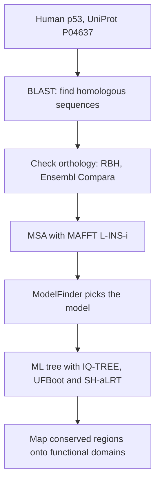

Sequence alignment means lining up two or more DNA or protein sequences to find the positions that correspond to each other, and it is the first step of almost every analysis, from finding homologous genes in a database to building a phylogenetic tree. This article follows one concrete sequence, human p53 protein (UniProt P04637, 393 amino acids), through five steps: dynamic programming, BLAST, choosing orthologs, multiple sequence alignment with MAFFT and tree building with IQ-TREE. Two numbers are worth remembering. In a protein search, an E-value < 0.001 is already enough to infer homology (Pearson, 2013), and a branch in a tree is only trustworthy when its ultrafast bootstrap support reaches 95% (Hoang et al., 2018). The article is written for biology and biotechnology students and self-taught bioinformatics learners who know basic Python. Every code block can be rerun.

<div class="callout callout-note">
<p class="callout-title">Quick summary</p>

- Needleman–Wunsch (global) and Smith–Waterman (local) are dynamic programming algorithms whose running time scales with the product of the two sequence lengths.
- An alignment score depends entirely on the substitution matrix and the gap penalty; linear and affine gaps give different scores for the same pair.
- E-values grow with database size. For protein:protein searches, E < 0.001 is enough to infer homology, but it does not tell you whether a hit is an ortholog or a paralog.
- In the p53 family, human p63 and p73 share about 57–61% identity with human p53 in the DNA-binding domain, close to zebrafish p53 (71%) (pairwise alignment, BLOSUM62, section 7).
- In IQ-TREE, `-B` is the ultrafast bootstrap: read it against a 95% threshold, together with SH-aLRT ≥ 80%.

</div>

## 1. What sequence alignment is, and the route of this article

Aligning two sequences means inserting gaps into each of them so that the characters placed in the same column add up to the highest total score under a given scoring system. Global alignment lines up two sequences from end to end; local alignment looks only for the most similar stretch. To compare one sequence against an entire database, people use heuristics such as BLAST. Once you have a set of homologous sequences, a multiple sequence alignment (MSA) puts all of them into one shared table of columns, and that table is the input for building a phylogenetic tree.

p53 suits this whole chain of steps for two reasons. TP53 mutations are very common in cancer, and about 70% of TP53 alterations are missense mutations (Hassin & Oren, 2023) (→ Gene mutations). And the p53/p63/p73 gene family has kept its structure and function for more than a billion years of evolution (Belyi et al., 2010), so there are enough sequences in both vertebrates and invertebrates to see clearly what is conserved and what differs.



## 2. Pairwise alignment with dynamic programming

### 2.1. Why dynamic programming

The number of ways to place gaps in two sequences grows very quickly with their length, so listing them all and picking the best is out of the question. Dynamic programming solves the problem by storing the best score for every pair of prefixes in a matrix $F$: cell $F(i,j)$ is the best score for aligning the first $i$ characters of $x$ with the first $j$ characters of $y$. Each cell needs only three neighboring cells that were computed earlier, so the whole table fills in time proportional to the product of the lengths, $n \times m$. Double the length of both sequences and the time goes up fourfold (Pearson, 2013). Eddy (2004) wrote a short introduction to dynamic programming for biologists.

### 2.2. Needleman–Wunsch: global alignment

Needleman and Wunsch (1970) introduced a general method for comparing two complete protein sequences. With a linear gap penalty (each gap position costs $d$) and a substitution score function $s(a,b)$, the recurrence is:

$$F(i,j) = \max \begin{cases} F(i-1,j-1) + s(x_i, y_j) \\ F(i-1,j) - d \\ F(i,j-1) - d \end{cases}$$

Initialize $F(0,0)=0$, $F(i,0) = -i\,d$ and $F(0,j) = -j\,d$, because aligning a prefix with an empty string means all gaps (Durbin et al., 1998). The optimal score sits in the corner cell $F(n,m)$. Tracing back from that cell to $F(0,0)$, each step following the cell that produced the max, gives you the alignment.

Working a few cells by hand shows how the formula behaves. With $x$ = GATTACA (rows) and $y$ = GCATGCT (columns), cell $F(1,1)$ aligns G with G: $\max(0+1,\ -1-1,\ -1-1) = 1$. Cell $F(1,2)$ aligns G with GC. The diagonal move from $F(0,1) = -1$ plus the G/C mismatch gives −2, the horizontal move from $F(1,1) = 1$ minus a gap gives 0, and the vertical move from $F(0,2) = -2$ minus a gap gives −3. The max is 0, which means the best option is to align G with G and then set C against a gap. The rest of the 8 × 8 table fills in by the same rule, one row at a time.

Global alignment fits when two sequences are homologous along their entire length, not merely because they happen to be the same length. When the homologous region sits in different contexts, for example a domain shared by two proteins with different domain architectures, use local alignment instead (Pearson, 2013).

Figure 1 shows the matrix $F$ for the pair GATTACA/GCATGCT with match +1, mismatch −1, gap −1. The optimal score is 0, and Biopython returns three alignments that all reach it. The practical consequence: when you test your own code against a library, compare **scores**, not alignment strings, because two correct programs can pick two different traceback paths.


*Figure 1. Needleman–Wunsch matrix F for GATTACA (rows) and GCATGCT (columns); the red numbers are one optimal traceback path. Drawn from the code in section 2.6.*

### 2.3. Smith–Waterman: local alignment

Smith and Waterman (1981) modified the algorithm to find the best common subsequence. The change is in two places. First, the max function gets an extra 0, so a score can never go negative: a bad stretch cannot drag down the score of a good stretch that follows it. Second, the traceback starts from the highest-scoring cell anywhere in the matrix, not from the corner, and it stops when it reaches a cell equal to 0 (Durbin et al., 1998). Skip the second rule and the code still runs, but it returns the wrong segment.

<div class="callout callout-warning">
<p class="callout-title">Three common mistakes when implementing it yourself</p>

- Forgetting to initialize the first row and column in Needleman–Wunsch: leaving them all at 0 silently makes leading gaps free, and your score will come out higher than the library's.
- Tracing back Smith–Waterman from the bottom-right corner as in Needleman–Wunsch: the code still runs, but the segment it returns is not the highest-scoring one.
- Off-by-one indexing: row $i$ of the matrix corresponds to character $x_{i-1}$ in Python (zero-based). Slipping one position here gives a wrong score without any error.

</div>

A good case for local alignment: CEP-1 from the nematode *C. elegans* is 644 amino acids long, while human p53 has 393 (UniProt Consortium, 2025). A global alignment would force the two proteins to match from end to end and create many meaningless gaps; a local alignment keeps only the shared region.

### 2.4. Affine gaps: opening costs more than extending

A single insertion or deletion event (indel) often adds or removes several residues at once, so a gap of length 5 should not be penalized like five separate gaps. The affine model penalizes a gap of length $g$ as $d + (g-1)\,e$, where $d$ is the opening penalty and $e < d$ is the extension penalty. Gotoh (1982) gave an algorithm for this model that keeps $O(nm)$ time by using three matrices: $M$ (ending in an aligned pair), $I_x$ (ending in a residue of $x$ against a gap) and $I_y$ (the reverse). In the notation of Durbin et al. (1998):

$$M(i,j) = s(x_i,y_j) + \max\{M(i-1,j-1),\ I_x(i-1,j-1),\ I_y(i-1,j-1)\}$$
$$I_x(i,j) = \max\{M(i-1,j) - d,\ I_x(i-1,j) - e\}$$
$$I_y(i,j) = \max\{M(i,j-1) - d,\ I_y(i,j-1) - e\}$$

The formulation in Durbin et al. (1998) does not let a gap in $x$ follow directly after a gap in $y$. The code in section 2.6 does allow a direct $I_x$ ↔ $I_y$ transition (each side paying its own opening penalty) to follow Biopython's convention, and that is why its scores match Biopython on every pair tested. If you implement exactly the three lines above, you may get a different score from this code on a few pairs. All three matrices are the same size, $(n+1)\times(m+1)$, and each cell takes constant time, so the total stays $O(nm)$, only a constant factor slower than the linear version.

That is why you must state the gap model. For the same GATTACA/GCATGCT pair, a linear gap of −1 gives an optimal score of 0, while affine gaps with opening −2 and extension −0.5 give −1.0 and an alignment with no gaps at all. Implement the linear formula and compare it against code that uses `open_gap_score=-2, extend_gap_score=-0.5`, and you will not get the same score unless opening equals extension. There is no single "correct" setting. Opening −10 and extension −0.5 with BLOSUM62 is a common parameter set for proteins, but changing the parameters changes the answer. Every alignment report should therefore state the substitution matrix, the opening and extension penalties, and whether gaps at the two ends are penalized.

### 2.5. Substitution matrices

For proteins, $s(a,b)$ comes from a substitution matrix. Henikoff and Henikoff (1992) built the BLOSUM family of matrices from about 2,000 blocks of ungapped aligned segments drawn from more than 500 groups of related proteins, and showed that they improve both alignment and database searching compared with matrices based on the Dayhoff (PAM) model. BLOSUM62 is the usual choice for proteins; in Biopython you load it with `substitution_matrices.load("BLOSUM62")`. A positive value means the amino acid pair turns up in homologous proteins more often than chance; a negative value means less often. In BLOSUM62, for example, cysteine–cysteine scores +9, while cysteine paired with many other amino acids scores negative: in blocks of homologous proteins, cysteine is rarely replaced by something else. In p53, the four zinc-binding residues are three cysteines and one histidine, and section 7 shows that they stay unchanged all the way to the fruit fly.

### 2.6. Implementing and testing it yourself

The code below implements the three algorithms in pure Python.

```python
# align.py
NEG = float("-inf")

def score_fn(match=1, mismatch=-1, matrix=None):
    if matrix is not None:
        return lambda a, b: matrix[a][b]
    return lambda a, b: match if a == b else mismatch

def nw(x, y, s, d):
    """Global, linear gap: each gap position costs d."""
    n, m = len(x), len(y)
    F = [[0.0] * (m + 1) for _ in range(n + 1)]
    for i in range(1, n + 1):
        F[i][0] = -i * d
    for j in range(1, m + 1):
        F[0][j] = -j * d
    for i in range(1, n + 1):
        for j in range(1, m + 1):
            F[i][j] = max(F[i-1][j-1] + s(x[i-1], y[j-1]),
                          F[i-1][j] - d, F[i][j-1] - d)
    return F[n][m], F

def sw(x, y, s, d):
    """Local: add 0 to the max; the score is the largest cell in the whole matrix."""
    n, m = len(x), len(y)
    F = [[0.0] * (m + 1) for _ in range(n + 1)]
    best, best_ij = 0.0, (0, 0)
    for i in range(1, n + 1):
        for j in range(1, m + 1):
            F[i][j] = max(0.0, F[i-1][j-1] + s(x[i-1], y[j-1]),
                          F[i-1][j] - d, F[i][j-1] - d)
            if F[i][j] > best:
                best, best_ij = F[i][j], (i, j)
    return best, best_ij, F

def gotoh(x, y, s, d, e):
    """Global, affine: a gap of length g costs d + (g-1)*e."""
    n, m = len(x), len(y)
    M = [[NEG] * (m + 1) for _ in range(n + 1)]
    Ix = [[NEG] * (m + 1) for _ in range(n + 1)]
    Iy = [[NEG] * (m + 1) for _ in range(n + 1)]
    M[0][0] = 0.0
    for i in range(1, n + 1):
        Ix[i][0] = -d - (i - 1) * e
    for j in range(1, m + 1):
        Iy[0][j] = -d - (j - 1) * e
    for i in range(1, n + 1):
        for j in range(1, m + 1):
            M[i][j] = s(x[i-1], y[j-1]) + max(M[i-1][j-1], Ix[i-1][j-1], Iy[i-1][j-1])
            Ix[i][j] = max(M[i-1][j] - d, Ix[i-1][j] - e, Iy[i-1][j] - d)
            Iy[i][j] = max(M[i][j-1] - d, Iy[i][j-1] - e, Ix[i][j-1] - d)
    return max(M[n][m], Ix[n][m], Iy[n][m])
```

The test suite compares scores against Biopython's `Bio.Align.PairwiseAligner` (Cock et al., 2009) on 200 random DNA pairs 5–40 characters long, with a fixed seed:

```python
import random
from Bio import Align
from align import nw, sw, gotoh, score_fn

s = score_fn(1, -1)
g = Align.PairwiseAligner(mode="global", match_score=1, mismatch_score=-1, gap_score=-1)
l = Align.PairwiseAligner(mode="local",  match_score=1, mismatch_score=-1, gap_score=-1)
a = Align.PairwiseAligner(mode="global", match_score=1, mismatch_score=-1,
                          open_gap_score=-2, extend_gap_score=-0.5)
random.seed(42)
bad = {"global": 0, "local": 0, "affine": 0}
for _ in range(200):
    p = "".join(random.choices("ACGT", k=random.randint(5, 40)))
    q = "".join(random.choices("ACGT", k=random.randint(5, 40)))
    bad["global"] += nw(p, q, s, 1)[0] != g.score(p, q)
    bad["local"]  += sw(p, q, s, 1)[0] != l.score(p, q)
    bad["affine"] += abs(gotoh(p, q, s, 2, 0.5) - a.score(p, q)) > 1e-9
print(bad)   # {'global': 0, 'local': 0, 'affine': 0}
```

Run on November 26, 2026 with Biopython 1.87: not a single pair differed in score for any of the three algorithms. One more test with a real protein: the DNA-binding domain of human p53 (residues 102–292) against the matching stretch of mouse p53, BLOSUM62, gap opening −10, extension −0.5. `gotoh()` and Biopython both return 927.0. The GLOB and LOCA exercises on Rosalind come with answers, so you can use them as two more test cases with a substitution matrix.

Figure 2 times random DNA pairs from 100 to 1,600 characters long. Going from 800 to 1,600, the pure-Python version goes from 0.29 s to 1.33 s, about 4.5 times longer, close to the fourfold increase that theory predicts. Biopython (with a C core) is about 130–210 times faster on the same machine, but the slope is the same: writing in a faster language does not change the order of the algorithm.


*Figure 2. Time to compute the Needleman–Wunsch score versus length, log–log scale. Measured November 26, 2026, Python 3.13, Biopython 1.87.*

| | Needleman–Wunsch | Smith–Waterman | Gotoh (affine, global) |
|---|---|---|---|
| Type | global | local | global (local version exists) |
| Initialization | $-i\,d$, $-j\,d$ | 0 | $-d-(i-1)e$ in $I_x$, $I_y$ |
| Max function | 3 options | 3 options and 0 | 3 matrices |
| Traceback starts at | cell $F(n,m)$ | largest cell | largest of the 3 matrices at $(n,m)$ |
| Traceback ends at | cell $F(0,0)$ | a cell equal to 0 | cell $(0,0)$ |
| Time | $O(nm)$ | $O(nm)$ | $O(nm)$ |

*Table 1. Comparison of the three dynamic programming algorithms. The Gotoh column describes the global version, matching the `gotoh()` function above.*

## 3. BLAST: finding homologous sequences in a database

### 3.1. Seed-and-extend

Smith–Waterman gives the optimal answer but is far too slow for comparing one query against hundreds of millions of sequences. BLAST (Altschul et al., 1990) directly approximates the maximal segment pair (MSP) score, that is, the highest-scoring ungapped segment pair between two sequences. The method: find short, high-scoring words (seeds), then extend them in both directions. The statistical theory of MSP scores (Karlin & Altschul, 1990) makes it possible to compute the significance of each hit. The 1990 paper reported BLAST as roughly an order of magnitude faster than tools of comparable sensitivity at the time. Gapped BLAST in 1997 ran about three times faster than the original, and PSI-BLAST used a position-specific score matrix to find distant homologs (Altschul et al., 1997). The current command-line suite is BLAST+ (Camacho et al., 2009).

The price of a heuristic is that it can miss distant homology. So when BLAST finds no significant hit, you cannot conclude that two sequences are not homologous (Pearson, 2013).

### 3.2. The BLAST programs

| Program | Query | Database |
|---|---|---|
| blastn | nucleotide | nucleotide |
| blastp | protein | protein |
| blastx | nucleotide translated in 6 frames | protein |
| tblastn | protein | nucleotide translated in 6 frames |
| tblastx | nucleotide translated in 6 frames | nucleotide translated in 6 frames |

*Table 2. The five main BLAST programs.*

Searching with protein or translated DNA is about 5–10 times more sensitive than DNA:DNA, and DNA:DNA comparisons rarely detect homology beyond 200–400 million years of divergence (Pearson, 2013). Human and fruit fly p53 lineages split far longer ago than that, so the search has to be done with protein.

### 3.3. Reading E-value, bit score and % identity

The **E-value** is the number of hits you would expect by chance with a score equal to or higher than the one observed, in a database of the size you searched. For the same score, searching a database 100 times larger gives an E-value 100 times larger (Pearson, 2013). The threshold for protein:protein searches: E < 0.001 is already reliable enough to infer homology. The common threshold of 1e-5 is a stricter convention. DNA:DNA is different: E < 10⁻⁶ still happens by chance fairly often, and 10⁻¹⁰ is a safer threshold. The `-evalue` parameter in a BLAST+ command is only a reporting cutoff, not a statistical test.

The **bit score** is a normalized score that does not depend on database size; for a protein of average length, a bit score of about 50 is almost always significant (Pearson, 2013).

**% identity** is easy to read but easy to misread. The rule "above 30% identity means homologous" misses many homologs: of 3,084 yeast proteins with significant similarity to a human protein, only 2,081 had more than 30% identity (Pearson, 2013). Homology also has no percentage: two sequences either share an ancestor or they don't. Saying "% homology" is wrong; use "% identity" or "% similarity".

The E-value is a kind of correction for comparing one query against millions of sequences, in the same spirit as multiple-testing correction in the article on [p-values and FDR](/en/blog/toan-va-thong-ke-cho-sinh-hoc/).

<div class="callout callout-example">
<p class="callout-title">Reading one line of output</p>

Suppose the command `blastp -outfmt "6 qseqid sseqid pident length evalue bitscore"` returns a line with pident 29.5, length 180, evalue 3e-12, bitscore 65. Read it in order: a bit score of 65 is above 50, and the E-value is far below 0.001, so you can conclude that the two proteins are homologous even though identity is under 30%. If the same query were searched against a database 100 times larger, the E-value would become about 3e-10, still significant; the bit score would not change. What this line does not tell you: whether the two proteins are orthologs or paralogs.

</div>

### 3.4. When the data get too big

With millions of queries, DIAMOND (Buchfink et al., 2015) and MMseqs2 (Steinegger & Söding, 2017) replace BLAST for large-scale protein searches. MMseqs2 is also used to split training and test sets by homology clusters, a topic of the [article on machine learning in biology](/en/blog/machine-learning-va-ai-trong-sinh-hoc/).

## 4. Homologs, orthologs, paralogs: the trap in the p53 family

Statistically significant similarity lets you infer homology, meaning shared ancestry. It does not tell you how the two genes came apart. Orthologs are homologous genes that diverged through a speciation event; paralogs diverged through gene duplication (Pearson, 2013). The distinction matters because building a species tree from a mix of orthologs and paralogs gives the wrong tree.

The p53 family is the clearest example of this trap. According to Belyi et al. (2010), the common ancestor of p53, p63 and p73 was already present in sea anemones, where it protected the germline; most invertebrates carry only one ancestral p63/p73-like gene; the first duplication, which produced p53 and the p63/p73 ancestor, happened in cartilaginous fish, and bony fish already have all three genes. The upshot: the fruit fly protein called "p53" is not a 1:1 ortholog of human TP53. It descends from the gene as it was before the duplication, so it is homologous to all three human genes. Functionally, Dmp53 can bind human p53 binding sites and triggers apoptosis after DNA damage, but it does not cause G1 arrest (Brodsky et al., 2000; Ollmann et al., 2000).

The BLAST trap: searching the proteome of a vertebrate with human p53 returns TP53, TP63 and TP73 all with tiny E-values. In the DNA-binding domain, human TP73 and TP63 share 61% and 57% identity with human p53, not far from zebrafish p53 (71%) (section 7).

Two ways to check orthology:

1. **Reciprocal best hit (RBH):** gene A in species 1 and gene B in species 2 are each other's best hit when BLAST is run in both directions. The procedure: BLAST human p53 against the full mouse proteome and take the hit with the highest bit score; BLAST that protein back against the human proteome; if the top hit comes back to human p53, the pair is a candidate ortholog. Mouse TP63 will also have a tiny E-value when searched with human p53, but in the reverse search it will most likely find human TP63 first, so it is dropped. BLAST options such as low-complexity filtering or the final alignment method affect how many orthologs you find (Moreno-Hagelsieb & Latimer, 2008).
2. **Duplication-aware gene trees:** Ensembl Compara GeneTrees builds a tree for each gene family and separates orthologs from paralogs (Vilella et al., 2009). Check your RBH results against these annotations.

When building the tree, include human TP63 and TP73 as paralog controls: if the TP53 sequences cluster into their own clade, your sequence selection is on the right track. RBH has its own weak spot: when a species has lost a gene, or has a recent duplication in just one lineage, the "best of each other" can land on a paralog. So RBH is a quick filter, and a duplication-aware gene tree is the final check.

## 5. Multiple sequence alignment with MAFFT

An exactly optimal MSA costs exponentially more as sequences are added, so programs use a progressive approach, followed by iterative refinement to fix gaps that were placed wrongly early on (Pearson, 2013). MAFFT version 7 added many features (Katoh & Standley, 2013). According to the MAFFT manual (Katoh, n.d.), `--auto` chooses among L-INS-i, FFT-NS-i and FFT-NS-2 based on data size, and L-INS-i is recommended for fewer than 200 sequences. With 8–10 sequences, call L-INS-i directly and state that choice. Clustal Omega (Sievers et al., 2011) and MUSCLE (Edgar, 2004) are other options.

An MSA program does not test for homology: it will happily align sequences that are not homologous (Pearson, 2013). Every sequence you feed in needs independent evidence of homology from the BLAST and orthology steps. Large length differences cause trouble too: CEP-1 is 644 amino acids long against 393 for human p53, and the extra length turns into blocks of columns that are almost all gaps. Unreviewed accessions carry an added risk at the start or end of the protein, where gene models are most often wrong; an odd N-terminal stretch found in only one sequence is usually a sign that you should reopen the UniProt record before building the tree.

Should you trim the MSA? Tan et al. (2015) showed that automated MSA filtering often makes single-gene trees worse and raises the share of branches that are highly supported but wrong; light filtering, at most 20% of positions, has little effect. Run both an untrimmed version and a lightly trimmed version with trimAl (Capella-Gutiérrez et al., 2009), then compare the two trees. View the MSA in Jalview (Waterhouse et al., 2009). A quick quality check for a p53 MSA: human R175 must fall in the same column as mouse R172, because the R175H mutation in humans corresponds to R172H in mice (Hassin & Oren, 2023). If these two residues end up in different columns, the MSA has a problem right in its most conserved region.

## 6. Building trees: Neighbor-Joining and Maximum Likelihood with IQ-TREE

### 6.1. Distance methods

Neighbor-Joining (NJ) joins pairs of "neighbors" step by step so that the total branch length is as small as possible. In simulations by Saitou and Nei (1987), NJ outperformed UPGMA. NJ is fast and easy to understand, but it compresses all the information in the MSA into a single number per pair.

### 6.2. Maximum Likelihood with IQ-TREE

Maximum Likelihood (ML) looks for the tree and parameters that make the observed data most probable under an evolutionary model. IQ-TREE 2 is a widely used ML program with many built-in models (Minh, Schmidt et al., 2020); IQ-TREE 3 was published in May 2026 (Wong et al., 2026), and the official documentation uses the command `iqtree3`. Record the version you ran.

The `-m MFP` option runs ModelFinder and then builds the tree with the best model. ModelFinder improves accuracy by modeling rate variation across sites and searching model space and tree space together (Kalyaanamoorthy et al., 2017).

### 6.3. Branch support: standard bootstrap and UFBoot

Felsenstein's (1985) standard bootstrap resamples the columns of the MSA, rebuilds the tree many times and counts how often a branch appears (→ The Bootstrap). In IQ-TREE, `-b` is the standard bootstrap (at least 100 replicates recommended), and `-B` is the ultrafast bootstrap (UFBoot), with at least 1,000 replicates recommended (IQ-TREE, n.d.-b).

UFBoot is less biased than the standard bootstrap, which is conservative (Minh et al., 2013). When the model is not violated, or only mildly violated, you can trust branches with UFBoot2 ≥ 95%; UFBoot2 was about 778 times faster than the standard bootstrap (median) on the test datasets (Hoang et al., 2018). The IQ-TREE FAQ recommends running SH-aLRT alongside it (`-alrt 1000`; Guindon et al., 2010) and trusting a clade more when SH-aLRT ≥ 80% and UFBoot ≥ 95% (IQ-TREE, n.d.-a). A branch with 80% UFBoot is not "fairly good" the way 80% standard bootstrap is.

<div class="callout callout-example">
<p class="callout-title">Reading IQ-TREE branch labels</p>

When run with `-B 1000 -alrt 1000`, the `.treefile` writes two numbers on each internal branch, in the form `SH-aLRT/UFBoot`. A branch labeled `98.7/100` passes both thresholds. A branch labeled `85.2/91` passes the SH-aLRT threshold but falls short of 95% UFBoot: treat it as unresolved. A branch labeled `39/51` has almost no support; drawing it as a polytomy is more honest than keeping a branching order that looks certain.

</div>

Two of the five UFBoot2 authors, D. T. Hoang and L. S. Vinh, are at the VNU University of Engineering and Technology, Vietnam National University, Hanoi (Hoang et al., 2018).

### 6.4. Rooting and long branches

An ML tree has no root. For the vertebrate TP53 clade, pre-duplication sequences (fruit fly, Ciona) make a reasonable outgroup (Belyi et al., 2010). Very long branches such as CEP-1 risk long-branch attraction (Bergsten, 2005), so include them only in a sensitivity analysis. Display the tree with iTOL (Letunic & Bork, 2024) or FigTree.

## 7. Hands-on: TP53 in 8 species

This part runs entirely in Python and Biopython: download sequences from UniProt, align each species pairwise with human p53, map key residues, plot a conservation profile and draw an illustrative NJ tree. BLAST, MAFFT and IQ-TREE need to be installed through Bioconda (→ [Computing foundations](/en/blog/nen-tang-tinh-toan/)); the commands are in the appendix. How to download sequences through the UniProt REST API is covered in the [article on data formats](/en/blog/dinh-dang-du-lieu-va-co-so-du-lieu-sinh-hoc/).

The eight species were chosen to span mammals to insects: human, mouse, chicken, frog, zebrafish, a cartilaginous fish (the group where the first duplication producing p53 happened, according to Belyi et al., 2010), Ciona and fruit fly (two outgroups carrying the pre-duplication gene). Human TP63 and TP73 serve as paralog controls; CEP-1 is reserved for a sensitivity analysis with a long branch.

| Species | Gene | Accession | Status | Length (aa) |
|---|---|---|---|---|
| *Homo sapiens* | TP53 | P04637 | reviewed | 393 |
| *Mus musculus* | Trp53 | P02340 | reviewed | 390 |
| *Gallus gallus* | TP53 | P10360 | reviewed | 367 |
| *Xenopus tropicalis* | tp53 | Q6NTF1 | unreviewed | 362 |
| *Danio rerio* | tp53 | P79734 | reviewed | 373 |
| *Callorhinchus milii* (elephant shark, a cartilaginous fish) | p53 | G9J1L8 | unreviewed | 387 |
| *Ciona intestinalis* | p53 | F6SSG7 | unreviewed | 419 |
| *Drosophila melanogaster* | p53 | Q9N6D8 | unreviewed | 385 |
| *H. sapiens* (paralog control) | TP63 | Q9H3D4 | reviewed | 680 |
| *H. sapiens* (paralog control) | TP73 | O15350 | reviewed | 636 |
| *C. elegans* (long branch) | cep-1 | Q20646 | reviewed | 644 |

*Table 3. Sequences used in the analysis, downloaded from the UniProt REST API on November 26, 2026.*

The code below downloads the sequences, aligns them pairwise and maps positions. The `mapping()` function uses Biopython's coordinates for aligned blocks (`aligned`) to convert residue numbers from human to another species.

```python
import urllib.request
from Bio import Align
from Bio.Align import substitution_matrices

ACC = ["P04637", "P02340", "P10360", "Q6NTF1", "P79734", "G9J1L8",
       "F6SSG7", "Q9N6D8", "Q9H3D4", "O15350", "Q20646"]
def fetch(acc):
    url = f"https://rest.uniprot.org/uniprotkb/{acc}.fasta"
    lines = urllib.request.urlopen(url).read().decode().splitlines()
    return "".join(l for l in lines if not l.startswith(">"))
seq = {a: fetch(a) for a in ACC}

al = Align.PairwiseAligner(mode="global",
                           substitution_matrix=substitution_matrices.load("BLOSUM62"),
                           open_gap_score=-10, extend_gap_score=-0.5)
al.end_insertion_score = al.end_deletion_score = 0   # no penalty for gaps at the ends

def mapping(a, b):
    # position (1-based) on a -> position on b; positions that fall in a gap are not in the dict
    aln = al.align(seq[a], seq[b])[0]
    m = {}
    for (s1, e1), (s2, e2) in zip(*aln.aligned):
        for k in range(e1 - s1):
            m[s1 + k + 1] = s2 + k + 1
    return m

def identity(a, b, lo=1, hi=None):
    m = mapping(a, b)
    pos = [i for i in m if lo <= i <= (hi or len(seq[a]))]
    return sum(seq[a][i-1] == seq[b][m[i]-1] for i in pos) / len(pos)

H = "P04637"
for b in ACC[1:]:
    print(b, round(identity(H, b), 2), round(identity(H, b, 102, 292), 2))
m = mapping(H, "P02340")
print("human R175 ->", seq["P02340"][m[175]-1] + str(m[175]))   # R172
```

Pairwise global alignment, BLOSUM62, gap opening −10, extension −0.5, no penalty for end gaps. % identity is computed over aligned positions; the DNA-binding domain (DBD) is residues 102–292 of human p53 according to UniProt. Note that because identity is computed over aligned positions, overhangs at either end are not penalized: for the fruit fly, only 318 of the 393 positions of human p53 are aligned, and for CEP-1 only 278.

| Compared with human p53 | Full length | DBD |
|---|---|---|
| Mouse | 0.79 | 0.88 |
| Chicken | 0.59 | 0.72 |
| Frog *X. tropicalis* | 0.58 | 0.68 |
| Zebrafish | 0.57 | 0.71 |
| Elephant shark *C. milii* | 0.53 | 0.67 |
| Ciona | 0.38 | 0.43 |
| Fruit fly | 0.25 | 0.29 |
| Human TP73 | 0.46 | 0.61 |
| Human TP63 | 0.46 | 0.57 |
| CEP-1 | 0.31 | 0.33 |

*Table 4. % identity relative to human p53 (Biopython 1.87, November 26, 2026).*

Write your check questions down before you run anything, so you don't read the results the way you want them to come out. Here are five, with their answers.

Question 1: is the DBD more conserved than the rest of the protein? Yes, in every species: 0.88 versus 0.79 over the full length in mouse, 0.71 versus 0.57 in zebrafish. Figure 3 shows the same thing position by position. On average, a DBD residue is kept in 62% of species, compared with 39% in the transactivation domain (1–44) and 51% in the tetramerization domain (325–356). 35 of the 191 DBD positions are unchanged in all seven species. The transactivation domain has a small peak around residues 17–25, right at the TADI motif according to UniProt, while the rest of that domain varies a lot.


*Figure 3. Number of species (out of 7) that keep the human p53 residue at each position, computed from pairwise alignments; the solid line is a 9-position moving average. Colored boxes: domains according to UniProt; green lines: zinc-binding residues; red lines: R175, Y220, R248, R273.*

Question 2: are the zinc-binding and hotspot residues kept?

| Human p53 | Mouse | Chicken | Frog | Zebrafish | Elephant shark | Ciona | Fruit fly |
|---|---|---|---|---|---|---|---|
| R175 | R172 | R160 | R149 | R143 | R165 | R217 | R155 |
| C176 | C173 | C161 | C150 | C144 | C166 | C218 | C156 |
| H179 | H176 | H164 | H153 | H147 | H169 | H221 | H159 |
| Y220 | Y217 | Y206 | Y195 | Y188 | Y211 | Y265 | L205 |
| C238 | C235 | C224 | C213 | C206 | C229 | C283 | C227 |
| C242 | C239 | C228 | C217 | C210 | C233 | C287 | C231 |
| G245 | G242 | G231 | G220 | G213 | G236 | G292 | gap |
| R248 | R245 | R234 | R223 | R216 | R239 | R295 | R234 |
| R273 | R270 | R259 | R248 | R241 | R264 | R320 | K259 |

*Table 5. Key residues mapped from human p53 to 7 species.*

All four zinc-binding residues are unchanged in all seven species. R175, R248 and R273 are kept in every vertebrate and in Ciona; in the fruit fly, R273 corresponds to a lysine, Y220 to a leucine, and G245 falls in a gap.

Question 3: does the mapping agree with the literature? Human R175 aligns with mouse R172, matching the correspondence between R175H in humans and R172H in mice (Hassin & Oren, 2023). This test is cheap and catches real bugs: if the code shifts coordinates by one position, R175 lands on C173 or some other residue, and every table after it is off too.

Question 4: do paralogs "slip through" as orthologs? Human TP73 and TP63 share 61% and 57% identity with human p53 in the DBD, right next to zebrafish (71%), frog (68%) and elephant shark (67%). No % identity threshold can separate distant orthologs from close paralogs. On top of that, fruit fly p53 is slightly more similar to human TP63 and TP73 (29–30%) than to human TP53 (25%), consistent with its being a descendant of the ancestral p63/p73-like gene (Belyi et al., 2010).

Question 5: can the tree separate orthologs from paralogs? Figure 4 is an NJ tree built from p-distances (1 − identity) for every pair, rooted on the fruit fly. The six TP53 sequences form one clade, TP63 and TP73 form a separate clade, and Ciona sits outside both. Inside the TP53 clade, the branching order does not match the generally accepted species relationships (zebrafish sits next to the group with human, mouse and chicken). According to TimeTree (Kumar et al., 2022), zebrafish split off before the tetrapods (frog, chicken, mouse, human). This is a limitation of uncorrected p-distances with no branch support. An ML tree with ModelFinder and UFBoot from a MAFFT MSA is the proper next step. What Figure 4 can be trusted for is the gene-family level (TP53 separate from TP63/TP73), not the species order inside it.


*Figure 4. Illustrative NJ tree from p-distances of pairwise alignments (10 sequences, without CEP-1). For illustrating the separation of orthologs and paralogs only; it does not replace an ML tree.*

## 8. Discussion and limitations

Hassin and Oren (2023) divide cancer p53 mutations into DNA-contact mutations (such as R248Q and R273H) and structural mutations (such as R175H, which disrupts zinc binding). These positions are unchanged in every vertebrate in Table 5, and the zinc-binding residues are unchanged all the way to the fruit fly. That fits their role: a position that natural selection has kept unchanged over hundreds of millions of years is usually one where a change breaks function. But this is a descriptive observation on a handful of sequences, not proof; testing for selective pressure (for example, the dN/dS ratio on coding sequences) is beyond the scope of this article.

To connect this to 3D structure, you could paint the conservation scores from Figure 3 onto a DBD structure from the PDB or an AlphaFold model (→ [Proteomics and protein structure](/en/blog/proteomics-va-cau-truc-protein/)). The zinc-binding residues and the DNA-contacting arginines would then show up as a cluster on the DNA-binding surface, instead of scattered ticks along a sequence axis.

Limitations to state when reporting an analysis like this one: one gene and few sequences, so the tree has few informative sites; a gene tree can differ from the species tree because of rate differences between lineages or a paralog picked by mistake; several accessions are unreviewed, so their gene models may be wrong; the conservation profile comes from pairwise alignments, not an MSA; and there is no test of selective pressure. Protein searches can detect almost every homolog that diverged within the last 500 million years or so (Pearson, 2013), which is enough for the vertebrate scope of this article. The reverse does not hold: failing to find significant similarity does not prove two sequences are unrelated, especially for lineages that split very early, such as nematodes and vertebrates.

## 9. Checklist and conclusion

| # | What to do |
|---|---|
| 1 | Record the versions of Biopython, BLAST+, MAFFT and IQ-TREE; record accessions and download dates |
| 2 | Test your own code by comparing scores, not strings |
| 3 | State whether gaps are linear or affine, and which substitution matrix |
| 4 | Record database size alongside the E-value threshold |
| 5 | Report E-value and bit score; never write "% homology" |
| 6 | Check orthology with RBH and/or a gene tree; include paralogs as controls |
| 7 | Choose the MAFFT mode deliberately; don't trim by default |
| 8 | Report the model ModelFinder chose |
| 9 | State whether you used UFBoot or the standard bootstrap; read UFBoot against 95% |
| 10 | Say clearly that the tree is a gene tree |

*Table 6. Checklist.*

After all these steps, a single human p53 sequence has become a comparison table, a conservation profile and a tree. At every step one parameter can change the result: the gap model in pairwise alignment, the database size in BLAST, how orthologs are chosen, the MAFFT mode and whether to trim, the evolutionary model and the type of bootstrap. Recording those parameters matters as much as the results themselves. And the final tree, however well supported, is still a hypothesis about the history of one gene. The next article in the series, on [next-generation sequencing](/en/blog/giai-trinh-tu-the-he-moi-ngs-va-genomics/), moves from a few protein sequences to millions of short reads, where alignment needs very different algorithms.

Further reading: Durbin et al. (1998) for the algorithms, Pearson (2013) for how to read similarity search results.

## Frequently asked questions

**How do Needleman–Wunsch and Smith–Waterman differ?** Needleman–Wunsch aligns two whole sequences, and the score is in the last cell of the matrix. Smith–Waterman adds 0 to the max function and takes the highest-scoring cell, so it returns only the most similar segment. Use global alignment when two sequences are homologous along their full length; use local alignment when they share only a domain.

**What E-value counts as significant?** For protein:protein, E < 0.001 is enough to infer homology; DNA:DNA needs to be stricter, around 10⁻¹⁰ (Pearson, 2013). Always read an E-value together with the database size.

**Is 30% identity the threshold for homology?** No. Many homologous protein pairs have less than 30% identity; rely on the E-value and bit score.

**How do orthologs and paralogs differ?** Orthologs split when species split; paralogs split when a gene duplicates. Human TP53 and mouse Tp53 are orthologs; human TP53 and TP63 are paralogs.

**What UFBoot value is reliable?** 95% or higher, ideally together with SH-aLRT of 80% or higher. Don't read UFBoot on the same scale as the standard bootstrap.

**Should I trim an MSA before building a tree?** Not by default. Heavy filtering often makes single-gene trees worse; if you trim, trim lightly and compare against the untrimmed tree.

## Appendix: commands to rerun

The commands below are templates for BLAST+, MAFFT and IQ-TREE; the file names are examples. Run `blastp -help`, `mafft --help` and `iqtree3 -h` to check the options in the version on your machine, then record the versions in a README.

```bash
# Environment (Bioconda)
conda create -n tp53 -c conda-forge -c bioconda biopython blast mafft iqtree trimal
conda activate tp53

# BLAST: database from the mouse proteome, search with human p53, then search back
makeblastdb -in mouse_proteome.fasta -dbtype prot -out mouse
blastp -query P04637.fasta -db mouse -evalue 1e-3 \
       -outfmt "6 qseqid sseqid pident length evalue bitscore" -out human_vs_mouse.tsv
# take the hit with the highest bit score and BLAST it back against the human proteome to check RBH

# MSA with L-INS-i
mafft --localpair --maxiterate 1000 tp53_8species.fasta > tp53.aln.fasta

# Light trimming for a sensitivity analysis
# -gt 0.8: keep columns where at least 80% of sequences have no gap; record the share of columns removed
trimal -in tp53.aln.fasta -out tp53.trim.fasta -gt 0.8

# ML tree: ModelFinder, UFBoot and SH-aLRT, fixed seed
iqtree3 -s tp53.aln.fasta -m MFP -B 1000 -alrt 1000 -seed 12345 --prefix tp53
```

## References

- Altschul, S. F., Gish, W., Miller, W., Myers, E. W., & Lipman, D. J. (1990). Basic local alignment search tool. *Journal of Molecular Biology, 215*(3), 403–410. https://doi.org/10.1016/S0022-2836(05)80360-2
- Altschul, S. F., Madden, T. L., Schäffer, A. A., Zhang, J., Zhang, Z., Miller, W., & Lipman, D. J. (1997). Gapped BLAST and PSI-BLAST: A new generation of protein database search programs. *Nucleic Acids Research, 25*(17), 3389–3402. https://doi.org/10.1093/nar/25.17.3389
- Belyi, V. A., Ak, P., Markert, E., Wang, H., Hu, W., Puzio-Kuter, A., & Levine, A. J. (2010). The origins and evolution of the p53 family of genes. *Cold Spring Harbor Perspectives in Biology, 2*(6), a001198. https://doi.org/10.1101/cshperspect.a001198
- Bergsten, J. (2005). A review of long-branch attraction. *Cladistics, 21*(2), 163–193. https://doi.org/10.1111/j.1096-0031.2005.00059.x
- Brodsky, M. H., Nordstrom, W., Tsang, G., Kwan, E., Rubin, G. M., & Abrams, J. M. (2000). Drosophila p53 binds a damage response element at the reaper locus. *Cell, 101*(1), 103–113. https://doi.org/10.1016/S0092-8674(00)80627-3
- Buchfink, B., Xie, C., & Huson, D. H. (2015). Fast and sensitive protein alignment using DIAMOND. *Nature Methods, 12*(1), 59–60. https://doi.org/10.1038/nmeth.3176
- Camacho, C., Coulouris, G., Avagyan, V., Ma, N., Papadopoulos, J., Bealer, K., & Madden, T. L. (2009). BLAST+: Architecture and applications. *BMC Bioinformatics, 10*, 421. https://doi.org/10.1186/1471-2105-10-421
- Capella-Gutiérrez, S., Silla-Martínez, J. M., & Gabaldón, T. (2009). trimAl: A tool for automated alignment trimming in large-scale phylogenetic analyses. *Bioinformatics, 25*(15), 1972–1973. https://doi.org/10.1093/bioinformatics/btp348
- Cock, P. J. A., Antao, T., Chang, J. T., Chapman, B. A., Cox, C. J., Dalke, A., Friedberg, I., Hamelryck, T., Kauff, F., Wilczynski, B., & de Hoon, M. J. L. (2009). Biopython: Freely available Python tools for computational molecular biology and bioinformatics. *Bioinformatics, 25*(11), 1422–1423. https://doi.org/10.1093/bioinformatics/btp163
- Durbin, R., Eddy, S. R., Krogh, A., & Mitchison, G. (1998). *Biological sequence analysis*. Cambridge University Press. https://doi.org/10.1017/CBO9780511790492
- Eddy, S. R. (2004). What is dynamic programming? *Nature Biotechnology, 22*(7), 909–910. https://doi.org/10.1038/nbt0704-909
- Edgar, R. C. (2004). MUSCLE: Multiple sequence alignment with high accuracy and high throughput. *Nucleic Acids Research, 32*(5), 1792–1797. https://doi.org/10.1093/nar/gkh340
- Felsenstein, J. (1985). Confidence limits on phylogenies: An approach using the bootstrap. *Evolution, 39*(4), 783–791. https://doi.org/10.1111/j.1558-5646.1985.tb00420.x
- Gotoh, O. (1982). An improved algorithm for matching biological sequences. *Journal of Molecular Biology, 162*(3), 705–708. https://doi.org/10.1016/0022-2836(82)90398-9
- Guindon, S., Dufayard, J.-F., Lefort, V., Anisimova, M., Hordijk, W., & Gascuel, O. (2010). New algorithms and methods to estimate maximum-likelihood phylogenies: Assessing the performance of PhyML 3.0. *Systematic Biology, 59*(3), 307–321. https://doi.org/10.1093/sysbio/syq010
- Hassin, O., & Oren, M. (2023). Drugging p53 in cancer: One protein, many targets. *Nature Reviews Drug Discovery, 22*(2), 127–144. https://doi.org/10.1038/s41573-022-00571-8
- Henikoff, S., & Henikoff, J. G. (1992). Amino acid substitution matrices from protein blocks. *Proceedings of the National Academy of Sciences, 89*(22), 10915–10919. https://doi.org/10.1073/pnas.89.22.10915
- Hoang, D. T., Chernomor, O., von Haeseler, A., Minh, B. Q., & Vinh, L. S. (2018). UFBoot2: Improving the ultrafast bootstrap approximation. *Molecular Biology and Evolution, 35*(2), 518–522. https://doi.org/10.1093/molbev/msx281
- IQ-TREE. (n.d.-a). *Frequently asked questions*. Retrieved November 26, 2026, from https://iqtree.github.io/doc/Frequently-Asked-Questions
- IQ-TREE. (n.d.-b). *Beginner's tutorial*. Retrieved November 26, 2026, from https://iqtree.github.io/doc/Tutorial
- Kalyaanamoorthy, S., Minh, B. Q., Wong, T. K. F., von Haeseler, A., & Jermiin, L. S. (2017). ModelFinder: Fast model selection for accurate phylogenetic estimates. *Nature Methods, 14*(6), 587–589. https://doi.org/10.1038/nmeth.4285
- Karlin, S., & Altschul, S. F. (1990). Methods for assessing the statistical significance of molecular sequence features by using general scoring schemes. *Proceedings of the National Academy of Sciences, 87*(6), 2264–2268. https://doi.org/10.1073/pnas.87.6.2264
- Katoh, K. (n.d.). *MAFFT version 7 manual*. Retrieved November 26, 2026, from https://mafft.cbrc.jp/alignment/software/manual/manual.html
- Katoh, K., & Standley, D. M. (2013). MAFFT multiple sequence alignment software version 7: Improvements in performance and usability. *Molecular Biology and Evolution, 30*(4), 772–780. https://doi.org/10.1093/molbev/mst010
- Kumar, S., Suleski, M., Craig, J. M., Kasprowicz, A. E., Sanderford, M., Li, M., Stecher, G., & Hedges, S. B. (2022). TimeTree 5: An expanded resource for species divergence times. *Molecular Biology and Evolution, 39*(8), msac174. https://doi.org/10.1093/molbev/msac174
- Letunic, I., & Bork, P. (2024). Interactive Tree of Life (iTOL) v6: Recent updates to the phylogenetic tree display and annotation tool. *Nucleic Acids Research, 52*(W1), W78–W82. https://doi.org/10.1093/nar/gkae268
- Minh, B. Q., Nguyen, M. A. T., & von Haeseler, A. (2013). Ultrafast approximation for phylogenetic bootstrap. *Molecular Biology and Evolution, 30*(5), 1188–1195. https://doi.org/10.1093/molbev/mst024
- Minh, B. Q., Schmidt, H. A., Chernomor, O., Schrempf, D., Woodhams, M. D., von Haeseler, A., & Lanfear, R. (2020). IQ-TREE 2: New models and efficient methods for phylogenetic inference in the genomic era. *Molecular Biology and Evolution, 37*(5), 1530–1534. https://doi.org/10.1093/molbev/msaa015
- Moreno-Hagelsieb, G., & Latimer, K. (2008). Choosing BLAST options for better detection of orthologs as reciprocal best hits. *Bioinformatics, 24*(3), 319–324. https://doi.org/10.1093/bioinformatics/btm585
- Needleman, S. B., & Wunsch, C. D. (1970). A general method applicable to the search for similarities in the amino acid sequence of two proteins. *Journal of Molecular Biology, 48*(3), 443–453. https://doi.org/10.1016/0022-2836(70)90057-4
- Ollmann, M., Young, L. M., Di Como, C. J., Karim, F., Belvin, M., Robertson, S., Whittaker, K., Demsky, M., Fisher, W. W., Buchman, A., Duyk, G., Friedman, L., Prives, C., & Kopczynski, C. (2000). Drosophila p53 is a structural and functional homolog of the tumor suppressor p53. *Cell, 101*(1), 91–101. https://doi.org/10.1016/S0092-8674(00)80626-1
- Pearson, W. R. (2013). An introduction to sequence similarity ("homology") searching. *Current Protocols in Bioinformatics, 42*, 3.1.1–3.1.8. https://doi.org/10.1002/0471250953.bi0301s42
- Saitou, N., & Nei, M. (1987). The neighbor-joining method: A new method for reconstructing phylogenetic trees. *Molecular Biology and Evolution, 4*(4), 406–425. https://doi.org/10.1093/oxfordjournals.molbev.a040454
- Sievers, F., Wilm, A., Dineen, D., Gibson, T. J., Karplus, K., Li, W., Lopez, R., McWilliam, H., Remmert, M., Söding, J., Thompson, J. D., & Higgins, D. G. (2011). Fast, scalable generation of high-quality protein multiple sequence alignments using Clustal Omega. *Molecular Systems Biology, 7*, 539. https://doi.org/10.1038/msb.2011.75
- Smith, T. F., & Waterman, M. S. (1981). Identification of common molecular subsequences. *Journal of Molecular Biology, 147*(1), 195–197. https://doi.org/10.1016/0022-2836(81)90087-5
- Steinegger, M., & Söding, J. (2017). MMseqs2 enables sensitive protein sequence searching for the analysis of massive data sets. *Nature Biotechnology, 35*(11), 1026–1028. https://doi.org/10.1038/nbt.3988
- Tan, G., Muffato, M., Ledergerber, C., Herrero, J., Goldman, N., Gil, M., & Dessimoz, C. (2015). Current methods for automated filtering of multiple sequence alignments frequently worsen single-gene phylogenetic inference. *Systematic Biology, 64*(5), 778–791. https://doi.org/10.1093/sysbio/syv033
- The UniProt Consortium. (2025). UniProt: The Universal Protein Knowledgebase in 2025. *Nucleic Acids Research, 53*(D1), D609–D617. https://doi.org/10.1093/nar/gkae1010
- Vilella, A. J., Severin, J., Ureta-Vidal, A., Heng, L., Durbin, R., & Birney, E. (2009). EnsemblCompara GeneTrees: Complete, duplication-aware phylogenetic trees in vertebrates. *Genome Research, 19*(2), 327–335. https://doi.org/10.1101/gr.073585.107
- Waterhouse, A. M., Procter, J. B., Martin, D. M. A., Clamp, M., & Barton, G. J. (2009). Jalview Version 2—a multiple sequence alignment editor and analysis workbench. *Bioinformatics, 25*(9), 1189–1191. https://doi.org/10.1093/bioinformatics/btp033
- Wong, T. K. F., Ly-Trong, N., Ren, H., Demotte, P., Baños, H., Roger, A. J., Susko, E., Bielow, C., De Maio, N., Goldman, N., Hahn, M. W., dos Reis, M., Vinh, L. S., Huttley, G., Lanfear, R., & Minh, B. Q. (2026). IQ-TREE 3: Phylogenomic inference software using complex evolutionary models. *Molecular Biology and Evolution, 43*(5), msag117. https://doi.org/10.1093/molbev/msag117
