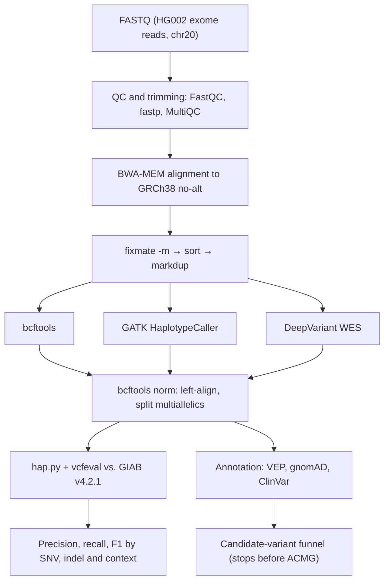

Germline variant calling is the step that turns millions of short reads from a sequencer into the list of SNVs and indels a person has carried since birth. Run the same sample through three popular tools (bcftools, GATK HaplotypeCaller and DeepVariant) and you can get three different lists, so a pipeline that finishes without errors tells you nothing about how correct its output is. The standard way to measure that today is to compare against the Genome in a Bottle (GIAB) truth set: for sample HG002, version 4.2.1 covers 92% of the GRCh38 autosomes (Wagner et al., 2022a), and matching calls according to the GA4GH best practices yields precision, recall and F1 separately for SNVs and indels (Krusche et al., 2019). This sixth *methods tutorial* in the series *Bioinformatics from beginner to advanced* is written for biology and biotechnology students who are comfortable on the Linux command line and want to check an exome pipeline for themselves.

<div class="callout callout-note">
<p class="callout-title">Quick summary</p>

- **Pipeline**: FASTQ → fastp → BWA-MEM → `fixmate -m` → `sort` → `markdup` → three callers → `bcftools norm` → hap.py.
- **Data**: the HG002 exome on chr20, compared with GIAB v4.2.1 (GRCh38) and the GIAB v3.6 stratifications.
- **Metrics**: precision, recall and F1 for SNVs and indels separately, with 95% Wilson confidence intervals; no specificity.
- **Reference numbers**: DeepVariant 1.9.0 on the HG003 exome reaches F1 0.9929 (SNP) and 0.9833 (indel) in the developers' case study.
- **Limits**: the pipeline only produces *candidate variants*; the five-tier ACMG/AMP classification needs evidence from outside the sequencing data.

</div>

## 1. What germline variant calling is, and why accuracy has to be measured

A sequencer does not "read" a genome from start to finish. It produces millions of short fragments, each a few hundred bases long, and every base comes with a probability of being wrong. Variant calling is an inference problem: from reads aligned to a reference genome, estimate which alleles this person carries at each position, with what genotype and how much confidence. The DeepVariant team describes it as a statistical problem on error-prone data rather than a matter of copying out a sequence (Poplin et al., 2018). Every upstream step, from read trimming to alignment to duplicate marking, changes the input to that problem.

Because it is inference, different methods give different answers. In 2014 the GIAB group at the US National Institute of Standards and Technology (NIST) integrated 14 data sets from 5 sequencing technologies, 7 aligners and 3 variant callers for the same sample, NA12878, and found that the methods disagreed substantially (Zook et al., 2014). Their conclusion was that labs needed a standard set of genotypes, built from several technologies, to compare against. From NA12878, GIAB expanded to an Ashkenazi family trio (HG002 is the son, HG003 and HG004 the parents) and a Han Chinese trio (HG005–HG007) (Zook et al., 2016). HG002 is part of the Personal Genome Project and consented to broad public release of their data, which is why it is now the most widely used sample for evaluating pipelines (Zook et al., 2019; Krusche et al., 2019).

Two terms need to be kept apart from the start. An **SNV** (single nucleotide variant) is a position where an individual differs from the reference genome at one base. An **SNP** (single nucleotide polymorphism) is an SNV that has reached appreciable frequency in a population. A person's VCF contains SNVs; some of them coincide with known SNPs. Biologically, SNVs and indels (insertions/deletions of a few nucleotides) are exactly the point mutations, substitutions, insertions and deletions of base pairs, described in Gene mutations. Some software, hap.py included, still labels the variant type "SNP"; when you read its output tables, take that to mean SNV.

The sections below follow the order of the actual work: run each step of an exome germline pipeline correctly, measure the accuracy of three callers on the same reads and learn to read those numbers, then see how far software can get on the road from "variant" to "clinical significance". The scope is small germline variants (SNVs and indels under 50 bp) from Illumina short reads. Somatic variants in cancer and structural variants are called and benchmarked differently and are out of scope.

Figure 1 summarizes the whole workflow. The left branch is the familiar pipeline; the right branch is the part people tend to skip: comparing against a truth set.


*Figure 1. A germline variant-calling pipeline with an accuracy-measurement branch.*

## 2. Background: from DNA molecule to read

### 2.1. From Sanger to massively parallel sequencing

The first generation consisted of the Sanger method, which terminates chains with dideoxynucleotides, and the Maxam–Gilbert method, which cleaves DNA chemically. Both read one DNA fragment at a time. Pyrosequencing took a different route: it detects the pyrophosphate released each time a nucleotide is incorporated, so no electrophoresis is needed. The shotgun strategy breaks a genome into many random pieces and reassembles them using their overlaps. Next-generation sequencing (NGS) keeps the shotgun idea but reads millions of fragments at once on a flow cell. Costs fell dramatically. The trade-off is shorter reads and higher error rates than Sanger: according to Goodwin and colleagues' 2016 review, error rates ranged from about 0.1% to 15% depending on the platform, and short reads were roughly 35–700 bp long (Goodwin et al., 2016).

### 2.2. Three main platforms

**Illumina** uses cyclic reversible termination chemistry: each cycle adds one fluorescently labeled nucleotide, takes an image, then removes the blocking group. Reads are up to 300 bp, overall accuracy is **above 99.5%**, errors are mostly substitutions, and very AT-rich or GC-rich regions tend to be underrepresented (Goodwin et al., 2016).

The "99.9%" figure you often see is not the accuracy of the whole platform. It is what a Phred quality score of Q30 means for **a single base**. The Phred score relates to the error probability $p$ through $Q = -10\log_{10} p$, that is, $p = 10^{-Q/10}$ (the FASTQ quality-score format is covered in [Part 4](/en/blog/dinh-dang-du-lieu-va-co-so-du-lieu-sinh-hoc/)):

```python
for q in (10, 20, 30, 40):
    p = 10 ** (-q / 10)
    print(f"Q{q}: error probability = {p:.4f}, accuracy = {100 * (1 - p):.2f}%")
# Q30: error probability = 0.0010, accuracy = 99.90%
```

**PacBio HiFi** reads the same circularized DNA molecule many times over (circular consensus sequencing) and takes the consensus. The original paper reported 99.8% accuracy with a mean read length of 13.5 kb (Wenger et al., 2019).

**Oxford Nanopore** measures changes in electrical current as a DNA strand passes through a protein pore. "Ultra-long" reads have an N50 above 100 kb, and the longest read reached 882 kb (Jain et al., 2018). Because it measures the native molecule directly, nanopore sequencing can detect cytosine methylation without bisulfite treatment (Simpson et al., 2017). High error rates were a feature of early versions: in 2016 the MinION had errors of up to about 30% for 1D reads (Goodwin et al., 2016). Chemistry and basecallers have changed a lot since then, so that number is of historical interest only.

*Table 1. Three sequencing platforms, figures from the original papers.*

| Platform | Principle | Read length | Accuracy | Notes |
|---|---|---|---|---|
| Illumina | Cyclic reversible termination | Up to 300 bp | > 99.5% overall (Goodwin et al., 2016) | Substitution errors; AT/GC-rich regions underrepresented |
| PacBio HiFi | Circular consensus (CCS) | Mean 13.5 kb (Wenger et al., 2019) | 99.8% (Wenger et al., 2019) | Suited to repeats and structural variants |
| Oxford Nanopore | Current through a protein pore | N50 > 100 kb, max 882 kb (Jain et al., 2018) | Errors up to ~30% for 1D reads in 2016 (Goodwin et al., 2016) | Reads methylation (Simpson et al., 2017) |

### 2.3. Depth, coverage and exomes

**Depth** is the number of reads covering a position; **coverage** (breadth) is the fraction of the region of interest covered at or above some depth threshold. There is no single "right" depth for every study: what you need depends on the variant type, the sample type and the question (Sims et al., 2014). Exome depth is especially uneven across target regions, so reporting mean depth alone is not enough. You need the fraction of target bases reaching 10x, 20x and 30x, which mosdepth computes quickly (Pedersen & Quinlan, 2018).

**Whole exome sequencing** (WES) captures exons with probes and amplifies them by PCR before sequencing. PCR makes many copies of the same original molecule (→ PCR basics). If the original molecule carries an error, or PCR introduces one in an early cycle, that error shows up on many reads and looks like a real variant. That is why **PCR duplicates** (read pairs with the same outer coordinates) have to be marked, so the caller counts them only once.

### 2.4. The reference genome

This article uses the GRCh38 *no-alt analysis set*: the GRCh38 sequences without the ALT contigs (alternate haplotypes), so reads don't have their mapping quality split between two near-identical copies. GRCh38 remains a high-quality, widely used reference genome (Schneider et al., 2017). The T2T-CHM13 genome is more complete and fills the remaining gaps (Nurk et al., 2022), and GIAB already has draft benchmarks on CHM13; that direction is left for a follow-up article.

## 3. Materials and methods

### 3.1. Data and resources

*Table 2. Data and resources (checked on the GIAB FTP site on November 11, 2026).*

| Component | File or version | Size, date | Source |
|---|---|---|---|
| HG002 exome reads | Coordinate-sorted, duplicate-marked BAM, directory `OsloUniversityHospital_Exome` | 10,339,495,604 bytes, Nov 25, 2015, with `.bai` | Genome in a Bottle Consortium (n.d.) |
| Truth set | `HG002_GRCh38_1_22_v4.2.1_benchmark.vcf.gz` | 156,252,944 bytes, Dec 7, 2020 | Wagner et al. (2022a) |
| Confident regions | `HG002_GRCh38_1_22_v4.2.1_benchmark_noinconsistent.bed` | 11,494,021 bytes, Dec 4, 2020 | Wagner et al. (2022a) |
| Stratifications | GIAB genome stratifications v3.6 | — | Dwarshuis et al. (2024) |
| Reference genome | GRCh38 no-alt analysis set | — | Schneider et al. (2017) |

**Sample.** HG002 (NA24385) is the son in the Ashkenazi trio. Because the sample is male, you have to declare the sex to the comparison tool when evaluating the sex chromosomes.

**Exome reads.** The GIAB data directory includes an exome BAM from Oslo University Hospital. The file name contains the string "KIT-Av5", which suggests the Agilent SureSelect All Exon V5 capture kit; that is an inference from the file name and needs to be confirmed from metadata. Barbitoff and colleagues report that the GIAB exomes they used were all captured with SureSelect v5 or v7, at 100–200x depth (Barbitoff et al., 2022). So that the tutorial still "starts from FASTQ", the chr20 reads are extracted from the BAM, converted back to FASTQ and run through the whole pipeline from scratch.

**Why chr20.** The first reason is that a single chromosome fits on a personal computer. The second matters more: DeepVariant's WES v1.9 model was trained with HG002, but DeepVariant's training-data documentation states that chr20–22 are always held out of training (Google, n.d.-a). Scoring DeepVariant on chr20 therefore means scoring it on data it has never learned from.

**Truth set.** GIAB v4.2.1 for HG002 on GRCh38 adds linked reads and long reads to extend into difficult regions. Compared with the previous version, the benchmark region grew from 85% to 92% of the autosomes, gained more than 300,000 SNVs and more than 50,000 indels, and includes 16% more exonic variants (Wagner et al., 2022a). The assembly-based v5.0q release is currently marked as a draft by GIAB, so it is only suitable for sensitivity analysis.

**Evaluation region.** The final region for computing metrics is the intersection of three sets: the capture kit's target regions, the benchmark's confident regions, and chr20. If there is no official GRCh38 BED file for the capture kit, one option is to use GENCODE exons padded by 150 bp on each side, as Barbitoff and colleagues did (Barbitoff et al., 2022).

### 3.2. QC and trimming

FastQC gives a quality overview of each file; fastp trims adapters, trims low-quality bases and filters reads in a single pass (Chen et al., 2018); MultiQC collects reports from many tools into one page (Ewels et al., 2016). The fastp authors report that their tool is 2–5 times faster than Trimmomatic or Cutadapt; that is the developers' own evaluation (Chen et al., 2018). The `-j` flag writes a JSON report that MultiQC can read.

```bash
fastqc R1.fq.gz R2.fq.gz -o qc/
fastp -i R1.fq.gz -I R2.fq.gz -o R1.trim.fq.gz -O R2.trim.fq.gz \
      -h qc/fastp.html -j qc/fastp.json -w 4
multiqc qc/ -o qc/
```

When you read the reports, look at four things: quality by base position (usually dropping toward the end of the read), adapter content, duplication rate and GC distribution. Record the read counts before and after trimming for the results table.

### 3.3. Alignment and BAM processing

**BWA-MEM.** Read alignment is a sequence alignment problem (→ [Part 5](/en/blog/phan-tich-trinh-tu/)), but at the scale of millions of reads against a 3-billion-base genome it needs an index. BWA uses the Burrows–Wheeler transform; the 2009 paper describes the short-read algorithm (the "backtrack" version) and reports it as 10–20 times faster than MAQ with similar accuracy (Li & Durbin, 2009). The BWA-MEM algorithm, now the default choice for Illumina reads, was described in a 2013 preprint, not in the 2009 paper (Li, 2013). Declare the read group (`ID`, `SM`, `PL`, `LB`) at alignment time: GATK needs it to know which sample a read belongs to, and `SM` is also the sample name that appears in the last column of the VCF.

Bowtie2 is fast and popular (Langmead & Salzberg, 2012), but in a systematic benchmark on GIAB data it gave noticeably worse variant-calling accuracy, and the authors advise against using it for medical variant calling (Barbitoff et al., 2022). Long reads use minimap2 (Li, 2018).

**Mark duplicates in the right order.** According to the samtools documentation, `markdup` needs the tags that `fixmate -m` adds (such as `MC` and `ms`) and needs a coordinate-sorted BAM (SAMtools, n.d.; Danecek et al., 2021). `fixmate`, in turn, needs reads grouped by name. The output of `bwa mem` already keeps mates next to each other, so it can go straight into `fixmate -m` and then `sort`:

```bash
bwa index GRCh38_no_alt.fa
bwa mem -t 8 -R '@RG\tID:HG002_oslo\tSM:HG002\tPL:ILLUMINA\tLB:lib1' \
    GRCh38_no_alt.fa R1.trim.fq.gz R2.trim.fq.gz \
  | samtools fixmate -m -u - - \
  | samtools sort -o hg002.sorted.bam -
samtools markdup hg002.sorted.bam hg002.md.bam
samtools index hg002.md.bam
```

The shorter chain, `bwa mem | samtools sort` followed by `markdup`, will either fail or under-mark duplicates, because the tags from `fixmate -m` are missing.

**Post-alignment QC.** `samtools flagstat` reports the mapping rate, the properly paired rate and the duplicate rate (Danecek et al., 2021). mosdepth computes depth per target region at 10/20/30x thresholds (Pedersen & Quinlan, 2018). IGV lets you inspect suspicious positions visually (Robinson et al., 2011).

```bash
samtools flagstat hg002.md.bam
mosdepth -t 4 --by targets_chr20.bed --thresholds 10,20,30 cov/hg002 hg002.md.bam
```

### 3.4. Calling variants three ways

All three callers get the same BAM and the same padded target region, so any difference in results comes from the caller.

**bcftools** uses a probabilistic model on each pileup column: at every position it computes the likelihood of each genotype from the observed bases and quality scores (Li, 2011; Danecek et al., 2021). For an exome, restrict calling to the target region with `-R` and also write `AD` (reads per allele) and `DP` for filtering and checks later:

```bash
bcftools mpileup -f GRCh38_no_alt.fa -R targets_chr20_pad.bed \
    -a FORMAT/AD,FORMAT/DP -Ou hg002.md.bam \
  | bcftools call -m -v -Oz -o bcftools.raw.vcf.gz
bcftools filter -e 'QUAL<=30 || INFO/DP<=10' -Oz -o bcftools.filt.vcf.gz bcftools.raw.vcf.gz
```

The final filter keeps variants with `QUAL>30` and `DP>10`, a common hard filter. Note that `-e` **removes** failing records from the file outright. If you want to keep them and only flag them in the FILTER column, add `-s LowQual` to the command. Run hap.py on both the unfiltered and the filtered file to see how much recall the filter trades for precision.

**GATK HaplotypeCaller.** The 2010 GATK paper describes the toolkit's MapReduce-style **framework**, not HaplotypeCaller (McKenna et al., 2010). The 2011 workflow covered alignment, realignment around indels, base quality score recalibration (BQSR), variant calling and machine-learning filtering (DePristo et al., 2011); the 2013 Best Practices formalized the steps from FASTQ to VCF (Van der Auwera et al., 2013). HaplotypeCaller, described in a 2017 preprint, identifies active regions that show signs of variation and then locally reassembles haplotypes from the reads in each region (Poplin et al., 2017). Thanks to that reassembly step, the pipeline here has no separate indel-realignment step.

With data as small as one chromosome of one exome, VQSR (filtering with a model trained on very large numbers of variants) does not have enough data to train. Use **hard filters** from the GATK documentation instead: SNPs are filtered when QD < 2.0, FS > 60, SOR > 3, MQ < 40, MQRankSum < −12.5 or ReadPosRankSum < −8; indels are filtered when QD < 2.0, FS > 200 or ReadPosRankSum < −20 (Broad Institute, n.d.). The GATK documentation treats these as a starting point to be tuned to the data. Barbitoff and colleagues found that HaplotypeCaller reached high accuracy only when filtered with the 1D CNN or with hard filters (Barbitoff et al., 2022).

```bash
gatk HaplotypeCaller -R GRCh38_no_alt.fa -I hg002.md.bam \
     -L targets_chr20_pad.bed -O gatk.raw.vcf.gz
gatk SelectVariants -V gatk.raw.vcf.gz -select-type SNP -O gatk.snp.vcf.gz
gatk VariantFiltration -V gatk.snp.vcf.gz -O gatk.snp.filt.vcf.gz \
     -filter "QD < 2.0" --filter-name "QD2" \
     -filter "FS > 60.0" --filter-name "FS60" \
     -filter "SOR > 3.0" --filter-name "SOR3" \
     -filter "MQ < 40.0" --filter-name "MQ40" \
     -filter "MQRankSum < -12.5" --filter-name "MQRankSum-12.5" \
     -filter "ReadPosRankSum < -8.0" --filter-name "ReadPosRankSum-8"
```

Indels are filtered the same way with `-select-type INDEL` and their three thresholds, and the two files are then merged with `gatk MergeVcfs`.

**DeepVariant** turns the region around each candidate position into a multi-channel "image" (bases, base quality, mapping quality, strand and so on) and uses a convolutional neural network to classify the genotype (Poplin et al., 2018). The model generalizes to other genome builds, other mammalian species and to exomes (Poplin et al., 2018). For an exome, run the `WES` model and restrict the region with `--regions`, exactly as in the official exome case study (Google, n.d.-b):

```bash
run_deepvariant --model_type WES --ref GRCh38_no_alt.fa --reads hg002.md.bam \
    --regions targets_chr20_pad.bed --output_vcf dv.vcf.gz \
    --output_gvcf dv.g.vcf.gz --num_shards 8
```

There are many other callers, such as FreeBayes (Garrison & Marth, 2012), Strelka2, Clair3 and Octopus; this article sticks to three callers that represent three approaches.

### 3.5. Normalization, comparison and statistics

**Normalization.** The same indel in a repeat can be written at several different positions in a VCF, and a multiallelic variant can sit on one line or be split across several. Before comparing callers, left-align and split multiallelic records (Tan et al., 2015):

```bash
bcftools norm -f GRCh38_no_alt.fa -m -any -Oz -o dv.norm.vcf.gz dv.vcf.gz
```

Per-record normalization still isn't enough for complex variants (several nearby changes can be represented by many different combinations of records). That is why comparison against a truth set has to use haplotype-aware matching: vcfeval reconstructs haplotypes from both VCFs and compares the sequences (Krusche et al., 2019).

**Comparing against the truth set.** hap.py is a VCF comparison tool developed by Illumina and adopted by the GA4GH team as its reference framework (Illumina, n.d.; Krusche et al., 2019). Run it with the vcfeval engine:

```bash
hap.py HG002_GRCh38_1_22_v4.2.1_benchmark.vcf.gz dv.vcf.gz \
  -f HG002_GRCh38_1_22_v4.2.1_benchmark_noinconsistent.bed \
  -T targets_chr20.bed -r GRCh38_no_alt.fa \
  --engine vcfeval --gender male --pass-only \
  --stratification GRCh38@all/GRCh38-all-stratifications.tsv -o happy/deepvariant
```

`-f` is the benchmark's confident region, `-T` is the target region, and `--pass-only` counts only variants whose FILTER is PASS. `--stratification` breaks results down by genomic context (Krusche et al., 2019; Dwarshuis et al., 2024). This TSV file lives in the `GRCh38@all/` directory of the v3.6 stratifications on the GIAB FTP site, next to the directories that hold each stratum's BED files (LowComplexity, Mappability, GCcontent and others). The safe approach is to download the whole `[email hidden]` archive, unpack it, and point to the TSV inside.

**Metric definitions.** Under GA4GH, TP, FP and FN are counted at the genotype-match level: a variant called at the right position with the right allele but the wrong genotype (heterozygous instead of homozygous) does not count as a TP (Krusche et al., 2019). Because the query and truth representations can differ, precision uses TPs counted in the query's representation and recall uses TPs counted in the truth's representation:

$$\text{Precision} = \frac{TP_{query}}{TP_{query} + FP}, \qquad \text{Recall} = \frac{TP_{truth}}{TP_{truth} + FN}, \qquad F_1 = \frac{2 \cdot \text{Precision} \cdot \text{Recall}}{\text{Precision} + \text{Recall}}$$

There are no true negatives and no specificity, because the number of "non-variant" positions in a genome is undefined: countless different indels could occur at any one position (Krusche et al., 2019).

**Confidence intervals.** Recall is a proportion $k/n$ (true variants found out of all true variants), so it carries binomial uncertainty. The 95% Wilson interval behaves better than the Wald interval when the proportion is close to 0 or 1 (Brown et al., 2001), which is exactly where recall and precision sit (→ [Part 3](/en/blog/toan-va-thong-ke-cho-sinh-hoc/), binomial distribution):

$$\frac{\hat p + \frac{z^2}{2n} \pm z\sqrt{\frac{\hat p(1-\hat p)}{n} + \frac{z^2}{4n^2}}}{1 + \frac{z^2}{n}}, \quad z = 1.96$$

**Precision–recall curves and overlap.** hap.py writes ROC tables based on a score field such as QUAL or GQ (Krusche et al., 2019). The TP, FP and FN sets of the three callers are plotted with UpSet instead of a three-circle Venn diagram (Lex et al., 2014; Conway et al., 2017).

### 3.6. Annotation

VEP (Variant Effect Predictor) assigns each variant its gene, transcript and protein consequence (McLaren et al., 2016); SnpEff (Cingolani et al., 2012) and ANNOVAR (Wang et al., 2010) are two alternatives. Alongside come gnomAD allele frequencies (Karczewski et al., 2020), ClinVar labels (Landrum et al., 2025), CADD scores (Kircher et al., 2014; Rentzsch et al., 2019) and AlphaMissense (Cheng et al., 2023). The filtering funnel is: PASS → within target → protein consequence (missense, nonsense, frameshift, splice) → rare (gnomAD AF < 0.01) → has a ClinVar label. Section 5 explains why this funnel is not yet clinical interpretation.

### 3.7. Reproducibility

Snakemake with a separate conda environment per rule lets you rerun the whole pipeline with one command (Mölder et al., 2021). DeepVariant and hap.py run in containers (Docker or Apptainer). nf-core/sarek is the equivalent community pipeline and is useful as a cross-check (Ewels et al., 2020). Record the version of every tool, hashes of the reference files, download dates, and the run time and RAM of each step.

## 4. Reading the results: metrics, confidence intervals and reference numbers

### 4.1. QC and coverage

The QC table should include the number of read pairs extracted from chr20, the fraction remaining after fastp, the mapping rate, the duplicate rate, the median depth over the target region, and the fraction of target bases at ≥ 10x, ≥ 20x and ≥ 30x. The GIAB exomes were sequenced at 100–200x (Barbitoff et al., 2022), so most of the target region will be far above 20x. Regions below 20x are usually GC-rich exons or regions where probes capture poorly, and that is where FNs cluster.

### 4.2. Precision, recall and F1 by caller

hap.py writes a summary table by variant type (SNP, INDEL) and by filter. The code below reads a table with a similar structure, recomputes the metrics and adds a Wilson interval for recall.

<div class="callout callout-warning">
<p class="callout-title">Illustrative numbers</p>

The numbers in the table below are simulated to illustrate the calculation. They are not HG002 results.

</div>

```python
import io, math
import pandas as pd

# Illustrative numbers, not real results
csv = """Caller,Type,TRUTH.TP,TRUTH.FN,QUERY.TP,QUERY.FP
bcftools,SNP,980,20,980,15
bcftools,INDEL,85,15,85,9
GATK,SNP,985,15,985,8
GATK,INDEL,90,10,90,6
DeepVariant,SNP,990,10,990,3
DeepVariant,INDEL,95,5,95,2
"""
df = pd.read_csv(io.StringIO(csv))

def wilson(k, n, z=1.96):
    """95% Wilson interval for the proportion k/n."""
    p = k / n
    den = 1 + z**2 / n
    centre = (p + z**2 / (2 * n)) / den
    half = z * math.sqrt(p * (1 - p) / n + z**2 / (4 * n**2)) / den
    return centre - half, centre + half

df["Recall"] = df["TRUTH.TP"] / (df["TRUTH.TP"] + df["TRUTH.FN"])
df["Precision"] = df["QUERY.TP"] / (df["QUERY.TP"] + df["QUERY.FP"])
df["F1"] = 2 * df["Precision"] * df["Recall"] / (df["Precision"] + df["Recall"])
ci = df.apply(lambda r: wilson(r["TRUTH.TP"], r["TRUTH.TP"] + r["TRUTH.FN"]), axis=1)
df["Recall_CI95"] = [f"{lo:.3f}–{hi:.3f}" for lo, hi in ci]
print(df[["Caller", "Type", "Recall", "Precision", "F1", "Recall_CI95"]].round(3).to_string(index=False))
```

Output:

```text
     Caller  Type  Recall  Precision    F1 Recall_CI95
   bcftools   SNP   0.980      0.985 0.982 0.969–0.987
   bcftools INDEL   0.850      0.904 0.876 0.767–0.907
       GATK   SNP   0.985      0.992 0.988 0.975–0.991
       GATK INDEL   0.900      0.938 0.918 0.826–0.945
DeepVariant   SNP   0.990      0.997 0.993 0.982–0.995
DeepVariant INDEL   0.950      0.979 0.964 0.888–0.978
```

The last column is the one to read carefully. With 100 indels, the recall intervals for GATK (0.826–0.945) and DeepVariant (0.888–0.978) overlap. A 5-percentage-point gap is therefore not enough to say which caller is better. With 1,000 SNVs the intervals are much narrower.

**Published reference numbers.** To see where your results land, you can set them next to the figures below. They come from different samples, regions and versions, so treat them as a rough guide only:

| Study | Data | Caller | SNV/SNP | Indel |
|---|---|---|---|---|
| DeepVariant 1.9.0 exome case study (Google, n.d.-b) | HG003, IDT exome, ~100x, benchmark v4.2.1 | DeepVariant | Recall 0.9883; precision 0.9976; F1 0.9929 | Recall 0.9743; precision 0.9924; F1 0.9833 |
| Supernat et al. (2018) | NA12878, WGS 30x | DeepVariant / GATK / SpeedSeq | F 0.98 for all three | F 0.94 / 0.90 / 0.84 |


*Figure 2. Published F1, split by SNV and indel. Left: 30x WGS of NA12878 (Supernat et al., 2018). Right: the HG003 exome with DeepVariant 1.9.0 (Google, n.d.-b). The y-axis starts at 0.80 to make the differences visible.*

Two hypotheses follow from the literature. **H1**: for SNVs, the three callers' F1 scores are close; on 30x WGS all three reach 0.98 (Supernat et al., 2018), and on GIAB data SNV accuracy is comparable between WES and WGS (Barbitoff et al., 2022). **H2**: the differences are larger for indels, with DeepVariant in the lead; across 14 GIAB WES and WGS data sets DeepVariant performed best, and indels are harder to call from exomes (Barbitoff et al., 2022).

### 4.3. Confidence intervals depend on the number of variants

Figure 3 shows how the width of the 95% Wilson interval for recall shrinks as the number of true variants in the evaluation region grows. At a true recall of 0.95, the interval is about 0.09 wide with n = 100, 0.027 with n = 1,000 and 0.009 with n = 10,000.


*Figure 3. Width of the 95% Wilson interval for recall as a function of the number of true variants n (computed from the formula, not measured data).*

On one chromosome of one exome there are far fewer indels than SNVs, so indel recall always has a wide confidence interval. An indel F1 reported to four decimal places without a confidence interval only creates a false sense of precision.

### 4.4. Stratifying by genomic context

The GIAB stratifications divide the genome into strata such as homopolymers, tandem repeats, hard-to-map regions, low- or high-GC regions and segmental duplications (Dwarshuis et al., 2024). hap.py computes metrics for each stratum separately. **H3**: FPs and FNs concentrate in homopolymers, tandem repeats and hard-to-map regions. Krusche and colleagues found that with PCR-based WGS, indel recall and precision were clearly lower, mostly because of errors in homopolymers and tandem repeats (Krusche et al., 2019). Exome libraries also involve PCR, but this evidence comes from WGS, so for exomes it is a hypothesis to test. In any stratum with many errors, open IGV at a few FPs and FNs to see what the reads actually look like (Robinson et al., 2011).

### 4.5. How much the three callers overlap

An UpSet plot shows how many FNs all three callers share and how many FPs only one caller makes (Lex et al., 2014). With three sets a Venn diagram is still readable, but UpSet puts the size of each intersection in a column on a numeric axis, which makes intersections easier to compare and scales when you add a fourth caller (Conway et al., 2017). FNs shared by all three callers point to limits of the data (short reads that can't be mapped, low coverage), since three different approaches missed the same thing. FPs unique to one caller point to quirks of that model. An FP present in all three callers deserves a careful look in IGV, because sometimes the truth set itself is wrong at that spot. GA4GH accounts for this possibility: a truth set is considered valid only if more than half of the FPs and FNs are confirmed as errors of the method under evaluation rather than of the truth set (Krusche et al., 2019).

### 4.6. Common mistakes when reading results

Some mistakes change the numbers without triggering any error message:

1. **Not restricting the evaluation region.** Running hap.py without `-T` on exome data counts every true variant outside the target as an FN, and recall collapses. Conversely, forgetting `-f` counts variants in difficult regions (outside the confident region) as FPs.
2. **Mismatched contig names.** A BAM from older data may use "20" while GRCh38 and the truth set use "chr20". The region intersections are then empty and hap.py reports zero variants. Check the header with `samtools view -H` before running.
3. **Comparing an unfiltered VCF with a filtered one.** `--pass-only` drops variants whose FILTER is not PASS. `bcftools call` leaves the FILTER column empty (`.`), meaning no filter has been applied, so every record is counted. Records only get flagged after `bcftools filter` with `-s`; `-e`, as used in section 3.4, deletes records instead of flagging them. With GATK after `VariantFiltration`, filtered records stay in the file but are not counted.
4. **Pooling SNVs and indels.** A combined F1 is dominated by SNVs because they far outnumber indels, so a caller that is weak on indels can still post a high combined F1 (Krusche et al., 2019).
5. **Forgetting the sex.** HG002 is male; if you evaluate the X chromosome too, haploid genotypes have to be handled correctly, which is what `--gender male` is for.

### 4.7. Filter thresholds and the precision–recall curve

**H4**: filter thresholds shift the balance between precision and recall. The `QUAL>30 && DP>10` filter raises precision but lowers recall in low-coverage regions. To check, plot a precision–recall curve by QUAL or GQ from hap.py's ROC table, then mark where the filter sits on the curve (Krusche et al., 2019).

### 4.8. Sensitivity analysis

**H5**: results depend on the benchmark version. When the evaluation region is broader and includes more difficult regions, every method scores lower (Barbitoff et al., 2022). You can rerun with v5.0q, with GATK with and without BQSR, and with two definitions of the target region. **H6** (optional): run DeepVariant on a chromosome that was in the training set to see the effect of data leakage, with GATK as a control.

## 5. From "variant" to "clinical significance"

**Annotation attaches information; it is not interpretation.** VEP tells you which gene and transcript a variant falls in, what it does to the protein, and looks it up in databases (McLaren et al., 2016). Missense, nonsense and splice variants correspond to the forms of point mutation in Gene mutations.

**Population frequency.** gnomAD v2 aggregates data from 141,456 people (Karczewski et al., 2020). AF < 0.01 is a filter commonly used in research, not an ACMG criterion. Under ACMG/AMP, an allele frequency above 5% in control populations is stand-alone evidence for a benign classification (BA1) (Richards et al., 2015). Whiffin and colleagues proposed using detailed, population-specific variant frequencies to filter more tightly for each disease (Whiffin et al., 2017).

**Prediction scores.** CADD ranks how deleterious every variant in the genome is likely to be (Kircher et al., 2014; Rentzsch et al., 2019). AlphaMissense classifies 89% of missense variants as either likely benign or likely pathogenic (Cheng et al., 2023). ACMG/AMP treats computational evidence as supporting-level (PP3 for pathogenic, BP4 for benign) and warns against overweighting it (Richards et al., 2015). Pejaver and colleagues calibrated thresholds for 13 tools: most reached the supporting level, and a few reached the strong level (Pejaver et al., 2022).

**The 2015 ACMG/AMP framework.** The joint guideline of the American College of Medical Genetics and Genomics and the Association for Molecular Pathology sorts variants in Mendelian disease genes into five tiers: pathogenic, likely pathogenic, uncertain significance (VUS), likely benign and benign (Richards et al., 2015). "Likely" is defined as more than 90% certain. Pathogenic criteria come at very strong (PVS1), strong (PS), moderate (PM) and supporting (PP) levels; benign criteria come at stand-alone (BA1), strong (BS) and supporting (BP) levels. The authors recommend that testing be done in a CLIA-certified laboratory and interpreted by molecular genetics specialists (Richards et al., 2015). Tavtigian and colleagues later modeled the framework as a Bayesian classification system (Tavtigian et al., 2018).

*Table 3. ACMG/AMP evidence and what the pipeline can supply.*

| Evidence type | Pipeline supplies | Pipeline does not supply |
|---|---|---|
| Population frequency (BA1, BS1, PM2) | gnomAD AF | Frequency in the population relevant to the specific disease |
| Computational prediction (PP3, BP4) | CADD, AlphaMissense | Thresholds calibrated for that gene |
| Protein consequence (PVS1) | Nonsense, frameshift, splice | Whether loss of function is the disease mechanism for that gene |
| De novo (PS2, PM6) | — | Parental samples, confirmed parentage |
| Segregation in the family (PP1) | — | Pedigree, relatives' genotypes |
| Functional (PS3, BS3) | — | Functional assays |
| Phenotype (PP4) | — | The patient's clinical information |

Table 3 shows why an automated pipeline cannot label a variant "pathogenic" on its own. The most heavily weighted evidence in the ACMG/AMP framework, such as a confirmed de novo variant, co-segregation with disease in a family or a functional assay, lies outside the VCF. What the pipeline can supply is mostly frequency and prediction, which are supporting- or moderate-level evidence, plus protein consequence, whose use for PVS1 depends on each gene's disease mechanism (Richards et al., 2015). ClinVar labels can't stand in for interpretation either: ClinVar is an archive of classifications submitted by labs and expert panels, and each record carries a review status that indicates the level of agreement (Landrum et al., 2025). A variant labeled "pathogenic" by a single submitter with no supporting evidence is a very different thing from one reviewed by an expert panel.

So the sensible output of the pipeline is a list of **candidate variants** with enough information for a specialist to review: gene, consequence, frequency, prediction scores, ClinVar label and review status, plus call quality (QUAL, GQ, depth, allele fraction). The final classification is the laboratory's job.

**Ethics.** HG002 is a real person who consented to public release of their data. The pipeline above should report only the counts at each stage of the funnel and should not name any variant of this person that might be linked to disease. When you need to illustrate how to read a ClinVar record, use a public variant that does not come from HG002.

## 6. Discussion and limitations

**Comparison with the literature.** If your chr20 results match Barbitoff and colleagues and Supernat and colleagues (DeepVariant ahead on indels, SNVs close together), that is a confirmation on a small sample, not new evidence. If they differ, list the design differences before concluding which caller is "better": exome versus WGS, software and model versions, evaluation region, filtering, benchmark version. Supernat and colleagues measured on 30x WGS of NA12878 (Supernat et al., 2018), while the DeepVariant case study used the HG003 exome at about 100x (Google, n.d.-b); any one of those differences is enough to change the indel ranking. Barbitoff and colleagues did not test bcftools (Barbitoff et al., 2022), so bcftools results on GIAB data add something beyond that benchmark.

**The caller matters more than the aligner.** In Barbitoff and colleagues' benchmark, across aligners (Bowtie2 excepted), accuracy was driven mainly by the caller; the largest F1 difference between two aligners was only 0.0038 for SNPs and 0.0104 for indels (Barbitoff et al., 2022). That is why the pipeline uses a single aligner and puts its effort into comparing callers. The practical consequence: when a pipeline performs poorly, switching aligners is rarely the most effective fix. Check the evaluation region, the duplicate-marking step and the caller's filters first.

**Limits of the truth set.** A benchmark can only evaluate inside its confident regions (Krusche et al., 2019). Outside them, methods disagree far more: in the GA4GH team's example, SNV concordance between two methods was 99.7% inside the confident regions but only 76.5% outside (Krusche et al., 2019). Even v4.2.1 covers only 92% of the autosomes (Wagner et al., 2022a). The confident region within CDS in v4.2 spans 30.4 Mbp and contains only about 79% of known pathogenic variants in ClinVar (Barbitoff et al., 2022). Some difficult medical genes, located in segmental duplications or repeats, need their own benchmark (Wagner et al., 2022b). The precisionFDA Truth Challenge V2 showed that in difficult regions, graph-based methods did best with short reads and machine learning did best with long reads (Olson et al., 2022).

This has a direct consequence for users: a pipeline's "99%" holds only within the region the benchmark can evaluate, and that happens to be the easy part. A pathogenic variant in a gene with a near-identical pseudogene may never show up in the measurement at all, whether the pipeline calls it right or wrong.

**Data leakage.** DeepVariant learns from GIAB samples: the training-data table for the WES v1.9 model lists HG001, HG002, HG004, HG005, HG006 and HG007 (Google, n.d.-a). A high score on samples and regions the model has already seen says nothing about how it handles new samples. It is the same trap as scoring a machine-learning model on its own training set (→ [Part 10](/en/blog/machine-learning-va-ai-trong-sinh-hoc/)). Choosing chr20, which is always held out of training, avoids the problem. Classical callers such as bcftools do not learn from GIAB, but the default parameters and filter thresholds of every tool have been tuned on familiar data sets, so scores on HG002 are usually an upper bound on scores for real clinical samples.

**Where errors come from.** Li (2014) analyzed artifacts in variant calling from high-coverage samples, a topic that ties straight back to H3: errors are not spread evenly but concentrate in repeats and in regions with abnormal coverage. Reading hap.py's stratified output alongside IGV views of the error sites is the quickest way to tell whether a pipeline's errors come from the data, the alignment or the caller.

**Design limitations.** One sample, one chromosome, one exome sequenced in 2015, and a capture kit inferred from a file name. The reads come from a BAM already aligned to an older reference, so chr20 reads that were once mapped elsewhere are lost; that is a source of FNs not caused by the new pipeline. The number of indels in the evaluation region is small, so the indel recall interval is wide (Figure 3). Software versions change fast, so results hold only for the exact versions and parameters recorded (Barbitoff et al., 2022). None of this generalizes to somatic variants, structural variants or long reads.

## 7. Conclusion and checklist

A pipeline that runs without errors proves one thing: the machine finished. Precision and recall against an independent truth set, within the confident regions, using standardized variant matching, are what tell you how far the variant list can be trusted (Krusche et al., 2019). Those numbers have to be split by SNV and indel, come with confidence intervals and be stratified by context, because every caller's weak spots are indels and repeats, not SNVs in easy regions. And even a good pipeline only produces candidate variants; clinical classification needs evidence that sequencing data does not contain (Richards et al., 2015).

**An 8-point checklist before you trust a VCF:**

1. The data has a truth set (GIAB) to measure against.
2. Evaluation region = target region ∩ benchmark confident region.
3. Duplicates are marked in the right order: `fixmate -m` → `sort` → `markdup`.
4. The caller runs in exome mode on the right target region.
5. Variants are normalized; matching is haplotype-aware with vcfeval.
6. SNVs and indels are reported separately, with confidence intervals.
7. Results are stratified by genomic context.
8. Versions, parameters and reference-file hashes are recorded.

These eight points also make the skeleton of a complete portfolio project: one repo with a Snakefile, an environment file for each step, the hap.py results table and a precision/recall figure per caller, showing that you understand both how to run a pipeline and how to check it (→ Part 12). For a lab's own samples, where there is no truth set, the next step is to include a GIAB sample in every sequencing batch. That sample's scores from batch to batch tell you whether the pipeline's quality holds up over time.

The RNA branch of the diagram is covered in [Part 7](/en/blog/transcriptomics-rna-seq-va-single-cell/); packaging the pipeline in Snakemake is in [Part 11](/en/blog/quy-trinh-tai-lap-workflow-container-hpc-va-cloud/).

## References

Barbitoff, Y. A., Abasov, R., Tvorogova, V. E., Glotov, A. S., & Predeus, A. V. (2022). Systematic benchmark of state-of-the-art variant calling pipelines identifies major factors affecting accuracy of coding sequence variant discovery. *BMC Genomics, 23*, 155. https://doi.org/10.1186/s12864-022-08365-3

Broad Institute. (n.d.). *Hard-filtering germline short variants*. GATK Technical Documentation. Retrieved November 11, 2026, from https://gatk.broadinstitute.org/hc/en-us/articles/360035890471-Hard-filtering-germline-short-variants

Brown, L. D., Cai, T. T., & DasGupta, A. (2001). Interval estimation for a binomial proportion. *Statistical Science, 16*(2), 101–133. https://doi.org/10.1214/ss/1009213286

Chen, S., Zhou, Y., Chen, Y., & Gu, J. (2018). fastp: An ultra-fast all-in-one FASTQ preprocessor. *Bioinformatics, 34*(17), i884–i890. https://doi.org/10.1093/bioinformatics/bty560

Cheng, J., Novati, G., Pan, J., Bycroft, C., Žemgulytė, A., Applebaum, T., Pritzel, A., Wong, L. H., Zielinski, M., Sargeant, T., Schneider, R. G., Senior, A. W., Jumper, J., Hassabis, D., Kohli, P., & Avsec, Ž. (2023). Accurate proteome-wide missense variant effect prediction with AlphaMissense. *Science, 381*(6664), eadg7492. https://doi.org/10.1126/science.adg7492

Cingolani, P., Platts, A., Wang, L. L., Coon, M., Nguyen, T., Wang, L., Land, S. J., Lu, X., & Ruden, D. M. (2012). A program for annotating and predicting the effects of single nucleotide polymorphisms, SnpEff. *Fly, 6*(2), 80–92. https://doi.org/10.4161/fly.19695

Conway, J. R., Lex, A., & Gehlenborg, N. (2017). UpSetR: An R package for the visualization of intersecting sets and their properties. *Bioinformatics, 33*(18), 2938–2940. https://doi.org/10.1093/bioinformatics/btx364

Danecek, P., Bonfield, J. K., Liddle, J., Marshall, J., Ohan, V., Pollard, M. O., Whitwham, A., Keane, T., McCarthy, S. A., Davies, R. M., & Li, H. (2021). Twelve years of SAMtools and BCFtools. *GigaScience, 10*(2), giab008. https://doi.org/10.1093/gigascience/giab008

DePristo, M. A., Banks, E., Poplin, R., Garimella, K. V., Maguire, J. R., Hartl, C., Philippakis, A. A., del Angel, G., Rivas, M. A., Hanna, M., McKenna, A., Fennell, T. J., Kernytsky, A. M., Sivachenko, A. Y., Cibulskis, K., Gabriel, S. B., Altshuler, D., & Daly, M. J. (2011). A framework for variation discovery and genotyping using next-generation DNA sequencing data. *Nature Genetics, 43*(5), 491–498. https://doi.org/10.1038/ng.806

Dwarshuis, N., Kalra, D., McDaniel, J., Sanio, P., Alvarez Jerez, P., Jadhav, B., Huang, W., Mondal, R., Busby, B., Olson, N. D., Sedlazeck, F. J., Wagner, J., Majidian, S., & Zook, J. M. (2024). The GIAB genomic stratifications resource for human reference genomes. *Nature Communications, 15*, 9029. https://doi.org/10.1038/s41467-024-53260-y

Ewels, P. A., Peltzer, A., Fillinger, S., Patel, H., Alneberg, J., Wilm, A., Garcia, M. U., Di Tommaso, P., & Nahnsen, S. (2020). The nf-core framework for community-curated bioinformatics pipelines. *Nature Biotechnology, 38*(3), 276–278. https://doi.org/10.1038/s41587-020-0439-x

Ewels, P., Magnusson, M., Lundin, S., & Käller, M. (2016). MultiQC: Summarize analysis results for multiple tools and samples in a single report. *Bioinformatics, 32*(19), 3047–3048. https://doi.org/10.1093/bioinformatics/btw354

Garrison, E., & Marth, G. (2012). *Haplotype-based variant detection from short-read sequencing* (arXiv:1207.3907). arXiv. https://arxiv.org/abs/1207.3907

Genome in a Bottle Consortium. (n.d.). *GIAB reference samples: FTP release and data directories* [Data set]. National Institute of Standards and Technology. Retrieved November 11, 2026, from https://ftp-trace.ncbi.nlm.nih.gov/ReferenceSamples/

Goodwin, S., McPherson, J. D., & McCombie, W. R. (2016). Coming of age: Ten years of next-generation sequencing technologies. *Nature Reviews Genetics, 17*(6), 333–351. https://doi.org/10.1038/nrg.2016.49

Google. (n.d.-a). *DeepVariant training data* (r1.9 branch). GitHub. Retrieved November 27, 2026, from https://github.com/google/deepvariant/blob/r1.9/docs/deepvariant-details-training-data.md

Google. (n.d.-b). *DeepVariant whole exome sequencing (WES) case study* (r1.9 branch). GitHub. Retrieved November 11, 2026, from https://github.com/google/deepvariant/blob/r1.9/docs/deepvariant-exome-case-study.md

Illumina. (n.d.). *hap.py: Haplotype VCF comparison tools* [Computer software]. GitHub. Retrieved November 11, 2026, from https://github.com/Illumina/hap.py

Jain, M., Koren, S., Miga, K. H., Quick, J., Rand, A. C., Sasani, T. A., Tyson, J. R., Beggs, A. D., Dilthey, A. T., Fiddes, I. T., Malla, S., Marriott, H., Nieto, T., O'Grady, J., Olsen, H. E., Pedersen, B. S., Rhie, A., Richardson, H., Quinlan, A. R., . . . Loose, M. (2018). Nanopore sequencing and assembly of a human genome with ultra-long reads. *Nature Biotechnology, 36*(4), 338–345. https://doi.org/10.1038/nbt.4060

Karczewski, K. J., Francioli, L. C., Tiao, G., Cummings, B. B., Alföldi, J., Wang, Q., Collins, R. L., Laricchia, K. M., Ganna, A., Birnbaum, D. P., Gauthier, L. D., Brand, H., Solomonson, M., Watts, N. A., Rhodes, D., Singer-Berk, M., England, E. M., Seaby, E. G., Kosmicki, J. A., . . . MacArthur, D. G. (2020). The mutational constraint spectrum quantified from variation in 141,456 humans. *Nature, 581*(7809), 434–443. https://doi.org/10.1038/s41586-020-2308-7

Kircher, M., Witten, D. M., Jain, P., O'Roak, B. J., Cooper, G. M., & Shendure, J. (2014). A general framework for estimating the relative pathogenicity of human genetic variants. *Nature Genetics, 46*(3), 310–315. https://doi.org/10.1038/ng.2892

Krusche, P., Trigg, L., Boutros, P. C., Mason, C. E., De La Vega, F. M., Moore, B. L., Gonzalez-Porta, M., Eberle, M. A., Tezak, Z., Lababidi, S., Truty, R., Asimenos, G., Funke, B., Fleharty, M., Chapman, B. A., Salit, M., Zook, J. M., & the Global Alliance for Genomics and Health Benchmarking Team. (2019). Best practices for benchmarking germline small-variant calls in human genomes. *Nature Biotechnology, 37*(5), 555–560. https://doi.org/10.1038/s41587-019-0054-x

Landrum, M. J., Chitipiralla, S., Kaur, K., Brown, G., Chen, C., Hart, J., Hoffman, D., Jang, W., Liu, C., Maddipatla, Z., Maiti, R., Mitchell, J., Rezaie, T., Riley, G., Song, G., Yang, J., Ziyabari, L., Russette, A., & Kattman, B. L. (2025). ClinVar: Updates to support classifications of both germline and somatic variants. *Nucleic Acids Research, 53*(D1), D1313–D1321. https://doi.org/10.1093/nar/gkae1090

Langmead, B., & Salzberg, S. L. (2012). Fast gapped-read alignment with Bowtie 2. *Nature Methods, 9*(4), 357–359. https://doi.org/10.1038/nmeth.1923

Lex, A., Gehlenborg, N., Strobelt, H., Vuillemot, R., & Pfister, H. (2014). UpSet: Visualization of intersecting sets. *IEEE Transactions on Visualization and Computer Graphics, 20*(12), 1983–1992. https://doi.org/10.1109/TVCG.2014.2346248

Li, H. (2011). A statistical framework for SNP calling, mutation discovery, association mapping and population genetical parameter estimation from sequencing data. *Bioinformatics, 27*(21), 2987–2993. https://doi.org/10.1093/bioinformatics/btr509

Li, H. (2013). *Aligning sequence reads, clone sequences and assembly contigs with BWA-MEM* (arXiv:1303.3997). arXiv. https://arxiv.org/abs/1303.3997

Li, H. (2014). Toward better understanding of artifacts in variant calling from high-coverage samples. *Bioinformatics, 30*(20), 2843–2851. https://doi.org/10.1093/bioinformatics/btu356

Li, H. (2018). Minimap2: Pairwise alignment for nucleotide sequences. *Bioinformatics, 34*(18), 3094–3100. https://doi.org/10.1093/bioinformatics/bty191

Li, H., & Durbin, R. (2009). Fast and accurate short read alignment with Burrows–Wheeler transform. *Bioinformatics, 25*(14), 1754–1760. https://doi.org/10.1093/bioinformatics/btp324

McKenna, A., Hanna, M., Banks, E., Sivachenko, A., Cibulskis, K., Kernytsky, A., Garimella, K., Altshuler, D., Gabriel, S., Daly, M., & DePristo, M. A. (2010). The Genome Analysis Toolkit: A MapReduce framework for analyzing next-generation DNA sequencing data. *Genome Research, 20*(9), 1297–1303. https://doi.org/10.1101/gr.107524.110

McLaren, W., Gil, L., Hunt, S. E., Riat, H. S., Ritchie, G. R. S., Thormann, A., Flicek, P., & Cunningham, F. (2016). The Ensembl Variant Effect Predictor. *Genome Biology, 17*, 122. https://doi.org/10.1186/s13059-016-0974-4

Mölder, F., Jablonski, K. P., Letcher, B., Hall, M. B., Tomkins-Tinch, C. H., Sochat, V., Forster, J., Lee, S., Twardziok, S. O., Kanitz, A., Wilm, A., Holtgrewe, M., Rahmann, S., Nahnsen, S., & Köster, J. (2021). Sustainable data analysis with Snakemake. *F1000Research, 10*, 33. https://doi.org/10.12688/f1000research.29032.2

Nurk, S., Koren, S., Rhie, A., Rautiainen, M., Bzikadze, A. V., Mikheenko, A., Vollger, M. R., Altemose, N., Uralsky, L., Gershman, A., Aganezov, S., Hoyt, S. J., Diekhans, M., Logsdon, G. A., Alonge, M., Antonarakis, S. E., Borchers, M., Bouffard, G. G., Brooks, S. Y., . . . Phillippy, A. M. (2022). The complete sequence of a human genome. *Science, 376*(6588), 44–53. https://doi.org/10.1126/science.abj6987

Olson, N. D., Wagner, J., McDaniel, J., Stephens, S. H., Westreich, S. T., Prasanna, A. G., Johanson, E., Boja, E., Maier, E. J., Serang, O., Jáspez, D., Lorenzo-Salazar, J. M., Muñoz-Barrera, A., Rubio-Rodríguez, L. A., Flores, C., Kyriakidis, K., Malousi, A., Shafin, K., Pesout, T., . . . Zook, J. M. (2022). PrecisionFDA Truth Challenge V2: Calling variants from short and long reads in difficult-to-map regions. *Cell Genomics, 2*(5), 100129. https://doi.org/10.1016/j.xgen.2022.100129

Pedersen, B. S., & Quinlan, A. R. (2018). Mosdepth: Quick coverage calculation for genomes and exomes. *Bioinformatics, 34*(5), 867–868. https://doi.org/10.1093/bioinformatics/btx699

Pejaver, V., Byrne, A. B., Feng, B.-J., Pagel, K. A., Mooney, S. D., Karchin, R., O'Donnell-Luria, A., Harrison, S. M., Tavtigian, S. V., Greenblatt, M. S., Biesecker, L. G., Radivojac, P., Brenner, S. E., & ClinGen Sequence Variant Interpretation Working Group. (2022). Calibration of computational tools for missense variant pathogenicity classification and ClinGen recommendations for PP3/BP4 criteria. *American Journal of Human Genetics, 109*(12), 2163–2177. https://doi.org/10.1016/j.ajhg.2022.10.013

Poplin, R., Chang, P.-C., Alexander, D., Schwartz, S., Colthurst, T., Ku, A., Newburger, D., Dijamco, J., Nguyen, N., Afshar, P. T., Gross, S. S., Dorfman, L., McLean, C. Y., & DePristo, M. A. (2018). A universal SNP and small-indel variant caller using deep neural networks. *Nature Biotechnology, 36*(10), 983–987. https://doi.org/10.1038/nbt.4235

Poplin, R., Ruano-Rubio, V., DePristo, M. A., Fennell, T. J., Carneiro, M. O., Van der Auwera, G. A., Kling, D. E., Gauthier, L. D., Levy-Moonshine, A., Roazen, D., Shakir, K., Thibault, J., Chandran, S., Whelan, C., Lek, M., Gabriel, S., Daly, M. J., Neale, B., MacArthur, D. G., & Banks, E. (2017). *Scaling accurate genetic variant discovery to tens of thousands of samples* [Preprint]. bioRxiv. https://doi.org/10.1101/201178

Rentzsch, P., Witten, D., Cooper, G. M., Shendure, J., & Kircher, M. (2019). CADD: Predicting the deleteriousness of variants throughout the human genome. *Nucleic Acids Research, 47*(D1), D886–D894. https://doi.org/10.1093/nar/gky1016

Richards, S., Aziz, N., Bale, S., Bick, D., Das, S., Gastier-Foster, J., Grody, W. W., Hegde, M., Lyon, E., Spector, E., Voelkerding, K., & Rehm, H. L. (2015). Standards and guidelines for the interpretation of sequence variants: A joint consensus recommendation of the American College of Medical Genetics and Genomics and the Association for Molecular Pathology. *Genetics in Medicine, 17*(5), 405–424. https://doi.org/10.1038/gim.2015.30

Robinson, J. T., Thorvaldsdóttir, H., Winckler, W., Guttman, M., Lander, E. S., Getz, G., & Mesirov, J. P. (2011). Integrative genomics viewer. *Nature Biotechnology, 29*(1), 24–26. https://doi.org/10.1038/nbt.1754

SAMtools. (n.d.). *samtools-markdup(1) manual page* (Version 1.25). Retrieved November 11, 2026, from https://www.htslib.org/doc/samtools-markdup.html

Schneider, V. A., Graves-Lindsay, T., Howe, K., Bouk, N., Chen, H.-C., Kitts, P. A., Murphy, T. D., Pruitt, K. D., Thibaud-Nissen, F., Albracht, D., Fulton, R. S., Kremitzki, M., Magrini, V., Markovic, C., McGrath, S., Steinberg, K. M., Auger, K., Chow, W., Collins, J., . . . Church, D. M. (2017). Evaluation of GRCh38 and de novo haploid genome assemblies demonstrates the enduring quality of the reference assembly. *Genome Research, 27*(5), 849–864. https://doi.org/10.1101/gr.213611.116

Simpson, J. T., Workman, R. E., Zuzarte, P. C., David, M., Dursi, L. J., & Timp, W. (2017). Detecting DNA cytosine methylation using nanopore sequencing. *Nature Methods, 14*(4), 407–410. https://doi.org/10.1038/nmeth.4184

Sims, D., Sudbery, I., Ilott, N. E., Heger, A., & Ponting, C. P. (2014). Sequencing depth and coverage: Key considerations in genomic analyses. *Nature Reviews Genetics, 15*(2), 121–132. https://doi.org/10.1038/nrg3642

Supernat, A., Vidarsson, O. V., Steen, V. M., & Stokowy, T. (2018). Comparison of three variant callers for human whole genome sequencing. *Scientific Reports, 8*, 17851. https://doi.org/10.1038/s41598-018-36177-7

Tan, A., Abecasis, G. R., & Kang, H. M. (2015). Unified representation of genetic variants. *Bioinformatics, 31*(13), 2202–2204. https://doi.org/10.1093/bioinformatics/btv112

Tavtigian, S. V., Greenblatt, M. S., Harrison, S. M., Nussbaum, R. L., Prabhu, S. A., Boucher, K. M., & Biesecker, L. G. (2018). Modeling the ACMG/AMP variant classification guidelines as a Bayesian classification framework. *Genetics in Medicine, 20*(9), 1054–1060. https://doi.org/10.1038/gim.2017.210

Van der Auwera, G. A., Carneiro, M. O., Hartl, C., Poplin, R., del Angel, G., Levy-Moonshine, A., Jordan, T., Shakir, K., Roazen, D., Thibault, J., Banks, E., Garimella, K. V., Altshuler, D., Gabriel, S., & DePristo, M. A. (2013). From FastQ data to high-confidence variant calls: The Genome Analysis Toolkit best practices pipeline. *Current Protocols in Bioinformatics, 43*(1), 11.10.1–11.10.33. https://doi.org/10.1002/0471250953.bi1110s43

Wagner, J., Olson, N. D., Harris, L., Khan, Z., Farek, J., Mahmoud, M., Stankovic, A., Kovacevic, V., Yoo, B., Miller, N., Rosenfeld, J. A., Ni, B., Zarate, S., Kirsche, M., Aganezov, S., Schatz, M. C., Narzisi, G., Byrska-Bishop, M., Clarke, W., . . . Zook, J. M. (2022a). Benchmarking challenging small variants with linked and long reads. *Cell Genomics, 2*(5), 100128. https://doi.org/10.1016/j.xgen.2022.100128

Wagner, J., Olson, N. D., Harris, L., McDaniel, J., Cheng, H., Fungtammasan, A., Hwang, Y.-C., Gupta, R., Wenger, A. M., Rowell, W. J., Khan, Z. M., Farek, J., Zhu, Y., Pisupati, A., Mahmoud, M., Xiao, C., Yoo, B., Sahraeian, S. M. E., Miller, D. E., . . . Sedlazeck, F. J. (2022b). Curated variation benchmarks for challenging medically relevant autosomal genes. *Nature Biotechnology, 40*(5), 672–680. https://doi.org/10.1038/s41587-021-01158-1

Wang, K., Li, M., & Hakonarson, H. (2010). ANNOVAR: Functional annotation of genetic variants from high-throughput sequencing data. *Nucleic Acids Research, 38*(16), e164. https://doi.org/10.1093/nar/gkq603

Wenger, A. M., Peluso, P., Rowell, W. J., Chang, P.-C., Hall, R. J., Concepcion, G. T., Ebler, J., Fungtammasan, A., Kolesnikov, A., Olson, N. D., Töpfer, A., Alonge, M., Mahmoud, M., Qian, Y., Chin, C.-S., Phillippy, A. M., Schatz, M. C., Myers, G., DePristo, M. A., . . . Hunkapiller, M. W. (2019). Accurate circular consensus long-read sequencing improves variant detection and assembly of a human genome. *Nature Biotechnology, 37*(10), 1155–1162. https://doi.org/10.1038/s41587-019-0217-9

Whiffin, N., Minikel, E., Walsh, R., O'Donnell-Luria, A. H., Karczewski, K., Ing, A. Y., Barton, P. J. R., Funke, B., Cook, S. A., MacArthur, D., & Ware, J. S. (2017). Using high-resolution variant frequencies to empower clinical genome interpretation. *Genetics in Medicine, 19*(10), 1151–1158. https://doi.org/10.1038/gim.2017.26

Zook, J. M., Catoe, D., McDaniel, J., Vang, L., Spies, N., Sidow, A., Weng, Z., Liu, Y., Mason, C. E., Alexander, N., Henaff, E., McIntyre, A. B. R., Chandramohan, D., Chen, F., Jaeger, E., Moshrefi, A., Pham, K., Stedman, W., Liang, T., . . . Salit, M. (2016). Extensive sequencing of seven human genomes to characterize benchmark reference materials. *Scientific Data, 3*, 160025. https://doi.org/10.1038/sdata.2016.25

Zook, J. M., Chapman, B., Wang, J., Mittelman, D., Hofmann, O., Hide, W., & Salit, M. (2014). Integrating human sequence data sets provides a resource of benchmark SNP and indel genotype calls. *Nature Biotechnology, 32*(3), 246–251. https://doi.org/10.1038/nbt.2835

Zook, J. M., McDaniel, J., Olson, N. D., Wagner, J., Parikh, H., Heaton, H., Irvine, S. A., Trigg, L., Truty, R., McLean, C. Y., De La Vega, F. M., Xiao, C., Sherry, S., & Salit, M. (2019). An open resource for accurately benchmarking small variant and reference calls. *Nature Biotechnology, 37*(5), 561–566. https://doi.org/10.1038/s41587-019-0074-6
