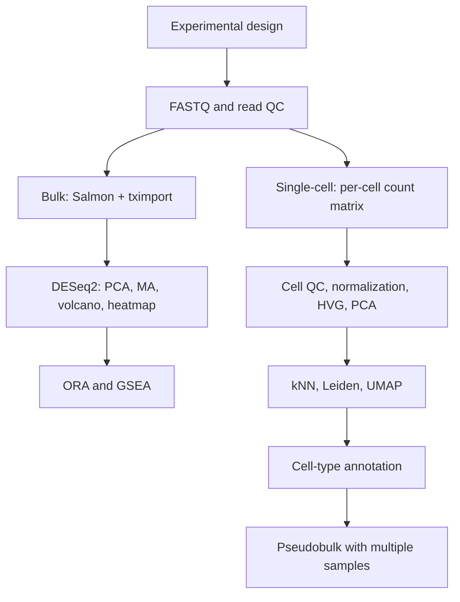

RNA-seq analysis is a chain of decisions: how many replicates, which library type, whether to quantify by alignment or with Salmon, which DESeq2 design formula to test, and whether to interpret results with ORA or GSEA. Single-cell work adds the whole Scanpy workflow, from QC to cell-type annotation. The first decision usually carries the most weight. In an experiment with 48 replicates per condition, keeping only 3 replicates meant that 9 of 11 tools found just 20–40% of the differentially expressed genes identified with the full dataset (Schurch et al., 2016).

This article follows the order in which those decisions come up in a real project and flags where recommendations changed between the 2019 and 2023 best-practice guides, such as the move from Louvain to Leiden and from per-cell tests to pseudobulk. It is written for students and thesis-stage researchers with RNA-seq data, and for wet-lab scientists who need to read a DESeq2 table or a UMAP plot correctly. The end of the article lays out a reanalysis of two public datasets (the liver cancer study GSE94660 and PBMC 3k) and a 12-item checklist.

<div class="callout callout-note">
<p class="callout-title">Quick summary</p>

- Design determines most of the quality: aim for at least 6 biological replicates and never let batch coincide with the condition you are comparing (Schurch et al., 2016; Leek et al., 2010).
- DESeq2 needs raw counts or estimated counts (Salmon + tximport); it does not accept RPKM/FPKM/TPM tables (Love et al., 2014).
- If you want to claim "more than a 2-fold change," test the threshold directly with `lfcThreshold = 1` instead of filtering |log2FC| > 1 after the test.
- ORA results depend on the gene background; GSEA results depend on the permutation type and the ranking statistic.
- Single-cell: QC per sample, Leiden at several resolutions, UMAP for viewing only, and pseudobulk by sample for comparisons between conditions (Heumos et al., 2023).

</div>

## 1. What RNA-seq is: one question, two resolutions

RNA-seq (RNA sequencing) measures how much RNA each gene produces in a sample. RNA is converted to cDNA, tens of millions of short fragments are sequenced, and the fragments are counted by gene. RNA levels reflect transcription, the first layer of the flow of information from DNA to protein (see transcription and translation).

**Bulk RNA-seq** grinds up a whole tissue sample and measures the average expression of millions of cells. **Single-cell RNA-seq** (scRNA-seq) tags each cell with a barcode, so it measures expression cell by cell. The price is data that are much sparser and noisier, with a count matrix full of zeros (Luecken & Theis, 2019). The two methods answer different questions. Bulk asks, "In tumor tissue, which genes and functional programs change compared with normal tissue?" Single-cell asks, "Which cell types make up this sample, and what does each one express?"

The article uses two example questions. First: in hepatocellular carcinoma (HCC), which genes and functional programs differ between tumor tissue and non-tumor liver tissue from the same patient? Second: which groups make up one person's peripheral blood mononuclear cells (PBMC)? Figure 1 summarizes the two analysis branches.


*Figure 1. The two branches of an RNA-seq project: the bulk branch (C → F) and the single-cell branch (D → J) share the design and read-QC steps.*

Scope: poly(A) bulk RNA-seq in humans, analyzed at the gene level, with two paired conditions; droplet-based single-cell data from one sample. Isoforms, splicing, fusion genes and small RNAs are out of scope (Conesa et al., 2016). The statistical background (the negative binomial distribution, p-values, FDR) is covered in [the article on math and statistics for biology](/en/blog/toan-va-thong-ke-cho-sinh-hoc/); this article only recaps it where needed.

The sections follow the order of decisions. Sections 2 and 3 cover what has to be settled before you have a count table; sections 4 and 5 cover testing and interpretation; section 6 covers single-cell; section 7 is a workflow you can rerun on public data yourself. If you plan to put the analysis in a portfolio, section 7 can become a complete repository (see the article on portfolio projects), and getting one omics layer right is a prerequisite for integrating several (see the article on multi-omics).

## 2. Experimental design: decisions made before sequencing

### 2.1. How many biological replicates?

Biological replicates are independent individuals, patients or culture batches; technical replicates are the same RNA sample library-prepped or sequenced again. The number of biological replicates you need depends on technical variability, biological variability and the statistical power you want (Conesa et al., 2016).

The clearest empirical evidence comes from Schurch et al. (2016). The authors sequenced 48 biological replicates per condition in yeast, removed poor-quality samples, and used the results from the "clean" set of 42 replicates as the benchmark. When they randomly drew only 3 replicates, 9 of 11 tools found 20–40% of the differentially expressed genes identified with the full set. That rate rose above 85% for genes changing more than 4-fold, which means 3 replicates are enough to see large changes but miss most small ones. Finding more than 85% of differentially expressed genes at every fold change required more than 20 replicates. The authors' recommendation: at least 6 replicates, and at least 12 when you need to catch genes at every level of change. With fewer than 12 replicates, edgeR and DESeq2 gave the best balance between true and false positives.

Three replicates is still common. DESeq2 was designed to work with 2–3 replicates by borrowing information across genes when estimating dispersion (Love et al., 2014), but "it runs" is not the same as "it has enough power." Schurch's experiment also used genetically uniform yeast grown under laboratory conditions. Human tissue samples vary far more biologically, so treat 6 as a floor, not as enough.

<div class="callout callout-warning">
<p class="callout-title">The "n ≥ 30" rule does not apply to omics</p>

The number 30 comes from approximating the distribution of a sample mean, not from a power calculation for tens of thousands of genes tested at once. For RNA-seq, the number of replicates you need depends on each gene's dispersion and on the fold change you want to detect. See [the article on p-values, FDR and the negative binomial](/en/blog/toan-va-thong-ke-cho-sinh-hoc/).

</div>

### 2.2. Batch effects

A batch effect is a difference caused by processing conditions: the day RNA was extracted, the reagent lot, the person doing the work, the sequencing run. Leek et al. (2010) showed that batch effects are widespread in high-throughput data and become a serious problem when they coincide with the outcome variable. When multiple batches are unavoidable, Conesa et al. (2016) recommend including controls, processing samples in random order and spreading the samples of each condition evenly across batches.

If all tumor samples are extracted in week 1 and all normal samples in week 2, batch and condition are completely confounded. No statistical model can separate the two, because the data contain no information to separate them. A design error like this cannot be fixed at the analysis stage.

A concrete example: you have 6 patients, each with one tumor sample and one normal sample, but you can only extract 6 samples a day. The worst layout is 6 tumor samples on day 1 and 6 normal samples on day 2. A better layout puts 3 patients on day 1 and 3 on day 2, keeping both samples from each person on the same day. Each batch then contains both conditions, and because batch is nested within patient, the `patient` term in the formula `~ patient + condition` (section 4.2) also absorbs the difference between the two days. Record the processing date of every sample in the sample sheet from the start, even if you think you will never need it.

### 2.3. Library type: poly(A) or ribo-depletion, stranded or not

rRNA usually makes up more than 90% of total RNA, while mRNA accounts for only about 1–2% (Conesa et al., 2016). Sequence it directly and most reads land on rRNA. There are two ways to enrich: select polyadenylated mRNA with oligo-dT, or remove rRNA (ribo-depletion).

Poly(A) selection needs RNA with little degradation, that is, a high RIN (RNA integrity number). Small biopsies, hard-to-obtain samples and bacterial samples (whose mRNA has no poly(A) tail) should use ribo-depletion (Conesa et al., 2016). Poly(A) selection also misses transcripts without a poly(A) tail and partially degraded mRNA, so it is a poor fit for RNA from FFPE samples (Zhao et al., 2014).

Stranded libraries keep track of which strand a read came from, which helps quantify antisense transcripts and genes that overlap on opposite strands (Conesa et al., 2016). In a comparison of seven strand-specific library protocols, the dUTP method was one of the two best performers (Levin et al., 2010).

<div class="callout callout-example">
<p class="callout-title">From the bench to FASTQ</p>

The TRIzol protocol extracts **total RNA**; it does not isolate mRNA, which is enriched only during library prep. Pure RNA has an A260/A280 ratio of about 2.0, and an acidic measuring solution lowers the ratio by 0.2–0.3 (Desjardins & Conklin, 2010). This ratio reflects protein or phenol contamination and says nothing about RNA integrity. Integrity is measured as RIN on a capillary electrophoresis instrument (Conesa et al., 2016). For example, the GEO record for GSE94660 reports a mean RIN of 8.2 ± 0.7 (Yoo et al., 2017).

</div>

### 2.4. Sequencing depth

The right depth depends on the goal. Some authors argue that about 5 million aligned reads are enough to quantify moderately and highly expressed genes, while some groups sequence up to 100 million reads to quantify low-expression genes accurately (Conesa et al., 2016). A saturation curve (genes detected versus number of subsampled reads) shows whether more reads still add information.

**Table 1. Design checklist and the actual values for GSE94660**

| Decision | Recommendation | GSE94660 (Yoo et al., 2017) |
|---|---|---|
| Biological replicates | ≥ 6 per group; ≥ 12 to catch every level of change | 21 patients, 2 samples each |
| Batch | Spread evenly, randomize, record the batch variable | No batch variable on GEO |
| mRNA enrichment | poly(A) if RIN is high; ribo-depletion for degraded RNA, FFPE, bacteria | poly(A), oligo-dT |
| Stranded | Stranded (dUTP) if antisense or overlapping genes matter | TruSeq RNA v2, unstranded |
| RNA quality | Report RIN | RIN 8.2 ± 0.7 |
| Depth, read type | Depends on goal; ~5 million reads for moderately to highly expressed genes | HiSeq 2500, paired-end 2 × 100 nt; median 41.0 million spots per run |

## 3. From FASTQ to a count matrix

Read QC (FastQC, fastp, MultiQC) works the same way as in any other sequencing project and is covered in [the article on NGS](/en/blog/giai-trinh-tu-the-he-moi-ngs-va-genomics/). Specific to RNA-seq, it is worth checking GC bias and gene-length bias after quantification (Conesa et al., 2016).

There are two routes from reads to counts. The first is **align, then count**: STAR (Dobin et al., 2013) or HISAT2 (Kim et al., 2019) aligns reads to the genome, allowing reads to span exon–exon junctions, and featureCounts (Liao et al., 2014) counts the reads that fall in each gene. The advantage is a BAM file you can open in IGV to inspect the reads at any gene.

The second route is **transcript-level quantification without full alignment**. kallisto uses pseudoalignment: it only determines which transcripts a read is compatible with, without computing a base-by-base alignment position (Bray et al., 2016). Salmon uses lightweight mapping combined with bias models and was the first transcriptome-wide quantifier to correct for fragment GC bias (Patro et al., 2017). Lumping both under the label "pseudoalignment" is not accurate. Srivastava et al. (2020) showed that the choice of alignment or mapping method has a substantial effect on transcript estimates and on differential expression results; Salmon's selective alignment mode was developed to reduce spurious mappings.

Two practical details from the Salmon documentation (Salmon developers, n.d.): GC bias correction is **off by default** and has to be turned on with `--gcBias`; and the index should be built with **decoys** (genome sequences) so that reads from unannotated genomic regions are not wrongly assigned to transcripts.

```bash
# Decoy-aware index: concatenate transcriptome and genome, list genome sequence names as decoys
grep "^>" genome.fa | cut -d " " -f 1 | sed 's/>//' > decoys.txt
cat transcripts.fa genome.fa > gentrome.fa
salmon index -t gentrome.fa -d decoys.txt -i salmon_index -k 31

# Quantify one paired-end sample; -l A lets Salmon infer the library type
salmon quant -i salmon_index -l A -1 S1_R1.fastq.gz -2 S1_R2.fastq.gz \
    --validateMappings --gcBias -p 8 -o quant/S1
```

Salmon produces transcript-level estimates, but the question is usually at the gene level. tximport summarizes transcript estimates into gene-level counts. Soneson et al. (2016) showed that gene-level estimation and inference perform better and are easier to interpret than transcript-level analysis. When samples use different isoforms, a simply summed count matrix can inflate the FDR; an offset computed from the transcript-level estimates fixes this.

**Table 2. Align-and-count versus transcript-level quantification**

| Criterion | STAR/HISAT2 + featureCounts | Salmon/kallisto + tximport |
|---|---|---|
| Main output | BAM + gene-level count table | Transcript-level estimates, summarized to gene level |
| View reads in IGV | Yes | No (unless exported separately) |
| Bias correction | Not built into the counting step | Salmon: GC, positional, sequence (`--gcBias` must be on) |
| Transcript level | Needs an extra tool | Built in |
| Downstream use | Variants, splicing, visual inspection | Gene- and transcript-level differential expression |

A common trap when reanalyzing public data: the processed tables on GEO are often not counts. GSE94660 provides only an "RPKM_normalized" table (Yoo et al., 2017); GSE124535, the 35-pair HCC set from Jiang et al. (2019), provides only FPKM from TopHat/Cufflinks according to its GEO description. DESeq2 needs unnormalized counts or estimated counts (Love et al., 2014), so you have to start again from FASTQ. RPKM/FPKM tables are only useful for checking the direction of change. If you would rather not chain the tools yourself, nf-core/rnaseq runs the whole pipeline with a QC report (see the article on reproducible workflows).

<div class="callout callout-warning">
<p class="callout-title">Common mistakes at the quantification step</p>

- Feeding Salmon's TPM table into DESeq2 as if it were counts. Let tximport build the input object, or use estimated counts with an offset (Soneson et al., 2016).
- Building the Salmon index from one transcriptome release and taking the transcript-to-gene table (tx2gene) from another. Many transcript names fail to match, and the corresponding genes silently drop out of the results with no error.
- Forgetting `--gcBias` or building the index without decoys, then not recording it in the methods.
- Not checking each sample's mapping rate in the MultiQC report before running DESeq2. A sample with an unusually low mapping rate needs a second look before it skews the PCA, not after.

</div>

## 4. Differential expression with DESeq2 and four standard plots

### 4.1. What DESeq2 does

DESeq2 fits a generalized linear model (GLM) with a negative binomial distribution to each gene. Because each gene has only a few samples, dispersion and log2 fold change (LFC) are "shrunk" toward the shared trend across all genes, which stabilizes estimates with only 2–3 replicates (Love et al., 2014). Each gene gets a Wald p-value. Genes with very low mean counts are removed by independent filtering, and the p-values of the remaining genes are adjusted with Benjamini–Hochberg to give `padj` (Benjamini & Hochberg, 1995; Love et al., 2014).

### 4.2. The design formula for paired samples

The design formula tells DESeq2 which variables explain the variation. The familiar example is `~ batch + condition`. GSE94660 has no batch variable, but each patient contributes one tumor sample and one non-tumor sample. The sensible formula is `~ patient + condition`: the `condition` coefficient then measures the tumor–non-tumor difference **within the same person**, removing baseline differences between patients. The variable of interest goes last in the formula.

By default, the reference level of a factor in R follows alphabetical order. "normal" happens to come before "tumor," so the default works, but rename it to "non_tumor" and the sign of log2FC flips. Set it explicitly with `relevel()` (Love et al., n.d.).

### 4.3. Filtering low-expression genes

Filtering before running DESeq2 is optional. The DESeq2 vignette gives the example of keeping genes with at least 10 reads in a number of samples equal to the smallest group size (Love et al., n.d.). This step mainly saves memory and time; FDR control is already handled by independent filtering (Love et al., 2014).

### 4.4. Shrinkage and threshold tests

The code below was tested on DESeq2 1.46.0 and apeglm 1.28.0, with simulated data for 6 patients × 2 tissue types.

```r
library(DESeq2)
# counts_mat: count matrix (genes x samples); coldata: sample table with columns patient, condition
coldata$condition <- relevel(factor(coldata$condition), ref = "normal")
dds <- DESeqDataSetFromMatrix(countData = counts_mat, colData = coldata,
                              design = ~ patient + condition)
keep <- rowSums(counts(dds) >= 10) >= 6       # 6 = smallest group size
dds  <- dds[keep, ]
dds  <- DESeq(dds)
resultsNames(dds)                               # check coefficient names

# Test H0: LFC = 0 (use for reporting p-values)
res     <- results(dds, name = "condition_tumor_vs_normal", alpha = 0.05)
# Test H0: |LFC| <= 1 (use when claiming "more than 2-fold change")
res_thr <- results(dds, name = "condition_tumor_vs_normal", alpha = 0.05,
                   lfcThreshold = 1, altHypothesis = "greaterAbs")
# Shrunken LFC (use for plots and ranking), requires the apeglm package
res_shr <- lfcShrink(dds, coef = "condition_tumor_vs_normal", type = "apeglm")
```

The three objects have three jobs. `lfcShrink` changes only log2FC and its standard error, not the p-value; on the test data, the `pvalue` column of `res_shr` was identical to that of `res`. So don't overwrite `res` with the shrunken result: keep `res` for reporting the test and `res_shr` for plotting and ranking. apeglm uses a heavy-tailed (Cauchy) prior, which reduces noise for low-count genes while preserving large true differences (Zhu et al., 2019).

The more important issue is the statistical question. The command `subset(res, padj < 0.05 & abs(log2FoldChange) > 1)` tests H0: LFC = 0 and only then filters by the estimated size. A gene with a true LFC of 0.8 whose noisy estimate comes out at 1.2 still gets through. To claim "more than a 2-fold change" with FDR control, test H0: |LFC| ≤ 1 directly with `lfcThreshold = 1` (Love et al., 2014). The idea is similar to TREAT by McCarthy and Smyth (2009) for microarrays.


*Figure 2. Simulation of 10,000 genes (3,000 with a true LFC drawn from a normal distribution, standard errors 0.15–0.6). Filtering |LFC| > 1 after testing calls 812 genes, of which 146 actually change by no more than 2-fold. The threshold test calls 116 genes, none of them in that category. Simulated data, not experimental results.*

Figure 2 shows the cost of each choice. Filtering after the test gives a much longer list, but about 18% of the genes on it do not truly change by more than 2-fold. The threshold test is far stricter: it calls only genes for which the data are confident the LFC exceeds the threshold, so it misses many true genes. Neither option is "right" in every case; what is required is that the methods section states which hypothesis was tested.

### 4.5. Four standard plots

Each plot answers a different question (for principles of choosing a chart, see [the article on data visualization](/en/blog/share-data-through-the-art-of-visualization/)).

**PCA** on variance-stabilized data (`vst`, default `blind = TRUE`) answers: do samples separate by condition, by patient, and are there outliers? With paired data, drawing a line between the two samples from the same patient makes the patient effect obvious. The `vst` or `rlog` transformations are only for visualization and clustering; inference still uses raw counts (Love et al., 2014).

**MA plot** shows log2FC against mean count. Comparing the unshrunken and shrunken versions shows low-count genes with artificially large log2FC being pulled toward 0.

**Volcano plot** puts the (shrunken) log2FC on the x-axis and −log10(padj) on the y-axis. Genes in the two upper corners are both statistically significant and have large estimated effects. That still doesn't make a gene biologically "important"; biological importance needs other evidence.

**Heatmap** of 50 genes uses row-scaled VST values (z-scores). State how the 50 genes were chosen (smallest padj or largest |LFC|), because the two approaches give different lists. The Bioconductor RNA-seq workflow is a good reference for all four plots (Love et al., 2016).

Read the four plots in a fixed order. Look at the PCA **before** reading the results table: if one sample sits far from all the others, or patient A's tumor sample sits among the normal samples, check for a sample mix-up or a technical failure before trusting any gene list. If PC1 separates patients more strongly than conditions, that is a sign the paired formula will help. The MA plot comes next and tells you whether shrinkage is behaving. The volcano plot and heatmap come last, once you trust the data.

## 5. Functional enrichment: ORA, GSEA and their biases

### 5.1. ORA and the background problem

Over-representation analysis (ORA) asks whether a gene set (a GO term, a KEGG pathway) appears in the list of significant genes more often than chance would predict. The usual test is the hypergeometric test, equivalent to Fisher's exact test.

The result depends heavily on the **background**, the set of genes considered "eligible to be selected." Wijesooriya et al. (2022) surveyed 186 open-access articles and found that 95% of ORA analyses used an inappropriate background or did not describe it, and 43% did not correct for multiple testing. For RNA-seq, the right background is the genes that were **measured and passed filtering**, not the whole genome: a gene not expressed in the tissue can never appear in the list of differentially expressed genes.

The hypothetical example below shows how the background changes the p-value. A gene set of 200 genes, all expressed in the tissue and therefore all passing the filter; 1,000 significant genes are drawn from 12,000 filtered genes, and 30 of them belong to the set.

```python
from scipy.stats import hypergeom

# Hypothetical example: a 200-gene set, all passing the filter; 1,000 significant genes, 30 of them in the set
k, n_set, n_de = 30, 200, 1000
for background, N in [("whole genome", 20000), ("filtered genes", 12000)]:
    p = hypergeom.sf(k - 1, N, n_set, n_de)   # P(X >= k)
    expected = n_set * n_de / N
    print(f"Background {background:14s} N = {N:6d}  expected = {expected:5.1f}  p = {p:.2g}")
# Background whole genome   N =  20000  expected =  10.0  p = 7.1e-08
# Background filtered genes N =  12000  expected =  16.7  p = 0.0011
```

Same 30 genes: a whole-genome background gives p = 7.1 × 10⁻⁸, the filtered background gives p = 0.0011. The wrong background lowers the expected count (10 instead of 16.7), so every gene set expressed in the tissue looks more "enriched" than it really is.

The second source of bias is gene length. For the same level of change, long, highly expressed transcripts collect more reads and reach significance more easily, so gene sets full of long genes look enriched more easily. GOseq corrects for this bias (Young et al., 2010). Timmons et al. (2015) warn that several such biases together distort enrichment analysis when it is used to "validate" omics results.

An example done right, from proteomics: Dong et al. (2022) analyzed small extracellular vesicle proteins in plasma from HCC patients and used all quantified proteins as the background for enrichment analysis (see also the review of the liver cancer exosome proteome).

### 5.2. GSEA

Gene set enrichment analysis (GSEA) needs no threshold. All genes are ranked by their association with the phenotype, and GSEA asks whether the genes of a set cluster at the top or the bottom of the list. The enrichment score (ES) is the maximum deviation of a weighted running sum, similar to a Kolmogorov–Smirnov statistic; the normalized enrichment score (NES) adjusts for gene-set size; the **leading edge** is the subset of genes that contributes most to the ES (Subramanian et al., 2005).

The permutation type determines what the p-value means. The original GSEA permutes the **phenotype labels** of samples, preserving correlations between genes. Permuting **genes** ignores those correlations and tends to overstate significance (Subramanian et al., 2005). Preranked GSEA tools such as fgsea (Korotkevich et al., 2016) or clusterProfiler's `GSEA()` (Yu et al., 2012; Wu et al., 2021) take an already ranked list as input, so they can only permute gene sets. The methods section should say so.

The common FDR ≤ 0.25 cutoff is the reporting threshold the original GSEA paper chose because its goal was hypothesis generation (Subramanian et al., 2005), not a universal standard. The ranking input for fgsea is usually the Wald statistic (`stat`) or the shrunken log2FC; the two give different rankings, so record which one you used.

When reading GSEA output, keep the direction of comparison in mind. With normal tissue as the reference level, a positive NES means the set's genes cluster toward higher expression in tumor tissue; change the reference level and the sign of the NES flips. The leading-edge list is often more useful than the NES itself: it tells you which genes actually drive the signal, and those are the genes to revisit on the heatmap or pick for qPCR validation.

### 5.3. Hallmark gene sets

MSigDB version 1.0, released with the GSEA paper, contained 1,325 gene sets (Subramanian et al., 2005). The Hallmark collection consists of 50 refined gene sets, distilled from 4,022 of the 8,380 original MSigDB sets to reduce redundancy (Liberzon et al., 2015). Fewer sets means fewer tests and results that are easier to read. Record the MSigDB version you downloaded, since gene-set contents change between releases.

### 5.4. Tools

In R: clusterProfiler for ORA and GSEA (Yu et al., 2012; Wu et al., 2021), fgsea for fast preranked GSEA (Korotkevich et al., 2016). On the web: g:Profiler (Kolberg et al., 2023) and Enrichr (Kuleshov et al., 2016). With web tools, check whether you can upload your own background.

## 6. Single-cell RNA-seq: the standard workflow and what has changed

The two reference points for this section are the guide by Luecken and Theis (2019) and the update by Heumos et al. (2023). Scanpy (Wolf et al., 2018) is the popular Python toolkit; R users have Seurat (Hao et al., 2024) and the Bioconductor ecosystem (Amezquita et al., 2020).

### 6.1. From droplets to a count matrix

The 10x Genomics droplet system encapsulates each cell in a droplet with a barcoded bead and then counts the 3' ends of mRNA. The foundational paper by Zheng et al. (2017) reported a cell capture rate of about 50% and released a dataset of 68,000 PBMCs. Each molecule is tagged with a unique molecular identifier (UMI) to remove PCR duplicates. Quantification typically uses 10x Genomics' Cell Ranger or alevin-fry (He et al., 2022). A "barcode" in the matrix is not necessarily a cell: it can be an empty droplet holding only ambient RNA, or a doublet containing two cells (Luecken & Theis, 2019).

### 6.2. Cell QC

The three basic QC metrics are total counts per barcode, number of genes detected per barcode and the fraction of counts from mitochondrial genes (Luecken & Theis, 2019). A ruptured cell loses its cytoplasmic mRNA but keeps the mRNA inside mitochondria, so a high mitochondrial fraction signals a low-quality cell. The three metrics should be considered together and thresholds set as permissively as possible, so that a viable population with unusual characteristics is not discarded by mistake (Luecken & Theis, 2019). The 2023 guide recommends manual thresholds or automatic thresholds based on a number of median absolute deviations (MAD), **computed per sample** (Heumos et al., 2023).

The 5% mitochondrial threshold is a long-standing default, but mitochondrial fractions in human tissues are higher than in mouse; Osorio and Cai (2021) proposed reference values for 44 human tissues. A 5% threshold works for PBMC, as in the Scanpy tutorial, but for other tissues look up that tissue's reference value first, so you do not throw out an entire population of healthy cells.

Doublets make up a few percent of barcodes in most experiments (Wolock et al., 2019). Scrublet (Wolock et al., 2019) and scDblFinder (Germain et al., 2022) detect doublets by simulating artificial doublets and comparing; scDblFinder scores well in benchmarks (Heumos et al., 2023). Ambient RNA from lysed cells can make one cell type's markers appear in another (Heumos et al., 2023).

### 6.3. Normalization, highly variable genes and PCA

Normalization puts cells sequenced at different depths on the same scale. In 2019, Luecken and Theis recommended scran; a simpler approach is to normalize by total counts and take log(x + 1), which remains acceptable for data like PBMC 3k if you state it. Next, select roughly 1,000–5,000 highly variable genes (HVG), depending on the complexity of the data (Luecken & Theis, 2019), and reduce dimensions with PCA.

### 6.4. Integrating multiple samples

With multiple samples or batches, integration is needed so that cells of the same type from different samples end up next to each other. Harmony (Korsunsky et al., 2019) and scVI (Lopez et al., 2018) are two popular choices. A benchmark of 68 method combinations on 85 batches of data showed that selecting HVGs first improves integration, and that scANVI, Scanorama, scVI and scGen do well on complex tasks (Luecken et al., 2022). PBMC 3k has a single sample, so this step is skipped.

### 6.5. Clustering and UMAP

Cells are connected into a k-nearest-neighbor (kNN) graph in PCA space and then clustered with a community-detection algorithm. In 2019, Louvain was the recommendation (Luecken & Theis, 2019). Traag et al. (2019) showed that Louvain can produce badly connected clusters: in their experiments, up to 25% of clusters were badly connected and up to 16% were even disconnected. The Leiden algorithm guarantees connected clusters and runs faster. The 2023 guide recommends Leiden at several resolutions (Heumos et al., 2023), because the number of clusters depends directly on this parameter. There is no "correct" resolution: run a few values (for example 0.4, 0.7 and 1.0) and see which clusters split and which stay intact. A cluster that appears at only one value and one seed needs more evidence before it gets a name.

UMAP (McInnes et al., 2018) projects the data into two dimensions for viewing. Chari and Pachter (2023) showed that going from thousands of dimensions down to 2 inevitably distorts distances. The distance between two clusters on a UMAP, cluster size or a "strand" shape measures nothing; conclusions must not rest on the 2D plot alone (Heumos et al., 2023).

### 6.6. Cell-type annotation

The 2023 guide recommends three steps: automatic annotation, manual expert annotation with marker genes, then verification (Heumos et al., 2023). CellTypist is a machine-learning tool for automatic annotation, trained on immune cells from many tissues (Domínguez Conde et al., 2022). The output of any pretrained classifier depends heavily on the model type and the training data (Heumos et al., 2023).

### 6.7. Differential expression: marker genes and comparisons between conditions

Two different questions share the name "differential expression." The first is about marker genes: which genes distinguish this cluster from the others? Here lies the "double dipping" trap: testing on the same data used to define the clusters gives artificially low p-values, because the clustering algorithm has already forced the groups apart (Zhang et al., 2019). Marker-gene p-values should be used only for ranking.

The second is a comparison between conditions: within CD4 T cells, which genes differ between patients and healthy donors? In 2019, Luecken and Theis recommended MAST or limma. In 2021, Squair et al. compared 14 methods on 18 datasets with a ground truth and found that all 6 top-performing methods aggregated cells by biological replicate, that is, **pseudobulk**. The most popular methods, which treat each cell as an independent observation, can "discover" hundreds of differentially expressed genes when there is no biological difference at all. The 2023 guide concluded that pseudoreplication inflates the FDR, and that sum-based pseudobulk and mixed models outperform the Wilcoxon test (Heumos et al., 2023). The muscat framework performs pseudobulk analysis per cell type (Crowell et al., 2020).


*Figure 3. Simulation of 1,000 genes, 3 donors per condition, 200 cells per donor; donors vary randomly, but there is no difference between the two conditions. Per-cell testing gives p < 0.05 for 70.5% of genes; pseudobulk gives 5.3%. For simplicity, the simulation takes the mean per donor; in practice, pseudobulk sums the counts and then uses DESeq2 or edgeR. Simulated data.*

Figure 3 shows why. Treating 600 cells per side as 600 independent observations, the test mistakes differences between donors for differences between conditions. The true independent unit is the donor, and there are only 3 per side. Pseudobulk brings the analysis back to that unit, and the false-positive rate returns to around the expected 5%.

### 6.8. Other downstream analyses

Trajectory inference and cell–cell communication analysis with CellChat (Jin et al., 2021) are common steps after annotation. Luecken and Theis (2019) caution that a trajectory inferred from the data does not necessarily reflect a real biological process; it needs independent evidence.

**Table 3. Recommendations in 2019 and 2023**

| Step | Luecken & Theis (2019) | Heumos et al. (2023) |
|---|---|---|
| QC | Three metrics considered together, permissive thresholds | Manual or MAD thresholds, per sample; doublets, ambient RNA |
| Normalization | scran | Several options, depending on the downstream step |
| Clustering | Louvain on a kNN graph | Leiden, several resolutions |
| Visualization | UMAP | UMAP for viewing only, no conclusions from the 2D plot |
| Annotation | Marker genes | Automatic → manual → verification |
| DE between conditions | MAST, limma | Pseudobulk or mixed models |

The Scanpy code below includes all the QC steps described above (mitochondria, gene filtering, doublets) and sets a seed at every step involving randomness. The 200–2,500 gene and 5% mitochondrial thresholds come from Scanpy's PBMC 3k tutorial; for other data, replace them with per-sample MAD thresholds. The code needs Scanpy 1.10 or later (for `sc.pp.scrublet`) and the igraph package. In a test run on Scanpy 1.12.6 and anndata 0.13.4, 2,638 cells remained after QC, Scrublet flagged 43 barcodes as doublets, and Leiden at resolution 0.7 produced 9 clusters instead of the 8 in the older tutorial. The code only scores doublets and does not remove them; to remove them, filter on the `predicted_doublet` column. The one-cluster difference from the tutorial illustrates exactly what section 6.5 said: the number of clusters depends on software version, algorithm implementation and seed.

```python
import scanpy as sc

adata = sc.datasets.pbmc3k()
adata.var["mt"] = adata.var_names.str.startswith("MT-")
sc.pp.calculate_qc_metrics(adata, qc_vars=["mt"], percent_top=None,
                           log1p=False, inplace=True)
sc.pp.filter_cells(adata, min_genes=200)
sc.pp.filter_genes(adata, min_cells=3)
adata = adata[(adata.obs.n_genes_by_counts < 2500)
              & (adata.obs.pct_counts_mt < 5)].copy()
sc.pp.scrublet(adata, random_state=0)          # doublet scores
adata.layers["counts"] = adata.X.copy()
sc.pp.normalize_total(adata, target_sum=1e4)
sc.pp.log1p(adata)
sc.pp.highly_variable_genes(adata, n_top_genes=2000)
sc.tl.pca(adata, n_comps=50, random_state=0)
sc.pp.neighbors(adata, n_neighbors=10, n_pcs=40, random_state=0)
sc.tl.leiden(adata, resolution=0.7, random_state=0,
             flavor="igraph", n_iterations=2, directed=False)
sc.tl.umap(adata, random_state=0)
sc.tl.rank_genes_groups(adata, "leiden", method="wilcoxon")
```

## 7. Hands-on: reanalyzing two public datasets

This section is a workflow for you to run, with hypotheses written down before seeing any results. Writing hypotheses first means you record the outcome whether it is right or wrong, instead of picking a story after seeing the numbers.

### 7.1. Data

**GSE94660** contains 42 samples from 21 patients with hepatitis B virus (HBV)-associated HCC; each patient has one tumor sample and one sample of non-tumor liver tissue distant from the tumor (Yoo et al., 2017). According to GEO (National Center for Biotechnology Information, n.d.), the total RNA had a RIN of 8.2 ± 0.7, poly(A) selection used oligo-dT, libraries were unstranded TruSeq RNA v2, and sequencing was HiSeq 2500 paired-end 100 nt. SRA (SRP099053) lists 42 runs, with a median of 41.0 million spots per run (15.3–54.0 million) and about 220 GB in SRA format in total (accessed November 11, 2026). The dataset suits practice because the paired design is clear and the size is manageable on a personal computer if you process one sample at a time.

**GSE77314** is an independent validation set: 50 HCC and normal tissue pairs, used in the paper showing that dimethylglycine dehydrogenase (DMGDH) is downregulated in HCC (Liu et al., 2016). It has 100 runs, about 618 GB of fastq.gz according to ENA, which is too heavy to rerun; use only the published conclusions for comparison.

**PBMC 3k** contains 2,700 PBMCs from one healthy donor, from 10x Genomics, loaded with `sc.datasets.pbmc3k()`. Scanpy's older PBMC 3k tutorial (Scanpy developers, n.d.) keeps cells with 200–2,500 genes and under 5% mitochondrial counts, and genes present in at least 3 cells, leaving 2,638 cells; Leiden at resolution 0.7 gives 8 clusters, labeled CD4 T, B, CD14+ Monocytes, NK, CD8 T, FCGR3A+ Monocytes, Dendritic and Megakaryocytes.

### 7.2. Bulk workflow

1. Build a sample sheet `samples.tsv` (run, patient, condition) from the sample titles on GEO.
2. Download each run with `fasterq-dump`, run QC with fastp and MultiQC, and delete the FASTQ files after quantification to save disk space.
3. Run Salmon with a decoy-aware index and `--gcBias`; record the Salmon and transcriptome versions (GENCODE or Ensembl).
4. Summarize to gene level with tximport.
5. DESeq2 with `~ condition` and `~ patient + condition`; `relevel`; standard `results()` and `lfcThreshold = 1`; `lfcShrink(type = "apeglm")`.
6. PCA, MA, volcano, heatmap.
7. fgsea with the Hallmark sets (record the MSigDB version, ranking statistic, seed); ORA with both kinds of background.

### 7.3. Hypotheses for the bulk analysis

- **H1 (PCA).** PC1 separates tumor from non-tumor tissue; samples from the same patient sit close together on later PCs.
- **H2 (paired design).** `~ patient + condition` yields more genes with `padj < 0.05` than `~ condition`, because baseline differences between patients are removed from the residuals.
- **H3 (threshold).** `lfcThreshold = 1` yields fewer genes than filtering |LFC| > 1 after testing, as in the simulation in Figure 2.
- **H4 (replication).** DMGDH is lower in tumor tissue, as in GSE77314 (Liu et al., 2016).
- **H5 (GSEA).** Proliferation Hallmarks have a positive NES; Hallmarks for liver-specific metabolism have a negative NES. This is purely a hypothesis.
- **H6 (ORA background).** A whole-genome background yields more "significant" GO terms than the filtered-gene background (Wijesooriya et al., 2022).
- **H7 (comparison with GEO).** DESeq2 log2FC correlates positively with the differences in the GEO RPKM table.

### 7.4. Workflow and hypotheses for PBMC 3k

Run two versions: a minimal one that filters only `min_genes=200`, and the full-QC version from section 6. Then run a sensitivity analysis: 5% mitochondrial threshold versus a MAD threshold; Leiden at resolutions 0.4, 0.7 and 1.0; five different seeds; manual labels versus CellTypist; doublet scores from Scrublet.

- **S1.** The minimal version keeps more than 2,638 cells and may produce a cluster of low-quality cells.
- **S2.** The full-QC version with Leiden 0.7 gives about 8 clusters, with at least 6 groups identifiable by marker genes: IL7R (CD4 T), CD14 and LYZ (CD14+ monocytes), MS4A1 (B), CD8A (CD8 T), GNLY and NKG7 (NK), FCGR3A and MS4A7 (FCGR3A+ monocytes), FCER1A and CST3 (dendritic), PPBP (megakaryocytes).
- **S3.** The number of clusters changes with resolution and seed; small groups (dendritic, megakaryocytes) are the least stable.
- **S4.** CellTypist agrees with manual labels for the large groups and differs for small groups or fine-grained labels such as memory versus naive T cells.
- **S5.** The UMAP layout changes with the seed while cluster labels are more stable (Chari & Pachter, 2023).

Record the versions of scanpy, anndata, leidenalg or igraph, CellTypist and the CellTypist model used.

### 7.5. When a hypothesis turns out wrong

A wrong hypothesis is also a result, and it should be reported. If H1 fails because one sample sits apart on the PCA, the first step is to check that sample's label and QC report, not to drop it for a cleaner plot. If H2 fails, meaning the paired formula adds no genes, the baseline differences between patients may be small relative to the tumor–normal difference; record that instead of choosing whichever formula gives more genes. If H4 fails, recheck the direction of comparison and the reference level before concluding that the two cohorts disagree. For PBMC 3k, if the number of clusters is unstable across seeds, report a table of cluster counts by resolution and seed instead of a single UMAP.

## 8. Discussion and limitations

A single distinction runs through this article: which results depend on analysis choices and which are stable. The design formula, the way thresholds are set, the ORA background and the Leiden resolution all change the final list. A trustworthy result is one that still holds when you swap one reasonable choice for another.

For GSE94660, the limitations should be stated plainly. This is HBV-associated HCC, and the background liver tissue shows varying degrees of fibrosis (Yoo et al., 2017), so the results do not generalize to all HCC. "Non-tumor" tissue is not healthy liver. The 21 pairs come from a single center, with no published batch variable. A match with GSE77314 would only be replication of the direction of change for one gene such as DMGDH, not of the gene list.

Links to proteomics call for caution. Dong et al. (2022) found that the proteins C1QB, C1QC, C4BPA and C4BPB were elevated in plasma small extracellular vesicles from HCC patients and proposed them as candidate markers. mRNA in tumor tissue and protein in plasma extracellular vesicles are two different biological compartments, so tissue RNA-seq results can only be "consistent" or "inconsistent" with them; they cannot confirm or refute a plasma marker. The early-stage HCC tissue proteomics study by Jiang et al. (2019) is a natural next step (see the article on proteomics).

For PBMC 3k: one donor and no comparison condition, so pseudobulk between conditions is not possible; a pseudobulk exercise needs a dataset with several donors per condition. Marker genes have artificially low p-values (Zhang et al., 2019), and UMAP does not measure distances (Chari & Pachter, 2023).

The two simulated figures in this article (Figures 2 and 3) only illustrate mechanisms. Their specific numbers, such as 146 genes or 70.5%, depend on the simulation parameters chosen (noise level, number of donors, number of cells) and should not be quoted as estimates for real data. What the simulations show is the direction of the effect, which matches benchmarks on real data (Love et al., 2014; Squair et al., 2021).

Every computational result is a hypothesis until it is confirmed by an independent experiment such as qPCR or a Western blot.

## 9. Conclusion and checklist

The weightiest decisions sit before and after the `DESeq()` call: the number of replicates, the input, the statistical question, the gene background, and whether the statistical unit is the person or the cell. Recording each choice is the cheapest way to make results reproducible.

**Table 4. A 12-item checklist for an RNA-seq analysis**

| # | Item | Source |
|---|---|---|
| 1 | At least 6 biological replicates, or a stated reason for fewer | Schurch et al. (2016) |
| 2 | Batch not confounded with condition; batch or pairing variable in the formula | Conesa et al. (2016); Leek et al. (2010) |
| 3 | Record library type (poly(A)/ribo-depletion, stranded) and RIN | Conesa et al. (2016) |
| 4 | Record Salmon/STAR version, transcriptome, and whether decoys and `--gcBias` were used | Patro et al. (2017); Srivastava et al. (2020) |
| 5 | Give DESeq2 raw counts or estimated counts (tximport), never RPKM/FPKM/TPM | Soneson et al. (2016); Love et al. (2014) |
| 6 | Set the reference level explicitly; use `lfcThreshold` when claiming effect size | Love et al. (2014); McCarthy & Smyth (2009) |
| 7 | Keep shrunken log2FC (plots, ranking) separate from the test | Love et al. (2014); Zhu et al. (2019) |
| 8 | ORA: state the background, correct for multiple testing, consider gene-length bias | Wijesooriya et al. (2022); Young et al. (2010) |
| 9 | GSEA: state the ranking statistic, permutation type, MSigDB version, FDR cutoff | Subramanian et al. (2005); Liberzon et al. (2015) |
| 10 | Single-cell: QC per sample, state the mitochondrial threshold and doublet method | Heumos et al. (2023); Osorio & Cai (2021) |
| 11 | Leiden at several resolutions with a set seed; no conclusions from UMAP | Traag et al. (2019); Chari & Pachter (2023) |
| 12 | Compare conditions with pseudobulk by sample | Squair et al. (2021); Crowell et al. (2020) |

## Frequently asked questions

**How many biological replicates does RNA-seq need?** At least 6 per group, based on the 48-replicate experiment by Schurch et al. (2016); 3 replicates catch mostly the large changes.

**Can I feed an FPKM or TPM table downloaded from GEO into DESeq2?** No. DESeq2 needs raw counts or estimated counts; normalized tables are only for cross-checking.

**How does GSEA differ from ORA?** ORA needs a threshold to build a gene list and a background; GSEA uses the whole ranked gene list and needs no threshold.

**What is pseudobulk?** Summing the counts of cells of the same type within each sample into one "bulk sample," then comparing conditions with a bulk tool such as DESeq2, with the donor as the independent unit.

## References

Amezquita, R. A., Lun, A. T. L., Becht, E., Carey, V. J., Carpp, L. N., Geistlinger, L., Marini, F., Rue-Albrecht, K., Risso, D., Soneson, C., Waldron, L., Pagès, H., Smith, M. L., Huber, W., Morgan, M., Gottardo, R., & Hicks, S. C. (2020). Orchestrating single-cell analysis with Bioconductor. *Nature Methods, 17*(2), 137–145. https://doi.org/10.1038/s41592-019-0654-x

Benjamini, Y., & Hochberg, Y. (1995). Controlling the false discovery rate: A practical and powerful approach to multiple testing. *Journal of the Royal Statistical Society: Series B (Methodological), 57*(1), 289–300. https://doi.org/10.1111/j.2517-6161.1995.tb02031.x

Bray, N. L., Pimentel, H., Melsted, P., & Pachter, L. (2016). Near-optimal probabilistic RNA-seq quantification. *Nature Biotechnology, 34*(5), 525–527. https://doi.org/10.1038/nbt.3519

Chari, T., & Pachter, L. (2023). The specious art of single-cell genomics. *PLOS Computational Biology, 19*(8), e1011288. https://doi.org/10.1371/journal.pcbi.1011288

Conesa, A., Madrigal, P., Tarazona, S., Gomez-Cabrero, D., Cervera, A., McPherson, A., Szcześniak, M. W., Gaffney, D. J., Elo, L. L., Zhang, X., & Mortazavi, A. (2016). A survey of best practices for RNA-seq data analysis. *Genome Biology, 17*, 13. https://doi.org/10.1186/s13059-016-0881-8

Crowell, H. L., Soneson, C., Germain, P.-L., Calini, D., Collin, L., Raposo, C., Malhotra, D., & Robinson, M. D. (2020). muscat detects subpopulation-specific state transitions from multi-sample multi-condition single-cell transcriptomics data. *Nature Communications, 11*, 6077. https://doi.org/10.1038/s41467-020-19894-4

Desjardins, P., & Conklin, D. (2010). NanoDrop microvolume quantitation of nucleic acids. *Journal of Visualized Experiments*, (45), e2565. https://doi.org/10.3791/2565

Dobin, A., Davis, C. A., Schlesinger, F., Drenkow, J., Zaleski, C., Jha, S., Batut, P., Chaisson, M., & Gingeras, T. R. (2013). STAR: Ultrafast universal RNA-seq aligner. *Bioinformatics, 29*(1), 15–21. https://doi.org/10.1093/bioinformatics/bts635

Domínguez Conde, C., Xu, C., Jarvis, L. B., Rainbow, D. B., Wells, S. B., Gomes, T., Howlett, S. K., Suchanek, O., Polanski, K., King, H. W., Mamanova, L., Huang, N., Szabo, P. A., Richardson, L., Bolt, L., Fasouli, E. S., Mahbubani, K. T., Prete, M., Tuck, L., … Teichmann, S. A. (2022). Cross-tissue immune cell analysis reveals tissue-specific features in humans. *Science, 376*(6594), eabl5197. https://doi.org/10.1126/science.abl5197

Dong, W., Xia, Z., Chai, Z., Qiu, Z., Wang, X., Yang, Z., Wang, J., Zhang, T., Zhang, Q., & Jin, J. (2022). Proteomic analysis of small extracellular vesicles from the plasma of patients with hepatocellular carcinoma. *World Journal of Surgical Oncology, 20*, 387. https://doi.org/10.1186/s12957-022-02849-y

Germain, P.-L., Lun, A., Garcia Meixide, C., Macnair, W., & Robinson, M. D. (2022). Doublet identification in single-cell sequencing data using scDblFinder. *F1000Research, 10*, 979. https://doi.org/10.12688/f1000research.73600.2

Hao, Y., Stuart, T., Kowalski, M. H., Choudhary, S., Hoffman, P., Hartman, A., Srivastava, A., Molla, G., Madad, S., Fernandez-Granda, C., & Satija, R. (2024). Dictionary learning for integrative, multimodal and scalable single-cell analysis. *Nature Biotechnology, 42*(2), 293–304. https://doi.org/10.1038/s41587-023-01767-y

He, D., Zakeri, M., Sarkar, H., Soneson, C., Srivastava, A., & Patro, R. (2022). Alevin-fry unlocks rapid, accurate and memory-frugal quantification of single-cell RNA-seq data. *Nature Methods, 19*(3), 316–322. https://doi.org/10.1038/s41592-022-01408-3

Heumos, L., Schaar, A. C., Lance, C., Litinetskaya, A., Drost, F., Zappia, L., Lücken, M. D., Strobl, D. C., Henao, J., Curion, F., Single-cell Best Practices Consortium, Aliee, H., Ansari, M., Badia-i-Mompel, P., Büttner, M., Dann, E., Dimitrov, D., Dony, L., Frishberg, A., … Theis, F. J. (2023). Best practices for single-cell analysis across modalities. *Nature Reviews Genetics, 24*(8), 550–572. https://doi.org/10.1038/s41576-023-00586-w

Jiang, Y., Sun, A., Zhao, Y., Ying, W., Sun, H., Yang, X., Xing, B., Sun, W., Ren, L., Hu, B., Li, C., Zhang, L., Qin, G., Zhang, M., Chen, N., Zhang, M., Huang, Y., Zhou, J., Zhao, Y., … He, F. (2019). Proteomics identifies new therapeutic targets of early-stage hepatocellular carcinoma. *Nature, 567*(7747), 257–261. https://doi.org/10.1038/s41586-019-0987-8

Jin, S., Guerrero-Juarez, C. F., Zhang, L., Chang, I., Ramos, R., Kuan, C.-H., Myung, P., Plikus, M. V., & Nie, Q. (2021). Inference and analysis of cell-cell communication using CellChat. *Nature Communications, 12*, 1088. https://doi.org/10.1038/s41467-021-21246-9

Kim, D., Paggi, J. M., Park, C., Bennett, C., & Salzberg, S. L. (2019). Graph-based genome alignment and genotyping with HISAT2 and HISAT-genotype. *Nature Biotechnology, 37*(8), 907–915. https://doi.org/10.1038/s41587-019-0201-4

Kolberg, L., Raudvere, U., Kuzmin, I., Adler, P., Vilo, J., & Peterson, H. (2023). g:Profiler—interoperable web service for functional enrichment analysis and gene identifier mapping (2023 update). *Nucleic Acids Research, 51*(W1), W207–W212. https://doi.org/10.1093/nar/gkad347

Korotkevich, G., Sukhov, V., Budin, N., Shpak, B., Artyomov, M. N., & Sergushichev, A. (2016). *Fast gene set enrichment analysis* [Preprint]. bioRxiv. https://doi.org/10.1101/060012

Korsunsky, I., Millard, N., Fan, J., Slowikowski, K., Zhang, F., Wei, K., Baglaenko, Y., Brenner, M., Loh, P.-R., & Raychaudhuri, S. (2019). Fast, sensitive and accurate integration of single-cell data with Harmony. *Nature Methods, 16*(12), 1289–1296. https://doi.org/10.1038/s41592-019-0619-0

Kuleshov, M. V., Jones, M. R., Rouillard, A. D., Fernandez, N. F., Duan, Q., Wang, Z., Koplev, S., Jenkins, S. L., Jagodnik, K. M., Lachmann, A., McDermott, M. G., Monteiro, C. D., Gundersen, G. W., & Ma'ayan, A. (2016). Enrichr: A comprehensive gene set enrichment analysis web server 2016 update. *Nucleic Acids Research, 44*(W1), W90–W97. https://doi.org/10.1093/nar/gkw377

Leek, J. T., Scharpf, R. B., Bravo, H. C., Simcha, D., Langmead, B., Johnson, W. E., Geman, D., Baggerly, K., & Irizarry, R. A. (2010). Tackling the widespread and critical impact of batch effects in high-throughput data. *Nature Reviews Genetics, 11*(10), 733–739. https://doi.org/10.1038/nrg2825

Levin, J. Z., Yassour, M., Adiconis, X., Nusbaum, C., Thompson, D. A., Friedman, N., Gnirke, A., & Regev, A. (2010). Comprehensive comparative analysis of strand-specific RNA sequencing methods. *Nature Methods, 7*(9), 709–715. https://doi.org/10.1038/nmeth.1491

Liao, Y., Smyth, G. K., & Shi, W. (2014). featureCounts: An efficient general purpose program for assigning sequence reads to genomic features. *Bioinformatics, 30*(7), 923–930. https://doi.org/10.1093/bioinformatics/btt656

Liberzon, A., Birger, C., Thorvaldsdóttir, H., Ghandi, M., Mesirov, J. P., & Tamayo, P. (2015). The Molecular Signatures Database (MSigDB) hallmark gene set collection. *Cell Systems, 1*(6), 417–425. https://doi.org/10.1016/j.cels.2015.12.004

Liu, G., Hou, G., Li, L., Li, Y., Zhou, W., & Liu, L. (2016). Potential diagnostic and prognostic marker dimethylglycine dehydrogenase (DMGDH) suppresses hepatocellular carcinoma metastasis in vitro and in vivo. *Oncotarget, 7*(22), 32607–32616. https://doi.org/10.18632/oncotarget.8927

Lopez, R., Regier, J., Cole, M. B., Jordan, M. I., & Yosef, N. (2018). Deep generative modeling for single-cell transcriptomics. *Nature Methods, 15*(12), 1053–1058. https://doi.org/10.1038/s41592-018-0229-2

Love, M. I., Anders, S., & Huber, W. (n.d.). *Analyzing RNA-seq data with DESeq2* [Bioconductor vignette]. Bioconductor. Retrieved November 11, 2026, from https://bioconductor.org/packages/release/bioc/vignettes/DESeq2/inst/doc/DESeq2.html

Love, M. I., Anders, S., Kim, V., & Huber, W. (2016). RNA-Seq workflow: Gene-level exploratory analysis and differential expression. *F1000Research, 4*, 1070. https://doi.org/10.12688/f1000research.7035.2

Love, M. I., Huber, W., & Anders, S. (2014). Moderated estimation of fold change and dispersion for RNA-seq data with DESeq2. *Genome Biology, 15*(12), 550. https://doi.org/10.1186/s13059-014-0550-8

Luecken, M. D., & Theis, F. J. (2019). Current best practices in single-cell RNA-seq analysis: A tutorial. *Molecular Systems Biology, 15*(6), e8746. https://doi.org/10.15252/msb.20188746

Luecken, M. D., Büttner, M., Chaichoompu, K., Danese, A., Interlandi, M., Mueller, M. F., Strobl, D. C., Zappia, L., Dugas, M., Colomé-Tatché, M., & Theis, F. J. (2022). Benchmarking atlas-level data integration in single-cell genomics. *Nature Methods, 19*(1), 41–50. https://doi.org/10.1038/s41592-021-01336-8

McCarthy, D. J., & Smyth, G. K. (2009). Testing significance relative to a fold-change threshold is a TREAT. *Bioinformatics, 25*(6), 765–771. https://doi.org/10.1093/bioinformatics/btp053

McInnes, L., Healy, J., & Melville, J. (2018). *UMAP: Uniform manifold approximation and projection for dimension reduction* (arXiv:1802.03426) [Preprint]. arXiv. https://arxiv.org/abs/1802.03426

National Center for Biotechnology Information. (n.d.). *GSE94660* [Data set]. Gene Expression Omnibus. Retrieved November 11, 2026, from https://www.ncbi.nlm.nih.gov/geo/query/acc.cgi?acc=GSE94660

Osorio, D., & Cai, J. J. (2021). Systematic determination of the mitochondrial proportion in human and mice tissues for single-cell RNA-sequencing data quality control. *Bioinformatics, 37*(7), 963–967. https://doi.org/10.1093/bioinformatics/btaa751

Patro, R., Duggal, G., Love, M. I., Irizarry, R. A., & Kingsford, C. (2017). Salmon provides fast and bias-aware quantification of transcript expression. *Nature Methods, 14*(4), 417–419. https://doi.org/10.1038/nmeth.4197

Salmon developers. (n.d.). *Salmon documentation*. Retrieved November 11, 2026, from https://salmon.readthedocs.io/en/latest/salmon.html

Scanpy developers. (n.d.). *Preprocessing and clustering 3k PBMCs (legacy workflow)*. Retrieved November 11, 2026, from https://scanpy.readthedocs.io/en/stable/tutorials/basics/clustering-2017.html

Schurch, N. J., Schofield, P., Gierliński, M., Cole, C., Sherstnev, A., Singh, V., Wrobel, N., Gharbi, K., Simpson, G. G., Owen-Hughes, T., Blaxter, M., & Barton, G. J. (2016). How many biological replicates are needed in an RNA-seq experiment and which differential expression tool should you use? *RNA, 22*(6), 839–851. https://doi.org/10.1261/rna.053959.115

Soneson, C., Love, M. I., & Robinson, M. D. (2016). Differential analyses for RNA-seq: Transcript-level estimates improve gene-level inferences. *F1000Research, 4*, 1521. https://doi.org/10.12688/f1000research.7563.2

Squair, J. W., Gautier, M., Kathe, C., Anderson, M. A., James, N. D., Hutson, T. H., Hudelle, R., Qaiser, T., Matson, K. J. E., Barraud, Q., Levine, A. J., La Manno, G., Skinnider, M. A., & Courtine, G. (2021). Confronting false discoveries in single-cell differential expression. *Nature Communications, 12*, 5692. https://doi.org/10.1038/s41467-021-25960-2

Srivastava, A., Malik, L., Sarkar, H., Zakeri, M., Almodaresi, F., Soneson, C., Love, M. I., Kingsford, C., & Patro, R. (2020). Alignment and mapping methodology influence transcript abundance estimation. *Genome Biology, 21*, 239. https://doi.org/10.1186/s13059-020-02151-8

Subramanian, A., Tamayo, P., Mootha, V. K., Mukherjee, S., Ebert, B. L., Gillette, M. A., Paulovich, A., Pomeroy, S. L., Golub, T. R., Lander, E. S., & Mesirov, J. P. (2005). Gene set enrichment analysis: A knowledge-based approach for interpreting genome-wide expression profiles. *Proceedings of the National Academy of Sciences, 102*(43), 15545–15550. https://doi.org/10.1073/pnas.0506580102

Timmons, J. A., Szkop, K. J., & Gallagher, I. J. (2015). Multiple sources of bias confound functional enrichment analysis of global -omics data. *Genome Biology, 16*, 186. https://doi.org/10.1186/s13059-015-0761-7

Traag, V. A., Waltman, L., & van Eck, N. J. (2019). From Louvain to Leiden: Guaranteeing well-connected communities. *Scientific Reports, 9*, 5233. https://doi.org/10.1038/s41598-019-41695-z

Wijesooriya, K., Jadaan, S. A., Perera, K. L., Kaur, T., & Ziemann, M. (2022). Urgent need for consistent standards in functional enrichment analysis. *PLOS Computational Biology, 18*(3), e1009935. https://doi.org/10.1371/journal.pcbi.1009935

Wolf, F. A., Angerer, P., & Theis, F. J. (2018). SCANPY: Large-scale single-cell gene expression data analysis. *Genome Biology, 19*, 15. https://doi.org/10.1186/s13059-017-1382-0

Wolock, S. L., Lopez, R., & Klein, A. M. (2019). Scrublet: Computational identification of cell doublets in single-cell transcriptomic data. *Cell Systems, 8*(4), 281–291.e9. https://doi.org/10.1016/j.cels.2018.11.005

Wu, T., Hu, E., Xu, S., Chen, M., Guo, P., Dai, Z., Feng, T., Zhou, L., Tang, W., Zhan, L., Fu, X., Liu, S., Bo, X., & Yu, G. (2021). clusterProfiler 4.0: A universal enrichment tool for interpreting omics data. *The Innovation, 2*(3), 100141. https://doi.org/10.1016/j.xinn.2021.100141

Yoo, S., Wang, W., Wang, Q., Fiel, M. I., Lee, E., Hiotis, S. P., & Zhu, J. (2017). A pilot systematic genomic comparison of recurrence risks of hepatitis B virus-associated hepatocellular carcinoma with low- and high-degree liver fibrosis. *BMC Medicine, 15*, 214. https://doi.org/10.1186/s12916-017-0973-7

Young, M. D., Wakefield, M. J., Smyth, G. K., & Oshlack, A. (2010). Gene ontology analysis for RNA-seq: Accounting for selection bias. *Genome Biology, 11*(2), R14. https://doi.org/10.1186/gb-2010-11-2-r14

Yu, G., Wang, L.-G., Han, Y., & He, Q.-Y. (2012). clusterProfiler: An R package for comparing biological themes among gene clusters. *OMICS: A Journal of Integrative Biology, 16*(5), 284–287. https://doi.org/10.1089/omi.2011.0118

Zhang, J. M., Kamath, G. M., & Tse, D. N. (2019). Valid post-clustering differential analysis for single-cell RNA-seq. *Cell Systems, 9*(4), 383–392.e6. https://doi.org/10.1016/j.cels.2019.07.012

Zhao, W., He, X., Hoadley, K. A., Parker, J. S., Hayes, D. N., & Perou, C. M. (2014). Comparison of RNA-Seq by poly (A) capture, ribosomal RNA depletion, and DNA microarray for expression profiling. *BMC Genomics, 15*, 419. https://doi.org/10.1186/1471-2164-15-419

Zheng, G. X. Y., Terry, J. M., Belgrader, P., Ryvkin, P., Bent, Z. W., Wilson, R., Ziraldo, S. B., Wheeler, T. D., McDermott, G. P., Zhu, J., Gregory, M. T., Shuga, J., Montesclaros, L., Underwood, J. G., Masquelier, D. A., Nishimura, S. Y., Schnall-Levin, M., Wyatt, P. W., Hindson, C. M., … Bielas, J. H. (2017). Massively parallel digital transcriptional profiling of single cells. *Nature Communications, 8*, 14049. https://doi.org/10.1038/ncomms14049

Zhu, A., Ibrahim, J. G., & Love, M. I. (2019). Heavy-tailed prior distributions for sequence count data: Removing the noise and preserving large differences. *Bioinformatics, 35*(12), 2084–2092. https://doi.org/10.1093/bioinformatics/bty895
