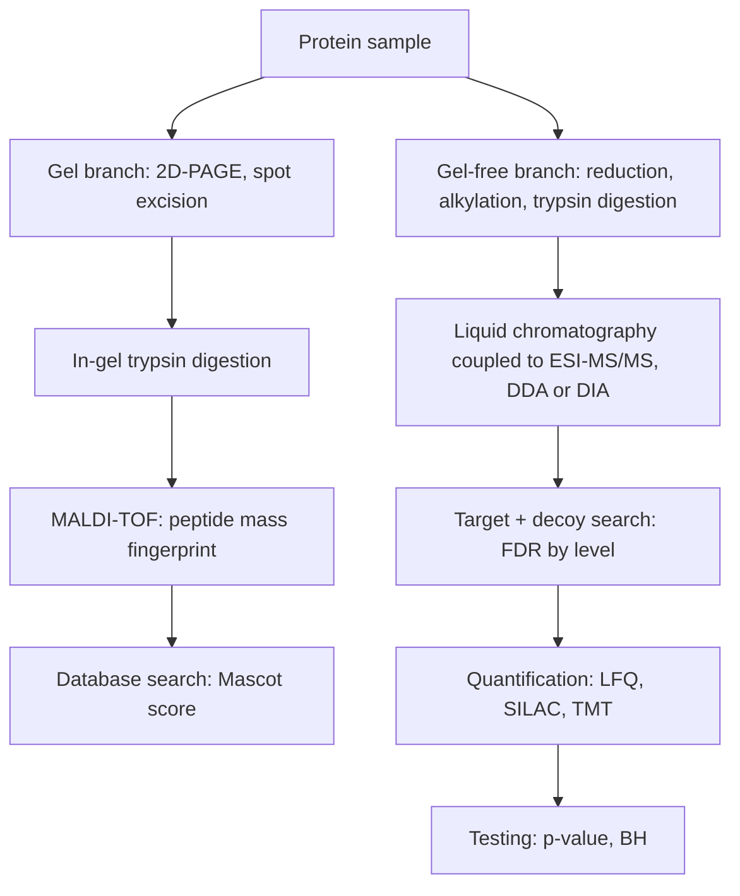

Mass spectrometry-based proteomics and AlphaFold structure prediction attach six confidence numbers to their results: the Mascot score, the 1% FDR from the target-decoy strategy, the p-value from per-protein testing, pLDDT, PAE, and the AutoDock Vina score. Every one of them is a conditional estimate. The Mascot score shifts with database size, FDR changes with the level it is computed at (PSM, peptide, or protein), pLDDT is the model's own guess about its local accuracy, and a Vina score ranks binding poses rather than measuring affinity. This eighth article in the series *Bioinformatics from Beginner to Advanced* walks biology students and self-taught bioinformaticians through each number, with runnable code, real AlphaFold DB data for p53 and ABL1, and a checklist you can use right away.

<div class="callout callout-note">
<p class="callout-title">Quick summary</p>

- Mascot score = −10·log10(P). The significance threshold depends on how many entries are searched: against Swiss-Prot's 576,073 entries, a Bonferroni correction gives about 70.6.
- A 1% FDR at the PSM level is not automatically 1% at the protein level; each level needs its own estimate.
- With 281 proteins that do not change at all and a 3 vs 3 t-test, about 14 proteins still reach unadjusted p < 0.05 on average.
- p53's mean pLDDT is 75.06, but the DNA-binding domain scores about 95 while both ends sit near 49: read it region by region.
- A Vina score helps rank binding poses. It is not a measured affinity.

</div>

## 1. What mass spectrometry proteomics is, and the six confidence numbers

Proteomics measures proteins in bulk: which proteins a sample contains, how much of each, what modifications they carry, and what they interact with. Mass spectrometry has become the main tool for exploring the structure and function of the proteome (Aebersold & Mann, 2016). This article covers only the **bottom-up** approach. Proteins are cut into peptides, the peptides are measured in a mass spectrometer, and software works backward to the proteins. Top-down, cross-linking MS, HDX-MS, and single-cell proteomics are out of scope.

Proteins are the end product of the flow of genetic information and do most of the cell's work directly (the chemical composition of the cell). [Article 7](/en/blog/transcriptomics-rna-seq-va-single-cell/) stopped at RNA, but mRNA levels cannot tell you whether a protein has been cleaved, phosphorylated, or rapidly degraded.

Identification means comparing measured data with hundreds of thousands of proteins in a database, so random matches are always possible. Confidence numbers exist to quantify that probability (Perkins et al., 1999; Elias & Gygi, 2007). On the structure side, AlphaFold reached accuracy competitive with experimental structures for most CASP14 targets (Jumper et al., 2021), and every model it produces comes with confidence metrics of its own.

The six numbers this article explains, in order:

1. **Mascot score**: the probability that a match is random, put on a log scale.
2. **Target-decoy FDR**: the estimated share of wrong results in a list of identifications.
3. **p-value or adjusted p** from per-protein testing (limma, MSstats).
4. **pLDDT**: local confidence for each residue in an AlphaFold model.
5. **PAE**: confidence in the relative position of two parts of the model.
6. **AutoDock Vina score**: the estimated binding score of one ligand pose.

Keratin from the skin and hair of the person running the experiment is the textbook contaminant in mass spectrometry (Matrix Science, n.d.). A search can return keratin above the Mascot threshold and be completely correct statistically, because the mass list really does match keratin better than chance. The number answers "is this match random?" It does not answer "where did this protein come from?" Section 3.1 walks through such a case.

## 2. From protein to spectrum: the bottom-up workflow

The diagram below summarizes the two branches of the workflow and where each confidence number appears.



### 2.1. Sample preparation

First, the protein's disulfide bonds are reduced with DTT (dithiothreitol), and cysteines are alkylated with IAA (iodoacetamide) so the bonds cannot re-form. Trypsin then cuts the chain after lysine (K) and arginine (R), unless the next residue is proline (P).

A cysteine alkylated with IAA gains a carbamidomethyl group. That is why **Carbamidomethyl (C)** must be declared as a fixed modification at search time; forget it and every cysteine-containing peptide is off in mass and fails to match. Trypsin also cuts itself. These autolysis peptides are noise, but they also work as internal standards for mass calibration because their theoretical masses are known in advance.

### 2.2. Separation before mass spectrometry: gel or chromatography

A proteome is too complex to measure in one pass. The **gel-based** approach uses two-dimensional electrophoresis (2D-PAGE): the first dimension separates by isoelectric point (pI), the second by molecular weight. Each spot on the gel holds one or a few proteins; the spot is cut out, digested in the gel, and loaded onto the instrument.

The **gel-free** approach digests the whole protein mixture into peptides and separates the peptides by liquid chromatography. Washburn et al. (2001) named this MudPIT (multidimensional protein identification technology): multidimensional liquid chromatography coupled directly to tandem mass spectrometry (MS/MS), searched with SEQUEST, which identified 1,484 yeast proteins in a single analysis. Peptides leaving the column are ionized and measured continuously, so each run produces tens of thousands of spectra.

### 2.3. Ionization and mass analysis

A mass spectrometer measures the mass-to-charge ratio (m/z), so peptides have to be ionized first. MALDI (matrix-assisted laser desorption/ionization) produces mostly singly charged ions and is usually paired with a time-of-flight (TOF) analyzer. ESI (electrospray ionization) produces multiply charged ions and can be coupled directly to a liquid chromatography stream.

### 2.4. Two ways to identify: PMF and MS/MS

**Peptide mass fingerprinting** (PMF) uses only the list of peptide masses in one MS spectrum. The software digests every protein in the database "in silico" with trypsin, computes theoretical peptide masses, and looks for the protein with the most matching peptides. Pappin et al. (1993) were among the first groups to publish this identification approach. PMF is fast and cheap, but it only works well when the spot contains a nearly pure protein. Two mixed proteins give two overlapping sets of masses.

**MS/MS identification** selects one peptide ion (the precursor ion), fragments it, and compares the fragment spectrum with theoretical spectra of candidate peptides. An MS/MS spectrum carries sequence information, so even complex mixtures can be identified (Aebersold & Mann, 2016). Each pairing of a spectrum with a peptide is called a PSM (peptide-spectrum match). MaxQuant (Cox & Mann, 2008) and MSFragger (Kong et al., 2017) generate tens of thousands of PSMs per run. The question "which PSMs are right?" leads straight to target-decoy in Section 3.

### 2.5. DDA and DIA

With MS/MS, the instrument has to choose which ions to fragment. Table 1 compares the two main acquisition modes.

**Table 1.** Data-dependent acquisition (DDA) and data-independent acquisition (DIA).

| Criterion | DDA (data-dependent acquisition) | DIA (data-independent acquisition) |
|---|---|---|
| Ions selected for fragmentation | The most intense ions in each cycle (e.g., top 10) | All ions in successive m/z windows |
| MS/MS spectra | Mostly from a single peptide | Mixed spectra from many peptides |
| Run-to-run reproducibility | Weak peptides picked in some runs, missed in others | More consistent (Gillet et al., 2012) |
| Missing values | Many, partly from stochastic sampling | Fewer |
| Typical software | MaxQuant, MSFragger | Targeted extraction; DIA-NN (Demichev et al., 2020) |

DDA is simple and gives clean spectra. The catch is that peptides near the intensity cutoff get picked in one run and skipped in the next, creating missing values that have nothing to do with biology. Gillet et al. (2012) proposed targeted data extraction from DIA spectra (SWATH) for more consistent and accurate quantification. DIA-NN uses neural networks and interference correction to reach deeper into the proteome (Demichev et al., 2020). The trade-off is that DIA spectra are complex, need specialized software, and usually need a spectral library to interpret.

## 3. Identification and error control

### 3.1. The Mascot score is a rescaled p-value

Mascot scores by probability. If P is the probability that the observed match is random, the score is −10·log10(P) (Perkins et al., 1999; Matrix Science, n.d.). P = 0.001 gives a score of 30; P = 10⁻⁷ gives 70. The higher the score, the less likely the match arose by chance.

The significance threshold starts from 0.05 but has to be corrected for the number of tests, since every protein in the database is one test. Mascot applies a Bonferroni correction based on the number of entries searched, plus an empirical correction (Matrix Science, n.d.). As a result, **the threshold is not fixed**. Searching all of Swiss-Prot gives a high threshold; restricting the taxonomy to one species shrinks the entry count and lowers it. Swiss-Prot release 2026_04 has 576,073 entries (UniProt Consortium, 2026). The Bonferroni part alone gives:

$$S_{\text{threshold}} = -10\log_{10}\left(\frac{0.05}{576{,}073}\right) \approx 70.6$$

This calculation is only a sanity check. Read the real threshold off the results page, because it also includes the empirical correction.

<div class="callout callout-example">
<p class="callout-title">Worked case: a PMF result above the threshold</p>

A plasma protein spot is digested with trypsin, measured on MALDI-TOF, and gives 10 peptide masses between m/z 1064.9 and 2385.4. A Mascot PMF search against Swiss-Prot, taxonomy "All", trypsin, 1 missed cleavage allowed, tolerance ±1.2 Da. The top hit is "Keratin, type I cytoskeletal" (MW 50,995, pI 5.43), score 78 against a threshold of about 70, sequence coverage 20%.

</div>

This result needs to be read in four layers. The first is the score: 78 clears the threshold of about 70, meaning the mass list matches a type I keratin better than chance at the 0.05 level after correction. Next comes the tolerance. ±1.2 Da is very wide: in relative terms it is about 1,127 ppm at m/z 1064.9 and 503 ppm at m/z 2385.4. The wider the window, the more theoretical peptides fall into it, so random matches go up and discrimination goes down. Matrix Science gives an example in which widening the tolerance from ±0.1 Da to ±1.0 Da pushes the score of a correct result below the threshold (Matrix Science, n.d.). Set the tolerance to the mass accuracy the instrument actually achieves, read from the internal standard peptides.

The third layer is the amount of data. Ten masses is few; Matrix Science recommends submitting as many masses as possible in the 1000–3500 Da range (Matrix Science, n.d.), and 20% coverage means most of the keratin chain has no matching peptide. The last layer, and the weightiest, is what the protein is: keratin is the classic contaminant. Matrix Science states plainly that contaminants can never be ruled out and recommends always searching a contaminant database alongside (Matrix Science, n.d.). Frankenfield et al. (2022) built universal contaminant libraries for DDA and DIA and showed that including them in searches reduces false discoveries. So the score of 78 says the match to keratin is not random. It does not say whether the keratin was in the plasma to begin with or got in during handling.

The code below recomputes the Bonferroni threshold and converts the tolerance to ppm:

```python
import math
# Mascot threshold estimated with Bonferroni: -10*log10(0.05 / N)
for n_entries in (576_073, 20_000):
    print(n_entries, round(-10 * math.log10(0.05 / n_entries), 1))
# Convert absolute tolerance (Da) to ppm at each m/z
tol_da = 1.2
for mz in (1064.9, 2385.4):
    print(mz, round(tol_da / mz * 1e6))
# 576073 70.6 | 20000 56.0 | 1064.9 1127 | 2385.4 503
```

The second line shows the effect of taxonomy: if only 20,000 entries are searched (a hypothetical number, say after restricting to one species), the Bonferroni threshold drops to about 56.

### 3.2. Target-decoy: estimating FDR from known-wrong results

With tens of thousands of PSMs, applying Bonferroni to each spectrum would kill sensitivity. The **target-decoy** strategy gets around this with a trick: search the spectra against the real database (target) combined with a fake one (decoy), usually reversed sequences. No decoy peptide actually exists in the sample, so every PSM that hits a decoy is wrong. If the decoys mimic how wrong results are distributed, the number of decoy PSMs above a score cutoff approximates the number of wrong target PSMs above the same cutoff (Elias & Gygi, 2007):

$$\widehat{\text{FDR}}(s) = \frac{N_{\text{decoy}}(\geq s)}{N_{\text{target}}(\geq s)}$$

Elias and Gygi (2007) showed that this assumption is reasonable, that a **concatenated** target-decoy search works better than separate searches, that the error of the estimate can be calculated, and that different ways of building decoys give similar results when done properly. Figure 1 illustrates this with simulated data.


*Figure 1. Simulation of 60,000 target PSMs (15,000 correct, 45,000 wrong) and 45,000 decoy PSMs. The lowest cutoff giving an estimated FDR ≤ 1% is a score of 49.5; in the simulation, where the answer is known, the true FDR above that cutoff is 1.10%. Simulated data, not measured data.*

Software usually reports a **q-value** for each PSM: the lowest FDR achievable if the cutoff is set at that PSM or below. The code below computes FDR and q-values for 12 hypothetical PSMs:

```python
import pandas as pd
psm = pd.DataFrame({
    "score":  [88, 75, 71, 66, 64, 60, 58, 55, 52, 50, 47, 45],
    "is_decoy": [0, 0, 0, 0, 1, 0, 0, 0, 1, 0, 1, 0],
}).sort_values("score", ascending=False)
psm["n_target"] = (psm["is_decoy"] == 0).cumsum()
psm["n_decoy"] = psm["is_decoy"].cumsum()
psm["fdr"] = psm["n_decoy"] / psm["n_target"]
# q-value: lowest FDR achievable with a cutoff at this score or lower
psm["q"] = psm["fdr"][::-1].cummin()[::-1]
print(psm.to_string(index=False))
```

The first four PSMs have q = 0. The PSM scoring 60 has an FDR of 0.20 but q ≈ 0.14: lowering the cutoff to 55 still keeps it in the list, and at 55 there is 1 decoy against 7 targets.

Each PSM carries many features besides its main score. Percolator uses semi-supervised learning, with decoy PSMs as negative examples, to combine those features and separate correct PSMs from wrong ones more effectively (Käll et al., 2007). It was an early use of machine learning in proteomics; [Article 10](/en/blog/machine-learning-va-ai-trong-sinh-hoc/) comes back to this topic.

### 3.3. FDR by level: PSM, peptide, protein

"1% FDR" only means something once you say at which level. One peptide can be supported by several PSMs; one protein is inferred from one or more peptides. The reason the levels differ lies in how results are rolled up: wrong PSMs tend to scatter, with each false protein receiving a single PSM, while correct PSMs pile up on fewer proteins. So when results are aggregated to the protein level, the error rate does not stay the same as at the PSM level. In very large datasets, the "classic" target-decoy approach at the protein level overestimates false positives; Savitski et al. (2015) proposed a "picked" approach for estimating protein FDR separately. A complete report should state the FDR at all three levels: PSM, peptide, and protein.

Target-decoy FDR and the Benjamini–Hochberg (BH) procedure in Section 4 share the goal of controlling the false discovery rate but work differently. Target-decoy estimates an empirical FDR from known-wrong results; BH works on a list of p-values. [Article 3](/en/blog/toan-va-thong-ke-cho-sinh-hoc/) covers BH in detail.

The last step of identification is **protein inference**. A peptide can occur in several homologous proteins or isoforms, so MaxQuant reports **protein groups**: sets of proteins that cannot be told apart from the observed peptides (Cox & Mann, 2008). For quantification, "unique" peptides belong to only one group, while "razor" peptides are assigned to the group with the most evidence.

## 4. Quantification, missing values, and testing

### 4.1. Three ways to quantify

**Table 2.** Three common quantification methods in bottom-up proteomics.

| | Label-free (LFQ) | SILAC | TMT |
|---|---|---|---|
| Principle | Compares peptide intensities across separate runs | Metabolic stable-isotope labeling: cells grown with heavy amino acids | Isobaric tags chemically attached to peptides after digestion |
| Samples multiplexed per run | None, one sample per run | 2–3 samples (light, medium, heavy) | Many samples, distinguished by reporter ions after fragmentation |
| Applicable to | Any sample type | Cultured cells; human plasma cannot be labeled directly | Any sample digested into peptides |
| Main weakness | Missing values, run-to-run variation | Limited sample types | Ratio compression from co-fragmentation |
| Source | Cox et al. (2014) | Ong et al. (2002) | Thompson et al. (2003); Ting et al. (2011) |

Each LFQ sample is its own run, so runs have to be normalized against each other. MaxLFQ uses delayed normalization and maximal peptide ratio extraction for accurate proteome-wide quantification (Cox et al., 2014). Ong et al. (2002) introduced SILAC as a simple and accurate quantification approach; samples are mixed right after the cells are harvested. TMT works quite differently: the tags are attached by a chemical reaction, all tags have the same total mass, and they only separate on fragmentation (Thompson et al., 2003). If another ion slips into the isolation window, its reporter ions add on and pull every ratio toward 1. MS3 acquisition nearly eliminates this ratio distortion (Ting et al., 2011).

### 4.2. Missing values that are not random

LFQ tables almost always have missing values, and how you handle them can change the list of differential proteins entirely. Lazar et al. (2016) distinguish missingness mechanisms. **MNAR** (missing not at random) means a value is missing because the signal fell below the detection limit, close to left-censored data: low-abundance proteins go missing more often. **MCAR** (missing completely at random) means random missingness, for example when DDA skips a peptide. Each imputation method suits one mechanism. The question to ask is which method **fits** the missingness mechanism in the data at hand, not which method is "best" (Lazar et al., 2016).

Perseus (Tyanova et al., 2016) popularized one workflow: filter proteins by the number of valid values, then replace missing values with random draws from a narrow normal distribution shifted toward low intensities. The defaults in the Perseus documentation are a width of 0.3 and a down-shift of 1.8 standard deviations of the valid values (Cox Lab, n.d.). This approach implicitly assumes MNAR, i.e., that missing values are low values. If most missing values are MCAR, the assumption is wrong and creates spurious differences.

There is a technical trap even before imputation. MaxQuant records unmeasured intensities as 0, and log2(0) is negative infinity. You have to turn 0 into NA before taking logs, and remove contaminant rows (prefix `CON__`) and decoy rows (`REV__`). The code below runs all four steps on a small table:

```python
import numpy as np, pandas as pd
lfq = pd.DataFrame({
    "protein": ["P1", "P2", "P3", "P4", "CON__P04264", "REV__P5"],
    "T1": [2.1e8, 4.5e6, 5.5e6, 9.0e7, 3.0e9, 1.0e6],
    "T2": [1.9e8, 4.1e6, 0,     8.7e7, 2.5e9, 0],
    "T3": [2.3e8, 3.8e6, 0,     9.4e7, 2.8e9, 0],
    "N1": [1.0e8, 0,     0,     8.9e7, 3.1e9, 0],
    "N2": [1.1e8, 0,     6.0e6, 9.1e7, 2.9e9, 2.0e6],
    "N3": [0.9e8, 0,     0,     9.3e7, 3.3e9, 0],
}).set_index("protein")
# 1. Drop contaminants (CON__) and decoys (REV__)
lfq = lfq[~lfq.index.str.startswith(("CON__", "REV__"))]
# 2. Turn 0 into NA before log2 (log2(0) = -inf)
log = np.log2(lfq.replace(0, np.nan))
# 3. Keep proteins with at least 3 valid values in at least one group
tumor, normal = ["T1", "T2", "T3"], ["N1", "N2", "N3"]
keep = (log[tumor].notna().sum(axis=1) >= 3) | (log[normal].notna().sum(axis=1) >= 3)
log = log[keep]
# 4. "Down-shifted distribution" imputation (MNAR assumption), sample by sample
rng = np.random.default_rng(1)
imp = log.copy()
for col in imp:
    mu, sd = log[col].mean(), log[col].std()
    miss = imp[col].isna()
    imp.loc[miss, col] = rng.normal(mu - 1.8 * sd, 0.3 * sd, miss.sum())
print(log.round(2)); print(imp.round(2))
```

P3 is dropped because neither group has 3 values. P2 has all 3 values in the Tumor group and is missing all 3 in the Normal group. Running the code exposes a second trap: the imputed values for P2 in the Normal group land around 26.3, **higher** than the Tumor group (about 22). Each Normal column has only 2 valid values left, both high, so a "down-shifted distribution" estimated from 2 points still sits above P2. Real data with thousands of proteins is more stable, but you should still plot the distributions before and after imputation to check that the filled-in values really fall in the low-intensity range.

### 4.3. Testing each protein

With 3 samples per group, the variance estimate for each protein is very unstable. A protein that happens to have three close values gets a large t-statistic even when the difference is small. limma handles this with linear models plus information borrowing across features (empirical Bayes): each protein's variance is shrunk toward a common value, which makes it more stable at small sample sizes (Ritchie et al., 2015). MSstats models at the peptide or feature level and then summarizes to the protein (Choi et al., 2014).

One detail that often makes limma code fail: the contrast `makeContrasts(groupTumor - groupNormal, levels = design)` only runs when `group` is a factor with exactly two levels, "Tumor" and "Normal", and the design matrix is built with `model.matrix(~ 0 + group)`. After testing, the p-values for all proteins must be adjusted with BH before any protein is called "different." A hand-written BH function shows the calculation:

```python
import numpy as np
def bh(p):
    """Benjamini–Hochberg adjusted p-values."""
    p = np.asarray(p); m = len(p); order = np.argsort(p)
    adj = p[order] * m / np.arange(1, m + 1)
    adj = np.minimum.accumulate(adj[::-1])[::-1]
    out = np.empty(m); out[order] = np.minimum(adj, 1); return out
p = [0.001, 0.008, 0.02, 0.03, 0.04, 0.2, 0.5, 0.9]
print(np.round(bh(p), 3))
# [0.008 0.032 0.053 0.06  0.064 0.267 0.571 0.9  ]
```

In this eight-protein example, five proteins have raw p < 0.05, but after BH only two have adjusted p < 0.05.

### 4.4. Case study: Dong et al. (2022)

Dong et al. (2022) analyzed the proteome of small extracellular vesicles in plasma from patients with hepatocellular carcinoma (HCC). The methods are described in reasonable detail, which makes it a good case for applying Sections 4.1–4.3.

The discovery cohort had 21 HCC patients and 15 controls, but the samples were **pooled** into 3 samples per group (each control pool from 5 people, each HCC pool from 7) to reduce between-individual variation and save cost. Samples were run with DDA top 10 on a Q Exactive, processed in MaxQuant 1.5.3.17 with peptide and protein FDR below 1%, contaminants removed, and quantified by LFQ. The result was 335 identified proteins and 281 quantified proteins. Filtering by fold change ≥ 1.5 or < 0.66 left 54 proteins, of which 27 had p < 0.05 (Dong et al., 2022).

The first thing to read closely is multiple-testing correction. The methods mention Benjamini–Hochberg only for the GO and KEGG enrichment analysis; for differential proteins they mention only a t-test and p < 0.05, with no correction (Dong et al., 2022). If all 281 proteins were tested and every null hypothesis were true, the expected number of false positives at p < 0.05 would be 281 × 0.05 ≈ 14; if only the 54 fold-change-filtered proteins were tested, about 2.7. Figure 2 simulates the first scenario.


*Figure 2. 2,000 simulations: 281 proteins unchanged between two groups, 3 samples per group, two-sample t-test. On average 13.97 proteins reach unadjusted p < 0.05; after BH at 0.05, the average is 0.06 proteins, and 94.7% of simulations have no protein left. Simulated data.*

The second is pooling. Pooling removes the estimate of biological variation between people: three pools, each mixing 7 patients, give the variance of pool averages, not how a protein varies from one patient to the next. n = 3 pools does not carry the statistical weight of n = 21 individuals. The third is missing values. The paper does not describe how they were handled, so there is no way to tell whether a protein "found only in the HCC group" is really there or just below the detection limit in controls (Lazar et al., 2016; Dong et al., 2022).

The paper also has a clear strength: four complement proteins were validated by Western blot in 7 independent patients and 7 independent controls (Dong et al., 2022), meaning a different method on different samples. So do not conclude that "the paper's findings are wrong." The proteomics evidence is weaker than the Western blot evidence, and the list of 27 proteins is best read as a candidate list.

### 4.5. Practice on a dataset with known answers

To see how missing-value handling plays out, try it on data where the answer is known. While developing MaxLFQ, Cox et al. (2014) released a benchmark that mixes two proteomes in known ratios; the data are on PRIDE under accession PXD000279 (Perez-Riverol et al., 2022; PRIDE Archive, 2014). Since you know which proteins should change and which should not, you can count false positives for each strategy: dropping proteins with missing values, down-shifted imputation, or kNN imputation. Then subsample 3 vs 3 to compare raw p < 0.05 with BH at 0.05. It makes a good small portfolio project (Article 12).

## 5. AlphaFold and how to read pLDDT and PAE

From here the article moves from "which proteins are there" to "what does a protein look like."

### 5.1. The gap between sequence and structure

Three-dimensional protein structures are determined by X-ray crystallography, nuclear magnetic resonance (NMR), or cryo-electron microscopy (cryo-EM), then deposited in the Protein Data Bank (PDB), the single global archive for macromolecular structure data (wwPDB consortium, 2019). According to Jumper et al. (2021), when AlphaFold2 arrived, about 100,000 unique proteins had experimental structures, a tiny fraction of the billions of known sequences.

### 5.2. AlphaFold, AlphaFold DB, and other tools

AlphaFold2 combines multiple sequence alignments (MSA) with a deep learning architecture that builds in physical and biological knowledge about protein structure; at CASP14 it reached accuracy competitive with experiment in most cases (Jumper et al., 2021). The MSA is a core input, so model quality depends on how many homologous sequences can be found (see [Article 5](/en/blog/phan-tich-trinh-tu/) on MSA).

Applied to the human proteome, AlphaFold predicted structures for 98.5% of proteins; 58% of all residues were predicted confidently, and 36% of all residues with very high confidence (Tunyasuvunakool et al., 2021). AlphaFold DB launched with over 360,000 structures from 21 model-organism proteomes (Varadi et al., 2022), and by its 2024 release covered over 214 million sequences (Varadi et al., 2024).

A few other tools are worth knowing. ColabFold runs faster and is easier to access thanks to MSA search with MMseqs2 (Mirdita et al., 2022). ESMFold predicts from a protein language model, with no MSA needed (Lin et al., 2023). RoseTTAFold uses a three-track network (Baek et al., 2021). AlphaFold 3 extends prediction to complexes with ligands and nucleic acids (Abramson et al., 2024); this article covers single-chain prediction only.

### 5.3. pLDDT: local confidence

pLDDT (predicted local distance difference test) is the lDDT score the model predicts for each residue. lDDT is a local, superposition-free comparison score that measures how well distances between neighboring atoms are preserved (Mariani et al., 2013). AlphaFold DB splits pLDDT into four bands (Table 3).

**Table 3.** The four pLDDT bands used by AlphaFold DB (EMBL-EBI, n.d.-a).

| pLDDT | Band | How to use it |
|---|---|---|
| > 90 | Very high | Usable for high-accuracy work, such as describing binding sites |
| 70–90 | Confident | Backbone usually predicted well |
| 50–70 | Low | Interpret with caution |
| < 50 | Very low | Do not interpret the coordinates |

pLDDT below 50 is a fairly strong indicator of disorder (EMBL-EBI, n.d.-a; Tunyasuvunakool et al., 2021). Such a region may have no fixed structure under physiological conditions, or may fold only inside a complex. The reverse does not always hold: Alderson et al. (2023) found that AlphaFold2 assigns confident structure to nearly 15% of human intrinsically disordered regions (IDRs), usually conditionally folded states, for example when bound to a partner. Ruff and Pappu (2021) discuss the implications of AlphaFold for disordered proteins in more depth.

Two real proteins show why a mean pLDDT is the wrong thing to read. The AlphaFold DB v6 model of p53 (P04637, 393 amino acids) has a mean pLDDT of 75.06, with 52.7% of residues very high and 29.8% very low. ABL1 (P00519, 1,130 amino acids) has a mean pLDDT of 63.38, with 49.2% of residues very low (EMBL-EBI, n.d.-b). Figure 3 plots pLDDT by position, shaded according to UniProt annotations.


*Figure 3. Per-residue pLDDT for p53 and ABL1 (AlphaFold DB, model v6). Gray: disordered regions per UniProt; green: the p53 DNA-binding domain (102–292) and the ABL1 kinase domain (242–493); purple: the p53 oligomerization region (325–356). Dotted lines: thresholds at 90, 70, 50.*

By region, the p53 DNA-binding domain (102–292) has a mean pLDDT of 95.5 and the oligomerization region (325–356) reaches 90.9, while segment 1–96 (the transactivation and disordered regions) scores only 49.6 and the C-terminus (351–393) 48.6. In ABL1, the kinase domain reaches 92.4, while the disordered region 518–996 scores only 36.1. The p53 figure of 75 averages two very different kinds of region and describes neither of them well. The code below reads pLDDT from an AlphaFold DB PDB file, where pLDDT is stored in the B-factor column:

```python
import numpy as np
def plddt_from_pdb(path):
    """pLDDT is stored in the B-factor column of CA atoms in AlphaFold DB PDB files."""
    v = {}
    for line in open(path):
        if line.startswith("ATOM") and line[12:16].strip() == "CA":
            v[int(line[22:26])] = float(line[60:66])
    return v
# Download first: https://alphafold.ebi.ac.uk/files/AF-P04637-F1-model_v6.pdb
v = plddt_from_pdb("AF-P04637-F1-model_v6.pdb")
regions = {"1-96": (1, 96), "102-292 (DNA-binding domain)": (102, 292),
           "325-356 (oligomerization)": (325, 356), "351-393": (351, 393)}
for name, (a, b) in regions.items():
    x = np.array([v[i] for i in range(a, b + 1)])
    print(f"{name}: mean pLDDT {x.mean():.1f}; share < 50: {(x < 50).mean():.0%}")
```

### 5.4. PAE: confidence in relative position

pLDDT tells you whether each region is predicted well, but not whether two regions are placed correctly relative to each other. That is PAE's job (predicted aligned error). Cell (x, y) of the PAE matrix is the expected position error, in ångströms, at residue x when the predicted and true structures are aligned on residue y (EMBL-EBI, n.d.-a). Low PAE between two domains means their relative position is predicted with confidence. High PAE means you should not interpret the relative orientation of the two domains.


*Figure 4. PAE matrix for ABL1 (AlphaFold DB, model v6). Darker means lower error. Red lines mark the kinase domain, 242–493.*

Within the ABL1 kinase domain, mean PAE is about 4.0 Å, so the shape inside the domain is predicted confidently. Between the kinase domain and the C-terminal segment 997–1130, mean PAE is about 28–30 Å in both directions, close to the file's ceiling of 31.75 Å. The C-terminal segment itself has a mean pLDDT of 72.4, with 43 of 134 residues (32%) above 90 (Figure 3), so parts of it are predicted to fold well. Its position relative to the kinase domain in the model, however, is essentially arbitrary. A 3D picture of the whole chain looks tidy and invites you to trust how these two parts are arranged; PAE shows there is no basis for that trust.

### 5.5. Limits: a model is a hypothesis

Terwilliger et al. (2024) compared AlphaFold predictions directly with crystallographic electron density maps. Many predictions matched very closely. Even very high-confidence predictions, though, could deviate both globally (distortion, relative domain orientation) and locally (backbone, side chains). Predictions also do not account for ligands or covalent modifications. The authors recommend treating AlphaFold models as exceptionally useful hypotheses that speed up, but do not replace, experimental structure determination (Terwilliger et al., 2024).

## 6. Docking: binding poses, not affinity

Molecular docking places a small molecule (ligand) into a protein's binding pocket, searches for plausible poses, and scores them. AutoDock Vina is about two orders of magnitude faster than AutoDock 4 and improved the accuracy of binding-mode prediction on the authors' test set (Trott & Olson, 2010). Vina 1.2.0 added new docking methods, an expanded force field, and Python bindings (Eberhardt et al., 2021).

Because Vina scores come in kcal/mol, they are easy to read as real binding energies. Warren et al. (2006) evaluated 10 docking programs and 37 scoring functions against 8 protein targets. Every program generated crystal-like poses for at least one target. The scoring functions did worse at picking the correct pose out of the docked poses, and **no** program or scoring function predicted binding affinity in a useful way. The right sentence is "Vina estimates a binding score to rank poses"; avoid writing "Vina predicts affinity."

To trust a docking workflow, first test it with **redocking**: take a crystal structure with a bound ligand, remove the ligand, and see whether the software puts it back in the right place. For imatinib and ABL1, the right structure is PDB 1IEP: the c-Abl kinase domain bound to STI-571 (imatinib), at 2.1 Å resolution (RCSB PDB, n.d.; Nagar et al., 2002). The workflow:

1. Download 1IEP, keep one protein chain, and save imatinib to a separate file as the reference pose.
2. Prepare the receptor (add hydrogens, assign charges) and the ligand (define rotatable bonds).
3. Center the search box on imatinib's position in the crystal, i.e., the ATP-binding site of the kinase domain.
4. Redock with Vina and keep the top few poses.
5. Compute the heavy-atom RMSD between the docked pose and the crystal pose, in the same coordinate frame.

```python
import numpy as np
def rmsd(a, b):
    """RMSD between two poses with the same atom order and coordinate frame (no re-superposition)."""
    a, b = np.asarray(a), np.asarray(b)
    return float(np.sqrt(((a - b) ** 2).sum(axis=1).mean()))
crystal = [[0.0, 0.0, 0.0], [1.5, 0.0, 0.0], [1.5, 1.5, 0.0]]
docked  = [[0.3, 0.1, 0.0], [1.8, 0.2, 0.1], [1.2, 1.9, 0.2]]
print(round(rmsd(crystal, docked), 2))   # 0.42
```

Many studies treat an RMSD below about 2 Å as successful redocking. It is a common convention whose origin this article has not traced, so state the cutoff you chose before you run anything.

Receptor conformation matters just as much. Imatinib traps a distinctive inactive conformation of the Abl activation loop (Nagar et al., 2002). The AlphaFold model of ABL1 was predicted without a ligand (Terwilliger et al., 2024), and nothing guarantees it sits in that conformation. Docking into the AlphaFold model is therefore only a secondary test and may do worse than redocking into 1IEP. If you try it, use only the kinase domain, 242–493, since almost half of the 1,130-residue chain has very low pLDDT (EMBL-EBI, n.d.-b; UniProt Consortium, 2026).

## 7. Connecting the two halves

Identified peptides and post-translational modification sites can be mapped onto a structure to see whether they sit on the surface or in the core, in an ordered region or not (Aebersold & Mann, 2016). A phosphorylation site that falls in a region with pLDDT below 50 cannot be interpreted using the model's coordinates, even though the modification itself is real.

Both fields also share one way of checking: comparing the pipeline against an independent answer key, such as proteomes mixed in known ratios (Cox et al., 2014), the PDB and blind assessments like CASP (wwPDB consortium, 2019; Jumper et al., 2021), or redocking into a crystal structure (Nagar et al., 2002). [Article 6](/en/blog/giai-trinh-tu-the-he-moi-ngs-va-genomics/) applies the same idea with variant benchmark sets.

## 8. Conclusion and a "confidence number" checklist

Each confidence number answers a narrow question under specific conditions (Table 4).

**Table 4.** Checklist for the six confidence numbers.

| Number | What it estimates | Depends on | Common trap | Source |
|---|---|---|---|---|
| Mascot score | Probability that a match is random | Database size, taxonomy, tolerance, number of masses | Contaminants above threshold; tolerance too wide | Perkins et al. (1999); Matrix Science (n.d.) |
| Target-decoy FDR | Share of wrong results in a list | Decoy quality; level of calculation | Confusing PSM FDR with protein FDR | Elias & Gygi (2007); Savitski et al. (2015) |
| p-value, adjusted p | Evidence of a difference between groups | Sample size, missing-value handling, multiple-testing correction | Pooled samples; uncorrected raw p | Lazar et al. (2016); Ritchie et al. (2015) |
| pLDDT | Local confidence per residue | MSA depth; disordered regions | Reading the whole-protein average | Tunyasuvunakool et al. (2021); EMBL-EBI (n.d.-a) |
| PAE | Confidence in relative position of two parts | Domains, linkers | Interpreting domain orientation when PAE is high | EMBL-EBI (n.d.-a) |
| Vina score | Estimated binding score of one pose | Scoring function; receptor conformation | Reading it as true affinity | Warren et al. (2006) |

Next time you read a results table, ask three questions before quoting a number: what does it estimate, under what assumptions, and has it been checked against an independent answer key? If you want to test this yourself, start with two small tasks: rerun the pLDDT code from Section 5.3 on a protein you care about, and count false positives on PXD000279 as described in Section 4.5.

## Frequently asked questions

**What Mascot score is significant?** There is no universal number. Mascot computes the threshold from the number of entries searched (Bonferroni plus an empirical correction), so read it off the results page. For all of Swiss-Prot, the Bonferroni part alone is about 70.6 (Section 3.1).

**Does 1% FDR mean 99% of the proteins in the list are correct?** Only at the level where the FDR was computed. A 1% FDR at the PSM level does not guarantee 1% at the protein level (Savitski et al., 2015), so a report needs to state the level (Section 3.3).

**Can AlphaFold replace crystallography?** No. High-confidence models can still be off in domain orientation and side chains, and they do not account for ligands (Terwilliger et al., 2024). Use them as hypotheses and read pLDDT and PAE region by region (Section 5).

**Is a Vina score a binding affinity?** No. A Vina score helps rank poses; in the evaluation by Warren et al. (2006), no docking program predicted affinity in a useful way (Section 6).

## References

Abramson, J., Adler, J., Dunger, J., Evans, R., et al. (2024). Accurate structure prediction of biomolecular interactions with AlphaFold 3. *Nature, 630*(8016), 493–500. https://doi.org/10.1038/s41586-024-07487-w

Aebersold, R., & Mann, M. (2016). Mass-spectrometric exploration of proteome structure and function. *Nature, 537*(7620), 347–355. https://doi.org/10.1038/nature19949

Alderson, T. R., Pritišanac, I., Kolarić, Đ., Moses, A. M., & Forman-Kay, J. D. (2023). Systematic identification of conditionally folded intrinsically disordered regions by AlphaFold2. *Proceedings of the National Academy of Sciences, 120*(44), e2304302120. https://doi.org/10.1073/pnas.2304302120

Baek, M., DiMaio, F., Anishchenko, I., Dauparas, J., et al. (2021). Accurate prediction of protein structures and interactions using a three-track neural network. *Science, 373*(6557), 871–876. https://doi.org/10.1126/science.abj8754

Choi, M., Chang, C.-Y., Clough, T., Broudy, D., et al. (2014). MSstats: An R package for statistical analysis of quantitative mass spectrometry-based proteomic experiments. *Bioinformatics, 30*(17), 2524–2526. https://doi.org/10.1093/bioinformatics/btu305

Cox, J., Hein, M. Y., Luber, C. A., Paron, I., Nagaraj, N., & Mann, M. (2014). Accurate proteome-wide label-free quantification by delayed normalization and maximal peptide ratio extraction, termed MaxLFQ. *Molecular & Cellular Proteomics, 13*(9), 2513–2526. https://doi.org/10.1074/mcp.M113.031591

Cox, J., & Mann, M. (2008). MaxQuant enables high peptide identification rates, individualized p.p.b.-range mass accuracies and proteome-wide protein quantification. *Nature Biotechnology, 26*(12), 1367–1372. https://doi.org/10.1038/nbt.1511

Cox Lab. (n.d.). *Replace missing values from normal distribution* [Perseus documentation]. Retrieved November 27, 2026, from https://cox-labs.github.io/coxdocs/replacemissingfromgaussian.html

Demichev, V., Messner, C. B., Vernardis, S. I., Lilley, K. S., & Ralser, M. (2020). DIA-NN: Neural networks and interference correction enable deep proteome coverage in high throughput. *Nature Methods, 17*(1), 41–44. https://doi.org/10.1038/s41592-019-0638-x

Dong, W., Xia, Z., Chai, Z., Qiu, Z., et al. (2022). Proteomic analysis of small extracellular vesicles from the plasma of patients with hepatocellular carcinoma. *World Journal of Surgical Oncology, 20*(1), 387. https://doi.org/10.1186/s12957-022-02849-y

Eberhardt, J., Santos-Martins, D., Tillack, A. F., & Forli, S. (2021). AutoDock Vina 1.2.0: New docking methods, expanded force field, and Python bindings. *Journal of Chemical Information and Modeling, 61*(8), 3891–3898. https://doi.org/10.1021/acs.jcim.1c00203

Elias, J. E., & Gygi, S. P. (2007). Target-decoy search strategy for increased confidence in large-scale protein identifications by mass spectrometry. *Nature Methods, 4*(3), 207–214. https://doi.org/10.1038/nmeth1019

EMBL-EBI. (n.d.-a). *AlphaFold Protein Structure Database: Frequently asked questions*. Retrieved November 11, 2026, from https://alphafold.ebi.ac.uk/faq

EMBL-EBI. (n.d.-b). *AlphaFold Protein Structure Database: AF-P04637-F1 and AF-P00519-F1, model v6*. Retrieved November 27, 2026, from https://alphafold.ebi.ac.uk/entry/P04637 and https://alphafold.ebi.ac.uk/entry/P00519

Frankenfield, A. M., Ni, J., Ahmed, M., & Hao, L. (2022). Protein contaminants matter: Building universal protein contaminant libraries for DDA and DIA proteomics. *Journal of Proteome Research, 21*(9), 2104–2113. https://doi.org/10.1021/acs.jproteome.2c00145

Gillet, L. C., Navarro, P., Tate, S., Röst, H., Selevsek, N., Reiter, L., Bonner, R., & Aebersold, R. (2012). Targeted data extraction of the MS/MS spectra generated by data-independent acquisition: A new concept for consistent and accurate proteome analysis. *Molecular & Cellular Proteomics, 11*(6), O111.016717. https://doi.org/10.1074/mcp.O111.016717

Jumper, J., Evans, R., Pritzel, A., Green, T., et al. (2021). Highly accurate protein structure prediction with AlphaFold. *Nature, 596*(7873), 583–589. https://doi.org/10.1038/s41586-021-03819-2

Käll, L., Canterbury, J. D., Weston, J., Noble, W. S., & MacCoss, M. J. (2007). Semi-supervised learning for peptide identification from shotgun proteomics datasets. *Nature Methods, 4*(11), 923–925. https://doi.org/10.1038/nmeth1113

Kong, A. T., Leprevost, F. V., Avtonomov, D. M., Mellacheruvu, D., & Nesvizhskii, A. I. (2017). MSFragger: Ultrafast and comprehensive peptide identification in mass spectrometry–based proteomics. *Nature Methods, 14*(5), 513–520. https://doi.org/10.1038/nmeth.4256

Lazar, C., Gatto, L., Ferro, M., Bruley, C., & Burger, T. (2016). Accounting for the multiple natures of missing values in label-free quantitative proteomics data sets to compare imputation strategies. *Journal of Proteome Research, 15*(4), 1116–1125. https://doi.org/10.1021/acs.jproteome.5b00981

Lin, Z., Akin, H., Rao, R., Hie, B., et al. (2023). Evolutionary-scale prediction of atomic-level protein structure with a language model. *Science, 379*(6637), 1123–1130. https://doi.org/10.1126/science.ade2574

Mariani, V., Biasini, M., Barbato, A., & Schwede, T. (2013). lDDT: A local superposition-free score for comparing protein structures and models using distance difference tests. *Bioinformatics, 29*(21), 2722–2728. https://doi.org/10.1093/bioinformatics/btt473

Matrix Science. (n.d.). *Mascot help: Probability based scoring; Peptide mass fingerprint search*. Retrieved November 11, 2026, from https://www.matrixscience.com/help/scoring_help.html and https://www.matrixscience.com/help/pmf_help.html

Mirdita, M., Schütze, K., Moriwaki, Y., Heo, L., Ovchinnikov, S., & Steinegger, M. (2022). ColabFold: Making protein folding accessible to all. *Nature Methods, 19*(6), 679–682. https://doi.org/10.1038/s41592-022-01488-1

Nagar, B., Bornmann, W. G., Pellicena, P., Schindler, T., Veach, D. R., Miller, W. T., Clarkson, B., & Kuriyan, J. (2002). Crystal structures of the kinase domain of c-Abl in complex with the small molecule inhibitors PD173955 and imatinib (STI-571). *Cancer Research, 62*(15), 4236–4243. https://pubmed.ncbi.nlm.nih.gov/12154025/

Ong, S.-E., Blagoev, B., Kratchmarova, I., Kristensen, D. B., et al. (2002). Stable isotope labeling by amino acids in cell culture, SILAC, as a simple and accurate approach to expression proteomics. *Molecular & Cellular Proteomics, 1*(5), 376–386. https://doi.org/10.1074/mcp.M200025-MCP200

Pappin, D. J. C., Hojrup, P., & Bleasby, A. J. (1993). Rapid identification of proteins by peptide-mass fingerprinting. *Current Biology, 3*(6), 327–332. https://doi.org/10.1016/0960-9822(93)90195-T

Perez-Riverol, Y., Bai, J., Bandla, C., García-Seisdedos, D., et al. (2022). The PRIDE database resources in 2022: A hub for mass spectrometry-based proteomics evidences. *Nucleic Acids Research, 50*(D1), D543–D552. https://doi.org/10.1093/nar/gkab1038

Perkins, D. N., Pappin, D. J. C., Creasy, D. M., & Cottrell, J. S. (1999). Probability-based protein identification by searching sequence databases using mass spectrometry data. *Electrophoresis, 20*(18), 3551–3567. https://doi.org/10.1002/(SICI)1522-2683(19991201)20:18<3551::AID-ELPS3551>3.0.CO;2-2

PRIDE Archive. (2014). *PXD000279: MaxLFQ label-free quantification algorithm benchmark datasets*. EMBL-EBI. https://www.ebi.ac.uk/pride/archive/projects/PXD000279

RCSB PDB. (n.d.). *1IEP: Crystal structure of the c-Abl kinase domain in complex with STI-571*. Retrieved November 11, 2026, from https://www.rcsb.org/structure/1IEP

Ritchie, M. E., Phipson, B., Wu, D., Hu, Y., et al. (2015). limma powers differential expression analyses for RNA-sequencing and microarray studies. *Nucleic Acids Research, 43*(7), e47. https://doi.org/10.1093/nar/gkv007

Ruff, K. M., & Pappu, R. V. (2021). AlphaFold and implications for intrinsically disordered proteins. *Journal of Molecular Biology, 433*(20), 167208. https://doi.org/10.1016/j.jmb.2021.167208

Savitski, M. M., Wilhelm, M., Hahne, H., Kuster, B., & Bantscheff, M. (2015). A scalable approach for protein false discovery rate estimation in large proteomic data sets. *Molecular & Cellular Proteomics, 14*(9), 2394–2404. https://doi.org/10.1074/mcp.M114.046995

Terwilliger, T. C., Liebschner, D., Croll, T. I., Williams, C. J., et al. (2024). AlphaFold predictions are valuable hypotheses and accelerate but do not replace experimental structure determination. *Nature Methods, 21*(1), 110–116. https://doi.org/10.1038/s41592-023-02087-4

Thompson, A., Schäfer, J., Kuhn, K., Kienle, S., et al. (2003). Tandem mass tags: A novel quantification strategy for comparative analysis of complex protein mixtures by MS/MS. *Analytical Chemistry, 75*(8), 1895–1904. https://doi.org/10.1021/ac0262560

Ting, L., Rad, R., Gygi, S. P., & Haas, W. (2011). MS3 eliminates ratio distortion in isobaric multiplexed quantitative proteomics. *Nature Methods, 8*(11), 937–940. https://doi.org/10.1038/nmeth.1714

Trott, O., & Olson, A. J. (2010). AutoDock Vina: Improving the speed and accuracy of docking with a new scoring function, efficient optimization, and multithreading. *Journal of Computational Chemistry, 31*(2), 455–461. https://doi.org/10.1002/jcc.21334

Tunyasuvunakool, K., Adler, J., Wu, Z., Green, T., et al. (2021). Highly accurate protein structure prediction for the human proteome. *Nature, 596*(7873), 590–596. https://doi.org/10.1038/s41586-021-03828-1

Tyanova, S., Temu, T., Sinitcyn, P., Carlson, A., et al. (2016). The Perseus computational platform for comprehensive analysis of (prote)omics data. *Nature Methods, 13*(9), 731–740. https://doi.org/10.1038/nmeth.3901

UniProt Consortium. (2026). *UniProtKB/Swiss-Prot release 2026_04; entries P04637 (P53_HUMAN) and P00519 (ABL1_HUMAN)*. Retrieved November 11, 2026, from https://www.uniprot.org/uniprotkb/P04637/entry and https://www.uniprot.org/uniprotkb/P00519/entry

Varadi, M., Anyango, S., Deshpande, M., Nair, S., et al. (2022). AlphaFold Protein Structure Database: Massively expanding the structural coverage of protein-sequence space with high-accuracy models. *Nucleic Acids Research, 50*(D1), D439–D444. https://doi.org/10.1093/nar/gkab1061

Varadi, M., Bertoni, D., Magana, P., Paramval, U., et al. (2024). AlphaFold Protein Structure Database in 2024: Providing structure coverage for over 214 million protein sequences. *Nucleic Acids Research, 52*(D1), D368–D375. https://doi.org/10.1093/nar/gkad1011

Warren, G. L., Andrews, C. W., Capelli, A.-M., Clarke, B., et al. (2006). A critical assessment of docking programs and scoring functions. *Journal of Medicinal Chemistry, 49*(20), 5912–5931. https://doi.org/10.1021/jm050362n

Washburn, M. P., Wolters, D., & Yates, J. R. (2001). Large-scale analysis of the yeast proteome by multidimensional protein identification technology. *Nature Biotechnology, 19*(3), 242–247. https://doi.org/10.1038/85686

wwPDB consortium. (2019). Protein Data Bank: The single global archive for 3D macromolecular structure data. *Nucleic Acids Research, 47*(D1), D520–D528. https://doi.org/10.1093/nar/gky949
