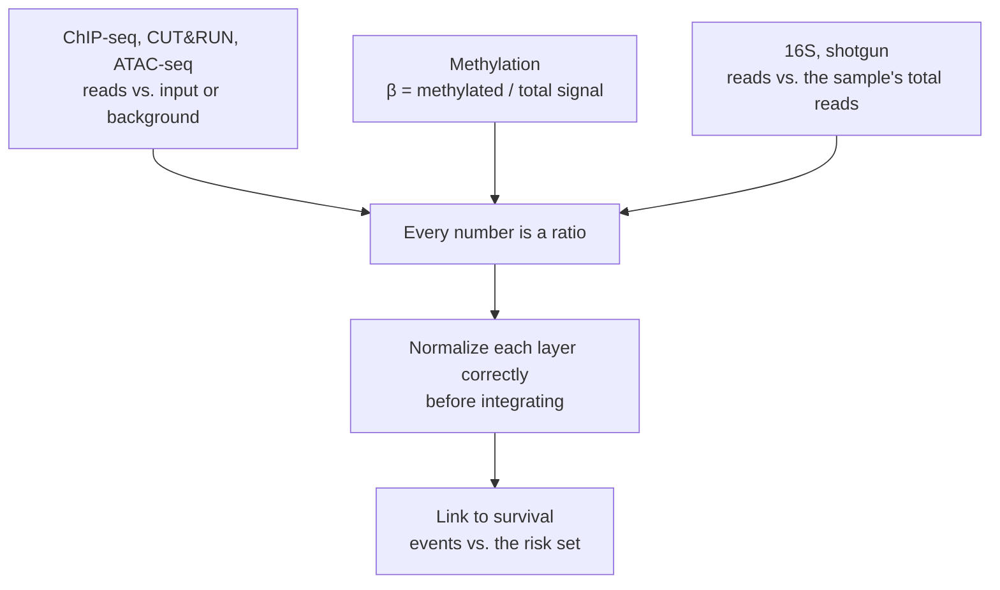
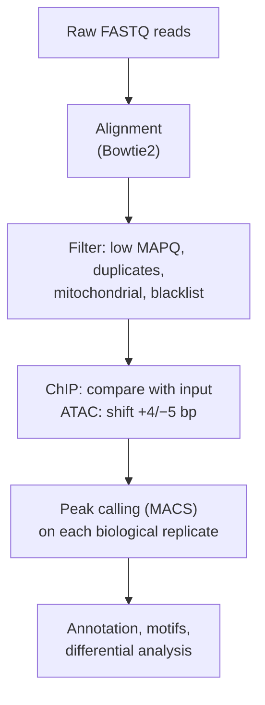

Multi-omics integration combines epigenomics, metagenomics, transcriptomics and clinical data to get a fuller picture of disease, yet almost every layer in that stack is a relative measurement: a ChIP-seq peak is read against an input sample, a β-value against the total signal at one CpG, a 16S count table against a read total set by the sequencer. Ignoring that denominator produces very specific errors. One bacterial species grows tenfold and three others "drop" from 25% to 7.7% without losing a single cell. In 365 liver cancer patients from TCGA, the same question, "does a TP53 mutation predict a worse outcome?", gives p = 0.086 for overall survival but p = 0.049 for progression-free survival and p = 0.037 for disease-specific survival. This article is for students and self-taught bioinformaticians. It covers epigenomics, metagenomics, the compositional data trap, integration strategies and a do-it-yourself Kaplan–Meier example, with Python code that runs.

<div class="callout callout-note">
<p class="callout-title">Quick summary</p>

- Every omics layer is a ratio: name the denominator before you analyze anything.
- ChIP-seq needs an input control and biological replicates; ATAC-seq needs mitochondrial reads and blacklist regions removed and Tn5 read ends shifted; bisulfite cannot tell 5-mC from 5-hmC.
- Microbiome count tables are compositional data: spurious decreases, spurious correlations (averaging −1/(D−1)) and differential abundance methods that disagree.
- There are five integration strategies; pick a method that tolerates missing layers when intersecting layers costs you half your samples (TCGA-LIHC: 372 → 173).
- Clinical conclusions change with the endpoint: choose the endpoint first, report numbers at risk, check assumptions and confounders.

</div>

## 1. What each omics layer is a ratio of

Multi-omics promises to connect molecular layers, from DNA, chromatin, RNA and protein to metabolites and microbial communities, so the flow of information that leads to disease becomes clearer than it is from any single layer (Hasin et al., 2017). That only holds if each layer is measured and read correctly. The two examples below are numbers computed without error that are still very easy to misread.

**Example 1: a "blooming" species.** A stool sample holds four bacterial species, A, B, C and D, with 100 cells each, so each makes up 25%. A week later, species A has grown to 1,000 cells while the other three are still at 100. A sequencer does not count cells; it returns a roughly fixed number of reads per sample. In the proportion table, A now accounts for 1,000/1,300 ≈ 76.9%, while B, C and D all fall to 100/1,300 ≈ 7.7%. Anyone reading the table would write "three species fell more than threefold," even though their cell counts did not change (Figure 1). This is not far-fetched. When cells are counted alongside sequencing, microbial load in stool from healthy people turns out to vary by as much as tenfold (Vandeputte et al., 2017).


*Figure 1. The "bloom" example: only taxon A grows tenfold, but on the proportion scale B, C and D drop from 25% to 7.7%. Numbers computed by hand.*

**Example 2: the median that flips.** In The Cancer Genome Atlas (TCGA) data on hepatocellular carcinoma (HCC), median overall survival in the TP53-mutant group is 81.7 months, longer than in the TP53 wild-type group (58.9 months). A quick read suggests a TP53 mutation is "protective." Yet at 12, 24, 36 and 48 months, the mutant group's survival probability is lower every time (Section 6). The mutant group's median falls in the tail of the curve, where only a handful of patients are still being followed (7 at 60 months).

Both share the same root: a number that is computed correctly can still be misinterpreted when the reader does not know the denominator (total reads, total cells) or the risk set (the number of people still under follow-up at a given time). The diagram below summarizes the "denominator" of each data layer in this article.



This article picks up from the DNA ([NGS and genomics](/en/blog/giai-trinh-tu-the-he-moi-ngs-va-genomics/)), RNA ([transcriptomics](/en/blog/transcriptomics-rna-seq-va-single-cell/)) and protein ([proteomics](/en/blog/proteomics-va-cau-truc-protein/)) parts of the series, within the map of omics layers introduced in the [introduction](/en/blog/nhap-mon-bioinformatics/).

## 2. Epigenomics: measuring gene regulation on chromatin

Epigenomics measures changes on chromatin that regulate which genes are transcribed, without changing the DNA sequence. The question this layer asks is "which regions of the genome are being regulated, and by what mechanism?"

### 2.1 Biological background

DNA in the nucleus wraps around histone octamers to form nucleosomes. Histone acetylation usually goes with open chromatin and active transcription; histone methylation can activate or repress depending on the residue; and chromatin remodelling complexes slide or evict nucleosomes so transcription factors can reach the DNA (see also gene regulation).

In mammals, DNA methylation means adding a methyl group to cytosine to form 5-methylcytosine (5-mC), a job carried out by the enzymes DNMT1, DNMT3A and DNMT3B (Carey, 2013). Methylation mostly occurs on cytosines in CpG dinucleotides, and those CpGs are spread across the genome rather than confined to CpG islands. The first base-resolution map of the human methylome also showed that in embryonic stem cells, nearly a quarter of methylation sits outside the CG context (Lister et al., 2009).

Two projects produced the reference maps that every epigenomic analysis is compared against: ENCODE, an encyclopedia of functional elements in the human genome (ENCODE Project Consortium, 2012), and Roadmap Epigenomics, with 111 human reference epigenomes (Roadmap Epigenomics Consortium et al., 2015).

### 2.2 ChIP-seq and CUT&RUN

ChIP-seq (chromatin immunoprecipitation sequencing) uses an antibody to pull down DNA fragments bound to a protein and then sequences them. It maps the binding sites of transcription factors (Johnson et al., 2007) and of histone modifications (Barski et al., 2007) across the genome.

A ChIP-seq peak is not an absolute signal. MACS, the most widely used peak caller, estimates the tag shift and uses a dynamic Poisson distribution with a local λ to handle regional bias; a peak is a region with **more reads than expected relative to the local background** (Zhang et al., 2008). That background comes from the input sample, meaning chromatin that was sheared but not immunoprecipitated. Without input, the software can still call peaks, but regions that shear easily, have extra copies or amplify easily will look like binding sites.

The ENCODE and modENCODE guidelines set out four groups of requirements: antibody validation, experimental replication, sequencing depth and data quality assessment (Landt et al., 2012). A biological replicate comes from a separate culture or individual, not a rerun of the same library. A common tool chain is Bowtie2 for alignment (Langmead & Salzberg, 2012), MACS for peak calling (Zhang et al., 2008; the current version is MACS3), HOMER for motif discovery (Heinz et al., 2010) and ChIPseeker for annotating peaks to genes (Yu et al., 2015).

CUT&RUN works the other way around. Instead of pulling chromatin down, it delivers an antibody-tethered nuclease into the nucleus and cuts in place. Because only the cleaved fragments escape, background is very low, so it needs only about one-tenth of the sequencing depth of ChIP-seq (Skene & Henikoff, 2017).

<div class="callout callout-warning">
<p class="callout-title">Common ChIP-seq mistakes</p>

- Calling peaks without input and then reading every strong peak as a binding site: regions that shear easily or repeat also give strong peaks.
- Pooling reads from two runs of the same library and calling them two replicates: those are technical replicates and say nothing about biological variation.
- Comparing peak counts between two conditions sequenced to different depths: peak count depends on depth, so normalize or subsample to the same depth before comparing.

</div>

The same "relative to background" logic applies to the third technique in this layer, which needs no antibody.

### 2.3 ATAC-seq

ATAC-seq uses the Tn5 transposase to insert sequencing adapters directly into native chromatin. Tn5 can only insert where nucleosomes are not in the way, so the density of insertions reflects how open the chromatin is. The method needs 500–50,000 cells and maps open chromatin, transcription factor binding and nucleosome positions at the same time (Buenrostro et al., 2013).

The review by Yan et al. (2020) splits ATAC-seq analysis into QC, alignment, peak calling, differential analysis, motifs and footprinting, with practical thresholds. A uniquely mapped read rate above 80% is typical of a successful experiment. For mammals, aim for at least 50 million aligned reads for open-chromatin detection and differential analysis, and 200 million for footprinting. After alignment, three groups of reads must go: reads on the mitochondrial genome (which is easy to access because it is not packaged into chromatin, so coverage is very high), reads in ENCODE blacklist regions, and PCR duplicates. Finally, read ends are shifted +4 bp on the plus strand and −5 bp on the minus strand, because Tn5 creates a 9-bp duplication when the cut is repaired (Yan et al., 2020). Two QC plots help spot a good library: the fragment size distribution peaks around 100 bp (nucleosome-free fragments) and around 200 bp (fragments wrapped around one nucleosome), and the TSS enrichment plot shows nucleosome-free fragments concentrated right at the TSS.

Blacklist regions are parts of the genome that give abnormally high signal in every functional sequencing experiment, regardless of antibody or cell type; removing them is an essential quality step (Amemiya et al., 2019).



Differential analysis between conditions uses packages such as DiffBind; a classic application of this approach found differential oestrogen receptor binding across breast tumors that was associated with clinical outcome (Ross-Innes et al., 2012). For visualization, deepTools builds bigWig files and heatmaps around transcription start sites (TSS) (Ramírez et al., 2016), and IGV lets you browse region by region (Robinson et al., 2011); the BED and bigWig formats are introduced in the [data formats part](/en/blog/dinh-dang-du-lieu-va-co-so-du-lieu-sinh-hoc/).

### 2.4 DNA methylation: bisulfite and arrays

Bisulfite treatment converts unmethylated cytosine to uracil (read as T after PCR), while 5-mC stays as C (Frommer et al., 1992). Aligning reads to the reference genome, each C/T position tells you whether one DNA molecule was methylated there. Whole-genome bisulfite sequencing (WGBS) gives a base-resolution methylation map (Lister et al., 2009); RRBS (reduced representation bisulfite sequencing) lowers the cost by using a restriction enzyme so that only CpG-rich regions are sequenced (Meissner et al., 2005).

A key limitation: bisulfite **cannot distinguish** 5-mC from 5-hydroxymethylcytosine (5-hmC), and regions rich in 5-hmC can also amplify poorly (Huang et al., 2010). A "highly methylated region" in bisulfite data may contain both forms.

Common tools include Bismark for alignment and methylation calling (Krueger & Andrews, 2011), methylKit for differential analysis (Akalin et al., 2012) and DSS, which uses a Bayesian hierarchical model for base-resolution data (Feng et al., 2014). For large clinical cohorts, Infinium arrays are cheaper: the 450K measures more than 450,000 CpGs at single-site resolution (Bibikova et al., 2011), EPIC extends coverage (Pidsley et al., 2016), and minfi (Aryee et al., 2014) and SeSAMe (Zhou et al., 2018) process the raw data.

Arrays and bisulfite both return a ratio. The β-value = methylated / (methylated + unmethylated) lies in [0, 1]. The M-value = log₂(β / (1 − β)) is the base-2 logit of β. Du et al. (2010) showed that β is strongly heteroscedastic at CpGs that are very highly or very lowly methylated; they recommend M for differential methylation analysis and reporting β alongside it, because β is easier to interpret biologically (Figure 2). For example, one CpG going from β = 0.80 to 0.95 and another going from 0.40 to 0.55 both rise by 0.15 on the β scale. On the M scale, the first rises from 2.00 to 4.25 (2.25 units), the second from −0.58 to 0.29 (0.87 units). Because the variance of β shrinks at both ends, the same 0.15 difference near 1 is much rarer than in the middle of the scale, and M reflects that.

```python
import numpy as np
beta = np.array([0.05, 0.2, 0.5, 0.8, 0.95])
M = np.log2(beta / (1 - beta))          # [-4.25 -2.  0.  2.  4.25]
beta_back = 2**M / (2**M + 1)           # convert back to β
print(M.round(2), beta_back.round(2))
```


*Figure 2. β versus M: near 0 and 1, a small change in β corresponds to a large change in M.*

**Table 1. Epigenomic techniques: what they measure and relative to what**

| Technique | What it measures | Relative to what | QC you cannot skip | Tools | Source |
|---|---|---|---|---|---|
| ChIP-seq | Protein binding sites or histone modifications | Input (non-immunoprecipitated chromatin) | Antibody validation, biological replicates, depth | Bowtie2, MACS, HOMER, ChIPseeker | Landt et al. (2012); Zhang et al. (2008) |
| CUT&RUN | Same as ChIP-seq, cut in place | Low background because only cleaved fragments escape | ~1/10 of ChIP depth | MACS | Skene & Henikoff (2017) |
| ATAC-seq | Open chromatin, nucleosomes | Tn5 insertion density vs. background | Remove mitochondrial, blacklist, duplicate reads; shift +4/−5 bp | MACS, DiffBind, deepTools | Buenrostro et al. (2013); Yan et al. (2020) |
| WGBS, RRBS | Methylation at each CpG | C/(C+T) ratio at each position | Bisulfite conversion rate; 5-mC/5-hmC | Bismark, methylKit, DSS | Lister et al. (2009); Huang et al. (2010) |
| 450K, EPIC | Methylation at preselected CpGs | β = methylated / total | Normalization, failed probes | minfi, SeSAMe | Du et al. (2010) |

## 3. Metagenomics: who is there and what they do

Metagenomics sequences the DNA of a whole microbial community without culturing it. This layer asks two questions: "who is there" and "what can they do."

### 3.1 16S rRNA and shotgun

There are two main approaches (Knight et al., 2018; Quince et al., 2017). 16S rRNA amplicon sequencing amplifies one variable region of the 16S gene and sequences it, so it is cheap and fast but only tells you taxonomy. Shotgun metagenomics sequences all the DNA at random, so it gives both species-level taxonomy and functional gene content. In a head-to-head comparison on chicken gut samples, 16S saw only part of the community that shotgun detected; with enough reads, shotgun was better at picking up less abundant genera, and those rare genera were biologically meaningful for telling conditions apart (Durazzi et al., 2021).

**Table 2. 16S versus shotgun**

| Criterion | 16S rRNA amplicon | Shotgun metagenomics |
|---|---|---|
| What gets sequenced | One marker gene region | All DNA in the sample |
| Taxonomic resolution | Usually genus | Species, sometimes strain |
| Functional information | Not measured directly | Yes (genes, pathways) |
| Cost, depth needed | Low | Higher |
| Main tools | QIIME 2, DADA2, SILVA | Kraken 2, Bracken, MetaPhlAn, HUMAnN |
| Comparative evidence | Sees part of the community | Better at detecting rare taxa with enough reads (Durazzi et al., 2021) |

### 3.2 From reads to an ASV table

QIIME 2 is a widely used platform for amplicon data (Bolyen et al., 2019). DADA2 infers the exact sequences present in a sample and can resolve differences of a single nucleotide (Callahan et al., 2016). The resulting unit is the amplicon sequence variant (ASV), and Callahan et al. (2017) argue that ASVs should replace OTUs because they can be compared directly across studies. Taxonomic assignment usually relies on the SILVA database (Quast et al., 2013).

The QIIME 2 "Moving Pictures" tutorial uses part of the data from Caporaso et al. (2011): samples from 2 people, 4 body sites and 5 time points, denoised with DADA2 or Deblur before computing alpha and beta diversity (QIIME 2 Development Team, n.d.).

### 3.3 Shotgun: taxonomy, function, genomes

For shotgun data, Kraken 2 assigns taxonomy to each read (Wood et al., 2019), Bracken re-estimates abundance at the species level (Lu et al., 2017), and MetaPhlAn uses clade-specific marker genes within bioBakery 3 (Beghini et al., 2021). HUMAnN profiles gene and pathway abundance at the species level (Franzosa et al., 2018). To recover genomes from a metagenome (metagenome-assembled genomes, MAGs), reads are assembled with MEGAHIT (Li et al., 2015) and contigs are binned with MetaBAT 2 (Kang et al., 2019).

### 3.4 Contamination and negative controls

Contaminating DNA is present in extraction kits and laboratory reagents, and it hits low-biomass samples hardest; Salter et al. (2014) recommend sequencing negative controls alongside samples. The decontam package uses DNA concentration or prevalence in negative controls to identify contaminant sequences statistically (Davis et al., 2018).

### 3.5 Diversity and testing

Alpha diversity describes a single sample. Richness (Observed Features in QIIME 2) only counts how many taxa are present. The Shannon index accounts for both the number of taxa and how evenly they are distributed, so two samples with 100 taxa each can have very different Shannon values. Take a smaller example: sample X has 4 taxa at 25% each, and sample Y also has 4 taxa, but one makes up 97% and the other three 1% each. Both have the same richness (4), but the Shannon index with the natural log is 1.386 for X and 0.168 for Y. Writing "alpha diversity (Shannon, number of species)" collapses these two quantities into one. Faith's PD adds phylogenetic information, and Pielou's evenness measures evenness alone.

Beta diversity compares samples with each other: Bray–Curtis is abundance-based (Bray & Curtis, 1957), and UniFrac is based on the fraction of the phylogenetic tree that is shared or unique (Lozupone & Knight, 2005). The distance matrix is then tested with PERMANOVA (Anderson, 2001).

PERMANOVA tests the null hypothesis that group centroids coincide. Simulations by Anderson and Walsh (2013) showed that ANOSIM and the Mantel test are very sensitive to differences in dispersion between groups, while PERMANOVA is little affected when the design is balanced; with an unbalanced design and unequal dispersions, none of the tests is reliable. In practice: count the samples per group first, run PERMANOVA for "location" and PERMDISP (betadisper) for "dispersion," and interpret the two results together.

The unit of replication matters too. In Moving Pictures, samples from the same person are not independent, so a PERMANOVA p-value by body site describes these two people and does not generalize to a population (see [math and statistics for biology](/en/blog/toan-va-thong-ke-cho-sinh-hoc/)).

Alpha diversity, beta diversity and PERMANOVA are all computed on a count table in which each sample's total is a number chosen by the machine. That detail carries more weight than the choice of index, and the next section explains why.

## 4. The compositional data trap

### 4.1 What compositional data are

Compositional data are data in which the information lies in **the ratios between parts**, not in the absolute value of each part. The statistical foundation for this kind of data is Aitchison's (1982) log-ratio analysis. Gloor et al. (2017) argue that 16S, metagenome and metatranscriptome datasets are all compositional because the total number of reads per sample is imposed arbitrarily by the sequencer, and that treating them as compositions at every step "is not optional."

The microbiome is not a special case. Whenever reads are counted and assigned to many features against a fixed total, you get the same kind of data: RNA-seq, ChIP-seq, 16S, metagenomics, selective growth experiments. ALDEx2 was built on that observation and was tested on RNA-seq, 16S and selective growth data (Fernandes et al., 2014). So the lessons of this section also apply to [RNA-seq data](/en/blog/transcriptomics-rna-seq-va-single-cell/).

### 4.2 Three pathologies

**Spurious decreases.** The "bloom" example in Section 1 is the simplest case: one taxon rises and every other taxon falls on the proportion scale. Relative analysis cannot tell you the direction or size of change in true abundance (Vandeputte et al., 2017).

**Spurious correlations.** Suppose there are D taxa whose absolute abundances are completely independent. After dividing by the total, the proportions add up to 1, so the variance of the sum is 0. Written out: Var(Σpᵢ) = Σ Var(pᵢ) + Σ_{i≠j} Cov(pᵢ, pⱼ) = 0. If the taxa have equal variances, the covariances must sum to −D times that variance, and the average pairwise correlation is

$$\bar r = -\frac{1}{D-1}.$$

With 3 taxa, the average correlation is −0.5 even though there is no biological interaction at all. A simulation of 1,000 lognormal samples (σ = 1, seed 42) reproduces this exactly: correlations on absolute counts are near 0 (0.005; −0.008; 0.000), and on proportions they are −0.500 for D = 3, −0.250 for D = 5 and −0.052 for D = 20 (Figure 3). The centred log-ratio (CLR) transform does not fix the average correlation either (−0.500; −0.250; −0.053), because CLR values sum to zero across each row, a similar constraint. Lovell et al. (2015) conclude that correlation is not valid for relative data and propose proportionality instead, measured with the ϕ statistic based on the variance of the log-ratio between two components.


*Figure 3. Distribution of correlations between pairs of independent taxa (simulated data). Dashed line: −1/(D−1).*

```python
import numpy as np, pandas as pd

# The "bloom" example: only A grows tenfold
before = pd.Series({"A": 100, "B": 100, "C": 100, "D": 100})
after = before.copy(); after["A"] = 1000
print((after / after.sum()).round(3).to_dict())   # B, C, D: 0.25 -> 0.077

# Spurious correlation between independent taxa
rng = np.random.default_rng(42)
def mean_corr(m):
    c = np.corrcoef(m, rowvar=False)
    return c[~np.eye(len(c), dtype=bool)].mean()
for D in (3, 5, 20):
    x = rng.lognormal(0, 1, size=(1000, D))          # absolute counts
    p = x / x.sum(axis=1, keepdims=True)              # proportions
    clr = np.log(p) - np.log(p).mean(axis=1, keepdims=True)
    print(D, round(mean_corr(x), 3), round(mean_corr(p), 3),
          round(mean_corr(clr), 3), round(-1 / (D - 1), 3))
```

With hundreds of taxa the average spurious correlation is small, but individual pairs can still be pushed off, especially when a few taxa take most of the reads. The Bacteroides–Prevotella pair is often described as a "trade-off" in the gut; measuring absolute load, Vandeputte et al. (2017) showed that this relationship is partly an artifact of relative analysis.

**Differential abundance (DA) methods disagree.** Nearing et al. (2022) ran 14 DA methods on 38 16S datasets and found that both the number and the set of significant ASVs differed widely between methods. ALDEx2 and ANCOM-II gave the most consistent results across studies, and the authors recommend a consensus of several methods rather than trusting any one.

<div class="callout callout-warning">
<p class="callout-title">Common mistakes with log-ratio transforms</p>

- ASV tables contain a lot of zeros, and log(0) is undefined. Adding a small pseudocount before taking logs is common practice, but the value you pick affects results for rare taxa; try two values and report both.
- Filtering rare taxa **after** converting to proportions changes the denominator; filter first, then normalize.
- Building co-occurrence networks from Pearson or Spearman correlations on a proportion table: that network includes the spurious negative correlations from the formula above.

</div>

### 4.3 Ways out

There is no way to "recover" absolute counts from relative data without adding information. The well-founded options fall into three groups (Table 3).

**Table 3. Methods for compositional data**

| Approach | Assumption, idea | Output | Source |
|---|---|---|---|
| ALDEx2 | Dirichlet Monte Carlo sampling, CLR transform | Differences on the log-ratio scale | Fernandes et al. (2014) |
| ANCOM | Tests the log-ratio of each taxon against every other taxon | Differentially abundant taxa (W statistic) | Mandal et al. (2015) |
| ANCOM-BC | Estimates and corrects the sampling fraction | Coefficients, confidence intervals, FDR control | Lin & Peddada (2020) |
| Reference frames | Compares each taxon with a reference taxon | Directional relative change, no total load needed | Morton et al. (2019) |
| Absolute measurement | Flow cytometry cell counts alongside sequencing | Estimated cell counts per taxon | Vandeputte et al. (2017) |
| Proportionality | Variance of the log-ratio between two components | ϕ statistic instead of correlation | Lovell et al. (2015) |

As for rarefying, which randomly subsamples reads so every sample has the same depth, McMurdie and Holmes (2014) argue that both rarefying and plain proportions produce many false positives, and recommend avoiding rarefying for differential analysis. That is one side of a debate that is still going on; rarefying remains common in many diversity workflows.

### 4.4 Connecting to the other layers

Section 2 showed that β is a ratio of two parts and that a ChIP-seq signal is enrichment relative to input. The message for integration: each layer has to be brought onto a statistically meaningful scale (log-ratio, M-value, normalized log-counts) **before** layers are combined. If one layer still carries spurious correlations and another still depends on sequencing depth, the integration method will find exactly those "shared axes of variation" that come from how things were measured rather than from biology.

## 5. Multi-omics integration

### 5.1 Five strategies

Ritchie et al. (2015) reviewed data integration methods for finding genotype–phenotype interactions. Picard et al. (2021) classified integration strategies for machine learning into five groups: early, mixed, intermediate, late and hierarchical. The common three-way split (early, intermediate, late) is a simplified version of this scheme.

**Table 4. Integration strategies**

| Strategy | How it works | Strengths | Weaknesses | Example |
|---|---|---|---|---|
| Early | Concatenate the matrices column-wise | Simple | Needs samples with every layer; layers with many features dominate | Concatenate, then run PCA |
| Mixed | Transform each layer separately, then combine | Reduces imbalance in feature counts | Loses some information | Per-layer kernels or graphs |
| Intermediate | Learn a joint representation | Captures shared and layer-specific variation | Hard to interpret | MOFA, DIABLO, jDR |
| Late | Analyze separately, combine the results | Flexible, tolerates missing layers | Ignores interactions between layers | Combining predictions |
| Hierarchical | Follows biological relationships between layers | Tied to the DNA → RNA → protein flow | Requires prior knowledge | Regulatory models |

Note: the strengths and weaknesses columns summarize the general arguments about each strategy; the five groups follow Picard et al. (2021).

In practice, a simple sequence of questions helps you choose a strategy:

1. Is the question exploratory (along which axes do the layers vary together?) or predictive and classificatory (which features separate two groups?)? Exploration suits unsupervised methods such as MOFA; classification suits supervised methods such as DIABLO.
2. How many samples have every layer? If intersecting the layers loses many samples, choose a method that tolerates missing layers, or use late integration.
3. How different are the feature counts per layer? A layer with hundreds of thousands of CpGs combined with a layer of a few hundred proteins will dominate unless you select features or weight the layers.
4. Has each layer been transformed onto an appropriate scale (Section 4.4)? If not, go back to preprocessing.
5. Is there an independent dataset for validation? If not, present the integration results as hypotheses.

### 5.2 Tools

**MOFA** (Multi-Omics Factor Analysis) infers a number of latent factors that capture sources of variation shared across layers and specific to each layer; the original paper applied it to 200 patients with chronic lymphocytic leukemia (CLL) with mutations, RNA, methylation and drug response (Argelaguet et al., 2018). **MOFA+** extends it to multi-modal single-cell data with multiple sample groups, using variational inference (Argelaguet et al., 2020). For bulk data such as TCGA, the 2018 MOFA paper is the right methods reference; the MOFA2 package implements both.

**DIABLO**, part of the mixOmics package (Rohart et al., 2017), is a supervised method: it selects features that are correlated across layers and at the same time discriminate phenotype groups (Singh et al., 2019). MOFA answers "along which axes do the layers vary together," and DIABLO answers "which features across layers jointly separate cases from controls."

**WGCNA** builds weighted correlation networks and modules of co-expressed genes (Langfelder & Horvath, 2008). At its core it is a **single-layer** analysis, usually of gene expression; modules can be compared with other layers afterward, but WGCNA is not an integration method in itself.

**Benchmark.** Cantini et al. (2021) compared 9 joint dimensionality reduction (jDR) methods on simulated data, TCGA (survival prediction, clinical annotation, pathways) and single-cell data. intNMF was best at clustering and MCIA was consistently solid across settings; no method won on every criterion. For beginners, running two different methods and comparing the results is worth more than hunting for "the best method." Integration with deep learning is covered in the machine learning part.

### 5.3 What TCGA-LIHC data actually look like

The `lihc_tcga_pan_can_atlas_2018` study on cBioPortal has 372 samples: 366 with mutation data, 366 with RNA-seq, 372 with HM450 methylation, but only 179 with RPPA (protein). Intersecting mutations with RNA leaves 361 samples, adding methylation still leaves 361, and adding RPPA leaves only 173, meaning more than half are lost (Figure 4). Compared with the 361 samples that have mutations, RNA and methylation, early integration of all four layers forces you to drop 188 samples (199 if you count from 372). MOFA tolerates missing layers, so it keeps those samples in the model (Argelaguet et al., 2018).


*Figure 4. TCGA-LIHC: samples per layer and their overlap (cBioPortal REST API, queried November 27, 2026).*

The original TCGA integrative analysis of HCC sequenced the exomes of 363 cases, 196 of which also had methylation, RNA, miRNA and proteomic data; clustering across 5 platforms produced 3 subtypes, one with worse prognosis, and an expression signature of p53 target genes correlated with poor survival (Cancer Genome Atlas Research Network, 2017). The next section tests a simple version of that question on public data.

## 6. Do it yourself: Kaplan–Meier by TP53 status in TCGA-LIHC

### 6.1 Data and group definitions

The data come from cBioPortal (Cerami et al., 2012; Gao et al., 2013), study Liver Hepatocellular Carcinoma (TCGA, PanCancer Atlas), through its REST API. PanCancer Atlas clinical data were harmonized according to the TCGA Clinical Data Resource (TCGA-CDR), which defined four endpoints (OS, DSS, DFI, PFI) and recommended which ones are usable for each cancer type (Liu et al., 2018).

The "TP53 mutant" group includes patients with at least one TP53 mutation in the mutation profile of the 366 sequenced patients: 110 people (30%). One of the 366 has no OS data, so the survival analyses below use 365 people. By type: 64 had only missense mutations, 41 had at least one truncating mutation (frameshift, nonsense, splice site), and 5 had other types (in-frame, splice region).

To reproduce this yourself, follow these steps with cBioPortal's public REST API (no account needed):

1. Get the list of sequenced samples: `GET /api/sample-lists/lihc_tcga_pan_can_atlas_2018_sequenced/sample-ids`.
2. Get TP53 mutations (Entrez 7157): `POST /api/molecular-profiles/lihc_tcga_pan_can_atlas_2018_mutations/mutations/fetch` with the `sampleListId` from step 1 and `entrezGeneIds: [7157]`.
3. Get patient-level clinical data: `GET /api/studies/lihc_tcga_pan_can_atlas_2018/clinical-data?clinicalDataType=PATIENT`, keeping the fields `OS_MONTHS`, `OS_STATUS`, `PFS_MONTHS`, `PFS_STATUS`, `DSS_MONTHS`, `DSS_STATUS`, `AGE`, `AJCC_PATHOLOGIC_TUMOR_STAGE`.
4. Join on patient ID, set `tp53 = 1` for patients with at least one mutation, and code the status "1:DECEASED" (or "1:PROGRESSION") as an event.

The numbers in this section may shift slightly if cBioPortal updates its import; record the download date with your results.

Pooling these types into one group is a choice that needs to be stated. TP53 mutations in cancer are mostly missense, about 70% of alterations, and about 10% of TP53-mutant tumors carry nonsense mutations (Hassin & Oren, 2023). Missense and truncating mutations differ in mechanism (see [sequence analysis](/en/blog/phan-tich-trinh-tu/)). An analysis of TP53 in 10,225 samples from 32 TCGA cancer types found that more than 91% of TP53-mutant cancers lose the second allele, and that an RNA signature of mutant TP53 correlates with reduced survival in 11 cancer types (Donehower et al., 2019).

### 6.2 Statistical tools

The Kaplan–Meier estimator computes a survival function from incomplete observations, where some patients are censored because they were lost to follow-up or the study ended (Kaplan & Meier, 1958; Clark et al., 2003). The log-rank test compares two curves over the whole follow-up period (Bland & Altman, 2004). The Cox model estimates the hazard ratio (HR) and allows adjustment for other variables, assuming the HR is constant over time (Cox, 1972; Therneau & Grambsch, 2000).

All numbers below were computed with the Python package lifelines 0.30.3 (Davidson-Pilon, 2019) on data downloaded November 27, 2026. Five patients with an OS time of 0 were kept in the analysis.

### 6.3 Results

**Table 5. TP53 mutation and survival in TCGA-LIHC**

| Endpoint | n (mutant / WT) | Events (mutant / WT) | Log-rank | Univariable Cox HR (95% CI) | Median, months (mutant / WT) |
|---|---|---|---|---|---|
| OS (overall survival) | 110 / 255 | 40 / 87 | χ² = 2.95; p = 0.086 | 1.39 (0.95–2.04) | 81.7 / 58.9 |
| PFS (progression-free survival) | 110 / 255 | 60 / 117 | χ² = 3.89; p = 0.049 | 1.37 (1.00–1.87) | 12.7 / 25.5 |
| DSS (disease-specific survival) | 108 / 248 | 26 / 49 | χ² = 4.33; p = 0.037 | 1.66 (1.02–2.69) | not reached / 83.2 |

For OS, survival probability in the mutant versus WT group is 0.745 and 0.866 at 12 months; 0.626 and 0.732 at 24 months; 0.567 and 0.653 at 36 months; 0.505 and 0.590 at 48 months; 0.505 and 0.500 at 60 months. The numbers still at risk at 60 months are 7 and 33. At 12 months the two groups are 12 percentage points apart (74.5% vs. 86.6%), a clinically meaningful gap. Log-rank still misses the 0.05 threshold because it weighs the whole curve, and the two curves converge later on. Median follow-up, computed with the reverse Kaplan–Meier method, is only about 26.9 months (Figure 5), so most of the information sits in the first two years and anything said about year five and beyond rests on very few patients.


*Figure 5. Kaplan–Meier OS by TP53 status, with 95% confidence intervals and numbers at risk (TCGA-LIHC via cBioPortal, computed with lifelines).*

Cox model for OS adjusted for stage and age (n = 346, 117 deaths): TP53 mutant HR 1.51 (1.02–2.25), p = 0.040; stage III–IV vs. I–II HR 2.47 (1.70–3.58); age, per 10 years, HR 1.16 (1.00–1.34).

Subgroup analyses, done after seeing the main result and therefore post hoc: truncating vs. WT p = 0.040 (n = 41); missense only vs. WT p = 0.52 (n = 64).

```python
# pip install lifelines pandas   (run with lifelines 0.30.3)
import pandas as pd
from lifelines import KaplanMeierFitter, CoxPHFitter
from lifelines.statistics import logrank_test, proportional_hazard_test

# d: one row per patient; dur = OS_MONTHS, E = 1 if died, tp53 = 1 if mutant
def analyze(d):
    m = d.tp53 == 1
    lr = logrank_test(d.dur[m], d.dur[~m], d.E[m], d.E[~m])
    cox = CoxPHFitter().fit(d[["dur", "E", "tp53"]], "dur", "E")
    km = KaplanMeierFitter().fit(d.dur[m], d.E[m])
    ph = proportional_hazard_test(cox, d[["dur", "E", "tp53"]], time_transform="km")
    return lr.p_value, cox.hazard_ratios_["tp53"], km.median_survival_time_, ph.p_value[0]

# Small dataset for a test run
d = pd.DataFrame({"dur": [5, 8, 12, 20, 30, 3, 15, 25, 40, 60, 70, 80],
                  "E":   [1, 1, 0, 1, 0, 1, 0, 1, 0, 0, 1, 0],
                  "tp53":[1, 1, 1, 1, 1, 0, 0, 0, 0, 0, 0, 0]})
print(analyze(d))
```

### 6.4 Five traps when reading the results

**Endpoint.** Three endpoints give three conclusions on both sides of the 0.05 line. TCGA-CDR recommends endpoints per cancer type because follow-up time and data quality differ (Liu et al., 2018). The primary endpoint has to be chosen **before** you look at the results; choosing afterward is a form of the "garden of forking paths."

**The tail of the curve.** The mutant group's median of 81.7 months sits where only a few patients remain (7 at 60 months, 4 at 72 months), and the curve drops to 0 when the last patient dies. Always show a numbers-at-risk table and confidence intervals.

**The proportional hazards (PH) assumption.** The two OS curves nearly touch around 60 months, so a PH violation is worth suspecting. The test based on Schoenfeld residuals (equivalent to R's `cox.zph` with the KM time transform; Therneau & Grambsch, 2000) gives χ² = 0.46, p = 0.50: no evidence of a violation, although with 7 patients in the tail this test has little power.

**Confounding.** Stage is a strong prognostic factor (HR 2.47). In this sample the share of stage III–IV is 25/105 (24%) in the mutant group and 66/241 (27%) in WT, so there is no sign of strong confounding by stage; even so, adjustment moves the HR from 1.39 to 1.51. This is still an observational association, not a causal relationship (see causal inference).

**Group definitions and multiple testing.** Three endpoints times three group definitions (any mutation, truncating, missense) make at least 9 tests. Report them all, correct for multiple testing, or pre-specify one primary analysis.

## 7. Checklist and conclusion

Every omics layer in this article is a relative measurement: peaks against input, insertions against background, methylation against total signal, reads against total reads, events against the risk set. Controls are mandatory: input for ChIP-seq (Landt et al., 2012), negative controls for microbiome work (Salter et al., 2014). Integration is only as good as each layer, and benchmarks show there is no best method for every setting (Cantini et al., 2021).

**Table 6. Checklist before integration**

| Data layer | Measured relative to | Required QC | Transform before integration | Common trap |
|---|---|---|---|---|
| ChIP-seq, CUT&RUN | Input, local background | Antibody, biological replicates | Region-normalized log-counts | No input |
| ATAC-seq | Tn5 insertion background | Mitochondrial, blacklist, duplicates, +4/−5 shift | Log-counts | False peaks in blacklist regions |
| Methylation | Total signal at the CpG | Bisulfite conversion, failed probes | M-value | Treating bisulfite as pure 5-mC |
| 16S, shotgun | The sample's total reads | Negative controls, decontam | CLR or log-ratio | Spurious decreases, spurious correlations |
| Survival | Risk set | Pre-specified endpoint | Not applicable | Median in the tail, multiple tests |

The whole analysis should be packaged as notebooks and reproducible workflows (see reproducible workflows).

The question most worth carrying with you is the one from the start of the article: what is this number a ratio of? The TCGA-LIHC example shows that the same dataset can give a "significant" or "not significant" conclusion just by switching endpoints; the "bloom" example shows that three species can "decrease" without losing a single cell. Multi-omics integration does not fix those errors, it stacks them. Name the denominator, set up controls, pre-specify the primary analysis, and only then combine the layers.

## Frequently asked questions

**What are compositional data in microbiome research?** They are data in which each sample only tells you the proportions of taxa, because the total read count is set by the sequencer and does not reflect the actual number of bacteria. As a result, one taxon going up makes the others go down on paper, and correlations between taxa are pulled toward negative values (Gloor et al., 2017).

**Should you use 16S or shotgun?** 16S is cheaper and enough when the question is genus-level taxonomic composition across many samples. Shotgun is needed when you want species-level resolution, functional gene content, or to detect rare taxa, provided you have enough reads (Durazzi et al., 2021).

**β-value or M-value?** Use M for statistical testing because its variance is more stable, and report β to readers because β is an intuitive methylation proportion (Du et al., 2010).

**MOFA or DIABLO?** MOFA when you want unsupervised exploration of shared sources of variation and need to tolerate missing layers (Argelaguet et al., 2018); DIABLO when you have group labels and want to select multi-layer features that separate the groups (Singh et al., 2019).

**Should you rarefy 16S data?** For differential analysis, McMurdie and Holmes (2014) recommend against it because it throws away data and increases false positives; for diversity calculations, rarefying is still used. State your choice and the reason in the methods section.

**Which datasets can you practice on?** The QIIME 2 Moving Pictures tutorial for 16S, the Galaxy Training Network ATAC-seq tutorial (Batut et al., 2018) for epigenomics, and the TCGA-LIHC study on cBioPortal for survival analysis as in Section 6.

## References

- Aitchison, J. (1982). The statistical analysis of compositional data. *Journal of the Royal Statistical Society: Series B (Methodological), 44*(2), 139–160. https://doi.org/10.1111/j.2517-6161.1982.tb01195.x

- Akalin, A., Kormaksson, M., Li, S., Garrett-Bakelman, F. E., Figueroa, M. E., Melnick, A., & Mason, C. E. (2012). methylKit: A comprehensive R package for the analysis of genome-wide DNA methylation profiles. *Genome Biology, 13*(10), R87. https://doi.org/10.1186/gb-2012-13-10-r87

- Amemiya, H. M., Kundaje, A., & Boyle, A. P. (2019). The ENCODE Blacklist: Identification of problematic regions of the genome. *Scientific Reports, 9*(1), 9354. https://doi.org/10.1038/s41598-019-45839-z

- Anderson, M. J. (2001). A new method for non-parametric multivariate analysis of variance. *Austral Ecology, 26*(1), 32–46. https://doi.org/10.1111/j.1442-9993.2001.01070.pp.x

- Anderson, M. J., & Walsh, D. C. I. (2013). PERMANOVA, ANOSIM, and the Mantel test in the face of heterogeneous dispersions: What null hypothesis are you testing? *Ecological Monographs, 83*(4), 557–574. https://doi.org/10.1890/12-2010.1

- Argelaguet, R., Arnol, D., Bredikhin, D., Deloro, Y., Velten, B., Marioni, J. C., & Stegle, O. (2020). MOFA+: A statistical framework for comprehensive integration of multi-modal single-cell data. *Genome Biology, 21*(1), 111. https://doi.org/10.1186/s13059-020-02015-1

- Argelaguet, R., Velten, B., Arnol, D., Dietrich, S., Zenz, T., Marioni, J. C., Buettner, F., Huber, W., & Stegle, O. (2018). Multi-Omics Factor Analysis—a framework for unsupervised integration of multi-omics data sets. *Molecular Systems Biology, 14*(6), e8124. https://doi.org/10.15252/msb.20178124

- Aryee, M. J., Jaffe, A. E., Corrada-Bravo, H., Ladd-Acosta, C., Feinberg, A. P., Hansen, K. D., & Irizarry, R. A. (2014). Minfi: A flexible and comprehensive Bioconductor package for the analysis of Infinium DNA methylation microarrays. *Bioinformatics, 30*(10), 1363–1369. https://doi.org/10.1093/bioinformatics/btu049

- Barski, A., Cuddapah, S., Cui, K., Roh, T.-Y., Schones, D. E., Wang, Z., …, & Zhao, K. (2007). High-resolution profiling of histone methylations in the human genome. *Cell, 129*(4), 823–837. https://doi.org/10.1016/j.cell.2007.05.009

- Batut, B., Hiltemann, S., Bagnacani, A., Baker, D., Bhardwaj, V., Blank, C., …, & Grüning, B. (2018). Community-driven data analysis training for biology. *Cell Systems, 6*(6), 752–758.e1. https://doi.org/10.1016/j.cels.2018.05.012

- Beghini, F., McIver, L. J., Blanco-Míguez, A., Dubois, L., Asnicar, F., Maharjan, S., …, & Segata, N. (2021). Integrating taxonomic, functional, and strain-level profiling of diverse microbial communities with bioBakery 3. *eLife, 10*, e65088. https://doi.org/10.7554/eLife.65088

- Bibikova, M., Barnes, B., Tsan, C., Ho, V., Klotzle, B., Le, J. M., …, & Shen, R. (2011). High density DNA methylation array with single CpG site resolution. *Genomics, 98*(4), 288–295. https://doi.org/10.1016/j.ygeno.2011.07.007

- Bland, J. M., & Altman, D. G. (2004). The logrank test. *BMJ, 328*(7447), 1073. https://doi.org/10.1136/bmj.328.7447.1073

- Bolyen, E., Rideout, J. R., Dillon, M. R., Bokulich, N. A., Abnet, C. C., Al-Ghalith, G. A., …, & Caporaso, J. G. (2019). Reproducible, interactive, scalable and extensible microbiome data science using QIIME 2. *Nature Biotechnology, 37*(8), 852–857. https://doi.org/10.1038/s41587-019-0209-9

- Bray, J. R., & Curtis, J. T. (1957). An ordination of the upland forest communities of southern Wisconsin. *Ecological Monographs, 27*(4), 325–349. https://doi.org/10.2307/1942268

- Buenrostro, J. D., Giresi, P. G., Zaba, L. C., Chang, H. Y., & Greenleaf, W. J. (2013). Transposition of native chromatin for fast and sensitive epigenomic profiling of open chromatin, DNA-binding proteins and nucleosome position. *Nature Methods, 10*(12), 1213–1218. https://doi.org/10.1038/nmeth.2688

- Callahan, B. J., McMurdie, P. J., & Holmes, S. P. (2017). Exact sequence variants should replace operational taxonomic units in marker-gene data analysis. *The ISME Journal, 11*(12), 2639–2643. https://doi.org/10.1038/ismej.2017.119

- Callahan, B. J., McMurdie, P. J., Rosen, M. J., Han, A. W., Johnson, A. J. A., & Holmes, S. P. (2016). DADA2: High-resolution sample inference from Illumina amplicon data. *Nature Methods, 13*(7), 581–583. https://doi.org/10.1038/nmeth.3869

- Cancer Genome Atlas Research Network (Ally, A., et al.). (2017). Comprehensive and integrative genomic characterization of hepatocellular carcinoma. *Cell, 169*(7), 1327–1341.e23. https://doi.org/10.1016/j.cell.2017.05.046

- Cantini, L., Zakeri, P., Hernandez, C., Naldi, A., Thieffry, D., Remy, E., & Baudot, A. (2021). Benchmarking joint multi-omics dimensionality reduction approaches for the study of cancer. *Nature Communications, 12*(1), 124. https://doi.org/10.1038/s41467-020-20430-7

- Caporaso, J. G., Lauber, C. L., Costello, E. K., Berg-Lyons, D., Gonzalez, A., Stombaugh, J., …, & Knight, R. (2011). Moving pictures of the human microbiome. *Genome Biology, 12*(5), R50. https://doi.org/10.1186/gb-2011-12-5-r50

- Carey, N. (2013). *The epigenetics revolution: How modern biology is rewriting our understanding of genetics, disease, and inheritance*. Columbia University Press.

- cBioPortal for Cancer Genomics. (2026). *Liver Hepatocellular Carcinoma (TCGA, PanCancer Atlas)* [Data set and REST API]. Retrieved November 27, 2026, from https://www.cbioportal.org/study/summary?id=lihc_tcga_pan_can_atlas_2018

- Cerami, E., Gao, J., Dogrusoz, U., Gross, B. E., Sumer, S. O., Aksoy, B. A., …, & Schultz, N. (2012). The cBio Cancer Genomics Portal: An open platform for exploring multidimensional cancer genomics data. *Cancer Discovery, 2*(5), 401–404. https://doi.org/10.1158/2159-8290.CD-12-0095

- Clark, T. G., Bradburn, M. J., Love, S. B., & Altman, D. G. (2003). Survival analysis part I: Basic concepts and first analyses. *British Journal of Cancer, 89*(2), 232–238. https://doi.org/10.1038/sj.bjc.6601118

- Cox, D. R. (1972). Regression models and life-tables. *Journal of the Royal Statistical Society: Series B (Methodological), 34*(2), 187–202. https://doi.org/10.1111/j.2517-6161.1972.tb00899.x

- Davidson-Pilon, C. (2019). lifelines: Survival analysis in Python. *Journal of Open Source Software, 4*(40), 1317. https://doi.org/10.21105/joss.01317

- Davis, N. M., Proctor, D. M., Holmes, S. P., Relman, D. A., & Callahan, B. J. (2018). Simple statistical identification and removal of contaminant sequences in marker-gene and metagenomics data. *Microbiome, 6*(1), 226. https://doi.org/10.1186/s40168-018-0605-2

- Donehower, L. A., Soussi, T., Korkut, A., Liu, Y., Schultz, A., Cardenas, M., …, & Wheeler, D. A. (2019). Integrated analysis of TP53 gene and pathway alterations in The Cancer Genome Atlas. *Cell Reports, 28*(5), 1370–1384.e5. https://doi.org/10.1016/j.celrep.2019.07.001

- Du, P., Zhang, X., Huang, C.-C., Jafari, N., Kibbe, W. A., Hou, L., & Lin, S. M. (2010). Comparison of Beta-value and M-value methods for quantifying methylation levels by microarray analysis. *BMC Bioinformatics, 11*(1), 587. https://doi.org/10.1186/1471-2105-11-587

- Durazzi, F., Sala, C., Castellani, G., Manfreda, G., Remondini, D., & De Cesare, A. (2021). Comparison between 16S rRNA and shotgun sequencing data for the taxonomic characterization of the gut microbiota. *Scientific Reports, 11*(1), 3030. https://doi.org/10.1038/s41598-021-82726-y

- ENCODE Project Consortium. (2012). An integrated encyclopedia of DNA elements in the human genome. *Nature, 489*(7414), 57–74. https://doi.org/10.1038/nature11247

- Feng, H., Conneely, K. N., & Wu, H. (2014). A Bayesian hierarchical model to detect differentially methylated loci from single nucleotide resolution sequencing data. *Nucleic Acids Research, 42*(8), e69. https://doi.org/10.1093/nar/gku154

- Fernandes, A. D., Reid, J. N. S., Macklaim, J. M., McMurrough, T. A., Edgell, D. R., & Gloor, G. B. (2014). Unifying the analysis of high-throughput sequencing datasets: Characterizing RNA-seq, 16S rRNA gene sequencing and selective growth experiments by compositional data analysis. *Microbiome, 2*(1), 15. https://doi.org/10.1186/2049-2618-2-15

- Franzosa, E. A., McIver, L. J., Rahnavard, G., Thompson, L. R., Schirmer, M., Weingart, G., …, & Huttenhower, C. (2018). Species-level functional profiling of metagenomes and metatranscriptomes. *Nature Methods, 15*(11), 962–968. https://doi.org/10.1038/s41592-018-0176-y

- Frommer, M., McDonald, L. E., Millar, D. S., Collis, C. M., Watt, F., Grigg, G. W., Molloy, P. L., & Paul, C. L. (1992). A genomic sequencing protocol that yields a positive display of 5-methylcytosine residues in individual DNA strands. *Proceedings of the National Academy of Sciences, 89*(5), 1827–1831. https://doi.org/10.1073/pnas.89.5.1827

- Gao, J., Aksoy, B. A., Dogrusoz, U., Dresdner, G., Gross, B., Sumer, S. O., …, & Schultz, N. (2013). Integrative analysis of complex cancer genomics and clinical profiles using the cBioPortal. *Science Signaling, 6*(269), pl1. https://doi.org/10.1126/scisignal.2004088

- Gloor, G. B., Macklaim, J. M., Pawlowsky-Glahn, V., & Egozcue, J. J. (2017). Microbiome datasets are compositional: And this is not optional. *Frontiers in Microbiology, 8*, 2224. https://doi.org/10.3389/fmicb.2017.02224

- Hasin, Y., Seldin, M., & Lusis, A. (2017). Multi-omics approaches to disease. *Genome Biology, 18*(1), 83. https://doi.org/10.1186/s13059-017-1215-1

- Hassin, O., & Oren, M. (2023). Drugging p53 in cancer: One protein, many targets. *Nature Reviews Drug Discovery, 22*(2), 127–144. https://doi.org/10.1038/s41573-022-00571-8

- Heinz, S., Benner, C., Spann, N., Bertolino, E., Lin, Y. C., Laslo, P., …, & Glass, C. K. (2010). Simple combinations of lineage-determining transcription factors prime cis-regulatory elements required for macrophage and B cell identities. *Molecular Cell, 38*(4), 576–589. https://doi.org/10.1016/j.molcel.2010.05.004

- Huang, Y., Pastor, W. A., Shen, Y., Tahiliani, M., Liu, D. R., & Rao, A. (2010). The behaviour of 5-hydroxymethylcytosine in bisulfite sequencing. *PLoS ONE, 5*(1), e8888. https://doi.org/10.1371/journal.pone.0008888

- Johnson, D. S., Mortazavi, A., Myers, R. M., & Wold, B. (2007). Genome-wide mapping of in vivo protein-DNA interactions. *Science, 316*(5830), 1497–1502. https://doi.org/10.1126/science.1141319

- Kang, D. D., Li, F., Kirton, E., Thomas, A., Egan, R., An, H., & Wang, Z. (2019). MetaBAT 2: An adaptive binning algorithm for robust and efficient genome reconstruction from metagenome assemblies. *PeerJ, 7*, e7359. https://doi.org/10.7717/peerj.7359

- Kaplan, E. L., & Meier, P. (1958). Nonparametric estimation from incomplete observations. *Journal of the American Statistical Association, 53*(282), 457–481. https://doi.org/10.1080/01621459.1958.10501452

- Knight, R., Vrbanac, A., Taylor, B. C., Aksenov, A., Callewaert, C., Debelius, J., …, & Dorrestein, P. C. (2018). Best practices for analysing microbiomes. *Nature Reviews Microbiology, 16*(7), 410–422. https://doi.org/10.1038/s41579-018-0029-9

- Krueger, F., & Andrews, S. R. (2011). Bismark: A flexible aligner and methylation caller for Bisulfite-Seq applications. *Bioinformatics, 27*(11), 1571–1572. https://doi.org/10.1093/bioinformatics/btr167

- Landt, S. G., Marinov, G. K., Kundaje, A., Kheradpour, P., Pauli, F., Batzoglou, S., …, & Snyder, M. (2012). ChIP-seq guidelines and practices of the ENCODE and modENCODE consortia. *Genome Research, 22*(9), 1813–1831. https://doi.org/10.1101/gr.136184.111

- Langfelder, P., & Horvath, S. (2008). WGCNA: An R package for weighted correlation network analysis. *BMC Bioinformatics, 9*(1), 559. https://doi.org/10.1186/1471-2105-9-559

- Langmead, B., & Salzberg, S. L. (2012). Fast gapped-read alignment with Bowtie 2. *Nature Methods, 9*(4), 357–359. https://doi.org/10.1038/nmeth.1923

- Li, D., Liu, C.-M., Luo, R., Sadakane, K., & Lam, T.-W. (2015). MEGAHIT: An ultra-fast single-node solution for large and complex metagenomics assembly via succinct de Bruijn graph. *Bioinformatics, 31*(10), 1674–1676. https://doi.org/10.1093/bioinformatics/btv033

- Lin, H., & Peddada, S. D. (2020). Analysis of compositions of microbiomes with bias correction. *Nature Communications, 11*(1), 3514. https://doi.org/10.1038/s41467-020-17041-7

- Lister, R., Pelizzola, M., Dowen, R. H., Hawkins, R. D., Hon, G., Tonti-Filippini, J., …, & Ecker, J. R. (2009). Human DNA methylomes at base resolution show widespread epigenomic differences. *Nature, 462*(7271), 315–322. https://doi.org/10.1038/nature08514

- Liu, J., Lichtenberg, T., Hoadley, K. A., Poisson, L. M., Lazar, A. J., Cherniack, A. D., …, & Hu, H. (2018). An integrated TCGA Pan-Cancer Clinical Data Resource to drive high-quality survival outcome analytics. *Cell, 173*(2), 400–416.e11. https://doi.org/10.1016/j.cell.2018.02.052

- Lovell, D., Pawlowsky-Glahn, V., Egozcue, J. J., Marguerat, S., & Bähler, J. (2015). Proportionality: A valid alternative to correlation for relative data. *PLOS Computational Biology, 11*(3), e1004075. https://doi.org/10.1371/journal.pcbi.1004075

- Lozupone, C., & Knight, R. (2005). UniFrac: A new phylogenetic method for comparing microbial communities. *Applied and Environmental Microbiology, 71*(12), 8228–8235. https://doi.org/10.1128/AEM.71.12.8228-8235.2005

- Lu, J., Breitwieser, F. P., Thielen, P., & Salzberg, S. L. (2017). Bracken: Estimating species abundance in metagenomics data. *PeerJ Computer Science, 3*, e104. https://doi.org/10.7717/peerj-cs.104

- Mandal, S., Van Treuren, W., White, R. A., Eggesbø, M., Knight, R., & Peddada, S. D. (2015). Analysis of composition of microbiomes: A novel method for studying microbial composition. *Microbial Ecology in Health & Disease, 26*, 27663. https://doi.org/10.3402/mehd.v26.27663

- McMurdie, P. J., & Holmes, S. (2014). Waste not, want not: Why rarefying microbiome data is inadmissible. *PLoS Computational Biology, 10*(4), e1003531. https://doi.org/10.1371/journal.pcbi.1003531

- Meissner, A., Gnirke, A., Bell, G. W., Ramsahoye, B., Lander, E. S., & Jaenisch, R. (2005). Reduced representation bisulfite sequencing for comparative high-resolution DNA methylation analysis. *Nucleic Acids Research, 33*(18), 5868–5877. https://doi.org/10.1093/nar/gki901

- Morton, J. T., Marotz, C., Washburne, A., Silverman, J., Zaramela, L. S., Edlund, A., Zengler, K., & Knight, R. (2019). Establishing microbial composition measurement standards with reference frames. *Nature Communications, 10*(1), 2719. https://doi.org/10.1038/s41467-019-10656-5

- Nearing, J. T., Douglas, G. M., Hayes, M. G., MacDonald, J., Desai, D. K., Allward, N., …, & Langille, M. G. I. (2022). Microbiome differential abundance methods produce different results across 38 datasets. *Nature Communications, 13*(1), 342. https://doi.org/10.1038/s41467-022-28034-z

- Picard, M., Scott-Boyer, M.-P., Bodein, A., Périn, O., & Droit, A. (2021). Integration strategies of multi-omics data for machine learning analysis. *Computational and Structural Biotechnology Journal, 19*, 3735–3746. https://doi.org/10.1016/j.csbj.2021.06.030

- Pidsley, R., Zotenko, E., Peters, T. J., Lawrence, M. G., Risbridger, G. P., Molloy, P., …, & Clark, S. J. (2016). Critical evaluation of the Illumina MethylationEPIC BeadChip microarray for whole-genome DNA methylation profiling. *Genome Biology, 17*(1), 208. https://doi.org/10.1186/s13059-016-1066-1

- QIIME 2 Development Team. (n.d.). *Moving Pictures tutorial*. QIIME 2 amplicon documentation. Retrieved November 11, 2026, from https://amplicon-docs.qiime2.org/en/latest/tutorials/moving-pictures.html

- Quast, C., Pruesse, E., Yilmaz, P., Gerken, J., Schweer, T., Yarza, P., Peplies, J., & Glöckner, F. O. (2013). The SILVA ribosomal RNA gene database project: Improved data processing and web-based tools. *Nucleic Acids Research, 41*(D1), D590–D596. https://doi.org/10.1093/nar/gks1219

- Quince, C., Walker, A. W., Simpson, J. T., Loman, N. J., & Segata, N. (2017). Shotgun metagenomics, from sampling to analysis. *Nature Biotechnology, 35*(9), 833–844. https://doi.org/10.1038/nbt.3935

- Ramírez, F., Ryan, D. P., Grüning, B., Bhardwaj, V., Kilpert, F., Richter, A. S., …, & Manke, T. (2016). deepTools2: A next generation web server for deep-sequencing data analysis. *Nucleic Acids Research, 44*(W1), W160–W165. https://doi.org/10.1093/nar/gkw257

- Ritchie, M. D., Holzinger, E. R., Li, R., Pendergrass, S. A., & Kim, D. (2015). Methods of integrating data to uncover genotype–phenotype interactions. *Nature Reviews Genetics, 16*(2), 85–97. https://doi.org/10.1038/nrg3868

- Roadmap Epigenomics Consortium, Kundaje, A., Meuleman, W., Ernst, J., et al. (2015). Integrative analysis of 111 reference human epigenomes. *Nature, 518*(7539), 317–330. https://doi.org/10.1038/nature14248

- Robinson, J. T., Thorvaldsdóttir, H., Winckler, W., Guttman, M., Lander, E. S., Getz, G., & Mesirov, J. P. (2011). Integrative genomics viewer. *Nature Biotechnology, 29*(1), 24–26. https://doi.org/10.1038/nbt.1754

- Rohart, F., Gautier, B., Singh, A., & Lê Cao, K.-A. (2017). mixOmics: An R package for 'omics feature selection and multiple data integration. *PLOS Computational Biology, 13*(11), e1005752. https://doi.org/10.1371/journal.pcbi.1005752

- Ross-Innes, C. S., Stark, R., Teschendorff, A. E., Holmes, K. A., Ali, H. R., Dunning, M. J., …, & Carroll, J. S. (2012). Differential oestrogen receptor binding is associated with clinical outcome in breast cancer. *Nature, 481*(7381), 389–393. https://doi.org/10.1038/nature10730

- Salter, S. J., Cox, M. J., Turek, E. M., Calus, S. T., Cookson, W. O., Moffatt, M. F., …, & Walker, A. W. (2014). Reagent and laboratory contamination can critically impact sequence-based microbiome analyses. *BMC Biology, 12*(1), 87. https://doi.org/10.1186/s12915-014-0087-z

- Singh, A., Shannon, C. P., Gautier, B., Rohart, F., Vacher, M., Tebbutt, S. J., & Lê Cao, K.-A. (2019). DIABLO: An integrative approach for identifying key molecular drivers from multi-omics assays. *Bioinformatics, 35*(17), 3055–3062. https://doi.org/10.1093/bioinformatics/bty1054

- Skene, P. J., & Henikoff, S. (2017). An efficient targeted nuclease strategy for high-resolution mapping of DNA binding sites. *eLife, 6*, e21856. https://doi.org/10.7554/eLife.21856

- Therneau, T. M., & Grambsch, P. M. (2000). *Modeling survival data: Extending the Cox model*. Springer. https://doi.org/10.1007/978-1-4757-3294-8

- Vandeputte, D., Kathagen, G., D'hoe, K., Vieira-Silva, S., Valles-Colomer, M., Sabino, J., …, & Raes, J. (2017). Quantitative microbiome profiling links gut community variation to microbial load. *Nature, 551*(7681), 507–511. https://doi.org/10.1038/nature24460

- Wood, D. E., Lu, J., & Langmead, B. (2019). Improved metagenomic analysis with Kraken 2. *Genome Biology, 20*(1), 257. https://doi.org/10.1186/s13059-019-1891-0

- Yan, F., Powell, D. R., Curtis, D. J., & Wong, N. C. (2020). From reads to insight: A hitchhiker's guide to ATAC-seq data analysis. *Genome Biology, 21*(1), 22. https://doi.org/10.1186/s13059-020-1929-3

- Yu, G., Wang, L.-G., & He, Q.-Y. (2015). ChIPseeker: An R/Bioconductor package for ChIP peak annotation, comparison and visualization. *Bioinformatics, 31*(14), 2382–2383. https://doi.org/10.1093/bioinformatics/btv145

- Zhang, Y., Liu, T., Meyer, C. A., Eeckhoute, J., Johnson, D. S., Bernstein, B. E., …, & Liu, X. S. (2008). Model-based analysis of ChIP-Seq (MACS). *Genome Biology, 9*(9), R137. https://doi.org/10.1186/gb-2008-9-9-r137

- Zhou, W., Triche, T. J., Laird, P. W., & Shen, H. (2018). SeSAMe: Reducing artifactual detection of DNA methylation by Infinium BeadChips in genomic deletions. *Nucleic Acids Research, 46*(20), e123. https://doi.org/10.1093/nar/gky691
