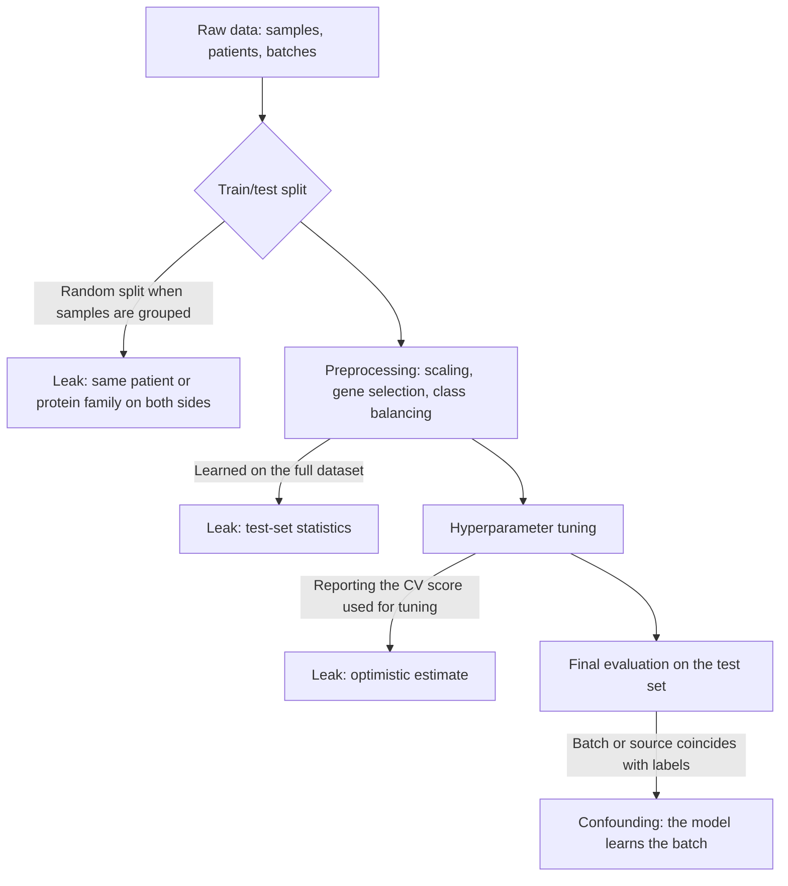

Data leakage happens when information from the test set slips into training, and on biological data it can make a machine learning model look far more accurate than it is. In the simulation in this article, a model trained on 10,000 pure-noise "genes" reaches a mean AUROC of 0.76 only because gene selection happens before cross-validation; move that step inside a `Pipeline` and AUROC falls to 0.49, which is coin-flip level. Kapoor and Narayanan (2023) documented leakage in 17 scientific fields, affecting 294 papers, and Whalen et al. (2022) summarized five pitfalls specific to genomics. This is part 10 of the series *Bioinformatics from Beginner to Advanced*, written for students and self-learners who already know scikit-learn. You will come away with three things: how to split data by patient and by homology cluster, how to read the ProteinGym leaderboard (ESM-2 650M scores a Spearman of 0.414 and ranks 45 of 97), and how to grade a chatbot that answers biology questions.

<div class="callout callout-note">
<p class="callout-title">Quick summary</p>

- The first question to ask of any "accuracy" number: is the test set truly independent of everything the model has seen?
- Scaling, gene selection, class balancing, and hyperparameter tuning all belong **inside** the cross-validation loop (`Pipeline`, nested CV).
- When several samples come from one patient, split by patient (`StratifiedGroupKFold`); when proteins share families, split by homology cluster and try several identity thresholds.
- On ProteinGym, ESM-2 beats the Site-Independent baseline on average but loses to it on viral proteins and on proteins with shallow MSAs; the 15B version is no better than the 650M one.
- Evaluating a chatbot is a validation problem too: reference answers locked in advance, a rubric, blind grading, re-grading, and checking every citation.

</div>

## 1. What data leakage is: AUROC 0.76 on data with no signal

Kaufman et al. (2012) define leakage in data mining as introducing information into a model that it would not have when used for real. In prediction tasks, the most common form is information from the test set (or from the fold used for evaluation) flowing back into training. The measured number then no longer answers "how well does the model do on new data?" It answers a much easier question.

The following experiment runs on a laptop in a few minutes. Create 100 samples, each with 10,000 "genes" drawn at random from a normal distribution, then assign disease/healthy labels at random, 50/50. No gene is related to the label. The first approach picks the 20 genes with the strongest F statistic on **all** 100 samples, and only then runs 5-fold cross-validation (CV) with L1-penalized logistic regression (→ Classification). The second approach puts gene selection **inside** a `Pipeline`, so each fold picks its own 20 genes from that fold's training portion only. Repeat 100 times with 100 different datasets:


*Figure 1. Mean 5-fold AUROC on pure-noise data, 100 repeats. Genes selected before CV: mean 0.760 (range 0.632–0.886). Genes selected inside the Pipeline: mean 0.488 (0.330–0.700). Simulated data; script run on November 28, 2026, with scikit-learn 1.9.0.*

Not one repeat of the first approach gave an AUROC below 0.63, even though the model had nothing to learn. Those 20 genes were chosen because they *happened* to separate the two groups well on the very samples that later served as the test set. With 10,000 genes and 100 samples, there are always a few dozen such genes.

The simulations in this article (Figures 1 and 2) are examples with known answers. They say nothing about how common this error is in the scientific literature; frequency figures have to come from reviews such as Kapoor and Narayanan (2023).

None of this is new. In 2002, Ambroise and McLachlan showed that cancer prediction rules built from microarray data with near-zero cross-validation error owed that result to selection bias: genes were selected on the full dataset before CV. Once gene selection was moved inside CV, the error was no longer zero (Ambroise & McLachlan, 2002). Varma and Simon (2006) took the argument a step further to parameter tuning: on "null" data with no signal, CV of a tuned classifier gave an error below 30% in 18.5% of simulated datasets with shrunken centroids and 38% with SVM.

Twenty years later, the problem is still here, and it has spread. Whalen et al. (2022) observe that machine learning is widely used in genomics thanks to large datasets and easy-to-use toolkits, but the toolkits' implicit assumptions often do not hold for biological data. Kapoor and Narayanan (2023) call leakage part of a reproducibility crisis in ML-based science. The whole article turns on one question: **is the test set truly independent?** Section 2 looks at the training procedure and data structure, Section 3 at the pretraining data of foundation models (through ESM-2 and ProteinGym), and Section 4 at the grader when evaluating chatbots.

## 2. Five pitfalls in validating ML for genomics

### 2.1. The i.i.d. assumption and biological data

ML software assumes that samples are independent and identically distributed (i.i.d.), and that training and test data resemble the data the model will meet in real use. Biological data violates this in many ways: samples from the same patient, proteins from the same family, genes at the same locus, samples run on the same day. Whalen et al. (2022) group these violations into five pitfalls: distributional differences, dependent examples, confounding, leaky preprocessing, and unbalanced classes. Kapoor and Narayanan (2023) sort leakage into eight types, from textbook errors to open research problems, and propose that every paper include a "model info sheet" describing how the data were split.

**Table 1.** The five pitfalls, examples in omics, and fixes.

| Pitfall (Whalen et al., 2022) | Example in omics | Fix | scikit-learn tool |
|---|---|---|---|
| Leaky preprocessing | Scaling, gene selection, SMOTE on the full dataset before CV | Every step that learns from data sits inside the CV loop | `Pipeline`, `make_pipeline` |
| Dependent examples | Several biopsies from one patient; proteins from the same family; protein pairs that share a member | Split by group or by cluster | `GroupKFold`, `StratifiedGroupKFold`, `LeaveOneGroupOut` |
| Confounding | Sequencing batch coincides with disease group | Balanced design; evaluate on new batches or cohorts | `LeaveOneGroupOut` with group = batch |
| Distributional differences | Train at one hospital, deploy at another | Test on an independent cohort | (outside CV) |
| Unbalanced classes | 2% pathogenic variants | Report the positive-class rate and AUPRC alongside AUROC; balance classes within folds | `StratifiedKFold`, `average_precision_score` |

The diagram below marks where test-set information most often leaks into a pipeline:



### 2.2. Leakage from preprocessing, feature selection, and tuning

The rule fits in one sentence: any step that **learns from data** (computing the mean and standard deviation for scaling, ranking genes, generating synthetic samples to balance classes, choosing the number of PCA components) may only learn from the training portion of each fold. The scikit-learn user guide states this rule in its cross-validation section and uses `Pipeline` to enforce it: when `cross_val_score` receives a `Pipeline`, every step inside is re-`fit` on the training portion of each fold (scikit-learn developers, n.d.-b; Pedregosa et al., 2011).

The code below is a condensed, single-run version of the simulation in Figure 1:

```python
import numpy as np
from sklearn.pipeline import make_pipeline
from sklearn.feature_selection import SelectKBest, f_classif
from sklearn.preprocessing import StandardScaler
from sklearn.linear_model import LogisticRegression
from sklearn.model_selection import StratifiedKFold, cross_val_score

rng = np.random.default_rng(0)
X = rng.normal(size=(100, 10_000))          # 100 samples, 10,000 pure-noise "genes"
y = np.repeat([0, 1], 50); rng.shuffle(y)   # random labels: nothing to learn
cv = StratifiedKFold(n_splits=5, shuffle=True, random_state=0)
clf = make_pipeline(StandardScaler(),
                    LogisticRegression(l1_ratio=1, solver="liblinear", C=0.1))

# WRONG: select 20 genes using all the data, including samples that later become test data
X_top = SelectKBest(f_classif, k=20).fit_transform(X, y)
print("Leaky  :", cross_val_score(clf, X_top, y, cv=cv, scoring="roc_auc").mean().round(3))

# RIGHT: gene selection sits inside the Pipeline and is re-learned on each fold's training part
pipe = make_pipeline(SelectKBest(f_classif, k=20), clf)
print("Correct:", cross_val_score(pipe, X, y, cv=cv, scoring="roc_auc").mean().round(3))
```

With scikit-learn 1.9.0, the output is 0.806 for the wrong approach and 0.494 for the right one. L1-penalized logistic regression is declared with `l1_ratio=1`: as of version 1.8, the `penalty` parameter of `LogisticRegression` is deprecated and will be removed in 1.10; the `liblinear` solver still supports the L1 penalty (scikit-learn developers, n.d.-a).

Hyperparameter tuning is a harder leak to spot. Fixing `C=0.1` in advance is fine. But if you try many values of `C` with `GridSearchCV` and then report the best CV score, that number is optimistic, because the evaluation data were used to choose `C`. Varma and Simon (2006) showed that nested CV (an inner CV loop for tuning, nested in an outer CV loop for evaluation) gives an almost unbiased estimate. Lever et al. (2016b) make the same point: data used to select a model must not be reused to report its performance. In scikit-learn, nested CV just means passing a `GridSearchCV` to `cross_val_score`.

Ambroise and McLachlan (2002) also recommend 10-fold CV over leave-one-out, or the .632+ bootstrap, when estimating error after gene selection.

<div class="callout callout-warning">
<p class="callout-title">Three common leaks in Jupyter notebooks</p>

- Calling `StandardScaler().fit_transform(X)` on the whole table before `train_test_split`: the mean and standard deviation already carry test-set information. With large datasets the bias is usually small, but the habit leads to bigger mistakes.
- Balancing classes by oversampling (generating extra minority-class samples) before splitting: copies or synthetic versions of the same original sample end up in both train and test.
- Filtering genes by variance or by the p-value of a two-group comparison on the full dataset before modeling. Variance filtering doesn't use labels, so it's less dangerous; p-value filtering does use labels, and that is exactly the experiment in Figure 1.

</div>

### 2.3. Dependent examples: same patient, same pair

One patient can contribute many samples: biopsies from several regions of a tumor, several time points, thousands of cells in single-cell data. These samples share that person's "fingerprint": genotype, age, how the sample was collected. Split randomly by sample, and one person's samples land in both train and test. The model can then score well simply by recognizing the patient rather than the disease. Whalen et al. (2022) recommend splitting by group (group k-fold). scikit-learn ships `GroupKFold`, `StratifiedGroupKFold` (keeps class ratios and separates groups), `LeaveOneGroupOut`, and `GroupShuffleSplit` (scikit-learn developers, n.d.-b).

The second simulation uses 30 patients × 4 samples, 200 features; labels are assigned per patient, and each person's own expression fingerprint is **unrelated** to the label. A random forest with `StratifiedKFold` reaches a mean AUROC of 0.996; with `StratifiedGroupKFold` by patient it drops to 0.491 (Figure 2, left).


*Figure 2. Same data, only the train/test split differs, 30 repeats. Left: 30 patients × 4 samples, AUROC 0.996 when splitting by sample and 0.491 when splitting by patient. Right: 60 simulated protein families × 10 members, accuracy 0.960 with a random split and 0.572 when splitting by family. Simulated data.*

To check that a split is correct, test it directly: no group may appear on both sides.

```python
import numpy as np
from sklearn.model_selection import StratifiedGroupKFold

rng = np.random.default_rng(1)
patient = np.repeat(np.arange(30), 4)           # 30 patients, 4 samples each
y = np.repeat(rng.permutation([0, 1] * 15), 4)  # labels assigned per patient
X = rng.normal(size=(120, 50))

cv = StratifiedGroupKFold(n_splits=5, shuffle=True, random_state=0)
for train, test in cv.split(X, y, groups=patient):
    assert not set(patient[train]) & set(patient[test])  # no patient on both sides
print("OK: no patient appears in both train and test")
```

Tasks whose input is a **pair** (protein–protein interaction, drug–target) are trickier still. Park and Marcotte (2012) showed that pair-prediction methods perform much better on test pairs that share a member with the training set, so test pairs must be broken out by overlap: both proteins seen, one protein seen, or neither. Bernett et al. (2024) reproduced deep learning models that predict protein–protein interactions from sequence: random splits overestimated performance; once sequence similarity between train and test was reduced, performance fell to chance; and a baseline using only similarity and node degree in the network did well at very low cost.

### 2.4. Homologous sequences: split by cluster, not at random

Proteins from the same family on both sides of the train/test line are also dependent examples. The DOME recommendations call for redundancy reduction suited to each field, for example removing homologs between the training and test sets (Walsh et al., 2021). The common approach is to cluster all sequences with MMseqs2 (Steinegger & Söding, 2017), or Linclust for very large datasets (Steinegger & Söding, 2018), then keep each cluster entirely on one side, in other words, use the cluster ID as `groups` for `GroupKFold`.

What identity threshold is enough? The common 30% is a convention tied to the "twilight zone" of protein alignment. According to Rost (1999), this zone sits at roughly 20–35% identity: above about 30%, around 90% of sequence pairs are true homologs; below 25%, fewer than 10% are. That study is about inferring structural homology, not about train/test splitting rules. The safe approach is to try several thresholds (say 30%, 50%, 70%) and report performance at each.

Subcellular localization prediction is a familiar example. DeepLoc applied deep learning to this task (Almagro Armenteros et al., 2017). Stärk et al. (2021) used protein language model embeddings, beat the previous best method by about 8 percentage points (10-class accuracy), and had to build an additional new test set to expose the limits of the static dataset. DeepLoc 2.0 moved fully to protein language models (Thumuluri et al., 2022).

Figure 2 (right) simulates this: 60 simulated "protein families," each with 10 members sitting close together in a 64-dimensional space, like embeddings of proteins from one family. The "location" label is assigned per family, mostly from a weak shared signal and the rest at random. With a random split, logistic regression reaches 0.960 accuracy because it has already seen relatives of almost every test protein. Split by family, it drops to 0.572. The second number is the real ability to predict for a protein family it has never encountered.

Foundation models add another layer of leakage: proteins in the test set may already be in the language model's pretraining data. Hermann et al. (2024, preprint) compared a split that accounts for pretraining data with an ordinary cluster split on melting-temperature prediction, and found that leakage from pretraining consistently distorted measured performance.

On visualization: ESM-2 embeddings clustering by protein family on a UMAP do not prove the model "understands function," because the clusters may simply reflect sequence similarity. UMAP helps you look at data; it is not an evaluation.

### 2.5. Batch effects and confounding

A batch effect is a technical difference between groups of samples processed differently: run date, reagent lot, operator, lab. Leek et al. (2010) showed that batch effects are widespread in high-throughput data and most dangerous when they coincide with the outcome, for example when all disease samples run in week one and all healthy samples in week two (→ [Transcriptomics](/en/blog/transcriptomics-rna-seq-va-single-cell/)).

Cross-validation does **not** detect a confounding batch. If batch coincides with label, a model that learns the batch predicts the label correctly in every fold. Soneson et al. (2014) simulated several levels of confounding between batch and group and found that CV-based performance estimates were strongly biased relative to performance on independent data.

Batch correction has its own trap. ComBat (Johnson et al., 2007) lets you include the group variable in the model to preserve group differences while removing batch differences. Nygaard et al. (2016) showed that with an unbalanced design (group proportions differing across batches), this "preserve group differences" correction can create spurious group differences and make downstream analyses overconfident.

In order of priority: (1) design a balanced study from the start, with every batch containing every group; (2) plot a PCA colored by batch and by group before doing anything else (→ [Math and statistics for biology](/en/blog/toan-va-thong-ke-cho-sinh-hoc/)); (3) include batch in the model as a covariate when possible; (4) do the final evaluation on an unseen batch or cohort, for example `LeaveOneGroupOut` with batch as the group (Leek et al., 2010; Whalen et al., 2022).

### 2.6. Choosing metrics and always having a baseline

Sensitivity, specificity, PPV, NPV, the ROC curve, and AUROC are the familiar set; PPV and NPV depend on prevalence, so they don't transfer between populations (→ Error Rates and the Bayes Classifier). Lever et al. (2016a) give a short summary of these metrics.

When classes are imbalanced, say 2% pathogenic variants, Saito and Rehmsmeier (2015) showed that the precision-recall (PR) curve is more informative than ROC. But McDermott et al. (2024) counter that AUPRC is not always better than AUROC under imbalance, and can widen disparities between subgroups because it favors the group with more positives. The safe choice is to report both, along with the positive-class rate (the AUPRC baseline equals exactly this rate) and confidence intervals.

A number on its own, with no baseline to compare against, says almost nothing. The baseline could be logistic regression on a few features, "predict from the nearest homologous protein," or Site-Independent on ProteinGym (Section 3). When Kapoor and Narayanan (2023) fixed leakage in civil war prediction studies, complex ML models no longer substantially outperformed logistic regression. In single-cell work, Kedzierska et al. (2025) showed that foundation models used zero-shot can lose to simple methods, and Ahlmann-Eltze et al. (2025) found that five foundation models and two other deep learning models did not beat a linear baseline at predicting gene perturbation effects.

The question "what are the 10 most important genes?" is also easy to get wrong. The gene set chosen by L1 or a random forest often changes between folds when p ≫ n. Rather than reporting one list, report how often each gene is selected across folds or across many resamples, in the spirit of stability selection (Meinshausen & Bühlmann, 2010).

### 2.7. Reporting standards: DOME, TRIPOD+AI, model cards

DOME is the ELIXIR Machine Learning Focus Group's set of recommendations for validating supervised ML in biology, built on four components, **Data, Optimization, Model, Evaluation**, with a question-based checklist (Walsh et al., 2021). TRIPOD+AI is the reporting guideline for clinical prediction models that use regression or ML (Collins et al., 2024). A model card is a documentation template that ships with a model and describes its purpose, data, and performance by subgroup (Mitchell et al., 2019).

**Table 2.** The DOME checklist applied to the hypothetical study in Figure 1 (disease classification from 10,000 genes, 100 samples).

| DOME | Key question | Leaky version | Fixed version |
|---|---|---|---|
| Data | Do train and test overlap? Redundancy reduced? Split published? | Gene selection has "seen" every sample | Every learning step inside the fold; seed and split recorded |
| Optimization | Which data chose the parameters and features? | 20 genes chosen on the full dataset | `SelectKBest` inside a `Pipeline`; nested CV if tuning `k` or `C` |
| Model | Is the model interpretable and published? | Doesn't mention that the gene set fluctuates | Report gene selection frequency across folds |
| Evaluation | Compared with a baseline? Confidence interval? Confusion matrix? | AUROC 0.76, no baseline | AUROC 0.49 vs. the 0.5 level; distribution over 100 repeats |

## 3. ESM-2 and ProteinGym: reading a benchmark correctly

Section 2 was about your own models. This section turns to reading results for other people's models, with ESM-2 and ProteinGym as the case study. A public benchmark solves part of the problem: every model is scored on the same assays, with the same metric, by the same team. The rest of the work falls to the reader: look at the table by subgroup, find the baseline, and recognize when a gap is too small to matter.

### 3.1. What a protein language model is

A protein language model (pLM) learns protein sequences the way a language model learns text: mask some amino acids and make the model guess them back (masked language modeling), across tens to hundreds of millions of sequences. Rives et al. (2021) showed that information about structure and function emerges on its own in the representations of the ESM-1b model when unsupervised learning is scaled up to 250 million sequences. ProtTrans is another family of self-supervised pLMs, developed in parallel (Elnaggar et al., 2022).

ESM-2 is a family of models from 8 million to 15 billion parameters (Lin et al., 2023). The 650M checkpoint has 33 layers and is released on Hugging Face under the MIT license (Meta AI, n.d.). Lin and colleagues used ESM-2 as the basis for ESMFold and predicted structures for more than 617 million metagenomic proteins, more than 225 million of them with high confidence (→ [Proteomics and protein structure](/en/blog/proteomics-va-cau-truc-protein/)).

There are two ways to use a pLM. The first takes the **embedding** (a vector representation of each protein) as features for a small supervised model, as in the subcellular localization task in Section 2.4. The second is **zero-shot**: with no further training, compare the probability the model assigns to the mutant amino acid with the wild-type amino acid at the same position to score a mutation's effect. Meier et al. (2021) introduced this approach with ESM-1v.

**Table 3.** Some deep learning architectures in biology and their learning type.

| Model | Architecture | Learning | Input → output |
|---|---|---|---|
| DeepBind (Alipanahi et al., 2015) | CNN | Supervised | DNA/RNA → protein binding specificity |
| Basset (Kelley et al., 2016) | CNN | Supervised | DNA → open chromatin regions |
| DNABERT (Y. Ji et al., 2021) | Transformer | Self-supervised (language model) | DNA → embedding |
| Nucleotide Transformer (Dalla-Torre et al., 2025) | Transformer | Self-supervised (language model) | DNA → embedding |
| Enformer (Avsec et al., 2021) | CNN + Transformer | **Supervised** | DNA → gene expression, long-range interactions up to 100 kb |
| ESM-2 (Lin et al., 2023) | Transformer | Self-supervised (language model) | Protein → embedding, amino acid probabilities |
| scGPT (Cui et al., 2024); Geneformer (Theodoris et al., 2023) | Transformer | Pretrained on single-cell data | Cell expression → embedding |
| RFdiffusion (Watson et al., 2023) | Diffusion | Generative | Design of new protein structures |
| AlphaFold 3 (Abramson et al., 2024) | Pairformer + diffusion module | Supervised | Molecule sequences → complex structure |

### 3.2. ProteinGym and deep mutational scanning data

Deep mutational scanning (DMS) measures the effects of thousands of mutations of one protein in a single experiment, by linking each variant to a functional selection and sequencing before and after selection (Fowler & Fields, 2014). DMS data were used to evaluate variant effect predictors before ProteinGym existed (Livesey & Marsh, 2020). Models that learn from a protein family's multiple sequence alignment (MSA), such as DeepSequence (Riesselman et al., 2018) and EVE (Frazer et al., 2021), are familiar points of comparison.

ProteinGym collects standardized DMS assays along with clinical variant data and evaluates both zero-shot and supervised settings; the preprint describes more than 250 assays and more than 70 models (Notin et al., 2023a), and the NeurIPS 2023 conference version is Notin et al. (2023b). The README for v1.3 lists 217 substitution assays (about 2.7 million missense variants) and 74 indel assays (about 300 thousand variants) (OATML-Markslab, n.d.-a).

The way ProteinGym designs its evaluation is worth copying. The main metric is the Spearman correlation between model scores and measured values, so it only asks whether the model ranks the mutations in the right order. Assays are grouped by the type of function measured (activity, binding, expression, organismal fitness, stability), by taxon (human, other eukaryote, prokaryote, virus), and by MSA depth (low, medium, high). In the supervised setting there are three 5-fold split schemes: random, contiguous (by consecutive stretches of the chain), and modulo (by position remainder), to measure extrapolation to unseen positions (Notin et al., 2023a; OATML-Markslab, n.d.-a). Contiguous and modulo are the "split by group" of Section 2.3, applied to positions on a protein.

### 3.3. Reading the leaderboard: where does ESM-2 stand?

The zero-shot summary table across 217 substitution assays includes 97 models (OATML-Markslab, n.d.-b; accessed November 28, 2026). Some rows:

**Table 4.** Mean zero-shot Spearman on ProteinGym, overall and by subgroup.

| Model | Rank | Mean | Bootstrap SE | Virus | Low MSA depth | High MSA depth |
|---|---|---|---|---|---|---|
| AIDO Protein-RAG (16B) | 1 | 0.518 | 0.000 | 0.522 | 0.498 | 0.585 |
| TranceptEVE L | 18 | 0.456 | 0.007 | 0.461 | 0.436 | 0.490 |
| GEMME | 20 | 0.455 | 0.009 | 0.472 | 0.446 | 0.493 |
| EVE (ensemble) | 26 | 0.439 | 0.009 | 0.434 | 0.420 | 0.477 |
| ESM2 (650M) | 45 | 0.414 | 0.012 | 0.261 | 0.338 | 0.513 |
| ESM-1v (ensemble) | 47 | 0.407 | 0.013 | 0.294 | 0.316 | 0.495 |
| ESM2 (3B) | 50 | 0.406 | 0.011 | 0.294 | 0.336 | 0.485 |
| ESM2 (15B) | 52 | 0.400 | 0.010 | 0.333 | 0.341 | 0.467 |
| ESM-1b | 57 | 0.394 | 0.011 | 0.260 | 0.365 | 0.480 |
| Site-Independent | 76 | 0.359 | 0.012 | 0.375 | 0.427 | 0.317 |
| ESM2 (8M) | 93 | 0.226 | 0.015 | 0.090 | 0.200 | 0.262 |


*Figure 3. Mean zero-shot Spearman by subgroup for six models, redrawn from the ProteinGym table (OATML-Markslab, n.d.-b), accessed November 28, 2026.*

The table holds three lessons.

**Bigger is not necessarily better.** On average, ESM2 650M (0.414) beats 3B (0.406) and 15B (0.400). The 8M version reaches only 0.226, so size helps at the low end of the scale, but past 650M it stops paying off.

**Averages hide subgroups.** On viral proteins, ESM2 650M reaches only 0.261, lower even than Site-Independent (0.375), a baseline that uses only amino acid frequencies in each MSA column. On proteins with shallow MSAs, ESM2 650M scores 0.338, Site-Independent 0.427, and GEMME 0.446. Conversely, with deep MSAs, ESM2 650M (0.513) beats GEMME (0.493). Someone who only looks at the average column will miss these reversals.

**The standard error tells you which gaps mean something.** The ProteinGym README explains that the bootstrap standard error column reflects how much the aggregate figure varies across assays (OATML-Markslab, n.d.-a). The top model has an SE of 0, and the README doesn't explain the calculation in detail. The ESM group's errors are around 0.010–0.013, while ESM2 650M, ESM-1v, and ESM2 3B are only 0.007–0.008 apart. Ranks 45, 47, and 50 are therefore not enough to say which of these three models is better.

A few lines of pandas are enough to check these numbers yourself against the public table on GitHub. Figures can change as the authors add models, so record the access date when you cite them:

```python
import pandas as pd
url = ("https://raw.githubusercontent.com/OATML-Markslab/ProteinGym/main/benchmarks/"
       "DMS_zero_shot/substitutions/Spearman/Summary_performance_DMS_substitutions_Spearman.csv")
table = pd.read_csv(url)
cols = ["Model_rank", "Model_name", "Average_Spearman", "Taxa_Virus", "Low_MSA_depth"]
models = ["ESM2 (650M)", "ESM2 (15B)", "GEMME", "Site-Independent"]
print(table.loc[table["Model_name"].isin(models), cols].to_string(index=False))
```

### 3.4. The TP53 case: same protein, conclusions change with the assay

TP53 is the tumor suppressor gene discussed in the sequence analysis article (→ [Sequence analysis](/en/blog/phan-tich-trinh-tu/)). ProteinGym has four DMS assays for TP53: three labeled `Giacomelli_2018`, corresponding to three different selection conditions (Null_Etoposide, Null_Nutlin, WT_Nutlin), and one labeled `Kotler_2018`, following the names in ProteinGym's table.


*Figure 4. Zero-shot Spearman on four TP53 assays, redrawn from ProteinGym's per-assay table (OATML-Markslab, n.d.-c), accessed November 28, 2026.*

ESM2 650M scores 0.432 (Null_Etoposide), 0.404 (Null_Nutlin), 0.400 (WT_Nutlin), and 0.678 (Kotler). On WT_Nutlin, ESM2 650M is **lower** than Site-Independent (0.445); on Kotler it is higher (0.678 vs. 0.629). Against the average trend in Section 3.3, the 15B version beats the 650M on all four TP53 assays, for example 0.497 vs. 0.432 on Null_Etoposide (OATML-Markslab, n.d.-c). Ask "which model is better for TP53?" and the answer depends on the assay you pick.

Why do pLMs behave this way? Gordon et al. (2024, preprint) showed that a pLM's zero-shot ability can be predicted from the likelihood the model assigns to the wild-type sequence: sequences the model "prefers" too much or too little both lead to worse predictions. Ding and Steinhardt (2024, preprint) showed that pLM likelihoods carry a species bias, because sequence databases sample the tree of life unevenly. Both studies are still preprints; they suggest one explanation for the weak results on viral proteins, not a confirmed conclusion.

### 3.5. Five questions to ask of any benchmark

<div class="callout callout-example">
<p class="callout-title">Reading a leaderboard</p>

1. What is the metric, and why was it chosen (Spearman, AUROC, accuracy)?
2. Which groups are averaged together; do subgroup results reverse?
3. What are the standard errors or confidence intervals; does the gap exceed them?
4. What is the simplest baseline in the table, and how far ahead of it is the model you care about?
5. Could the test set already be in the pretraining data?

</div>

## 4. Evaluating AI chatbots on bioinformatics questions

### 4.1. Why you need your own evaluation

Hallucination is when a model generates fluent text that is unfaithful to the source or factually wrong (Z. Ji et al., 2023). In biology, the most dangerous form is fabricated citations. Walters and Wilder (2023) checked 636 citations in 84 short literature reviews written by ChatGPT: 55% of GPT-3.5's citations and 18% of GPT-4's were fabricated. Bhattacharyya et al. (2023) checked 115 references in 30 short medical papers written by ChatGPT-3.5: 47% were fabricated, 46% were real but had wrong details, and only 7% were fully correct; a wrong PMID was the most common error. Both studies used 2023-era models, and today's chatbots may differ. That is why you need to measure on the kinds of questions you actually ask.

Plenty of benchmarks exist. MultiMedQA has humans grade medical answers along several axes: factuality, comprehension, reasoning, potential for harm, and bias (Singhal et al., 2023). GeneTuring has 16 genomics tasks, 1,600 questions, and 48,000 hand-graded answers (Shang et al., 2025). LAB-Bench has more than 2,400 multiple-choice questions on practical biology research skills (Laurent et al., 2024, preprint). PubMedQA covers question answering from PubMed abstracts (Jin et al., 2019). For structure and variants, CASP (Kryshtafovych et al., 2021) and CAGI (The Critical Assessment of Genome Interpretation Consortium, 2024) are long-running blind assessments. A small question set you build yourself can't replace these benchmarks, but it tells you how far to trust a chatbot for the exact work you do.

### 4.2. Designing the question set

About 20 questions is enough for practice, split into four types:

1. **Fact lookups with an answer in a database**, for example the number of exons in the canonical TP53 transcript in a specific Ensembl release. Always state the release, because the answer changes between releases.
2. **Concepts and reasoning**, for example why controlling the FDR differs from a Bonferroni correction, or why you need `GroupKFold` when each patient contributes several samples.
3. **Calculations or code**, for example converting a Phred quality score to an error probability, or converting BED coordinates (0-based) to VCF (1-based).
4. **Citation requests**, for example asking for two original papers for a method, with DOIs.

Calculation questions have the advantage that the answer is clearly right or wrong. A Phred score $Q$ relates to the probability $P$ of a wrong base call by $P = 10^{-Q/10}$, so Q30 corresponds to $P = 0.001$ and Q20 to $P = 0.01$. A position written in a BED file as `chr1  99  100` (0-based, half-open) corresponds to `POS = 100` in VCF (1-based). A chatbot that answers "1%" for Q30, or keeps 99 when converting to VCF, has made a clear factual error, and there's nothing to debate when grading it.

Each question gets a **reference answer** written in advance, with a verified source (UniProt, ClinVar, NCBI, Ensembl, a paper with a DOI). Store the answers and rubric in a timestamped repository **before** asking the chatbot, much like preregistering a study. Record the chatbot's name, the model version (if shown), date and time, whether web search was on, and the exact prompt. Ask each question three times in three fresh conversations to see how much answers vary.

The leakage lesson from Section 2 holds here too: questions copied verbatim from textbooks or public exercises may already be in the chatbot's training data. Rewrite them and add specific details (database version, your own numbers).

### 4.3. A three-criterion rubric and an error taxonomy

**Table 5.** Rubric for grading each answer, 0–2 scale per criterion.

| Criterion | 2 | 1 | 0 |
|---|---|---|---|
| Factual accuracy | Matches the reference answer | Main point right, details wrong | Wrong |
| Grounding and citations | Every citation is real and correct in detail (checked via Crossref, PubMed) | Real but with wrong year, volume, pages, or PMID; or no citation when one is needed | At least one fabricated citation |
| Awareness of limits | Says clearly when unsure, when the answer depends on a version, or when the question has a false premise | Generic caveat | Confidently wrong, invents numbers or gene names |

The three criteria are close to the MultiMedQA axes (Singhal et al., 2023), trimmed for lookup and calculation tasks. Each answer can contain several errors, classified into four types: **factual error**, **fabricated citation**, **faulty reasoning**, and **missing context**. Fabricated citations deserve their own category rather than being folded into factual errors, because they are frequent (Bhattacharyya et al., 2023; Walters & Wilder, 2023) and detecting them is a different job: you have to look up every DOI and PMID.

### 4.4. The reliability of the grader

The grader may not be independent either. There are three safeguards: blind grading (another person or a script shuffles the answers and hides the chatbot's name before grading); re-grading after at least two weeks to measure stability; and computing Cohen's (1960) kappa between the two rounds. Because the 0–1–2 scale is ordinal, weighted kappa fits better than plain kappa. For error rates on small samples, use the Wilson (1927) confidence interval.

```python
from math import sqrt
from sklearn.metrics import cohen_kappa_score

def wilson(k, n, z=1.96):
    """95% Wilson confidence interval for the proportion k/n."""
    p = k / n
    center = (p + z**2 / (2 * n)) / (1 + z**2 / n)
    half = z * sqrt(p * (1 - p) / n + z**2 / (4 * n**2)) / (1 + z**2 / n)
    return center - half, center + half

# Hypothetical example: 4 of 20 answers contain at least one fabricated citation
lo, hi = wilson(4, 20)
print(f"20% (95% Wilson CI: {lo:.1%} – {hi:.1%})")

# Hypothetical example: 0–2 scores for 20 questions, first round and re-grade after 2 weeks
round1 = [2,2,1,0,2,1,1,2,0,2,2,1,2,2,0,1,2,2,1,2]
round2 = [2,1,1,0,2,1,2,2,0,2,2,1,2,1,0,1,2,2,2,2]
print("unweighted kappa:", round(cohen_kappa_score(round1, round2), 2))
print("linear weighted kappa:", round(cohen_kappa_score(round1, round2, weights="linear"), 2))
```

Output: 20% with a 95% confidence interval from 8.1% to 41.6%; kappa 0.66 and linear weighted kappa 0.73. These numbers are a hypothetical example to illustrate the calculation, not results from a real evaluation. A confidence interval nearly 34 percentage points wide shows that 20 questions are only enough to catch big problems, not to rank two chatbots that are close.

You can use a language model as a judge (LLM-as-a-judge) for comparison. Zheng et al. (2023) found that strong LLM judges reach more than 80% agreement with humans, but show biases toward answer position, length, and answers they generated themselves. It should serve only as a cross-check, not a replacement for the human grader.

### 4.5. Limitations

Twenty questions is a small sample, written and graded by one person. The language of the questions (Vietnamese or English) may affect the results. The model behind a chatbot changes over time, so results hold only for the version and date recorded. If you have used the same chatbot to write study materials, state the conflict of interest, and ideally compare at least two chatbots with blind grading.

## 5. Discussion: one question for all three parts

All three parts of this article ask the same question: independent of what? Section 2 requires independence from the **training procedure** (scaling, gene selection, tuning) and from the **data structure** (patients, pairs, protein families, batches) (Kapoor & Narayanan, 2023; Whalen et al., 2022). Section 3 adds **pretraining data**, and requires reading results by subgroup, with standard errors (Hermann et al., 2024; Notin et al., 2023a). Section 4 adds the **grader's expectations** (rubric locked in advance, blind grading), along with checking every citation (Cohen, 1960; Walters & Wilder, 2023).

An independent cohort isn't always available. When it's missing, the minimum is to split by the right independent unit, keep every learning step inside the CV loop, compare against a baseline, and state plainly in the limitations that external validation is still missing. A modest number with a transparent split is more useful than an AUROC of 0.95 that nobody can reproduce. The next-generation sequencing article reaches the same point: you only know how well a variant-calling pipeline works when you compare it with an independent truth set such as Genome in a Bottle (→ [Next-generation sequencing](/en/blog/giai-trinh-tu-the-he-moi-ngs-va-genomics/)).

**Table 6.** Ten questions to ask before trusting a number.

| # | Question |
|---|---|
| 1 | Which preprocessing step learned from the full dataset? |
| 2 | What is the independent unit: sample, patient, protein, cluster, batch? |
| 3 | Are there homologous sequences on both sides of the split, and at what threshold? |
| 4 | Does the technical batch coincide with the labels? |
| 5 | Which data were used to choose the parameters? |
| 6 | Which metric, what positive-class rate, what confidence interval? |
| 7 | Which simple baseline was it compared against? |
| 8 | Do subgroup results reverse? |
| 9 | Is the test set in the pretraining data? |
| 10 | Have all citations been checked via Crossref and PubMed? |

## 6. Frequently asked questions

**When should you use `GroupKFold` instead of `StratifiedKFold`?** When one biological unit (patient, individual, protein family, batch) contributes more than one sample. If the classes are imbalanced, use `StratifiedGroupKFold`.

**Is the 30% identity threshold mandatory?** No. It is a convention tied to the 20–35% twilight zone (Rost, 1999). Try several thresholds and report performance at each.

## 7. Conclusion

Most of the inflated numbers in biological ML come from a test set that isn't independent, not from a weak algorithm. Next time you train a model, do three things before reporting: put every learning step in a `Pipeline`, choose the unit you split on (patient, homology cluster, batch), and set a baseline next to your result. When reading a benchmark like ProteinGym, look at the subgroup columns and the error column before the average. With chatbots, lock the reference answers before asking and look up every DOI they give you. The next article in the series covers reproducible workflows (→ Reproducible workflows).

## References

Abramson, J., Adler, J., Dunger, J., Evans, R., Green, T., Pritzel, A., Ronneberger, O., Willmore, L., et al. (2024). Accurate structure prediction of biomolecular interactions with AlphaFold 3. *Nature, 630*(8016), 493–500. https://doi.org/10.1038/s41586-024-07487-w

Ahlmann-Eltze, C., Huber, W., & Anders, S. (2025). Deep-learning-based gene perturbation effect prediction does not yet outperform simple linear baselines. *Nature Methods, 22*(8), 1657–1661. https://doi.org/10.1038/s41592-025-02772-6

Alipanahi, B., Delong, A., Weirauch, M. T., & Frey, B. J. (2015). Predicting the sequence specificities of DNA- and RNA-binding proteins by deep learning. *Nature Biotechnology, 33*(8), 831–838. https://doi.org/10.1038/nbt.3300

Almagro Armenteros, J. J., Sønderby, C. K., Sønderby, S. K., Nielsen, H., & Winther, O. (2017). DeepLoc: Prediction of protein subcellular localization using deep learning. *Bioinformatics, 33*(21), 3387–3395. https://doi.org/10.1093/bioinformatics/btx431

Ambroise, C., & McLachlan, G. J. (2002). Selection bias in gene extraction on the basis of microarray gene-expression data. *Proceedings of the National Academy of Sciences, 99*(10), 6562–6566. https://doi.org/10.1073/pnas.102102699

Avsec, Ž., Agarwal, V., Visentin, D., Ledsam, J. R., Grabska-Barwinska, A., Taylor, K. R., Assael, Y., Jumper, J., Kohli, P., & Kelley, D. R. (2021). Effective gene expression prediction from sequence by integrating long-range interactions. *Nature Methods, 18*(10), 1196–1203. https://doi.org/10.1038/s41592-021-01252-x

Bernett, J., Blumenthal, D. B., & List, M. (2024). Cracking the black box of deep sequence-based protein–protein interaction prediction. *Briefings in Bioinformatics, 25*(2), bbae076. https://doi.org/10.1093/bib/bbae076

Bhattacharyya, M., Miller, V. M., Bhattacharyya, D., & Miller, L. E. (2023). High rates of fabricated and inaccurate references in ChatGPT-generated medical content. *Cureus, 15*(5), e39238. https://doi.org/10.7759/cureus.39238

Cohen, J. (1960). A coefficient of agreement for nominal scales. *Educational and Psychological Measurement, 20*(1), 37–46. https://doi.org/10.1177/001316446002000104

Collins, G. S., Moons, K. G. M., Dhiman, P., Riley, R. D., Beam, A. L., Van Calster, B., Ghassemi, M., Liu, X., et al. (2024). TRIPOD+AI statement: Updated guidance for reporting clinical prediction models that use regression or machine learning methods. *BMJ, 385*, e078378. https://doi.org/10.1136/bmj-2023-078378

Cui, H., Wang, C., Maan, H., Pang, K., Luo, F., Duan, N., & Wang, B. (2024). scGPT: Toward building a foundation model for single-cell multi-omics using generative AI. *Nature Methods, 21*(8), 1470–1480. https://doi.org/10.1038/s41592-024-02201-0

Dalla-Torre, H., Gonzalez, L., Mendoza-Revilla, J., Lopez Carranza, N., Grzywaczewski, A. H., Oteri, F., Dallago, C., Trop, E., de Almeida, B. P., Sirelkhatim, H., Richard, G., Skwark, M., Beguir, K., Lopez, M., & Pierrot, T. (2025). Nucleotide Transformer: Building and evaluating robust foundation models for human genomics. *Nature Methods, 22*(2), 287–297. https://doi.org/10.1038/s41592-024-02523-z

Ding, F., & Steinhardt, J. N. (2024). *Protein language models are biased by unequal sequence sampling across the tree of life* [Preprint]. bioRxiv. https://doi.org/10.1101/2024.03.07.584001

Elnaggar, A., Heinzinger, M., Dallago, C., Rehawi, G., Wang, Y., Jones, L., Gibbs, T., Feher, T., Angerer, C., Steinegger, M., Bhowmik, D., & Rost, B. (2022). ProtTrans: Toward understanding the language of life through self-supervised learning. *IEEE Transactions on Pattern Analysis and Machine Intelligence, 44*(10), 7112–7127. https://doi.org/10.1109/TPAMI.2021.3095381

Fowler, D. M., & Fields, S. (2014). Deep mutational scanning: A new style of protein science. *Nature Methods, 11*(8), 801–807. https://doi.org/10.1038/nmeth.3027

Frazer, J., Notin, P., Dias, M., Gomez, A., Min, J. K., Brock, K., Gal, Y., & Marks, D. S. (2021). Disease variant prediction with deep generative models of evolutionary data. *Nature, 599*(7883), 91–95. https://doi.org/10.1038/s41586-021-04043-8

Gordon, C., Lu, A. X., & Abbeel, P. (2024). *Protein language model fitness is a matter of preference* [Preprint]. bioRxiv. https://doi.org/10.1101/2024.10.03.616542

Hermann, L., Fiedler, T., Nguyen, H. A., Nowicka, M., & Bartoszewicz, J. M. (2024). *Beware of data leakage from protein LLM pretraining* [Preprint]. bioRxiv. https://doi.org/10.1101/2024.07.23.604678

Ji, Y., Zhou, Z., Liu, H., & Davuluri, R. V. (2021). DNABERT: Pre-trained bidirectional encoder representations from transformers model for DNA-language in genome. *Bioinformatics, 37*(15), 2112–2120. https://doi.org/10.1093/bioinformatics/btab083

Ji, Z., Lee, N., Frieske, R., Yu, T., Su, D., Xu, Y., Ishii, E., Bang, Y. J., Madotto, A., & Fung, P. (2023). Survey of hallucination in natural language generation. *ACM Computing Surveys, 55*(12), 1–38. https://doi.org/10.1145/3571730

Jin, Q., Dhingra, B., Liu, Z., Cohen, W., & Lu, X. (2019). PubMedQA: A dataset for biomedical research question answering. In *Proceedings of the 2019 Conference on Empirical Methods in Natural Language Processing and the 9th International Joint Conference on Natural Language Processing (EMNLP-IJCNLP)* (pp. 2567–2577). Association for Computational Linguistics. https://doi.org/10.18653/v1/D19-1259

Johnson, W. E., Li, C., & Rabinovic, A. (2007). Adjusting batch effects in microarray expression data using empirical Bayes methods. *Biostatistics, 8*(1), 118–127. https://doi.org/10.1093/biostatistics/kxj037

Kapoor, S., & Narayanan, A. (2023). Leakage and the reproducibility crisis in machine-learning-based science. *Patterns, 4*(9), 100804. https://doi.org/10.1016/j.patter.2023.100804

Kaufman, S., Rosset, S., Perlich, C., & Stitelman, O. (2012). Leakage in data mining: Formulation, detection, and avoidance. *ACM Transactions on Knowledge Discovery from Data, 6*(4), 1–21. https://doi.org/10.1145/2382577.2382579

Kedzierska, K. Z., Crawford, L., Amini, A. P., & Lu, A. X. (2025). Zero-shot evaluation reveals limitations of single-cell foundation models. *Genome Biology, 26*, 101. https://doi.org/10.1186/s13059-025-03574-x

Kelley, D. R., Snoek, J., & Rinn, J. L. (2016). Basset: Learning the regulatory code of the accessible genome with deep convolutional neural networks. *Genome Research, 26*(7), 990–999. https://doi.org/10.1101/gr.200535.115

Kryshtafovych, A., Schwede, T., Topf, M., Fidelis, K., & Moult, J. (2021). Critical assessment of methods of protein structure prediction (CASP)—Round XIV. *Proteins: Structure, Function, and Bioinformatics, 89*(12), 1607–1617. https://doi.org/10.1002/prot.26237

Laurent, J. M., Janizek, J. D., Ruzo, M., Hinks, M. M., Hammerling, M. J., Narayanan, S., Ponnapati, M., White, A. D., & Rodriques, S. G. (2024). *LAB-Bench: Measuring capabilities of language models for biology research* (arXiv:2407.10362) [Preprint]. arXiv. https://arxiv.org/abs/2407.10362

Leek, J. T., Scharpf, R. B., Bravo, H. C., Simcha, D., Langmead, B., Johnson, W. E., Geman, D., Baggerly, K., & Irizarry, R. A. (2010). Tackling the widespread and critical impact of batch effects in high-throughput data. *Nature Reviews Genetics, 11*(10), 733–739. https://doi.org/10.1038/nrg2825

Lever, J., Krzywinski, M., & Altman, N. (2016a). Classification evaluation. *Nature Methods, 13*(8), 603–604. https://doi.org/10.1038/nmeth.3945

Lever, J., Krzywinski, M., & Altman, N. (2016b). Model selection and overfitting. *Nature Methods, 13*(9), 703–704. https://doi.org/10.1038/nmeth.3968

Lin, Z., Akin, H., Rao, R., Hie, B., Zhu, Z., Lu, W., Smetanin, N., Verkuil, R., Kabeli, O., Shmueli, Y., dos Santos Costa, A., Fazel-Zarandi, M., Sercu, T., Candido, S., & Rives, A. (2023). Evolutionary-scale prediction of atomic-level protein structure with a language model. *Science, 379*(6637), 1123–1130. https://doi.org/10.1126/science.ade2574

Livesey, B. J., & Marsh, J. A. (2020). Using deep mutational scanning to benchmark variant effect predictors and identify disease mutations. *Molecular Systems Biology, 16*(7), e9380. https://doi.org/10.15252/msb.20199380

McDermott, M. B. A., Zhang, H., Hansen, L. H., Angelotti, G., & Gallifant, J. (2024). A closer look at AUROC and AUPRC under class imbalance. In *Advances in Neural Information Processing Systems 37* (pp. 44102–44163). https://doi.org/10.52202/079017-1400

Meier, J., Rao, R., Verkuil, R., Liu, J., Sercu, T., & Rives, A. (2021). *Language models enable zero-shot prediction of the effects of mutations on protein function* [Preprint]. bioRxiv. https://doi.org/10.1101/2021.07.09.450648

Meinshausen, N., & Bühlmann, P. (2010). Stability selection. *Journal of the Royal Statistical Society: Series B (Statistical Methodology), 72*(4), 417–473. https://doi.org/10.1111/j.1467-9868.2010.00740.x

Meta AI. (n.d.). *facebook/esm2_t33_650M_UR50D* [Model card]. Hugging Face. Retrieved November 11, 2026, from https://huggingface.co/facebook/esm2_t33_650M_UR50D

Mitchell, M., Wu, S., Zaldivar, A., Barnes, P., Vasserman, L., Hutchinson, B., Spitzer, E., Raji, I. D., & Gebru, T. (2019). Model cards for model reporting. In *Proceedings of the Conference on Fairness, Accountability, and Transparency* (pp. 220–229). ACM. https://doi.org/10.1145/3287560.3287596

Notin, P., Kollasch, A. W., Ritter, D., van Niekerk, L., Paul, S., Spinner, H., Rollins, N., Shaw, A., Weitzman, R., Frazer, J., Dias, M., Franceschi, D., Orenbuch, R., Gal, Y., & Marks, D. S. (2023a). *ProteinGym: Large-scale benchmarks for protein design and fitness prediction* [Preprint]. bioRxiv. https://doi.org/10.1101/2023.12.07.570727

Notin, P., Kollasch, A., Ritter, D., van Niekerk, L., Paul, S., Spinner, H., Rollins, N., Shaw, A., Orenbuch, R., Weitzman, R., Frazer, J., Dias, M., Franceschi, D., Gal, Y., & Marks, D. (2023b). ProteinGym: Large-scale benchmarks for protein fitness prediction and design. In *Advances in Neural Information Processing Systems 36* (pp. 64331–64379). https://doi.org/10.52202/075280-2810

Nygaard, V., Rødland, E. A., & Hovig, E. (2016). Methods that remove batch effects while retaining group differences may lead to exaggerated confidence in downstream analyses. *Biostatistics, 17*(1), 29–39. https://doi.org/10.1093/biostatistics/kxv027

OATML-Markslab. (n.d.-a). *ProteinGym* (README, v1.3) [Source code repository]. GitHub. Retrieved November 28, 2026, from https://github.com/OATML-Markslab/ProteinGym

OATML-Markslab. (n.d.-b). *Summary_performance_DMS_substitutions_Spearman.csv* [Data set]. GitHub. Retrieved November 28, 2026, from https://github.com/OATML-Markslab/ProteinGym/tree/main/benchmarks/DMS_zero_shot/substitutions/Spearman

OATML-Markslab. (n.d.-c). *DMS_substitutions_Spearman_DMS_level.csv* [Data set]. GitHub. Retrieved November 28, 2026, from https://github.com/OATML-Markslab/ProteinGym/tree/main/benchmarks/DMS_zero_shot/substitutions/Spearman

Park, Y., & Marcotte, E. M. (2012). Flaws in evaluation schemes for pair-input computational predictions. *Nature Methods, 9*(12), 1134–1136. https://doi.org/10.1038/nmeth.2259

Pedregosa, F., Varoquaux, G., Gramfort, A., Michel, V., Thirion, B., Grisel, O., Blondel, M., Prettenhofer, P., Weiss, R., Dubourg, V., Vanderplas, J., Passos, A., Cournapeau, D., Brucher, M., Perrot, M., & Duchesnay, É. (2011). Scikit-learn: Machine learning in Python. *Journal of Machine Learning Research, 12*, 2825–2830. https://jmlr.org/papers/v12/pedregosa11a.html

Riesselman, A. J., Ingraham, J. B., & Marks, D. S. (2018). Deep generative models of genetic variation capture the effects of mutations. *Nature Methods, 15*(10), 816–822. https://doi.org/10.1038/s41592-018-0138-4

Rives, A., Meier, J., Sercu, T., Goyal, S., Lin, Z., Liu, J., Guo, D., Ott, M., Zitnick, C. L., Ma, J., & Fergus, R. (2021). Biological structure and function emerge from scaling unsupervised learning to 250 million protein sequences. *Proceedings of the National Academy of Sciences, 118*(15), e2016239118. https://doi.org/10.1073/pnas.2016239118

Rost, B. (1999). Twilight zone of protein sequence alignments. *Protein Engineering, 12*(2), 85–94. https://doi.org/10.1093/protein/12.2.85

Saito, T., & Rehmsmeier, M. (2015). The precision-recall plot is more informative than the ROC plot when evaluating binary classifiers on imbalanced datasets. *PLoS ONE, 10*(3), e0118432. https://doi.org/10.1371/journal.pone.0118432

scikit-learn developers. (n.d.-a). *sklearn.linear_model.LogisticRegression* (Version 1.9.1). Retrieved November 11, 2026, from https://scikit-learn.org/stable/modules/generated/sklearn.linear_model.LogisticRegression.html

scikit-learn developers. (n.d.-b). *3.1. Cross-validation: Evaluating estimator performance*. scikit-learn User Guide. Retrieved November 11, 2026, from https://scikit-learn.org/stable/modules/cross_validation.html

Shang, X., Liao, X., Ji, Z., & Hou, W. (2025). Benchmarking large language models for genomic knowledge with GeneTuring. *Briefings in Bioinformatics, 26*(5), bbaf492. https://doi.org/10.1093/bib/bbaf492

Singhal, K., Azizi, S., Tu, T., Mahdavi, S. S., Wei, J., Chung, H. W., Scales, N., Tanwani, A., et al. (2023). Large language models encode clinical knowledge. *Nature, 620*(7972), 172–180. https://doi.org/10.1038/s41586-023-06291-2

Soneson, C., Gerster, S., & Delorenzi, M. (2014). Batch effect confounding leads to strong bias in performance estimates obtained by cross-validation. *PLoS ONE, 9*(6), e100335. https://doi.org/10.1371/journal.pone.0100335

Stärk, H., Dallago, C., Heinzinger, M., & Rost, B. (2021). Light attention predicts protein location from the language of life. *Bioinformatics Advances, 1*(1), vbab035. https://doi.org/10.1093/bioadv/vbab035

Steinegger, M., & Söding, J. (2017). MMseqs2 enables sensitive protein sequence searching for the analysis of massive data sets. *Nature Biotechnology, 35*(11), 1026–1028. https://doi.org/10.1038/nbt.3988

Steinegger, M., & Söding, J. (2018). Clustering huge protein sequence sets in linear time. *Nature Communications, 9*, 2542. https://doi.org/10.1038/s41467-018-04964-5

The Critical Assessment of Genome Interpretation Consortium. (2024). CAGI, the Critical Assessment of Genome Interpretation, establishes progress and prospects for computational genetic variant interpretation methods. *Genome Biology, 25*, 53. https://doi.org/10.1186/s13059-023-03113-6

Theodoris, C. V., Xiao, L., Chopra, A., Chaffin, M. D., Al Sayed, Z. R., Hill, M. C., Mantineo, H., Brydon, E. M., Zeng, Z., Liu, X. S., & Ellinor, P. T. (2023). Transfer learning enables predictions in network biology. *Nature, 618*(7965), 616–624. https://doi.org/10.1038/s41586-023-06139-9

Thumuluri, V., Almagro Armenteros, J. J., Johansen, A. R., Nielsen, H., & Winther, O. (2022). DeepLoc 2.0: Multi-label subcellular localization prediction using protein language models. *Nucleic Acids Research, 50*(W1), W228–W234. https://doi.org/10.1093/nar/gkac278

Varma, S., & Simon, R. (2006). Bias in error estimation when using cross-validation for model selection. *BMC Bioinformatics, 7*, 91. https://doi.org/10.1186/1471-2105-7-91

Walsh, I., Fishman, D., Garcia-Gasulla, D., Titma, T., Pollastri, G., ELIXIR Machine Learning Focus Group, Harrow, J., Psomopoulos, F. E., & Tosatto, S. C. E. (2021). DOME: Recommendations for supervised machine learning validation in biology. *Nature Methods, 18*(10), 1122–1127. https://doi.org/10.1038/s41592-021-01205-4

Walters, W. H., & Wilder, E. I. (2023). Fabrication and errors in the bibliographic citations generated by ChatGPT. *Scientific Reports, 13*, 14045. https://doi.org/10.1038/s41598-023-41032-5

Watson, J. L., Juergens, D., Bennett, N. R., Trippe, B. L., Yim, J., Eisenach, H. E., Ahern, W., Borst, A. J., et al. (2023). De novo design of protein structure and function with RFdiffusion. *Nature, 620*(7976), 1089–1100. https://doi.org/10.1038/s41586-023-06415-8

Whalen, S., Schreiber, J., Noble, W. S., & Pollard, K. S. (2022). Navigating the pitfalls of applying machine learning in genomics. *Nature Reviews Genetics, 23*(3), 169–181. https://doi.org/10.1038/s41576-021-00434-9

Wilson, E. B. (1927). Probable inference, the law of succession, and statistical inference. *Journal of the American Statistical Association, 22*(158), 209–212. https://doi.org/10.1080/01621459.1927.10502953

Zheng, L., Chiang, W.-L., Sheng, Y., Zhuang, S., Wu, Z., Zhuang, Y., Lin, Z., Li, Z., Li, D., Xing, E. P., Zhang, H., Gonzalez, J. E., & Stoica, I. (2023). Judging LLM-as-a-judge with MT-Bench and Chatbot Arena. In *Advances in Neural Information Processing Systems 36* (pp. 46595–46623). https://doi.org/10.52202/075280-2020

**Further reading:** Ramsundar, B., Eastman, P., Walters, P., & Pande, V. (2019). *Deep learning for the life sciences: Applying deep learning to genomics, microscopy, drug discovery, and more*. O'Reilly Media. (Published before ESM-2; useful for learning deep learning fundamentals.)
