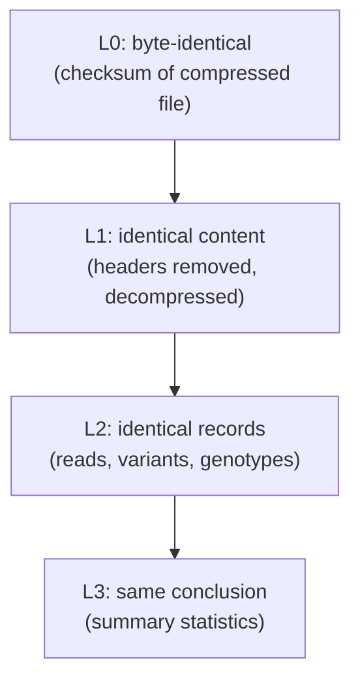
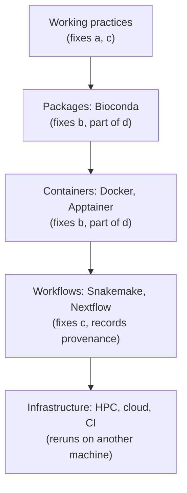

Computational reproducibility means that someone else, or you a few months from now, can rerun the same data through the same code and get the same result. In bioinformatics, the toolkit for this is Bioconda, containers (Docker, Apptainer), workflow managers (Snakemake, Nextflow/nf-core) and HPC or cloud infrastructure. In practice it breaks a lot: of more than 9,000 public R files on Harvard Dataverse, 74% failed on the first run (Trisovic et al., 2022), and of 98 omics tools that researchers tried to install, 28% could not be installed (Mangul et al., 2019). This article proposes a four-level scale for saying exactly how "identical" two results are, maps each layer of tooling to the source of drift it fixes, and then walks through designing a reproducibility test for a fastp → BWA-MEM → SAMtools → bcftools variant-calling pipeline. It is written for students and self-taught bioinformaticians who are about to hand in a capstone project or thesis, or who are building a portfolio repo.

<div class="callout callout-note">
<p class="callout-title">Quick summary</p>

- "Reproducible" comes in levels: L0 is byte-identical, L1 is identical content once headers are stripped, L2 is identical record by record, L3 is the same conclusion. State which level you reached.
- The most common causes of failure are missing data, missing descriptions and software that will not install, not the operating system.
- Containers solve installation, but they still share the host's kernel and hardware. On HPC you use Apptainer, because Docker needs a root daemon.
- Some nondeterminism lives inside the algorithms (thread count, batching, read order), so pinning versions and setting seeds is not enough.
- A good portfolio repo has one command that runs everything, data downloaded from a fixed URL with checksums, and CI that reruns it on at least two operating systems.

</div>

## 1. What does "rerunnable" actually mean?

In 2016, *Nature* published a survey of about 1,500 scientists on failures to reproduce results, and the phrase "reproducibility crisis" took off from there (Baker, 2016). That survey was mostly about experiments, not computational analysis specifically. For data analysis the question is narrower and testable: same data, same code, same result?

The National Academies of Sciences, Engineering, and Medicine (2019) separate two ideas. *Reproducibility* means obtaining consistent results using the same input data, computational steps, methods, code and conditions of analysis. *Replicability* means obtaining consistent results across independent studies, each collecting its own data. Different fields use these two words differently, sometimes in opposite ways (Goodman et al., 2016), so when you read the literature, check how the authors define them. This article deals only with reproducibility in the National Academies sense: computational reproducibility.

Peng (2011) describes reproducibility as a spectrum. When an independent study is not feasible, publishing code and data so others can rerun the analysis is the minimum standard. In genomics, Baykal et al. (2024) proposed the idea of *genomic reproducibility*: the ability of bioinformatics tools to give consistent results across technical replicates, meaning different sequencing runs of the same sample. The concept is a reminder that even when software and data are fixed, a tool can still respond differently to very small differences between sequencing runs.

Buffalo (2015) makes a practical point: the person who most often needs to reproduce an analysis is you, months later, when your advisor asks about a number or a reviewer asks for a revision.

### A four-level scale

"This pipeline is reproducible" rarely says how identical the results are. This article proposes a four-level scale. It is a working classification, not a definition taken from the literature.

| Level | What is identical | Example check |
|---|---|---|
| L0 – bytes | The files as written, byte for byte | SHA-256 of `sample.vcf.gz`, `sample.bam` |
| L1 – content | Decompressed content with headers removed | `bcftools view -H`, `samtools view` (no `-h`), then SHA-256 |
| L2 – records | Every read has the same position, MAPQ, CIGAR; every variant has the same genotype | Join on read name; `bcftools isec` |
| L3 – conclusion | Summary statistics and the biological conclusion | `samtools flagstat`, SNV/indel counts, Ti/Tv, precision/recall |



Meeting a stricter level (L0) automatically meets the looser levels (L1–L3) in the direction of the arrows, but not the other way around. L3 is what a paper's reader cares about; L0 is what a checksum comparison tests. Mixing them up leads to two mistakes: calling a pipeline "not reproducible" just because checksums differ, or calling it "reproducible" because the total variant count matches while individual variants have changed.

<div class="callout callout-example">
<p class="callout-title">A common situation</p>

You and a classmate run the same pipeline on the same two FASTQ files. Your `sample.filt.vcf.gz` files have different SHA-256 hashes. Open them and you find that each header records a command line with that person's own directory path, while the 1,250 variant lines underneath are identical. The two runs differ at L0 but match at L1, and therefore at L2 and L3. If you stop at the checksum, the whole group loses an afternoon hunting a "bug" that does not exist.

</div>

The reverse can happen too. Both runs report 1,250 variants (a match at L3 by count), but 12 variants in one run are replaced by 12 different ones in the other. The matching total hides a difference at L2. So when you report, state both the level you checked and the tool you used to compare. (The numbers in these two examples are illustrations, not measurements.)

## 2. Why computational analyses are hard to rerun: five sources of drift

When an analysis will not rerun, the first reflex is to blame the machine: "my laptop is a Mac," "the server has a different version." The empirical literature tells a different story. The causes fall into five groups, each backed by at least one study that measured it, and the operating system is only part of one group.

**(a) Missing data and descriptions.** Ioannidis et al. (2009) had two independent teams try to reproduce one table or figure from each of 18 microarray analyses published in *Nature Genetics* in 2005–2006. Only 2 analyses could be reproduced in principle, 6 partially, and 10 not at all. The main reason was unavailable data; most of the remaining discrepancies came from incomplete data annotation and incomplete descriptions of processing.

**(b) Software that disappears or will not install.** Mangul et al. (2019) examined 36,702 omics software resources published between 2005 and 2017: almost 28% were no longer reachable at the URL given in the paper. When they tried to install 98 tools, 51% were easy to install and 28% could not be installed. Bioconda and BioContainers were built to deal with exactly this problem.

**(c) Code that does not run.** Trisovic et al. (2022) reran more than 9,000 R files from Harvard Dataverse: 74% failed on the first run, and 56% still failed after automated code cleaning. Jupyter notebooks have also been studied at scale (Pimentel et al., 2019); notebook-level risks are covered in the article on [data analysis with Python](/en/blog/introduction-to-data-analysis-using-python/).

**(d) Versions and environments.** Gronenschild et al. (2012) measured brain volumes with FreeSurfer: changing the software version shifted results by 8.8% on average, while changing the workstation type or macOS version caused about half that. This is neuroimaging, but the general lesson holds: the software version can matter more than the operating system. The Nextflow developers also note that small variations across computing platforms cause numerical instability and lead to irreproducible results (Di Tommaso et al., 2017).

**(e) Data order and algorithms.** Firtina and Alkan (2016) did nothing but shuffle the order of reads in a FASTQ file and found that some reads in repetitive regions mapped to different locations. Even when alignments were identical, GATK HaplotypeCaller still produced slightly different variant sets. This kind of nondeterminism does not come from a random seed, so setting a seed does not fix it.

The case reported by Kim et al. (2018) shows how these sources add up. The authors had the code and data for a published method and still struggled to reproduce it, then rewrote it from MATLAB to Python and packaged it with Docker. Having code and data is necessary, but not sufficient.

In a student's variant-calling pipeline, the five groups look very concrete. Group (a) is a README that says "data from SRA" with no run accession. Group (b) is a tool that only lived on the author's personal page, which has since gone offline. Group (c) is a script with absolute paths like `...` or a manual Excel fix in the middle. Group (d) is an environment file that lists `bcftools` with no version number. Group (e) is rerunning with a different thread count and watching a few reads in repeats change places. Table 1 collects the five groups, the evidence and the matching layer of tooling; section 3 goes through each layer.


*Figure 1. Failure rates in three studies that measured whether analyses could be rerun. Numbers come from the abstracts of Ioannidis et al. (2009), Mangul et al. (2019) and Trisovic et al. (2022); the three studies measured different things, so the bars should not be compared directly.*

| Source of drift | Evidence | Layer that addresses it | Still unsolved |
|---|---|---|---|
| (a) Missing data, descriptions | 10/18 microarray analyses not reproduced (Ioannidis et al., 2009) | Practices: public data, README, archive with DOI | Sensitive data that cannot be made public |
| (b) Software will not install | 28% of 98 tools (Mangul et al., 2019) | Bioconda, BioContainers | Packages removed from the channel after a few years |
| (c) Code does not run | 74% of R files fail on first run (Trisovic et al., 2022) | Workflow manager, CI | Logic errors that "succeed" but are still wrong |
| (d) Versions, environment | 8.8% shift when changing FreeSurfer version (Gronenschild et al., 2012) | Version pinning, containers | Different CPU architecture, OS kernel |
| (e) Data order, algorithms | Shuffling reads changes mapping positions (Firtina & Alkan, 2016) | Control parameters (e.g., BWA-MEM's `-K`) | Tools that have no such parameter |

## 3. The reproducibility toolkit: what each layer fixes

Grüning et al. (2018) give five recommendations for practical computational reproducibility in the life sciences: choose suitable tools, install them with a package manager such as Bioconda, package them in containers, use virtual machines when you need long-term archiving, and run everything through a workflow platform. This section arranges the tools along those layers and adds a base layer of working practices.



### 3.1. Practices before tools

Sandve et al. (2013) boil it down to 10 rules: (1) for every result, keep track of how it was produced; (2) avoid manual data manipulation steps; (3) archive the exact versions of all external programs used; (4) version-control all custom scripts; (5) record all intermediate results, in standardized formats when possible; (6) for analyses that include randomness, note the underlying random seeds; (7) always store the raw data behind plots; (8) generate hierarchical analysis output, from summary to detail; (9) connect textual statements to underlying results; (10) provide public access to scripts, runs and results.

Wilson et al. (2017) set out "good enough" practices for people who are not software specialists. Noble (2009) proposes a way to organize projects: a chronological lab notebook, results directories named by date, and a driver script that runs the entire analysis from scratch. Buffalo (2015) adds a few concrete principles: treat raw data as read-only; write a plain-text README covering where the data came from, when it was downloaded, the data version and the software versions; and generate every figure and statistic from a script.

The following directory layout puts those principles into a single repo:

```text
project/
├── README.md            # question, how to rerun, data, versions
├── config/config.yaml   # every parameter; nothing hand-edited in code
├── data/                # raw data, read-only; checksums.sha256
├── envs/                # conda environment files, versions pinned
├── workflow/Snakefile   # analysis steps
├── scripts/             # helper scripts (comparison, plotting)
├── results/             # generated automatically
├── logs/  benchmarks/   # logs and time/memory measurements
└── .github/workflows/   # CI that reruns the pipeline
```

### 3.2. The package layer: conda and Bioconda

Conda installs software into the user's own directory without root access, so it works on shared clusters (Reiter et al., 2021). Bioconda is a conda channel dedicated to the life sciences (Grüning, Dale, et al., 2018). On November 11, 2026, the Bioconda site listed support for four platforms, linux-64, linux-aarch64, osx-64 and osx-arm64, with more than 8,000 packages (Bioconda, n.d.).

The limitation: conda re-solves dependencies every time it creates an environment. An environment file that just says `bwa` or `bwa>=0.7` can produce two different environments at two different times. Pin a specific version for every major tool, and save the actual package list of the environment you ran, for example with `conda list --explicit > envs/bwa_samtools.osx-64.txt` for each platform. A pinned file for the alignment rule might look like this:

```yaml
# envs/bwa_samtools.yaml
channels:
  - conda-forge
  - bioconda
dependencies:
  - bwa=0.7.19
  - samtools=1.21
```

The version numbers here only illustrate how to pin; the samtools and bcftools documentation cited in this article is the current, newer release. In real work, pick the version available on Bioconda and write that exact number into the file.

Two mistakes are common at this layer. The first is one big environment holding every tool: each time you add a package, conda may upgrade or downgrade others. One small environment per rule, which Snakemake supports, avoids this. The second is installing extra packages by hand into the environment you are using without recording them; the next time you build the environment from the file, that package is gone. Channel configuration (conda-forge first, `channel_priority: strict`) is covered in the article on [computing foundations](/en/blog/nen-tang-tinh-toan/).

### 3.3. The container layer: Docker, BioContainers, Apptainer

Docker packages a tool and its dependencies into an image that runs on other machines (Boettiger, 2015). But a container does not mean "runs the same on every machine." Containers share the host's operating system kernel and still depend on the hardware, which is why Grüning et al. (2018) suggest adding virtual machines when results must hold up over time. Images also depend on CPU architecture: code inside a container has to be compatible with the host's architecture, so a `linux/amd64` image will not run on an arm64 machine without emulation. A multi-platform image bundles several variants into one image (Docker, n.d.-a).

BioContainers is a community framework that standardizes containers for biological software. By 2017 it offered more than 2,000 containers, based on Docker and rkt, usable on desktops, cloud and HPC (da Veiga Leprevost et al., 2017). Today every Bioconda package gets a BioContainer built automatically on Quay.io (Bioconda, n.d.). The community also has its own packaging recommendations (Gruening et al., 2019).

Why don't HPC systems use Docker? Kurtzer et al. (2017) point out that every Docker container is spawned by a daemon running as root, which is unacceptable on a shared machine. With Singularity, a user without root on the host cannot escalate to root inside the container. The Singularity project later moved into the Linux Foundation and was renamed Apptainer, per an announcement dated November 30, 2021 (Apptainer, 2021). Docker now has a rootless mode, but it needs separate setup (Docker, n.d.-c).

On HPC, the usual approach is to pull a BioContainers image as an Apptainer `.sif` file and run the tool inside it, or let Snakemake do that with `--sdm apptainer`. Two things to watch. A container only sees the directories bound into it, so data paths outside the working directory have to be declared. And record the image digest (the `sha256:...` string) next to the tag: a tag is a label that can be reassigned, while a digest identifies exactly one image.

Writing reproducible Dockerfiles has its own 10 rules (Nüst et al., 2020). Four worth remembering: build on an existing image with a specific tag; pin versions of every package; avoid the `latest` tag because it is a moving target; rebuild regularly so you find out early when something changes.

```dockerfile
# Skeleton example: pin the base image tag and package versions
FROM python:3.12.7-slim
RUN pip install --no-cache-dir pandas==2.2.3 biopython==1.84
COPY gc_content.py /app/gc_content.py
ENTRYPOINT ["python", "/app/gc_content.py"]
```

### 3.4. The workflow layer: Snakemake, Nextflow and nf-core

Snakemake is a Python-based language that scales from a workstation to a cluster without changing the workflow, and it infers the order of steps from input and output file names with wildcards (Köster & Rahmann, 2012). The 2021 paper sets three goals: reproducibility, adaptability (modifying it to answer new questions) and transparency (others can understand it well enough to judge the method) (Mölder et al., 2021).

A rule has inputs, outputs, a software environment and a command:

```python
rule fastqc:
    input: "data/{sample}.fastq.gz"
    output: "qc/{sample}_fastqc.html"
    conda: "../envs/qc.yaml"          # this file pins the FastQC version
    threads: 2
    log: "logs/fastqc/{sample}.log"
    shell: "fastqc -t {threads} -o qc {input} 2> {log}"
```

Give every rule its own `log:` so that when a step fails, you know right away which one and why. Before a real run, `snakemake -n` (dry run) lists the jobs that would run without executing anything, and `snakemake --dag | dot -Tpng > dag.png` draws the dependency graph between steps. The most common beginner mistake is a wildcard name in `output:` that does not match the next rule's `input:`, so Snakemake reports that it does not know how to create a file; a dry run catches this in seconds.

The command `snakemake --cores 8 --use-conda` still works in Snakemake 9.27.1 (the documentation version cited); the newer form is `--sdm conda` or `--sdm apptainer` (Snakemake, n.d.-a). "Only rerun what changed" needs to be understood correctly: by default Snakemake considers five kinds of change, namely code, input, mtime, params and software environment. The `benchmark:` directive records time, `max_rss` and `cpu_time` for each job, and `repeat()` runs it several times (Snakemake, n.d.-b).

Nextflow uses a dataflow model with built-in container support; its 2017 paper presents it as a fix for numerical instability across platforms (Di Tommaso et al., 2017). nf-core is a community framework for curated Nextflow pipelines (Ewels et al., 2020). On November 11, 2026, the nf-core site listed 160 pipelines; that figure includes both released pipelines and those under development (nf-core, n.d.-a).

The nf-core/rnaseq 3.27.0 documentation recommends pinning the pipeline version with `-r`, using Conda only as a last resort, and not using iGenomes for new analyses because its gene annotations are very old; pass FASTA and GTF files directly instead (nf-core, n.d.-b):

```bash
nextflow run nf-core/rnaseq -r 3.27.0 -profile docker \
    --input samplesheet.csv --outdir results \
    --fasta GRCh38.primary_assembly.genome.fa.gz \
    --gtf gencode.annotation.gtf.gz
# Try it first on the bundled small test data:
nextflow run nf-core/rnaseq -r 3.27.0 -profile test,docker --outdir test_out
```

| | Snakemake | Nextflow / nf-core |
|---|---|---|
| Language | Extension of Python | Its own Groovy-based DSL |
| Declaring software | `conda:`, `container:` per rule | `conda`, `container` per process; docker, singularity, apptainer profiles |
| Running on HPC, cloud | No workflow changes (Köster & Rahmann, 2012) | Built in (Di Tommaso et al., 2017) |
| Community pipelines | Snakemake workflow catalog | nf-core, 160 pipelines (November 11, 2026) |
| Best for | Pipelines you write yourself, people comfortable with Python | Reusing standard, curated pipelines |

Wratten et al. (2021) compare popular workflow managers and find that they help optimize resources, manage software and versions, and run across platforms; Leipzig (2017) reviews pipeline frameworks. Reiter et al. (2021) advise beginners to start from code that already works, test on small subsampled data and check results at each step. CWL, WDL and Galaxy are other options.

### 3.5. The infrastructure layer: HPC and cloud

On HPC, SLURM is a widely used scheduler (Yoo et al., 2003). Three basic commands: `sbatch job.sh` to submit, `squeue -u $USER` to see the queue, `scancel <jobid>` to cancel. A submission script declares resources at the top:

```bash
#!/bin/bash
#SBATCH --job-name=variant-call
#SBATCH --cpus-per-task=4
#SBATCH --mem=8G
#SBATCH --time=02:00:00
#SBATCH --output=logs/slurm-%j.out
snakemake --sdm apptainer --cores "$SLURM_CPUS_PER_TASK"
```

This runs the whole pipeline in one job. For larger pipelines, Snakemake can submit each rule as its own SLURM job through an executor plugin and a profile; option names change between versions, so read the documentation for the exact version you installed. Galaxy is a web platform for accessible, reproducible and collaborative analysis (The Galaxy Community, 2024).

To get "another machine" for a reproducibility check without HPC, GitHub Actions is a low-cost option: standard runners are free for public repos; `ubuntu-latest` has 4 CPUs, 16 GB RAM and 14 GB SSD; Linux arm64 and macOS runners are available too (GitHub, n.d.).

On resources, the bwa 0.7.19 man page says that indexing the human genome with the bwtsw algorithm needs 5 GB of RAM (Li, n.d.). For other steps, the most reliable approach is to measure with `benchmark:` on your own data rather than rely on estimates of unknown origin.

## 4. Designing a reproducibility test for a variant-calling pipeline

This section turns the principles above into a concrete test for the variant-calling pipeline in the article on [NGS and genomics](/en/blog/giai-trinh-tu-the-he-moi-ngs-va-genomics/). The goal is to answer with numbers: when the pipeline is rerun on different machines, at which level of the L0–L3 scale do the results match, and which factor causes the most drift?

### 4.1. Pipeline and Snakefile

The steps: fastp (Chen et al., 2018) → BWA-MEM (Li, 2013) → `samtools fixmate -m` → `sort` → `markdup` → `index` (Danecek et al., 2021) → `bcftools mpileup -a FORMAT/AD,FORMAT/DP | bcftools call -m -v` → `bcftools norm -m -any` → `bcftools filter -i 'QUAL>30 && INFO/DP>10'` → `bcftools stats`, `samtools flagstat` → MultiQC (Ewels et al., 2016).

Each rule has `conda:` pointing to a pinned environment file, `container:` pointing to a fully tagged BioContainers image, plus `threads:`, `log:` and `benchmark:`. Parameters live in `config/config.yaml`. A condensed alignment rule:

```python
rule bwa_mem:
    input: r1="work/{s}.R1.trim.fq.gz", r2="work/{s}.R2.trim.fq.gz"
    output: "work/{s}.sorted.bam"
    params: rg=r"@RG\tID:{s}\tSM:{s}\tPL:ILLUMINA", K=config["bwa_K"]
    threads: config["threads"]
    conda: "../envs/bwa_samtools.yaml"
    container: config["images"]["bwa_samtools"]
    benchmark: repeat("benchmarks/bwa_mem/{s}.tsv", 3)
    shell:
        "bwa mem -t {threads} -K {params.K} -R '{params.rg}' {config[ref]} "
        "{input.r1} {input.r2} | samtools fixmate -m -u - - "
        "| samtools sort -o {output} -"
```

Keep the original BAM and VCF headers in the main run, because they record the command line and versions, in the spirit of rule 1 from Sandve et al. (2013).

### 4.2. Data

A small dataset is enough for this test. The nf-core/test-datasets repository, `modules` branch, has `test_1.fastq.gz` (16,013,759 bytes) and `test_2.fastq.gz` (16,698,858 bytes) in `data/genomics/homo_sapiens/illumina/fastq/`, along with the reference `hg38.chr22.fasta` (51,326,778 bytes). The repository README says the reads come from project PRJEB39899 and only reads mapping to chr22 were kept (nf-core, n.d.-c). That project includes tumor samples, so use it only to measure technical reproducibility, not for biological interpretation.

Download from a URL pinned to a commit hash rather than a branch name, record the SHA-256 in `data/checksums.sha256` and verify it before each run (Reiter et al., 2021). Before putting a copy of the data in your repo, check the repository's license.

### 4.3. Environments

| ID | Machine | Install method |
|---|---|---|
| E1 | Personal computer (e.g., Intel macOS) | conda (osx-64) |
| E2 | GitHub Actions `ubuntu-latest` (Linux x64) | conda (linux-64) |
| E3 | Same runner as E2 | Apptainer, BioContainers image with the same versions |
| E4 | GitHub Actions `ubuntu-24.04-arm` (Linux arm64) | conda (linux-aarch64) |
| E5 | GitHub Actions `macos-latest` (macOS arm64) | conda (osx-arm64) |

Comparing E2 with E3 isolates the effect of "conda versus container," and E3 is also how you would run on HPC. Comparing E2 with E4 isolates the effect of CPU architecture. If a package has no build for some architecture at the pinned version, write that down: it is exactly the kind of failure Mangul et al. (2019) measured. Docker Desktop only supports the current macOS release and the two before it (Docker, n.d.-b), so an older Mac may only be able to run conda.

### 4.4. Experiments and hypotheses

| ID | What to do | Hypothesis | Basis |
|---|---|---|---|
| R0 | Run once on E1–E5 with the same config | BAM and VCF bodies are identical | Grüning et al. (2018) and Di Tommaso et al. (2017) |
| R1 | Run twice in the same environment | Identical; if not, subtract this from every comparison | — |
| R2 | `bwa mem -t 1` versus `-t 4`, with and without `-K` | Without `-K` results may drift; with `-K` they don't | Li (n.d.) |
| R3 | Shuffle read pairs with 5 seeds | Reads in repeats change position | Firtina & Alkan (2016) |
| R4 | Change the bcftools version | More drift than changing the OS | Gronenschild et al. (2012), indirectly |
| R5 | Rerun with `--no-PG`, `--no-version` | L0 differs because of headers; L1 matches | samtools, bcftools documentation |
| R6 | Change the filter threshold; edit the alignment rule | Only the affected rules rerun | Snakemake documentation |

On R2: the bwa 0.7.19 man page (Li, n.d.) says that by default each batch processes 10,000,000 bases times the number of threads, and that setting `-K` fixes the number of bases per batch regardless of thread count, which helps reproducibility. The exact internal mechanism that makes results depend on batching is not described in the documentation consulted.

On R1: repeating a run in the same environment sounds redundant, but it is the baseline. If two runs on the same machine already differ at L2, every cross-machine difference has to be read after subtracting that noise.

On R3: when you shuffle paired-end reads, R1 and R2 from the same molecule must stay paired. The safe way is to merge the two files into interleaved form, or use the same seed for both files with a shuffling tool that supports it, then check that read names in the two files still match line by line. Use 5 different seeds and report the median and min–max range of reads that changed position, because a single seed can give a number that is just luck.

On R5: samtools adds an `@PG` line to the header unless you use `--no-PG`; bcftools adds its version and command line to the header unless you use `--no-version` (Danecek et al., 2021; Samtools, n.d.; Bcftools, n.d.).

### 4.5. Comparing at four levels

**L0 and L1.** The Python snippet below builds two compressed VCF files with the same records but different header lines for the command and timestamp, then compares them at both levels. It uses only the standard library and runs on macOS and Linux:

```python
import gzip, hashlib, io

# Two "runs" with the same VCF records; only the header line with the command and time differs
body = (
    "chr22\t16050075\t.\tA\tG\t52.3\tPASS\tDP=14\tGT\t0/1\n"
    "chr22\t16050115\t.\tG\tA\t88.1\tPASS\tDP=21\tGT\t1/1\n"
    "chr22\t16050213\t.\tC\tT\t35.7\tPASS\tDP=12\tGT\t0/1\n"
)
def vcf(cmd_line):
    return ("##fileformat=VCFv4.2\n"
            f"##bcftools_callCommand={cmd_line}\n"
            "#CHROM\tPOS\tID\tREF\tALT\tQUAL\tFILTER\tINFO\tFORMAT\tS1\n" + body)

run_a = vcf("call -mv ./s.bcf; Date=Mon Nov  2 09:14:03 2026")
run_b = vcf("call -mv ./s.bcf; Date=Tue Nov  3 21:40:55 2026")

def gz(text, mtime):
    buf = io.BytesIO()
    with gzip.GzipFile(fileobj=buf, mode="wb", mtime=mtime) as f:
        f.write(text.encode())
    return buf.getvalue()

sha = lambda b: hashlib.sha256(b).hexdigest()[:12]
file_a, file_b = gz(run_a, 1793610843), gz(run_b, 1793742055)

def records(gz_bytes):
    """L1: decompress and drop every header line starting with '#'."""
    text = gzip.decompress(gz_bytes).decode()
    return "".join(l + "\n" for l in text.splitlines() if not l.startswith("#"))

print("L0 (compressed file as is):", sha(file_a), sha(file_b), sha(file_a) == sha(file_b))
print("L1 (decompressed body)    :", sha(records(file_a).encode()), sha(records(file_b).encode()),
      records(file_a) == records(file_b))
# Same content, only the mtime in the gzip header differs
same_text = gz(run_a, 0) == gz(run_a, 1)
print("Same text, different gzip mtime -> identical bytes?", same_text)
```

```text
L0 (compressed file as is): 82871f576f62 4df0d94112b4 False
L1 (decompressed body)    : 25f57d7719bb 25f57d7719bb True
Same text, different gzip mtime -> identical bytes? False
```

The last line shows one more source of difference at L0: the gzip format has an MTIME field in its header (Deutsch, 1996), so compressing the same text at two different times can produce two files with different bytes.

**L2.** Compare variant by variant by joining on the key `CHROM, POS, REF, ALT`. In practice you can use `bcftools isec`; the pandas snippet below shows the logic:

```python
import io
import pandas as pd

# VCF records (header removed) from two runs; a small made-up example
run_a = """chr22\t16050075\tA\tG\t52.3\t0/1
chr22\t16050115\tG\tA\t88.1\t1/1
chr22\t16050213\tC\tT\t35.7\t0/1
chr22\t16050320\tT\tC\t41.0\t0/1"""
run_b = """chr22\t16050075\tA\tG\t52.3\t0/1
chr22\t16050115\tG\tA\t88.1\t0/1
chr22\t16050213\tC\tT\t35.9\t0/1
chr22\t16050402\tG\tT\t33.2\t0/1"""
cols = ["CHROM", "POS", "REF", "ALT", "QUAL", "GT"]
a = pd.read_csv(io.StringIO(run_a), sep="\t", names=cols)
b = pd.read_csv(io.StringIO(run_b), sep="\t", names=cols)

key = ["CHROM", "POS", "REF", "ALT"]
m = a.merge(b, on=key, how="outer", suffixes=("_a", "_b"), indicator=True)
both = m[m["_merge"] == "both"]
summary = {
    "only in A": int((m["_merge"] == "left_only").sum()),
    "only in B": int((m["_merge"] == "right_only").sum()),
    "shared sites": len(both),
    "shared, different GT": int((both["GT_a"] != both["GT_b"]).sum()),
    "shared, different QUAL": int((both["QUAL_a"] != both["QUAL_b"]).sum()),
}
print(summary)
```

```text
{'only in A': 1, 'only in B': 1, 'shared sites': 3, 'shared, different GT': 1, 'shared, different QUAL': 1}
```

The output shows three kinds of difference that a simple count would miss: one variant found only on each side (positions 16050320 and 16050402), one variant whose genotype changed from `1/1` to `0/1`, and one variant whose QUAL moved from 35.7 to 35.9. Both runs have 4 variants, so they look "the same" if you only count, but they differ at L2. Small QUAL differences are usually harmless unless they sit right at a filter threshold: a variant with QUAL 29.9 in one run and 30.1 in the other is filtered out on one side and kept on the other.

For BAM files the logic is the same: join on read name and the R1/R2 flag, then count reads whose position, MAPQ or CIGAR differs. The fraction of reads that changed position is the easiest number to compare across experiments R2, R3 and R4.

**L3.** Use `samtools flagstat`, SNV and indel counts, and the Ti/Tv ratio from `bcftools stats`. If you have a truth set such as GIAB (Zook et al., 2019), add precision and recall computed the GA4GH way (Krusche et al., 2019).

### 4.6. Checking Snakemake's partial rerun behavior

Hypothesis R6 can be tested right away on a personal computer without any NGS tools, using a four-step toy pipeline that mimics trimming, alignment, variant calling and filtering:

```python
configfile: "config/config.yaml"

rule all:
    input: "results/filtered.tsv"

rule trim:
    input: "data/reads.tsv"
    output: "work/trimmed.tsv"
    shell: "cut -f1,2 {input} > {output}"

rule align:
    input: "work/trimmed.tsv"
    output: "work/aligned.tsv"
    shell: "awk -v OFS='\\t' '{{print $1, NR*100}}' {input} > {output}"

rule call:
    input: "work/aligned.tsv"
    output: "work/calls.tsv"
    shell: "awk -v OFS='\\t' '{{print $1, $2, NR*15}}' {input} > {output}"

rule filter:
    input: "work/calls.tsv"
    output: "results/filtered.tsv"
    params: q=config["min_qual"]
    shell: "awk -v q={params.q} '$3 > q' {input} > {output}"
```

In a trial run on Snakemake 9.27.2 (one patch release newer than the 9.27.1 documentation) with `min_qual: 30`, then changing it to `min_qual: 20` and running `snakemake -n`, Snakemake schedules only 2 jobs, `filter` and `all`, with the reason "params have changed since last execution". Set the threshold back to 30 and edit the command in the `align` rule: this time 4 jobs are scheduled, `align` with the reason "Code has changed since last execution", and `call`, `filter`, `all` because their inputs were updated. `trim` does not rerun.

Two takeaways. First, Snakemake tracks both parameters and command text, not just file modification times: changing one number in `config.yaml` is enough to rerun the rule that uses it, and only the rules downstream of it. In a real pipeline, this means trying several filter thresholds does not force you to realign from scratch. Second, Snakemake itself prints a hint: if you only reformatted a command and are sure the output won't change, you can use `--rerun-triggers mtime` or `--cleanup-metadata <file>` to skip the rerun. Use these options with care, because they switch off the very mechanism that keeps results in step with the code.

## 5. Discussion and limitations

**A different checksum does not mean a different result.** The example in section 4.5 shows that two files that differ at L0 can be identical at L1. Recommendation: store L0 checksums to verify file integrity when moving data, and compare content at L1 or above when testing reproducibility. Keep the headers, because they carry provenance.

**How far a container gets you.** Containers address source (b) and part of (d). They do not address missing data (a), logic errors in code (c) or nondeterminism in algorithms (e). On top of that, containers still depend on the OS kernel and hardware (Grüning et al., 2018), and an image you can pull today may not be downloadable in a few years.

**CPU architecture.** Recent Macs and many cloud servers use arm64. None of the sources consulted state in advance that fastp, BWA-MEM, SAMtools and bcftools give identical results on x86_64 and arm64. That is why the test should include E4 and E5.

**Nondeterminism inside the algorithm.** The Firtina and Alkan (2016) result is a reminder that pinning versions is not enough. For each tool, look in its documentation for parameters like BWA-MEM's `-K` and record them in the README.

**Do versions matter more than platforms?** The FreeSurfer data suggest so (Gronenschild et al., 2012); Buffalo (2015) recounts a case where mismatched results were traced to an R package that had just been updated on a server. If R4 shows something similar, the practical message is: pin versions first, worry about containers second.

**Extensions.** GATK HaplotypeCaller gives slightly different variant sets even from identical alignments (Firtina & Alkan, 2016). For machine learning, Heil et al. (2021) propose separate reproducibility standards (see the article on [machine learning in biology](/en/blog/machine-learning-va-ai-trong-sinh-hoc/)).

**When results drift, where to look first.** A sensible order, from cheap to expensive: check the checksums of the input data; compare the actual package lists of the two environments; compare each intermediate file at L1 in pipeline order to find the first step where outputs diverge; at that step, look at thread count, batch parameters and input order. Usually the first step that differs points to the cause, and later steps simply inherit the difference.

**Limits of the test.** Small data (chr22) does not prove the same holds for a full genome. GitHub Actions runners are shared virtual machines, so run times are only indicative. Long-term archiving means storing both the image and the data in a repository with a DOI, following the FAIR principles (Wilkinson et al., 2016).

## 6. From pipeline to portfolio repo

A repo that reruns is evidence a hiring manager or thesis committee can check for themselves. The README should have 6 sections, each tied to one of the Sandve et al. (2013) rules:

| README section | Sandve rule | Files in the repo |
|---|---|---|
| (1) Question and conclusion in 3 sentences | 9 – connect statements to results | `README.md` |
| (2) The single most important figure | 7 – store the raw data behind plots | `results/`, `scripts/plot.py` |
| (3) How to rerun: one command, with a CI badge | 1, 2 – record how results were produced, no manual steps | `workflow/Snakefile`, `.github/workflows/` |
| (4) Data: source, commit-pinned URL, download date, SHA-256 | 10 – public access | `data/checksums.sha256` |
| (5) Methods and version table | 3, 4 – archive versions, version control | `envs/*.yaml` |
| (6) Limitations and next steps | 8 – hierarchical output | `README.md` |

<div class="callout callout-example">
<p class="callout-title">README skeleton</p>

**Question.** How similar are the results of a variant-calling pipeline when run on Linux x64, Linux arm64 and macOS?
**Main results.** (three sentences, each pointing to a file in `results/`)
**How to rerun.** `conda env create -f envs/snakemake.yaml`, then `snakemake --sdm conda --cores 4`. CI badge at the top of the page.
**Data.** Source, accession, commit-pinned URL, download date, SHA-256 in `data/checksums.sha256`.
**Methods and versions.** Table generated automatically from `envs/*.yaml`.
**Limitations.** Small data, one set of versions; next steps.

</div>

Snakemake can generate an HTML report that links results to their provenance (Mölder et al., 2021), which beats copying numbers into the README by hand. The interpretation can be written in Quarto or Jupyter. When you release, tag a version of the repo and archive that version in a repository that issues DOIs, so a paper or application points to the exact code that produced the results, not a main branch that has changed many times since.

For a technical check like this one, a blog post explaining the method and results is usually enough; a preprint is only worth considering if something surprising turns up, such as a large difference between two CPU architectures.

Five interview questions that come out of this article: Why can checksums differ while results are the same? Why not use Docker on HPC? What is BWA-MEM's `-K` parameter for? How does Snakemake decide which jobs to rerun? Why pin `-r` when running nf-core?

This repo is the "reproducibility" part of the capstone project in the article on capstone projects and portfolios.

## 7. Conclusion and checklist

"Reproducible" is a measurable level, not a label. Most failures come from data, descriptions and software, so pinning versions and publishing data pay off the most; containers and workflow managers are the next layer. Report clearly which of L0–L3 you reached.

A 10-point checklist:

1. Data downloaded from a fixed URL, with checksums.
2. Every tool version-pinned.
3. Containers fully tagged, no `latest`.
4. Parameters in a config file.
5. Parameters that control nondeterminism (seed, `-K`) set and recorded.
6. One command runs everything.
7. CI reruns on at least two operating systems.
8. Results compared at L1 or above.
9. README with the 6 sections.
10. Release archived in a repository with a DOI.

## Frequently asked questions

**What is the difference between reproducibility and replicability?** Reproducibility is same data, same code, same result; replicability is a new study with new data reaching consistent results (National Academies of Sciences, Engineering, and Medicine, 2019).

**Should I learn Snakemake or Nextflow first?** If you know Python and write your own pipelines, Snakemake is easier to start with. If you need to run an existing standard pipeline, nf-core gets you there faster.

**If I have Docker, do I still need conda?** Yes. BioContainers images are built from Bioconda packages, and a conda environment file is the most readable way to record versions.

**Do different checksums mean the pipeline is not reproducible?** Not necessarily. Compare at L1 (headers removed, decompressed) before drawing conclusions.

**Why won't my university cluster let me use Docker?** Because Docker spawns containers from a daemon running as root, which is unsafe on a shared machine (Kurtzer et al., 2017). Apptainer can run Docker images without that privilege.

**Can a machine with 8 GB of RAM run a variant-calling pipeline?** With small data such as a single chromosome, usually yes; indexing the whole human genome with bwtsw needs about 5 GB of RAM according to the bwa man page. With real data, measure with `benchmark:` instead of guessing.

## References

Apptainer. (2021, November 30). *Community announcement*. https://apptainer.org/news/community-announcement-20211130/

Baker, M. (2016). 1,500 scientists lift the lid on reproducibility. *Nature, 533*(7604), 452–454. https://doi.org/10.1038/533452a

Baykal, P. I., Łabaj, P. P., Markowetz, F., Schriml, L. M., Stekhoven, D. J., Mangul, S., & Beerenwinkel, N. (2024). Genomic reproducibility in the bioinformatics era. *Genome Biology, 25*(1), 213. https://doi.org/10.1186/s13059-024-03343-2

Bcftools. (n.d.). *bcftools manual* (version 1.22). Retrieved November 11, 2026, from https://samtools.github.io/bcftools/bcftools.html

Bioconda. (n.d.). *Bioconda*. Retrieved November 11, 2026, from https://bioconda.github.io/

Boettiger, C. (2015). An introduction to Docker for reproducible research. *ACM SIGOPS Operating Systems Review, 49*(1), 71–79. https://doi.org/10.1145/2723872.2723882

Buffalo, V. (2015). *Bioinformatics data skills: Reproducible and robust research with open source tools*. O'Reilly Media.

Chen, S., Zhou, Y., Chen, Y., & Gu, J. (2018). fastp: An ultra-fast all-in-one FASTQ preprocessor. *Bioinformatics, 34*(17), i884–i890. https://doi.org/10.1093/bioinformatics/bty560

da Veiga Leprevost, F., Grüning, B. A., Alves Aflitos, S., Röst, H. L., Uszkoreit, J., Barsnes, H., Vaudel, M., Moreno, P., Gatto, L., Weber, J., Bai, M., Jimenez, R. C., Sachsenberg, T., Pfeuffer, J., Vera Alvarez, R., Griss, J., Nesvizhskii, A. I., & Perez-Riverol, Y. (2017). BioContainers: An open-source and community-driven framework for software standardization. *Bioinformatics, 33*(16), 2580–2582. https://doi.org/10.1093/bioinformatics/btx192

Danecek, P., Bonfield, J. K., Liddle, J., Marshall, J., Ohan, V., Pollard, M. O., Whitwham, A., Keane, T., McCarthy, S. A., Davies, R. M., & Li, H. (2021). Twelve years of SAMtools and BCFtools. *GigaScience, 10*(2), giab008. https://doi.org/10.1093/gigascience/giab008

Deutsch, P. (1996). *GZIP file format specification version 4.3* (RFC 1952). RFC Editor. https://doi.org/10.17487/RFC1952

Di Tommaso, P., Chatzou, M., Floden, E. W., Barja, P. P., Palumbo, E., & Notredame, C. (2017). Nextflow enables reproducible computational workflows. *Nature Biotechnology, 35*(4), 316–319. https://doi.org/10.1038/nbt.3820

Docker. (n.d.-a). *Multi-platform builds*. Retrieved November 28, 2026, from https://docs.docker.com/build/building/multi-platform/

Docker. (n.d.-b). *Install Docker Desktop on Mac*. Retrieved November 11, 2026, from https://docs.docker.com/desktop/setup/install/mac-install/

Docker. (n.d.-c). *Rootless mode*. Retrieved November 11, 2026, from https://docs.docker.com/engine/security/rootless/

Ewels, P., Magnusson, M., Lundin, S., & Käller, M. (2016). MultiQC: Summarize analysis results for multiple tools and samples in a single report. *Bioinformatics, 32*(19), 3047–3048. https://doi.org/10.1093/bioinformatics/btw354

Ewels, P. A., Peltzer, A., Fillinger, S., Patel, H., Alneberg, J., Wilm, A., Garcia, M. U., Di Tommaso, P., & Nahnsen, S. (2020). The nf-core framework for community-curated bioinformatics pipelines. *Nature Biotechnology, 38*(3), 276–278. https://doi.org/10.1038/s41587-020-0439-x

GitHub. (n.d.). *GitHub-hosted runners*. Retrieved November 11, 2026, from https://docs.github.com/en/actions/reference/runners/github-hosted-runners

Goodman, S. N., Fanelli, D., & Ioannidis, J. P. A. (2016). What does research reproducibility mean? *Science Translational Medicine, 8*(341), 341ps12. https://doi.org/10.1126/scitranslmed.aaf5027

Gronenschild, E. H. B. M., Habets, P., Jacobs, H. I. L., Mengelers, R., Rozendaal, N., van Os, J., & Marcelis, M. (2012). The effects of FreeSurfer version, workstation type, and Macintosh operating system version on anatomical volume and cortical thickness measurements. *PLoS ONE, 7*(6), e38234. https://doi.org/10.1371/journal.pone.0038234

Gruening, B., Sallou, O., Moreno, P., da Veiga Leprevost, F., Ménager, H., Søndergaard, D., Röst, H., Sachsenberg, T., O'Connor, B., Madeira, F., Dominguez Del Angel, V., Crusoe, M. R., Varma, S., Blankenberg, D., Jimenez, R. C., BioContainers Community, & Perez-Riverol, Y. (2019). Recommendations for the packaging and containerizing of bioinformatics software [version 2]. *F1000Research, 7*, 742. https://doi.org/10.12688/f1000research.15140.2

Grüning, B., Chilton, J., Köster, J., Dale, R., Soranzo, N., van den Beek, M., Goecks, J., Backofen, R., Nekrutenko, A., & Taylor, J. (2018). Practical computational reproducibility in the life sciences. *Cell Systems, 6*(6), 631–635. https://doi.org/10.1016/j.cels.2018.03.014

Grüning, B., Dale, R., Sjödin, A., Chapman, B. A., Rowe, J., Tomkins-Tinch, C. H., Valieris, R., Köster, J., & The Bioconda Team. (2018). Bioconda: Sustainable and comprehensive software distribution for the life sciences. *Nature Methods, 15*(7), 475–476. https://doi.org/10.1038/s41592-018-0046-7

Heil, B. J., Hoffman, M. M., Markowetz, F., Lee, S.-I., Greene, C. S., & Hicks, S. C. (2021). Reproducibility standards for machine learning in the life sciences. *Nature Methods, 18*(10), 1132–1135. https://doi.org/10.1038/s41592-021-01256-7

Ioannidis, J. P. A., Allison, D. B., Ball, C. A., Coulibaly, I., Cui, X., Culhane, A. C., Falchi, M., Furlanello, C., Game, L., Jurman, G., Mangion, J., Mehta, T., Nitzberg, M., Page, G. P., Petretto, E., & van Noort, V. (2009). Repeatability of published microarray gene expression analyses. *Nature Genetics, 41*(2), 149–155. https://doi.org/10.1038/ng.295

Kim, Y.-M., Poline, J.-B., & Dumas, G. (2018). Experimenting with reproducibility: A case study of robustness in bioinformatics. *GigaScience, 7*(7), giy077. https://doi.org/10.1093/gigascience/giy077

Köster, J., & Rahmann, S. (2012). Snakemake—a scalable bioinformatics workflow engine. *Bioinformatics, 28*(19), 2520–2522. https://doi.org/10.1093/bioinformatics/bts480

Krusche, P., Trigg, L., Boutros, P. C., Mason, C. E., De La Vega, F. M., Moore, B. L., Gonzalez-Porta, M., Eberle, M. A., Tezak, Z., Lababidi, S., Truty, R., Asimenos, G., Funke, B., Fleharty, M., Chapman, B. A., Salit, M., Zook, J. M., & the Global Alliance for Genomics and Health Benchmarking Team. (2019). Best practices for benchmarking germline small-variant calls in human genomes. *Nature Biotechnology, 37*(5), 555–560. https://doi.org/10.1038/s41587-019-0054-x

Kurtzer, G. M., Sochat, V., & Bauer, M. W. (2017). Singularity: Scientific containers for mobility of compute. *PLOS ONE, 12*(5), e0177459. https://doi.org/10.1371/journal.pone.0177459

Leipzig, J. (2017). A review of bioinformatic pipeline frameworks. *Briefings in Bioinformatics, 18*(3), 530–536. https://doi.org/10.1093/bib/bbw020

Li, H. (2013). *Aligning sequence reads, clone sequences and assembly contigs with BWA-MEM* (arXiv:1303.3997). arXiv. https://arxiv.org/abs/1303.3997

Li, H. (n.d.). *bwa(1) manual page* (version 0.7.19). Retrieved November 11, 2026, from https://github.com/lh3/bwa

Mangul, S., Mosqueiro, T., Abdill, R. J., Duong, D., Mitchell, K., Sarwal, V., Hill, B., Brito, J., Littman, R. J., Statz, B., Lam, A. K.-M., Dayama, G., Grieneisen, L., Martin, L. S., Flint, J., Eskin, E., & Blekhman, R. (2019). Challenges and recommendations to improve the installability and archival stability of omics computational tools. *PLOS Biology, 17*(6), e3000333. https://doi.org/10.1371/journal.pbio.3000333

Mölder, F., Jablonski, K. P., Letcher, B., Hall, M. B., Tomkins-Tinch, C. H., Sochat, V., Forster, J., Lee, S., Twardziok, S. O., Kanitz, A., Wilm, A., Holtgrewe, M., Rahmann, S., Nahnsen, S., & Köster, J. (2021). Sustainable data analysis with Snakemake [version 2]. *F1000Research, 10*, 33. https://doi.org/10.12688/f1000research.29032.2

National Academies of Sciences, Engineering, and Medicine. (2019). *Reproducibility and replicability in science*. The National Academies Press. https://doi.org/10.17226/25303

nf-core. (n.d.-a). *Pipelines*. Retrieved November 11, 2026, from https://nf-co.re/pipelines

nf-core. (n.d.-b). *nf-core/rnaseq: Usage* (version 3.27.0). Retrieved November 11, 2026, from https://nf-co.re/rnaseq/usage

nf-core. (n.d.-c). *nf-core/test-datasets* (branch modules). GitHub. Retrieved November 11, 2026, from https://github.com/nf-core/test-datasets/tree/modules

Noble, W. S. (2009). A quick guide to organizing computational biology projects. *PLoS Computational Biology, 5*(7), e1000424. https://doi.org/10.1371/journal.pcbi.1000424

Nüst, D., Sochat, V., Marwick, B., Eglen, S. J., Head, T., Hirst, T., & Evans, B. D. (2020). Ten simple rules for writing Dockerfiles for reproducible data science. *PLOS Computational Biology, 16*(11), e1008316. https://doi.org/10.1371/journal.pcbi.1008316

Peng, R. D. (2011). Reproducible research in computational science. *Science, 334*(6060), 1226–1227. https://doi.org/10.1126/science.1213847

Pimentel, J. F., Murta, L., Braganholo, V., & Freire, J. (2019). A large-scale study about quality and reproducibility of Jupyter notebooks. In *2019 IEEE/ACM 16th International Conference on Mining Software Repositories (MSR)* (pp. 507–517). IEEE. https://doi.org/10.1109/MSR.2019.00077

Reiter, T., Brooks, P. T., Irber, L., Joslin, S. E. K., Reid, C. M., Scott, C., Brown, C. T., & Pierce-Ward, N. T. (2021). Streamlining data-intensive biology with workflow systems. *GigaScience, 10*(1), giaa140. https://doi.org/10.1093/gigascience/giaa140

Samtools. (n.d.). *samtools(1) manual page* (version 1.25). Retrieved November 28, 2026, from https://www.htslib.org/doc/samtools.html

Sandve, G. K., Nekrutenko, A., Taylor, J., & Hovig, E. (2013). Ten simple rules for reproducible computational research. *PLoS Computational Biology, 9*(10), e1003285. https://doi.org/10.1371/journal.pcbi.1003285

Snakemake. (n.d.-a). *Command line interface* (version 9.27.1). Retrieved November 11, 2026, from https://snakemake.readthedocs.io/en/stable/executing/cli.html

Snakemake. (n.d.-b). *Rules* (version 9.27.1). Retrieved November 11, 2026, from https://snakemake.readthedocs.io/en/stable/snakefiles/rules.html

The Galaxy Community. (2024). The Galaxy platform for accessible, reproducible, and collaborative data analyses: 2024 update. *Nucleic Acids Research, 52*(W1), W83–W94. https://doi.org/10.1093/nar/gkae410

Trisovic, A., Lau, M. K., Pasquier, T., & Crosas, M. (2022). A large-scale study on research code quality and execution. *Scientific Data, 9*(1), 60. https://doi.org/10.1038/s41597-022-01143-6

Wilkinson, M. D., Dumontier, M., Aalbersberg, I. J., Appleton, G., Axton, M., Baak, A., Blomberg, N., Boiten, J.-W., da Silva Santos, L. B., Bourne, P. E., Bouwman, J., Brookes, A. J., Clark, T., Crosas, M., Dillo, I., Dumon, O., Edmunds, S., Evelo, C. T., Finkers, R., . . . Mons, B. (2016). The FAIR guiding principles for scientific data management and stewardship. *Scientific Data, 3*, 160018. https://doi.org/10.1038/sdata.2016.18

Wilson, G., Bryan, J., Cranston, K., Kitzes, J., Nederbragt, L., & Teal, T. K. (2017). Good enough practices in scientific computing. *PLOS Computational Biology, 13*(6), e1005510. https://doi.org/10.1371/journal.pcbi.1005510

Wratten, L., Wilm, A., & Göke, J. (2021). Reproducible, scalable, and shareable analysis pipelines with bioinformatics workflow managers. *Nature Methods, 18*(10), 1161–1168. https://doi.org/10.1038/s41592-021-01254-9

Yoo, A. B., Jette, M. A., & Grondona, M. (2003). SLURM: Simple Linux Utility for Resource Management. In D. Feitelson, L. Rudolph, & U. Schwiegelshohn (Eds.), *Job scheduling strategies for parallel processing* (Lecture Notes in Computer Science, Vol. 2862, pp. 44–60). Springer. https://doi.org/10.1007/10968987_3

Zook, J. M., McDaniel, J., Olson, N. D., Wagner, J., Parikh, H., Heaton, H., Irvine, S. A., Trigg, L., Truty, R., McLean, C. Y., De La Vega, F. M., Xiao, C., Sherry, S., & Salit, M. (2019). An open resource for accurately benchmarking small variant and reference calls. *Nature Biotechnology, 37*(5), 561–566. https://doi.org/10.1038/s41587-019-0074-6
