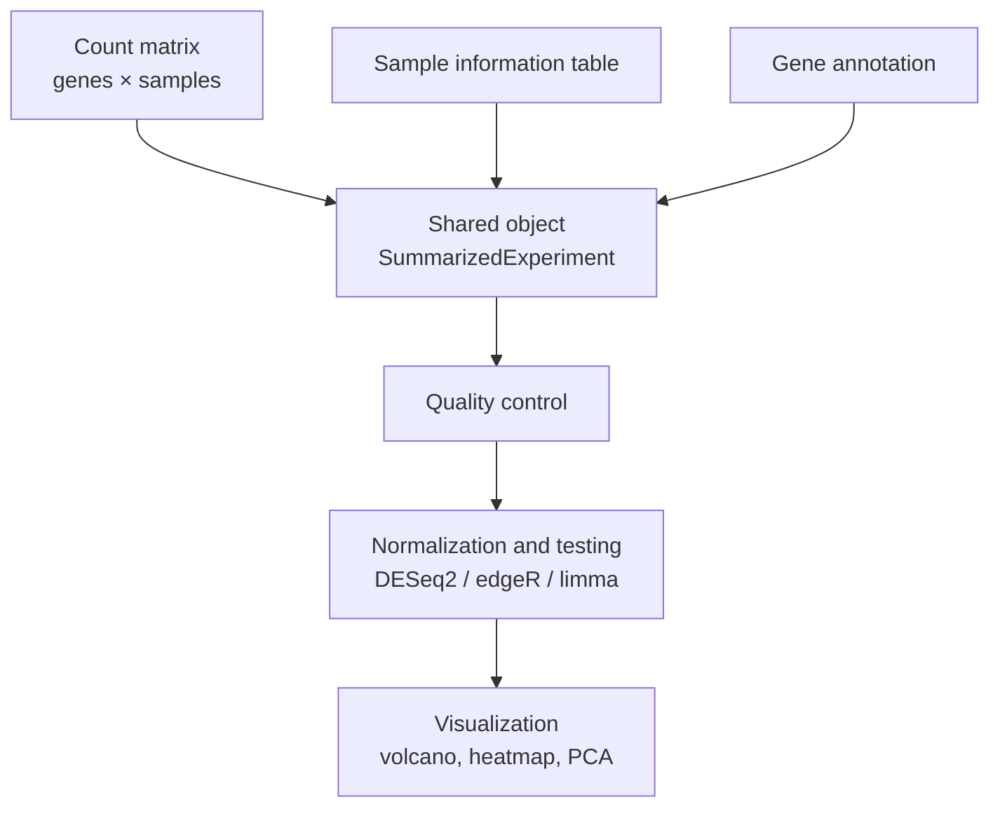

In 2002, Bioconductor shipped its first release with 15 packages; release 3.23 in April 2026 had 2,418 software packages (Bioconductor, n.d.-a). This first article in the series *R for Biological Data Analysis* asks one question: why did a language built for statistics and graphics become a main platform for analyzing RNA-seq, single-cell and epigenetic data? The answer has three layers that add up: a statistical core inherited from the S language, the community infrastructure of CRAN and Bioconductor, and a habit of publishing statistical methods together with packages. The article closes with a discussion of R's limits compared with Python and a script you can use to recount the size of the ecosystem yourself.

## 1. Introduction: three kinds of data, one language

RNA-seq, single-cell RNA-seq and epigenetics are the three kinds of data usually mentioned first when R is introduced to biology students. One measures the expression of tens of thousands of genes in a few tissue samples, another measures expression in individual cells, and the third measures DNA methylation at hundreds of thousands of CpG sites. Yet once raw sequencing data have been processed, all three take the same shape: a **large matrix** (genes × samples, genes × cells, CpGs × samples) paired with a sample information table (sample metadata).

With data in that shape, the core problem is **statistical**: modeling count data with very few replicates, testing tens of thousands of hypotheses at once, and visualizing the results. Love et al. (2014) spell out exactly these difficulties for RNA-seq count data: few replicates, discreteness, a large dynamic range and the presence of outliers. Huber et al. (2015) place Bioconductor, a project built on R, at the center of high-throughput data analysis in genomics.

So why is the most familiar tool for these problems a statistics language? The article works through three layers: history (Sections 2–3), community infrastructure (Section 4) and methods (Section 5), then discusses limits (Section 6). It is a conceptual overview and does not teach syntax. Syntax, RStudio and notebooks are covered in Part 2 (→ [RStudio and R notebooks](/en/blog/rstudio-and-r-notebooks/)); installing packages is covered in Part 7 (→ Installing packages).

## 2. From S to R: a language for data analysis

### 2.1. S at Bell Laboratories

To understand R, start with S. S is a language for data analysis and graphics developed at Bell Laboratories; the version that R would later largely match was described by Richard Becker, John Chambers and Allan Wilks in *The New S Language* in 1988 (Becker et al., 1988). The official R website describes R as "a different implementation" of S: there are important differences, but much code written for S runs unaltered under R (R Foundation, n.d.).

R also inherited from S an **interactive way of working**: type a command, look at the result, change the model, redraw the plot. This exploratory style suits biologists, who usually have to try several normalizations and several models before settling on a final analysis.

### 2.2. R at the University of Auckland

R was written by Ross Ihaka and Robert Gentleman at the Department of Statistics of the University of Auckland, New Zealand (Hornik & R Core Team, n.d.). The paper that formally introduced R, *R: A language for data analysis and graphics*, appeared in the *Journal of Computational and Graphical Statistics* in 1996 (Ihaka & Gentleman, 1996). According to the R FAQ, the design of R was heavily influenced by two languages: Becker, Chambers and Wilks' S, and Sussman's Scheme. The resulting language looks very much like S, but its underlying implementation and semantics derive from Scheme (Hornik & R Core Team, n.d.). In other words, R wears the "surface" of S so that S users could move over easily, while the "inside" is a new design.

The following dates can all be checked against public sources:

- **April 23, 1997**: the R 0.49 source file appears in the CRAN archive (CRAN, n.d.-a).
- **Mid-1997**: the R Core Team forms, the group with write access to the R source code (Hornik & R Core Team, n.d.).
- **February 29, 2000**: the R 1.0.0 file appears in the CRAN archive (CRAN, n.d.-a). This is the date of the file in the archive and is commonly used as the release date of version 1.0.0.

The year work on R began is often recounted in talks on R's history; the sources checked for this article only allow a firm statement that R was introduced in a journal in 1996 and reached version 1.0.0 in 2000.

### 2.3. Free software that runs on many operating systems

R is **free software** under the GNU General Public License and runs on UNIX platforms (including Linux), Windows and macOS (R Foundation, n.d.). "Free as in freedom" matters more than "free of charge": the GPL lets anyone read, modify and redistribute the source code, so a group of statisticians working in biology could build all of Bioconductor on top of R without asking anyone's permission.


**Figure 1.** Key milestones from S to R and Bioconductor. Sources: Becker et al. (1988), Ihaka and Gentleman (1996), Hornik and R Core Team (n.d.), CRAN (n.d.-a), Gentleman et al. (2004), Huber et al. (2015), Bioconductor (n.d.-a).

## 3. Why R suits biological data: statistics and graphics

### 3.1. Statistics is the core, not an add-on

The R website lists the techniques built in: linear and nonlinear modeling, classical statistical tests, time-series analysis, classification and clustering (R Foundation, n.d.). What stands out is that they **chain together**: a linear model in R is an object, from which you can pull coefficients, residuals and the design matrix for the next step.

Differential expression analysis is, at heart, fitting a generalized linear model to each gene with the same design matrix and then correcting for tens of thousands of tests. When the language already has a way to write model formulas, authors of biology packages can focus on what is new: modeling the variance of count data, or "borrowing information" across genes (Section 5).

### 3.2. Publication-quality graphics

The second strength is graphics. The official R website emphasizes the ability to produce publication-quality plots, including mathematical symbols and formulas (R Foundation, n.d.). The mechanism behind this is the mathematical annotation system described by Murrell and Ihaka (2000): you write an expression in near-R syntax, and R typesets subscripts, superscripts, Greek letters and fractions on axes and in legends. That is why labels such as $\log_2$ fold change or $-\log_{10}(p)$ render with the correct notation.

The next big step was ggplot2, a package implementing a "grammar of graphics," in which a plot is built from layers such as data, aesthetic mappings, geometric objects and a coordinate system (Wickham, 2016). ggplot2 later became part of the tidyverse, a collection of packages sharing a design philosophy for data science (Wickham et al., 2019; → Introduction to the tidyverse).

To be precise: R **makes it possible** to produce journal-quality figures; it does not **guarantee** them. A volcano plot, heatmap or PCA plot can be very clear or very cluttered depending on the choice of color scale, labels and proportions (→ Part 9, Data visualization).

## 4. Community infrastructure: CRAN and Bioconductor

"Open source with a large community" is a phrase that often appears in introductions to R. This section makes it concrete through how the two main package repositories work and through package counts taken on a specific date.

### 4.1. CRAN

CRAN (the Comprehensive R Archive Network) is a network of servers that stores and distributes R source code, binaries, contributed packages and documentation (Hornik, 2012). The `install.packages()` command downloads packages from CRAN by default; CRAN is a cross-disciplinary repository with packages for every field.

### 4.2. Bioconductor

Bioconductor grew out of the specific needs of genomics. Gentleman et al. (2004) describe the project as an initiative for the collaborative creation of extensible software for computational biology and bioinformatics, with three goals: fostering collaborative development and widespread use of innovative software, reducing barriers to entry into interdisciplinary research, and promoting **remote reproducibility** of research results. The first release, Bioconductor 1.0, came out on May 1, 2002, with 15 packages (Bioconductor, n.d.-a).

Huber et al. (2015) describe Bioconductor in its mature phase: an open-source, open-development project for high-throughput data that then comprised 934 interoperable packages, which undergo **formal initial review** and **continuous automated testing**. Three features set Bioconductor apart from an ordinary package repository:

- **A twice-yearly release cycle.** The release table shows 49 releases from 2002 to 2026, usually around April–May and October–November, each tied to a specific R version (Bioconductor, n.d.-a). As a result, all packages in a given release are tested together.
- **Shared data structures.** The community agreed on a few common object classes, such as ExpressionSet in the microarray era and later SummarizedExperiment and SingleCellExperiment (Huber et al., 2015; Amezquita et al., 2020), so one object can move through quality control, normalization and testing without changing format.
- **Documentation bundled with packages.** Every package has a vignette, a document that mixes prose with code that runs on example data.

The diagram below illustrates the idea of a shared data structure in an RNA-seq analysis.



**Figure 2.** One shared data object passing through several Bioconductor packages (illustrative diagram).

### 4.3. The size of the ecosystem in numbers

To replace the phrase "a large community" with numbers, packages in both repositories were counted on November 19, 2026. For CRAN, the method is to count lines beginning with `Package:` in the `PACKAGES` index file of the contributed-packages repository (CRAN, n.d.-b). For Bioconductor, the same count is run on the `VIEWS` file of each package group in release 3.23 (Bioconductor, n.d.-b), and the number of software packages is checked against the release table (Bioconductor, n.d.-a). The script is in the Appendix.

**Table 1.** Number of packages in CRAN and Bioconductor, counted November 19, 2026 (05:13 UTC)

| Repository              | Package group               | Packages | Counting method                           |
| ----------------------- | --------------------------- | -------: | ----------------------------------------- |
| CRAN                    | Contributed packages        |   25,818 | `Package:` lines in `src/contrib/PACKAGES` |
| Bioconductor 3.23       | Software                    |    2,418 | `Package:` lines in `bioc/VIEWS`          |
| Bioconductor 3.23       | Experiment data             |      436 | `data/experiment/VIEWS`                   |
| Bioconductor 3.23       | Annotation                  |      928 | `data/annotation/VIEWS`                   |
| Bioconductor 3.23       | Workflow                    |       28 | `workflows/VIEWS`                         |

Besides software packages, Bioconductor has experiment data packages (example data sets for vignettes and teaching), annotation packages (mappings between probe IDs, gene IDs and genome coordinates) and workflow packages (complete end-to-end analysis guides).


**Figure 3.** Number of Bioconductor software packages across 49 releases, from release 1.0 (May 1, 2002) to release 3.23 (April 29, 2026). Data: Bioconductor release announcements table, accessed November 19, 2026.

Figure 3 shows three phases. From May 2002 to October 2010, the number of software packages rose from 15 to 418, about 48 packages per year on average. From April 2010 to October 2020, it rose from 389 to 1,974, about 150 packages per year; this was also the period in which RNA-seq and then single-cell sequencing became widespread, although the table by itself says nothing about the cause of the growth. From April 2020 to April 2026, growth slowed to about 86 packages per year, from 1,903 to 2,418. These are simple calculations on the release table; the periods were chosen for illustration and are not the output of a trend model.

Release 3.20 (October 30, 2024) is the only release in which the number of software packages **fell**: 2,289 compared with 2,300 in release 3.19. The release announcement explains why: there were 54 new packages, but 65 packages were removed after being deprecated in 3.19 (Bioconductor, 2024). Continuous testing has real teeth: packages that are no longer maintained get dropped.

<div class="callout callout-warning">
<p class="callout-title">Package counts measure size, not quality or usage</p>

Package counts do not show that R is "more popular" than another language, nor which packages are trustworthy. The CRAN count is a snapshot at one point in time; measuring usage requires download counts or citation counts.

</div>

### 4.4. Packages, vignettes and reproducible research

The goal of "remote reproducibility" in the 2004 Bioconductor paper was not a slogan. Three years later, Gentleman and Temple Lang (2007) devoted a full paper to the relationship between statistical analyses and reproducible research. Bioconductor vignettes are one way of building the spirit of reproducibility into each package: readers can rerun every line of the analysis on example data and compare their results with the document.

R Markdown and the notebooks in Part 2 can be seen as a continuation of the same spirit: a document that holds both the reasoning and the code that produces the results. This is the article's interpretation, not a historical link asserted by any source. Reproducibility at a larger scale is discussed in the plan on reproducible workflows.

## 5. From methods to packages: RNA-seq, single-cell, epigenetics

The third layer: the most widely used statistical methods are often published **together with** an R/Bioconductor package, so the paper comes with a tool to run and the tool comes with a paper to cite. How to run these packages belongs to the plan on RNA-seq and single-cell.

### 5.1. Bulk RNA-seq

**limma** (short for *linear models for microarray data*) began as a package for microarray data. Ritchie et al. (2015) describe limma as an integrated solution for analyzing gene expression data, with tools for complex experimental designs and for information borrowing across genes to overcome small sample sizes; after more than a decade of use with microarrays, limma was extended to analyze RNA-seq data as well. This continuity may partly explain why the community moved from microarrays to RNA-seq while staying in R: the same modeling framework, the same way of writing a design matrix.

**edgeR** was introduced by Robinson et al. (2010) as a Bioconductor package for testing differential expression in replicated count data. It uses an overdispersed Poisson model to account for both biological and technical variability, and empirical Bayes methods to moderate the degree of overdispersion across transcripts, making inference more reliable. According to the authors, the method works even with minimal replication, provided that at least one experimental condition is replicated.

**DESeq2** (Love et al., 2014) uses shrinkage estimation for both dispersions and fold changes. The aim is to make estimates more stable and easier to interpret, so that the analysis focuses on the **strength** of differential expression rather than its mere presence.

The three packages share a pattern: what is new lies in modeling the variance and sharing information across genes, and everything else relies on R and Bioconductor.

"Borrowing information" can be understood this way: with three or four replicates per group, a per-gene variance estimate is very noisy, so these methods pull each gene's estimate toward a common value, by an amount that depends on how much information that gene carries.

### 5.2. Single-cell RNA-seq

**Seurat** is an R toolkit for single-cell data. The 2015 paper by Satija et al. used single-cell expression data to reconstruct the spatial positions of cells in a tissue (Satija et al., 2015). Later versions extended it to multimodal data, combining several kinds of measurements on the same cell (Hao et al., 2021). Seurat v5 uses dictionary learning combined with sketching to improve computational scalability, and the authors demonstrate it by harmonizing 8.6 million human immune cell profiles (Hao et al., 2024).

On the Bioconductor side, Amezquita et al. (2020) present a way to organize single-cell analysis built on state-of-the-art computational methods, standardized data infrastructure and interactive visualization tools, together with an online book, *Orchestrating Single-Cell Analysis with Bioconductor* (OSCA). At the center of this infrastructure is the SingleCellExperiment class, which extends SummarizedExperiment to single-cell data, in line with the shared-data-structure principle in Section 4.2.

### 5.3. Epigenetics

**minfi** is a Bioconductor package for analyzing Illumina Infinium DNA methylation microarray data (Aryee et al., 2014). **BSmooth** is a method that goes from whole-genome bisulfite sequencing (WGBS) reads to differentially methylated regions (Hansen et al., 2012). The current Bioconductor software for WGBS data is the **bsseq** package, with Kasper D. Hansen (first author of BSmooth) as its main author and maintainer (Hansen & Hickey, 2026). **ChIPseeker** is an R/Bioconductor package for annotating, comparing and visualizing peaks from ChIP-seq experiments (Yu et al., 2015). Deeper epigenomics topics are covered in the plan on epigenomics and multi-omics.

**Table 2.** Representative R/Bioconductor packages by data type

| Data type          | Package    | Year published | Main statistical idea or function                           | Source                 |
| ------------------ | ---------- | -------------- | ----------------------------------------------------------- | ---------------------- |
| Microarray, RNA-seq | limma     | 2015*          | Linear models + information borrowing across genes          | Ritchie et al. (2015)  |
| Bulk RNA-seq       | edgeR      | 2010           | Overdispersed Poisson + empirical Bayes for dispersion      | Robinson et al. (2010) |
| Bulk RNA-seq       | DESeq2     | 2014           | Shrinkage estimation of dispersion and fold change          | Love et al. (2014)     |
| Single-cell        | Seurat     | 2015, 2021, 2024 | Spatial reconstruction; multimodal data; dictionary learning, sketching | Satija et al. (2015); Hao et al. (2021, 2024) |
| Single-cell        | OSCA / SingleCellExperiment | 2020 | Standardized data infrastructure, online book  | Amezquita et al. (2020) |
| Methylation array  | minfi      | 2014           | Analysis of Infinium methylation microarrays                | Aryee et al. (2014)    |
| WGBS               | BSmooth / bsseq | 2012      | From bisulfite reads to differentially methylated regions   | Hansen et al. (2012)   |
| ChIP-seq           | ChIPseeker | 2015           | Peak annotation, comparison and visualization               | Yu et al. (2015)       |

\* Year of the cited overview paper; limma already existed in the microarray era, before 2015.

Table 2 is not exhaustive; "representative" means there is a method paper and an actively maintained package, not a ranking.

## 6. R's limits and where Python fits

R is not the best choice for everything in bioinformatics; there are at least three areas where other tools are often chosen.

**Very large single-cell data.** Scanpy is a scalable Python toolkit for single-cell gene expression analysis, covering preprocessing, visualization, clustering, trajectory inference and differential expression testing; according to Wolf et al. (2018), its Python-based implementation efficiently handles data sets of more than one million cells. The same paper introduces AnnData, a class for annotated data matrices that plays a role similar to SingleCellExperiment in R. Still, the gap is not fixed: Seurat v5 also targets data with millions of cells (Hao et al., 2024). The choice between the two depends more on a team's toolchain than on any absolute limit.

**Memory and performance.** The R FAQ explains that when R starts, it grabs a piece of memory and manages the storage of objects within it (Hornik & R Core Team, n.d.); the official documentation states that R holds the objects it is using in virtual memory (R Core Team, n.d.). With matrices of millions of cells, this can become a bottleneck. There are workarounds, such as on-disk data storage or parallel computing (the parallel package ships with the R distribution), but they take extra learning; this article has no peer-reviewed performance comparison with which to quantify the limitation.

**Raw data processing and software deployment.** Aligning reads to a genome or calling variants is usually handled by dedicated command-line tools; R is strongest at the statistical stage once a count matrix exists. Many new deep learning tools exist only in Python, and packaging an analysis as a service for end users is often easier in the Python ecosystem. This is a general description of practice, not measured by a survey.

The practical conclusion is to **choose tools by problem**, not by camp:

| You need to…                                                | Suggested starting point                    |
| ----------------------------------------------------------- | ------------------------------------------- |
| Run standard bulk RNA-seq differential expression           | R with DESeq2, edgeR or limma               |
| Analyze methylation arrays, annotate ChIP-seq peaks         | R with minfi, ChIPseeker                    |
| Analyze mid-sized single-cell data in Bioconductor or Seurat | R with OSCA or Seurat                      |
| Analyze very large single-cell data, integrate deep learning | Python with Scanpy and AnnData             |
| Align reads, call variants                                  | Dedicated command-line tools managed by a workflow system |

For biology students, learning R first lets you run the standard statistical methods that many RNA-seq and methylation papers publish alongside packages; adding Python opens the door to very large data and machine learning. The two languages complement each other more than they compete.

## 7. Conclusion and series roadmap

R became a foundation of biological data analysis through three layers that add up: the legacy of S, a language for interactive data analysis that Ihaka and Gentleman reimplemented as free software; the CRAN and Bioconductor infrastructure, with two releases a year, package review, continuous testing and shared data structures, growing from 15 to 2,418 software packages in 24 years; and the habit of publishing methods together with packages, from limma, edgeR and DESeq2 to Seurat, minfi and ChIPseeker.

The limits are clear too: very large data, deep learning and raw sequence processing usually call for other tools as well. The next articles move from concepts to practice:

- Part 2: RStudio and R notebooks (→ [RStudio and R notebooks](/en/blog/rstudio-and-r-notebooks/))
- Part 3: importing and exporting data (→ Importing and exporting data)
- Part 4: data frames (→ Data frames)
- Part 5: basic data types (→ Basic data types)
- Part 6: functions (→ Functions)
- Part 7: installing packages (→ Installing packages)
- Part 8: the tidyverse (→ Introduction to the tidyverse)
- Part 9: visualization (→ Data visualization)

Before moving on to Part 2, rerun the script in the Appendix and compare your numbers with Table 1: they will certainly have changed, which is exactly why every figure about a software ecosystem needs a count date.

## Appendix: how to count packages

The R script below (base R only; run with R 4.4.3 on November 19, 2026, reproducing the numbers in Table 1) counts packages in CRAN and in the four groups of Bioconductor 3.23.

```r
# Count CRAN and Bioconductor packages; record when the count was taken
count_packages <- function(url) {
  lines <- readLines(url(url), warn = FALSE)
  sum(grepl("^Package:", lines))
}
bioc <- "https://bioconductor.org/packages/3.23/"
result <- data.frame(
  repo = c("CRAN", "Bioc software", "Bioc experiment data",
           "Bioc annotation", "Bioc workflow"),
  url = c("https://cran.r-project.org/src/contrib/PACKAGES",
          paste0(bioc, c("bioc", "data/experiment",
                         "data/annotation", "workflows"), "/VIEWS"))
)
result$n_packages <- sapply(result$url, count_packages)
result$counted_at <- format(Sys.time(), "%Y-%m-%d %H:%M %Z", tz = "UTC")
print(result[, c("repo", "n_packages", "counted_at")], row.names = FALSE)
```

Another option is `nrow(available.packages())`, but by default the function filters out packages that do not match the running R version, operating system and architecture, as well as duplicates. At the same point in time, R 4.4.3 returned 25,630 packages with filtering and 25,818 with filtering turned off:

```r
nrow(available.packages(repos = "https://cloud.r-project.org"))   # filtered
nrow(available.packages(repos = "https://cloud.r-project.org",
                        filters = list()))                        # unfiltered
```

The Bioconductor software count from `VIEWS` matches the release table for release 3.23 (2,418); the two methods can differ if the repository is updated between accesses. When you cite these numbers, record the date, time, time zone, R version and counting method.

## References

Amezquita, R. A., Lun, A. T. L., Becht, E., Carey, V. J., Carpp, L. N., Geistlinger, L., Marini, F., Rue-Albrecht, K., Risso, D., Soneson, C., Waldron, L., Pagès, H., Smith, M. L., Huber, W., Morgan, M., Gottardo, R., & Hicks, S. C. (2020). Orchestrating single-cell analysis with Bioconductor. *Nature Methods, 17*(2), 137–145. https://doi.org/10.1038/s41592-019-0654-x

Aryee, M. J., Jaffe, A. E., Corrada-Bravo, H., Ladd-Acosta, C., Feinberg, A. P., Hansen, K. D., & Irizarry, R. A. (2014). Minfi: A flexible and comprehensive Bioconductor package for the analysis of Infinium DNA methylation microarrays. *Bioinformatics, 30*(10), 1363–1369. https://doi.org/10.1093/bioinformatics/btu049

Becker, R. A., Chambers, J. M., & Wilks, A. R. (1988). *The new S language: A programming environment for data analysis and graphics*. Wadsworth & Brooks/Cole.

Bioconductor. (2024, October 30). *Bioconductor 3.20 released*. https://bioconductor.org/news/bioc_3_20_release/

Bioconductor. (n.d.-a). *Bioconductor releases* [Release announcements table]. Retrieved November 19, 2026, from https://bioconductor.org/about/release-announcements/

Bioconductor. (n.d.-b). *VIEWS* [Package index files, release 3.23]. Retrieved November 19, 2026, from https://bioconductor.org/packages/3.23/bioc/VIEWS

CRAN. (n.d.-a). *Index of /src/base/R-0* and */src/base/R-1*. Retrieved November 12, 2026, from https://cran.r-project.org/src/base/R-1/

CRAN. (n.d.-b). *PACKAGES* [Index of contributed packages]. Retrieved November 19, 2026, from https://cran.r-project.org/src/contrib/PACKAGES

Gentleman, R. C., Carey, V. J., Bates, D. M., Bolstad, B., Dettling, M., Dudoit, S., Ellis, B., Gautier, L., Ge, Y., Gentry, J., Hornik, K., Hothorn, T., Huber, W., Iacus, S., Irizarry, R., Leisch, F., Li, C., Maechler, M., Rossini, A. J., … Zhang, J. (2004). Bioconductor: Open software development for computational biology and bioinformatics. *Genome Biology, 5*(10), R80. https://doi.org/10.1186/gb-2004-5-10-r80

Gentleman, R., & Temple Lang, D. (2007). Statistical analyses and reproducible research. *Journal of Computational and Graphical Statistics, 16*(1), 1–23. https://doi.org/10.1198/106186007X178663

Hansen, K. D., & Hickey, P. (2026). *bsseq: Analyze, manage and store whole-genome methylation data* (R package version 1.48.0) [Computer software]. Bioconductor. https://doi.org/10.18129/B9.bioc.bsseq

Hansen, K. D., Langmead, B., & Irizarry, R. A. (2012). BSmooth: From whole genome bisulfite sequencing reads to differentially methylated regions. *Genome Biology, 13*(10), R83. https://doi.org/10.1186/gb-2012-13-10-r83

Hao, Y., Hao, S., Andersen-Nissen, E., Mauck, W. M., Zheng, S., Butler, A., Lee, M. J., Wilk, A. J., Darby, C., Zager, M., Hoffman, P., Stoeckius, M., Papalexi, E., Mimitou, E. P., Jain, J., Srivastava, A., Stuart, T., Fleming, L. M., Yeung, B., … Satija, R. (2021). Integrated analysis of multimodal single-cell data. *Cell, 184*(13), 3573–3587.e29. https://doi.org/10.1016/j.cell.2021.04.048

Hao, Y., Stuart, T., Kowalski, M. H., Choudhary, S., Hoffman, P., Hartman, A., Srivastava, A., Molla, G., Madad, S., Fernandez-Granda, C., & Satija, R. (2024). Dictionary learning for integrative, multimodal and scalable single-cell analysis. *Nature Biotechnology, 42*(2), 293–304. https://doi.org/10.1038/s41587-023-01767-y

Hornik, K. (2012). The Comprehensive R Archive Network. *WIREs Computational Statistics, 4*(4), 394–398. https://doi.org/10.1002/wics.1212

Hornik, K., & R Core Team. (n.d.). *R FAQ: Frequently asked questions on R*. CRAN. Retrieved November 19, 2026, from https://cran.r-project.org/doc/FAQ/R-FAQ.html

Huber, W., Carey, V. J., Gentleman, R., Anders, S., Carlson, M., Carvalho, B. S., Bravo, H. C., Davis, S., Gatto, L., Girke, T., Gottardo, R., Hahne, F., Hansen, K. D., Irizarry, R. A., Lawrence, M., Love, M. I., MacDonald, J., Obenchain, V., Oleś, A. K., … Morgan, M. (2015). Orchestrating high-throughput genomic analysis with Bioconductor. *Nature Methods, 12*(2), 115–121. https://doi.org/10.1038/nmeth.3252

Ihaka, R., & Gentleman, R. (1996). R: A language for data analysis and graphics. *Journal of Computational and Graphical Statistics, 5*(3), 299–314. https://doi.org/10.1080/10618600.1996.10474713

Love, M. I., Huber, W., & Anders, S. (2014). Moderated estimation of fold change and dispersion for RNA-seq data with DESeq2. *Genome Biology, 15*(12), 550. https://doi.org/10.1186/s13059-014-0550-8

Murrell, P., & Ihaka, R. (2000). An approach to providing mathematical annotation in plots. *Journal of Computational and Graphical Statistics, 9*(3), 582–599. https://doi.org/10.1080/10618600.2000.10474900

R Core Team. (n.d.). *Memory limits in R* [R documentation, package base]. Retrieved November 19, 2026, from https://stat.ethz.ch/R-manual/R-devel/library/base/html/Memory-limits.html

R Foundation. (n.d.). *What is R?* Retrieved November 12, 2026, from https://www.r-project.org/about.html

Ritchie, M. E., Phipson, B., Wu, D., Hu, Y., Law, C. W., Shi, W., & Smyth, G. K. (2015). limma powers differential expression analyses for RNA-sequencing and microarray studies. *Nucleic Acids Research, 43*(7), e47. https://doi.org/10.1093/nar/gkv007

Robinson, M. D., McCarthy, D. J., & Smyth, G. K. (2010). edgeR: A Bioconductor package for differential expression analysis of digital gene expression data. *Bioinformatics, 26*(1), 139–140. https://doi.org/10.1093/bioinformatics/btp616

Satija, R., Farrell, J. A., Gennert, D., Schier, A. F., & Regev, A. (2015). Spatial reconstruction of single-cell gene expression data. *Nature Biotechnology, 33*(5), 495–502. https://doi.org/10.1038/nbt.3192

Wickham, H. (2016). *ggplot2: Elegant graphics for data analysis* (2nd ed.). Springer. https://doi.org/10.1007/978-3-319-24277-4

Wickham, H., Averick, M., Bryan, J., Chang, W., McGowan, L. D., François, R., Grolemund, G., Hayes, A., Henry, L., Hester, J., Kuhn, M., Pedersen, T. L., Miller, E., Bache, S. M., Müller, K., Ooms, J., Robinson, D., Seidel, D. P., Spinu, V., … Yutani, H. (2019). Welcome to the Tidyverse. *Journal of Open Source Software, 4*(43), 1686. https://doi.org/10.21105/joss.01686

Wolf, F. A., Angerer, P., & Theis, F. J. (2018). SCANPY: Large-scale single-cell gene expression data analysis. *Genome Biology, 19*(1), 15. https://doi.org/10.1186/s13059-017-1382-0

Yu, G., Wang, L.-G., & He, Q.-Y. (2015). ChIPseeker: An R/Bioconductor package for ChIP peak annotation, comparison and visualization. *Bioinformatics, 31*(14), 2382–2383. https://doi.org/10.1093/bioinformatics/btv145
