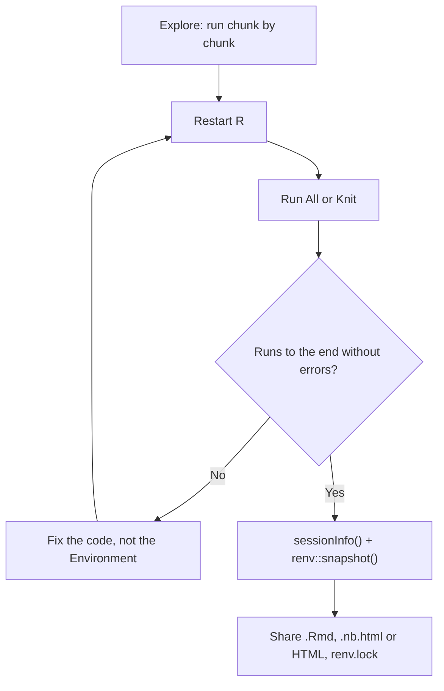

An R Notebook is an R Markdown document (`output: html_notebook`) in RStudio that keeps your explanation, your R code, and its output in a single file. It is one way of putting into practice literate programming, the idea Knuth proposed in 1984. A notebook keeps the whole analysis in one place, but on its own it doesn't guarantee that someone else will get the same result when they rerun it: with the same `set.seed(42)`, `sample(1:100, 5)` returns `49 65 25 74 18` on R 3.6.0 and later, yet `92 93 29 81 62` with the sampling method of R 3.5.0. This second article in the series *R for biological data analysis* is for biology students opening RStudio for the first time. It covers the interface, the assignment operators, three notebook formats, and a minimal reproducible notebook in 8 steps.

<div class="callout callout-note">
<p class="callout-title">Quick summary</p>

- R Notebook = R Markdown with `output: html_notebook`; saving the file also produces a `*.nb.html` file that holds the rendered view and a copy of the source (Xie et al., 2018).
- `<-` works everywhere; `=` only assigns at the top level or inside a `{ }` block, and inside a function call it matches an argument (R Core Team, 2025a).
- A notebook runs chunks in whatever order you click them, so before you share it, restart R and run everything from the top, or Knit.
- Reproducibility also needs a seed, `sessionInfo()`, `renv.lock`, relative paths, and no restoring of `.RData`.
- Since R 3.6.0, `sample()` uses a different default algorithm; without version information, random results can't be compared.

</div>

## 1. What an R Notebook is

*R Markdown: The Definitive Guide* defines an R Notebook as an R Markdown document whose code chunks can be run independently and interactively, with output shown right below each chunk. The book calls it, plainly, an implementation of literate programming (Xie et al., 2018, section 3.2). As a file, a notebook is still an `.Rmd`: the YAML header declares `output: html_notebook`, and the body is Markdown text with R code chunks in between.

The first difference is how it runs. In a regular R Markdown document, clicking *Knit* sends all of the code off to run in one pass. A notebook sends one line or one chunk at a time, whenever you click, so you can stop where an error appears and fix it on the spot (Xie et al., 2018). When you save, RStudio also writes a self-contained `*.nb.html` file. It holds the rendered page with all the chunk output you currently have, plus a copy of the `.Rmd` file. Whoever receives it can open the `.nb.html` in a browser to read it, then pull the source code back out of that same file. The notebook's *Preview* button **does not run** any chunks. It only stitches the text together with the most recent output you produced.

The original idea belongs to Donald Knuth. In his 1984 paper *Literate Programming*, Knuth suggested a change of attitude toward writing programs: instead of treating the main task as instructing a computer, concentrate on "explaining to human beings what we want a computer to do" (Knuth, 1984, p. 97). An R Notebook applies this to data analysis. A paragraph explains why you chose a test, the chunk right below runs the test, and the result sits right below the chunk.

One limit is worth knowing up front: a notebook makes an analysis **easy to read and check**, but it does not by itself make it **rerunnable**. The sections that follow move from the RStudio interface, through assignment syntax, to concrete steps that close that gap.

## 2. RStudio in 5 minutes: four panes and the life of an object

RStudio splits the screen into four panes. With no file open, the **Console** fills the whole left column. Once you open a script or an `.Rmd`, the **Source editor** appears at the top left and the Console moves to the bottom left. The right column holds **Environment/History** on top and **Files/Plots/Packages/Help/Viewer** below (Figure 1). You can rearrange this layout in the settings, so yours may look a little different.


*Figure 1. Default RStudio layout with a file open. Redrawn diagram, not a screenshot.*

The Console is where R takes commands. The `>` prompt means R is waiting. A `+` means the previous command isn't finished, usually because of a missing closing bracket or quote. If you see `+` and can't tell what's missing, press Esc to cancel.

Type `a <- 1 + 1` and press Enter. The Console prints nothing, but a new row appears in the Environment pane: `a` with the value `2`. This pane lists the objects in the *Global Environment*, the workspace of your current R session. It's handy for quick checks, and it's also the biggest threat to reproducibility. An object being in the Environment doesn't mean it's in your code. It may have come from a command typed into the Console, from a chunk you've since deleted, or from yesterday's session.

That third source, yesterday's session, deserves the most attention. By default, RStudio may save the Global Environment to a `.RData` file on exit and load it again on startup. The Console then prints `[Workspace loaded from ~/.RData]`, and every old object comes back as if nothing had happened. R's `?Random` help page adds that the state of the random number generator can also be carried over from a previous session when the workspace is restored (R Core Team, 2025b). Today's result then depends on something you can't see in the code.

The fix: open **Tools → Global Options**, uncheck *Restore .RData into workspace at startup*, and set *Save workspace to .RData on exit* to *Never*. You can also run `usethis::use_blank_slate()` (Wickham et al., 2023, chapter 6). Then get in the habit of restarting R often: Ctrl+Shift+F10 on Windows/Linux, Cmd+Shift+0 on macOS (Posit, 2024). If the analysis still runs from the code after a restart, the code really is the "source of truth."

## 3. The assignment operators `<-` and `=`: tested in code

Introductory material often says `<-` and `=` are interchangeable. That's only true **at the top level**, meaning when you type a complete command such as `x = 5` in the Console. The official help page `?assignOps` is explicit: `<-` can be used anywhere, while `=` is only allowed at the top level or as a subexpression in a braced `{ }` block (R Core Team, 2025a). The R Language Definition adds two points. First, `=` used for assignment has lower precedence than `<-`. Second, left-assignment operators group from right to left (R Core Team, n.d., section 10.4.2).

Table 1 summarizes five cases run on R 4.4.3; the full code is right below the table.

**Table 1.** Five cases where `<-` and `=` give different results (R 4.4.3)

| # | Command | Result | Explanation |
|---|---|---|---|
| 1 | `median(x = 1:10)` then `exists("x")` | `FALSE` | `=` inside a function call matches the argument `x` of `median`; no variable is created |
| 1 | `median(x <- 1:10)` then `exists("x")` | `TRUE` | `<-` creates `x` in the Global Environment, then passes the value to the function |
| 2 | `a2 = b2 <- 1` | `a2` = 1, `b2` = 1 | `<-` has higher precedence, so it runs first |
| 2 | `a <- b = 1` | Error `object 'a' not found` | R reads it as `(a <- b) = 1` |
| 3 | `system.time(z2 = 1)` | Error `unused argument (z2 = 1)` | `system.time` has no argument named `z2` |
| 3 | `system.time(z1 <- 1)` | runs, creates `z1` | the assignment is part of the expression being timed |
| 4 | `if (v = 3) 1` | Syntax error `unexpected '='` | `=` is not allowed in a condition |
| 4 | `if ((v = 3)) "ran"` | runs, `v` = 3 | the extra parentheses make a subexpression |
| 5 | `quote(a <- 1)[[1]]` and `parse(text = "y1 = 1")[[1]][[1]]` | `` `<-` `` and `` `=` `` | two different operators in the parse tree |

```r
# 1. Inside a function call
median(x = 1:10); exists("x")      # FALSE
median(x <- 1:10); exists("x")     # TRUE

# 2. Precedence
a2 = b2 <- 1; c(a2, b2)            # 1 1
# a <- b = 1                       # Error: object 'a' not found

# 3. A function with no argument of that name
# system.time(z2 = 1)              # Error: unused argument (z2 = 1)
invisible(system.time(z1 <- 1)); exists("z1")   # TRUE

# 4. Inside an if condition
# if (v = 3) 1                     # Error: unexpected '='
if ((v = 3)) "ran"                 # "ran"

# 5. The parse tree
quote(a <- 1)[[1]]                 # `<-`
parse(text = "y1 = 1")[[1]][[1]]   # `=`
```

You'll run into two more operators in other people's code. `->` assigns to the right (`5 -> w`) and is rarely used because it's hard to read. `<<-` assigns into a parent environment: inside a function, it looks for a variable of the same name in the enclosing environments and, if none exists, creates one in the Global Environment (R Core Team, 2025a). In a notebook, `<<-` is one more way to create hidden state, so avoid it.

The simplest convention to follow: use `<-` for every assignment and `=` for function arguments. A glance then tells you which lines create variables and which pass parameters. RStudio inserts `<-` with Alt+- (Option+- on macOS) (Posit, 2024).

## 4. Creating and running an R Notebook

There are two ways to create a notebook. The first is **File → New File → R Notebook**. The second is to change the `output` line in the YAML of an existing `.Rmd` file to `html_notebook` (Xie et al., 2018, section 3.2.1). RStudio starts you off with a template that has a title, a short paragraph of instructions, and a chunk that draws `plot(cars)`.

A chunk opens with three backticks followed by `{r}` and closes with three backticks. The three shortcuts you'll use most (Xie et al., 2018):

| Action | Windows/Linux | macOS |
|---|---|---|
| Insert a new chunk | Ctrl+Alt+I | Cmd+Option+I |
| Run the current chunk | Ctrl+Shift+Enter | Cmd+Shift+Enter |
| Run the current line or selection | Ctrl+Enter | Cmd+Enter |

Shortcuts can change between RStudio versions. The correct list for your installation is under **Tools → Keyboard Shortcuts Help**.

Chunk output appears right below the chunk in the editor, not in the Plots pane or the Console. By default, the working directory while a chunk runs is the folder that contains the `.Rmd` file. To wipe the state and rerun from scratch, use *Restart R and Clear Output* (Xie et al., 2018).

## 5. R Notebook, R Markdown document, or Quarto: which format to use

The three formats share almost the same syntax. They differ in how they run and in what you get at the end.

**Table 2.** The three formats compared

| Criterion | R Notebook | R Markdown document | Quarto document |
|---|---|---|---|
| File extension | `.Rmd` | `.Rmd` | `.qmd` |
| Declaration | `output: html_notebook` | `output: html_document`, `pdf_document`… | `format: html`… |
| Main way to run | chunk by chunk, interactively; Preview runs no code | Knit: reruns everything in one pass | `quarto render` or the Render button |
| Output file | `*.nb.html` (with a copy of the `.Rmd`) | HTML, PDF, Word… | HTML, PDF, Word, websites… |
| Execution order | the order you click, which can get messy | always top to bottom | always top to bottom |
| Languages | R (and a few other engines) | R (and a few other engines) | R, Python, Julia… |
| Tools needed | RStudio, rmarkdown | rmarkdown, pandoc | Quarto CLI (built on Pandoc) |

Quarto is a scientific publishing system built on Pandoc. According to its official FAQ, Quarto's core works much like R Markdown, but it brings packages that used to be separate into one system and supports several languages (Posit, n.d.).

For students, a sensible split is this: use a notebook while you explore the data, since running one chunk at a time and fixing things on the spot is convenient. Before you hand in an assignment or send it to a lab partner, render it again from scratch with Knit or `quarto render`. That step forces the code to run in page order in a fresh session, so it catches the bug that only works on one machine.

## 6. A minimal reproducible notebook: 8 steps

Sandve et al. (2013) set out ten rules for reproducible computational research. Wilson et al. (2017) describe "good enough" practices for scientists who aren't professional programmers. The eight steps below draw on both sets of rules, trimmed down for an R notebook.

**Step 1. One folder per project.** Noble (2009) recommends keeping data, results, and documents in separate subfolders. A minimal layout:

```text
germination-experiment/
├── germination-experiment.Rproj
├── data/            # raw data, read-only
├── results/         # tables and figures generated by code
├── doc/
├── analysis.Rmd
└── renv.lock
```

**Step 2. Give files meaningful names.** File names should contain only letters, numbers, underscores `_`, and hyphens `-`, plus a period before the extension; no spaces (Buffalo, 2015). The forward slash `/` separates directories, so it never belongs in a file name. Names should describe the contents, for example `plant-height-week-3.csv` instead of `result1.csv` (Wilson et al., 2017).

**Step 3. Use relative paths.** Open the project through its `.Rproj` file (an RStudio Project) and read data with `read.csv("data/plant_height.csv")`, not `setwd("homework")`. An absolute path is only correct on one machine (Buffalo, 2015; Wickham et al., 2023).

**Step 4. Set a seed for every random step.** Call `set.seed()` before every step that uses random numbers: simulation, bootstrapping, splitting a training set (Sandve et al., 2013, Rule 6).

**Step 5. Record software versions.** The last chunk calls `sessionInfo()` (Sandve et al., 2013, Rule 3).

**Step 6. Lock package versions.** `renv::init()` creates a project-specific library; `renv::snapshot()` writes each package's version to `renv.lock`; the recipient runs `renv::restore()` to install exactly those versions (Ushey & Wickham, 2026).

**Step 7. Don't restore the workspace.** Turn off `.RData` as described in section 2.

**Step 8. Do a clean rerun.** Restart R, then Run All or Knit. If this step throws "object not found," some object used to exist only in the Environment and never in the code. Fix the code until a clean rerun finishes without errors.

The diagram below shows the everyday loop for working in a notebook. Explore freely, but any result you plan to use has to pass a clean rerun.



Beginners only need three `renv` commands. `renv::init()` runs once, when the project starts; it creates the `renv/` folder and the `renv.lock` file. Whenever you install or update a package, run `renv::snapshot()` to record it. Whoever takes over the project opens the `.Rproj` file and runs `renv::restore()`. `sessionInfo()` and `renv.lock` complement each other. `sessionInfo()` tells you which R version and operating system the analysis ran on. `renv.lock` records the exact version of every package and lets you reinstall them.

A minimal notebook applying steps 4 and 5:

````markdown
---
title: "Minimal reproducible notebook"
output: html_notebook
---

```{r setup}
set.seed(42)
```

```{r analysis}
x <- rnorm(5)
round(mean(x), 4)
```

```{r session-info}
sessionInfo()
```
````

Knitted with `knitr::knit()` on R 4.4.3, the `analysis` chunk returns `0.4413`. The last chunk prints the R version (4.4.3), the platform, the BLAS/LAPACK libraries, and the locale.

**Table 3.** The 8-step checklist and the rules behind it

| Step | Action | Basis |
|---|---|---|
| 1 | One folder per project, `data/` read-only | Noble (2009); Wilson et al. (2017) |
| 2 | File names without spaces that describe the contents | Buffalo (2015); Wilson et al. (2017) |
| 3 | Relative paths, RStudio Project | Buffalo (2015); Wickham et al. (2023) |
| 4 | `set.seed()` | Sandve et al. (2013), Rule 6 |
| 5 | `sessionInfo()` | Sandve et al. (2013), Rule 3 |
| 6 | `renv.lock` | Sandve et al. (2013), Rule 3 |
| 7 | Don't restore `.RData` | Wickham et al. (2023) |
| 8 | Restart R → Run All / Knit | Sandve et al. (2013), Rule 1 |

## 7. Worked example: one seed, two conclusions

Picture a typical homework `.Rmd` file. It simulates data for two groups of plants, control and treatment, then compares mean height. The file starts with `set.seed(42)`, which is a good habit.

```r
make_data <- function() {
  set.seed(42)
  data.frame(
    group = sample(c("control", "treatment"), 20, replace = TRUE),
    height = round(rnorm(20, mean = 15, sd = 3), 1)
  )
}
d_new <- make_data()                       # default since R 3.6.0
suppressWarnings(RNGversion("3.5.0"))
d_old <- make_data()                       # as in R 3.5.0
RNGkind(sample.kind = "Rejection")         # back to the default
identical(d_new$height, d_old$height)      # TRUE
sum(d_new$group != d_old$group)            # 10
tapply(d_new$height, d_new$group, mean)
tapply(d_old$height, d_old$group, mean)
```

Results on R 4.4.3: the height column is identical, but 10 of the 20 group labels differ. Under the current default, the control group (n = 9) averages 15.17 cm and the treatment group (n = 11) 13.94 cm. Under the R 3.5.0 sampling method, control (n = 7) averages 13.90 cm and treatment (n = 13) 14.81 cm. The direction of the comparison flips (Figure 2).


*Figure 2. Simulated data: same `set.seed(42)`, only the `sample()` algorithm changes.*

The cause lies in R 3.6.0. Starting with that release, the `sample.kind` setting of the random number generator changed its default from `"Rounding"` to `"Rejection"`. The `?Random` page notes that the old method makes `sample` noticeably non-uniform on large populations and should only be used to reproduce old results (R Core Team, 2025b). `rnorm()` didn't change, so the height column stays the same. This is a silent failure: no warning, no error. Only the `sessionInfo()` output at the end of the file tells a reader which version the file ran on.

The same kind of file often has another habit: `attach(mtcars)` so you can type `mpg` instead of `mtcars$mpg`. The `?attach` page explains that `attach` copies the columns into a new environment on the search path and can lead to confusion (R Core Team, 2025c). Try it:

```r
mpg <- 0
attach(mtcars)      # The following object is masked _by_ .GlobalEnv: mpg
mean(mpg)           # 0, not 20.09
detach(mtcars)
with(mtcars, mean(mpg))   # 20.09062
```

A leftover `mpg` variable in the Global Environment has masked the data column. Using `mtcars$mpg` or `with()` avoids the problem.

## 8. From Knuth to Quarto: a short history


*Figure 3. Key milestones from literate programming to Quarto.*

Knuth's WEB system (1984) used one source file for two jobs. "Weaving the web" produced a TeX document describing the program. "Tangling the web" produced a Pascal program that could run. Because both came from the same source, the documentation and the code always matched.

R was introduced in the *Journal of Computational and Graphical Statistics* in 1996 as a language for data analysis and graphics (Ihaka & Gentleman, 1996). In 2002, Leisch introduced Sweave, which embeds R code in LaTeX, and called the approach "literate data analysis" (Leisch, 2002). In 2007, Gentleman and Temple Lang proposed the compendium: data, code, and text packaged as one distributable unit for reproducible statistical analysis (Gentleman & Temple Lang, 2007). Peng (2011) described reproducibility as a spectrum, with full independent replication at one end and nothing reproducible at the other; where a study sits depends on how much of its code and data is published.

knitr (Xie, 2015) and R Markdown (Xie et al., 2018) swapped LaTeX for Markdown, which is much easier to write. Quarto 1.0 was announced in 2022 as the first stable release (Posit, n.d.).

On the Python side, Jupyter Notebook follows the same idea. Pimentel et al. (2019) collected 1.4 million Jupyter notebooks from GitHub. Across 863,878 attempted runs of valid notebooks, only 24.11% ran without errors and 4.03% produced the same results. That doesn't make notebooks a bad tool. It shows that the notebook format can't replace the habits of recording dependencies and rerunning. Rule et al. (2019) distilled ten rules for writing and sharing notebooks, including recording dependencies (Record dependencies), using version control (Use version control), and designing notebooks so others can read, run, and explore them. Most of these rules overlap with the eight steps in section 6, even though they were written for Python.

Across the whole timeline, the tools changed a lot while the question stayed the same: how do you keep text, code, and results from drifting apart? WEB answered by generating both from one source. Sweave and knitr rerun the code every time the document is built. Notebooks give up part of that guarantee in exchange for convenience while exploring. Once you see that trade-off, you'll know when a notebook is fine and when you should Knit.

## 9. Discussion: a notebook is not reproducibility

Put a notebook next to the ten rules of Sandve et al. (2013) and it becomes clear what it does well. A notebook satisfies Rule 1, keeping track of how every result was produced, almost automatically, because each result sits right under the code that produced it. It also satisfies Rule 9, connecting textual statements to underlying results: the sentence "the treatment group was taller" sits a few lines from the number that backs it up. Compared with the old routine of running commands in the Console, copying numbers into Word, and pasting figures by hand, that's a real advantage. Buffalo (2015) advises that every figure and statistic in a report should come from a script rather than from manual steps. A notebook makes that advice the default.

But a notebook doesn't automatically satisfy Rule 3, archiving the exact versions of the software used, or Rule 4, putting code under version control such as Git. The worked example in section 7 shows that without Rule 3, the same file can yield two opposite conclusions without anyone being warned. Rule 4 is outside the scope of this article. The principle is simple, though: an `.Rmd` file is plain text, so keeping its history is as easy as keeping the history of a manuscript.

The risk specific to notebooks is hidden state. You run chunk 5, edit chunk 2, rerun chunk 2, but forget chunks 3 and 4. What's on screen now doesn't match any top-to-bottom reading of the file. In their rule "Build a pipeline," Rule et al. (2019) recommend making a habit of restarting the kernel and rerunning every cell, and treating that as the final test of your results. The numbers from Pimentel et al. (2019) show why: even among notebooks that run, very few on GitHub reproduce their saved results. Step 8 in section 6 is there for exactly this reason.

Notebooks also have limits of scale. A file with 40 chunks, each a few dozen lines long, is very hard to read and review. Wilson et al. (2017) recommend turning repeated code into functions with clear names. For a notebook, a reasonable approach is to move those functions into an `.R` file in the project folder, call `source("R/analysis_functions.R")` in the first chunk, and keep the notebook as a report of text, function calls, and results.

For biologists, reproducing an analysis matters as much as reproducing a wet-lab experiment. A carefully designed germination experiment, with controls and replicates, can still reach the wrong conclusion at the last step if software quietly alters the data table. Ziemann et al. (2016) showed that gene name errors, caused by spreadsheets auto-converting names to dates, are widespread in the published scientific literature (see also the [article on data cleaning](/en/blog/process-data-from-dirty-to-clean/)). Broman and Woo (2018) set out principles for organizing data in spreadsheets that reduce this kind of error, the topic of article 03 in this series.

## 10. Conclusion

An R Notebook is the quickest way to keep the explanation, code, and results of an analysis in one place, in the spirit of literate programming from Knuth (1984) to Quarto. On its own, a notebook doesn't make an analysis rerunnable; the eight steps in section 6 do that. If you only have time for three things, do these today:

1. Turn off restoring and saving `.RData` in Global Options.
2. Add a `sessionInfo()` chunk to the end of every notebook.
3. Before you hand in or send a file, restart R and rerun everything from the top, or Knit.

The next article in the series covers importing and exporting data (Importing and exporting data): CSV files, spreadsheets, and common formatting errors. `renv` comes back in the article on installing packages (Installing packages). Background on data types is in article 05.

## Frequently asked questions

**How is an R Notebook different from R Markdown?** Same `.Rmd` extension, same syntax. A notebook (`html_notebook`) runs chunks interactively and saves as `.nb.html`. An R Markdown document (`html_document`, `pdf_document`…) is Knit, which means everything reruns from the top in one pass.

**Should I switch to Quarto entirely?** If you only use R and everything works, there's no rush. Quarto is worth considering when you need to mix R with Python, or build books, websites, or slides from a single source.

**Why do I get different results with the same `set.seed()`?** Because random results also depend on the random number algorithm in your R version. Since R 3.6.0, `sample()` defaults to `"Rejection"` instead of `"Rounding"`. Record `sessionInfo()`, and when you must reproduce an old result, use `RNGversion()` with the matching version.

**Is `=` wrong?** Not for assignment at the top level. The catch is that `=` inside a function call matches an argument. Using `<-` for every assignment makes code easier to read.

## References

Broman, K. W., & Woo, K. H. (2018). Data organization in spreadsheets. *The American Statistician, 72*(1), 2–10. https://doi.org/10.1080/00031305.2017.1375989

Buffalo, V. (2015). *Bioinformatics data skills: Reproducible and robust research with open source tools*. O'Reilly Media.

Gentleman, R., & Temple Lang, D. (2007). Statistical analyses and reproducible research. *Journal of Computational and Graphical Statistics, 16*(1), 1–23. https://doi.org/10.1198/106186007X178663

Ihaka, R., & Gentleman, R. (1996). R: A language for data analysis and graphics. *Journal of Computational and Graphical Statistics, 5*(3), 299–314. https://doi.org/10.1080/10618600.1996.10474713

Knuth, D. E. (1984). Literate programming. *The Computer Journal, 27*(2), 97–111. https://doi.org/10.1093/comjnl/27.2.97

Leisch, F. (2002). Sweave: Dynamic generation of statistical reports using literate data analysis. In *Compstat* (pp. 575–580). Physica-Verlag HD. https://doi.org/10.1007/978-3-642-57489-4_89

Noble, W. S. (2009). A quick guide to organizing computational biology projects. *PLoS Computational Biology, 5*(7), e1000424. https://doi.org/10.1371/journal.pcbi.1000424

Peng, R. D. (2011). Reproducible research in computational science. *Science, 334*(6060), 1226–1227. https://doi.org/10.1126/science.1213847

Pimentel, J. F., Murta, L., Braganholo, V., & Freire, J. (2019). A large-scale study about quality and reproducibility of Jupyter notebooks. In *2019 IEEE/ACM 16th International Conference on Mining Software Repositories (MSR)* (pp. 507–517). IEEE. https://doi.org/10.1109/MSR.2019.00077

Posit. (2024). *Keyboard shortcuts* (RStudio IDE User Guide, version 2024.04.1). https://docs.posit.co/ide/user/2024.04.1/ide/reference/shortcuts.html

Posit. (n.d.). *FAQ for R Markdown users*. Quarto. https://quarto.org/docs/faq/rmarkdown.html

R Core Team. (n.d.). *R language definition*. CRAN. https://cran.r-project.org/doc/manuals/r-release/R-lang.html

R Core Team. (2025a). *Assignment operators* (`?assignOps`), R version 4.4.3 [Help documentation]. https://stat.ethz.ch/R-manual/R-devel/library/base/html/assignOps.html

R Core Team. (2025b). *Random number generation* (`?Random`), R version 4.4.3 [Help documentation]. https://stat.ethz.ch/R-manual/R-devel/library/base/html/Random.html

R Core Team. (2025c). *Attach set of R objects to search path* (`?attach`), R version 4.4.3 [Help documentation]. https://stat.ethz.ch/R-manual/R-devel/library/base/html/attach.html

Rule, A., Birmingham, A., Zuniga, C., Altintas, I., Huang, S.-C., Knight, R., Moshiri, N., Nguyen, M. H., Rosenthal, S. B., Pérez, F., & Rose, P. W. (2019). Ten simple rules for writing and sharing computational analyses in Jupyter Notebooks. *PLOS Computational Biology, 15*(7), e1007007. https://doi.org/10.1371/journal.pcbi.1007007

Sandve, G. K., Nekrutenko, A., Taylor, J., & Hovig, E. (2013). Ten simple rules for reproducible computational research. *PLoS Computational Biology, 9*(10), e1003285. https://doi.org/10.1371/journal.pcbi.1003285

Ushey, K., & Wickham, H. (2026). *renv: Project environments* (R package version 1.3.1) [Computer software]. CRAN. https://doi.org/10.32614/CRAN.package.renv

Wickham, H., Çetinkaya-Rundel, M., & Grolemund, G. (2023). *R for data science* (2nd ed.). O'Reilly Media. https://r4ds.hadley.nz/

Wilson, G., Bryan, J., Cranston, K., Kitzes, J., Nederbragt, L., & Teal, T. K. (2017). Good enough practices in scientific computing. *PLOS Computational Biology, 13*(6), e1005510. https://doi.org/10.1371/journal.pcbi.1005510

Xie, Y. (2015). *Dynamic documents with R and knitr* (2nd ed.). Chapman and Hall/CRC. https://doi.org/10.1201/9781315382487

Xie, Y., Allaire, J. J., & Grolemund, G. (2018). *R Markdown: The definitive guide*. Chapman and Hall/CRC. https://doi.org/10.1201/9781138359444

Ziemann, M., Eren, Y., & El-Osta, A. (2016). Gene name errors are widespread in the scientific literature. *Genome Biology, 17*(1), 177. https://doi.org/10.1186/s13059-016-1044-7
