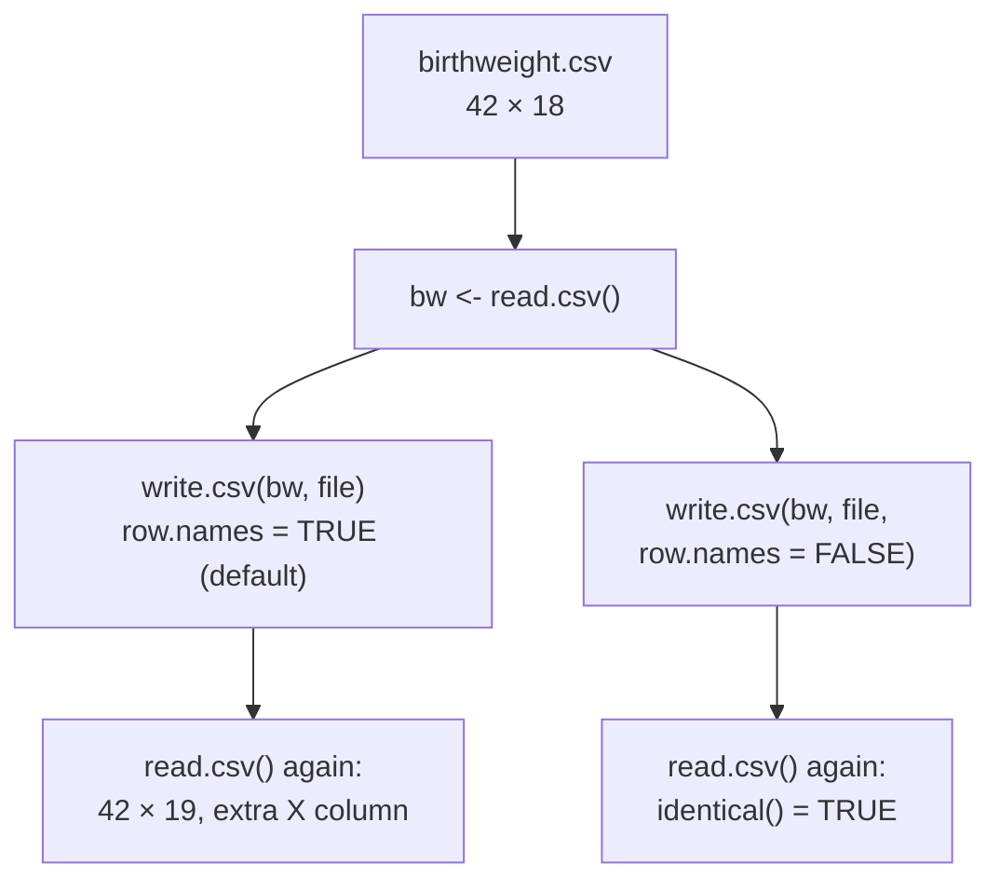
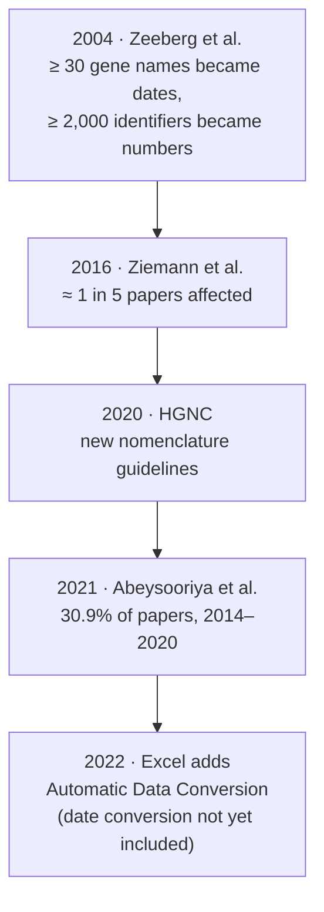

In R, `read.csv()` reads a CSV file into a data frame and `write.csv()` writes a data frame back out to CSV; nearly every biological data analysis in R starts with these two commands. Both come with defaults that catch people off guard: `write.csv()` adds a row-name column, so reading the file back gives you a stray column called `X`, and base R has no `write.delim()` function for writing tab-delimited files. On the spreadsheet side, Excel turns gene symbols such as `SEPT2` and `MARCH1` into dates, and 30.9% of PubMed Central articles from 2014–2020 that shipped gene lists in Excel files carried this error (Abeysooriya et al., 2021). This tutorial, written for biologists who are new to R, walks step by step through a 42-row × 18-column birth weight dataset and compares `read.csv`, `readr::read_csv`, and `data.table::fread`.

<div class="callout callout-note">
<p class="callout-title">Quick summary</p>

- CSV is a convention described in RFC 4180 (2005), not a binding standard; R writes CSV slightly differently from the RFC (LF line endings, an extra row-name column).
- Import: `read.csv()`, then check right away with `dim()`, `str()`, and `colSums(is.na())`.
- Export: always use `write.csv(x, file, row.names = FALSE)`; for tab-delimited files, use `write.table(x, file, sep = "\t", row.names = FALSE)`.
- Never open a gene list in Excel and save over it: the conversion to dates can't be undone.
- For large tables, `data.table::fread()` was more than 10 times faster than `read.csv()` in this article's test (a 210,000-row file).

</div>

This is the third article in the series *R for biological data analysis*. Every code block was run on R 4.4.3 and gives the same output if you use the same file.

## 1. What a CSV file is: RFC 4180 and its variants

A CSV (comma-separated values) file is plain text: each line is one row of the table, and columns are separated by commas. The most widely cited description is RFC 4180 by Shafranovich (2005), the document that registers the MIME type `text/csv`. RFC 4180 is an Informational RFC. It records how most software already handles CSV; it isn't a standard that every program must follow. That's why two files with the same `.csv` extension can still differ in their delimiter, their line endings, or how they quote strings.

According to section 2 of RFC 4180 (Shafranovich, 2005), a typical CSV file has these properties:

1. Each record sits on its own line, ending with a CRLF pair (carriage return and line feed).
2. A header line with column names is optional.
3. Lines should have the same number of fields; spaces are part of a field and are not stripped.
4. Fields containing commas, double quotes, or line breaks should be enclosed in double quotes.
5. If a field is enclosed in double quotes, any double quote inside it must be doubled (`""`).

R writes files in the spirit of rules 4 and 5. The example below has one note that contains a comma and one that contains double quotes:

```r
x <- data.frame(id = 1:2, note = c("remeasured, run 2", 'sample "A"'))
write.csv(x, "example.csv", row.names = FALSE)
cat(readLines("example.csv"), sep = "\n")
```

```text
"id","note"
1,"remeasured, run 2"
2,"sample ""A"""
```

The comma in "remeasured, run 2" doesn't split the row into three columns because the whole field is quoted, and the quotes around `A` are doubled. Reading the file back with `read.csv("example.csv")` gives a data frame identical to `x` (`identical()` returns `TRUE` on R 4.4.3).

R departs from the RFC, or makes decisions for you, in three places. `write.table()` and `write.csv()` default to `eol = "\n"`, meaning LF only rather than CRLF; the file written on macOS in this article's test contained no CR characters. The default `row.names = TRUE` makes R write the row names as an extra first column (section 3). And missing values are written as the text `NA` (`na = "NA"`), while the RFC says nothing about missing values (R Core Team, 2025). On the reading side, `read.csv()` defaults to `header = TRUE`, `sep = ","`, and `dec = "."`.

In many countries, Vietnam included, the comma is the decimal mark. The R documentation describes `read.csv2()` as the variant for countries that use a comma as the decimal point and a semicolon as the field separator, with defaults `sep = ";"` and `dec = ","` (R Core Team, 2025). Picking the wrong function doesn't always raise an error. The example below writes a small "semicolon-separated, decimal comma" file and reads it with both functions:

```r
writeLines(c("sample;conc", "A1;3,23", "A2;2,95"), "eu.csv")
str(read.csv("eu.csv"))
str(read.csv2("eu.csv"))
```

```text
'data.frame':	2 obs. of  1 variable:
 $ sample.conc: int  23 95
'data.frame':	2 obs. of  2 variables:
 $ sample: chr  "A1" "A2"
 $ conc  : num  3.23 2.95
```

`read.csv()` doesn't stop. It splits each line at the decimal comma, turns the part before it ("A1;3") into a row name, and returns a single integer column of 23 and 95 that means nothing. `read.csv2()` reads the two columns correctly, with concentrations of 3.23 and 2.95. When someone sends you a file, open it in a text editor to see the delimiter, then check it with `str()`. No error doesn't mean the import is right.

TSV (tab-separated values) files follow the same idea but separate columns with a tab character. Gene names and sample IDs rarely contain tabs, so TSV needs quoting less often than CSV. Domain formats such as FASTA, FASTQ, and VCF have their own rules, covered in the [article on biological data formats](/en/blog/dinh-dang-du-lieu-va-co-so-du-lieu-sinh-hoc/).

## 2. Importing data with `read.csv()`

### 2.1. Working directory: use a project instead of absolute paths

When you call `read.csv("birthweight.csv")`, R looks for the file in the current working directory. The familiar approach is to run `setwd()` with an absolute path, for example `setwd("D:/projects/R_project")`, or to choose *Session > Set Working Directory* in RStudio. A script like that runs on your machine and breaks on anyone else's. Bryan (2017) calls such scripts not self-contained and not portable: everyone who receives one has to fix the paths by hand.

The recommended alternative is a project-oriented workflow. Each analysis lives in its own folder, marked by an RStudio Project (a `.Rproj` file), and every path is written relative to the project root, optionally with the `here()` function from the here package (Bryan, 2017). Wilson et al. (2017) likewise recommend putting each project in its own directory, with raw data in `data/` and output in `results/`. How to create a Project in RStudio is covered in [article 2 on RStudio and R Notebooks](/en/blog/rstudio-and-r-notebooks/).

### 2.2. Download the file and verify its checksum

```r
dir.create("data", showWarnings = FALSE)
url <- paste0("https://raw.githubusercontent.com/ucdavis-bioinformatics-training/",
              "2022_February_Introduction_to_R_for_Bioinformatics/main/birthweight.csv")
download.file(url, file.path("data", "birthweight.csv"))
tools::md5sum(file.path("data", "birthweight.csv"))
```

```text
                   data/birthweight.csv
"bf579c7055ed0b040033028be20f573b"
```

A checksum (hash value) is a file's fingerprint: change a single byte and the value changes. The copy downloaded on November 23, 2026 has the MD5 shown above and the SHA-256 `6b3c2acca905a3ddd505474c44760a6a89b1a6e36ff72e4fbcb6358e49f894ac` (`shasum -a 256` on macOS, `sha256sum` on Linux). If you get a different value, the file on the server has changed and the numbers below may no longer match.

### 2.3. How `read.csv()` guesses column types

```r
bw <- read.csv(file.path("data", "birthweight.csv"))
dim(bw)
table(sapply(bw, class))
```

```text
[1] 42 18

character   integer   logical   numeric
        3        13         1         1
```

`read.csv()` reads the whole file as text and then guesses a type for each column. A column of whole numbers becomes `integer`, a column with decimals becomes `numeric`, a column of only `TRUE`/`FALSE` becomes `logical`, and everything else is `character`. For birthweight, that gives 13 `integer` columns, one `numeric` column (`birthweight`, in kg), one `logical` column, and three `character` columns (Table 1).

Since R 4.0.0, `stringsAsFactors = FALSE` has been the default, so text columns stay as strings instead of silently becoming factors (R Core Team, 2025). Material written before 2020 often describes the old behavior; if you want a factor, convert explicitly with `factor()`.

Empty cells in numeric columns become `NA`. Only the four father variables have missing values, 4–5 cells each.

The `birth.date` column stores dates as `1/25/1967` (month/day/year) and is kept as a string. R doesn't turn date-like strings into dates on its own; to use the column as dates, convert it explicitly with a declared format, for example `as.Date(bw$birth.date, format = "%m/%d/%Y")` (data types and type conversion are covered in the [article on basic data types](/en/blog/basic-data-types/)). This is the core difference from spreadsheets, where the conversion to a date happens the moment you open the file (section 5).

### 2.4. Check right after importing

```r
str(bw[, 1:5])
colSums(is.na(bw))[colSums(is.na(bw)) > 0]
table(bw$smoker)
```

```text
'data.frame':	42 obs. of  5 variables:
 $ ID         : int  1107 697 1683 27 1522 569 365 808 1369 1023 ...
 $ birth.date : chr  "1/25/1967" "2/6/1967" "2/14/1967" "3/9/1967" ...
 $ location   : chr  "General" "Silver Hill" "Silver Hill" "Silver Hill" ...
 $ length     : int  52 48 53 53 50 50 52 48 49 52 ...
 $ birthweight: num  3.23 3.03 3.35 3.55 2.74 2.51 3.53 2.92 3.18 3 ...

      paternal.age  paternal.education paternal.cigarettes     paternal.height
                 4                   5                   5                   5

 no yes
 20  22
```

Four commands, `dim()`, `str()`, `head()`, and `colSums(is.na())`, answer three questions: are all the rows and columns there, does each column have the right type, and where are the missing values? A numeric column that `str()` reports as `chr` usually means some cell contains text (such as "<0.1" or "n/a"). The next summary functions are in the article on summarizing data in R.

<div class="callout callout-warning">
<p class="callout-title">Three common import errors</p>

- `cannot open the connection`: wrong file name or wrong working directory; check with `getwd()` and `list.files()`.
- A table with only one column, or shifted numbers: wrong delimiter (see `read.csv2()` in section 1).
- A numeric column read as `character`: some cell holds text; find it with `x[is.na(suppressWarnings(as.numeric(x)))]` instead of editing the raw file by hand.

</div>

**Table 1.** Data dictionary for birthweight as read by `read.csv()` (R 4.4.3)

| Column | Type | Range or values | `NA` |
|---|---|---|---|
| `ID` | integer | 27–1764, 42 distinct values | 0 |
| `birth.date` | character | "1/25/1967", … (month/day/year) | 0 |
| `location` | character | General 10, Memorial 13, Silver Hill 19 | 0 |
| `length` | integer | 43–58 | 0 |
| `birthweight` | numeric | 1.92–4.57 (kg) | 0 |
| `head.circumference` | integer | 30–39 | 0 |
| `weeks.gestation` | integer | 33–45 | 0 |
| `smoker` | character | "no" 20, "yes" 22 | 0 |
| `maternal.age` | integer | 18–41 | 0 |
| `maternal.cigarettes` | integer | 0–50 | 0 |
| `maternal.height` | integer | 149–181 | 0 |
| `maternal.prepregnant.weight` | integer | 45–78 | 0 |
| `paternal.age` | integer | 19–46 | 4 |
| `paternal.education` | integer | 10–16 | 5 |
| `paternal.cigarettes` | integer | 0–50 | 5 |
| `paternal.height` | integer | 169–194 | 5 |
| `low.birthweight` | integer | 0 or 1 | 0 |
| `geriatric.pregnancy` | logical | TRUE/FALSE | 0 |

## 3. Exporting data: `write.csv()`, the `X` column, and tab-delimited files

### 3.1. Where the `X` column comes from

```r
write.csv(bw, "new_birthweight.csv")
bw2 <- read.csv("new_birthweight.csv")
dim(bw2)
names(bw2)[1:3]
```

```text
[1] 42 19
[1] "X"          "ID"         "birth.date"
```

By default, `write.csv(bw, "new_birthweight.csv")` writes the row names ("1", "2", …) as a first column with an empty header. When you read the file back, `read.csv()` finds an unnamed column and calls it `X`, so the table has 19 columns instead of 18. Repeat the write-and-read cycle a few times and you collect `X`, `X.1`, and so on. In pandas, the same column shows up as `Unnamed: 0`.

One argument fixes it:

```r
write.csv(bw, "new_birthweight.csv", row.names = FALSE)
identical(bw, read.csv("new_birthweight.csv"))
```

```text
[1] TRUE
```

`identical()` returning `TRUE` means the write-then-read round trip changed nothing: same columns, same types, same values, same `NA`s.



### 3.2. Missing values: `NA` or an empty cell

The original file leaves missing cells empty, but `write.csv()` writes the text `NA`. R reads it back correctly, yet other software may treat `NA` as a string. If the file is meant for spreadsheet users, add `na = ""`:

```r
write.csv(bw, "birthweight_blank_na.csv", row.names = FALSE, na = "")
identical(bw, read.csv("birthweight_blank_na.csv"))
```

```text
[1] TRUE
```

### 3.3. Writing a tab-delimited file

Base R has `read.delim()` for reading tab-delimited files but no matching writer called `write.delim()`: `exists("write.delim")` returns `FALSE` on R 4.4.3. The function you want is `write.table()` with `sep = "\t"`:

```r
write.table(bw, "birthweight.tsv", sep = "\t", row.names = FALSE, quote = FALSE)
identical(bw, read.delim("birthweight.tsv"))
```

```text
[1] TRUE
```

`quote = FALSE` keeps the file clean and easy to read with command-line tools, but it's only safe when no field contains a tab or a line break. If you aren't sure, keep the default `quote = TRUE`, in line with the quoting rule of RFC 4180. The birthweight data frame gets more practice in the [article on working with data in R](/en/blog/cac-thao-tac-voi-du-lieu-trong-r/).

### 3.4. Don't overwrite the raw file

Buffalo (2015) recommends treating raw data as read-only: your code reads the original file and writes results to a new file, never editing the original. A simple convention is to write results to `results/` (Wilson et al., 2017), for example `write.csv(bw, file.path("results", "birthweight_clean.csv"), row.names = FALSE)` after creating the folder with `dir.create("results")`. If you do overwrite something by accident, the checksum from section 2.2 tells you whether the file in `data/` is still the original.

## 4. The birthweight dataset: origin and limitations

The dataset records birth weight and maternal smoking, enough to ask simple biological questions about smoking during pregnancy. According to the UC Davis Bioinformatics Core (2022), the data were lightly modified from a dataset by Mathematics and Statistics Help (MASH) at the University of Sheffield to demonstrate a few extra functions; the file was uploaded to GitHub on January 29, 2022.

The file has 43 lines (one header line and 42 rows) and 18 columns: information about the baby, maternal variables, paternal variables, and two binary variables (Table 1).

The dataset has three limitations. These are modified teaching data, fine for practicing techniques but not for drawing conclusions about the real effects of smoking. The UC Davis GitHub repository declares no license (checked November 23, 2026), so this article links to the download instead of republishing the file. And the original description on the MASH site now requires a login, so the provenance given here relies on the UC Davis materials.

## 5. The evidence: when spreadsheets rename genes

Try reading three "dangerous" gene names in R:

```r
genes <- read.csv(text = "gene,log2FC\nSEPT2,1.8\nMARCH1,-0.9\nDEC1,2.4\n")
str(genes)
```

```text
'data.frame':	3 obs. of  2 variables:
 $ gene  : chr  "SEPT2" "MARCH1" "DEC1"
 $ log2FC: num  1.8 -0.9 2.4
```

R keeps all three names as strings. Open the same data in Excel and all three can become dates: `SEPT2` turns into September 2, `MARCH1` into March 1, and `DEC1` into December 1.

Zeeberg et al. (2004) described this error systematically while processing microarray data. According to the authors, date conversion affected at least 30 gene names, and conversion to floating-point numbers affected at least 2,000 identifiers once RIKEN identifiers were included (for example, a digit string with an E in the middle gets read as scientific notation). These conversions can't be reversed: once a cell has become a date, the software no longer knows what the original string was.

Twelve years later, Ziemann et al. (2016) scanned supplementary files from leading genomics journals and found that roughly one in five papers with gene lists in Excel files contained conversion errors. Abeysooriya et al. (2021) rescanned supplementary files on PubMed Central from 2014–2020: 30.9% (3,436 of 11,117) of articles had errors, and the rate did not drop after the 2016 warning. Part of the higher rate comes from the team also detecting dates stored as internal serial numbers (five-digit numbers). In the team's tests, Excel and Google Sheets converted gene names to dates under all three input methods (opening a text file, pasting, typing by hand), while LibreOffice Calc and Gnumeric did not (Abeysooriya et al., 2021).

The community responded from two sides. The HGNC (HUGO Gene Nomenclature Committee) published new nomenclature guidelines in 2020 (Bruford et al., 2020); according to Abeysooriya et al. (2021), the HGNC renamed some symbols that were prone to conversion, such as `SEPT1` to `SEPTIN1` and `MARCH1` to `MARCHF1`. A 2021 *Nature* news story reported that Excel's autocorrect errors were still causing trouble in genomics (Lewis, 2021). On Microsoft's side, Excel gained an *Automatic Data Conversion* option in 2022 that can turn off removing leading zeros, truncating numbers longer than 15 digits, and converting digit strings around the letter "E" to scientific notation; the announcement states that control over date conversion was planned but not yet available (Fifadra, 2022).



The root cause is software guessing data types on the user's behalf, so being more careful isn't enough. Prevention has to be part of the workflow: import with a script, declare types when needed, and check after every import and export.

Even so, you'll still receive files that have passed through someone else's spreadsheet. Before analyzing one, scan the gene column for the two traces these studies describe: "day-abbreviated month" strings and five-digit integers (a spreadsheet's internal date serial numbers). Here is an example on a simulated vector:

```r
gene_col <- c("TP53", "2-Sep", "1-Mar", "44075", "MYC")
months <- "(Jan|Feb|Mar|Apr|May|Jun|Jul|Aug|Sep|Oct|Nov|Dec)"
suspect <- grepl(paste0("^[0-9]{1,2}-", months, "$"), gene_col) |
           grepl("^[0-9]{5}$", gene_col)
gene_col[suspect]
```

```text
[1] "2-Sep" "1-Mar" "44075"
```

The code only flags; it doesn't fix. "2-Sep" might once have been `SEPT2` or `SEPTIN2`, and only whoever holds the original file knows for sure. The reliable fix is to get the list again from its source before it went through a spreadsheet, or to rejoin on a stable ID column such as the HGNC ID or Ensembl ID. If you must open the file in a spreadsheet, LibreOffice Calc or Gnumeric carries less risk according to the tests above; whatever software you use, don't save over the original file.

## 6. Good practice for organizing and sharing tabular data

Broman and Woo (2018) set out a list of rules for entering data in spreadsheets, from writing dates as YYYY-MM-DD, putting one thing in each cell, and keeping the data as a single rectangle with one header row, to saving an extra plain-text copy. Table 2 picks the rules that bear directly on import and export. Wickham (2014) calls the easy-to-analyze layout tidy data: each variable a column, each observation a row (→ [article on data frames](/en/blog/data-frames/)).

When sending data to an analyst, Ellis and Leek (2018) recommend including four things: the raw data, a tidy table, a codebook describing each variable, and a description of the steps that take you from the raw data to the tidy table. Wilson et al. (2017) and Sandve et al. (2013) add: keep the raw data, record every processing step in code, and use version control. Applied to this article, a small project might look like this:

```text
birthweight-project/
├── birthweight-project.Rproj
├── data/
│   └── birthweight.csv        # raw file, never edited
├── scripts/
│   └── 01-import.R            # download, verify checksum, read, check
└── results/
    └── birthweight_clean.csv  # exported file, row.names = FALSE
```

The recipient only needs to open the `.Rproj` file and run `scripts/01-import.R`; every relative path works without changing a line. Cleaning data after import is covered in depth in the [article on data cleaning](/en/blog/process-data-from-dirty-to-clean/), and organizing larger projects with workflows and containers in the article on reproducible workflows.

**Table 2.** Tabular data checklist for the lab

| Practice | Why | Source |
|---|---|---|
| Column names without spaces or special characters | R turns spaces into dots, which invites typos | Broman & Woo (2018) |
| Dates as `YYYY-MM-DD` | avoids mixing up month and day | Broman & Woo (2018) |
| Gene names stored as text, with a stable ID (HGNC ID, Ensembl ID) | spreadsheets don't turn IDs into dates | Abeysooriya et al. (2021); Bruford et al. (2020) |
| One value per cell, units in the header | machine-readable | Broman & Woo (2018) |
| Raw files read-only, results written to new files | traceable | Buffalo (2015) |
| Import into R with a script, no manual edits | reproducible | Sandve et al. (2013) |
| Send a codebook and a description of the steps | the recipient understands the data | Ellis & Leek (2018) |

## 7. Experiment: `read.csv`, `read_csv`, and `fread`

### 7.1. Methods

Besides base R's `read.csv()`, two popular readers are `read_csv()` from the readr package (Wickham et al., 2026) and `fread()` from the data.table package (Barrett et al., 2026). The test used R 4.4.3, readr 2.2.0, and data.table 1.18.4 on an Intel Core i5-5350U machine (4 logical threads, data.table using 2 threads) running macOS. Step one compared column types and object classes on the original 42 × 18 file. Step two measured speed on an expanded file: each row repeated 5,000 times for 210,000 rows and 16.9 MB, written with `write.csv(row.names = FALSE)`. Each function read the file 10 times in random order, and the median of `system.time()` was recorded.

### 7.2. Results

```r
library(readr); library(data.table)
a <- read.csv("data/birthweight.csv")
b <- read_csv("data/birthweight.csv", show_col_types = FALSE)
d <- fread("data/birthweight.csv")
class(b$length); class(d$length)
```

```text
[1] "numeric"
[1] "integer"
```

**Table 3.** Differences between the three readers on birthweight.csv

| | `read.csv()` | `readr::read_csv()` | `data.table::fread()` |
|---|---|---|---|
| Object class | `data.frame` | `spec_tbl_df`, `tbl_df`, `tbl`, `data.frame` | `data.table`, `data.frame` |
| 13 integer columns | integer | numeric (double) | integer |
| Other 5 columns | same | same | same |
| `NA` in `paternal.age` | 4 | 4 | 4 |
| Median time, 210,000 rows | 0.980 s | 0.379 s | 0.057 s |


*Figure 1. Time to read a 210,000-row CSV file with three functions; bars are medians, dots are individual runs (10 per function). Measured on November 23, 2026, on a single machine.*

There are two main results. All three functions return the same values and the same number of `NA`s, but `read_csv()` reads the 13 integer columns as double: readr guesses every number as double by default (`guess_parser("52")` returns `"double"`). `fread()` was about 17 times faster than `read.csv()`, and `read_csv()` about 2.6 times faster.

### 7.3. Discussion

The integer/double difference rarely changes a statistical result, but it makes `identical()` return `FALSE` when you compare two imports. If you need fixed types, declare them when reading, for example `read_csv(file, col_types = cols(length = col_integer()))`.

`fread()` also detects the delimiter and decimal mark on its own. On the `eu.csv` file from section 1, `fread("eu.csv")` returns the correct two columns, `sample` (string) and `conc` (the numbers 3.23 and 2.95), while `read.csv()` returns a wrong result without any error. That's still a guess, though; for files that matter, set `sep` and `dec` explicitly.

If you need a quick rule: use `read.csv()` for small tables and exercises, since there's nothing extra to install; use `read_csv()` if the whole analysis lives in the tidyverse (dplyr, ggplot2), so you get a tibble and a report of column types; use `fread()` for large tables such as RNA-seq count matrices. All three accept a column-type argument (`colClasses` for `read.csv()` and `fread()`, `col_types` for `read_csv()`), and setting it is the surest way to get the same result from two reads.

The test ran on one machine with an expanded file built from repeated rows, so the numbers show orders of magnitude, not a general benchmark. When the machine was busy with many other tasks, all three functions ran about 3–6 times slower (medians of 4.09 s, 1.22 s, and 0.32 s), but the ranking held: `fread()` was still about 13 times faster than `read.csv()`. A real table with more text columns may give different ratios. How tibbles and data.tables print and filter data is covered in the [article on data frames](/en/blog/data-frames/).

## 8. Conclusion

Import and export are where data most easily change without anyone noticing, because every piece of software guesses types for you. Spreadsheets turn gene names into dates and won't let you undo it (Zeeberg et al., 2004; Abeysooriya et al., 2021). R keeps strings as strings and lets you declare column types yourself. The surest protection is a fixed routine; on your next project, you can follow these five steps:

1. Keep the raw file in `data/`, leave it untouched, and record its checksum.
2. Import with a script, using relative paths inside an RStudio Project.
3. Check right away with `dim()`, `str()`, and `colSums(is.na())`.
4. Export to `results/` with `row.names = FALSE`.
5. Read the file you just wrote and compare it with `identical()`; that one line catches both the `X` column and delimiter mistakes.

The next article in the series looks at the structure of the data frame you just imported (→ [Data frames](/en/blog/data-frames/)).

## Appendix: reproducible code

The script below builds the expanded file and times the readers as in section 7; it needs `data/birthweight.csv` from section 2.2 and the readr and data.table packages. Run `sessionInfo()` at the end to record the R and package versions, because both column types and speed depend on them.

```r
library(readr); library(data.table)
bw  <- read.csv("data/birthweight.csv")
big <- bw[rep(seq_len(nrow(bw)), each = 5000), ]   # 210,000 rows
write.csv(big, "big.csv", row.names = FALSE)

set.seed(1)
res <- data.frame()
for (i in 1:10) for (f in sample(c("read.csv", "read_csv", "fread"))) {
  t <- switch(f,
    read.csv = system.time(read.csv("big.csv"))[["elapsed"]],
    read_csv = system.time(read_csv("big.csv", show_col_types = FALSE,
                                    lazy = FALSE))[["elapsed"]],
    fread    = system.time(fread("big.csv"))[["elapsed"]])
  res <- rbind(res, data.frame(fun = f, run = i, sec = t))
}
aggregate(sec ~ fun, res, median)
sessionInfo()
```

**Table 4.** Defaults of base R import and export functions (from `args()`, R 4.4.3)

| Function | `sep` | `dec` | `header` | `row.names` when writing | `na` when writing |
|---|---|---|---|---|---|
| `read.csv()` | `","` | `"."` | `TRUE` | – | – |
| `read.csv2()` | `";"` | `","` | `TRUE` | – | – |
| `read.delim()` | `"\t"` | `"."` | `TRUE` | – | – |
| `write.csv()` | `","` (fixed) | `"."` | – | `TRUE` | `"NA"` |
| `write.table()` | `" "` | `"."` | – | `TRUE` | `"NA"` |

## References

Abeysooriya, M., Soria, M., Kasu, M. S., & Ziemann, M. (2021). Gene name errors: Lessons not learned. *PLOS Computational Biology, 17*(7), e1008984. https://doi.org/10.1371/journal.pcbi.1008984

Barrett, T., Dowle, M., Srinivasan, A., Gorecki, J., Chirico, M., Hocking, T., Schwendinger, B., & Krylov, I. (2026). *data.table: Extension of `data.frame`* (R package version 1.18.4) [Computer software]. https://r-datatable.com

Broman, K. W., & Woo, K. H. (2018). Data organization in spreadsheets. *The American Statistician, 72*(1), 2–10. https://doi.org/10.1080/00031305.2017.1375989

Bruford, E. A., Braschi, B., Denny, P., Jones, T. E. M., Seal, R. L., & Tweedie, S. (2020). Guidelines for human gene nomenclature. *Nature Genetics, 52*(8), 754–758. https://doi.org/10.1038/s41588-020-0669-3

Bryan, J. (2017, December 12). *Project-oriented workflow*. Tidyverse blog. https://www.tidyverse.org/blog/2017/12/workflow-vs-script/

Buffalo, V. (2015). *Bioinformatics data skills: Reproducible and robust research with open source tools*. O'Reilly Media.

Ellis, S. E., & Leek, J. T. (2018). How to share data for collaboration. *The American Statistician, 72*(1), 53–57. https://doi.org/10.1080/00031305.2017.1375987

Fifadra, C. (2022, July 5). *Control data conversions in Excel*. Microsoft 365 Insider Blog. https://techcommunity.microsoft.com/blog/microsoft365insiderblog/control-data-conversions-in-excel/4215348

Lewis, D. (2021, August 13). Autocorrect errors in Excel still creating genomics headache. *Nature*. https://doi.org/10.1038/d41586-021-02211-4

R Core Team. (2025). *R: A language and environment for statistical computing* (Version 4.4.3) [Computer software]. R Foundation for Statistical Computing. https://www.R-project.org/

Sandve, G. K., Nekrutenko, A., Taylor, J., & Hovig, E. (2013). Ten simple rules for reproducible computational research. *PLoS Computational Biology, 9*(10), e1003285. https://doi.org/10.1371/journal.pcbi.1003285

Shafranovich, Y. (2005). *Common format and MIME type for comma-separated values (CSV) files* (RFC 4180). Internet Engineering Task Force. https://doi.org/10.17487/RFC4180

UC Davis Bioinformatics Core. (2022). *Introduction to R for Bioinformatics* (February 2022 workshop materials) [GitHub repository]. https://github.com/ucdavis-bioinformatics-training/2022_February_Introduction_to_R_for_Bioinformatics

Wickham, H. (2014). Tidy data. *Journal of Statistical Software, 59*(10), 1–23. https://doi.org/10.18637/jss.v059.i10

Wickham, H., Hester, J., & Bryan, J. (2026). *readr: Read rectangular text data* (R package version 2.2.0) [Computer software]. https://readr.tidyverse.org

Wilson, G., Bryan, J., Cranston, K., Kitzes, J., Nederbragt, L., & Teal, T. K. (2017). Good enough practices in scientific computing. *PLOS Computational Biology, 13*(6), e1005510. https://doi.org/10.1371/journal.pcbi.1005510

Zeeberg, B. R., Riss, J., Kane, D. W., Bussey, K. J., Uchio, E., Linehan, W. M., Barrett, J. C., & Weinstein, J. N. (2004). Mistaken identifiers: Gene name errors can be introduced inadvertently when using Excel in bioinformatics. *BMC Bioinformatics, 5*, 80. https://doi.org/10.1186/1471-2105-5-80

Ziemann, M., Eren, Y., & El-Osta, A. (2016). Gene name errors are widespread in the scientific literature. *Genome Biology, 17*, 177. https://doi.org/10.1186/s13059-016-1044-7
