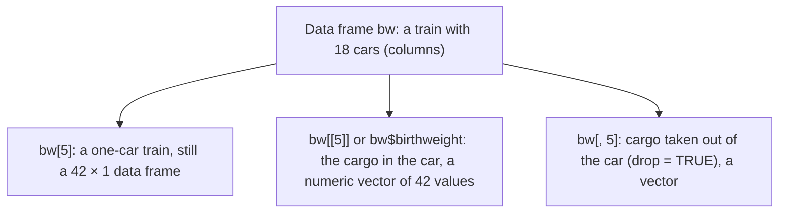
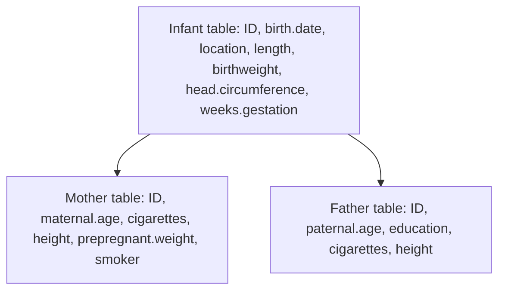

A data frame is R's basic table structure: a list of equal-length vectors, where each vector is a column and each column can have its own type (numeric, character, logical). That lets variables of different types measured on the same observations, such as each newborn's weight, birth date, and whether the mother smoked, live together in one object. The `birthweight` dataset used here is a 42 × 18 data frame. Even so, `bw$head` returns a column although no column is called `head`, and `bw[, 5]` returns a vector rather than a table. This fourth article in the series *R for biological data analysis* is for biology and biomedical students who are new to R. It covers the structure of a data frame, the three subsetting operators `$`, `[[` and `[`, the principles of tidy data, and one round of exploratory analysis with real output.

<div class="callout callout-note">
<p class="callout-title">Quick summary</p>

- A data frame is a list of equal-length columns: `typeof(bw)` gives `"list"`, and `length(bw)` equals the number of columns.
- `[` returns the same type as the original object (table in, table out); `[[` and `$` pull out a single column. The exception is `bw[, j]`, which drops a dimension when only one column is left, unless you add `drop = FALSE`.
- `$` partially matches column names, and filtering rows with a logical condition on a column that contains `NA` produces rows full of `NA`. Use `[[` inside functions, and use `which()` or `subset()` when filtering.
- In the `birthweight` dataset, the `low.birthweight` column flags 6 infants as low birth weight, but only 3 fall below the WHO cutoff of 2,500 g. Recompute derived variables from the original measurements.

</div>

## 1. What a data frame is: anatomy of a table of 42 newborns

### 1.1. The dataset

The examples use the file `birthweight.csv` from the "Introduction to R for Bioinformatics" materials of the UC Davis Bioinformatics Core (2022). According to its authors, it is a table of infant birth weights and parental information, adapted from a dataset provided by Mathematics and Statistics Help (MASH) at the University of Sheffield and lightly modified to demonstrate a few more functions. Each row is one infant born in 1967 at one of three hospitals. Downloading the file and checking its checksum is covered in [article 03 on importing and exporting data](/en/blog/importing-and-exporting-data/); here a single line is enough:

```r
bw <- read.csv("birthweight.csv")
```

The RStudio Environment pane now shows `bw` with the line "42 obs. of 18 variables": 42 observations (infants), 18 variables (columns). The three subsetting operators `$`, `[[` and `[` look alike but return three different things, and the reason lies in how a data frame is built.

### 1.2. A data frame is a list of equal-length vectors

These functions tell you nearly everything you need to know about the structure of `bw` (output from R 4.4.3):

```r
class(bw)    #> [1] "data.frame"
dim(bw)      #> [1] 42 18
typeof(bw)   #> [1] "list"
length(bw)   #> [1] 18
is.list(bw)  #> [1] TRUE
```

`dim()` reports 42 rows and 18 columns. The line to look at closely is `typeof()`: in storage terms, a data frame is a **list**, and its `length()` is the number of columns, not the number of cells. Each element of the list is a vector of exactly 42 values; the `"data.frame"` class adds a few attributes so that R treats that list as a table:

```r
attributes(bw[1:2, 1:3])
#> $names
#> [1] "ID"         "birth.date" "location"
#> $row.names
#> [1] 1 2
#> $class
#> [1] "data.frame"
```

`names` holds the column names, `row.names` the row names (row numbers by default), and `class` tells R which methods to use for printing and subsetting. Two consequences follow:

- Because it is a list, `bw[[5]]` and `bw$birthweight` are the same vector: `identical(bw[[5]], bw$birthweight)` returns `TRUE`.
- Because it has row and column name attributes, R lets you write `bw[i, j]` as you would with a matrix, even though there is no matrix inside.

### 1.3. One type per column

Unlike a matrix, each column of a data frame keeps its own type. `str(bw)` shows 13 integer columns, 1 numeric column (`birthweight`, in kg), 3 character columns (`birth.date`, `location`, `smoker`) and 1 logical column (`geriatric.pregnancy`). Table 1 summarizes the 18 columns and their missing values.

**Table 1.** Columns of the `birthweight` dataset (types from `str()`, `NA` counts from `colSums(is.na(bw))`)

| Column | Name | Type | `NA` count | Meaning |
| --- | --- | --- | --- | --- |
| 1 | `ID` | integer | 0 | infant ID |
| 2 | `birth.date` | character | 0 | birth date as M/D/YYYY |
| 3 | `location` | character | 0 | hospital |
| 4 | `length` | integer | 0 | length (cm) |
| 5 | `birthweight` | numeric | 0 | birth weight (kg) |
| 6 | `head.circumference` | integer | 0 | head circumference (cm) |
| 7 | `weeks.gestation` | integer | 0 | gestational age (weeks) |
| 8 | `smoker` | character | 0 | mother smokes (`yes`/`no`) |
| 9–12 | `maternal.*` (age, cigarettes, height, prepregnant.weight) | integer | 0 | mother's age, cigarettes per day, height, pre-pregnancy weight |
| 13 | `paternal.age` | integer | 4 | father's age |
| 14–16 | `paternal.*` (education, cigarettes, height) | integer | 5 each | father's years of education, cigarettes, height |
| 17 | `low.birthweight` | integer | 0 | 0/1 low birth weight code |
| 18 | `geriatric.pregnancy` | logical | 0 | mother aged 35 or older |

Allowing different types across columns is the whole reason data frames exist. Force this table into a matrix and every value becomes a string, because a matrix holds only one type:

```r
typeof(as.matrix(bw))   #> [1] "character"
as.matrix(bw)[1, 1:5]
#>          ID  birth.date    location      length birthweight
#>      "1107" "1/25/1967"   "General"        "52"      "3.23"
```

Mixed data therefore belongs in a data frame, while matrices are for single-type data such as gene expression tables (→ data structures in R). Data types and coercion rules are covered in detail in [article 05](/en/blog/basic-data-types/).

## 2. Three operators, three meanings: `$`, `[[` and `[`

If you remember one thing from this section, make it the image Wickham (2019, section 4.3.1) borrows: if a list is a freight train, `x[[5]]` is the cargo in car 5, while `x[5]` is car 5 itself, that is, a shorter train. In a data frame, the "cars" are columns.



*Diagram of the freight-train metaphor from Wickham (2019, section 4.3.1), redrawn for the `birthweight` dataset.*

### 2.1. `[[`: pull out one column

`[[` takes a column name (a string) or a column number and returns the contents of that column, which is a vector. According to the `[.data.frame` help page, `[[` matches names **exactly** by default (`exact = TRUE`) (R Core Team, 2025):

```r
bw[["birthweight"]][1:3]            #> [1] 3.23 3.03 3.35
bw[[5]][1:3]                        #> [1] 3.23 3.03 3.35
bw[["head"]]                        #> NULL
head(bw[["head", exact = FALSE]])   #> [1] 36 35 33 37 33 35
```

The big advantage of `[[` is that it accepts a **variable** holding the column name. That is the right way to write functions or loops that go over several columns:

```r
col <- "birthweight"
head(bw[[col]])   #> [1] 3.23 3.03 3.35 3.55 2.74 2.51
```

### 2.2. `$`: a handy shortcut with traps

`bw$birthweight` is quicker to type than `bw[["birthweight"]]`, and RStudio suggests column names as soon as you type `$`. But `$` differs from `[[` in three ways, and none of them raises an error:

```r
head(bw$head)   #> [1] 36 35 33 37 33 35   (partial match to head.circumference)
bw$birth        #> NULL                    (matches both birth.date and birthweight)
col <- "birthweight"
bw$col          #> NULL                    (R looks for a column named "col")
```

First, `$` does partial matching: `bw$head` returns the `head.circumference` column because it is the only column whose name starts with `head` (R Core Team, 2025; Wickham, 2019). Second, when a prefix matches several columns, as `birth` matches both `birth.date` and `birthweight`, the result is `NULL`, not an error message. Third, `$` takes whatever follows it literally as the column name, so `bw$col` looks for a column called `col`. A typo in a column name can therefore slip through quietly, and then `mean(NULL)` returns `NA` with a warning on some other line.

Wickham (2019, section 4.3.2) suggests turning on a warning for every partial match:

```r
options(warnPartialMatchDollar = TRUE)
x <- bw$head
#> Warning message:
#> In bw$head : partial match of 'head' to 'head.circumference'
```

A practical rule: use `$` when typing at the console, and use `[[` in functions, loops and reusable scripts.

### 2.3. `[`: subsets of the same type

`[` always tries to return the same type as the original object. With **one** index, a data frame is treated as a list, so `bw[5]` is a 42 × 1 data frame:

```r
class(bw[5])   #> [1] "data.frame"
dim(bw[5])     #> [1] 42  1
```

With **two** indices, the syntax is `bw[row, column]`. Leaving an index empty means "take all of that dimension": `bw[, 5]` is every row of column 5, and `bw[1, ]` is every column of row 1. Keep `bw[1, 5]` (two arguments: row 1, column 5) apart from `bw[c(1, 5)]` (one index vector: columns 1 and 5):

```r
bw[1, 5]               #> [1] 3.23
head(bw[c(1, 5)], 3)
#>     ID birthweight
#> 1 1107        3.23
#> 2  697        3.03
#> 3 1683        3.35
```

Negative indices drop rows or columns. Columns 13–16 are the four `paternal.*` columns, so the following command keeps 11 rows and removes all of the father's information:

```r
y <- bw[c(1, 3, 5:13), -c(13:16)]   # drop the father's data (columns 13-16)
dim(y)                              #> [1] 11 14
```

Using column names, as in `bw[, c("ID", "birthweight")]`, makes code easier to read, and it does not break when the column order changes.

### 2.4. The `drop = TRUE` trap

This kind of bug does not stop R, so it is hard to spot. The `[.data.frame` help page states that with two indices, the default is to drop a dimension when only **one column** remains, but not when only **one row** remains (R Core Team, 2025):

```r
class(bw[, 5])                #> [1] "numeric"
class(bw[, 5, drop = FALSE])  #> [1] "data.frame"
dim(bw[1, ])                  #> [1]  1 18   (one row is still a data frame)
```

With two or more columns, `bw[, c(4, 5)]` is still a data frame; the type only changes when exactly one column is left. The problem shows up when you write a function where the caller decides how many columns to pass:

```r
g <- function(d, cols) ncol(d[, cols])
g(bw, c("length", "birthweight"))   #> [1] 2
g(bw, "length")                     #> NULL
```

With one column, `d[, cols]` becomes a vector, the `ncol()` of a vector is `NULL`, and no error appears. Adding `drop = FALSE` to every subset inside a function is the safest way to get a data frame back.

### 2.5. Filtering rows with a logical vector, and the `NA` trap

Instead of positions, you can pass a logical vector to `[`. The 18-element vector below (12 `TRUE`, 4 `FALSE`, 2 `TRUE`) selects exactly the columns that `-c(13:16)` selects:

```r
keep <- c(rep(TRUE, 12), rep(FALSE, 4), rep(TRUE, 2))
identical(bw[keep], bw[-c(13:16)])   #> [1] TRUE
```

More common is filtering **rows** by a condition: `bw$length < 50` creates a 42-element logical vector, which you place in the row position:

```r
dim(bw[bw$length < 50, c(1, 4:12, 17, 18)])   #> [1] 10 12
nrow(bw[bw$smoker == "yes" & bw$maternal.cigarettes > 20, ])   #> [1] 9
```

Ten infants are shorter than 50 cm, and 9 have mothers who smoke more than 20 cigarettes a day. The operators `&` (and) and `|` (or) combine conditions.

The trap appears when the condition column has missing values. `paternal.age` has 4 `NA` values; the comparison `NA > 40` gives `NA`, and `[` turns each `NA` in the index vector into a row full of `NA`:

```r
bw[bw$paternal.age > 40, c("ID", "paternal.age")]
#>       ID paternal.age
#> NA    NA           NA
#> 4     27           46
#> NA.1  NA           NA
#> NA.2  NA           NA
#> NA.3  NA           NA
#> 40   532           41
```

The result has 6 rows, 4 of them "ghost" rows named `NA`, `NA.1`, `NA.2`, `NA.3`; any `nrow()` count afterward will be wrong without a warning. Two fixes give the same correct answer, 2 fathers over 40:

```r
bw[which(bw$paternal.age > 40), c("ID", "paternal.age")]
subset(bw, paternal.age > 40, select = c(ID, paternal.age))
#>     ID paternal.age
#> 4   27           46
#> 40 532           41
```

`which()` keeps only the positions that are `TRUE` and skips `NA`; `subset()` does the same and lets you write column names without `bw$`, which is convenient in interactive work.

### 2.6. Putting it together

Once a column has been pulled out as a vector, you keep using `[` with a single index and no comma: `bw$length[1]` gives `52`, and `bw$length[c(1, 2)]` gives `52 48`.

**Table 2.** The three subsetting operators on a data frame (R 4.4.3)

| Syntax | Input | Result | Name matching | When the condition has `NA` |
| --- | --- | --- | --- | --- |
| `bw$x` | name typed directly | vector | partial (warning can be enabled) | not applicable |
| `bw[["x"]]`, `bw[[5]]` | string, number, variable | vector | exact (`exact = TRUE`) | not applicable |
| `bw[5]`, `bw[c("x", "y")]` | number, string, logical vector | data frame | exact | not applicable |
| `bw[i, j]` | row, column | data frame; vector if 1 column is left | exact | creates all-`NA` rows |
| `bw[i, j, drop = FALSE]` | row, column | always a data frame | exact | creates all-`NA` rows |
| `subset(bw, cond, select)` | expression | data frame | bare column names | drops `NA` rows |

## 3. Exploring the data: four questions with real output

The three operators from section 2 are enough to answer the first descriptive questions. Each question below comes with the command, its output, and one thing to watch for.

**Question 1. What is the range of the fathers' ages?**

```r
range(bw$paternal.age)                #> [1] NA NA
range(bw$paternal.age, na.rm = TRUE)  #> [1] 19 46
sum(is.na(bw$paternal.age))           #> [1] 4
```

The first call returns `NA NA` because the column has 4 missing values, and R's summary functions (`range()`, `mean()`, `max()`, and so on) return `NA` by default when they meet an `NA`. Adding `na.rm = TRUE` gives 19–46 years, computed over the 38 fathers with data.

**Question 2. What is the mothers' mean age?**

```r
mean(bw$maternal.age)   #> [1] 25.54762
```

About 25.55 years. This column has no missing values, so `na.rm` is not needed.

**Question 3. How old is the mother who smokes the most?**

```r
max(bw$maternal.cigarettes)   #> [1] 50
bw$maternal.age[bw$maternal.cigarettes == max(bw$maternal.cigarettes)]   #> [1] 37
bw[which.max(bw$maternal.cigarettes), c("ID", "maternal.age", "maternal.cigarettes")]
#>      ID maternal.age maternal.cigarettes
#> 12 1272           37                  50
```

The mother smokes 50 cigarettes a day and is 37 years old (infant ID 1272, row 12). Both approaches give the same answer because only one mother smokes 50 a day, but they are not equivalent: the logical subset returns **every** value equal to the maximum, while `which.max()` returns only the **first** position and silently ignores ties.

**Question 4. Is the mothers' pre-pregnancy weight higher or lower in the low-birth-weight group than in the rest?**

```r
table(bw$low.birthweight)
#>  0  1
#> 36  6
tapply(bw$maternal.prepregnant.weight, bw$low.birthweight, mean)
#>        0        1
#> 58.52778 51.33333
```

By the `low.birthweight` column, the 6 low-birth-weight infants had mothers who weighed 51.33 kg on average before pregnancy, **lower** than the 58.53 kg for the other 36 infants. `tapply()` computes `mean` for each group; the logical subset `mean(bw$maternal.prepregnant.weight[bw$low.birthweight == 1])` gives the same 51.33.

If you want to go one step further, `t.test(maternal.prepregnant.weight ~ low.birthweight, data = bw)` (Welch) gives p ≈ 0.014 and `wilcox.test()` gives p ≈ 0.018. These two numbers only illustrate the `y ~ group` syntax with the `data =` argument: the low-birth-weight group has just 6 infants, the data are modified teaching data, and section 4 shows that the group definition itself needs a second look. Statistical inference comes in later articles.

Finally, an overview of the outcome variable:

```r
summary(bw$birthweight)
#>    Min. 1st Qu.  Median    Mean 3rd Qu.    Max.
#>   1.920   2.940   3.295   3.313   3.647   4.570
```

Birth weight ranges from 1.92 to 4.57 kg, with a median of 3.295 kg and a mean of 3.313 kg (3.312857 to be exact).

**Table 3.** The four exploratory questions and their answers

| Question | Main command | Output | Watch for |
| --- | --- | --- | --- |
| Range of fathers' ages | `range(bw$paternal.age, na.rm = TRUE)` | 19–46 | 4 `NA`; without `na.rm` you get `NA NA` |
| Mean maternal age | `mean(bw$maternal.age)` | 25.55 | no `NA` |
| Age of the heaviest-smoking mother | logical subset or `which.max()` | 37 years (50 cigarettes/day) | `which.max()` takes only the first position |
| Pre-pregnancy weight, low birth weight vs. the rest | `tapply(..., bw$low.birthweight, mean)` | 51.33 vs. 58.53 kg | n = 6; see section 4 for the group definition |
| (By the WHO cutoff) | `tapply(..., bw$birthweight < 2.5, mean)` | 51.33 vs. 57.97 kg | n = 3 |

## 4. A small finding: `low.birthweight` does not match the WHO cutoff

The World Health Organization defines low birth weight as a weight at birth **below 2,500 g** (World Health Organization [WHO], n.d.). The `birthweight` column is in kg, so the matching comparison is `bw$birthweight < 2.5`. Put it next to the existing `low.birthweight` column:

```r
table(lbw = bw$low.birthweight, who = bw$birthweight < 2.5)
#>    who
#> lbw FALSE TRUE
#>   0    36    0
#>   1     3    3
sort(bw$birthweight[bw$low.birthweight == 1])
#> [1] 1.92 2.05 2.37 2.51 2.65 2.66
```

Of the 6 infants coded as low birth weight, only 3 (1.92, 2.05 and 2.37 kg) fall below the WHO cutoff. The other three weigh 2.51, 2.65 and 2.66 kg. Meanwhile, the lightest infant coded 0 weighs 2.74 kg. If this column was built from a weight cutoff, that cutoff must lie somewhere between 2.66 and 2.74 kg, not at the 2.5 kg of the WHO definition.

The original dataset may have used a different definition, this may be part of the modifications made for teaching, or it may be a coding error. The accompanying materials say only that the data were "lightly modified" from the original (UC Davis Bioinformatics Core, 2022), so this article draws no conclusion about the cause. If you analyze low birth weight by the WHO definition, do not use the existing column.

Redoing Question 4 with the WHO cutoff: the group below 2.5 kg shrinks to 3 infants, whose mothers weighed 51.33 kg on average before pregnancy, compared with 57.97 kg for the other 39 infants; a Welch t-test gives p ≈ 0.14. The direction of the difference is unchanged, but with 3 infants nothing beyond a description is possible (Figure 2).


*Figure 2. Mothers' pre-pregnancy weight by low-birth-weight group under two definitions: the existing `low.birthweight` column (left) and the WHO cutoff of below 2.5 kg (right). Each dot is one infant; the box spans the interquartile range and the middle line is the median. Data: `birthweight.csv` (UC Davis Bioinformatics Core, 2022), n = 42.*

A derived variable such as `low.birthweight` is a conclusion stored as data. When the rule that produced it is not documented, recompute it from the original measurements.

## 5. Tidy data: is the `birthweight` dataset "tidy"?

A data frame is how R implements rectangular data, meaning a table of rows and columns; Bruce and Bruce (2017) call R's data frame and the pandas DataFrame the basic rectangular structures of the two environments. But a rectangular table can be arranged in many ways. Tidy data is a convention about **how data are organized** inside that rectangle. Wickham (2014) states three principles:

1. Each variable forms a column.
2. Each observation forms a row.
3. Each type of observational unit forms a table.

*R for Data Science* restates the idea in its "Data tidying" chapter (Wickham et al., 2023). Applied to `birthweight`:

**Principles 1 and 2: met.** Each row is one infant, and each column is one variable measured on the infant or the infant's parents; no column holds two variables, and no variable is spread over several columns.

**Principle 3: not entirely.** The table mixes three observational units: the infant (columns 1–8), the mother (columns 9–12) and the father (columns 13–16). If two infants shared the same parents, the parental information would be repeated, and fixing it in one place makes it easy to forget the other. A "normalized" design would split it into three tables linked by a key:



*Diagram: splitting `birthweight` by observational unit, linked by `ID`. The dataset has no separate IDs for mothers and fathers, so the infant's `ID` stands in here.*

With 42 independent infants, keeping a single table is a reasonable practical choice. Wickham (2014, section 3.4) links principle 3 to database normalization and also notes that for analysis, tables often have to be merged back into one.

**Stored derived variables.** Besides `low.birthweight` (section 4), the `geriatric.pregnancy` column is also computed from another column. This time the rule matches `maternal.age >= 35` exactly:

```r
table(bw$geriatric.pregnancy, bw$maternal.age >= 35)
#>         FALSE TRUE
#>   FALSE    38    0
#>   TRUE      0    4
```

All 4 mothers aged 35 or older are flagged `TRUE`, and the other 38 are `FALSE`. Two derived columns: one matches its rule, one does not. Unless you open the data and check, you cannot tell which kind you are holding.

**Dates stored as strings.** `birth.date` holds values such as `"1/25/1967"` in month/day/year order. As strings, R cannot sort them or compute the time between two dates; splitting and handling this date column is one of the examples in [article 06](/en/blog/functions/).

Most of these problems are best solved at data entry. Broman and Woo (2018) advise scientists to be consistent in codes and column names, to put just one thing in each cell, not to use font or fill color as data, and not to keep calculations in the raw data file. A spreadsheet built that way gives you a tidy data frame right after `read.csv()`. A documented data cleaning workflow is covered in more depth in [the article on cleaning data](/en/blog/process-data-from-dirty-to-clean/).

## 6. Where data frames came from: S, Chambers & Hastie, and R

R did not invent the data frame. R began as a language for data analysis and graphics (Ihaka & Gentleman, 1996), and the R project's official overview describes R as "a different implementation" of the S language, noting that much code written for S runs unaltered under R (R Foundation, n.d.). The "new" version of S was described in *The New S Language* (Becker et al., 1988).

R's `?data.frame` help page cites exactly one source: chapter 3, "Data for models," written by Chambers (1992), in the book *Statistical Models in S* (Chambers & Hastie, 1992). The chapter title hints at the context: a statistical model needs an object that bundles variables of different types with the same number of observations. That trace survives in the `data` argument of modeling functions such as `lm(formula, data, ...)` or `t.test(y ~ group, data = bw)` from section 3: the formula names the columns, and the data frame supplies them.

The idea of treating data as tables is older. Codd (1970) laid the foundation for the relational model, in which data are organized as relations, that is, tables. In presenting tidy data, Wickham (2014, section 2.3) writes that his three principles are Codd's third normal form, restated in the language of statistics; the source he cites for this point is Codd's 1990 book (Codd, 1990), not the 1970 paper.

The structure spread to Python with the pandas DataFrame (McKinney, 2010), and in R it was refreshed with the tidyverse's tibble (Wickham et al., 2019). Figure 1 places these milestones on a timeline.


*Figure 1. Key milestones from the relational model to the modern data frame. Sources: Codd (1970); Becker et al. (1988); Chambers & Hastie (1992); Ihaka & Gentleman (1996); McKinney (2010); Wickham (2014); Wickham et al. (2019).*

## 7. data.frame, tibble and pandas: a short comparison

These three tools share the idea of a table but differ in a few places that are easy to mix up.

**tibble** is the tidyverse's "modern" data frame (Müller & Wickham, 2023). It is still a data frame (`class()` includes `"tbl_df"`, `"tbl"`, `"data.frame"`), but it removes two of the traps from section 2: it never drops dimensions (`tb[, 5]` is still a 42 × 1 tibble), and `$` does no partial matching, returning `NULL` with a warning instead (Wickham, 2019, sections 4.2.5 and 4.3.2).

```r
library(tibble)          # tibble 3.2.1
tb <- as_tibble(bw)
dim(tb[, 5])             #> [1] 42  1
tb$head
#> NULL
#> Warning message:
#> Unknown or uninitialised column: `head`.
```

**pandas** uses notation that is almost the reverse of R's. In pandas, `df["birthweight"]` (one pair of brackets) pulls out a column as a `Series`, while `df[["birthweight"]]` (two pairs of brackets, with a list of column names inside) returns a `DataFrame`. People coming from R trip over this, because in R it is `[[` that extracts a column.

```python
import pandas as pd                      # pandas 3.0.3
df = pd.read_csv("birthweight.csv")
type(df["birthweight"]).__name__         # 'Series'
df[["birthweight"]].shape                # (42, 1)
df.birthweight.mean()                    # 3.3128571428571427
df.loc[df.length < 50].shape             # (10, 18)
df["paternal.age"].mean()                # 28.763157894736842
df.loc[df["paternal.age"] > 40, ["ID", "paternal.age"]]   # 2 rows: ID 27 and 532
```

The mean birth weight of 3.312857 kg and the 10 infants shorter than 50 cm match R. The big difference is missing values. pandas' `mean()` defaults to `skipna=True` (pandas development team, n.d.), so the fathers' mean age comes out as 28.76 with nothing declared, while R returns `NA` until you add `na.rm = TRUE`. Comparisons with `NaN` in pandas give `False`, so filtering for fathers over 40 returns exactly 2 rows, with no "ghost" rows. That is more convenient, but the 4 fathers with missing data drop out of the result without anyone mentioning it.

On indexing, R's data frame has `row.names` but no support for multilevel indexes, whereas pandas has an index, including multilevel indexes (Bruce & Bruce, 2017).

**Table 4.** Common operations in the three tools

| Operation | data.frame (base R) | tibble | pandas |
| --- | --- | --- | --- |
| Get one column as a vector/Series | `bw[["x"]]`, `bw$x` | `tb[["x"]]`, `tb$x` | `df["x"]` |
| Get one column, keep it as a table | `bw["x"]`, `bw[, "x", drop = FALSE]` | `tb[, "x"]` | `df[["x"]]` |
| Filter rows by a condition | `bw[which(cond), ]`, `subset()` | same as base R (or `dplyr::filter()`) | `df.loc[cond]` |
| Drop columns | `bw[, -c(13:16)]` | same as base R | `df.drop(columns=...)` |
| Partial name matching with `$`/attribute access | yes | no, warns | no |
| Mean with missing values | `NA`, needs `na.rm = TRUE` | same as base R | skipped (`skipna=True`) |

`dplyr` operations such as `filter()` and `select()` are covered in article 08 on the tidyverse.

## 8. Conclusion and checklist

Once you see a data frame as a list of equal-length columns, the rest is predictable: `[` takes out a smaller list, so it is still a data frame; `[[` and `$` take the contents of one element, so they give a vector; and `drop = TRUE` is an exception added for convenience when typing by hand. The hardest bugs to find do not stop R. They return `NULL`, `NA` rows or a column that has changed type, and the code keeps running. These six habits block most of them:

1. After importing data, run `dim()` and `str()` to check the number of rows, the number of columns and the type of each column.
2. In functions and reusable scripts, use `[[` instead of `$`; turn on `options(warnPartialMatchDollar = TRUE)` while developing code.
3. Add `drop = FALSE` when subsetting with `[i, j]` if the result could have a single column.
4. When filtering on a column with `NA`, use `which()` or `subset()`, and report the number of missing values.
5. Recompute derived variables (low birth weight, age groups) from the original measurements using a published definition, instead of trusting the existing column.
6. Keep data tidy from the spreadsheet onward: one variable per column, one observation per row, one value per cell.

[Article 05](/en/blog/basic-data-types/) goes deeper into data types, `NA` and coercion, all of which came up repeatedly here; [article 06](/en/blog/functions/) uses functions and `apply` to answer questions about smoking and birth weight.

### Frequently asked questions

**How is a data frame different from a matrix?** A matrix holds a single type; a data frame is a list of columns, each with its own type (section 1.3).

**Why does `bw[, 5]` give a vector while `bw[5]` gives a table?** `bw[5]` is list-style subsetting, so it keeps the data frame; `bw[, 5]` is matrix-style subsetting with `drop = TRUE` by default. Add `drop = FALSE` to keep the table.

**When should I use `$`, and when `[[`?** `$` is handy at the console, but it partially matches column names and cannot take a variable holding a column name. In functions, loops and reusable scripts, use `[[`, because it matches names exactly and accepts `bw[[col]]` (section 2.2).

## Appendix: reproducibility

Data file: `birthweight.csv` from the UC Davis Bioinformatics Core GitHub repository (2022), 43 lines (1 header line, 42 rows). The repository does not declare a license, so this article only links to the download. SHA-256 of the file used:

```
6b3c2acca905a3ddd505474c44760a6a89b1a6e36ff72e4fbcb6358e49f894ac
```

Environment: macOS, R 4.4.3, tibble 3.2.1, Python 3.13 with pandas 3.0.3; run on November 24, 2026. Figure 2 was drawn with matplotlib from the same data file.

## References

Becker, R. A., Chambers, J. M., & Wilks, A. R. (1988). *The new S language: A programming environment for data analysis and graphics*. Wadsworth & Brooks/Cole.

Broman, K. W., & Woo, K. H. (2018). Data organization in spreadsheets. *The American Statistician, 72*(1), 2–10. https://doi.org/10.1080/00031305.2017.1375989

Bruce, P., & Bruce, A. (2017). *Practical statistics for data scientists: 50 essential concepts*. O'Reilly Media.

Chambers, J. M. (1992). Data for models. In J. M. Chambers & T. J. Hastie (Eds.), *Statistical models in S* (chap. 3). Wadsworth & Brooks/Cole.

Chambers, J. M., & Hastie, T. J. (Eds.). (1992). *Statistical models in S*. Wadsworth & Brooks/Cole. (Reprinted: Routledge, 2017. https://doi.org/10.1201/9780203738535)

Codd, E. F. (1970). A relational model of data for large shared data banks. *Communications of the ACM, 13*(6), 377–387. https://doi.org/10.1145/362384.362685

Codd, E. F. (1990). *The relational model for database management: Version 2*. Addison-Wesley.

Ihaka, R., & Gentleman, R. (1996). R: A language for data analysis and graphics. *Journal of Computational and Graphical Statistics, 5*(3), 299–314. https://doi.org/10.1080/10618600.1996.10474713

McKinney, W. (2010). Data structures for statistical computing in Python. In *Proceedings of the 9th Python in Science Conference* (pp. 56–61). https://doi.org/10.25080/Majora-92bf1922-00a

Müller, K., & Wickham, H. (2023). *tibble: Simple data frames* (R package version 3.2.1). https://CRAN.R-project.org/package=tibble

pandas development team. (n.d.). *pandas.DataFrame.mean*. pandas documentation. Retrieved November 24, 2026, from https://pandas.pydata.org/docs/reference/api/pandas.DataFrame.mean.html

R Core Team. (2025). *R: A language and environment for statistical computing* (Version 4.4.3) [Computer software; help pages `data.frame` and `Extract.data.frame`]. R Foundation for Statistical Computing. https://www.R-project.org/

R Foundation. (n.d.). *What is R?* Retrieved November 24, 2026, from https://www.r-project.org/about.html

UC Davis Bioinformatics Core. (2022). *Introduction to R for Bioinformatics* (February 2022 workshop materials) [GitHub repository]. https://github.com/ucdavis-bioinformatics-training/2022_February_Introduction_to_R_for_Bioinformatics

Wickham, H. (2014). Tidy data. *Journal of Statistical Software, 59*(10), 1–23. https://doi.org/10.18637/jss.v059.i10

Wickham, H. (2019). *Advanced R* (2nd ed.). Chapman and Hall/CRC. https://doi.org/10.1201/9781351201315

Wickham, H., Averick, M., Bryan, J., Chang, W., McGowan, L. D., François, R., Grolemund, G., Hayes, A., Henry, L., Hester, J., Kuhn, M., Pedersen, T. L., Miller, E., Bache, S. M., Müller, K., Ooms, J., Robinson, D., Seidel, D. P., Spinu, V., … Yutani, H. (2019). Welcome to the tidyverse. *Journal of Open Source Software, 4*(43), 1686. https://doi.org/10.21105/joss.01686

Wickham, H., Çetinkaya-Rundel, M., & Grolemund, G. (2023). *R for data science: Import, tidy, transform, visualize, and model data* (2nd ed.). O'Reilly Media. https://r4ds.hadley.nz/

World Health Organization. (n.d.). *Low birth weight* [Nutrition Landscape Information System]. https://www.who.int/data/nutrition/nlis/info/low-birth-weight
