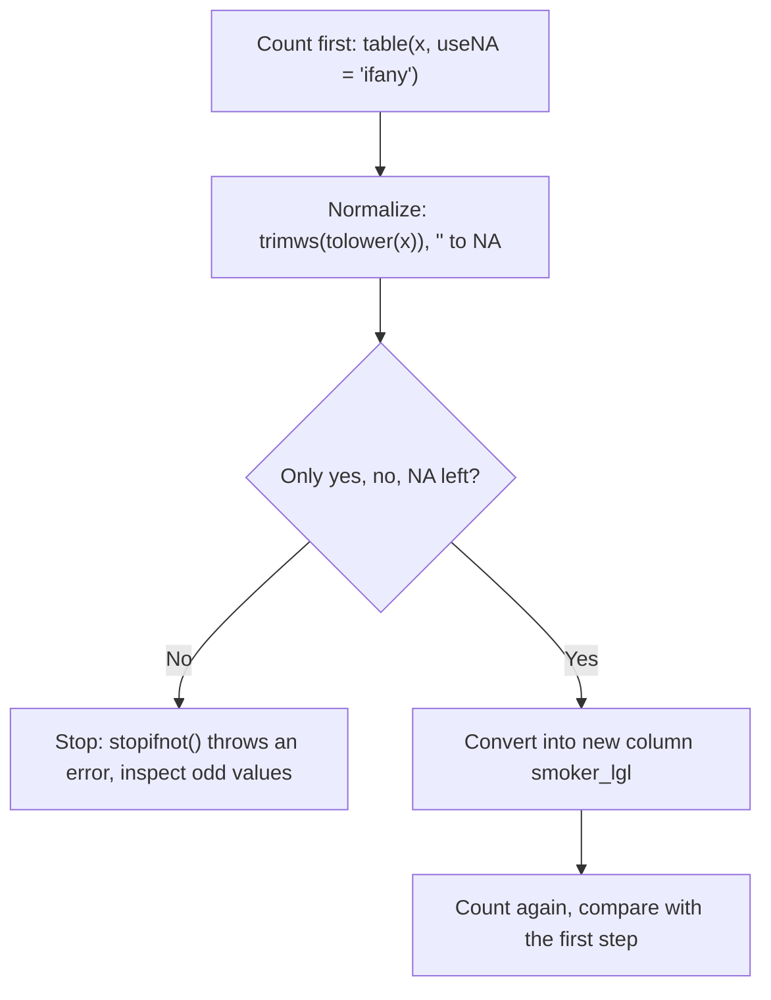

Every vector in R belongs to one of six atomic types: logical, integer, double, complex, character, raw. When you mix types, R coerces every element up to the highest type in the hierarchy `NULL < raw < logical < integer < double < complex < character < list < expression`. The rule is documented, but many of its consequences arrive without an error or a warning. `as.logical()` turns all 42 "yes"/"no" values in the birthweight dataset into `NA`; `lm()` quietly drops 4 of 42 rows with missing values. This article shows how to check types with `typeof()`, `class()`, `mode()` and `storage.mode()`, how to convert types safely when the data are messy, how to tell `NA`, `NaN` and `NULL` apart, and why `0.1 + 0.2 == 0.3` returns `FALSE`. It is written for students and people in biology and biomedicine who are new to R. Every example was run on R 4.4.3.

<div class="callout callout-note">
<p class="callout-title">Key points</p>

- Check the storage type with `typeof()`. `class()` only tells you which class the object is handled as (a factor has `class` factor but `typeof` integer).
- For strings, `as.logical()` only understands `"T"`, `"TRUE"`, `"True"`, `"true"` and the matching forms of false. `"yes"`, `"0"` and `"1"` all become `NA` with no warning.
- `NA` is a missing value, `NaN` is the undefined result of a calculation, and `NULL` is an empty object of length 0.
- Every time a function drops rows with `NA`, you are running a complete-case analysis, and the result can be biased if the data are not missing completely at random.
- Compare floating-point numbers with `all.equal()`, not `==`.

</div>

## 1. R raises no error, but the result is already wrong

The birthweight dataset in the R workshop materials from the UC Davis Bioinformatics Core has three columns that are, in substance, yes/no questions: does the mother smoke (`smoker`), is the baby low birth weight (`low.birthweight`), and is it a geriatric pregnancy (`geriatric.pregnancy`). Only the last one is stored as logical. The obvious way to convert the other two is to call `as.logical()`:

```r
bw <- read.csv("birthweight.csv")
x <- as.logical(bw$smoker)
sum(is.na(x))
#> [1] 42
```

All 42 values become `NA`. No error, no warning. If you don't count the `NA`s, the later steps still run, and nobody goes back to look for the cause until a result looks odd. The same command on `low.birthweight` gives the right answer.

This is a silent error: the software changes the data type and the user never finds out. The best-known example in biology is Excel turning gene names into dates or floating-point numbers: paste DEC1 into a cell and Excel shows 1-DEC. Zeeberg et al. (2004) documented at least 30 gene names converted to dates and more than 2,000 identifiers converted to floating-point numbers, and these changes cannot be reversed. Ziemann et al. (2016) estimated that roughly one in five papers with gene lists in supplementary Excel files in leading genomics journals were affected; Abeysooriya et al. (2021) rescanned papers in PubMed Central from 2014–2020 and found that 30.9% (3,436/11,117 papers) still had the error. The article [Dirty data in science](/en/blog/process-data-from-dirty-to-clean/) covers the Excel case in depth; this one looks at the same mechanism inside R.

None of the errors in this article are **syntax errors**. A syntax error stops the script and forces you to fix it. A data type error lets the script keep running and hands back a number that looks reasonable, maybe a mean or a regression coefficient. To guard against it, you need to know the rules R uses to change types and check your data exactly where those rules tend to surprise people. Sections 2–3 cover the rules, section 4 is the case study of the `smoker` column, sections 5–7 deal with `NA`, `NaN`, `NULL` and floating-point numbers, and section 8 is the checklist.

### Data and environment

The file `birthweight.csv` comes from the workshop materials *Introduction to R for Bioinformatics* by the UC Davis Bioinformatics Core (2022). It has 42 rows and 18 columns, and its SHA-256 hash starts with `6b3c2acc` and ends with `49f894ac`. The article links to the original repository instead of redistributing the file, because the repository declares no license. These are teaching data that have been modified, so they should not be used to draw conclusions about the real effects of smoking. Every result here was run on R 4.4.3 (2025-02-28); behavior can change between versions. Importing the file is covered in [Importing and exporting data](/en/blog/importing-and-exporting-data/).

## 2. The atomic type system: `typeof`, `class`, `mode`, `storage.mode`

### Six atomic types

According to the *R Language Definition* (R Core Team, 2026), R has six atomic vector types: logical, integer, double (also called real), complex, character and raw. Atomic means every element in the vector has the same type. R has no "scalar" type: `4.2` is a double vector of length 1. So everything this article says about vectors also holds for a single value.

The word "numeric" often causes confusion. It is not a storage type but an umbrella name for integer and double. `typeof(5)` is `"double"` and `typeof(5L)` is `"integer"`, yet `class(5)` is `"numeric"`. In biological data, most numeric columns read from a CSV are double; integer only shows up when every value in the column is a whole number.

Atomic types are the building blocks of larger structures. Wickham (2014) arranges R's five basic data structures along two dimensions: number of dimensions, and whether the contents are homogeneous.

| Dimensions | Homogeneous | Heterogeneous |
| --- | --- | --- |
| 1D | atomic vector | list |
| 2D | matrix | data frame |
| nD | array | – |

This article only deals with atomic vectors. Lists and data frames are covered in [Data frames](/en/blog/data-frames/). Each column of a data frame is an atomic vector, so every type rule here applies column by column: one text cell in a numeric column is enough to turn the whole column into character.

### Four functions, four questions

R has four functions that answer "what type is this?", but each answers a different question.

- `typeof()` gives the internal storage type.
- `mode()` and `storage.mode()` return the "mode" in the sense of the S language in Becker et al. (1988). R-lang notes that `storage.mode()` is mainly used when passing data to C or Fortran code (R Core Team, 2026).
- `class()` returns the class attribute used by S3 object-oriented programming. The class decides which `print()` or `summary()` method is called; it does not tell you how the data are stored.

**Table 1.** Output of the four functions on 13 objects (R 4.4.3)

| Object | `typeof` | `class` | `mode` | `storage.mode` |
| --- | --- | --- | --- | --- |
| `TRUE` | logical | logical | logical | logical |
| `1L` | integer | integer | numeric | integer |
| `4.2` | double | numeric | numeric | double |
| `1+2i` | complex | complex | complex | complex |
| `"a"` | character | character | character | character |
| `as.raw(255)` | raw | raw | raw | raw |
| `factor(c("no","yes"))` | integer | factor | numeric | integer |
| `as.Date("2026-11-24")` | double | Date | numeric | double |
| `matrix(1:4, 2)` | integer | matrix, array | numeric | integer |
| `list(1, "a")` | list | list | list | list |
| `data.frame(x = 1)` | list | data.frame | list | list |
| `NULL` | NULL | NULL | NULL | NULL |
| the function `mean` | closure | function | function | function |

`mode` lumps integer and double together as numeric; `storage.mode` keeps them apart, just as the table in R-lang shows.

Table 1 exposes two common misconceptions. First, `class()` does not tell you the data type: a factor has class factor but is stored as integer, a Date is stored as double, and a data frame is stored as a list. Second, `storage.mode()` does not always match `typeof()`: for the function `mean`, `typeof` is closure while `storage.mode` is function. The two only agree on atomic vectors. The practical rule: to find out how data are stored, use `typeof()`; to find out how R will treat them, use `class()`.

Class matters because it changes what the same function returns. With `f <- factor(c("no", "yes", "yes"))`, `summary(f)` counts how often each level appears (`no 1`, `yes 2`), while `summary(as.integer(f))` reports a mean of 1.667 for the codes 1 and 2, a number with no biological meaning. The underlying data are identical; only the class differs. For a quick list of type-checking commands, see [Programming and bioinformatics tools cheat sheet](/en/blog/programming-bang-tra-cuu-lenh-r-sql-cong-cu-tin-sinh-va-hoa-chat/).

### Checking types with `is.*` functions

`is.atomic()` looks convenient, but its behavior has changed: since R 4.4.0, `is.atomic(NULL)` returns `FALSE` (it used to be `TRUE`). Wickham (2019) advises caution with `is.vector()`, `is.atomic()` and `is.numeric()` because they don't test what their names suggest; for example, `is.numeric()` returns `TRUE` for both integer and double. Prefer functions that test one specific type: `is.logical()`, `is.integer()`, `is.double()`, `is.character()`.

## 3. Coercion: the hierarchy, its direction and its cost

### Implicit and explicit coercion

Coercion means converting a value from one type to another. Implicit coercion happens when you mix types in `c()`, in arithmetic or in a comparison; for example, `TRUE + 1` gives 2. Explicit coercion is when you call `as.logical()`, `as.integer()`, `as.numeric()` or `as.character()`.

### The hierarchy according to `?c`

R's help page `?c` gives the hierarchy:

$$\texttt{NULL} < \texttt{raw} < \texttt{logical} < \texttt{integer} < \texttt{double} < \texttt{complex} < \texttt{character} < \texttt{list} < \texttt{expression}$$

When components of different types are combined, the result takes the **highest** type among them.

```r
typeof(c(TRUE, 1L))     #> "integer"
typeof(c(1L, 1.5))      #> "double"
typeof(c(1.5, 1i))      #> "complex"
typeof(c(1i, "a"))      #> "character"
typeof(c(1, list(2)))   #> "list"
```

`?c` writes the order from low to high with `<`, while Wickham (2019) writes it the other way with arrows: character → double → integer → logical. Both say the same thing: character strings "win" over every numeric and logical type. When you meet an unfamiliar version of the hierarchy, check its direction with a quick test: `typeof(c(TRUE, "a"))` gives `"character"`.


*Figure 1. The coercion ladder of `c()` according to `?c`. Coercing up always works; coercing down with `as.*()` can produce NA or lose information.*

### When coercion loses information

Coercing up (logical → integer → double → character) always works because the higher type can hold the values of the lower one. Coercing down is not guaranteed.

```r
as.integer(2.9)                         #> 2  (truncates the decimals, does not round)
as.character(1/3)                       #> "0.333333333333333"
as.numeric(as.character(1/3)) == 1/3    #> FALSE
as.numeric("3,5")                       #> NA, with the warning "NAs introduced by coercion"
as.integer(factor(c("10", "20", "10"))) #> 1 2 1  (level codes, not values)
c(1, "2", TRUE)                         #> "1" "2" "TRUE"
```

`as.integer()` cuts off the decimal part. `as.character()` keeps 15 significant digits, so converting back no longer equals the original value. `"3,5"` writes a decimal with a comma; R doesn't understand it and returns `NA`, one of the rare cases where R does warn you. A factor stores level codes, so to get the values you have to go through character first: `as.numeric(as.character(f))` gives `10 20 10`. The last line turns even `TRUE` into the string `"TRUE"`.

The warning "NAs introduced by coercion" is a signal to stop, not something to silence with `suppressWarnings()` before moving on. To find out which values triggered it, compare the positions of `NA` before and after the conversion:

```r
x <- c("3,5", "4.1", "", "n/a", "2")
num <- suppressWarnings(as.numeric(x))
x[is.na(num) & !is.na(x) & x != ""]
#> "3,5" "n/a"
```

The two values need different fixes. `"n/a"` is a missing-value code, so declare it in `na.strings` when reading the file. `"3,5"` is a number with a decimal comma, so either re-read the file with `read.csv(..., sep = ";", dec = ",")` or replace the comma with `sub(",", ".", x, fixed = TRUE)` before converting.

## 4. Case study: the "yes/no" `smoker` column and the 0/1 `low.birthweight` column

### Three yes/no columns

Running `table()` on the three columns shows they are stored differently. `smoker` is character, with 20 `"no"` and 22 `"yes"` values. `low.birthweight` is integer, with 36 zeros and 6 ones. `geriatric.pregnancy` is already logical, with 38 FALSE and 4 TRUE.

### Why `smoker` turns entirely into `NA`

The help page `?as.logical` states the rule: for strings, only `"T"`, `"TRUE"`, `"True"`, `"true"` are read as TRUE and `"F"`, `"FALSE"`, `"False"`, `"false"` as FALSE; every other string becomes `NA`. For numbers, 0 becomes FALSE and every nonzero number becomes TRUE. For factors, R uses the level labels, not the integer codes.

**Table 2.** Output of `as.logical()` by input type (R 4.4.3)

| Input | Type | Result |
| --- | --- | --- |
| `"TRUE"`, `"true"`, `"True"`, `"T"` | character | TRUE |
| `"FALSE"`, `"false"`, `"False"`, `"F"` | character | FALSE |
| `"yes"`, `"no"`, `"tRUE"` | character | NA |
| `"0"`, `"1"` | character | NA |
| `0` | integer/double | FALSE |
| `1`, `27`, `-3` | integer/double | TRUE |
| `factor(c("no", "yes"))` | factor | NA NA |
| `factor(c("TRUE", "FALSE"))` | factor | TRUE FALSE |

`low.birthweight` converts correctly because `read.csv()` already read it as integer, and 0/1 falls under the numeric rule. The numeric rule has a downside too: `as.logical(bw$maternal.age)` gives 42 TRUE values because no mother is 0 years old. R has no idea which columns "mean" yes/no. Both the 42 `NA`s from `smoker` and the 42 TRUEs from `maternal.age` appear silently, because `as.logical()` is doing exactly what its documentation describes. Checking is the caller's job.

The reverse trap: if a 0/1 column is read as character, say because one text cell slipped in, then `as.logical(c("0", "1"))` gives `NA NA`. The fix is to convert to a number first: `as.logical(as.integer(x))`.

Another silent error often comes along: `bw$smoke` (missing the r) still returns the `smoker` column because the `$` operator does partial name matching, and R 4.4.3 doesn't warn unless you turn on `options(warnPartialMatchDollar = TRUE)`. Details are in [Data frames](/en/blog/data-frames/).

### Converting safely

The simple conversion is to compare with a string:

```r
bw$smoker_lgl <- bw$smoker == "yes"
table(bw$smoker_lgl, useNA = "ifany")
#> FALSE  TRUE
#>    20    22
```

For this file the result is correct. There are two things to do differently from overwriting with `bw$smoker <- bw$smoker == "yes"`. First, create a new column (`smoker_lgl`) instead of overwriting the original, so you can still cross-check. Second, real data are usually messier:

```r
d <- c("yes", "no", "Yes", " yes", NA, "")
d == "yes"                       #> TRUE FALSE FALSE FALSE NA FALSE
d %in% "yes"                     #> TRUE FALSE FALSE FALSE FALSE FALSE
trimws(tolower(d)) == "yes"      #> TRUE FALSE TRUE TRUE NA FALSE
```

`== "yes"` puts `"Yes"` and `" yes"` in the non-smoker group. `%in%` goes further and turns `NA` into FALSE, which quietly assigns people with missing information to the non-smoker group. Normalizing with `trimws(tolower())` handles capital letters and whitespace and keeps `NA` as `NA`. An empty cell `""` still becomes FALSE; if an empty cell means missing, convert it to `NA` first.

A suggested workflow:

1. Count first: `table(x, useNA = "ifany")`.
2. Normalize: `trimws(tolower(x))`, turn `""` into `NA`.
3. Convert into a new column.
4. Count again and compare with step 1.
5. Stop if there are unexpected values: `stopifnot(all(x_clean %in% c("yes", "no", NA)))`.



Wrapping the steps in a small function lets you reuse them for every yes/no column:

```r
yesno_to_lgl <- function(x) {
  x <- trimws(tolower(x))
  x[x == ""] <- NA
  stopifnot(all(x %in% c("yes", "no", NA)))
  x == "yes"
}
yesno_to_lgl(c("yes", "no", "Yes", " yes", NA, ""))
#> TRUE FALSE TRUE TRUE NA NA
bw$smoker_lgl <- yesno_to_lgl(bw$smoker)
table(bw$smoker, bw$smoker_lgl, useNA = "ifany")
#>        FALSE TRUE
#>   no      20    0
#>   yes      0   22
```

The final cross-tabulation is the check most worth doing: every `"no"` became FALSE, every `"yes"` became TRUE, and no cell is off. If the data contain a value like `"nope"`, the function stops with an error instead of quietly putting it in a group.

### `read.csv()` guesses types too

`read.csv()` uses `type.convert()` to guess the type of each column, and it reads `T`/`F` and `TRUE`/`FALSE` as logical just like `as.logical()`. A gene symbol column containing only `T` and `F` gets read as logical:

```r
g <- read.csv(text = "gene,expr\nT,5.1\nF,3.2\n")
g$gene    #> TRUE FALSE
```

Add one row with `SEPT2` and the whole column stays character. Namibia's country code `"NA"` is read as a missing value unless you set `na.strings = ""`. This is the same mechanism as the Excel error (Zeeberg et al., 2004), just in different software. The safeguard is to declare types when reading: `colClasses = c(gene = "character")`.

## 5. `NA`, `NaN` and `NULL`

### Definitions

According to R-lang (R Core Team, 2026):

- `NA` (Not Available) is a missing value in the statistical sense: the variable has a value, but it is unknown. `NA` is logical by default; R also has `NA_integer_`, `NA_real_`, `NA_complex_` and `NA_character_`. The raw type has no `NA`.
- `NaN` (Not a Number) is the undefined result of a numeric calculation, such as `0/0`, and exists only for double and complex.
- `NULL` is an empty object of length 0.

**Table 3.** Comparing `NA`, `NaN` and `NULL` (R 4.4.3)

| | `NA` | `NaN` | `NULL` |
| --- | --- | --- | --- |
| `typeof` | logical (with a version for each type) | double | NULL |
| `length` | 1 | 1 | 0 |
| `is.na()` | TRUE | TRUE | `logical(0)` |
| Dedicated test | `is.na()` | `is.nan()` | `is.null()` |
| Typical source | empty cell when reading a CSV | `0/0` | list element that doesn't exist |
| Inside `c(1, ?, 2)` | `1 NA 2` | `1 NaN 2` | `1 2` |

`is.na(NaN)` is TRUE, but `is.nan(NA)` is FALSE. Wickham (2019) calls `NA` "not applicable," while the R documentation calls it "Not Available"; this article follows R's wording.

### How `NA` propagates

A calculation involving `NA` usually returns `NA`, including `NA == NA`. The exceptions are cases where the result is the same no matter what value the `NA` might take: `FALSE & NA` is FALSE, `TRUE | NA` is TRUE, and `NA^0` is 1. By contrast, `TRUE & NA` is `NA`. `NA_character_` is also different from the string `"NA"`: `is.na("NA")` is FALSE.

### `NA` in the birthweight data

**Table 4.** Number of `NA`s per column and how functions handle `NA` by default

| Column | Number of `NA`s |
| --- | --- |
| `paternal.age` | 4 |
| `paternal.education` | 5 |
| `paternal.cigarettes` | 5 |
| `paternal.height` | 5 |
| Complete rows (`complete.cases`) | 35/42 |

| Function | Default behavior with `NA` |
| --- | --- |
| `mean()`, `sum()` | returns `NA`; add `na.rm = TRUE` to drop them |
| `cor()` | returns `NA`; choose `use = "complete.obs"` |
| `table()` | does not count `NA`; add `useNA = "ifany"` |
| `lm()` | drops rows with `NA` (`na.action = na.omit`) without saying so |

```r
mean(bw$paternal.age)                  #> NA
mean(bw$paternal.age, na.rm = TRUE)    #> 28.76316
m <- lm(birthweight ~ paternal.age, data = bw)
nobs(m)                                #> 38
```

`lm()` runs without complaint but only uses 38 rows. The `summary(m)` output does print the line "(4 observations deleted due to missingness)", but that line is easy to miss, and many plotting or export functions don't print it at all. `cor(bw$birthweight, bw$paternal.age)` returns `NA`; adding `use = "complete.obs"` gives 0.16, also computed on 38 pairs. Each function has its own default, so the number of observations actually used has to be checked for every analysis; you can't infer it from `nrow()`. The subset `bw[bw$paternal.education == 10, ]` returns 11 rows, 5 of which are all `NA`; the real number of people is 6 (see [Data frames](/en/blog/data-frames/)).

### Numeric missing-value codes

Some datasets code missing values as `-99` or `-999`. R reads them as ordinary numbers: `mean(c(-99, 5, 6))` gives −29.33. Broman and Woo (2018) recommend a single fixed missing-value code across the whole dataset and advise against numeric codes like `-999`. White et al. (2013) consider an empty cell the most compatible choice across R, Python and SQL; `NA` and `NULL` are acceptable; `-999` should be avoided. If you receive a file that already uses `-99`, declare `na.strings = c("", "NA", "-99")` when reading it rather than fixing it afterward.

### R's `NA` and SQL's `NULL`

`NULL` in SQL is closer to R's `NA` than to R's `NULL`: both are unknown values and make comparisons come out "unknown" (see [SQL: SELECT and WHERE](/en/blog/select-and-where-truy-van-co-ban/)).

## 6. What `NA` means statistically

When `lm()` drops four rows, that is not a neutral cleanup step but a statistical assumption. Rubin (1976) asked when the process that causes missing data can be ignored in inference. According to the paper's abstract, the core condition is that the data are missing at random; for likelihood-based or Bayesian inference, the parameters of the missingness mechanism must also be distinct from the parameters being estimated. The three categories below follow the wording of Sterne et al. (2009), which is easier to apply in biomedical research:

- **MCAR** (missing completely at random): there are no systematic differences between the missing values and the observed values.
- **MAR** (missing at random): any systematic differences are explained by the observed data.
- **MNAR** (missing not at random): differences remain even after accounting for the observed data.

Sterne et al. (2009) stress that complete-case analysis can be biased when the data are MAR rather than MCAR, and that MAR cannot be distinguished from MNAR using the observed data alone.

The simulation below illustrates the first point with simulated data, not the birthweight data. Each run creates 1,000 pairs of parents; the father's age is strongly correlated with the mother's (a correlation of about 0.86). The father's age is deleted under three mechanisms: MCAR deletes 20% at random; MAR deletes more often for younger mothers (the mother's age is always observed); MNAR deletes more often for the younger fathers themselves. The average missing rate is about 20–27%. The complete-case mean of the father's age is then compared with the true mean of all 1,000 people.

```r
set.seed(2026)
one_run <- function(n = 1000) {
  maternal <- rnorm(n, mean = 27, sd = 5)
  paternal <- 2 + 1.0 * maternal + rnorm(n, sd = 3)
  p_mcar <- rep(0.2, n)
  p_mar  <- plogis(-1.4 - 0.25 * (maternal - 27))
  p_mnar <- plogis(-1.4 - 0.25 * (paternal - 29))
  cc_mean <- function(p) mean(paternal[runif(n) > p])
  c(MCAR = cc_mean(p_mcar), MAR = cc_mean(p_mar), MNAR = cc_mean(p_mnar)) - mean(paternal)
}
res <- t(replicate(1000, one_run()))
round(colMeans(res), 2)
#> MCAR  MAR MNAR
#> 0.00 1.26 1.68
```


*Figure 2. Bias of the complete-case mean across 1,000 simulations (simulated data, seed 2026).*

Under MCAR, the complete-case mean is unbiased; you only lose precision because the sample is smaller. Under MAR, the mean is biased upward by about 1.26 years because younger fathers (who go with younger mothers) are excluded more often. Under MNAR, the bias is about 1.68 years. The difference lies here: under MAR, the information needed to correct the bias (the mother's age) is in the data, so methods such as multiple imputation can use it (Sterne et al., 2009); under MNAR, that information sits in the very values that were lost. Looking only at the observed data, the two scenarios look the same, just as Sterne et al. (2009) warn.

In the birthweight data, 4–5 fathers have missing information. This article makes no claim about the mechanism. Is the father's information missing because the father was absent, or because it wasn't reported? The answer changes how you read the number `nobs() = 38`. A simple check is to compare the mother's variables (age, cigarettes per day) between the groups with and without information about the father. A clear difference suggests the data are unlikely to be MCAR; no difference doesn't prove MCAR either, especially with a sample of 42.

What to do: report the number of `NA`s per variable, state the method clearly, and consider multiple imputation with the mice package (van Buuren & Groothuis-Oudshoorn, 2011). The standard textbook is Little and Rubin (2019). SQL's `AVG`, which ignores `NULL`, is also a complete-case analysis ([SQL: aggregate functions](/en/blog/ham-tong-hop-aggregate/)).

## 7. IEEE 754 floating point: why `0.1 + 0.2 == 0.3` is FALSE

Every real number in R is a double under IEC 60559, that is IEEE 754, in the binary64 format with 53 bits of precision (help page `?double`); the current standard is IEEE 754-2019 (IEEE, 2019). R FAQ 7.31 explains that only integers and fractions whose denominator is a power of 2 can be represented exactly (Hornik & R Core Team, 2026).

```r
0.1 + 0.2 == 0.3                     #> FALSE
sprintf("%.20f", 0.1)                #> "0.10000000000000000555"
sqrt(2)^2 == 2                       #> FALSE
.Machine$double.eps                  #> 2.220446e-16
2^53 == 2^53 + 1                     #> TRUE
isTRUE(all.equal(0.1 + 0.2, 0.3))    #> TRUE
```

The right way to compare is `all.equal()` with its default tolerance of `.Machine$double.eps^0.5` (about 1.5 × 10⁻⁸), wrapped in `isTRUE()`. Buffalo (2015) makes the same point when writing tests for a function that adds floating-point numbers.

### Integer and double

The largest integer is 2,147,483,647; adding `1L` gives `NA` with an integer overflow warning. One million integers take up 4,000,048 bytes; one million doubles take 8,000,048 bytes. Some operations on integers return doubles automatically: `5L / 2L` and `mean(1:10)` are both double. Large count data, such as read counts summed across many samples, can exceed the integer limit. Keeping them as double avoids overflow at the cost of twice the memory, and a double still represents every whole number up to 2⁵³ exactly. For more on floating-point arithmetic, see Goldberg (1991).

## 8. Data type checklist before analysis

**Table 5.** Checklist

| When | What to do | Command |
| --- | --- | --- |
| Reading a file | Declare types and missing-value codes | `colClasses`, `na.strings` |
| After import | Check types and `NA` counts | `str()`, `sapply(df, typeof)`, `colSums(is.na(df))` |
| Categorical columns | Count before and after converting | `table(x, useNA = "ifany")` |
| Converting types | Don't overwrite the original column | new `*_lgl` column |
| Factor to number | Go through character first | `as.numeric(as.character(f))` |
| Comparing floats | Use a tolerance | `isTRUE(all.equal(x, y))` |
| Fitting a model | Record the number of observations actually used | `nobs()`, `complete.cases()` |

## 9. Frequently asked questions

**`as.logical()` returns all `NA`. What should I do?** Look at `typeof()` and `table(x, useNA = "ifany")`. For "yes"/"no" strings, normalize them and then compare (section 4); for `"0"`/`"1"` strings, convert to integer first.

**Should I always use `na.rm = TRUE`?** Not out of habit. The number it gives is a complete-case result; record how many values were dropped and think about why they are missing (section 6).

## 10. Conclusion

R's type rules are clearly documented (R Core Team, 2025, 2026). Errors usually come from software guessing types on the user's behalf, whether that's Excel, `read.csv()` or an `as.*()` call (Ziemann et al., 2016; Abeysooriya et al., 2021). With the next dataset you open, you can do three things right away:

- Declare `colClasses` and `na.strings` when reading the file, then run `sapply(df, typeof)` to see what R actually read.
- Run `table(x, useNA = "ifany")` before and after every type conversion, and write the result to a new column.
- Record `nobs()` next to every model. Getting 38 instead of 42 is a statistical decision (Sterne et al., 2009), so it needs to be reported and explained.

The next article, [Functions in R](/en/blog/functions/), turns the checks here into functions and uses the `smoker_lgl` column to compare birth weight between smoking groups.

## Appendix: reproducible code

The script below downloads the data, checks the checksum, prints the type and number of `NA`s for each column, and records session information. Every code block in the article runs after this script.

```r
url <- "https://raw.githubusercontent.com/ucdavis-bioinformatics-training/2022_February_Introduction_to_R_for_Bioinformatics/main/birthweight.csv"
download.file(url, "birthweight.csv", quiet = TRUE)
tools::md5sum("birthweight.csv")   # bf579c7055ed0b040033028be20f573b
# SHA-256 (macOS/Linux): 6b3c2acc…49f894ac
system2("shasum", c("-a", "256", "birthweight.csv"))
bw <- read.csv("birthweight.csv")
sapply(bw, typeof)
colSums(is.na(bw))
sessionInfo()
```

## References

Abeysooriya, M., Soria, M., Kasu, M. S., & Ziemann, M. (2021). Gene name errors: Lessons not learned. *PLOS Computational Biology, 17*(7), e1008984. https://doi.org/10.1371/journal.pcbi.1008984

Becker, R. A., Chambers, J. M., & Wilks, A. R. (1988). *The new S language: A programming environment for data analysis and graphics*. Wadsworth & Brooks/Cole.

Broman, K. W., & Woo, K. H. (2018). Data organization in spreadsheets. *The American Statistician, 72*(1), 2–10. https://doi.org/10.1080/00031305.2017.1375989

Buffalo, V. (2015). *Bioinformatics data skills: Reproducible and robust research with open source tools*. O'Reilly Media.

Goldberg, D. (1991). What every computer scientist should know about floating-point arithmetic. *ACM Computing Surveys, 23*(1), 5–48. https://doi.org/10.1145/103162.103163

Hornik, K., & R Core Team. (2026). *The R FAQ* (Question 7.31). https://CRAN.R-project.org/doc/manuals/R-FAQ.html

IEEE. (2019). *IEEE standard for floating-point arithmetic* (IEEE Std 754-2019). https://doi.org/10.1109/IEEESTD.2019.8766229

Little, R. J. A., & Rubin, D. B. (2019). *Statistical analysis with missing data* (3rd ed.). Wiley. https://doi.org/10.1002/9781119482260

R Core Team. (2025). *R: A language and environment for statistical computing* (Version 4.4.3). R Foundation for Statistical Computing. https://www.R-project.org/

R Core Team. (2026). *R language definition* (Version 4.6.2). R Foundation for Statistical Computing. https://cran.r-project.org/doc/manuals/r-release/R-lang.html

Rubin, D. B. (1976). Inference and missing data. *Biometrika, 63*(3), 581–592. https://doi.org/10.1093/biomet/63.3.581

Sterne, J. A. C., White, I. R., Carlin, J. B., Spratt, M., Royston, P., Kenward, M. G., Wood, A. M., & Carpenter, J. R. (2009). Multiple imputation for missing data in epidemiological and clinical research: Potential and pitfalls. *BMJ, 338*, b2393. https://doi.org/10.1136/bmj.b2393

UC Davis Bioinformatics Core. (2022). *Introduction to R for bioinformatics* [GitHub repository]. https://github.com/ucdavis-bioinformatics-training/2022_February_Introduction_to_R_for_Bioinformatics

van Buuren, S., & Groothuis-Oudshoorn, K. (2011). mice: Multivariate imputation by chained equations in R. *Journal of Statistical Software, 45*(3), 1–67. https://doi.org/10.18637/jss.v045.i03

White, E. P., Baldridge, E., Brym, Z. T., Locey, K. J., McGlinn, D. J., & Supp, S. R. (2013). Nine simple ways to make it easier to (re)use your data. *Ideas in Ecology and Evolution, 6*(2), 1–10. https://doi.org/10.4033/iee.2013.6b.6.f

Wickham, H. (2014). *Advanced R*. Chapman and Hall/CRC. https://doi.org/10.1201/b17487

Wickham, H. (2019). *Advanced R* (2nd ed.). Chapman and Hall/CRC. https://doi.org/10.1201/9781351201315

Zeeberg, B. R., Riss, J., Kane, D. W., Bussey, K. J., Uchio, E., Linehan, W. M., Barrett, J. C., & Weinstein, J. N. (2004). Mistaken identifiers: Gene name errors can be introduced inadvertently when using Excel in bioinformatics. *BMC Bioinformatics, 5*, 80. https://doi.org/10.1186/1471-2105-5-80

Ziemann, M., Eren, Y., & El-Osta, A. (2016). Gene name errors are widespread in the scientific literature. *Genome Biology, 17*, 177. https://doi.org/10.1186/s13059-016-1044-7
