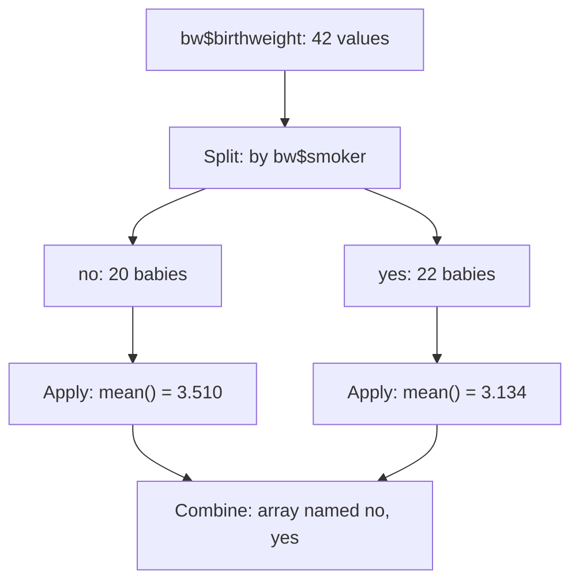

A function in R is a named block of code that takes arguments and returns a value. The apply family consists of `apply()`, `lapply()`, `sapply()`, `vapply()`, `tapply()` and `mapply()`: each one applies another function to every element or every group of your data, and each returns its own kind of object. This article uses those same functions to answer a biological question with `birthweight`, a teaching dataset of 42 newborns: babies of mothers who smoked weighed on average 0.375 kg less (95% CI 0.016–0.735; Welch p = 0.041; Hedges g = 0.63). Once birth weight is turned into a binary "low birth weight" outcome, Fisher's exact test gives p = 0.19 and an odds ratio confidence interval running from 0.53 to 277. That points the same way as a meta-analysis of 55 cohort studies (OR 1.89), but it carries almost no information. The article is written for biology and biomedical students learning R; every code block was run on R 4.4.3.

<div class="callout callout-note">
<p class="callout-title">Quick summary</p>

- `sapply()` returns a vector, a matrix or a list depending on what each call returns; inside your own functions, use `vapply()` to pin down the result type.
- `tapply()` packs the split-apply-combine strategy into a single line.
- Fast functions are usually functions that do less: `matrix(unlist(...))` is about 17 times faster than calling `strsplit()` three times on 100,000 birth dates.
- Among the 42 babies, maternal smoking goes with a birth weight 0.375 kg lower; the odds ratio for low birth weight is 5.39 (95% CI 0.53–277.5).
- With 20 babies per group, the power to detect d = 0.5 is only about 0.34: read effect sizes and confidence intervals, not just p < 0.05.

</div>

## 1. Functions and the apply family in R: definitions and result types

### 1.1. Functions, arguments and default values

You call a function by name, with its arguments inside parentheses, and `?function_name` opens its help page. The *Value* section of that page tells you what kind of object the function returns, and most confusing errors with the apply family trace back to it (R Core Team, 2025).

Many arguments have default values, and the result depends on them:

- `t.test()` defaults to `var.equal = FALSE`, which means a Welch t-test that does not assume the two groups share a variance. For the classic Student t-test you have to write `var.equal = TRUE`.
- `chisq.test()` accepts three kinds of input: a matrix (a contingency table), two vectors (R builds the contingency table for you), or a single vector, in which case R runs a goodness-of-fit test, not a test of independence. For a 2 × 2 table, the function applies Yates' continuity correction by default (`correct = TRUE`).

You write your own functions with the `function` keyword. The value of the last expression in the body is the return value:

```r
cohen_d <- function(x, y) {
  nx <- length(x); ny <- length(y)
  sp <- sqrt(((nx - 1) * var(x) + (ny - 1) * var(y)) / (nx + ny - 2))  # pooled SD
  (mean(x) - mean(y)) / sp
}
hedges_g <- function(x, y) {
  N <- length(x) + length(y)
  cohen_d(x, y) * (1 - 3 / (4 * N - 9))   # small-sample correction factor J
}
```

Each function does one job, and its name says what that job is. The second function calls the first instead of copying the formula. There is more on writing functions in functions and string handling and conditionals and loops.

### 1.2. The apply family: inputs and results

The apply family replaces a loop with a single function call. Each member takes one kind of input and returns one kind of result (Table 1).

**Table 1.** The apply family in base R (from the Value section of each help page; R Core Team, 2025)

| Function | Input | Applies the function to | Result |
| --- | --- | --- | --- |
| `apply(X, MARGIN, FUN)` | matrix or data frame (coerced to a matrix) | each row (`1`) or each column (`2`) | a vector if `FUN` returns 1 value; a matrix if `FUN` returns n > 1 values |
| `lapply(X, FUN)` | list or vector | each element | always a list the same length as `X` |
| `sapply(X, FUN)` | list or vector | each element | a vector, matrix or list, depending on whether the result can be simplified |
| `vapply(X, FUN, FUN.VALUE)` | list or vector | each element | exactly the type and length declared in `FUN.VALUE`, otherwise an error |
| `tapply(X, INDEX, FUN)` | a vector + one or more grouping variables | each subgroup of `X` | an array (usually one-dimensional, named by group) |
| `mapply(FUN, ...)` | several vectors or lists in parallel | each set of elements at the same position | a vector, matrix or list (simplified like `sapply`) |

The first row of the table shows that `apply()` does not always return a vector. On three numeric columns of the `birthweight` data:

```r
bw  <- read.csv("birthweight.csv")
num <- bw[, c("length", "birthweight", "head.circumference")]
apply(num, 2, mean)    # mean returns 1 value per column → vector
#>             length        birthweight head.circumference
#>          51.333333           3.312857          34.595238
apply(num, 2, range)   # range returns 2 values → 2 × 3 matrix
#>      length birthweight head.circumference
#> [1,]     43        1.92                 30
#> [2,]     58        4.57                 39
```

A data frame is a list of columns (see [the article on data frames](/en/blog/data-frames/)), so `sapply(num, sd)` also gives a vector. You rarely need `mapply()` for operations that are already vectorized: the mother's height minus the father's height is just `bw$maternal.height - bw$paternal.height`.

### 1.3. Does `sapply()` return a vector, a matrix or a list?

According to its help page, `sapply()` returns a vector when every call to `FUN` gives one value, a matrix (one column per input element) when every call gives the same k > 1 values, and a list in every other case, including empty input (R Core Team, 2025):

```r
parts <- strsplit(bw$birth.date, "/")     # list of 42 elements, each of length 3
class(sapply(parts, length))              # each call returns 1 number
#> [1] "integer"
dim(sapply(parts, identity))              # each call returns 3 strings
#> [1]  3 42
sapply(1:3, seq_len)                      # lengths 1, 2, 3: cannot be simplified
#> [[1]]
#> [1] 1
#> [[2]]
#> [1] 1 2
#> [[3]]
#> [1] 1 2 3
class(sapply(list(), length))             # empty input
#> [1] "list"
```

So the same `sapply()` line can return a vector with today's data and a list with tomorrow's. The code downstream will break, but it breaks somewhere else. `vapply()` prevents this with a result template, `FUN.VALUE`:

```r
vapply(parts, length, integer(1))[1:3]
#> [1] 3 3 3
vapply(1:3, seq_len, integer(1))
#> Error in vapply(1:3, seq_len, integer(1)) : values must be length 1,
#>  but FUN(X[[2]]) result is length 2
```

The error shows up right at the faulty line, along with the position of the element that caused it. Wickham (2019, section 9.2.1) recommends always using `vapply()` inside your own functions; `lapply()`, for its part, always returns a list.

### 1.4. Split-apply-combine and `tapply()`

Many analysis questions share one shape: split the data into groups, process each group, then put the results back together. Wickham (2011) called this the split-apply-combine strategy. The article's central question (mean birth weight by the mother's smoking status) takes a single line of `tapply()`:

```r
tapply(bw$birthweight, bw$smoker, mean)
#>       no      yes
#> 3.509500 3.134091
```



*Diagram 1. `tapply()` carries out the three split-apply-combine steps (Wickham, 2011) on the `birthweight` data.*

The result is a one-dimensional array named by group, not a data frame. If you want several statistics per group, write a function that returns a named vector and stitch the pieces together with `do.call(rbind, ...)` (section 4.3); the tidyverse article redoes this with `group_by()` and `summarise()`.

## 2. The biological question: smoking during pregnancy and low birth weight

The World Health Organization (WHO) defines low birth weight as a weight at birth below 2,500 g. A baby can be born small because of intrauterine growth restriction, because of preterm birth, or both (World Health Organization, n.d.). Because of these two pathways, the article looks at preterm birth alongside smoking. If smoking shortens pregnancy, part of its effect on birth weight runs through gestational age.

Reviews of smoking during pregnancy agree fairly well. Di et al. (2022) pooled 55 cohort studies published between 1986 and 2020 and estimated an odds ratio (OR) of 1.89 (95% CI 1.80–1.98) for low birth weight in babies of mothers who smoked, with a dose–response relationship by cigarettes per day. Pereira et al. (2017) limited their review to studies in the Americas and found an OR of 2.00 (95% CI 1.77–2.26) from the 30 studies in the meta-analysis, with between-study heterogeneity of I² = 66.3%. In other words, the odds of low birth weight are roughly twice as high when the mother smokes.

The dataset here has only 42 babies. So what can a sample that small show, and how should you report it so you don't read more into it than the data say? R, a language designed for data analysis and graphics (Ihaka & Gentleman, 1996), handles both the cleaning and the statistics.

The central question: how much lighter are babies of mothers who smoke, and does that match the literature? Three side questions look at preterm birth, parental smoking rates by hospital, and parent–child height. On the R side, the article compares the speed of `for` loops, the apply family and vectorization.

## 3. Data and methods

### 3.1. Data

The file `birthweight.csv` comes from the *Introduction to R for Bioinformatics* materials of the UC Davis Bioinformatics Core (2022). According to its authors, it is a table of birth weights and parental information adapted from a dataset by Mathematics and Statistics Help (MASH) at the University of Sheffield, lightly modified to demonstrate a few more functions. The file has 42 rows × 18 columns; its SHA-256 hash starts with `6b3c2acc` and ends with `49f894ac` (the download and check commands are in the appendix). Table 2 lists the variables used in this article.

**Table 2.** Variables used in this article

| Variable | Type | Meaning | `NA` |
| --- | --- | --- | --- |
| `birthweight` | numeric | weight at birth (kg) | 0 |
| `smoker` | character | mother smokes: `"yes"`/`"no"` | 0 |
| `maternal.cigarettes` | integer | cigarettes the mother smokes per day | 0 |
| `low.birthweight` | integer | 0/1 low birth weight code supplied in the file | 0 |
| `weeks.gestation` | integer | gestational age (weeks) | 0 |
| `location` | character | hospital: General, Memorial, Silver Hill | 0 |
| `paternal.cigarettes` | integer | cigarettes the father smokes per day | 5 |
| `maternal.height`, `paternal.height` | integer | mother's and father's height (cm) | 0; 5 |
| `length` | integer | baby's length (cm) | 0 |
| `birth.date` | character | date of birth as `"month/day/year"` | 0 |

Three derived variables are recomputed from the original ones: `preterm = weeks.gestation < 37`; `lbw_who = birthweight < 2.5` using the WHO cutoff; and `father.smokes = paternal.cigarettes > 0` (kept as `NA` when data are missing). The two columns on maternal smoking agree completely: all 20 mothers coded `"no"` smoke 0 cigarettes, and all 22 coded `"yes"` smoke 2 or more.

### 3.2. Splitting dates of birth with functions

The `birth.date` column holds strings like `"1/25/1967"`. To compute birth weight by month of birth, you need three numeric columns: month, day and year. The first step is `strsplit()`:

```r
parts <- strsplit(bw$birth.date, "/")
class(parts); length(parts); parts[[1]]
#> [1] "list"
#> [1] 42
#> [1] "1"    "25"   "1967"
```

The result is a list of 42 elements, each a character vector of length 3. Each column of a data frame, by contrast, is a vector of length 42. `unlist()` flattens the list into a single vector of 126 elements, ordered month, day, year for baby 1, then baby 2, and so on. `unlist()` alone does not give you a table, but adding `matrix(..., ncol = 3, byrow = TRUE)` is enough to put one baby on each row:

```r
m <- matrix(as.integer(unlist(parts)), ncol = 3, byrow = TRUE,
            dimnames = list(NULL, c("month", "day", "year")))
head(m, 3)
#>      month day year
#> [1,]     1  25 1967
#> [2,]     2   6 1967
#> [3,]     2  14 1967
```

This works when every date has all three parts. If a single date is missing one, the values slide into the wrong rows, and R gives no warning. Two more general functions differ in how many times they split the strings:

```r
# Approach A: loop over the 3 positions, splitting the whole date vector each time
split_A <- function(date_vector) {
  date_list <- lapply(1:3, function(i) {
    as.integer(sapply(strsplit(date_vector, split = "/"), `[[`, i))
  })
  names(date_list) <- c("month", "day", "year")
  as.data.frame(do.call(cbind, date_list))
}

# Approach B: split once, take element i with vapply and a fixed type
split_date <- function(x, sep = "/") {
  parts <- strsplit(x, sep, fixed = TRUE)
  out <- lapply(1:3, function(i) as.integer(vapply(parts, `[[`, character(1), i)))
  names(out) <- c("month", "day", "year")
  as.data.frame(out)
}

identical(split_A(bw$birth.date), split_date(bw$birth.date))
#> [1] TRUE
```

Approach A calls `strsplit()` three times on the same vector and throws away two thirds of the result each time. Approach B splits only once, uses `fixed = TRUE` (treating `"/"` as a literal character, not a regular expression) and uses `vapply(..., character(1), ...)` to make sure each call returns exactly one string. A third approach, `as.Date(x, format = "%m/%d/%Y")` followed by `format()`, gives a result `identical()` to the other two and also catches invalid dates such as February 31, because they become `NA`.

Finally, `bw <- cbind(bw, split_date(bw$birth.date))` attaches the three new columns, giving a 42 × 21 data frame.

### 3.3. Statistical analysis

**Comparing birth weight.** The Welch t-test is the primary analysis, with the Student t-test for comparison; a Wilcoxon rank-sum test with `conf.int = TRUE` gives the Hodges–Lehmann estimate. Shapiro–Wilk is used only descriptively, since it has little power at n of about 20.

**Effect size.** Cohen's d uses the pooled standard deviation; Hedges g multiplies d by $J = 1 - \dfrac{3}{4N - 9}$, where N is the total number of observations (Hedges, 1981; Lakens, 2013). The 95% confidence interval for d comes from a percentile bootstrap with 5,000 resamples (`set.seed(2026)`). The rank-biserial correlation $r = \dfrac{2W}{n_1 n_2} - 1$ equals Kerby's (2014) simple difference formula: the proportion of concordant pairs minus the proportion of discordant pairs. W is computed for the non-smoking group, so a positive r means that group tends to be heavier. Lakens (2013) recommends reporting effect sizes alongside t-tests so results can be compared and pooled across studies.

**Binary outcome.** The 2 × 2 table of `smoker` by `low.birthweight` has two cells with expected counts of 2.86 and 3.14, below the threshold of 5 that the rule commonly attributed to Cochran (1954) sets for the χ² test. `chisq.test()` also warns on its own that the approximation may be incorrect. Fisher's exact test is therefore the primary test; `fisher.test()` returns an OR estimated by conditional maximum likelihood, with a confidence interval, which differs slightly from the sample OR computed by hand as $ad/bc$. The analysis is repeated with `lbw_who` (2.5 kg cutoff).

**Side questions and dose–response.** Pearson correlation (`cor.test()`) for gestational age versus birth weight and for the height pairs; Spearman correlation between the mother's cigarettes per day and birth weight.

**Sensitivity model.** `lm(birthweight ~ smoker + weeks.gestation)` shows how much of the birth weight difference remains after adjusting for gestational age. This model answers a different question from the crude comparison (section 5.3).

**Power.** `power.t.test()` computes the power of a design with 20 babies per group for d = 0.5; `power.prop.test()` computes the sample size needed to distinguish a baseline low birth weight risk of 10% from the risk implied by the OR of 1.89 in Di et al. (2022), about 17.4%.

### 3.4. Benchmarks and computing environment

Speed was measured with `system.time()`, taking the median of 7 runs, on the 42 original birth dates (called 1,000 times) and on 100,000 dates sampled with replacement (`set.seed(1)`). Six approaches were compared (Table 3), and all gave the same result (`all.equal()` returns `TRUE`). Two extra comparisons: a `for` loop that grows its result with `rbind()` versus one with preallocation (10,000 dates), and group means for 12 groups over 10⁶ numbers using a `for` loop, `tapply()` and `rowsum()`.

The analysis ran on R 4.4.3 on macOS, using only base packages (`stats`, `utils`); no external packages were installed. Reproducible code, checksums and the command that records `sessionInfo()`, following the principles of Sandve et al. (2013), are in the appendix.

## 4. Results

### 4.1. Programming results: dates of birth, month of birth and speed

After splitting the dates of birth, count by year and by month:

```r
d <- split_date(bw$birth.date)
table(d$year)
#> 1967 1968
#>   21   21
table(d$month)
#>  1  2  3  4  5  6  7  8  9 10 11 12
#>  4  5  3  4  1  6  4  2  4  4  1  4
```

Twenty-one babies were born in 1967 and 21 in 1968. The first ten rows of the table are all from 1967, so anyone who only looks at `head()` could easily assume the whole dataset covers a single year. "Mean birth weight by month of birth" therefore mixes two different years.

Even with the two years pooled, each month has only 1 to 6 babies. May and November each have exactly 1 baby (2.92 kg and 3.41 kg). A "mean" based on one baby is just that baby's weight, so put `table()` next to `tapply()` before you compare groups.

On 100,000 dates of birth (Table 3, Figure 1), `matrix(unlist())` is the fastest (0.066 seconds) and approach A with the default regex is the slowest (1.10 seconds), a gap of about 17 times. Just adding `fixed = TRUE` brings approach A down to 0.29 seconds. Splitting once (approach B) takes 0.19 seconds. The preallocated `for` loop (0.31 seconds) is on par with approach A using `fixed = TRUE`; `as.Date()` is slow (0.97 seconds) because it has to parse dates against the calendar.

**Table 3.** Time to split dates of birth (median of 7 runs, `system.time()`)

| Approach | 42 dates, per call (ms) | 100,000 dates (seconds) |
| --- | --- | --- |
| A: `strsplit()` 3 times, default regex | 0.64 | 1.10 |
| A: `strsplit()` 3 times, `fixed = TRUE` | 0.24 | 0.29 |
| B: `strsplit()` once + `vapply()` | 0.42 | 0.19 |
| Preallocated `for` loop | 0.16 | 0.31 |
| `matrix(unlist())` | 0.07 | 0.066 |
| `as.Date()` + `format()` | 0.86 | 0.97 |


*Figure 1. Time to split 100,000 dates of birth with six approaches (log scale). Timings come from a single machine, so read the ranking rather than the absolute numbers.*

A `for` loop that grows its result with `rbind()` takes 0.61 seconds for 10,000 dates, versus 0.035 seconds with preallocation, about 17 times slower. For group means of 12 groups over 10⁶ numbers: `for` loop 0.074 seconds, `tapply()` 0.053 seconds, `rowsum()` 0.023 seconds.

With 42 rows, every approach takes under 1 millisecond per call, and approach B is even slower than approach A with `fixed = TRUE`, most likely because of the fixed overhead of each call (not measured separately). At this size, readable code and a guaranteed result type matter more than speed.

### 4.2. Three side questions

**Are preterm babies lighter?** Yes. This is the strongest association in the dataset. The five babies born before 37 weeks (33 to 35 weeks) weighed 2.44 kg on average, versus 3.43 kg for the 37 full-term babies. Four of the five preterm babies carry the low birth weight code, compared with 2 of the 37 full-term babies. The correlation between gestational age and birth weight is r = 0.71 (95% CI 0.52–0.83; p = 1.5 × 10⁻⁷). Figure 2 shows a nearly linear relationship, with the babies of smoking mothers sitting lower at the same gestational age.


*Figure 2. Gestational age and birth weight of the 42 babies, by the mother's smoking status. Dotted line: 37 weeks; dashed line: 2.5 kg.*

**Maternal and paternal smoking rates at each hospital.** The two rates are shown side by side rather than combined into a single ratio. Paternal smoking is derived from `paternal.cigarettes > 0`, which has 5 missing values:

```r
tapply(bw$smoker == "yes", bw$location, mean)
#>     General    Memorial Silver Hill
#>   0.4000000   0.8461538   0.3684211
tapply(bw$paternal.cigarettes > 0, bw$location, mean, na.rm = TRUE)
#>     General    Memorial Silver Hill
#>   0.6250000   0.7500000   0.5882353
```

The share of mothers who smoke is 4/10 (40%) at General, 11/13 (85%) at Memorial and 7/19 (37%) at Silver Hill; for fathers it is 5/8 (63%), 9/12 (75%) and 10/17 (59%). Within a couple, smoking tends to go together: 17 of 21 smoking mothers have a partner who smokes, versus 7 of 16 non-smoking mothers (excluding the 5 cases with missing data). Memorial has an unusually high rate of smoking mothers, but with 10 to 19 babies per hospital, the numbers are descriptive only.

**Do tall mothers have tall partners and longer babies?** Among the 37 couples with complete data, maternal and paternal height correlate at r = 0.36 (95% CI 0.04–0.62; p = 0.027). Maternal height correlates with the baby's length at r = 0.48 (95% CI 0.21–0.69; p = 0.001), while paternal height and the baby's length correlate at only r = 0.26 (95% CI −0.07–0.54; p = 0.12). The data hint at assortative mating by height and a clearer mother–child link than father–child link, but 42 families are not enough to separate genetics from the intrauterine environment.

### 4.3. Smoking and birth weight

The descriptive table is built with a small function, `tapply()` and `do.call(rbind, ...)`:

```r
desc <- function(x) c(n = length(x), mean = mean(x), sd = sd(x), median = median(x))
round(do.call(rbind, tapply(bw$birthweight, bw$smoker, desc)), 3)
#>      n  mean    sd median
#> no  20 3.510 0.518  3.385
#> yes 22 3.134 0.631  3.185
```

Figure 3 shows a lot of overlap between the two distributions, yet all three babies under 2.5 kg belong to the smoking group. Shapiro–Wilk gives p = 0.70 and 0.95, with no clear sign of non-normality.


*Figure 3. Birth weight by the mother's smoking status. Box: quartiles; diamond: mean; dashed line: WHO low birth weight cutoff of 2.5 kg.*

```r
t.test(birthweight ~ smoker, data = bw)               # Welch, the default
x <- bw$birthweight[bw$smoker == "no"]
y <- bw$birthweight[bw$smoker == "yes"]
c(d = cohen_d(x, y), g = hedges_g(x, y))
#>         d         g
#> 0.6467807 0.6345773
set.seed(2026)
boot_d <- replicate(5000, cohen_d(sample(x, replace = TRUE), sample(y, replace = TRUE)))
quantile(boot_d, c(0.025, 0.975))
#>       2.5%      97.5%
#> 0.08752519 1.31980453
```

**Table 4.** Birth weight in babies of non-smoking versus smoking mothers

| Measure | Result |
| --- | --- |
| Mean difference (non-smoking − smoking) | 0.375 kg (95% CI 0.016–0.735) |
| Welch t-test | t = 2.11; df = 39.6; p = 0.041 |
| Student t-test | p = 0.043 |
| Wilcoxon rank-sum | W = 295; p = 0.061 |
| Hodges–Lehmann shift | 0.37 kg (95% CI −0.03–0.75) |
| Cohen's d / Hedges g | 0.65 / 0.63 |
| Bootstrap 95% CI for d | 0.09–1.32 |
| Rank-biserial r | 0.34 |

Every measure points the same way: babies of smoking mothers are about 0.37–0.38 kg lighter, a medium effect size. Where they differ is certainty. Welch gives p = 0.041, Wilcoxon gives p = 0.061 with a Hodges–Lehmann interval that crosses 0, and the bootstrap interval for d runs from 0.09 (almost no difference) to 1.32 (a very large one). The data are compatible with a real effect, but they do not tell you how large it is.

**Binary outcome.** Using the `low.birthweight` code supplied in the file, 5 of 22 babies (22.7%) of smoking mothers had low birth weight, versus 1 of 20 (5.0%) of non-smoking mothers.

```r
tab <- table(bw$smoker, bw$low.birthweight)
chisq.test(tab)$expected        # two cells below 5
#>             0        1
#>   no  17.14286 2.857143
#>   yes 18.85714 3.142857
fisher.test(tab)
#> p-value = 0.187
#> 95 percent confidence interval:
#>    0.5262123 277.4965268
#> sample estimates:
#> odds ratio
#>   5.388501
```

`chisq.test()` with Yates' correction gives χ² = 1.44, p = 0.23; without the correction, p = 0.10, and both come with the warning "Chi-squared approximation may be incorrect". Fisher's exact test gives p = 0.19 and OR 5.39 (95% CI 0.53–277.5). The sample OR computed by hand is (5 × 19)/(1 × 17) = 5.59; the phi coefficient is 0.25. Using the WHO cutoff instead of the supplied code, the smoking group has 3 of 22 low birth weight babies and the non-smoking group has 0 of 20; Fisher p = 0.23, the OR is undefined (infinite) and the lower confidence limit is 0.39.

**Dose–response.** Across all 42 babies, the Spearman correlation between the mother's cigarettes per day and birth weight is ρ = −0.20 (p = 0.19). Among the 22 smoking mothers, consumption ranges from 2 to 50 cigarettes a day, with a median of 14.5.

**Adjusting for gestational age.** The smoking group has a slightly lower mean gestational age (38.95 versus 39.45 weeks). In the model `lm(birthweight ~ smoker + weeks.gestation)`, the coefficient for maternal smoking is −0.30 kg (SE 0.13; p = 0.024), and each extra week of gestation corresponds to 0.16 kg.

**Power.** With 20 babies per group, the power to detect d = 0.5 at α = 0.05 is only about 0.34; you would need about 64 babies per group to reach 80%. To distinguish a low birth weight risk of 10% from 17.4% (corresponding to OR 1.89), you would need about 342 babies per group.

```r
power.t.test(n = 20, delta = 0.5, sd = 1)$power
#> [1] 0.3377084
power.prop.test(p1 = 0.10, p2 = 0.1735537, power = 0.8)$n
#> [1] 341.4005
```

## 5. Discussion

### 5.1. Compared with the literature: same direction, not enough information

The direction of every result matches the two meta-analyses: babies of smoking mothers are lighter, and low birth weight is more common (Di et al., 2022; Pereira et al., 2017). The sample OR of about 5.4 is much higher than the pooled ORs of 1.89–2.00, but its confidence interval of 0.53–277.5 contains both pooled values and the value 1 (Figure 4). The point estimate rests on 6 low birth weight cases, only 1 of them in the non-smoking group; recode that one case and the OR changes completely.


*Figure 4. Odds ratios for low birth weight in babies of smoking mothers: two meta-analyses (figures from the abstracts of Di et al., 2022 and Pereira et al., 2017) and the `birthweight` data (Fisher's exact test). Log axis; dashed line: OR = 1.*

There are two reasons not to trust the figure of 5.4. First, odds ratio estimates from small samples tend to drift away from 1: in simulations, Nemes et al. (2009) showed that logistic regression overestimates ORs at small to moderate sample sizes, and that the bias is systematic, pointing away from the null. Fisher's OR is not a logistic OR, but it rests on the same six cases, so it is likely subject to the same kind of instability. Second, Button et al. (2013) showed that low-powered studies are prone to missing real effects, and that when they do find a "significant" result, the effect size tends to be inflated. The effect on continuous birth weight in this article (0.375 kg, p = 0.041) may also be larger than the true value for this reason.

Di et al. (2022) report a dose–response relationship; here ρ = −0.20 has a negative sign but is not statistically significant, which fits low power better than it contradicts the literature.

### 5.2. Why the t-test is "significant" and Fisher's test is not

The same birth weight data give p = 0.041 when comparing means and p = 0.19 when comparing low birth weight rates. These two numbers do not contradict each other. The comparison of means uses all 42 birth weights. Dichotomizing at 2.5 kg turns every baby into a 0 or a 1, and the information piles into 6 cases (or 3 under the WHO cutoff); a 2.51 kg baby and a 4.5 kg baby become identical. A continuous variable keeps more information, so the test is more powerful.

That is why you should report both, together with effect sizes and confidence intervals. The American Statistical Association (ASA) statement says plainly that a p-value does not measure the size or importance of an effect, and that scientific conclusions should not rest only on whether a p-value passes a threshold (Wasserstein & Lazar, 2016). In that spirit, p = 0.041 (Welch) and p = 0.061 (Wilcoxon) are two close measurements of the same weak evidence, not two opposing conclusions.

### 5.3. Gestational age: confounder or mediator?

After adjusting for gestational age, the difference shrinks to −0.30 kg. That number answers a different question. If smoking shortens pregnancy, gestational age is a mediator on the path from smoking to birth weight, and adjusting for it gives the part of the effect that does not go through gestational age, not the total effect. Hernández-Díaz et al. (2006) analyzed a situation with the same structure: conditioning on birth weight, a variable affected by smoking, can create spurious associations such as the "birth weight paradox". Carrying that argument over to gestational age is this article's own reasoning, not a finding of that paper. The takeaway: the choice of adjustment variables has to follow from the causal question. The data also lack confounders such as income, nutrition and parity, so every result here is an association.

### 5.4. Data quality

The `low.birthweight` column flags 6 babies as low birth weight, but only 3 weigh under 2.5 kg; the other three weigh 2.51–2.66 kg. The coding rule is not documented, so the article reports both versions. When you can, recompute derived variables from the original ones. The data were lightly modified to demonstrate functions (UC Davis Bioinformatics Core, 2022), and the birth dates span two years. The dataset is good for learning R, not for drawing epidemiological conclusions.

### 5.5. Programming lessons

A preallocated `for` loop runs about as fast as the `sapply()` approaches, and on the test machine `tapply()` is only about 28% faster than the equivalent loop (0.053 versus 0.074 seconds). Wickham (2019, section 9.1) writes that the real drawback of `for` loops is not slowness but too much flexibility: a reader can see you are looping but not what you plan to do with the result. A name like `vapply()` or `tapply()` makes that intent clear.

The large gaps in Table 3 line up with three principles from the performance chapters of *Advanced R*:

- **Do as little as possible** (Wickham, 2019, section 24.4): split the strings once instead of three times; use `fixed = TRUE` when the separator is not a regex.
- **Vectorize** (section 24.5): `unlist()`, `matrix()` and `rowsum()` handle a whole vector in one call, with the looping done in C code.
- **Avoid copies** (section 24.6): every time `rbind()` or `c()` appends to an object, R has to allocate new memory and copy the whole old object over; that is why the growing loop is about 17 times slower at 10,000 rows, and the gap widens as the data grow.

## 6. Conclusion

Among the 42 babies in the `birthweight` data, maternal smoking goes with a birth weight about 0.38 kg lower (Hedges g ≈ 0.63), in the same direction as two meta-analyses (Di et al., 2022; Pereira et al., 2017). The confidence interval for the low birth weight odds ratio is too wide to be useful. The gap between p = 0.041 and p = 0.19 on the same data is the reason to read effect sizes and confidence intervals instead of a p threshold (Wasserstein & Lazar, 2016). Small functions such as `strsplit()`, `vapply()` and `tapply()` cleaned up the dates of birth, and they also exposed the limits of the data: two birth years in one column, two months with a single baby, a low birth weight code that does not match the WHO cutoff.

<div class="callout callout-example">
<p class="callout-title">Checklist for writing functions and comparing two groups in R</p>

1. `sapply()` can return a vector, a matrix or a list; check with `class()` before using the result.
2. Inside your own functions, use `vapply()` with an explicit `FUN.VALUE`.
3. Compute once, use many times: don't call `strsplit()` or `read.csv()` again inside a loop.
4. If you use `for`, preallocate the result; don't grow it with `rbind()` or `c()`.
5. When a 2 × 2 table has expected counts below 5, use `fisher.test()`.
6. Always report effect sizes and confidence intervals next to p-values, and put `table()` next to every `tapply()`.

</div>

The next article in the series covers installing packages in R, for example `bench` for more precise timing; the tidyverse article redoes the same analysis with `group_by()` and `summarise()`. To review tests and correlation, see [statistical hypothesis testing](/en/blog/kiem-dinh-gia-thiet-thong-ke-trong-nghien-cuu-sinh-hoc/) and [correlation and regression](/en/blog/tuong-quan-va-hoi-quy/).

## Frequently asked questions

**What is the difference between `lapply()` and `sapply()`?** Both apply a function to each element of a list or vector. `lapply()` always returns a list; `sapply()` tries to simplify the result to a vector or matrix and only returns a list when it cannot simplify or the input is empty.

**When should I use `vapply()`?** In any function or script that runs repeatedly, whenever you know in advance what each call returns (for example `numeric(1)` or `character(1)`). If a result does not fit the template, R stops with an error at that line.

**Is the apply family faster than a `for` loop?** Usually not by much if the `for` loop preallocates (section 5.5). The big differences come from vectorization and from not recomputing what you have already computed.

**Why is the t-test significant but Fisher's exact test is not?** Dichotomizing at 2.5 kg throws away most of the information: the t-test uses all 42 values, while Fisher's test is left with 6 low birth weight cases (section 5.2).

## Appendix: reproducible code

The script below downloads the data, checks the checksum, splits the dates of birth and records session information. The code blocks in the article run after this script (the functions `cohen_d()` and `hedges_g()` are in section 1.1; `split_date()` is in section 3.2).

```r
url <- "https://raw.githubusercontent.com/ucdavis-bioinformatics-training/2022_February_Introduction_to_R_for_Bioinformatics/main/birthweight.csv"
download.file(url, "birthweight.csv", quiet = TRUE)
tools::md5sum("birthweight.csv")   # bf579c7055ed0b040033028be20f573b
system2("shasum", c("-a", "256", "birthweight.csv"))   # 6b3c2acc…49f894ac (macOS/Linux)
bw <- read.csv("birthweight.csv")
bw$preterm       <- bw$weeks.gestation < 37
bw$lbw_who       <- bw$birthweight < 2.5
bw$father.smokes <- bw$paternal.cigarettes > 0
table(split_date(bw$birth.date)$year)
#> 1967 1968
#>   21   21
sessionInfo()
```

## References

Button, K. S., Ioannidis, J. P. A., Mokrysz, C., Nosek, B. A., Flint, J., Robinson, E. S. J., & Munafò, M. R. (2013). Power failure: Why small sample size undermines the reliability of neuroscience. *Nature Reviews Neuroscience, 14*(5), 365–376. https://doi.org/10.1038/nrn3475

Cochran, W. G. (1954). Some methods for strengthening the common χ² tests. *Biometrics, 10*(4), 417. https://doi.org/10.2307/3001616

Di, H.-K., Gan, Y., Lu, K., Wang, C., Zhu, Y., Meng, X., Xia, W.-Q., Xu, M.-Z., Feng, J., Tian, Q.-F., He, Y., Nie, Z.-Q., Liu, J.-A., Song, F.-J., & Lu, Z.-X. (2022). Maternal smoking status during pregnancy and low birth weight in offspring: Systematic review and meta-analysis of 55 cohort studies published from 1986 to 2020. *World Journal of Pediatrics, 18*(3), 176–185. https://doi.org/10.1007/s12519-021-00501-5

Hedges, L. V. (1981). Distribution theory for Glass's estimator of effect size and related estimators. *Journal of Educational Statistics, 6*(2), 107–128. https://doi.org/10.3102/10769986006002107

Hernández-Díaz, S., Schisterman, E. F., & Hernán, M. A. (2006). The birth weight "paradox" uncovered? *American Journal of Epidemiology, 164*(11), 1115–1120. https://doi.org/10.1093/aje/kwj275

Ihaka, R., & Gentleman, R. (1996). R: A language for data analysis and graphics. *Journal of Computational and Graphical Statistics, 5*(3), 299–314. https://doi.org/10.1080/10618600.1996.10474713

Kerby, D. S. (2014). The simple difference formula: An approach to teaching nonparametric correlation. *Comprehensive Psychology, 3*, Article 11.IT.3.1. https://doi.org/10.2466/11.IT.3.1

Lakens, D. (2013). Calculating and reporting effect sizes to facilitate cumulative science: A practical primer for t-tests and ANOVAs. *Frontiers in Psychology, 4*, 863. https://doi.org/10.3389/fpsyg.2013.00863

Nemes, S., Jonasson, J. M., Genell, A., & Steineck, G. (2009). Bias in odds ratios by logistic regression modelling and sample size. *BMC Medical Research Methodology, 9*, 56. https://doi.org/10.1186/1471-2288-9-56

Pereira, P. P. da S., Da Mata, F. A. F., Figueiredo, A. C. G., de Andrade, K. R. C., & Pereira, M. G. (2017). Maternal active smoking during pregnancy and low birth weight in the Americas: A systematic review and meta-analysis. *Nicotine & Tobacco Research, 19*(5), 497–505. https://doi.org/10.1093/ntr/ntw228

R Core Team. (2025). *R: A language and environment for statistical computing* (Version 4.4.3) [Computer software; help pages for `lapply`, `tapply`, `apply`, `mapply`, `chisq.test`, `fisher.test`, `t.test`]. R Foundation for Statistical Computing. https://www.R-project.org/

Sandve, G. K., Nekrutenko, A., Taylor, J., & Hovig, E. (2013). Ten simple rules for reproducible computational research. *PLoS Computational Biology, 9*(10), e1003285. https://doi.org/10.1371/journal.pcbi.1003285

UC Davis Bioinformatics Core. (2022). *Introduction to R for Bioinformatics* (February 2022 workshop materials) [GitHub repository]. https://github.com/ucdavis-bioinformatics-training/2022_February_Introduction_to_R_for_Bioinformatics

Wasserstein, R. L., & Lazar, N. A. (2016). The ASA statement on p-values: Context, process, and purpose. *The American Statistician, 70*(2), 129–133. https://doi.org/10.1080/00031305.2016.1154108

Wickham, H. (2011). The split-apply-combine strategy for data analysis. *Journal of Statistical Software, 40*(1). https://doi.org/10.18637/jss.v040.i01

Wickham, H. (2019). *Advanced R* (2nd ed.). Chapman and Hall/CRC. https://doi.org/10.1201/9781351201315 (online edition: https://adv-r.hadley.nz/)

World Health Organization. (n.d.). *Low birth weight* [Nutrition Landscape Information System]. https://www.who.int/data/nutrition/nlis/info/low-birth-weight
