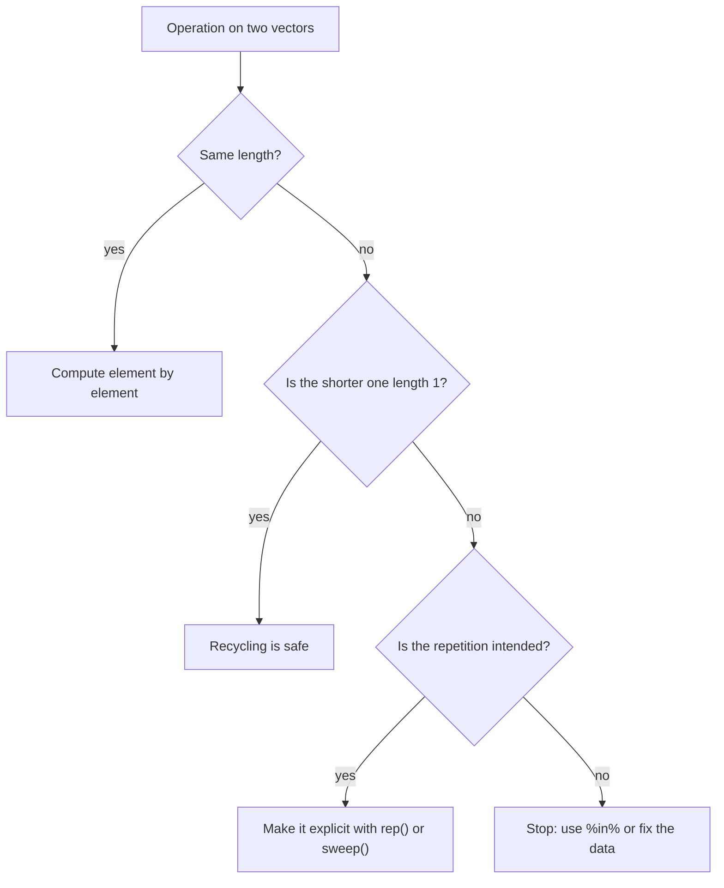

In R, doing arithmetic on a whole vector at once is the natural way to write code. It is also usually faster than a loop, by anywhere from about ten to several hundred times depending on how the loop is written. It comes with a rule called recycling: a shorter vector is repeated until it matches the longer one. When one length divides the other evenly, R says nothing, even if the result is wrong. This article walks through indexing, vectorization and recycling as the R language definition specifies them, compares recycling with NumPy broadcasting, and then times four ways of writing the same calculation with a base R script you can rerun yourself.

## 1. Introduction: a wrong filter with no warning

An experiment has six samples split into two groups, A and B. The group labels are stored in a vector called `group`. You want the indices of samples in group A or B, and you write what feels obvious:

```r
group <- c("A", "B", "A", "B", "B", "A")
which(group == c("A", "B"))
#> [1] 1 2 3 4
which(group %in% c("A", "B"))
#> [1] 1 2 3 4 5 6
```

The first line returns four samples. The second returns all six. R raises no error and prints no warning. The reason is how `==` works: it compares **element by element**. The right-hand side has length 2, so R repeats `c("A", "B")` into `A B A B A B` before comparing (R Core Team, n.d.-b, section 3.3.1).

**Table 0.** Element-wise comparison after R recycles the shorter vector

| Position | `group` | Right-hand side after recycling | `==` |
| --- | --- | --- | --- |
| 1 | A | A | TRUE |
| 2 | B | B | TRUE |
| 3 | A | A | TRUE |
| 4 | B | B | TRUE |
| 5 | B | A | FALSE |
| 6 | A | B | FALSE |

What you meant to ask is "is this element in the set {A, B}?", and that is the job of `%in%`. `==` answers a different question: "is element i equal to element i of the right-hand side?" Because 6 is a multiple of 2, the R specification does not call for a warning, so the mistake flows straight into the next step of the analysis. If that step is a mean expression level or a test between the two groups, the two dropped samples will skew the result. Nothing turns red in the console to send you back. With 7 samples instead of 6, the same line would print a warning. So the same coding mistake sometimes shows itself and sometimes doesn't, depending on how many samples the experiment happened to have.

This small example touches all three questions the article covers. What is vectorization, beyond "you don't need a loop"? How much faster is it than a loop on an actual machine? And when does the rule that comes with it, recycling, produce a wrong result that nobody notices?

## 2. Background: R has been a vector language from the start

R was written by Ross Ihaka and Robert Gentleman at the University of Auckland (R Core Team, n.d.-a). According to Ihaka (1998), the first binary copies were put on Statlib and announced on the s-news mailing list in August 1993. The source code was released under the GNU license in June 1995. The paper describing the language came out in 1996 (Ihaka & Gentleman, 1996).

R borrows its syntax from S, the statistical language developed at Bell Labs (Becker et al., 1988; Ihaka, 1998). Its semantics and underlying implementation, on the other hand, were influenced by Scheme, according to the R FAQ (R Core Team, n.d.-a).

R is often introduced with the line "everything in R is a vector." Chambers (2014) puts it more precisely: everything that exists in R is an **object**. Functions, environments and `NULL` are objects, but they are not atomic vectors. The part that is true, and useful, is that R has no scalar type: `42` is a numeric vector of length 1. That means `x * 2` is not a special case. It is recycling of a length-1 vector up to the length of `x`.

In biology, R owes much of its standing to its package ecosystem. The CRAN index page listed 25,704 packages on November 12, 2026 (CRAN, 2026); the number changes daily. Bioconductor is a separate repository for genomic and high-throughput data analysis (Gentleman et al., 2004; Huber et al., 2015). R and Bioconductor get a fuller introduction in the [first article in this series](/en/blog/introduction/).

## 3. Indexing semantics

Before getting to vectorization, you need to know how R pulls elements out of a vector. An index is itself a vector, and it follows recycling too. Section 3.4.1 of the *R Language Definition* lists the kinds of index (R Core Team, n.d.-b).

```r
score <- c(8, 7, 9, 6, 10)
score[1]            #> 8
score[length(score)] #> 10
score[10]           #> NA
score[-1]           #> 7 9 6 10
score[-10]          #> 8 7 9 6 10
score[0]            #> numeric(0)
score[c(-1, 2)]     #> Error: only 0's may be mixed with negative subscripts
score[c(TRUE, FALSE)] #> 8 9 10
```

**Positive indices** start at 1. An index past the end does not raise an error; it returns `NA`. **Negative indices** drop elements from the result, and you cannot mix them with positive ones. A negative index past the end is silently ignored (since R 2.6.0). **Index 0** returns an empty vector. **Logical indices** keep the `TRUE` positions. If the logical vector is shorter than the data, it is recycled, with no warning even when the lengths don't divide evenly (here 5 is not a multiple of 2). If it is longer, the result picks up extra `NA`s.

With **character indices**, `[` matches names exactly: `score["s"]` returns `NA` when there is no element named `s`. `$` on a list does partial matching by default, and `[[` does partial matching when you set `exact = FALSE` (R Core Team, n.d.-b). How this applies to data frames is covered in the [data frame article](/en/blog/data-frames/).

**Table 1.** Kinds of index, their results and what R reports (R 4.4.3)

| Kind | Example with `score <- c(8, 7, 9, 6, 10)` | Result | What R reports |
| --- | --- | --- | --- |
| Positive | `score[2]` | 7 | – |
| Positive, past the end | `score[10]` | NA | nothing |
| Negative | `score[-1]` | 7 9 6 10 | – |
| Negative, past the end | `score[-10]` | all 5 elements | nothing |
| Mixed positive and negative | `score[c(-1, 2)]` | – | error |
| Zero | `score[0]` | `numeric(0)` | nothing |
| Short logical | `score[c(TRUE, FALSE)]` | 8 9 10 | nothing |
| Long logical | `score[c(TRUE, FALSE, TRUE, FALSE, TRUE, TRUE)]` | 8 9 10 NA | nothing |
| Missing name | `score["s"]` | NA | nothing |

If you are coming from Python, two things are easy to trip over. In Python, `x[-1]` is the last element; in R, `score[-1]` is every element **except** the first. Python raises `IndexError` when an index runs past the end, while R returns `NA`. The habit of "a bad index stops the program" does not carry over to R: a loop that runs one step too far will quietly add an `NA` to the result.

Logical indices have one more trap when the data has missing values. Comparing with `NA` gives `NA`. A logical index that is `NA` is not skipped; it produces an `NA` element in the result:

```r
y <- c(8, NA, 9, 6, 10)
y[y >= 8]                  #> 8 NA 9 10
y[which(y >= 8)]           #> 8 9 10
y[!is.na(y) & y >= 8]      #> 8 9 10
```

`which()` returns only the positions of `TRUE` values, so it drops `NA` automatically. When you filter a clinical data table with blank cells, this difference decides whether rows full of `NA` get carried into the next step.

## 4. Vectorization: thinking in whole objects

Arithmetic, comparisons and many functions such as `sqrt()`, `log()` and `ifelse()` work element by element in R. Wickham (2019, section 24.5) describes vectorization as solving a problem by thinking about whole objects, not just as getting rid of loops.

```r
price    <- c(100, 200, 300)
quantity <- c(2, 1, 3)
price * quantity
#> [1] 200 200 900
```

Each element of `price` is multiplied by the element in the same position of `quantity`: 100 × 2 = 200, 200 × 1 = 200, 300 × 3 = 900. There's no counter, no result vector to set up in advance, and no index `i` to mistype as `i + 1`. The line reads like the formula on paper: revenue equals price times quantity.

This way of thinking pays off most when a formula has several steps. A $\log_2(x + 1)$ transform across an entire expression table is just `log2(x + 1)`. Written as loops, it takes two nested loops, and every index is a place to slip.

<div class="callout callout-note">
<p class="callout-title">Vectorized doesn't mean loop-free</p>

The computer still has to visit every element. The difference is that the loop lives in R's compiled C code instead of in R code that gets interpreted line by line. Section 7 measures that difference.

</div>

Logical vectors also work as counters. Inside `sum()`, `TRUE` counts as 1 and `FALSE` as 0. So `sum(x >= 8)` counts the elements that meet a threshold, and `mean(x >= 8)` gives the proportion.

```r
score <- c(8, 7, 9, 6, 10)
sum(score >= 8)    #> 3
mean(score >= 8)   #> 0.6

y <- c(8, NA, 9, 6, 10)
sum(y >= 8)                 #> NA
sum(y >= 8, na.rm = TRUE)   #> 3
mean(y >= 8, na.rm = TRUE)  #> 0.75
```

With biological data, CPM (counts per million) normalization is a textbook case of vectorization: divide each gene's read count by the sample's total reads, then multiply by 10⁶, $\text{CPM}_i = c_i / \sum_j c_j \times 10^6$.

```r
counts <- c(geneA = 120, geneB = 30, geneC = 850, geneD = 0)
counts / sum(counts) * 1e6
#>  geneA  geneB  geneC  geneD
#> 120000  30000 850000      0

lfc <- c(2.3, -0.4, -1.8, 0.9, 1.2, -2.6)   # log2 fold change
sum(abs(lfc) >= 1)    #> 4
ifelse(lfc > 0, "up", "down")
#> "up" "down" "down" "up" "up" "down"
```

`abs(lfc) >= 1` builds a logical vector of length 6. `sum()` finds 4 genes that changed at least twofold in one direction or the other. `ifelse()` labels all six genes "up" or "down" in a single call.

Logical operators come in two families. `&` and `|` work element by element. `&&` and `||` take only length-1 values and belong inside `if`. Since R 4.3.0, passing a vector longer than 1 to `&&` or `||` is an error, with a message like `'length = 2' in coercion to 'logical(1)'` (R Core Team, 2023). To filter on two conditions, use `&`: `lfc[abs(lfc) >= 1 & lfc > 0]`.

When you build a vector with `c()`, every element is coerced to a single type: `c(1, TRUE)` gives `1 1`, and `c(TRUE, "a")` gives `"TRUE" "a"`. The coercion hierarchy and how `NA` propagates are covered in the [data types article](/en/blog/basic-data-types/).

## 5. Recycling: silence, a warning or an error

Section 3.3.1 of the *R Language Definition* states the rule in three parts (R Core Team, n.d.-b). When two vectors of different lengths meet in an element-wise operation, the shorter one is repeated up to the length of the longer one. If the longer length is not a multiple of the shorter one, R still computes the result but prints a warning. An operation involving a zero-length vector returns a zero-length result.


*Figure 1. Recycling when adding `c(10, 20)` to 1:6 (top) and adding 1:4 to 1:6 (bottom). Only the bottom case triggers a warning.*

```r
Sys.setenv(LANGUAGE = "en")   # English messages make searching easier

1:6 + c(10, 20)
#> [1] 11 22 13 24 15 26
1:6 + 1:4
#> [1] 2 4 6 8 6 8
#> Warning message:
#> longer object length is not a multiple of shorter object length
numeric(0) + 1:3
#> numeric(0)
```

If your R prints messages in another language, `Sys.setenv(LANGUAGE = "en")` gives you the original English string to search for online.

Recycling is a deliberate feature first. Every time you write `x * 2`, `x - mean(x)` or `counts / sum(counts)`, R is recycling a length-1 vector, and that is what keeps R code short. The risk is concentrated in a small group of cases: the shorter vector is longer than 1, and the longer length happens to be a multiple of it. The warning "longer object length is not a multiple of shorter object length" catches only some of the mistakes; the rest go through without a trace. Table 2 collects the cases that were tested.

**Table 2.** Recycling in R 4.4.3: silence, a warning or an error

| Expression | Result | Response |
| --- | --- | --- |
| `1:6 * 2` | 2 4 6 8 10 12 | silent (intended) |
| `1:6 + c(10, 20)` | 11 22 13 24 15 26 | silent |
| `group == c("A", "B")` | T T T T F F | silent, not what was meant |
| `(1:5)[c(TRUE, FALSE)]` | 1 3 5 | silent even though 5 is not a multiple of 2 |
| `1:6 + 1:4` | 2 4 6 8 6 8 | warning |
| `1:5 + c(10, 20)` | 11 22 13 24 15 | warning |
| `numeric(0) + 1:3` | `numeric(0)` | silent |
| `d$b <- 1:2` (6-row data frame) | 1 2 1 2 1 2 | silent |
| `d$b <- 1:4` (6-row data frame) | – | error: replacement has 4 rows, data has 6 |
| `tibble(a = 1:6, b = 1:2)` | – | error: only values of size one are recycled |

The tidyverse uses a stricter rule: only length-1 vectors are recycled, and all other lengths must match (Wickham et al., 2026).

```r
tibble::tibble(a = 1:6, b = 1:2)
#> Error: Tibble columns must have compatible sizes.
#> • Size 6: Existing data.
#> • Size 2: Column `b`.
#> ℹ Only values of size one are recycled.
```

Base R data frames sit between the two approaches. Assigning `1:2` to a column of a 6-row data frame repeats it silently; assigning `1:4` raises an error. Tibbles block both. The output above was produced with tibble 3.2.1 and vctrs 0.6.5; the vctrs FAQ cited above is the current online version, and the recycling rule it describes is the same.

### 5.1. A biology example: dividing a matrix by its column sums

In genomic data analysis, the most dangerous recycling bugs tend to involve matrices. A matrix in R is really a vector with a `dim` attribute, with elements stored column by column. When you divide a count matrix (genes × samples) by `colSums()`, the vector of column totals is recycled **down the columns**, not applied to each column as you intended:

```r
m <- matrix(c(10, 30, 60, 100, 300, 600), nrow = 3)   # 3 genes x 2 samples
colSums(m)                   #> 100 1000
colSums(m / colSums(m))      #> 0.73 3.70   (wrong, no warning)
colSums(t(t(m) / colSums(m)))           #> 1 1
colSums(sweep(m, 2, colSums(m), "/"))   #> 1 1
```

The matrix has 6 elements and the column-sum vector has 2. Six is a multiple of 2, so R stays quiet. With real data, the number of matrix elements is always genes times samples, which is always a multiple of the number of samples. This wrong division therefore **never** produces a warning. The cheapest check is to see whether each column sums to 1 (or to 10⁶ for CPM) after normalization. `sweep(m, 2, ...)` states the margin explicitly (2 means columns), so it reads more clearly than the double-transpose trick.

### 5.2. Empty vectors spread

The third part of the rule (an operation with a zero-length vector returns a zero-length result) produces bugs that are hard to trace back. Suppose an earlier filtering step kept no genes at all. Every calculation on that result returns `numeric(0)` or `logical(0)`, and the problem only surfaces a few steps later, when `if()` receives an empty condition. Some summary functions return special values too: `max(numeric(0))` gives `-Inf` with a warning, so a threshold computed with `max()` on an empty set will keep every element. Calling `length()` right after each important filtering step is the simplest safeguard.

## 6. Compared with NumPy broadcasting

NumPy is the foundational array library of scientific Python (Harris et al., 2020; van der Walt et al., 2011). Its counterpart to recycling is broadcasting. NumPy aligns shapes starting from the last dimension, and two dimensions are compatible when they are equal or one of them is 1 (NumPy Developers, n.d.).

```python
import numpy as np
a = np.arange(1, 7)
a + np.array([10, 20])
# ValueError: operands could not be broadcast together with shapes (6,) (2,)
a + np.array([10])
# array([11, 12, 13, 14, 15, 16])
```

**Table 3.** Three conventions for vectors of different lengths

| Situation | Base R | tidyverse/vctrs | NumPy |
| --- | --- | --- | --- |
| Length 1 with length n | recycle | recycle | broadcast |
| n is a multiple of m (m > 1) | recycle, silent | error | error |
| n is not a multiple of m | recycle, warning | error | error |
| Length 0 with length 1 | length-0 result | length-0 result | length-0 result |
| Length 0 with length n > 1 | length-0 result | error | error |

Reading down the columns, NumPy is closer to vctrs than to base R. Both only allow "stretching" a dimension of size 1; any other mismatch is an error. Base R will repeat any vector and only complains when the lengths don't divide evenly. For someone moving over from Python, this means a calculation NumPy would reject on the spot can run in R and hand back a result.

Broadcasting goes further than recycling because it works by **dimension**. In NumPy, adding a (2, 3) array to a (2, 1) array stretches the second array across the columns, which is exactly "add a different constant to each row":

```python
np.arange(6).reshape(2, 3) + np.array([[10], [20]])
# array([[10, 11, 12],
#        [23, 24, 25]])
```

Base R has no such concept for matrices. Operations between a matrix and a vector always follow storage order (column by column), as in the example in section 5.1. To apply something by row or by column, you pick a function with an explicit margin argument such as `sweep()`, or use `colSums()`, `rowMeans()` and their relatives. The NumPy output in this section was produced with NumPy 2.4.6.

## 7. Benchmark: loops versus vectorization

### 7.1. Design

This section puts the advice "avoid loops in R" to a direct test. The task is deliberately trivial: double a `runif(n)` vector, with n from 10³ to 10⁷. The multiplication is so cheap that the measured time is mostly the cost of how the code is written.

Four implementations are compared:

1. **Growing `for` loop**: start from an empty vector and assign `out[i]` past the end at each step.
2. **Preallocated `for` loop**: create `numeric(n)` up front and fill it in.
3. **`sapply()`**: call an anonymous R function for each element.
4. **Vectorized**: `x * 2`.

Before timing anything, the script uses `identical()` to confirm that all four give exactly the same result. Comparing the speed of two pieces of code that produce different answers is meaningless. Each configuration runs 50 times for n ≤ 10⁵, 20 times for n = 10⁶ and 5 times for n = 10⁷ (at that size `sapply()` takes more than 13 seconds per run). Time is measured as the difference in `Sys.time()` around each call. The article reports the median and interquartile range (IQR) rather than the mean, because run times are usually right-skewed by garbage collection and other processes on the machine.

Test machine: macOS 12.7.6, Intel Core i5-5350U 1.8 GHz, 8 GB RAM, R 4.4.3, R's default BLAS and LAPACK, JIT level 3 (`compiler::enableJIT(-1)` returns 3). Run date: November 19, 2026. The script below is the core; the full version loops over every n and writes the results to CSV.

```r
f_grow     <- function(x) { out <- c(); for (i in seq_along(x)) out[i] <- x[i] * 2; out }
f_prealloc <- function(x) { out <- numeric(length(x)); for (i in seq_along(x)) out[i] <- x[i] * 2; out }
f_sapply   <- function(x) sapply(x, function(v) v * 2)
f_vector   <- function(x) x * 2

time_it <- function(f, x, reps) {
  vapply(seq_len(reps), function(r) {
    t0 <- Sys.time(); f(x); as.numeric(difftime(Sys.time(), t0, units = "secs"))
  }, numeric(1))
}

set.seed(2026)
x <- runif(1e6)
stopifnot(identical(f_grow(x), f_vector(x)), identical(f_sapply(x), f_vector(x)))
t <- time_it(f_prealloc, x, 20)
c(median = median(t), quantile(t, c(0.25, 0.75)))
```

### 7.2. Results


*Figure 2. Run time by n (both axes on a log scale). Points are medians, bars are IQRs.*

**Table 4.** Median run time (seconds) and how many times slower than `x * 2`

| n | `x * 2` | Preallocated `for` | Growing `for` | `sapply()` |
| --- | --- | --- | --- | --- |
| 10³ | 6.9 × 10⁻⁶ | 8.9 × 10⁻⁵ (×13) | 4.4 × 10⁻⁴ (×64) | 7.3 × 10⁻⁴ (×106) |
| 10⁴ | 5.1 × 10⁻⁵ | 8.5 × 10⁻⁴ (×17) | 3.7 × 10⁻³ (×72) | 8.2 × 10⁻³ (×160) |
| 10⁵ | 4.5 × 10⁻⁴ | 8.5 × 10⁻³ (×19) | 0.043 (×95) | 0.117 (×263) |
| 10⁶ | 0.0021 | 0.083 (×41) | 0.446 (×217) | 1.28 (×626) |
| 10⁷ | 0.018 | 1.18 (×68) | 4.48 (×256) | 13.5 (×773) |

Vectorized code is fastest at every n, and all four approaches scale roughly linearly with n. The gap, however, is not constant. The preallocated loop is 13 times slower at n = 10³ but 68 times slower at n = 10⁷. How you write the loop matters too: growing the vector is 3.8 (n = 10⁷) to 5.4 times (n = 10⁶) slower than preallocating, and `sapply()` is slower still than the growing loop.

In absolute terms, the preallocated loop handles a million elements in about 0.08 seconds. For a 20,000-gene vector, every approach in the table finishes in under a tenth of a second. At the size of a typical expression table, the main reason to vectorize is shorter code with fewer bugs. Speed only becomes a real issue when data reaches millions of elements, or when a calculation is repeated many times, as in simulation or bootstrapping.

The IQR for `x * 2` at n = 10⁶ and 10⁷ is unusually wide (0.0019–0.0084 seconds at n = 10⁶). Each call has to allocate an 8 MB or 80 MB result vector. The slow runs most likely coincide with garbage collection; the median is barely affected by them.

Two extra measurements help explain the results. The first is a separate run for JIT. With JIT turned off via `compiler::enableJIT(0)` and the preallocated function redefined, the median at n = 10⁶ was 0.89 seconds, versus 0.088 seconds with JIT on in the same run, or roughly 10 times slower. Rerunning in a fresh R process with the environment variable `R_ENABLE_JIT=0` (the function is not compiled to bytecode) gave figures of the same order: 0.91 versus 0.085 seconds. The second is a biology task: CPM normalization of a simulated count matrix with 20,000 genes × 12 samples (`rpois`, λ = 50, `set.seed(2026)`). Two nested loops took 0.058 seconds, `sweep()` took 0.0044 seconds, and `t(t(m) / colSums(m))` took 0.0043 seconds (20 runs each; all three gave the same result according to `all.equal()`). The loop was about 13 times slower, yet still took only a few hundredths of a second.

### 7.3. Why the gap exists

`x * 2` still visits every element, but that loop lives in compiled C code. A `for` loop in R has to be interpreted on every pass: look up variables, check types, call the `*` function and the assignment function. Morandat et al. (2012) evaluated R 2.12.1 and found the interpreter many times slower than C and Python, except for programs that pushed most of their work down into functions written in C. Those numbers are old and are best read as background.

Since R 3.4.0, the bytecode JIT compiler has been on by default at level 3: functions are compiled on their first or second use, and top-level loops are compiled before they run (R Core Team, 2017). On the test machine, the JIT-off measurements above suggest this closes the gap by roughly a factor of 10. Advice written before 2017 along the lines of "loops in R are extremely slow" should therefore be read in light of the R version of its time.

Growing a vector is slow because it has to be reallocated and copied each time it gets bigger (Wickham, 2019, section 24.6). *The R Inferno* calls this "growing objects" and devotes its second circle of common mistakes to it (Burns, 2012). Also since R 3.4.0, assigning past the end of a vector over-allocates a little, which makes growing cheaper than it used to be. Even so, the release notes still treat preallocation as the preferred approach (R Core Team, 2017). The measurements agree: growing is still 3.8 to 5.4 times slower than preallocating.

`sapply()` is the slowest because it calls an R function for every element and then has to assemble the results into a vector. The `apply` family makes code tidier than a loop, but it is not vectorization in the sense of section 4. More on this is in the [article on functions in R](/en/blog/functions/), and loop syntax is in the article on conditionals and loops.

<div class="callout callout-warning">
<p class="callout-title">Limits of this benchmark</p>

The benchmark ran on one machine, one R version, with one very cheap calculation. The absolute numbers do not generalize; only the ordering and the rough size of the ratios mean anything. Dedicated packages such as `bench` (Hester & Vaughan, 2025) and `microbenchmark` (Mersmann, 2024) time code more precisely than `Sys.time()`, and `bench::mark()` also checks results and reports memory allocated.

</div>

## 8. Good practice: writing safe vectorized code

The sections above point to five habits. First, when you compare a vector against **several values**, use `%in%`. Keep `==` for element-wise comparisons of equal length, or for comparing against a single value.

Second, check lengths before you compute instead of relying on warnings. A single `stopifnot(length(a) == length(b))` turns a silent bug into an error that halts the program, with the message `length(a) == length(b) is not TRUE`. For matrices, check the result against a property you already know, such as column sums after normalization.

Third, in automated pipelines, consider setting `options(warn = 2)` so that every warning becomes an error. Then `1:6 + 1:4` stops with `(converted from warning) longer object length is not a multiple of shorter object length`. The warning no longer gets lost among hundreds of log lines.

Fourth, use `seq_along(x)` instead of `1:length(x)` in loops. When `x` is empty, `1:length(x)` is `1:0`, which is the vector `1 0`, and the loop still runs twice. `seq_along(x)` returns `integer(0)`, and the loop doesn't run at all.

Fifth, when you genuinely need a loop (say, each step depends on the result of the previous one), preallocate the result vector.

The diagram below sums up how to decide when you face an operation between two vectors.



There's a reason for "make it explicit with `rep()`". `x + rep(c(10, 20), times = 3)` gives the same result as `x + c(10, 20)`, but anyone reading the code sees right away that the repetition is intentional.

## 9. Conclusion

Writing calculations over whole vectors keeps code close to the formula and cuts down on index mistakes. On the test machine, that style was 13 to 68 times faster than a preallocated loop and hundreds of times faster than `sapply()`. Recycling is what makes the style possible, but it stays silent whenever the lengths divide evenly, even when the result is wrong, as with `==` in section 1 or dividing a matrix by `colSums()` in section 5.1. NumPy and the tidyverse chose a stricter rule: only a dimension of size 1 gets stretched.

A good next step: open a script you use regularly, search for places where `==` is compared against a multi-element vector and where a matrix is divided by `colSums()`, and add a one-line check on lengths or column sums. To see how slow loops are on your own machine, rerun the script from section 7 with your current R version. Coercion in `c()` and how `NA` propagates are covered separately in the [[05 - Basic data types|article on data types, coercion and `NA`]].

## References

Becker, R. A., Chambers, J. M., & Wilks, A. R. (1988). *The new S language: A programming environment for data analysis and graphics*. Wadsworth & Brooks/Cole.

Burns, P. (2012). *The R inferno*. Lulu Press. https://www.burns-stat.com/pages/Tutor/R_inferno.pdf

Chambers, J. M. (2014). Object-oriented programming, functional programming and R. *Statistical Science, 29*(2), 167–180. https://doi.org/10.1214/13-STS452

CRAN. (2026). *Contributed packages*. Retrieved November 12, 2026, from https://cran.r-project.org/web/packages/index.html

Gentleman, R. C., Carey, V. J., Bates, D. M., Bolstad, B., Dettling, M., Dudoit, S., … Zhang, J. (2004). Bioconductor: Open software development for computational biology and bioinformatics. *Genome Biology, 5*(10), R80. https://doi.org/10.1186/gb-2004-5-10-r80

Harris, C. R., Millman, K. J., van der Walt, S. J., Gommers, R., Virtanen, P., Cournapeau, D., … Oliphant, T. E. (2020). Array programming with NumPy. *Nature, 585*(7825), 357–362. https://doi.org/10.1038/s41586-020-2649-2

Hester, J., & Vaughan, D. (2025). *bench: High precision timing of R expressions* (R package version 1.1.4). https://cran.r-project.org/package=bench

Huber, W., Carey, V. J., Gentleman, R., Anders, S., Carlson, M., Carvalho, B. S., … Morgan, M. (2015). Orchestrating high-throughput genomic analysis with Bioconductor. *Nature Methods, 12*(2), 115–121. https://doi.org/10.1038/nmeth.3252

Ihaka, R. (1998). *R: Past and future history* [Paper presented at Interface '98]. https://cran.r-project.org/doc/html/interface98-paper/paper.html

Ihaka, R., & Gentleman, R. (1996). R: A language for data analysis and graphics. *Journal of Computational and Graphical Statistics, 5*(3), 299–314. https://doi.org/10.1080/10618600.1996.10474713

Mersmann, O. (2024). *microbenchmark: Accurate timing functions* (R package version 1.5.0). https://cran.r-project.org/package=microbenchmark

Morandat, F., Hill, B., Osvald, L., & Vitek, J. (2012). Evaluating the design of the R language. In *ECOOP 2012 – Object-Oriented Programming* (Lecture Notes in Computer Science, pp. 104–131). Springer. https://doi.org/10.1007/978-3-642-31057-7_6

NumPy Developers. (n.d.). *Broadcasting*. NumPy user guide. https://numpy.org/doc/stable/user/basics.broadcasting.html

R Core Team. (n.d.-a). *R FAQ: Frequently asked questions on R*. https://cran.r-project.org/doc/FAQ/R-FAQ.html

R Core Team. (n.d.-b). *R language definition*. https://cran.r-project.org/doc/manuals/r-release/R-lang.html

R Core Team. (2017). *CHANGES IN R 3.4.0*. In *R NEWS 3.x*. https://cran.r-project.org/doc/manuals/r-release/NEWS.3.html

R Core Team. (2023). *CHANGES IN R 4.3.0*. In *R NEWS*. https://cran.r-project.org/doc/manuals/r-release/NEWS.html

van der Walt, S., Colbert, S. C., & Varoquaux, G. (2011). The NumPy array: A structure for efficient numerical computation. *Computing in Science & Engineering, 13*(2), 22–30. https://doi.org/10.1109/MCSE.2011.37

Wickham, H. (2019). *Advanced R* (2nd ed.). Chapman and Hall/CRC. https://adv-r.hadley.nz/

Wickham, H., Henry, L., & Vaughan, D. (2026). *FAQ – How does recycling work in vctrs and the tidyverse?* In *vctrs: Vector helpers* (R package version 0.7.3). https://vctrs.r-lib.org/reference/theory-faq-recycling.html
