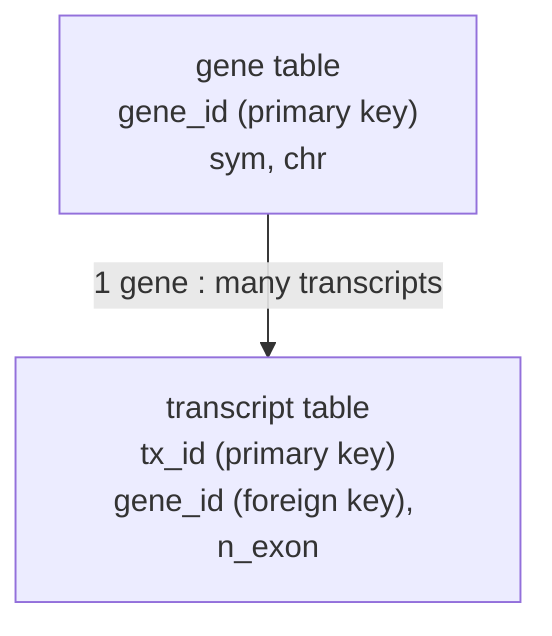

SQL (Structured Query Language) is a declarative language for defining, querying and updating data in relational databases, and it rests on the relational model that E. F. Codd published in 1970 (Codd, 1970). It began at IBM under the name SEQUEL, became the international standard ISO 9075:1987, and the current edition is ISO/IEC 9075:2023 (International Organization for Standardization [ISO], 1987, 2023). Even so, the PostgreSQL 18 documentation claims conformance to at least 170 of the 177 mandatory features of Core SQL:2023 and notes that no database system currently claims full conformance (PostgreSQL Global Development Group, n.d.-a). This article is for students of biology and bioinformatics: where SQL came from, what the standard's milestones are, and which queries change meaning when you move between systems, tested on SQLite 3.45.3.

<div class="callout callout-note">
<p class="callout-title">Quick summary</p>

- SQL is the language of the **relational model** (Codd, 1970): you say what data you want, and the database system works out how to get it.
- ISO's first SQL standard was ISO 9075:1987; the current edition is ISO/IEC 9075:2023, which adds SQL/PGQ graph queries and a JSON data type.
- The standard is a target, not a description of reality: `LIMIT`, `TOP` and `FETCH FIRST` do the same job, yet each system accepts only some of them.
- With biological data, the errors to fear are the **silent** ones: strings in double quotes, case-insensitive matching, `= NULL`, flexible typing.

</div>

## 1. What SQL is: a language for the relational model

"SQL is a language for accessing and manipulating databases" is true but misses the main point: SQL is a language for one **specific data model**, the relational model. The order of cause and effect runs like this. Codd supplied the theory; a relational database management system (RDBMS) is software that implements that theory; SQL is the language you use to talk to an RDBMS.

Codd's (1970) paper in *Communications of the ACM* starts from the user's side. In the systems of the day, a program had to know the order in which data were stored, which indexes existed and which access path to follow. Change the storage layout and the program broke. Codd proposed separating two layers. Users see data as **relations**, that is, tables, and physical arrangement is the system's business. Each row is a **tuple**, each column an **attribute**, and each table has a **key** that identifies every row uniquely. On that foundation, relational operations such as selecting rows, projecting columns and joining tables let you express a question without saying where the data live (Codd, 1970).

That is why SQL is **declarative**. You write `SELECT sym FROM gene WHERE chr = '17'` to say *what* you want; the database system decides *how*: scan the whole table or use an index, and in what order to read it.

Biological data are already relational in shape. A gene has several transcripts. Instead of copying the gene's name and location into every transcript row, you split the data into two tables and link them with a foreign key:



The question "which gene has the most transcripts?" then becomes one join and one count (→ [JOIN](/en/blog/join-ket-hop-nhieu-bang/)).

The relational model has also outlived many competitors. Stonebraker and Pavlo (2024) review the data models that have appeared over several decades and conclude that many ideas pitched as "replacements" for SQL ended up absorbed by SQL and the relational model. So a language from the 1970s is still a core skill for anyone who works with data.

## 2. One query, four systems: where the dialects differ

Having an ISO standard does not mean every database system speaks the same language. The code below creates a three-row gene table in SQLite and runs six queries. The table deliberately holds two spellings of the same symbol: `TP53` is the human gene symbol, written in all capitals, while zebrafish convention writes gene names in lowercase. Sonic hedgehog, for example, is *shha* in zebrafish, *SHH* in humans and *Shh* in mice (ZFIN, n.d.).

```python
import sqlite3
con = sqlite3.connect(":memory:")
con.executescript("""
CREATE TABLE gene (gene_id INTEGER PRIMARY KEY, sym TEXT, chr TEXT);
INSERT INTO gene VALUES (1, 'TP53', '17'), (2, 'BRCA1', '17'), (3, 'tp53', NULL);
""")
queries = [
    "SELECT sym FROM gene WHERE sym LIKE 'tp53'",      # LIKE and letter case
    "SELECT sym FROM gene WHERE chr = NULL",           # comparing with NULL
    "SELECT sym FROM gene WHERE chr IS NULL",
    'SELECT sym FROM gene WHERE sym = "TP53"',         # string in double quotes
    'SELECT sym FROM gene WHERE "symbol" = "symbol"',  # misspelled column name
    "SELECT TOP 2 sym FROM gene",                      # SQL Server syntax
]
print("SQLite", sqlite3.sqlite_version)
for q in queries:
    try:
        print(q, "->", [r[0] for r in con.execute(q)])
    except sqlite3.OperationalError as e:
        print(q, "-> ERROR:", e)
```

Output with Python 3 and SQLite 3.45.3, run on November 20, 2026:

```text
SELECT sym FROM gene WHERE sym LIKE 'tp53' -> ['TP53', 'tp53']
SELECT sym FROM gene WHERE chr = NULL -> []
SELECT sym FROM gene WHERE chr IS NULL -> ['tp53']
SELECT sym FROM gene WHERE sym = "TP53" -> ['TP53']
SELECT sym FROM gene WHERE "symbol" = "symbol" -> ['TP53', 'BRCA1', 'tp53']
SELECT TOP 2 sym FROM gene -> ERROR: near "2": syntax error
```

The six results fall into two kinds of difference, and their risk levels are far apart.

**Syntax differences** are the friendly kind: the system stops with an error right away. `TOP 2` is SQL Server syntax (Microsoft, n.d.); SQLite does not understand it and refuses to run. You lose a few minutes fixing it, not your results.

**Silent semantic differences** are the dangerous kind. The statement runs and returns rows, but the rows mean something other than what you think.

- `LIKE 'tp53'` returns both `TP53` and `tp53`, because by default SQLite's LIKE is case-insensitive for ASCII characters (SQLite, n.d.-b). In a multi-species table, a filter meant to pick "zebrafish genes only" has quietly pulled in the human gene as well.
- `chr = NULL` returns zero rows even though one row has no chromosome. NULL is not "equal" to anything, not even NULL; you have to write `IS NULL`. The PostgreSQL documentation says it plainly: do not write `expression = NULL`, because NULL is not equal to NULL (PostgreSQL Global Development Group, n.d.-d) (→ [SELECT & WHERE](/en/blog/select-and-where-truy-van-co-ban/)).
- `sym = "TP53"` works, but only because of a quirk. Standard SQL uses double quotes for **identifiers** (table and column names) and single quotes for **strings**. SQLite treats `"TP53"` as a string only when no column by that name exists, for compatibility with older software (SQLite, n.d.-a).
- The fifth line shows what that quirk costs. Misspell the column name as `"symbol"` and SQLite raises no error. It reads both sides as the string `'symbol'`, the condition is always true, and all three rows come back.

SQLite has two more traits that surprise people used to PostgreSQL. The first is **flexible typing**: a column declared `INTEGER` still accepts the value `'1,2 kb'` and stores it as text without complaint, while the expression `1 = '1'` returns 0 (false), because a number and a string are different values (SQLite, n.d.-a). Declare the table with the `STRICT` keyword and that insert is rejected with the message `cannot store TEXT value in INTEGER column`. The second is that **foreign keys are off by default**. On SQLite 3.45.3, a transcript pointing to a nonexistent `gene_id = 99` is inserted without any error; only after `PRAGMA foreign_keys = ON` does the system report `FOREIGN KEY constraint failed`. For gene and transcript tables, that means you can end up with "orphan" transcripts and never know.

The table below puts these differences side by side. The SQLite column comes from real runs; the other columns follow each system's official documentation, and cells with no documentation checked say "not checked."

| Feature | SQLite 3.45.3 (run) | PostgreSQL (docs) | MySQL 8.4 (docs, default mode) | SQL Server (docs) | Standard |
|---|---|---|---|---|---|
| Limiting rows | `LIMIT` works; `TOP`, `FETCH FIRST` are syntax errors | `LIMIT` and `FETCH FIRST` | `LIMIT` | `TOP`; `OFFSET … FETCH` in `ORDER BY` | `FETCH FIRST` (SQL:2008) |
| `"…"` | identifier; becomes a string if no column matches | always an identifier | string; identifier when `ANSI_QUOTES` is on | not checked | identifier |
| Unquoted names | not checked | folded to lowercase | not checked | not checked | folded to uppercase |
| `\|\|` | string concatenation | not checked | logical OR; concatenation when `PIPES_AS_CONCAT` is on | not checked | not checked |
| `x = NULL` | 0 rows | never true | not checked | not checked | use `IS NULL` |
| `<>` and `!=` | both work | `<>` is standard, `!=` is an alias | not checked | not checked | `<>` |

*Table 2. Some dialect differences. Points checked only on SQLite (`LIKE` and letter case, foreign keys, wrong-type inserts, `FULL OUTER JOIN`) are covered in the text and left out of the table. Sources: runs on SQLite 3.45.3 on November 20, 2026; SQLite (n.d.-a); PostgreSQL Global Development Group (n.d.-b, n.d.-c, n.d.-d); MySQL (n.d.); Microsoft (n.d.).*

Two rows deserve a closer look. In MySQL 8.4's default mode, double quotes delimit strings and `||` is logical OR; only with `ANSI_QUOTES` and `PIPES_AS_CONCAT` enabled do the two symbols mean what the standard says (MySQL, n.d.). A `SELECT sym || '_' || chr` written out of PostgreSQL habit and run on a default MySQL server gives you the result of a logical operation, not a concatenated string. PostgreSQL, for its part, folds unquoted names to lowercase, whereas the standard folds them to uppercase. The PostgreSQL documentation admits this is incompatible with the standard and advises either always quoting a given name or never quoting it (PostgreSQL Global Development Group, n.d.-b).

The version matters as much as the system's name. `FULL OUTER JOIN` exists in SQLite only from version 3.39.0, released June 25, 2022 (SQLite, 2022); a machine still running SQLite 3.37 will throw an error on the very same statement. Likewise, starting with 3.41.0 the SQLite command-line tool turns off acceptance of double-quoted strings, so `sym = "TP53"` can run in Python and fail in the terminal (SQLite, n.d.-a).

Five habits avoid most of these traps when you write SQL for biological data:

1. Use single quotes for strings and double quotes only for unusual column names.
2. Use the standard `<>`, `IS NULL` and `IS NOT NULL`.
3. When letter case matters, use `=` or check how `LIKE` is configured on your system.
4. Report the database system, version and configuration mode in your Methods section.
5. In SQLite, use `STRICT` tables when you want wrong-type values rejected (SQLite, n.d.-a).

## 3. From SEQUEL to SQL

Codd's model was mathematics; people needed a language to work with it. At IBM's research laboratory in San Jose, Donald Chamberlin and Raymond Boyce designed SEQUEL (Structured English Query Language) and presented it at the ACM SIGFIDET workshop, the forerunner of SIGMOD (Chamberlin & Boyce, 1974). Sources disagree on the year: the paper is usually cited as 1974, while the Crossref DOI record for the proceedings gives 1976. If you need to be safe, say "presented in the mid-1970s."

SEQUEL used English keywords such as `SELECT`, `FROM` and `WHERE` so that both programmers and nonspecialists could read it (Chamberlin & Boyce, 1974). Looking back nearly forty years later, Chamberlin (2012) wrote that the team wanted a language for people without training in mathematics or programming. That is why a simple SQL statement reads almost like an English sentence.

The name SEQUEL was later shortened to SQL. Popular histories explain the change with a trademark dispute, but that detail has not been checked against first-hand accounts, so treat it as an anecdote.

What has lasted from this period is a design choice. Codd's (1970) paper expressed relational operations in mathematical notation; SEQUEL put those operations into structured blocks of English keywords. The question "get the symbols of genes on chromosome 17" translates almost word for word into `SELECT sym FROM gene WHERE chr = '17'`. The price is that the language looks easier than it is, as the `NULL` and double-quote examples in section 2 showed.

<div class="callout callout-warning">
<p class="callout-title">Limits of the historical account</p>

Many details about 1970–1980 come from memoirs and retrospectives written by the project's own members (Chamberlin, 2012; Chamberlin et al., 1981). These are insider sources: rich in detail, but possibly tilted toward IBM's point of view. Dates in this article were checked against the DOI records of the original papers where possible.

</div>

## 4. From prototype to product: System R and INGRES

A declarative language is only useful if it runs fast enough. In the mid-1970s, two projects turned the relational model into working systems.

**System R** was IBM's prototype RDBMS, described in *ACM Transactions on Database Systems* in 1976 (Astrahan et al., 1976). In 1981 the project team published a history and evaluation of System R. According to that paper, the project set out to show that the usability advantages of the relational model could coexist with the complete function and high performance that everyday production use demands (Chamberlin et al., 1981). For data analysts, the component worth knowing here is the **query optimizer**: the software chooses the access path and execution plan, so the person writing the query does not have to. The retrospective devotes part of its evaluation to this very component (Chamberlin et al., 1981).

**INGRES** came out of the University of California, Berkeley. Stonebraker and colleagues (1976) describe a multiuser relational system that offered two nonprocedural data sublanguages and ran on the UNIX operating system.


*Figure 1. Key SQL milestones, 1970–2023. Sources: Codd (1970); Chamberlin & Boyce (1974); Astrahan et al. (1976); Stonebraker et al. (1976); ISO (1987, 2023); Eisenberg & Melton (1999); Eisenberg et al. (2004); PostgreSQL Global Development Group (n.d.-c); Kulkarni & Michels (2012); Michels et al. (2018); Eisentraut (2023). The 1986 ANSI milestone is based on secondary sources.*

## 5. Standardization: from ANSI 1986 to ISO/IEC 9075:2023

Once several companies were selling SQL products, a shared document became necessary. The first SQL standard from the American National Standards Institute (ANSI) is usually dated 1986; that date comes from secondary sources and has not been checked against the original document. The first international standard was **ISO 9075:1987**, edition 1, published in June 1987. It was withdrawn on April 19, 1989, and replaced by ISO/IEC 9075:1989, then ISO/IEC 9075:1992 (ISO, 1987).

From there the standard grew with each edition. Table 1 lists only the features that matter directly for data analysis.

| Edition | Notable features | Source |
|---|---|---|
| SQL:1999 (formerly SQL3) | recursive queries, triggers, object-oriented features | Eisenberg & Melton (1999) |
| SQL:2003 | the `WINDOW` clause and OLAP functions (previously an amendment to SQL:1999), the `MERGE` statement, sequence generators, the XML type | Eisenberg et al. (2004) |
| SQL:2008 | `OFFSET … FETCH FIRST` for limiting rows | PostgreSQL Global Development Group (n.d.-c) |
| SQL:2011 | temporal tables | Kulkarni & Michels (2012) |
| SQL:2016 | JSON, row pattern recognition, polymorphic table functions | Michels et al. (2018) |
| SQL:2023 | Part 16 SQL/PGQ (property graph queries), a `JSON` data type, `ANY_VALUE()`, `GREATEST`/`LEAST` | Eisentraut (2023); ISO (2023) |

*Table 1. SQL standard editions and their main features for data analysis.*

Recursive queries in SQL:1999 solved problems earlier SQL could not, such as walking a hierarchy (a bill of materials, in Eisenberg & Melton's 1999 example). In biology, taxonomic trees and the hierarchical vocabulary of the Gene Ontology have the same shape (→ [CTE & Set Operations](/en/blog/cte-and-set-operations/)). Window functions let you compute ranks, running totals or moving averages without collapsing rows (→ [Window Functions](/en/blog/window-functions/)). Both features run on SQLite 3.45.3: `ROW_NUMBER() OVER (PARTITION BY gene_id ORDER BY n_exon DESC)` and `WITH RECURSIVE`.

The current edition, ISO/IEC 9075-1:2023, is the 6th edition of Part 1 (Framework), published in June 2023 (ISO, 2023). The standard is not one document but several parts (Framework, Foundation…), and it defines a mandatory feature set called **Core SQL** plus many optional features. When the PostgreSQL 18 documentation reports at least 170 of 177 mandatory Core SQL:2023 features and says no system claims full conformance (PostgreSQL Global Development Group, n.d.-a), that figure shows the gap between standard and product even in a system known for following the standard.

One limitation to keep in mind: the ISO/IEC 9075 text is a paid document. The feature list above relies on overview papers written by members of the standards committee in *SIGMOD Record* and on ISO's catalog pages, not on the standard's text itself.

## 6. A biology example: from an Excel filter to SQL

SQL's declarative style is familiar to anyone who has used Excel. Excel's Advanced Filter takes a criteria range: conditions on the same row are combined with AND, conditions on different rows with OR. A `WHERE` clause says exactly that in words.

The example below uses a table of biological traits for 25 *Coilia grayii* anchovies, cleaned and published as CSV in the article [querying biological data with Excel, SQL and R](/en/blog/phan-tich-co-so-du-lieu/). The table holds length L (cm), total weight W (g), gutted weight Wo (g), sexual maturity stage Msex, age Age as text ("0+" … "5+") and other columns. To run the code below, copy the CSV block from that article into a file named `coilia_raw.csv` in the same folder.

```python
import sqlite3, pandas as pd
df = pd.read_csv("coilia_raw.csv")      # 25 fish, decimal point
con = sqlite3.connect(":memory:")
df.to_sql("fish", con, index=False)
q = {
  "L > 21 or age 5+":        "SELECT fish FROM fish WHERE l_cm > 21 OR age = '5+'",
  "Msex is 3 or 4":          "SELECT COUNT(*) FROM fish WHERE msex IN (3, 4)",
  "Max W, 19 ≤ L < 21":      "SELECT MAX(w_g) FROM fish WHERE l_cm >= 19 AND l_cm < 21",
  "Wo > W":                  "SELECT fish, w_g, wo_g FROM fish WHERE wo_g > w_g",
}
for k, s in q.items():
    print(k, "->", con.execute(s).fetchall())
```

```text
L > 21 or age 5+ -> [(7,), (8,), (11,), (12,), (14,), (15,), (22,)]
Msex is 3 or 4 -> [(11,)]
Max W, 19 ≤ L < 21 -> [(37.4,)]
Wo > W -> [(18, 31.4, 38.8)]
```

| Question | Excel | SQL | Result |
|---|---|---|---|
| L > 21 or age 5+ | Advanced Filter, two conditions on two rows | `WHERE l_cm > 21 OR age = '5+'` | 7 fish: nos. 7, 8, 11, 12, 14, 15, 22 |
| Msex equal to 3 or 4 | Advanced Filter, two rows | `WHERE msex IN (3, 4)` | 11 fish |
| Max W when 19 ≤ L < 21 | `DMAX` | `MAX(w_g)` + `WHERE` | 37.4 g |

*Table 3. Three Excel-style filters written in SQL on 25* C. grayii. *Results from SQLite 3.45.3, cross-checked with pandas.*

The most common mistake when turning a criteria range into `WHERE` is mixing up AND and OR. Write `l_cm > 21 AND age = '5+'` and you get 2 fish (nos. 8 and 15) instead of 7: both conditions must hold, just as if you had put them on the same row of the criteria range.

The example shows two more things beyond syntax. First, data entered with a decimal comma ("19,4") must be converted to a decimal point before loading. Otherwise the length column becomes text and `l_cm > 21` compares characters, not numbers: with values like "21,0", "21,5"…, the query raises no error and returns 7 fish, including the three fish measuring exactly 21.0 cm (nos. 7, 14, 17), because the string "21,0" is longer and therefore "greater" than the string "21"; the correct numeric answer is 4 fish (nos. 8, 11, 12, 15). That is section 2's silent error again, this time on real data. Second, the last query shows that fish no. 18 has a gutted weight of 38.8 g, more than its total weight of 31.4 g. That is biologically impossible and most likely a data-entry error. SQL has a tool to block it at the door: a `CHECK` constraint (→ SQL – Database).

```sql
CREATE TABLE fish2 (
  fish INTEGER PRIMARY KEY,
  w_g  REAL NOT NULL,
  wo_g REAL,
  CHECK (wo_g <= w_g)
);
```

Loading the 25 rows into this table on SQLite 3.45.3, 24 rows go in and fish no. 18 is rejected with the message `CHECK constraint failed: wo_g <= w_g`.

## 7. SQL in bioinformatics infrastructure

Biologists need SQL because many of the field's large databases are built on the relational model. The UCSC Genome Browser Database was designed to serve the browser's interactive queries (Karolchik et al., 2003). Ensembl stores its data in many MySQL databases and provides software libraries that hide the complex schema; programs using these libraries are less affected by schema changes than hand-written SQL (Stabenau et al., 2004). Hand-written SQL is more flexible; an API holds up better across releases. Chado, the schema developed by FlyBase and the GMOD project, is a modular, ontology-based relational schema reused by many model-organism databases (Mungall et al., 2007).

At the scale of a single researcher, SQLite is a popular choice. It is an embedded database that runs inside the program's own process and lives in a single file, and according to its developers it is the most widely deployed database engine (Gaffney et al., 2022). Buffalo (2015) devotes part of *Bioinformatics Data Skills* to introducing relational databases through SQLite for bioinformaticians (→ Biological data formats and databases).

## 8. Conclusion and roadmap

What to do next is concrete. Open the database system you use, run `SELECT sqlite_version();` (SQLite) or `SELECT version();` (PostgreSQL, MySQL), and record the version in your Methods section. Rerun the six queries from section 2 on that system to see how it handles double quotes, `NULL` and `LIKE`. For real data tables, add `CHECK` constraints or use a `STRICT` table before loading, so an error like fish no. 18 is stopped at the door instead of slipping into your results.

ISO/IEC 9075 is a target that systems converge toward, not a description of any one of them. A query that is correct on one system can fail on another, or worse, run smoothly and return a different answer.

The next articles in the series take the syntax one group at a time:

- Data and relational databases (→ [Data & Databases](/en/blog/gioi-thieu-du-lieu-and-database/)).
- SELECT, WHERE, NULL and three-valued logic (→ [SELECT & WHERE](/en/blog/select-and-where-truy-van-co-ban/)).
- ORDER BY and searching (→ Sorting & Searching).
- Aggregate functions, GROUP BY and HAVING (→ Aggregate, GROUP BY & HAVING).
- JOIN, subqueries, CASE WHEN (→ [JOIN](/en/blog/join-ket-hop-nhieu-bang/), [Subquery & CASE WHEN](/en/blog/subquery-and-case-when/), [Putting the skills together](/en/blog/ket-hop-tat-ca-ky-nang/)).
- Window functions, recursive CTEs and applications (→ [Window Functions](/en/blog/window-functions/), [CTE & Set Operations](/en/blog/cte-and-set-operations/), Real-world applications).

## Frequently asked questions

**What is the latest SQL standard?** ISO/IEC 9075:2023; the 6th edition of Part 1 (Framework) was published in June 2023 (ISO, 2023).

**Single quotes or double quotes for strings?** Single quotes. Under the standard, double quotes are for identifiers. The SQLite library (called from Python, for example) and MySQL in its default mode still accept double-quoted strings; the SQLite command-line tool from version 3.41.0 and PostgreSQL do not (SQLite, n.d.-a; MySQL, n.d.; PostgreSQL Global Development Group, n.d.-b).

**Limiting rows: `LIMIT`, `TOP` or `FETCH FIRST`?** It depends on the system. SQLite and MySQL use `LIMIT`; PostgreSQL accepts both `LIMIT` and the SQL:2008 `FETCH FIRST`; SQL Server uses `TOP` or `OFFSET … FETCH` after `ORDER BY` (Table 2; Microsoft, n.d.; PostgreSQL Global Development Group, n.d.-c). When code has to run on several systems, `FETCH FIRST` is closest to the standard, but SQLite 3.45.3 does not accept it.

## References

Astrahan, M. M., Blasgen, M. W., Chamberlin, D. D., Eswaran, K. P., Gray, J. N., Griffiths, P. P., King, W. F., Lorie, R. A., McJones, P. R., Mehl, J. W., Putzolu, G. R., Traiger, I. L., Wade, B. W., & Watson, V. (1976). System R: Relational approach to database management. *ACM Transactions on Database Systems, 1*(2), 97–137. https://doi.org/10.1145/320455.320457

Buffalo, V. (2015). *Bioinformatics data skills: Reproducible and robust research with open source tools*. O'Reilly Media.

Chamberlin, D. D. (2012). Early history of SQL. *IEEE Annals of the History of Computing, 34*(4), 78–82. https://doi.org/10.1109/MAHC.2012.61

Chamberlin, D. D., Astrahan, M. M., Blasgen, M. W., Gray, J. N., King, W. F., Lindsay, B. G., Lorie, R., Mehl, J. W., Price, T. G., Putzolu, F., Selinger, P. G., Schkolnick, M., Slutz, D. R., Traiger, I. L., Wade, B. W., & Yost, R. A. (1981). A history and evaluation of System R. *Communications of the ACM, 24*(10), 632–646. https://doi.org/10.1145/358769.358784

Chamberlin, D. D., & Boyce, R. F. (1974). SEQUEL: A structured English query language. In *Proceedings of the ACM SIGFIDET (now SIGMOD) workshop on Data description, access and control* (pp. 249–264). ACM. https://doi.org/10.1145/800296.811515 (the Crossref record gives the proceedings year as 1976)

Codd, E. F. (1970). A relational model of data for large shared data banks. *Communications of the ACM, 13*(6), 377–387. https://doi.org/10.1145/362384.362685

Eisenberg, A., & Melton, J. (1999). SQL:1999, formerly known as SQL3. *ACM SIGMOD Record, 28*(1), 131–138. https://doi.org/10.1145/309844.310075

Eisenberg, A., Melton, J., Kulkarni, K., Michels, J.-E., & Zemke, F. (2004). SQL:2003 has been published. *ACM SIGMOD Record, 33*(1), 119–126. https://doi.org/10.1145/974121.974142

Eisentraut, P. (2023, April 4). *SQL:2023 is finished: Here is what's new*. https://peter.eisentraut.org/blog/2023/04/04/sql-2023-is-finished-here-is-whats-new

Gaffney, K. P., Prammer, M., Brasfield, L., Hipp, D. R., Kennedy, D., & Patel, J. M. (2022). SQLite: Past, present, and future. *Proceedings of the VLDB Endowment, 15*(12), 3535–3547. https://doi.org/10.14778/3554821.3554842

International Organization for Standardization. (1987). *Information processing systems — Database language — SQL* (ISO Standard No. 9075:1987, withdrawn). https://www.iso.org/standard/16661.html

International Organization for Standardization. (2023). *Information technology — Database languages SQL — Part 1: Framework (SQL/Framework)* (ISO/IEC Standard No. 9075-1:2023). https://www.iso.org/standard/76583.html

Karolchik, D., Baertsch, R., Diekhans, M., Furey, T. S., Hinrichs, A., Lu, Y. T., Roskin, K. M., Schwartz, M., Sugnet, C. W., Thomas, D. J., Weber, R. J., Haussler, D., & Kent, W. J. (2003). The UCSC Genome Browser Database. *Nucleic Acids Research, 31*(1), 51–54. https://doi.org/10.1093/nar/gkg129

Kulkarni, K., & Michels, J.-E. (2012). Temporal features in SQL:2011. *ACM SIGMOD Record, 41*(3), 34–43. https://doi.org/10.1145/2380776.2380786

Michels, J., Hare, K., Kulkarni, K., Zuzarte, C., Liu, Z. H., Hammerschmidt, B., & Zemke, F. (2018). The new and improved SQL:2016 standard. *ACM SIGMOD Record, 47*(2), 51–60. https://doi.org/10.1145/3299887.3299897

Microsoft. (n.d.). *TOP (Transact-SQL)*. Microsoft Learn. Retrieved November 20, 2026, from https://learn.microsoft.com/en-us/sql/t-sql/queries/top-transact-sql

Mungall, C. J., Emmert, D. B., & The FlyBase Consortium. (2007). A Chado case study: An ontology-based modular schema for representing genome-associated biological information. *Bioinformatics, 23*(13), i337–i346. https://doi.org/10.1093/bioinformatics/btm189

MySQL. (n.d.). *Server SQL modes*. MySQL 8.4 Reference Manual. Retrieved November 20, 2026, from https://dev.mysql.com/doc/refman/8.4/en/sql-mode.html

PostgreSQL Global Development Group. (n.d.-a). *Appendix D. SQL conformance*. PostgreSQL 18 Documentation. Retrieved November 12, 2026, from https://www.postgresql.org/docs/18/features.html

PostgreSQL Global Development Group. (n.d.-b). *Lexical structure*. PostgreSQL Documentation. Retrieved November 20, 2026, from https://www.postgresql.org/docs/current/sql-syntax-lexical.html

PostgreSQL Global Development Group. (n.d.-c). *SELECT*. PostgreSQL Documentation. Retrieved November 20, 2026, from https://www.postgresql.org/docs/current/sql-select.html

PostgreSQL Global Development Group. (n.d.-d). *Comparison functions and operators*. PostgreSQL Documentation. Retrieved November 20, 2026, from https://www.postgresql.org/docs/current/functions-comparison.html

SQLite. (n.d.-a). *Quirks, caveats, and gotchas in SQLite*. Retrieved November 12, 2026, from https://www.sqlite.org/quirks.html

SQLite. (n.d.-b). *SQL language expressions*. Retrieved November 12, 2026, from https://www.sqlite.org/lang_expr.html

SQLite. (2022). *Release 3.39.0 on 2022-06-25*. https://www.sqlite.org/releaselog/3_39_0.html

Stabenau, A., McVicker, G., Melsopp, C., Proctor, G., Clamp, M., & Birney, E. (2004). The Ensembl core software libraries. *Genome Research, 14*(5), 929–933. https://doi.org/10.1101/gr.1857204

Stonebraker, M., Held, G., Wong, E., & Kreps, P. (1976). The design and implementation of INGRES. *ACM Transactions on Database Systems, 1*(3), 189–222. https://doi.org/10.1145/320473.320476

Stonebraker, M., & Pavlo, A. (2024). What goes around comes around... and around... *ACM SIGMOD Record, 53*(2), 21–37. https://doi.org/10.1145/3685980.3685984

ZFIN. (n.d.). *ZFIN zebrafish nomenclature conventions*. Zebrafish Information Network. Retrieved November 20, 2026, from https://zfin.atlassian.net/wiki/spaces/general/pages/1818394635/ZFIN+Zebrafish+Nomenclature+Conventions
