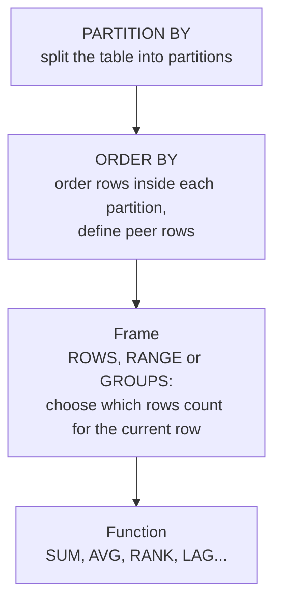

A window function in SQL computes a value for each row from a set of related rows, but unlike `GROUP BY` it does not collapse those rows: a table of 25 fish still returns 25 rows, each with an extra column for a rank, a running total or a moving average. Every `OVER (...)` expression has three parts: `PARTITION BY` splits the rows into groups, `ORDER BY` sets the order, and the frame picks which rows go into the calculation. The detail people get wrong most often is the default frame. When there is an `ORDER BY` but no frame clause, SQLite, PostgreSQL 18, MySQL 8.4 and SQL Server all use `RANGE BETWEEN UNBOUNDED PRECEDING AND CURRENT ROW`, so two orders on the same day make a running total go 100 → 180 → 180, not 100 → 150 → 180. This tutorial is written for students of biology and bioinformatics. Every query was run on SQLite 3.45.3, and the section on ties was cross-checked in R 4.4.3.

<div class="callout callout-note">
<p class="callout-title">Quick summary</p>

- A window function keeps every row and adds a column; `GROUP BY` collapses rows.
- `ROW_NUMBER`, `RANK` and `DENSE_RANK` differ only when values tie; `ROW_NUMBER` needs a tie-breaker column to give stable results.
- The default frame is `RANGE`, not `ROWS`: `ROWS` counts rows, `RANGE` measures distance in values, `GROUPS` counts groups of equal values.
- For read depth with gaps, `RANGE` gives a window that is correct in base pairs; midranks for a Wilcoxon test take one line of SQL.

</div>

## 1. What a window function is: keep the rows, add a column

Take a simple biological question. In a table of measurements for 25 *Coilia grayii* fish, how much longer or shorter is each fish than the average for its sex? `GROUP BY sex` answers the first half (the mean of each group), but it returns two rows and the length of each individual fish disappears (→ GROUP BY & HAVING). A window function answers both halves in one expression.

```sql
SELECT fish, sex, l_cm,
       AVG(l_cm) OVER (PARTITION BY sex)           AS group_avg,
       l_cm - AVG(l_cm) OVER (PARTITION BY sex)    AS diff
FROM fish;
```

Every row stays, and `AVG(...) OVER (PARTITION BY sex)` gives all fish of the same sex one shared mean: 18.69 cm for the 13 fish with `sex = 0` and 20.09 cm for the 12 fish with `sex = 1`. Fish 11 is 22.3 cm long, so its `diff` is +2.21 cm; fish 3 is 17.7 cm, a difference of −2.39 cm. An empty `OVER ()` means the whole table is one window.

| | `GROUP BY` | Window function |
|---|---|---|
| Rows in the result | Fewer, one per group | Same as input |
| Detail columns | Lost, except the grouping columns | Kept |
| Typical question | Total or mean per group | Compare each individual with its group; ranks; running totals; moving averages |

*Table 1. GROUP BY versus window functions.*

The *C. grayii* table used throughout this article is a cleaned set of 25 individuals published as a CSV in the article on [querying biological data with Excel, SQL and R](/en/blog/phan-tich-co-so-du-lieu/); only four columns are needed here: `fish`, `l_cm`, `sex`, `age`. Several fish share the same length, which is exactly the situation where the ranking functions and the frame types give different answers: 19.5 cm (2 fish), 20.6 cm (2 fish) and 21.0 cm (3 fish).

## 2. Anatomy of an OVER(...) expression

A window function is defined by three layers, read from the outside in:



**Partitions.** `PARTITION BY` splits the rows into independent groups; a function never looks across into another partition. Without `PARTITION BY`, the whole query result is one partition.

**Order and peers.** The `ORDER BY` inside `OVER` sorts the rows within a partition. It also creates an important idea: rows with the same sort value are called peers of each other (SQLite, n.d.; PostgreSQL Global Development Group, n.d.). Peers decide the result of `RANK` and of a `RANGE` frame.

**Frame.** For each row, the frame is the subset of the partition that an aggregate is computed over. A frame can be measured in three units: `ROWS` (number of rows), `RANGE` (a range of values in the sort column) and `GROUPS` (number of peer groups). Ranking functions and `LAG`/`LEAD` do not use a frame.

**Order of evaluation.** Window functions are computed after `WHERE`, `GROUP BY` and `HAVING`, and before the final `ORDER BY` of the query (Leis et al., 2015). Because `WHERE` runs first, the window only sees the rows that survive the filter. Rerun the query from section 1 with `WHERE fish IN (1, 2, 3, 11, 25)` and the mean for `sex = 0` is no longer 18.69 cm but 16.93 cm, the mean of fish 1, 2 and 25, the only ones left in that group. If you want to compare against the full-sample mean and filter afterwards, compute the window function in a CTE first. A second consequence: you cannot filter on a window function result in the `WHERE` clause of the same query (wrap it in a subquery or CTE), but you can apply a window function to grouped results, for example `LAG(SUM(total_amount)) OVER (ORDER BY month)` after `GROUP BY month`.

**Named windows.** When several functions share one window, the `WINDOW` clause keeps the query short and stops the copies from drifting apart (SQLite, n.d.):

```sql
SELECT fish, l_cm,
       ROW_NUMBER() OVER w AS rn,
       RANK()       OVER w AS rk
FROM fish
WINDOW w AS (PARTITION BY sex ORDER BY l_cm DESC);
```

## 3. Ranking: ROW_NUMBER, RANK, DENSE_RANK and ties

The three ranking functions differ only when there are ties. Take four salaries of 35, 25, 25 and 20 (in millions of Vietnamese dong), sorted in descending order:

```sql
SELECT name, salary,
       ROW_NUMBER()   OVER w AS rn,
       RANK()         OVER w AS rk,
       DENSE_RANK()   OVER w AS drk,
       PERCENT_RANK() OVER w AS pr,
       CUME_DIST()    OVER w AS cd
FROM salaries
WINDOW w AS (ORDER BY salary DESC);
```

| Salary | `ROW_NUMBER` | `RANK` | `DENSE_RANK` | `PERCENT_RANK` | `CUME_DIST` |
|---|---|---|---|---|---|
| 35 | 1 | 1 | 1 | 0 | 0.25 |
| 25 | 2 | 2 | 2 | 0.333 | 0.75 |
| 25 | 3 | 2 | 2 | 0.333 | 0.75 |
| 20 | 4 | 4 | 3 | 1 | 1 |

*Table 2. Results in SQLite 3.45.3.*

`ROW_NUMBER` always gives distinct numbers. `RANK` gives tied rows the same rank and then skips the ranks they "used up" (2, 2, then 4). `DENSE_RANK` does not skip (2, 2, then 3). `PERCENT_RANK` equals (rank − 1)/(n − 1): for the two people earning 25, (2 − 1)/(4 − 1) = 0.333. `CUME_DIST` is the share of rows that come before or tie with the current row: three of the four rows have a salary of 25 or more, so 0.75.

| Question | Function to use |
|---|---|
| Exactly k rows per group, even with ties (sampling, paging, deduplication) | `ROW_NUMBER` + tie-breaker column |
| Keep every tied individual; rank reflects "how many come before" | `RANK` |
| Count distinct value levels (level 1, level 2…) | `DENSE_RANK` |
| Ranks for nonparametric statistics | midranks (section 8) |
| Relative position from 0 to 1 | `PERCENT_RANK`, `CUME_DIST` |

*Table 3. Choosing a ranking function by question.*

### Determinism and the tie-breaker column

The two people earning 25 get `ROW_NUMBER` 2 and 3, but the query does not say who gets 2. When the sort key has ties, `ROW_NUMBER` is not deterministic: the result can change between two runs or between two database systems (Leis et al., 2015; Zemke, 2012). The fix is to add a unique tie-breaker column to `ORDER BY`, for example `ORDER BY salary DESC, id` (→ [Sorting & Searching](/en/blog/sap-xep-and-tim-kiem/)). With biological data, the tie-breaker should be a stable identifier such as a sample ID, an individual ID or an Ensembl ID, not a row number generated on import, because that number changes every time the data are reloaded.

### Is ORDER BY required?

In terms of meaning, yes: a rank without an order is meaningless. In terms of syntax, it depends on the system. SQLite accepts `RANK() OVER ()` and returns 1 for every row, because without `ORDER BY` every row is a peer; `ROW_NUMBER() OVER ()` returns 1, 2, 3, 4 in table-scan order. SQL Server states that the `ORDER BY` clause is required for `RANK`, and the function does not accept a `ROWS`/`RANGE` clause (Microsoft, n.d.-b). So a query that forgets `ORDER BY` can raise an error on one system and quietly return all 1s on another. A "top 10 genes" query where every gene ranks 1 returns the whole table.

### Example: ranking fish by length within each sex

```sql
SELECT sex, fish, l_cm,
       ROW_NUMBER() OVER (PARTITION BY sex ORDER BY l_cm DESC, fish) AS rn,
       RANK()       OVER w AS rk,
       DENSE_RANK() OVER w AS drk
FROM fish
WINDOW w AS (PARTITION BY sex ORDER BY l_cm DESC);
```

| Fish | L (cm) | `ROW_NUMBER` | `RANK` | `DENSE_RANK` |
|---|---|---|---|---|
| 12 | 21.1 | 3 | 3 | 3 |
| 7 | 21.0 | 4 | 4 | 4 |
| 17 | 21.0 | 5 | 4 | 4 |
| 22 | 20.2 | 6 | 6 | 5 |
| 18 | 20.1 | 7 | 7 | 6 |
| 16 | 19.5 | 8 | 8 | 7 |
| 20 | 19.5 | 9 | 8 | 7 |

*Table 4. Fish with `sex = 1`, ranks 3 to 9 of 12, sorted by length in descending order (SQLite 3.45.3).*

Fish 7 and 17 are both 21.0 cm long: `ROW_NUMBER` gives them 4 and 5 (by fish number), while `RANK` and `DENSE_RANK` both give 4. At the next fish, number 22 at 20.2 cm, the two functions split: `RANK` jumps to 6 because five fish come before it, while `DENSE_RANK` only moves to 5 because there have been just four distinct lengths. The 19.5 cm pair (fish 16 and 20) repeats the same pattern.

<div class="callout callout-warning">
<p class="callout-title">A tie-breaker in the wrong place</p>

The tie-breaker `fish` belongs only in the `ROW_NUMBER` window. If you add `fish` to the shared window `w`, fish 7 and 17 stop being peers, and `RANK` gives them 4 and 5, exactly like `ROW_NUMBER`. The query still runs; it just loses the tie information.

</div>

### Top-k per group

The question "the 4 longest fish of each sex" is a familiar use of ranking functions. Because you cannot filter on a window function in `WHERE`, wrap it in a CTE (→ [CTE & Set Operations](/en/blog/cte-and-set-operations/)):

```sql
WITH r AS (
  SELECT sex, fish, l_cm,
         RANK() OVER (PARTITION BY sex ORDER BY l_cm DESC) AS rk
  FROM fish
)
SELECT * FROM r WHERE rk <= 4;
```

For `sex = 1`, the condition `rk <= 4` returns 5 fish because fish 7 and 17 tie at rank 4. The `sex = 0` group also returns 5 fish, because fish 13 and 19 are both 20.6 cm long. With `ROW_NUMBER` you would get only 4 fish, and one of each tied pair would be dropped according to the tie-breaker.

## 4. LAG and LEAD: compare with the previous or next row

`LAG(column, n, default)` takes the value n rows earlier in the same partition; `LEAD` takes the value n rows later. A familiar example is month-over-month revenue growth:

```sql
SELECT month, revenue, prev_revenue,
       ROUND((revenue - prev_revenue) * 100.0 / NULLIF(prev_revenue, 0), 1) AS growth_pct
FROM (
  SELECT strftime('%Y-%m', order_date) AS month,
         SUM(total_amount) AS revenue,
         LAG(SUM(total_amount)) OVER (ORDER BY strftime('%Y-%m', order_date)) AS prev_revenue
  FROM orders
  WHERE status = 'Completed'
  GROUP BY month
);
```

On a small orders table (January: 150; February: 0; March: no orders; April: 80), the query returns:

| Month | Revenue | Previous month (`LAG`) | Growth (%) |
|---|---|---|---|
| 2026-01 | 150 | NULL | NULL |
| 2026-02 | 0 | 150 | −100.0 |
| 2026-04 | 80 | 0 | NULL |

*Table 5. Growth versus the previous row, SQLite 3.45.3.*

This query has four places where it is easy to trip. First, `strftime` is a SQLite function; PostgreSQL uses `date_trunc` or `to_char`. Second, the default argument only replaces values that fall outside the partition boundary. On the values (10, NULL, 30), `LAG(v, 1, 0)` returns 0 on the first row and 10 on the second, but on the third row it still returns NULL, because the real value of the previous row is NULL. Third, a previous month with zero revenue breaks the division; SQLite returns NULL for division by zero, while other systems may raise an error, so `NULLIF(prev_revenue, 0)` is the safe way to write it on any system.

The fourth is harder to spot: `LAG` takes the previous row, not the previous month. In Table 5, March has no orders, so it has no row, and April is compared with February. With weekly case counts, weeks with no cases are often missing from a summary table too. The fix is to generate a complete calendar with a recursive CTE and then left join:

```sql
WITH RECURSIVE calendar(month) AS (
  SELECT '2026-01'
  UNION ALL
  SELECT strftime('%Y-%m', month || '-01', '+1 month') FROM calendar WHERE month < '2026-04'
),
rev AS (
  SELECT strftime('%Y-%m', order_date) AS month, SUM(total_amount) AS revenue
  FROM orders WHERE status = 'Completed' GROUP BY month
)
SELECT c.month, COALESCE(rev.revenue, 0) AS revenue,
       LAG(COALESCE(rev.revenue, 0)) OVER (ORDER BY c.month) AS prev_revenue
FROM calendar c LEFT JOIN rev ON rev.month = c.month;
```

The result has all four months, March gets revenue 0, and April is now compared with March. If the table has several groups (several monitoring stations, say), add `PARTITION BY` inside `LAG`.

In genomic data, `LAG` gives the distance between two consecutive variants on the same chromosome: `pos - LAG(pos) OVER (PARTITION BY chrom ORDER BY pos)`. `PARTITION BY chrom` makes sure the first variant on chr2 gets NULL instead of being subtracted from the last variant on chr1.

## 5. Frames: ROWS, RANGE, GROUPS and the default frame

The frame is the easiest part to get wrong because it is usually not written out.

### Three frame units

- `ROWS BETWEEN 1 PRECEDING AND CURRENT ROW`: the row just before and the current row, counted by physical position.
- `RANGE BETWEEN 1 PRECEDING AND CURRENT ROW`: every row whose sort value lies in [x − 1, x], including all peers of the current row.
- `GROUPS BETWEEN 1 PRECEDING AND CURRENT ROW`: the current peer group and one peer group before it (SQLite, n.d.; Oracle, n.d.).


*Figure 1. The frame of row 5 (x = 5) under the three units, on the sequence x = 1, 2, 2, 3, 5, 5. Blue cells are rows inside the frame; gray bars above mark peer groups. The frames were taken directly from SQLite with `json_group_array`.*

In Figure 1, the same clause, "1 PRECEDING AND CURRENT ROW", gives three different frames. `ROWS` takes rows 4 and 5 but leaves out row 6, even though row 6 has the same value x = 5. `RANGE` takes the rows with x in [4, 5], that is rows 5 and 6; row 4 (x = 3) is outside the range. `GROUPS` takes the current peer group {5, 6} and the peer group just before it, {4}.

### The default frame is RANGE

When `OVER` has an `ORDER BY` but no frame clause, the default frame is `RANGE BETWEEN UNBOUNDED PRECEDING AND CURRENT ROW`. Four common systems document the same thing:

| System | Default frame with `ORDER BY` | Note | Source |
|---|---|---|---|
| SQLite | `RANGE BETWEEN UNBOUNDED PRECEDING AND CURRENT ROW` | Without `ORDER BY`: the whole partition | SQLite (n.d.) |
| PostgreSQL 18 | `RANGE UNBOUNDED PRECEDING` (same meaning) | | PostgreSQL Global Development Group (n.d.) |
| MySQL 8.4 | `RANGE BETWEEN UNBOUNDED PRECEDING AND CURRENT ROW` | Without `ORDER BY`: the whole partition | Oracle (n.d.) |
| SQL Server | `RANGE BETWEEN UNBOUNDED PRECEDING AND CURRENT ROW` | Ranking functions do not accept `ROWS`/`RANGE` | Microsoft (n.d.-a, n.d.-b) |

*Table 6. Default frames according to official documentation, accessed November 12, 2026 and November 20, 2026.*

With a `RANGE` frame, peer rows always get the same result, so the result does not depend on physical order. The price is that a running total does not climb row by row when there are ties.

### Experiment 1: a running total with two orders on the same day

Four orders: 100 on January 1, 50 and 30 both on January 2, and 20 on January 3.

```sql
SELECT id, d, amount,
  SUM(amount) OVER (ORDER BY d) AS default_,
  SUM(amount) OVER (ORDER BY d ROWS  BETWEEN UNBOUNDED PRECEDING AND CURRENT ROW) AS rows_,
  SUM(amount) OVER (ORDER BY d, id ROWS BETWEEN UNBOUNDED PRECEDING AND CURRENT ROW) AS rows_id,
  SUM(amount) OVER (ORDER BY d GROUPS BETWEEN 1 PRECEDING AND CURRENT ROW) AS groups_
FROM sales ORDER BY d, id;
```

| id | Date | Amount | Default (= `RANGE`) | `ROWS` | `ROWS` + `id` | `GROUPS` 1 |
|---|---|---|---|---|---|---|
| 1 | Jan 1 | 100 | 100 | 100 | 100 | 100 |
| 2 | Jan 2 | 50 | **180** | **150** | 150 | 180 |
| 3 | Jan 2 | 30 | 180 | 180 | 180 | 180 |
| 4 | Jan 3 | 20 | 200 | 200 | 200 | 100 |

*Table 7. Results in SQLite 3.45.3 (Python) and SQLite 3.37.0 (macOS CLI); both versions give the same result.*

The default column matches an explicit `RANGE` exactly (not shown here). For the two orders on January 2, `RANGE` adds both at once (180, 180) because they are peers. `ROWS` adds them one at a time (150, 180), but which order is added first depends on physical order, just as Zemke (2012) notes that `ROWS` can cut through a peer group. Adding `id` to `ORDER BY` is what makes `ROWS` deterministic.

Both can be right. The default means "total through the end of the day"; `ROWS` with a tie-breaker means "total through this order". The question "how much had we sold by the end of January 2" needs `RANGE`; the question "which order pushed revenue past 150" needs `ROWS` with a tie-breaker. Cumulative counts of individuals by sampling date work the same way: fish from the same net haul share a date, so the default line steps up one haul at a time.

### Experiment 2: "the last 3 rows" is not "the last 3 days"

Four measurement days, the 1st, 2nd, 5th and 6th, with values 1, NULL, 3 and 5.

```sql
SELECT d, v,
  AVG(v) OVER (ORDER BY d ROWS BETWEEN 2 PRECEDING AND CURRENT ROW) AS ma3_rows,
  AVG(v) OVER (ORDER BY julianday(d) RANGE BETWEEN 2 PRECEDING AND CURRENT ROW) AS ma3_range
FROM daily;
```

On the 5th, `ROWS` takes three rows (the 1st, 2nd and 5th), drops the NULL and divides by 2: the result is 2.0. `RANGE` takes the days in [3rd, 5th], which contains only the 5th itself: the result is 3.0. `RANGE` with a numeric offset needs a numeric sort column, so the date is converted with `julianday(d)`. `AVG` skips NULLs, so the real denominator can be smaller than 3 (→ [Aggregate functions](/en/blog/ham-tong-hop-aggregate/)); to see how many values each average rests on, add a `COUNT(v) OVER (...)` column with the same frame. SQLite also allows a `RANGE` frame with an offset only when `ORDER BY` has exactly one expression; adding a second column raises an error.

### GROUPS

`GROUPS BETWEEN 1 PRECEDING AND CURRENT ROW` on the orders table gives the total for the current day plus the previous day that has orders: 100, 180, 180, 100. This is a way to write "slide over the number of days with data" without grouping by day first.

## 6. Application 1: moving average of read depth along genomic coordinates

Per-position read depth is computed from BAM files with tools such as samtools (Li et al., 2009), BEDTools (Quinlan & Hall, 2010) or mosdepth (Pedersen & Quinlan, 2018). Note that `samtools depth` does not print zero-depth positions by default; you have to add `-a` to print all of them (Samtools, n.d.). So a `(chrom, pos, depth)` table loaded into SQLite often has gaps.

The small hand-made table below has chr1 at positions 100, 101, 102, 105 and 106 and chr2 at 100 and 101:

```sql
SELECT chrom, pos, depth,
  AVG(depth) OVER (PARTITION BY chrom ORDER BY pos ROWS  BETWEEN 2 PRECEDING AND CURRENT ROW) AS ma_rows,
  AVG(depth) OVER (PARTITION BY chrom ORDER BY pos RANGE BETWEEN 2 PRECEDING AND CURRENT ROW) AS ma_range,
  AVG(depth) OVER (PARTITION BY chrom ORDER BY pos RANGE BETWEEN 2 PRECEDING AND 2 FOLLOWING) AS ma_c5
FROM cov;
```

| chrom | pos | depth | `ROWS` 3 rows | `RANGE` 3 bp |
|---|---|---|---|---|
| chr1 | 100 | 10 | 10.00 | 10.00 |
| chr1 | 101 | 12 | 11.00 | 11.00 |
| chr1 | 102 | 14 | 12.00 | 12.00 |
| chr1 | 105 | 30 | **18.67** | **30.00** |
| chr1 | 106 | 32 | 25.33 | 31.00 |
| chr2 | 100 | 5 | 5.00 | 5.00 |
| chr2 | 101 | 7 | 6.00 | 6.00 |

*Table 8. Moving average of read depth, SQLite 3.45.3.*

At position 105, `ROWS` mixes in positions 101 and 102, which are 3–4 bp away; `RANGE` keeps only the positions that really lie within 3 bp. `PARTITION BY chrom` stops the window from spilling from chr1 into chr2. If the table already contains every position, zero-depth ones included (for example, exported with `samtools depth -a`), the two frames give the same result. The `ma_c5` column (a centered ±2 bp window, not shown) is 31.0 at position 105; this window shrinks on its own at the edges.


*Figure 2. Simulated data: depth around 30 over 1–80 bp and around 12 over 121–200 bp; the region 81–120 bp has zero depth and is absent from the table. Solid line: 10-row average; dashed line: 10-bp average.*

Just after the gap in Figure 2, at position 121, the 10-row average is 28.0 because the nine rows before it belong to the high-depth stretch at 72–80 bp, while the 10-bp average is 9.0, in line with the actual depth there. The `ROWS` line does not catch up with the `RANGE` line until position 130. If you use a moving average to call deletions or low-coverage regions, `ROWS` will shift the region boundaries by a few dozen bp.

<div class="callout callout-note">
<p class="callout-title">Limits</p>

For a whole-genome depth table with hundreds of millions of positions, SQL is no substitute for samtools, BEDTools or mosdepth. SQL suits tables that have already been summarized; in the same spirit, GEMINI loads variants and genome annotations into a single database for users to query (Paila et al., 2013) (→ NGS and genomics).

</div>

## 7. Application 2: ranking genes and computing TPM within each sample

A gene expression table in long format, `(sample, gene, len_kb, count)`, is a natural input for window functions (→ Transcriptomics). TPM (transcripts per million) divides each gene by the total for its sample, which is exactly the job of an aggregate window without `ORDER BY`:

```sql
WITH rpk AS (
  SELECT sample, gene, count, count / len_kb AS rpk FROM expr
)
SELECT sample, gene, count,
       ROUND(rpk / SUM(rpk) OVER (PARTITION BY sample) * 1e6) AS tpm,
       RANK()       OVER (PARTITION BY sample ORDER BY rpk DESC)   AS tpm_rank,
       DENSE_RANK() OVER (PARTITION BY sample ORDER BY count DESC) AS count_rank
FROM rpk;
```

The data below are simulated, two samples and five genes, small enough to check by hand:

| Sample | Gene | Length (kb) | Count | TPM | TPM rank (`RANK`) | Count rank (`DENSE_RANK`) |
|---|---|---|---|---|---|---|
| S1 | geneB | 1.0 | 400 | 571,429 | 1 | 1 |
| S1 | geneA | 2.0 | 400 | 285,714 | 2 | 1 |
| S1 | geneC | 4.0 | 400 | 142,857 | 3 | 1 |
| S1 | geneD | 1.5 | 0 | 0 | 4 | 2 |
| S1 | geneE | 0.5 | 0 | 0 | 4 | 2 |
| S2 | geneA | 2.0 | 900 | 529,412 | 1 | 1 |
| S2 | geneC | 4.0 | 800 | 235,294 | 2 | 2 |
| S2 | geneB | 1.0 | 100 | 117,647 | 3 | 3 |
| S2 | geneE | 0.5 | 50 | 117,647 | 3 | 4 |
| S2 | geneD | 1.5 | 0 | 0 | 5 | 5 |

*Table 9. TPM and ranks within each sample, simulated data, SQLite 3.45.3.*

In sample S1, three genes have the same 400 reads but are 1, 2 and 4 kb long, so TPM ranks them 1, 2, 3 while the count rank is 1, 1, 1. In S2 it goes the other way: geneB (100 reads, 1 kb) and geneE (50 reads, 0.5 kb) have the same TPM and so tie at rank 3, even though their counts differ. A quick check: the TPM total for each sample must be 1,000,000.

Genes with no reads are the largest source of ties in real RNA-seq data, because a sample usually has thousands of genes with a count of 0. When the ranks feed into a statistical test, use midranks (section 8).

Wagner, Kin and Lynch (2012) showed that RPKM is inconsistent among samples and proposed TPM. Ranking within one sample does not need between-sample normalization, but comparing across samples needs a consistent unit, so normalization comes before ranking.

## 8. Ties in SQL and in the Wilcoxon test

Wilcoxon's (1945) rank-sum test and Mann and Whitney's (1947) U test work on ranks. R's `rank()` function has a `ties.method` argument whose default is `"average"` (midranks), and its `"min"` option is described as the ranking used in sports (R Core Team, n.d.). SQL's `RANK()` corresponds to `"min"`. Midranks can be computed like this:

```sql
SELECT fish, l_cm,
       RANK() OVER (ORDER BY l_cm)
         + (COUNT(*) OVER (PARTITION BY l_cm) - 1) / 2.0 AS midrank
FROM fish;
```

On the 25 fish, this column matches R 4.4.3's `rank()` on all 25 rows. Sum the midranks by sex and subtract n(n + 1)/2, and the query below gives U = 48 for the `sex = 0` group (13 fish) and U = 108 for the `sex = 1` group (12 fish); 48 + 108 = 13 × 12. R reports W for whichever group comes first: `wilcox.test(l_cm ~ sex)` gives W = 48, while `wilcox.test(l_cm[sex == 1], l_cm[sex == 0])` gives W = 108. The numbers agree, which means `wilcox.test()` uses midranks when there are ties and SQL can reproduce that statistic with window functions:

```sql
WITH r AS (
  SELECT sex,
         RANK() OVER (ORDER BY l_cm)
           + (COUNT(*) OVER (PARTITION BY l_cm) - 1) / 2.0 AS midrank
  FROM fish
)
SELECT sex, COUNT(*) AS n, SUM(midrank) AS rank_sum,
       SUM(midrank) - COUNT(*) * (COUNT(*) + 1) / 2.0 AS U
FROM r GROUP BY sex;
```

The midrank formula works because `RANK()` returns the lowest rank in a tied group, and a group of k tied values occupies ranks r through r + k − 1, whose mean is r + (k − 1)/2. For the three fish at 21.0 cm, `RANK()` in ascending order is 19, k = 3, and the midrank is 20, the same value R prints.

Leave the p-value to statistical software. With ties, R uses a normal approximation and prints a warning; here p ≈ 0.11. The number only illustrates the technique: 25 individuals from a teaching dataset are not enough to draw conclusions about a difference between the sexes (→ [Hypothesis testing](/en/blog/kiem-dinh-gia-thiet-thong-ke-trong-nghien-cuu-sinh-hoc/)).

## 9. Performance and origins

Before window functions, a running total was usually written as a correlated subquery: for each row, add up every row before it. The two approaches give the same result, but their run times are far apart. Measured once on a macOS machine with SQLite 3.45.3 (timings depend on the machine, so read only the ratios): with 2,000 rows, the window function took 3.0 ms and the subquery 144.9 ms; with 8,000 rows, 12.2 ms versus 2,333.3 ms. When the row count grows fourfold, the window function's time grows about fourfold, while the subquery's grows about sixteenfold. Leis et al. (2015) explain why: the naive approach is O(n²); a cumulative algorithm reaches O(n) for the default frame; a segment tree handles arbitrary frames in O(log n) per row. Cao et al. (2012) optimized the ordering of several window functions in one query, avoiding repeated sorts for windows that share partitioning and ordering.

Window functions entered the standard through the 2000 OLAP amendment to SQL:1999 and were folded into SQL:2003 (Eisenberg et al., 2004; Zemke, 2012). SQL:2011 added `GROUPS`, `NTILE`, `LAG`, `LEAD`, `FIRST_VALUE`, `LAST_VALUE` and `NTH_VALUE` (Zemke, 2012). SQLite has supported window functions since 3.25.0 (September 15, 2018), and `GROUPS`, `EXCLUDE` and `RANGE` with an offset since 3.28.0 (April 16, 2019) (SQLite, n.d.). SQLite versions older than 3.25.0 raise a syntax error on `OVER`; `SELECT sqlite_version();` tells you which version you have.

## 10. Conclusion and checklist

The part of an `OVER (...)` expression people overlook most is the part that is never written: the default `RANGE` frame. Before you run a query with `OVER`, ask yourself six questions:

1. What is the partition, and can the window spill into another chromosome or sample?
2. What is the order, and is one needed?
3. Does the sort column have ties?
4. Do you need `ROWS`, `RANGE` or `GROUPS`, and have you written the frame explicitly?
5. Is there a stable tie-breaker column?
6. How are NULLs and gaps (months with no orders, zero-depth positions) handled?

Next in the series: CTEs and `WITH RECURSIVE` (→ [CTE & Set Operations](/en/blog/cte-and-set-operations/)), then RFM and cohort analysis (→ [Real-world applications](/en/blog/ung-dung-thuc-chien/)).

## Frequently asked questions

**Why does my running total have two identical values in a row?** Because the `ORDER BY` column has ties and the default frame is `RANGE`, which adds all peer rows at once. Write `ROWS BETWEEN UNBOUNDED PRECEDING AND CURRENT ROW`, and add a tie-breaker column if you want to add one row at a time.

**Which SQLite version supports window functions?** Version 3.25.0 (2018) and later; `GROUPS`, `EXCLUDE` and `RANGE` with an offset arrived in 3.28.0 (2019) (SQLite, n.d.).

## References

Cao, Y., Chan, C.-Y., Li, J., & Tan, K.-L. (2012). Optimization of analytic window functions. *Proceedings of the VLDB Endowment, 5*(11), 1244–1255. https://doi.org/10.14778/2350229.2350243

Eisenberg, A., Melton, J., Kulkarni, K., Michels, J.-E., & Zemke, F. (2004). SQL:2003 has been published. *ACM SIGMOD Record, 33*(1), 119–126. https://doi.org/10.1145/974121.974142

Leis, V., Kundhikanjana, K., Kemper, A., & Neumann, T. (2015). Efficient processing of window functions in analytical SQL queries. *Proceedings of the VLDB Endowment, 8*(10), 1058–1069. https://doi.org/10.14778/2794367.2794375

Li, H., Handsaker, B., Wysoker, A., Fennell, T., Ruan, J., Homer, N., Marth, G., Abecasis, G., Durbin, R., & 1000 Genome Project Data Processing Subgroup. (2009). The Sequence Alignment/Map format and SAMtools. *Bioinformatics, 25*(16), 2078–2079. https://doi.org/10.1093/bioinformatics/btp352

Mann, H. B., & Whitney, D. R. (1947). On a test of whether one of two random variables is stochastically larger than the other. *The Annals of Mathematical Statistics, 18*(1), 50–60. https://doi.org/10.1214/aoms/1177730491

Microsoft. (n.d.-a). *SELECT – OVER clause (Transact-SQL)*. Retrieved November 12, 2026, from https://learn.microsoft.com/en-us/sql/t-sql/queries/select-over-clause-transact-sql

Microsoft. (n.d.-b). *RANK (Transact-SQL)*. Retrieved November 20, 2026, from https://learn.microsoft.com/en-us/sql/t-sql/functions/rank-transact-sql

Oracle. (n.d.). *MySQL 8.4 reference manual: 14.20.3 Window function frame specification*. Retrieved November 12, 2026, from https://dev.mysql.com/doc/refman/8.4/en/window-functions-frames.html

Paila, U., Chapman, B. A., Kirchner, R., & Quinlan, A. R. (2013). GEMINI: Integrative exploration of genetic variation and genome annotations. *PLoS Computational Biology, 9*(7), e1003153. https://doi.org/10.1371/journal.pcbi.1003153

Pedersen, B. S., & Quinlan, A. R. (2018). Mosdepth: Quick coverage calculation for genomes and exomes. *Bioinformatics, 34*(5), 867–868. https://doi.org/10.1093/bioinformatics/btx699

PostgreSQL Global Development Group. (n.d.). *PostgreSQL 18 documentation: 4.2. Value expressions (4.2.8 Window function calls)*. Retrieved November 12, 2026, from https://www.postgresql.org/docs/current/sql-expressions.html

Quinlan, A. R., & Hall, I. M. (2010). BEDTools: A flexible suite of utilities for comparing genomic features. *Bioinformatics, 26*(6), 841–842. https://doi.org/10.1093/bioinformatics/btq033

R Core Team. (n.d.). *rank: Sample ranks* (R documentation, package base). Retrieved November 12, 2026, from https://stat.ethz.ch/R-manual/R-devel/library/base/html/rank.html

Samtools. (n.d.). *samtools-depth(1) manual page*. Retrieved November 20, 2026, from https://www.htslib.org/doc/samtools-depth.html

SQLite. (n.d.). *Window functions*. Retrieved November 12, 2026, from https://www.sqlite.org/windowfunctions.html

Wagner, G. P., Kin, K., & Lynch, V. J. (2012). Measurement of mRNA abundance using RNA-seq data: RPKM measure is inconsistent among samples. *Theory in Biosciences, 131*(4), 281–285. https://doi.org/10.1007/s12064-012-0162-3

Wilcoxon, F. (1945). Individual comparisons by ranking methods. *Biometrics Bulletin, 1*(6), 80–83. https://doi.org/10.2307/3001968

Zemke, F. (2012). What's new in SQL:2011. *ACM SIGMOD Record, 41*(1), 67–73. https://doi.org/10.1145/2206869.2206883
