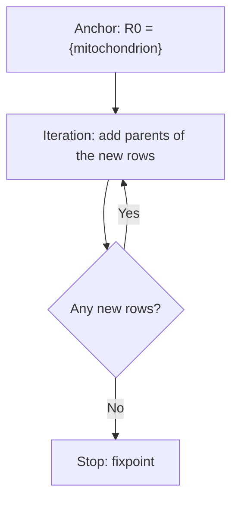
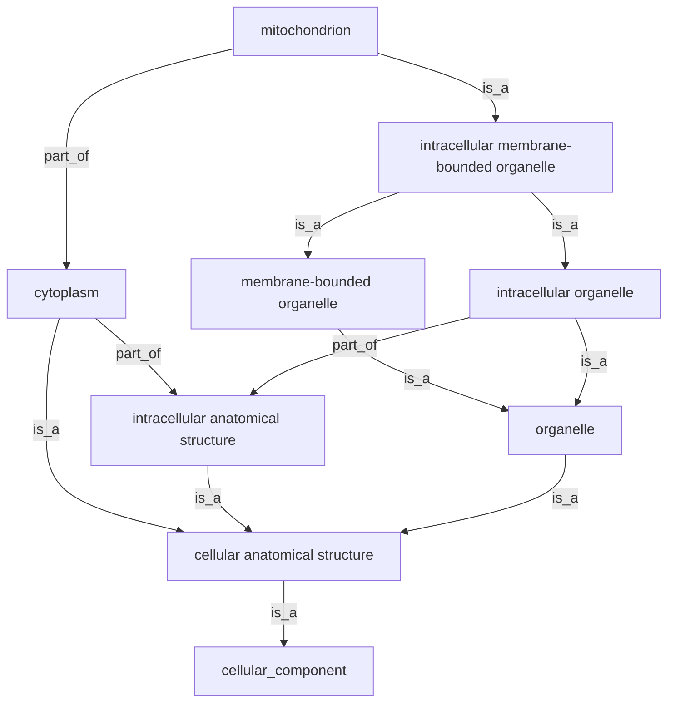

A CTE (common table expression) is a named subquery, declared with a `WITH` clause, that exists only for the duration of one SQL statement; `WITH RECURSIVE` lets a CTE refer to itself so it can walk hierarchical data of unknown depth. With it, questions like "which general terms does this Gene Ontology term belong to?" or "what is the full lineage of this tax_id?" can be answered directly in SQL. In the go-basic.obo release of 2026-07-26, the term *mitochondrion* has 8 ancestors via `is_a` and `part_of`, yet a query written with `UNION ALL` returns 19 rows, because every path up to the root produces its own row. This tutorial is for biology students and bioinformatics practitioners who already know `SELECT`, `JOIN`, and subqueries; every query here was run on SQLite 3.45.3.

<div class="callout callout-note">
<p class="callout-title">Quick summary</p>

- CTEs organize a query; they don't promise speed. Since version 12, PostgreSQL inlines a CTE that is referenced only once into the outer query.
- `UNION ALL` just appends; `UNION` appends and then deduplicates with a temporary B-tree, which ran 12–49 times slower on 1 million simulated rows.
- `WITH RECURSIVE` repeats the recursive step on the new rows until no new rows appear (a fixpoint).
- Gene Ontology is a DAG: multiple parents create duplicate rows, but only a real cycle makes a query run forever.

</div>

## 1. Which biological questions need recursion

A zebrafish gene is annotated to the term *mitochondrion* (GO:0005739). When an enrichment analysis counts genes under *organelle*, that gene has to be counted, even though its annotation never says *organelle*. Here is why: *mitochondrion* `is_a` *intracellular membrane-bounded organelle*, which in turn `is_a` *intracellular organelle*, then *organelle*, and so on up to the root term *cellular_component*. An annotation to a specific term holds for every more general term above it along `is_a` and `part_of`. The go-basic file is filtered so that it has no cycles and no relations that cross the three ontology branches, so propagating annotations upward is safe (Gene Ontology Consortium, n.d.-a).

Taxonomy poses the same kind of question. NCBI Taxonomy provides names and classifications for every organism with sequences in the INSDC databases (Federhen, 2012; Schoch et al., 2020). To find out which order, class, and phylum *Danio rerio* (tax_id 7955) belongs to, you climb from species to genus, family, order, and onward to the root.

The shared difficulty is that the depth isn't known in advance. One self-`JOIN` on the relation table gives you the parent, two give you the grandparent, but the lineage of *Danio rerio* from *cellular organisms* down to the species is 29 levels long, and every GO term sits at a different depth. What you need is a loop: take the parents of the current set, add them to the result, and repeat until nobody new shows up. `WITH RECURSIVE` is that loop, written in SQL.

## 2. Plain CTEs: giving a query step a name

### 2.1. Syntax

You declare a CTE with `WITH name AS (query)`, and the main `SELECT` then uses `name` as if it were a table. A familiar business example computes monthly revenue and keeps the months above a threshold:

```sql
WITH monthly_revenue AS (
    SELECT strftime('%Y-%m', order_date) AS month,
           SUM(total_amount) AS revenue
    FROM orders
    WHERE status = 'Completed'
    GROUP BY month
)
SELECT month, revenue
FROM monthly_revenue
WHERE revenue > 50000000;
```

One statement can declare several CTEs separated by commas, and a later CTE may use an earlier one. For biological data, take a table `annot(gene, go_id)` holding direct annotations. The query below counts genes per term and keeps the terms with at least two genes:

```sql
WITH gene_count AS (
    SELECT go_id, COUNT(DISTINCT gene) AS n_gene
    FROM annot
    GROUP BY go_id
),
big_terms AS (
    SELECT go_id, n_gene FROM gene_count WHERE n_gene >= 2
)
SELECT go_id, n_gene FROM big_terms ORDER BY n_gene DESC;
```

### 2.2. CTEs, subqueries, views, and temporary tables

A subquery in `FROM` can do the same job, but it has no name: if you need its result twice, you have to paste the query twice, while a CTE can be called by name as often as you like within the same statement. A view is stored in the schema and works across statements; a temporary table holds real data for the whole session. How subqueries work is covered in the [Subquery and CASE WHEN article](/en/blog/subquery-and-case-when/).

**Table 1.** Four ways to name an intermediate result

| Approach | Lifetime | Reusable by name | Can be inlined into the outer query |
| --- | --- | --- | --- |
| Subquery in `FROM` | One spot in the statement | No, must be copied | Yes |
| CTE (`WITH`) | One statement | Yes, within that statement | Yes, depending on system and version |
| View | Persistent, in the schema | Yes, in any statement | Yes |
| Temporary table | One connection session | Yes, within the session | No, the data has already been written |

### 2.3. Computed once, or folded into the outer query?

A common misconception is that a CTE is always precomputed into a temporary table, so using one makes a query faster. In reality, whether a CTE is precomputed (materialized) or folded into the outer query (inlined) is up to the optimizer. Before PostgreSQL 12, CTEs were always materialized. Starting with version 12, a CTE that is non-recursive, has no side effects, and is referenced only once gets inlined into the outer query; a CTE referenced more than once is computed separately once by default, and you can force either behavior with `MATERIALIZED` or `NOT MATERIALIZED` (PostgreSQL Global Development Group, n.d.-a, n.d.-c). SQLite accepts both keywords as of 3.35.0 but treats them only as hints, and advises against using them without a compelling reason (SQLite, n.d.-c).

If you want certainty, read the query plan. On SQLite 3.45.3, `EXPLAIN QUERY PLAN` gives the same `CO-ROUTINE` plan for `gene_count` used once and for the equivalent subquery: rows are produced on demand for the outer query and never written to a table. When the CTE is used twice, the plan switches to `MATERIALIZE`. Speed is the optimizer's call, so compare plans and time the query on your own data.

```sql
EXPLAIN QUERY PLAN
WITH gene_count AS (
    SELECT go_id, COUNT(DISTINCT gene) AS n_gene
    FROM annot GROUP BY go_id
)
SELECT go_id FROM gene_count
WHERE n_gene = (SELECT MAX(n_gene) FROM gene_count);
-- MATERIALIZE gene_count
--   SCAN annot
--   USE TEMP B-TREE FOR GROUP BY
--   USE TEMP B-TREE FOR count(DISTINCT)
-- SCAN gene_count
-- SCALAR SUBQUERY 2
--   SEARCH gene_count
```

## 3. Set operations: sets, bags, and precedence

### 3.1. Four operators and the compatibility rule

SQL has four set operations that combine the results of two `SELECT` statements: `UNION` takes the union, `INTERSECT` the intersection, `EXCEPT` the rows found only on the left, and `UNION ALL` appends the two results and keeps duplicates. The two sides must be "union compatible": the same number of columns, with corresponding columns of compatible types, not necessarily identical ones (PostgreSQL Global Development Group, n.d.-d).

SQLite is even looser because it is dynamically typed: `SELECT 1 UNION SELECT 'abc'` runs just fine. The trap is that `SELECT 1 UNION SELECT '1'` returns two rows, because the integer 1 and the string `'1'` are different values. If one table stores gene IDs as numbers and another stores them as text, `UNION` won't remove the duplicates and `INTERSECT` comes back empty, with no error. `CAST` both sides to the same type before combining them.

### 3.2. Sets and bags

An SQL table is a multiset (bag): a row can appear more than once. `UNION`, `INTERSECT`, and `EXCEPT` without `ALL` remove duplicates like `DISTINCT` and return a set; the `ALL` versions keep the multiplicities (PostgreSQL Global Development Group, n.d.-d). PostgreSQL supports both `INTERSECT ALL` and `EXCEPT ALL`; SQLite's grammar has only `UNION`, `UNION ALL`, `INTERSECT`, and `EXCEPT` (SQLite, n.d.-a). For any other system, check that system's own documentation.

A biology example: two RNA-seq experiments produce two lists of differentially expressed (DE) genes, stored in `de_a` and `de_b`. List A accidentally contains *pax6a* twice, and list B has a `NULL` row from a data-entry error.

```sql
CREATE TABLE de_a(gene TEXT);
CREATE TABLE de_b(gene TEXT);
INSERT INTO de_a VALUES ('tp53'), ('myca'), ('sox2'), ('pax6a'), ('pax6a');
INSERT INTO de_b VALUES ('tp53'), ('pax6a'), ('nkx2.5'), (NULL);

-- Genes DE in both experiments: pax6a, tp53
SELECT gene FROM de_a INTERSECT SELECT gene FROM de_b ORDER BY gene;

-- Genes DE only in experiment A: myca, sox2
SELECT gene FROM de_a EXCEPT SELECT gene FROM de_b ORDER BY gene;

-- Row counts: UNION ALL returns 9, UNION returns 6 (including the NULL row)
SELECT COUNT(*) FROM (SELECT gene FROM de_a UNION ALL SELECT gene FROM de_b);
SELECT COUNT(*) FROM (SELECT gene FROM de_a UNION SELECT gene FROM de_b);
```

"How many genes are DE in at least one experiment?" calls for `UNION`; "how many DE calls were made in total?" calls for `UNION ALL`. Pick the wrong one and your count is wrong; being slower is the lesser problem.

### 3.3. EXCEPT, NOT EXISTS, and the NOT IN trap

"Genes found only in A" can also be written with `NOT EXISTS` or `NOT IN`. The first two give the same result; the third does not:

```sql
-- myca, sox2
SELECT DISTINCT gene FROM de_a a
WHERE NOT EXISTS (SELECT 1 FROM de_b b WHERE b.gene = a.gene);

-- Empty! Because de_b contains NULL
SELECT DISTINCT gene FROM de_a
WHERE gene NOT IN (SELECT gene FROM de_b);
```

With `NOT IN`, the comparison `'myca' <> NULL` evaluates to unknown, so the condition is never true. `EXCEPT` treats two `NULL`s as duplicates when deduplicating, and `NOT EXISTS` compares pair by pair with `=`, so neither is broken by the `NULL` row.

### 3.4. Precedence differs between systems

When a statement chains three or more branches without parentheses, the grouping decides the result. In PostgreSQL, `INTERSECT` binds more tightly than `UNION` and `EXCEPT`, and `UNION` and `EXCEPT` associate left to right (PostgreSQL Global Development Group, n.d.-d). SQLite groups every operator left to right: `A op B op C` means `(A op B) op C` (SQLite, n.d.-a). Take A = {1, 2, 3}, B = {3, 4}, C = {4}:

```sql
WITH a(x) AS (VALUES (1), (2), (3)),
     b(x) AS (VALUES (3), (4)),
     c(x) AS (VALUES (4))
SELECT x FROM a
UNION
SELECT x FROM b
INTERSECT
SELECT x FROM c;
-- SQLite 3.45.3 returns: 4
```

SQLite computes (A ∪ B) ∩ C = {4}; under PostgreSQL's rules, the same statement is A ∪ (B ∩ C) = {1, 2, 3, 4}. The safe approach on every system is to wrap the branch that should run first in a subquery: `SELECT x FROM a UNION SELECT * FROM (SELECT x FROM b INTERSECT SELECT x FROM c)` returns {1, 2, 3, 4} on SQLite.

## 4. Benchmark: how much more does UNION cost than UNION ALL?

### 4.1. Why deduplication is expensive

`UNION` is `UNION ALL` plus a deduplication step: the database has to sort the whole result and drop adjacent identical rows, or hash every row. Bitton and DeWitt (1983) analyzed the cost of duplicate elimination in large files and proposed a merge-sort variant; Graefe (1993) showed the duality between sort-based and hash-based methods for set-matching operations. `UNION ALL` just reads the left side to the end and then reads the right side.

On SQLite, `EXPLAIN QUERY PLAN` for the two tables `de_a` and `de_b` shows `UNION USING TEMP B-TREE`, `INTERSECT USING TEMP B-TREE`, and `EXCEPT USING TEMP B-TREE`, while `UNION ALL` uses no temporary B-tree at all.

### 4.2. Experimental design

The experiment below uses simulated data, not real biological data:

1. Two tables, `a(id)` and `b(id)`, each holding half of the total row count (10³, 10⁴, 10⁵, 10⁶); ids are unique within each table; fixed seed 2026.
2. Overlap between the two tables: 0%, 50%, or 90% of the rows in `b`.
3. The measured query is `SELECT COUNT(*), SUM(id)` over the combined result; the `SUM(id)` column forces SQLite to read every row, because with `COUNT(*)` alone SQLite can count without reading all the data.
4. Each configuration ran 6 times (4 times at 10⁶ rows); the first run was discarded and the median taken.
5. SQLite 3.45.3 via Python 3.13's `sqlite3`, in-memory database, one personal computer, November 20, 2026.

```sql
-- The two variants measured, with <op> being UNION or UNION ALL
SELECT COUNT(*), SUM(id)
FROM (SELECT id FROM a UNION ALL SELECT id FROM b);

SELECT COUNT(*), SUM(id)
FROM (SELECT id FROM a UNION SELECT id FROM b);
```

### 4.3. Results


*Figure 1. Median run time of UNION and UNION ALL by total row count and overlap, log–log axes. Simulated data, SQLite 3.45.3, one personal computer.*

**Table 2.** Median time (ms) and rows returned

| Total rows | Overlap | UNION ALL (ms) | UNION (ms) | UNION / UNION ALL | Rows returned by UNION |
| --- | --- | --- | --- | --- | --- |
| 10³ | 0% | 0.09 | 0.77 | 9× | 1,000 |
| 10³ | 90% | 0.09 | 0.29 | 3× | 550 |
| 10⁵ | 0% | 9.7 | 90 | 9× | 100,000 |
| 10⁵ | 90% | 10.0 | 66 | 7× | 55,000 |
| 10⁶ | 0% | 105 | 4,844 | 46× | 1,000,000 |
| 10⁶ | 50% | 98 | 4,826 | 49× | 750,000 |
| 10⁶ | 90% | 225 | 2,794 | 12× | 550,000 |

Three trends stand out. `UNION ALL` time grows roughly linearly with row count, since it only reads data. The gap between the two operators widens as the data grows: 2–9 times at 10³ rows, 12–49 times at 10⁶ rows. A high overlap actually makes `UNION` *faster*, because the temporary B-tree holds only distinct values. The `UNION ALL` point of 225 ms at 10⁶ rows with 90% overlap is unusually high compared with the other two configurations of the same size and is most likely noise; each point rests on only three valid runs.

The table shows a trend on one machine; it is not a comparison between database systems, and PostgreSQL may choose hashing instead of sorting. The practical rule: if the two sides cannot overlap (samples from the 2024 sequencing batch and the 2025 batch), use `UNION ALL`; if you need each value once, use `UNION`.

## 5. Theory: transitive closure and fixpoints

### 5.1. The limits of relational algebra

Codd's (1970) relational model builds queries from selection, projection, join, union, and difference; each such expression can take only a fixed number of steps through the data. The transitive closure of a parent–child relation, meaning the set of all (ancestor, descendant) pairs, needs a number of steps that depends on the depth of the data, so no single fixed expression can express it. This result was already known in first-order logic; Aho and Ullman (1979) established the limitation for database query languages and proposed adding a fixpoint operator.

### 5.2. The least fixpoint

Let $E$ be the edge table (child, parent) and $R_0$ the starting set (anchor), for example containing only the term *mitochondrion*. Each iteration adds the parents of the rows just found:

$$
R_{i+1} = R_i \cup \{\, p \mid (c, p) \in E,\ c \in R_i \,\}
$$

Because the data is finite and each iteration only adds rows, never removes them, the chain $R_0 \subseteq R_1 \subseteq R_2 \subseteq \dots$ must stop at some iteration $k$ where $R_{k+1} = R_k$. That set $R_k$ is the **least fixpoint**: the smallest set that contains the anchor and is closed under the recursive step. `WITH RECURSIVE` in SQL computes exactly this set.



### 5.3. Naive and semi-naive evaluation

Naive evaluation applies the recursive step to all of $R_i$ in every iteration, so parents that were already found get found again and again. Semi-naive evaluation applies it only to the **new** part from the previous iteration, $\Delta_i = R_i \setminus R_{i-1}$. Bancilhon and Ramakrishnan (1986) compare these strategies in their survey of recursive query processing; Abiteboul et al. (1995) present them formally.

PostgreSQL implements the semi-naive idea with a "working table" that holds only the rows produced in the previous iteration; with `UNION`, rows that duplicate existing results are discarded before the next iteration (PostgreSQL Global Development Group, n.d.-a). SQLite uses a queue: it takes out one row at a time, adds it to the result, runs the recursive step as if that were the only row, and pushes any new rows onto the queue; with `UNION`, a row enters the queue only if it has never been there before. Without an `ORDER BY` in the recursive part, the queue is first in, first out, which gives breadth-first traversal; an `ORDER BY` can turn it into depth-first (SQLite, n.d.-c).

### 5.4. From the standard to software

According to survey sources, recursive CTEs entered the SQL standard with SQL:1999 (see Eisenberg & Melton, 1999, for background on SQL:1999); the ISO standard itself is a paid document, so this milestone rests on secondary sources. SQLite added CTEs and `WITH` in version 3.8.3 (2014-02-03) and allowed multiple recursive `SELECT` statements as of 3.34.0 (2020-12-01) (SQLite, n.d.-b). Both PostgreSQL and SQLite accept either `UNION` or `UNION ALL` between the anchor and the recursive part (PostgreSQL Global Development Group, n.d.-a; SQLite, n.d.-c), and that choice changes both the result and whether the query terminates.

## 6. Application 1: querying Gene Ontology in SQLite

### 6.1. GO is a DAG, not a tree

Gene Ontology launched in 2000 as a structured vocabulary for describing gene function consistently across species (Ashburner et al., 2000), and today it is a knowledgebase of ontologies, annotations, and GO-CAM models (Gene Ontology Consortium et al., 2023). Every term except the root of each branch has an `is_a` relation to at least one other term, and a term can have several parents through different relations (Gene Ontology Consortium, n.d.-b). GO is therefore a directed acyclic graph (DAG), unlike the employee–manager tree in SQL textbooks, where everyone has exactly one manager.

### 6.2. Loading go-basic.obo into two tables

The go-basic.obo file downloaded on November 20, 2026 reports `data-version: releases/2026-07-26`. A short Python script reads each `[Term]` stanza and splits the `id`, `name`, `namespace`, `is_obsolete`, `is_a`, and `relationship` lines into two tables:

```sql
CREATE TABLE term(go_id TEXT PRIMARY KEY, name TEXT, namespace TEXT, is_obsolete INT);
CREATE TABLE edge(child TEXT, parent TEXT, relation TEXT);
```

This release has 48,340 terms (10,248 of them obsolete) and 71,496 edges: 57,456 `is_a`, 6,270 `part_of`, 2,820 `regulates`, 2,475 `positively_regulates`, and 2,475 `negatively_regulates`. These numbers change between releases, so any GO result should be reported with its `data-version`.

### 6.3. Ancestor and descendant queries

The ancestor query climbs from a term to the root along `is_a` and `part_of`. The anchor is the term itself with `depth = 0`; the recursive step joins `edge` to the current result on the `child` column and takes `parent`:

```sql
WITH RECURSIVE anc(go_id, depth) AS (
    SELECT 'GO:0005739', 0
    UNION ALL
    SELECT e.parent, a.depth + 1
    FROM edge e
    JOIN anc a ON e.child = a.go_id
    WHERE e.relation IN ('is_a', 'part_of')
)
SELECT a.go_id, t.name, MIN(a.depth) AS min_depth, COUNT(*) AS n_paths
FROM anc a JOIN term t ON t.go_id = a.go_id
GROUP BY a.go_id
ORDER BY min_depth, a.go_id;
```

The result has 9 terms (*mitochondrion* plus 8 ancestors) but 19 rows before grouping: *cellular_component* and *cellular anatomical structure* each appear 5 times, because 5 different paths lead up to them. The diagram below shows exactly the edges the query finds.



Switch `UNION ALL` to `UNION` (and drop the `depth` column, because `UNION` compares whole rows) and each term appears only once:

```sql
WITH RECURSIVE anc(go_id) AS (
    SELECT 'GO:0005739'
    UNION
    SELECT e.parent
    FROM edge e
    JOIN anc a ON e.child = a.go_id
    WHERE e.relation IN ('is_a', 'part_of')
)
SELECT COUNT(*) FROM anc;   -- 9
```

A descendant query only needs the join reversed: `JOIN d ON e.parent = d.go_id`, taking `e.child`. For *mitochondrion*, the set of descendants via `is_a` and `part_of` (including the term itself) has 71 terms.

**Table 3.** Rows returned by the ancestor query (`is_a` + `part_of`, including the starting term), go-basic 2026-07-26

| Term | UNION | UNION ALL |
| --- | --- | --- |
| GO:0005739 mitochondrion | 9 | 19 |
| GO:0007507 heart development | 10 | 21 |
| GO:0006915 apoptotic process | 5 | 5 |
| GO:0016301 kinase activity | 5 | 5 |
| GO:0061283 specification of mesonephric distal tubule identity | 63 | 4,779 |

*Apoptotic process* and *kinase activity* have ancestors arranged in a straight chain, so both operators return the same number of rows. At the other extreme, among non-obsolete terms, *specification of mesonephric distal tubule identity* has the most paths to the root: 63 terms, but 4,779 rows with `UNION ALL`. The number of paths can grow exponentially as branches merge and split again, so on a deep, dense DAG, `UNION ALL` makes the query balloon.

The question decides the operator. "Which terms does this gene belong to?" needs a **set** of terms, so `UNION`; "how many paths lead to the root?" needs `UNION ALL`, or a dynamic-programming count outside SQL when the number of paths is large.

### 6.4. Checking the results, and indexes

The ancestor sets of the first four terms in Table 3 were recomputed with a Python graph-traversal function on the same `edge` table and matched the SQL results. No non-obsolete term loops back to itself through `is_a` and `part_of`, consistent with the description of go-basic (Gene Ontology Consortium, n.d.-a). GOATOOLS also provides a ready-made ancestor function in Python for cross-checking (Klopfenstein et al., 2018).

Indexes decide the speed. Without an index, every recursive iteration scans the whole table of 71,496 edges: the ancestors of *apoptotic process* take about 53 ms, the descendants of *mitochondrion* about 123 ms. With indexes on `edge(child)` and `edge(parent)`, those drop to 0.04 ms and 0.18 ms, and the query plan shows `SEARCH e USING INDEX ix_parent (parent=?)` in the recursive step.

```sql
CREATE INDEX ix_child  ON edge(child);
CREATE INDEX ix_parent ON edge(parent);
```

## 7. Application 2: lineages in NCBI Taxonomy

NCBI Taxonomy is the opposite case: a true tree, where each node has exactly one parent. In the taxdump file `nodes.dmp`, each line holds `tax_id`, `parent tax_id`, `rank`, and several other columns, separated by `\t|\t` (National Center for Biotechnology Information [NCBI], n.d.). NCBI Taxonomy itself has moved from a single SQL database to several linked databases to support curation (Schoch et al., 2020); for users, taxdump is still the simplest way to get the whole tree into a database of your own.

After loading `nodes.dmp` into a table `tax_node(tax_id, parent_tax_id, rank)` and the scientific names from `names.dmp` into `tax_name(tax_id, name)`, the lineage of *Danio rerio* is a single upward query:

```sql
WITH RECURSIVE lineage(tax_id, depth) AS (
    SELECT 7955, 0
    UNION ALL
    SELECT n.parent_tax_id, l.depth + 1
    FROM tax_node n
    JOIN lineage l ON n.tax_id = l.tax_id
    WHERE n.tax_id <> n.parent_tax_id      -- in case the root points to itself
)
SELECT l.depth, l.tax_id, nm.name, n.rank
FROM lineage l
JOIN tax_node n  ON n.tax_id = l.tax_id
JOIN tax_name nm ON nm.tax_id = l.tax_id
WHERE n.rank IN ('domain', 'kingdom', 'phylum', 'class', 'order', 'family', 'genus', 'species')
ORDER BY l.depth DESC;
```

The condition `n.tax_id <> n.parent_tax_id` is a safety net for the root node (tax_id 1, *root*). Check the tax_id 1 line in the copy of `nodes.dmp` you download: if the root's parent is recorded as the root itself, then without this condition the recursive step finds that the root's parent is the root, then the root again, and with `UNION ALL` the query never ends. That is a cycle of length 1, exactly the kind of problem covered in section 8; if the root doesn't point to itself, the condition is harmless.

**Table 4.** Lineage of *Danio rerio* by the eight main ranks (domain, kingdom, phylum, class, order, family, genus, species), from the NCBI Taxonomy record queried on November 20, 2026

| Rank | tax_id | Name |
| --- | --- | --- |
| domain | 2759 | Eukaryota |
| kingdom | 33208 | Metazoa |
| phylum | 7711 | Chordata |
| class | 186623 | Actinopteri |
| order | 7952 | Cypriniformes |
| family | 2743709 | Danionidae |
| genus | 7954 | Danio |
| species | 7955 | Danio rerio |

The full lineage has 29 levels, many of them `clade`, such as Opisthokonta or Vertebrata; filtering on `rank` for the eight main ranks gives the compact table above. Reversing the join (`ON n.parent_tax_id = l.tax_id`) returns every descendant of a genus or family; add `WHERE rank = 'species'` to count species. A tree has no multi-parent nodes, so `UNION ALL` produces no duplicate rows and there's no reason to pay for `UNION`. TaxonKit is a dedicated command-line tool for checking lineages in bulk (Shen & Ren, 2021).

## 8. Cycles and four ways to stop them

### 8.1. Multiple parents are not cycles

These two situations often get lumped together. **Multiple parents** (a DAG) mean a node can be reached by several paths, so `UNION ALL` produces duplicate rows, but the query still stops because every path ends at the root. A **cycle** means that following the edges brings you back to the starting node; with `UNION ALL`, the query never stops. "Each node has only one parent" is therefore not a guard against infinite loops: GO has plenty of multi-parent nodes and no cycles, while a tree needs only one backward edge to get one.

The toy graph below illustrates both. The table `g(child, parent)` has the edges B→A, C→A, D→B, D→C, E→D; node D has two parents.

```sql
CREATE TABLE g(child TEXT, parent TEXT);
INSERT INTO g VALUES ('B','A'), ('C','A'), ('D','B'), ('D','C'), ('E','D');

WITH RECURSIVE anc(node) AS (
    SELECT 'E'
    UNION ALL
    SELECT g.parent FROM g JOIN anc ON g.child = anc.node
)
SELECT node, COUNT(*) FROM anc GROUP BY node ORDER BY node;
-- A 2, B 1, C 1, D 1, E 1: it stops, but A appears twice
```

Adding the edge A→E creates the cycle E→D→B→A→E. The same query with `UNION ALL` now runs forever. There are four ways to stop it.

```sql
INSERT INTO g VALUES ('A','E');   -- creates the cycle E → D → B → A → E
```

### 8.2. Technique 1: UNION

With `UNION`, rows that duplicate existing results are discarded, so once every node has been visited there are no new rows and the loop stops (PostgreSQL Global Development Group, n.d.-a). The SQLite documentation uses exactly this approach in its graph-traversal example to avoid an infinite loop (SQLite, n.d.-c). The limitation: `UNION` compares whole rows, so once there's a `depth` column, the rows (A, 3) and (A, 7) differ and the cycle is no longer blocked. On the graph with the A→E edge, the `UNION` query returns all 5 nodes and stops:

```sql
WITH RECURSIVE anc(node) AS (
    SELECT 'E'
    UNION
    SELECT g.parent FROM g JOIN anc ON g.child = anc.node
)
SELECT node FROM anc ORDER BY node;   -- A, B, C, D, E
```

### 8.3. Technique 2: a depth limit

Adding a `depth` column and a stopping condition is the blunt approach:

```sql
WITH RECURSIVE anc(node, depth) AS (
    SELECT 'E', 0
    UNION ALL
    SELECT g.parent, anc.depth + 1
    FROM g JOIN anc ON g.child = anc.node
    WHERE anc.depth < 20
)
SELECT COUNT(*), MAX(depth) FROM anc;   -- 218 rows, max depth 20
```

The query stops, but it returns 218 rows (including the anchor) for a 5-node graph: every trip around the cycle generates new rows, and since D has two parents, the number of paths doubles on each lap. A depth limit is a safety net for when you know a reasonable maximum depth; it doesn't handle the cycle. SQLite also supports `LIMIT` in a recursive CTE: it caps the number of rows added to the result and always makes the recursion stop, and the SQLite documentation recommends setting a `LIMIT` when you know an upper bound (SQLite, n.d.-c).

### 8.4. Technique 3: a path column

A more precise approach records the path and stops on reaching a node already in it. In SQLite, the path is stored as a delimited string and checked with `instr`:

```sql
WITH RECURSIVE anc(node, path, is_cycle) AS (
    SELECT 'E', '/E/', 0
    UNION ALL
    SELECT g.parent,
           anc.path || g.parent || '/',
           instr(anc.path, '/' || g.parent || '/') > 0
    FROM g JOIN anc ON g.child = anc.node
    WHERE anc.is_cycle = 0
)
SELECT node, path, is_cycle FROM anc;
```

The query returns 8 rows and correctly flags two rows with `is_cycle = 1`, the paths `/E/D/B/A/E/` and `/E/D/C/A/E/`: two ways back to E through D's two parents. The `/` on both ends keeps `instr` from mistaking node "A" for part of a name like "AB". This approach keeps `depth` and shows where the cycle is, at the cost of every row carrying a string that keeps growing.

### 8.5. Technique 4: the CYCLE and SEARCH clauses

PostgreSQL 14 (released 2021-09-30) added two standard clauses for recursive CTEs: `SEARCH DEPTH FIRST` / `SEARCH BREADTH FIRST` set the traversal order, and `CYCLE` detects cycles automatically (PostgreSQL Global Development Group, n.d.-a, n.d.-b). Write `CYCLE node SET is_cycle USING path` after the CTE definition and PostgreSQL maintains the path column and the flag column for you, just like technique 3. SQLite 3.45.3 reports a syntax error on `CYCLE`, and SQLite's `WITH` documentation does not describe the clause; on SQLite, traversal order is controlled with `ORDER BY` (SQLite, n.d.-c).

**Table 5.** Four ways to stop cycles in a recursive CTE

| Technique | Stops on a cycle | Keeps depth/path columns | Result | Supported by |
| --- | --- | --- | --- | --- |
| `UNION` | Yes, if there is no depth/path | No | Each node once | PostgreSQL, SQLite |
| `depth < N` or `LIMIT` | Yes | Yes | Grows with the number of paths | Any system (`LIMIT`: SQLite) |
| Path column | Yes | Yes | Exact, shows the cycle | Any system |
| `CYCLE` | Yes | Yes | Same as path column | PostgreSQL ≥ 14 |

Before running a recursive query on new data, run technique 3 with `WHERE is_cycle = 1` to find out whether the data has cycles. For data guaranteed to be acyclic, like go-basic, `UNION` is enough; hand-entered data or data merged from several sources deserves both a path column and a depth limit.

## 9. Conclusion and checklist

CTEs, set operations, and `WITH RECURSIVE` meet at one question: do you need a set or a multiset? `UNION` answers with a set and pays for it with a temporary B-tree; `UNION ALL` answers with a multiset almost for free. In a recursive query, that choice decides between 9 and 19 rows for *mitochondrion*, and decides whether the query stops when the data contains a cycle.

Six things to check:

1. Read the query plan before believing a CTE makes your query faster.
2. Use `UNION ALL` when the two sides can't overlap; use `UNION` when you need each value once.
3. Determine whether your data is a tree (NCBI Taxonomy) or a DAG (Gene Ontology).
4. In a recursive CTE, choose `UNION` for the set of nodes and `UNION ALL` for path counts.
5. Always guard against cycles (`UNION`, a path column, `CYCLE`) together with a depth limit or `LIMIT`; block the self-pointing root case.
6. Record the data and software versions next to every number.

The output of a recursive query is a table like any other, so a natural next step is ranking or running totals over it with [window functions](/en/blog/window-functions/), or combining CTEs with window functions in the applied case-study article.

## References

Abiteboul, S., Hull, R., & Vianu, V. (1995). *Foundations of databases*. Addison-Wesley.

Aho, A. V., & Ullman, J. D. (1979). Universality of data retrieval languages. In *Proceedings of the 6th ACM SIGACT-SIGPLAN Symposium on Principles of Programming Languages* (pp. 110–119). ACM. https://doi.org/10.1145/567752.567763

Ashburner, M., Ball, C. A., Blake, J. A., Botstein, D., Butler, H., Cherry, J. M., Davis, A. P., Dolinski, K., Dwight, S. S., Eppig, J. T., Harris, M. A., Hill, D. P., Issel-Tarver, L., Kasarskis, A., Lewis, S., Matese, J. C., Richardson, J. E., Ringwald, M., Rubin, G. M., & Sherlock, G. (2000). Gene Ontology: Tool for the unification of biology. *Nature Genetics, 25*(1), 25–29. https://doi.org/10.1038/75556

Bancilhon, F., & Ramakrishnan, R. (1986). An amateur's introduction to recursive query processing strategies. In *Proceedings of the 1986 ACM SIGMOD International Conference on Management of Data* (pp. 16–52). ACM. https://doi.org/10.1145/16894.16859

Bitton, D., & DeWitt, D. J. (1983). Duplicate record elimination in large data files. *ACM Transactions on Database Systems, 8*(2), 255–265. https://doi.org/10.1145/319983.319987

Codd, E. F. (1970). A relational model of data for large shared data banks. *Communications of the ACM, 13*(6), 377–387. https://doi.org/10.1145/362384.362685

Eisenberg, A., & Melton, J. (1999). SQL:1999, formerly known as SQL3. *ACM SIGMOD Record, 28*(1), 131–138. https://doi.org/10.1145/309844.310075

Federhen, S. (2012). The NCBI Taxonomy database. *Nucleic Acids Research, 40*(D1), D136–D143. https://doi.org/10.1093/nar/gkr1178

Gene Ontology Consortium. (n.d.-a). *Download the ontology*. Retrieved November 12, 2026, from https://geneontology.org/docs/download-ontology/

Gene Ontology Consortium. (n.d.-b). *Relations in the Gene Ontology*. Retrieved November 12, 2026, from https://geneontology.org/docs/ontology-relations/

Gene Ontology Consortium, Aleksander, S. A., Balhoff, J., Carbon, S., Cherry, J. M., Drabkin, H. J., Ebert, D., Feuermann, M., et al. (2023). The Gene Ontology knowledgebase in 2023. *Genetics, 224*(1), iyad031. https://doi.org/10.1093/genetics/iyad031

Graefe, G. (1993). Query evaluation techniques for large databases. *ACM Computing Surveys, 25*(2), 73–169. https://doi.org/10.1145/152610.152611

Klopfenstein, D. V., Zhang, L., Pedersen, B. S., Ramírez, F., Warwick Vesztrocy, A., Naldi, A., Mungall, C. J., Yunes, J. M., et al. (2018). GOATOOLS: A Python library for Gene Ontology analyses. *Scientific Reports, 8*(1), 10872. https://doi.org/10.1038/s41598-018-28948-z

National Center for Biotechnology Information. (n.d.). *taxdump_readme.txt*. Retrieved November 12, 2026, from https://ftp.ncbi.nlm.nih.gov/pub/taxonomy/taxdump_readme.txt

PostgreSQL Global Development Group. (n.d.-a). *7.8. WITH queries (Common Table Expressions)*. PostgreSQL 18 documentation. Retrieved November 12, 2026, from https://www.postgresql.org/docs/current/queries-with.html

PostgreSQL Global Development Group. (n.d.-b). *Release 14*. PostgreSQL documentation. Retrieved November 12, 2026, from https://www.postgresql.org/docs/14/release-14.html

PostgreSQL Global Development Group. (n.d.-c). *Release 12*. PostgreSQL documentation. Retrieved November 12, 2026, from https://www.postgresql.org/docs/12/release-12.html

PostgreSQL Global Development Group. (n.d.-d). *7.4. Combining queries (UNION, INTERSECT, EXCEPT)*. PostgreSQL 18 documentation. Retrieved November 12, 2026, from https://www.postgresql.org/docs/current/queries-union.html

Schoch, C. L., Ciufo, S., Domrachev, M., Hotton, C. L., Kannan, S., Khovanskaya, R., Leipe, D., Mcveigh, R., et al. (2020). NCBI Taxonomy: A comprehensive update on curation, resources and tools. *Database, 2020*, baaa062. https://doi.org/10.1093/database/baaa062

Shen, W., & Ren, H. (2021). TaxonKit: A practical and efficient NCBI taxonomy toolkit. *Journal of Genetics and Genomics, 48*(9), 844–850. https://doi.org/10.1016/j.jgg.2021.03.006

SQLite. (n.d.-a). *SELECT*. Retrieved November 12, 2026, from https://www.sqlite.org/lang_select.html

SQLite. (n.d.-b). *Release history of SQLite*. Retrieved November 12, 2026, from https://www.sqlite.org/changes.html

SQLite. (n.d.-c). *The WITH clause*. Retrieved November 20, 2026, from https://www.sqlite.org/lang_with.html
