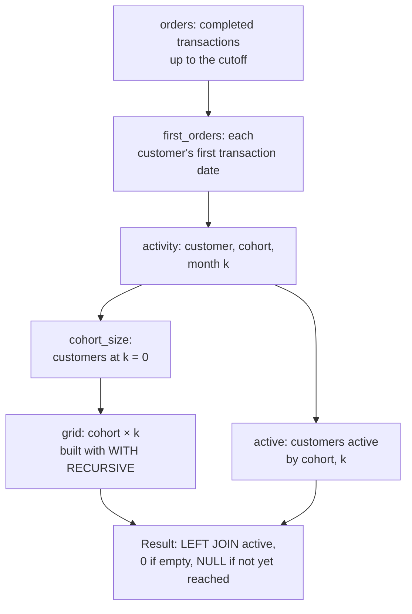

RFM (Recency, Frequency, Monetary) sums up each person's behavior in three numbers: how long ago their last transaction was relative to the data cutoff, how many transactions they made, and their total value. Cohort analysis follows groups that started at the same time, month by month, to measure retention. Both can be written in SQL with CTEs and window functions. There are four places where they usually go wrong: the grouping key, the reference date, ties at group boundaries, and the retention denominator. On simulated data for 211 customers, average month-6 retention is 0.306 when only observed cohorts are counted, but just 0.153 when unobserved cells are treated as 0; a Kaplan–Meier estimator written in SQL matches a statistics library exactly. This tutorial is for biology and biomedical students and health-data analysts who already know `GROUP BY`, CTEs, and window functions, and its real-world example is the 748 blood donors in a public UCI dataset.

<div class="callout callout-note">
<p class="callout-title">Quick summary</p>

- Group by `id`, not by name; Recency is the number of days to a fixed cutoff date.
- `NTILE(5)` splits by row count, so two equal values can end up with different scores.
- Month-k retention = people still active in month k / cohort size in month 0.
- A cell where nobody was active shows 0; a cell that hasn't been observed yet is `NULL`.
- The newer the cohort, the more it is right-censored; for a fair comparison, use Kaplan–Meier.

</div>

## 1. What RFM and cohort analysis are: two questions about the same people

A blood transfusion center wants to know who donated recently, who donates often, and who has given the most. Those are the three parts of RFM. **Recency** is the time from the last transaction to a reference point, **Frequency** is the number of transactions, and **Monetary** is their total value. In retail a transaction is an order; for a blood donor it is one donation, and the value is the volume of blood. The Blood Transfusion Service Center dataset in section 7 records exactly these three quantities for 748 people (Yeh, 2008; Yeh et al., 2009).

The second question is about time. Of the people who first donated in January, how many came back after 3, 6, or 12 months? A group that shares a starting point is a **cohort**, and the share of the group still active after k months is **retention**. RFM is a snapshot taken on the cutoff date; cohort analysis is a movie.

It is also the question that survival analysis asks in epidemiology, and it runs into the same problem. Each person is followed for a different length of time, and people who joined late haven't had time to reach an outcome when the data are frozen.

On the technical side, this article builds on window functions ([the window functions article](/en/blog/window-functions/)) and CTEs, including `WITH RECURSIVE` ([the CTE and set operations article](/en/blog/cte-and-set-operations/)). Every query was run on SQLite 3.45.3. If you use PostgreSQL, the differences are listed in section 5.5.

## 2. Computing R, F, and M correctly in SQL

The toy dataset below has 5 customers and 10 orders, small enough to check by eye. Customers 1 and 2 share a name on purpose, and customer 4 has a canceled order.

```sql
CREATE TABLE customers (id INTEGER PRIMARY KEY, full_name TEXT);
INSERT INTO customers VALUES
  (1, 'Nguyen Van An'), (2, 'Nguyen Van An'), (3, 'Tran Thi Binh'),
  (4, 'Le Van Cuong'),  (5, 'Pham Thi Dung');

CREATE TABLE orders (id INTEGER PRIMARY KEY, customer_id INTEGER,
                     order_date TEXT, total_amount REAL, status TEXT);
INSERT INTO orders VALUES
  (1, 1, '2026-01-05', 100, 'Completed'), (2, 1, '2026-03-20',  50, 'Completed'),
  (3, 2, '2026-02-11', 500, 'Completed'), (4, 3, '2026-01-15',  80, 'Completed'),
  (5, 3, '2026-02-02', 120, 'Completed'), (6, 3, '2026-04-28',  60, 'Completed'),
  (7, 4, '2026-02-07', 300, 'Cancelled'), (8, 4, '2026-03-03',  90, 'Completed'),
  (9, 5, '2026-01-25',  40, 'Completed'), (10, 5, '2026-06-10', 70, 'Completed');
```

### 2.1. Group by the primary key, not the name

With `GROUP BY full_name`, two different people with the same name get merged into one. You end up with a single "Nguyen Van An" row with 3 orders totaling 650, when these are really two very different profiles (Table 1).

**Table 1.** Same data, two ways of grouping (SQLite 3.45.3, `Completed` orders only)

| Grouping | "Nguyen Van An" rows | Orders | Total value |
|---|---|---|---|
| `GROUP BY full_name` | 1 row | 3 | 650 |
| `GROUP BY k.id` | customer 1 | 2 | 150 |
| | customer 2 | 1 | 500 |

Shared names are common in health data, so every grouping should use an identifier (customer ID, donor ID, patient ID). Names are for display only.

### 2.2. Measure Recency to a fixed cutoff date

`MAX(order_date)` only gives you the last transaction date. Recency is the distance from that date to a **reference date**, usually the data cutoff; in SQLite, subtracting two `julianday()` values gives the number of days. Pass the reference date in as a parameter (`:ref_date`) instead of using `'now'`. Otherwise the same query run twice gives two different answers, and the analysis can't be reproduced.

### 2.3. Scoring 1–5 with NTILE

`NTILE(N)` takes the rows in `ORDER BY` order and splits them into N groups whose sizes differ by at most one row; when the split isn't even, the first groups get the extra row (SQLite, n.d.). For F and M, bigger is better, so sort `ASC` and the top people get a 5. For Recency, sort `DESC`, because fewer days means more recent. Forget to flip it and the whole segmentation comes out upside down.

```sql
WITH rfm_raw AS (
    SELECT k.id AS customer_id,
           k.full_name,
           CAST(julianday(:ref_date) - julianday(MAX(d.order_date)) AS INTEGER) AS recency_days,
           COUNT(d.id)         AS frequency,
           SUM(d.total_amount) AS monetary
    FROM customers AS k
    JOIN orders    AS d ON d.customer_id = k.id
    WHERE d.status = 'Completed'
    GROUP BY k.id, k.full_name
),
rfm_score AS (
    SELECT *,
           NTILE(5) OVER (ORDER BY recency_days DESC, customer_id) AS r_score,  -- most recent = 5
           NTILE(5) OVER (ORDER BY frequency ASC,  customer_id) AS f_score,
           NTILE(5) OVER (ORDER BY monetary ASC,   customer_id) AS m_score
    FROM rfm_raw
)
SELECT customer_id, full_name, recency_days, frequency, monetary,
       r_score, f_score, m_score,
       CASE                                   -- illustrative thresholds; depends on the problem
           WHEN r_score >= 4 AND f_score >= 4 THEN 'Champions'
           WHEN r_score <= 2 AND f_score >= 4 THEN 'At risk'
           WHEN r_score >= 4 AND f_score <= 2 THEN 'New / Promising'
           ELSE 'Others'
       END AS segment
FROM rfm_score
ORDER BY customer_id;
```

With `:ref_date = '2026-06-30'`, customer 5 has a Recency of 20 days and `r_score = 5`, while customer 2 has a Recency of 139 days and `r_score = 1`; customers 3 and 5 land in "Champions." The segment names and the thresholds in the `CASE` are only illustrations. There is no standard set of thresholds; each organization defines its own, and the report should spell them out.

### 2.4. Ties at group boundaries

Because `NTILE` splits by **row count** rather than by value, two equal rows can still be cut into different groups. For the sequence 10, 10, 10, 20, 30, 30, 40, `NTILE(5)` gives 1, 1, 2, 2, 3, 4, 5: the three 10s get two different scores, and so do the two 30s. Even in the toy data, customers 2 and 4 each have one order, yet they get `f_score` 1 and 2 purely because their `customer_id` differs.

There are two ways to handle this. The first is to add a deterministic tie-breaker such as `customer_id`, as above. The scores aren't any "fairer," but a rerun always gives the same result; without it, the database picks the order among tied rows. The second is to score by value with `PERCENT_RANK()` and accept uneven groups.

```sql
SELECT x,
       NTILE(5) OVER (ORDER BY x, id)                                   AS ntile_score,
       MIN(5, 1 + CAST(5 * PERCENT_RANK() OVER (ORDER BY x) AS INTEGER)) AS value_score
FROM v;          -- v(id, x) holds 10, 10, 10, 20, 30, 30, 40
```

The `value_score` column gives 1, 1, 1, 3, 4, 4, 5. Equal values get equal scores, but group 1 now has three people and group 2 has none. You are choosing between "even groups" and "consistent scores." Hyndman and Fan (1996) showed that even sample quantiles are defined differently across statistical packages, so if you compare RFM scores from two tools, check how each one cuts the groups.

### 2.5. Frequency piled up at 1, and the status filter

In many transaction datasets, a large share of people have exactly one transaction. The first two or three quintiles of F are then all F = 1 people, separated only by the tie-breaker. Fixed cutoffs (1, 2, 3–5, 6–10, more than 10) written with `CASE WHEN` are easier to interpret; section 7 shows this on real data.

The condition `status = 'Completed'` is also a definitional choice. Do canceled orders, refunded orders, or deferred donations count as transactions? The answer changes F, M, and even the date of the first transaction, which is a person's cohort (section 5), so record it in your methods section.

## 3. RFM has a theoretical basis: from direct marketing to probability models

Group-based scoring grew up in direct marketing, when a business had to decide who would get a letter or a catalog in each mailing. Hughes's *Strategic Database Marketing* (1994) helped popularize it among people working with customer databases.

Bult and Wansbeek (1995) modeled the choice of mail recipients as a problem of maximizing expected profit, with a solution that balances the marginal cost and marginal return of mailing one more person.

Schmittlein, Morrison, and Colombo (1987) proposed the Pareto/NBD model to answer "which customers are still active, and how much will they buy?" The model uses the number and timing of past transactions to compute the probability that someone is still a customer, so Frequency and Recency are its inputs. Fader, Hardie, and Lee (2005a) proposed BG/NBD, which is much easier to estimate (it can be done in Excel) and gives results very close to Pareto/NBD. The same group (Fader et al., 2005b) linked RFM to customer lifetime value (CLV) through **iso-value curves**, lines that group customers with different purchase histories but similar future value. They used Pareto/NBD for the flow of transactions and a gamma-gamma model for the value of each transaction, on data from the music site CDNOW. Two people with different RFM scores can therefore be worth the same. A 1–5 score is a rough summary that is convenient in SQL, not a measure of value.

**Table 2.** 1–5 RFM scores compared with probability models

| Criterion | 1–5 RFM score | Pareto/NBD, BG/NBD |
|---|---|---|
| Inputs | R, F, M at the cutoff date | Number of transactions, time of last transaction, observation period |
| Output | Relative rank | Probability of being active, expected number of transactions |
| Assumptions | Not stated | Explicit purchase and dropout process |
| Computable in SQL | Easy (`NTILE`, `CASE`) | Needs software to estimate parameters |

RFM is also a common input to clustering when you want segments to emerge from the data ([Data Mining](/en/blog/data-mining/)); for CLV, the review by Gupta and colleagues (2006) is a good starting point.

## 4. Cohort: a concept borrowed from demography and epidemiology

In demography, a cohort is a group of people who share a characteristic within the same time period, the classic case being a **birth cohort** (Indira Gandhi National Open University [IGNOU], n.d.-a). A **cohort life table** follows a real birth cohort, while a **current life table** applies one year's age-specific death rates to a hypothetical cohort (IGNOU, n.d.-a). A retention matrix is a miniature cohort life table: each row is a real cohort.

Frost (1939/1995) analyzed tuberculosis deaths by birth cohort across successive decades. Ryder (1965) discussed the cohort as a concept for studying social change, taking the idea beyond medicine. In modern epidemiology, a **cohort study** selects a group free of the outcome and follows it forward to compare incidence; when each person is followed for a different length of time, the denominator is **person-time**, the total follow-up time, rather than a head count (IGNOU, n.d.-b).

The concepts in the two fields line up almost one to one (Table 3). The problems epidemiology already ran into, such as uneven follow-up, loss to follow-up, and censoring, show up in customer analysis too.

**Table 3.** Mapping terms between cohort analysis and epidemiology

| Cohort analysis | Epidemiology |
|---|---|
| Month of first transaction | Study entry |
| Returning, or leaving | Event (outcome) |
| Data cutoff date | End of follow-up |
| Month k since first transaction | Follow-up time |
| New cohort without enough months | Right-censored observation |

## 5. Building a retention matrix in SQL

### 5.1. Labeling cohorts with a window function

`MIN(order_date) OVER (PARTITION BY customer_id)` returns each customer's first transaction date on every one of that customer's rows, with no need to `GROUP BY` and then `JOIN` back.

```sql
SELECT customer_id,
       order_date,
       strftime('%Y-%m', MIN(order_date) OVER (PARTITION BY customer_id)) AS cohort_month
FROM orders
WHERE status = 'Completed';
```

`WHERE` runs before the window function, so the filter decides what "first" means. Customer 4's first order was on February 7, 2026, but it was canceled, so with `status = 'Completed'` customer 4 belongs to the 2026-03 cohort. This article defines a cohort by the **first completed transaction**.

### 5.2. Cohort age and the denominator

If you group by calendar month, each cohort starts in a different column. You need to switch to **cohort age**, month k since the first transaction:

$$k = (12 \cdot \text{year}_{\text{transaction}} + \text{month}_{\text{transaction}}) - (12 \cdot \text{year}_{\text{first}} + \text{month}_{\text{first}})$$

The first month has k = 0; a March 2026 transaction in the 2026-01 cohort has k = 2. Month-k retention is the number of people with at least one transaction in month k divided by the cohort's size in month 0, and that denominator is best computed separately in a `cohort_size` CTE. The result is the **share active in month k**, not the share "not yet gone." Someone can skip February and come back in March, so a retention curve can go up.

### 5.3. Keep the zero cells, put NULL in unobserved cells

`GROUP BY` only produces rows for combinations that have data. In the toy data, the 2026-01 cohort is customers 1, 3, and 5, and in month 4 (May 2026) none of them made a purchase. A direct count returns months 01 through 04 and then jumps to 06; the May row vanishes instead of showing 0. The fix is to generate a **grid** of every (cohort, k) pair first with `WITH RECURSIVE`, `LEFT JOIN` the counts onto it, and `COALESCE` the gaps to 0. Not every empty cell is a 0, though. The 2026-02 cohort has only 4 months of follow-up as of the June 30, 2026 cutoff, so its month 5 **hasn't happened yet** and must be `NULL`.



```sql
WITH RECURSIVE
first_orders AS (
    SELECT customer_id,
           order_date,
           MIN(order_date) OVER (PARTITION BY customer_id) AS first_date
    FROM orders
    WHERE status = 'Completed'
      AND order_date <= :cutoff_date
),
activity AS (
    SELECT DISTINCT
           customer_id,
           strftime('%Y-%m', first_date) AS cohort_month,
           (CAST(strftime('%Y', order_date) AS INTEGER) * 12 + CAST(strftime('%m', order_date) AS INTEGER))
         - (CAST(strftime('%Y', first_date) AS INTEGER) * 12 + CAST(strftime('%m', first_date) AS INTEGER))
             AS month_index
    FROM first_orders
),
cohort_size AS (
    SELECT cohort_month, COUNT(DISTINCT customer_id) AS n_customers
    FROM activity
    WHERE month_index = 0
    GROUP BY cohort_month
),
k(month_index) AS (
    SELECT 0
    UNION ALL
    SELECT month_index + 1 FROM k WHERE month_index < :max_k
),
grid AS (
    SELECT c.cohort_month, k.month_index, c.n_customers,
           -- months of follow-up available for the cohort as of the cutoff month
           (CAST(strftime('%Y', :cutoff_date) AS INTEGER) * 12 + CAST(strftime('%m', :cutoff_date) AS INTEGER))
         - (CAST(substr(c.cohort_month, 1, 4) AS INTEGER) * 12 + CAST(substr(c.cohort_month, 6, 2) AS INTEGER))
             AS max_observed_k
    FROM cohort_size AS c
    CROSS JOIN k
),
active AS (
    SELECT cohort_month, month_index, COUNT(DISTINCT customer_id) AS n_active
    FROM activity
    GROUP BY cohort_month, month_index
)
SELECT g.cohort_month,
       g.month_index,
       g.n_customers,
       CASE WHEN g.month_index > g.max_observed_k THEN NULL
            ELSE COALESCE(a.n_active, 0) END AS n_active,
       CASE WHEN g.month_index > g.max_observed_k THEN NULL
            ELSE ROUND(1.0 * COALESCE(a.n_active, 0) / g.n_customers, 3) END AS retention
FROM grid AS g
LEFT JOIN active AS a
       ON a.cohort_month = g.cohort_month
      AND a.month_index  = g.month_index
ORDER BY g.cohort_month, g.month_index;
```

On the toy data with `:cutoff_date = '2026-06-30'` and `:max_k = 5`, the 2026-01 cohort has all six rows, with 0 in month 4; the 2026-02 cohort has `NULL` in month 5; and the 2026-03 cohort has `NULL` in months 4 and 5. The `1.0 *` is needed because SQLite returns an integer when it divides two integers. If the cutoff falls mid-month, the cutoff month is only partly observed; cutting off at the end of a month avoids an artificially low last cell in each row. SQLite has no `PIVOT`, but `MAX(CASE ...)` turns the long result into a matrix:

```sql
-- retention_long: a table holding the result of the query above
SELECT cohort_month,
       MAX(n_customers)                                  AS n,
       MAX(CASE WHEN month_index = 1 THEN retention END) AS m1,
       MAX(CASE WHEN month_index = 3 THEN retention END) AS m3,
       MAX(CASE WHEN month_index = 6 THEN retention END) AS m6
FROM retention_long
GROUP BY cohort_month
ORDER BY cohort_month;
```

### 5.4. The matrix on simulated data

To get a matrix big enough to be interesting, this section uses **simulated** data: 211 customers in 12 cohorts, January through December 2025 (14–20 customers per cohort). After the first month, each customer has a 0.15 chance per month of leaving for good; if they haven't left, they make a transaction that month with probability 0.7. The data are cut off on December 31, 2025.


*Figure 1. Retention matrix from simulated data for 211 customers, cutoff December 31, 2025. Gray cells have not been observed yet (`NULL`).*

The triangle shape is typical of every cohort matrix: the 2025-01 cohort has 12 months of follow-up, while the 2025-12 cohort has only month 0. Month-1 retention ranges from 0.29 (2025-05) to 0.73 (2025-03) even though every customer came from the same mechanism; in a cohort of 15–20 people, each person is worth 5–7 percentage points.

### 5.5. Differences when moving to PostgreSQL

| Task | SQLite | PostgreSQL |
|---|---|---|
| Get the month | `strftime('%Y-%m', d)` | `date_trunc('month', d)` |
| Days between two dates | `julianday(a) - julianday(b)` | `a::date - b::date` |
| Years/months/days apart | compute it yourself | `age(a, b)` |
| Generate the k sequence | `WITH RECURSIVE` | `generate_series(0, 11)` |
| Logarithm, bucketing | `ln()`, `NTILE(n)` | `ln()`, `ntile(n)` |

These functions are in the official PostgreSQL documentation (PostgreSQL Global Development Group, n.d.-a, n.d.-b, n.d.-c, n.d.-d). The table only maps function names; the queries in this article have not been tested on PostgreSQL.

## 6. Limitations: right censoring and Kaplan–Meier

### 6.1. Censoring, and what goes wrong when you average a column

An observation is **censored** when the event hasn't been recorded because the study ended, the person withdrew, or they were lost to follow-up. **Right censoring**, where you only know the time to the event is greater than some value, is the most common kind (IGNOU, n.d.-c; Leung et al., 1997). One survival analysis textbook illustrates this with a cohort of 500 heart attack patients followed for up to 15 years after discharge: a crude rate over the whole cohort ignores both the different follow-up times and the losses to follow-up (IGNOU, n.d.-c). In a retention matrix every cohort is cut off by the cutoff date, but the newer the cohort, the earlier it gets cut.

Reports often want a single "month-6 retention" number. There are two ways to average the columns of Figure 1, and they give very different answers (Table 4).

**Table 4.** Column averages of retention (simulated data, 12 cohorts, cutoff December 31, 2025)

| Month k | Cohorts observed | Average, `NULL` cells dropped | Average, `NULL` treated as 0 |
|---|---|---|---|
| 3 | 9 | 0.429 | 0.322 |
| 6 | 6 | 0.306 | 0.153 |
| 9 | 3 | 0.178 | 0.045 |

Treating unobserved cells as 0 assumes that every customer in the newer cohorts has already left, just because they haven't reached that month yet. At month 6 the number is cut in half. `AVG()` skips `NULL` but counts zeros, so unobserved cells need to be `NULL` from the query onward. Dropping the `NULL` cells has its own limits: at k = 9, only the 3 oldest cohorts contribute.

### 6.2. From "still active" to "not yet churned"

Survival analysis needs an **absorbing** event, one that can't be undone once it happens, like death. To apply it to customers or blood donors, you have to define **churn** with a rule, for example "no transaction for 3 consecutive months." Survival time is then the number of months from the first transaction to the last.

That rule creates censoring at the end of the data. With a December 31, 2025 cutoff, someone whose last transaction was in November 2025 can't yet be classified as churned. They are censored, and the question is **when**. The last transaction is the wrong point. If you censor there, people whose true survival time equals that point but who haven't had 3 months to confirm it will sit in the risk set without ever being counted as events, which biases the estimate upward. The right point is the last time the rule can still be checked: months of follow-up minus 3. Cohorts with fewer than 3 months of follow-up (October, November, and December 2025, 57 customers in all) contribute no information about churn.

### 6.3. Kaplan–Meier in SQL

Kaplan and Meier (1958) proposed the product-limit estimator for the survival function when data are incomplete:

$$\hat S(t) = \prod_{t_i \le t} \left(1 - \frac{d_i}{n_i}\right)$$

where $d_i$ is the number of events at time $t_i$ and $n_i$ is the number of people at risk at that time. A censored person stays in $n_i$ until they are censored and then leaves the risk set without counting as an event, so the information "this person stayed at least until here" isn't thrown away (Clark et al., 2003). The formula is just counting and a running product, and the product can be turned into a sum of logarithms, $\prod (1 - d_i/n_i) = \exp \sum \ln(1 - d_i/n_i)$, so it can be written with window functions.

```sql
WITH
orders_ok AS (
    SELECT customer_id,
           CAST(strftime('%Y', order_date) AS INTEGER) * 12
         + CAST(strftime('%m', order_date) AS INTEGER) AS m
    FROM orders
    WHERE status = 'Completed'
      AND order_date <= :cutoff_date
),
life AS (
    SELECT customer_id, last_k, horizon,
           CASE WHEN horizon - last_k >= :inactive_months
                THEN 1 ELSE 0 END AS churned,                    -- 1 = event, 0 = censored
           CASE WHEN horizon - last_k >= :inactive_months
                THEN last_k                                      -- churned after the last purchase month
                ELSE horizon - :inactive_months                  -- last point the rule can still be checked
           END AS t
    FROM (
        SELECT customer_id,
               MAX(m) - MIN(m) AS last_k,                        -- month index of the last purchase
               (CAST(strftime('%Y', :cutoff_date) AS INTEGER) * 12
              + CAST(strftime('%m', :cutoff_date) AS INTEGER)) - MIN(m) AS horizon
        FROM orders_ok
        GROUP BY customer_id
    )
),
by_t AS (
    SELECT t, SUM(churned) AS d, COUNT(*) AS c
    FROM life
    WHERE t >= 0
    GROUP BY t
),
risk AS (
    SELECT t, d, c,
           SUM(c) OVER (ORDER BY t DESC) AS n_risk              -- people with T >= t
    FROM by_t
)
SELECT t, n_risk, d,
       CASE WHEN MAX(d = n_risk) OVER w = 1 THEN 0.0             -- everyone still at risk has churned
            ELSE ROUND(EXP(SUM(LN(CASE WHEN d < n_risk
                                       THEN 1.0 - 1.0 * d / n_risk END)) OVER w), 4)
       END AS km_survival
FROM risk
WINDOW w AS (ORDER BY t ROWS UNBOUNDED PRECEDING)
ORDER BY t;
```

`SUM(c) OVER (ORDER BY t DESC)` accumulates from the largest time down, so it gives exactly the number of people observed for t or longer. When everyone still at risk has the event ($d_i = n_i$), $\ln 0$ is undefined; the inner `CASE` returns `NULL` so that `SUM` skips it, and the outer `CASE` sets survival to 0. `LN` and `EXP` are available in SQLite when the build enables math functions, as the 3.45.3 build bundled with the Python used here does.

On the simulated data the query returns 8 event times, from $\hat S(0) = 0.7922$ (154 at risk, 32 events) to $\hat S(7) = 0.2819$, and agrees to four decimal places at every time with statsmodels' `SurvfuncRight` on the same table of times and events.

### 6.4. Kaplan–Meier lands near the truth; the crude rate doesn't

Because the data are simulated, the true value is knowable: keep running the data-generating process for many months past the cutoff until every customer has a final transaction, then compute the share whose survival time exceeds t.


*Figure 2. Same simulated data: the true value (full follow-up), Kaplan–Meier from data cut off on December 31, 2025, and the crude rate that treats the last observed transaction as the end.*

**Table 5.** Share not yet churned, $P(T > t)$

| t (months) | True value | Kaplan–Meier (SQL) | Crude |
|---|---|---|---|
| 1 | 0.678 | 0.659 | 0.540 |
| 3 | 0.507 | 0.508 | 0.308 |
| 6 | 0.313 | 0.333 | 0.137 |

The crude curve treats everyone as gone after their last observed transaction, including people who simply haven't been followed long enough. At month 3 it gives 0.308, while the true value is 0.507 and Kaplan–Meier gives 0.508. At times 6 and 7 the risk set is down to 23 and then 13 people, so the estimate is off by a few percentage points; after time 8 the curve stops because not enough people are still under follow-up.

Kaplan–Meier assumes censoring is unrelated to the chance of the event. Censoring by a cutoff date usually satisfies this; loss to follow-up because a donor moved away may not (Leung et al., 1997). The "3 months" rule can also misclassify someone taking a break as churned, so the window length should follow the actual rhythm of transactions.

### 6.5. Going further

Kaplan–Meier describes what was observed; it doesn't forecast. For contractual or subscription customers, Fader and Hardie (2007) proposed a **shifted-beta-geometric (sBG)** probability model to project retention instead of "curve-fitting" regression models, and it runs in Excel. When you need to compare several groups while adjusting for other variables, the standard tool is Cox regression (Cox, 1972). Both are beyond the scope of this article.

## 7. A biomedical example: RFM for 748 blood donors

### 7.1. The dataset, and why M duplicates F

The **Blood Transfusion Service Center** dataset was published by Yeh (2008) on the UCI Machine Learning Repository under a CC BY 4.0 license, drawn from the donor database of the Blood Transfusion Service Center in Hsin-Chu City, Taiwan. It covers 748 people with Recency (months since the last donation), Frequency (number of donations), Monetary (total blood volume, c.c.), Time (months since the first donation), and a binary variable for whether they donated in March 2007; 178 people (23.8%) did. The paper that introduced the dataset used an extended RFM model called RFMTC to predict the likelihood of another donation (Yeh et al., 2009).

The first thing to check is the correlation between F and M. Here all 748 rows have Monetary exactly equal to 250 × Frequency, a correlation of 1. M duplicates F completely, so this RFM is really RF. Adding the F and M scores counts Frequency twice, and putting both in a regression gives perfect collinearity.

In addition, 192 people have Recency equal to Time, meaning their first and last donations fall in the same month according to the data. Of these, 158 have Frequency = 1, which is everyone who donated only once; the other 34 have Frequency greater than 1. The data don't say why, so treat it as a feature of the dataset and leave it at that.

### 7.2. Scoring, checked against the March 2007 donations

After loading the CSV into a `donors` table (with an `id` column added in row order), the query is the same as in section 2.3, except that Recency is already in months. Swap `r_score` for `f_score` to get the other half of Table 6.

```sql
WITH scored AS (
    SELECT id, recency_m, frequency, monetary, time_m, donated_mar2007,
           NTILE(5) OVER (ORDER BY recency_m DESC, id) AS r_score,   -- most recent donation = 5
           NTILE(5) OVER (ORDER BY frequency ASC,  id) AS f_score
    FROM donors
)
SELECT r_score AS score,
       COUNT(*)                                  AS n,
       MIN(recency_m) || '–' || MAX(recency_m)   AS recency_range,
       ROUND(100.0 * AVG(donated_mar2007), 1)    AS pct_donated
FROM scored
GROUP BY r_score
ORDER BY r_score;
```

**Table 6.** Share donating in March 2007 by R score and F score (`NTILE(5)`, n = 748)

| Score | Recency (months) | % donated by R | Frequency (donations) | % donated by F |
|---|---|---|---|---|
| 1 | 16–74 | 8.0 | 1 | 13.3 |
| 2 | 11–16 | 12.7 | 1–3 | 19.3 |
| 3 | 4–11 | 29.3 | 3–5 | 19.3 |
| 4 | 2–4 | 38.3 | 5–8 | 32.2 |
| 5 | 0–2 | 30.9 | 8–50 | 34.9 |

By F score, the donation rate rises from 13.3% to 34.9%. By R score, it rises from 8.0% to 38.3% at score 4 and then falls to 30.9% at score 5. The relationship isn't monotonic, so don't assume "5 is best" until you have checked it on your own data. The data aren't enough to explain the dip.

Table 6 also shows the problem from section 2.4 on real data. Recency takes only 31 distinct values across 748 people, so the group boundaries have to cut through ties: of the 173 people with Recency = 2 months, 135 get a score of 5 and 38 get a 4, purely because of row order. The 158 one-time donors are likewise split into 150 with F score 1 and 8 with score 2. Fixed Frequency cutoffs give a cleaner picture. The donation rate is 12.7% for 1 donation (158 people), 17.0% for 2 (112), 22.3% for 3–5 (211), 32.9% for 6–10 (164), and 36.9% for more than 10 (103). It rises steadily, and nobody is assigned to a group by row order.

### 7.3. Data ethics

The UCI dataset is anonymized and public. With real donor data, follow-up patient visits, or biobank samples, the queries run exactly the same way, but access and analysis need ethics approval and must follow the data custodian's privacy rules.

## 8. Checklist and conclusion

1. Group by an identifier (`id`); names are for display only.
2. Measure Recency to a fixed cutoff date passed in as a parameter.
3. Always give `NTILE` a deterministic tie-breaker; consider `PERCENT_RANK` or fixed cutoffs when there are many ties.
4. Check the F–M correlation before using both.
5. The retention denominator is the cohort size in month 0, computed in its own CTE.
6. Use cohort age (month k), not calendar month.
7. A cell with nobody active shows 0; an unobserved cell is `NULL`.
8. Don't take a crude average across new and old cohorts; if you need one number, define churn, use Kaplan–Meier, and check it against a statistics library.

RFM is a snapshot. It is good enough for setting priorities, but it is only true on the cutoff date. Cohort analysis is a movie, and every movie is cut at the cutoff date; the newest cohorts are cut the earliest. Epidemiology has had tools for exactly this problem since the Kaplan and Meier (1958) estimator and Cox regression (Cox, 1972). A good next step is to run the queries above on your own data, set a fixed cutoff, and compare the Kaplan–Meier curve with the crude retention table. For further reading, start with Fader and colleagues (2005b), Fader and Hardie (2007), and Clark and colleagues (2003); for retention metrics in web analytics tools, see Marketing Analytics.

## Frequently asked questions

**Do you need all three RFM measures?** No. If M is nearly proportional to F, as in the blood donor data, M adds no information; some fields add other variables instead, such as Time in RFMTC (Yeh et al., 2009).

**How are retention and churn different?** Retention in a cohort matrix is the share active in month k, and it can rise again. Churn is a leaving event defined by a rule you choose; with that rule, $1 - \hat S(t)$ is the share who have churned by month t.

**Can Kaplan–Meier be computed entirely in SQL?** Yes, if your database has window functions plus `LN` and `EXP`. The hard part is defining churn and the censoring point (section 6.2), not the formula. The query in section 6.3 matches statsmodels' `SurvfuncRight`; confidence intervals and between-group comparisons are better left to a statistics library.

## Appendix: Gap analysis

Comparing targets with actuals has two traps: dividing by zero when the target is 0, and integer division. `NULLIF(target_amount, 0)` turns a zero denominator into `NULL`, and `* 100.0` forces floating-point math.

```sql
SELECT month, target_amount, actual_amount,
       actual_amount - target_amount AS gap,
       ROUND(actual_amount * 100.0 / NULLIF(target_amount, 0), 1) AS attainment_pct
FROM sales_targets
WHERE department = 'Sales'
ORDER BY month;
```

On three test rows (targets of 1,000, 1,200, and 0; actuals of 920, 1,310, and 150), the query returns 92.0%, 109.2%, and `NULL`.

## References

Bult, J. R., & Wansbeek, T. (1995). Optimal selection for direct mail. *Marketing Science, 14*(4), 378–394. https://doi.org/10.1287/mksc.14.4.378

Clark, T. G., Bradburn, M. J., Love, S. B., & Altman, D. G. (2003). Survival analysis part I: Basic concepts and first analyses. *British Journal of Cancer, 89*(2), 232–238. https://doi.org/10.1038/sj.bjc.6601118

Cox, D. R. (1972). Regression models and life-tables. *Journal of the Royal Statistical Society: Series B (Methodological), 34*(2), 187–202. https://doi.org/10.1111/j.2517-6161.1972.tb00899.x

Fader, P. S., & Hardie, B. G. S. (2007). How to project customer retention. *Journal of Interactive Marketing, 21*(1), 76–90. https://doi.org/10.1002/dir.20074

Fader, P. S., Hardie, B. G. S., & Lee, K. L. (2005a). "Counting your customers" the easy way: An alternative to the Pareto/NBD model. *Marketing Science, 24*(2), 275–284. https://doi.org/10.1287/mksc.1040.0098

Fader, P. S., Hardie, B. G. S., & Lee, K. L. (2005b). RFM and CLV: Using iso-value curves for customer base analysis. *Journal of Marketing Research, 42*(4), 415–430. https://doi.org/10.1509/jmkr.2005.42.4.415

Frost, W. H. (1995). The age selection of mortality from tuberculosis in successive decades. *American Journal of Epidemiology, 141*(1), 4–9. https://doi.org/10.1093/oxfordjournals.aje.a117343 (Original work published 1939)

Gupta, S., Hanssens, D., Hardie, B., Kahn, W., Kumar, V., Lin, N., Ravishanker, N., & Sriram, S. (2006). Modeling customer lifetime value. *Journal of Service Research, 9*(2), 139–155. https://doi.org/10.1177/1094670506293810

Hughes, A. M. (1994). *Strategic database marketing*. Probus Publishing. https://openlibrary.org/isbn/1557385513

Hyndman, R. J., & Fan, Y. (1996). Sample quantiles in statistical packages. *The American Statistician, 50*(4), 361–365. https://doi.org/10.1080/00031305.1996.10473566

Indira Gandhi National Open University. (n.d.-a). *MSTE-003 Bio-statistics-I, Block 1: Vital statistics* (Unit 2; Unit 3: Life tables). IGNOU. https://egyankosh.ac.in/handle/123456789/85320

Indira Gandhi National Open University. (n.d.-b). *MSTE-003 Bio-statistics-I, Block 3: Epidemiology* (Unit 10; Unit 11: Design, conduct and analysis of epidemiological studies). IGNOU. https://egyankosh.ac.in/handle/123456789/85320

Indira Gandhi National Open University. (n.d.-c). *MSTE-004 Biostatistics-II, Block 4: Survival analysis* (Units 14–15). IGNOU. https://egyankosh.ac.in/handle/123456789/88168

Kaplan, E. L., & Meier, P. (1958). Nonparametric estimation from incomplete observations. *Journal of the American Statistical Association, 53*(282), 457–481. https://doi.org/10.1080/01621459.1958.10501452

Leung, K.-M., Elashoff, R. M., & Afifi, A. A. (1997). Censoring issues in survival analysis. *Annual Review of Public Health, 18*, 83–104. https://doi.org/10.1146/annurev.publhealth.18.1.83

PostgreSQL Global Development Group. (n.d.-a). *Date/time functions and operators*. PostgreSQL documentation. Retrieved November 24, 2026, from https://www.postgresql.org/docs/current/functions-datetime.html

PostgreSQL Global Development Group. (n.d.-b). *Mathematical functions and operators*. PostgreSQL documentation. Retrieved November 24, 2026, from https://www.postgresql.org/docs/current/functions-math.html

PostgreSQL Global Development Group. (n.d.-c). *Set returning functions*. PostgreSQL documentation. Retrieved November 24, 2026, from https://www.postgresql.org/docs/current/functions-srf.html

PostgreSQL Global Development Group. (n.d.-d). *Window functions*. PostgreSQL documentation. Retrieved November 24, 2026, from https://www.postgresql.org/docs/current/functions-window.html

Ryder, N. B. (1965). The cohort as a concept in the study of social change. *American Sociological Review, 30*(6), 843–861. https://doi.org/10.2307/2090964

Schmittlein, D. C., Morrison, D. G., & Colombo, R. (1987). Counting your customers: Who are they and what will they do next? *Management Science, 33*(1), 1–24. https://doi.org/10.1287/mnsc.33.1.1

SQLite. (n.d.). *Window functions*. Retrieved November 24, 2026, from https://www.sqlite.org/windowfunctions.html

Yeh, I.-C. (2008). *Blood transfusion service center* [Dataset]. UCI Machine Learning Repository. https://doi.org/10.24432/C5GS39

Yeh, I.-C., Yang, K.-J., & Ting, T.-M. (2009). Knowledge discovery on RFM model using Bernoulli sequence. *Expert Systems with Applications, 36*(3), 5866–5871. https://doi.org/10.1016/j.eswa.2008.07.018
