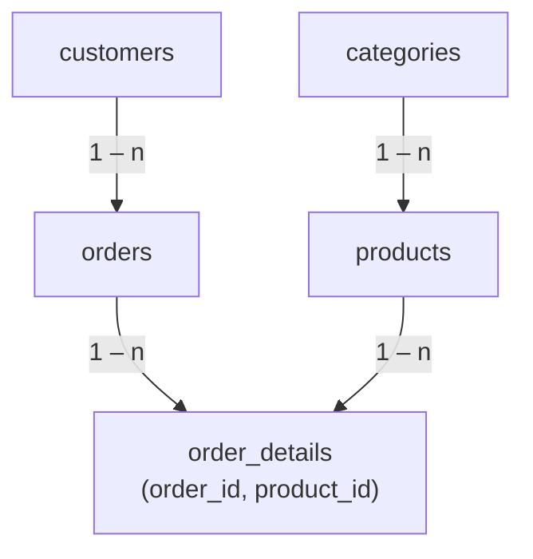
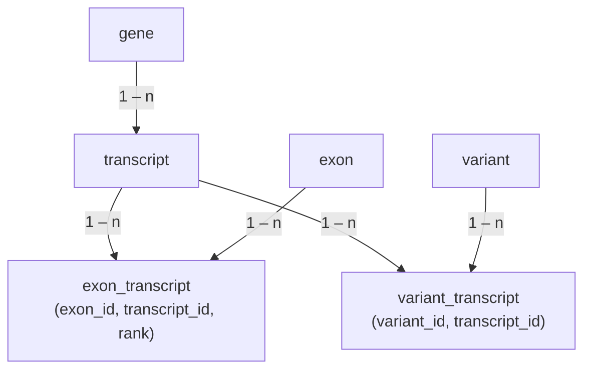

In 2020, the committee that names human genes (HGNC) renamed SEPT1 to SEPTIN1 and MARCH1 to MARCHF1, not because of any new biology but because spreadsheets kept turning these symbols into dates (Bruford et al., 2020). This article explains what a database is, checks the familiar "Excel vs. database" claims against official documentation, and uses gene name errors to show the core difference: a relational database makes you declare a **schema** before you enter any data. It also spells out when a database will not save your data and when a spreadsheet is still good enough, with SQLite code you can run.

## 1. Introduction: a gene renamed because of software

In many labs, sample information lives in one file, qPCR results in another, and lists of differentially expressed genes are exported from R and then opened in Excel for filtering. The trouble starts when files grow heavy, several people edit them, and sheets have to cross-reference each other through VLOOKUP.

The question "spreadsheet or database?" is usually answered with four points: Excel holds only about a million rows while a database holds billions, databases are fast thanks to indexes, Excel is hard to share among many users, and VLOOKUP is weaker than JOIN. These points are partly right, but they miss what matters most: a spreadsheet cell does not know that its column holds gene symbols, so the software guesses the type from the content, and `SEPT2` looks like September 2. The real advantage of a relational database lies in a **schema with data types, keys and constraints**, following the model Codd (1970) proposed. This is the second article in the series *SQL for biological data and analysis*, after the one on the history of SQL.

## 2. What is a database: tables, rows, columns and schema

A database is an organized collection of data that a database management system (DBMS) stores and serves to queries. The most common kind is the **relational database**, based on E. F. Codd's 1970 paper. Codd's key idea was to separate how users see data from how the machine organizes it internally: users see only tables, and programs do not have to be rewritten when the storage layout changes (Codd, 1970).

Data lives in **tables** (called relations in theory). Each **column** (attribute) is one kind of information, such as `symbol` or `salary`; each **row** (tuple, or record) is one concrete object, such as a gene or an employee. What sets this apart from an Excel sheet is the **schema**: a declaration of column names, the **data type** of each column, the **primary key** that identifies each row, **foreign keys** that point to other tables, and **constraints** such as `NOT NULL` or `CHECK`. The schema comes before the data; every value entered must fit it.


*Figure 1. Parts of the `gene` table: table name, columns, rows, primary key and the data types declared in the schema. Illustrative data.*

**SQL** (Structured Query Language) is a declarative language for working with relational databases: you describe the result you want, and the DBMS decides how to get it. Given an `employees` table with the columns `id`, `full_name`, `department` and `salary`, the following statement returns every employee's name and salary:

```sql
SELECT full_name, salary FROM employees;
```

<div class="callout callout-warning">
<p class="callout-title">SQL is case-insensitive, but only for keywords</p>

`SELECT` and `select` are the same, and each statement should end with a `;`. **String values** are another matter: in SQLite, `WHERE symbol = 'TP53'` matches only `TP53`, while `WHERE symbol LIKE 'tp53'` matches both `TP53` and `tp53` (tested with SQLite 3.45.3); other DBMSs behave according to their collation. This matters because human gene symbols are all uppercase (TP53), while mouse gene symbols capitalize only the first letter (Trp53).

</div>

In a spreadsheet, a single column can mix numbers, text and dates; cell formatting is only a display hint. A schema turns the "one variable per column" principle from [the data preparation article](/en/blog/prepare-data-for-exploration/) into a rule the machine can enforce (see also SQL – Database).

## 3. Spreadsheets vs. databases: checking against official documentation

**Capacity.** Microsoft's specifications page lists a maximum of 1,048,576 rows by 16,384 columns per **worksheet**, while the number of sheets in a workbook is limited by available memory (Microsoft, n.d.-a): "about a million rows" is the limit of one sheet, not of the file. "Billions of rows" is vague, because it depends on the DBMS and the hardware. SQLite theoretically allows 2^64 rows per table but is capped by a maximum file size of about 281 TB, for an estimated ideal maximum of about 2e+13 rows (SQLite, n.d.-c); PostgreSQL 18 limits a table to 32 TB with the default block size (PostgreSQL Global Development Group, n.d.). Both far exceed what most labs need, so capacity is rarely the main reason to move to a database.

**Speed.** When searching by rowid or by an index, SQLite uses binary search, so the time grows with log N; without a suitable index it scans the whole table, and time grows with N (SQLite, n.d.-d). "Fast thanks to indexes" holds only once an index matching the query condition has been created.

**Multiple users.** Excel's Shared Workbook (Legacy) feature allows up to 256 users to have a file open at once (Microsoft, n.d.-a). SQLite allows any number of simultaneous readers but only **one writer at a time**, and its own documentation recommends a client/server DBMS when many users need to write concurrently (SQLite, n.d.-a).

**Linking data.** VLOOKUP searches the **first column** of the range and defaults to an approximate match if the last argument is left out (Microsoft, n.d.-b), so with sample codes or gene IDs it can return another sample's row without any error. JOIN works on keys: it connects many tables, handles many-to-many relationships through a junction table, keeps unmatched rows with an outer join, and, through foreign keys, prevents records that point to objects that do not exist (Codd, 1970; SQLite, n.d.-e).

**Table 1.** Spreadsheets and relational databases: common claims and what the documentation says

| Criterion | Common claim | According to the documentation | Source |
| --- | --- | --- | --- |
| Capacity | Excel ~1 million rows; databases billions | 1,048,576 rows **per worksheet**; SQLite ~2e+13 rows; PostgreSQL 32 TB per table | Microsoft (n.d.-a); SQLite (n.d.-c); PostgreSQL Global Development Group (n.d.) |
| Speed | Databases are fast thanks to indexes | log N **with a suitable index** | SQLite (n.d.-d) |
| Multiple users | Hard in Excel; built into databases | Shared Workbook 256 users; SQLite one writer | Microsoft (n.d.-a); SQLite (n.d.-a) |
| Linking | VLOOKUP weaker than JOIN | VLOOKUP on first column, approximate by default; JOIN on keys | Microsoft (n.d.-b); Codd (1970) |
| Data types | rarely mentioned | Spreadsheets guess per cell; databases declare them in the schema | Abeysooriya et al. (2021); SQLite (n.d.-b) |
| Constraints | rarely mentioned | Data validation is optional; `NOT NULL`, `CHECK`, `FOREIGN KEY` | SQLite (n.d.-b, n.d.-e) |

The last two rows are where the two tools differ in kind. Spreadsheets do have their own database functions such as Advanced Filter and DMAX (see [database analysis in Excel](/en/blog/phan-tich-co-so-du-lieu/)); how to frame the question before choosing a tool is covered in [the article on asking questions](/en/blog/ask-questions-to-make-data-driven-decisions/).

## 4. Lessons from gene name errors

### 4.1. A timeline

In 2004, while processing microarray data, Zeeberg and colleagues found that Excel converted at least 30 gene names into dates (such as DEC1 into 1-DEC) and, counting RIKEN identifiers, at least 2,000 identifiers into floating-point numbers (such as `2310009E13` read as 2310009 × 10¹³). Both conversions are **irreversible** (Zeeberg et al., 2004).

Ziemann, Eren and El-Osta (2016) measured how widespread the problem was: they scanned 35,175 supplementary Excel files from 18 journals and confirmed errors in 987 files from 704 papers; 19.6% of papers with Excel gene lists were affected, with typical examples being `SEPT2` turned into `2-Sep` and `MARCH1` into `1-Mar`.

The errors did not go away. Abeysooriya and colleagues (2021) scanned PubMed Central for 2014–2020 with a tool that also catches dates stored internally (five-digit numbers): 30.9% (3,436/11,117) of papers with Excel gene lists contained errors, and the rate kept rising after 2016. In the group's data-entry tests, Excel and Google Sheets converted gene names to dates under all three entry methods, while LibreOffice and Gnumeric did not.

The nomenclature community responded in an unusual way: the 2020 HGNC guidelines for human gene nomenclature state that all symbols Excel autoconverted to dates have been changed, for example SEPT1 to SEPTIN1 and MARCH1 to MARCHF1 (Bruford et al., 2020). Abeysooriya et al. (2021) note that renaming human and mouse genes does not solve everything, because gene symbols of many other species can still be converted, and computers with other language settings can still be affected.


*Figure 2. Four milestones of the spreadsheet gene name error problem, 2004–2021. Data from Zeeberg et al. (2004), Ziemann et al. (2016), Bruford et al. (2020) and Abeysooriya et al. (2021).*

These figures reflect only the journals and periods that were scanned, not every field.

### 4.2. The root cause: type inference without a schema

This is not a typing mistake but default behavior: if a cell has no declared type, the software has to guess, and a string that looks like a date becomes a date. Warnings in journals cannot change default behavior on millions of machines.

Microsoft later added a group of *Automatic Data Conversion* options to Excel for Microsoft 365 and Excel 2024 (Windows and Mac), letting users turn off removing leading zeros, truncating long numbers, converting strings with the letter "E" into scientific notation, and converting continuous letters and numbers into dates (Microsoft, n.d.-c). The last option has a limit: according to the help page, only continuous strings such as `JAN1` stay as text, while `JAN 1` or `JAN-1` may still become dates. It is also a per-machine setting that does not travel with the data.

Safe file reading in R is covered in importing and exporting data in R and Basic data types; handling errors after they happen is covered in [the data cleaning article](/en/blog/process-data-from-dirty-to-clean/).

## 5. How a database prevents errors, and when it does not

### 5.1. Declared data types, and a counterexample

The following test uses SQLite, an embedded DBMS that ships with Python. Five values that spreadsheets tend to mangle are inserted into three columns declared differently (`TEXT`, `NUMERIC`, no declared type) and into a `STRICT` table:

```python
import sqlite3
con = sqlite3.connect(":memory:")
con.execute("CREATE TABLE t (s_text TEXT, s_num NUMERIC, s_none)")
con.execute("CREATE TABLE t_strict (s TEXT) STRICT")
for v in ["SEPT2", "MARCH1", "1-Mar", "2310009E13", "00123"]:
    con.execute("INSERT INTO t VALUES (?, ?, ?)", (v, v, v))
    con.execute("INSERT INTO t_strict VALUES (?)", (v,))
for row in con.execute("SELECT s_text, typeof(s_text), s_num, typeof(s_num), "
                       "s_none, typeof(s_none) FROM t"):
    print(row)
```

**Table 2.** Stored value and storage class (`typeof`) by column declaration, SQLite 3.45.3

| Inserted value | `TEXT` column | `NUMERIC` column | No declared type | `STRICT`, `TEXT` column |
| --- | --- | --- | --- | --- |
| `SEPT2` | `SEPT2` (text) | `SEPT2` (text) | `SEPT2` (text) | `SEPT2` (text) |
| `MARCH1` | `MARCH1` (text) | `MARCH1` (text) | `MARCH1` (text) | `MARCH1` (text) |
| `1-Mar` | `1-Mar` (text) | `1-Mar` (text) | `1-Mar` (text) | `1-Mar` (text) |
| `2310009E13` | `2310009E13` (text) | `2.310009e+19` (**real**) | `2310009E13` (text) | `2310009E13` (text) |
| `00123` | `00123` (text) | `123` (**integer**) | `00123` (text) | `00123` (text) |

SQLite never turns a string into a date, because it does not infer dates from text. But in the `NUMERIC` column, the RIKEN ID becomes a floating-point number and sample code `00123` loses its leading zeros, just as in a spreadsheet. The cause is *type affinity*: text that "looks like a number" inserted into a column with NUMERIC affinity is converted to INTEGER or REAL (SQLite, n.d.-b). A database protects data only when the schema is right; declare the wrong type for an ID column and the error still happens.

### 5.2. STRICT tables: reject instead of silently accepting

By default SQLite uses flexible typing: an `INTEGER` column still accepts strings. Since version 3.37.0 (2021), tables declared `STRICT` enforce types and raise an error on mismatch (SQLite, n.d.-b):

```python
con.execute("CREATE TABLE expr (gene TEXT NOT NULL, tpm INTEGER) STRICT")
con.execute("INSERT INTO expr VALUES ('TP53', 'high')")
# sqlite3.IntegrityError: cannot store TEXT value in INTEGER column expr.tpm
```

A clear error at entry time is always cheaper than a wrong value lying silent until analysis.

### 5.3. Foreign keys and CHECK constraints

Foreign keys prevent "orphan" records, such as a transcript pointing to a gene that is not in the `gene` table. There is a trap: in SQLite, foreign key enforcement is **off by default** and must be enabled for each connection with `PRAGMA foreign_keys = ON` (SQLite, n.d.-e). The following runs in the `sqlite3` command-line tool:

```sql
CREATE TABLE gene (
  gene_id TEXT PRIMARY KEY,
  symbol  TEXT NOT NULL
) STRICT;
CREATE TABLE transcript (
  transcript_id TEXT PRIMARY KEY,
  gene_id       TEXT NOT NULL REFERENCES gene(gene_id)
) STRICT;
INSERT INTO gene VALUES ('G1', 'SEPTIN2'), ('G2', 'MARCHF1');
INSERT INTO transcript VALUES ('T1', 'G1');
-- Foreign keys are off: the orphan record is accepted
INSERT INTO transcript VALUES ('T9', 'G99');
-- Turn enforcement on and try again
PRAGMA foreign_keys = ON;
INSERT INTO transcript VALUES ('T10', 'G99');
-- Error: FOREIGN KEY constraint failed
```

A `CHECK` constraint turns domain knowledge into a rule. In a fish measurement table, gutted weight (Wo) cannot exceed whole-body weight (W). With the simulated data below, the second row is rejected at entry:

```sql
CREATE TABLE fish (
  fish_id INTEGER PRIMARY KEY,
  W  REAL NOT NULL CHECK (W > 0),   -- whole-body weight (g)
  Wo REAL NOT NULL CHECK (Wo > 0),  -- gutted weight (g)
  CHECK (Wo <= W)
) STRICT;
INSERT INTO fish VALUES (1, 30.2, 25.1);
INSERT INTO fish VALUES (2, 32.0, 36.5);
-- Error: CHECK constraint failed: Wo <= W
```

### 5.4. The path data takes

No constraint can rescue data that was damaged before it reached the database. If a gene table is opened and re-saved in Excel before being loaded into SQLite, `2-Sep` will be stored faithfully as the string `2-Sep`: accurate and useless. So load directly from the text files your pipeline produces (CSV, TSV), in line with Broman and Woo's (2018) advice to keep data in plain text.

## 6. Real biological databases running on an RDBMS

Many major bioinformatics resources run on a relational database management system (RDBMS) and allow direct queries. According to Ensembl's documentation (June 2026 archive), **Ensembl** runs a public MySQL server, `ensembldb.ensembl.org`, plus MariaDB mirrors, with login as user `anonymous` (Ensembl, n.d.-a); its core database includes the fundamental tables `gene`, `transcript`, `exon`, `exon_transcript` and `translation` (Ensembl, n.d.-b). The software libraries for this database were described in 2004 (Stabenau et al., 2004), and Ensembl still publishes regular updates (Dyer et al., 2025). The **UCSC Genome Browser** uses MariaDB and offers two public servers synchronized weekly with the website (UCSC Genome Browser, n.d.; Karolchik et al., 2003; Perez et al., 2025).

**GEMINI** loads variants and genotypes from VCF files into SQLite; its authors chose a relational database for the expressive power of SQL, and SQLite because the whole database is **a single file** that is easy to share (Paila et al., 2013), a feature the SQLite developers also emphasize (Gaffney et al., 2022). **Chado**, from the FlyBase community, is a modular relational schema for genome-associated information (Mungall et al., 2007).

**Table 3.** Some bioinformatics resources that use relational databases

| Resource | DBMS | Access | Source |
| --- | --- | --- | --- |
| Ensembl | MySQL, MariaDB mirrors | Public server, user `anonymous` | Ensembl (n.d.-a, n.d.-b) |
| UCSC Genome Browser | MariaDB | `genome-mysql.gi.ucsc.edu`, `genome-euro-mysql.soe.ucsc.edu` | UCSC Genome Browser (n.d.) |
| GEMINI | SQLite | One database file built from VCF | Paila et al. (2013) |
| Chado (FlyBase) | Modular schema | Installed per project | Mungall et al. (2007) |

Learning `SELECT`, `WHERE` and `JOIN` therefore means learning to query these resources directly. An overview of biological data formats and databases is in the data formats article.

## 7. From a store database to a gene database: two relationship diagrams

The classic example for learning SQL is an online store database, and its structure matches the way Ensembl organizes genes surprisingly well.

**Diagram A** is the store database in full. Each category has many products, and each customer has many orders. An order contains many products and a product appears in many orders: a many-to-many relationship that needs a **junction table** (`order_details`) holding `order_id`, `product_id` pairs.



**Diagram B** is a simplified gene – transcript – variant schema. A gene has many transcripts; a transcript consists of many exons, and an exon can be shared by many transcripts, so Ensembl uses the junction table `exon_transcript` (Ensembl, n.d.-b). The variant branch is inspired by how GEMINI links variants to annotations (Paila et al., 2013); the name `variant_transcript` was chosen for this article and is not a table in Ensembl or GEMINI.



`orders` – `order_details` – `products` has the same shape as `transcript` – `exon_transcript` – `exon`: understand one and you understand the other. The SQL below runs on a miniature version of Diagram B and asks: which exons are shared by several transcripts of the same gene?

```sql
SELECT g.symbol, et.exon_id, COUNT(*) AS n_transcript
FROM gene g
JOIN transcript t       ON t.gene_id = g.gene_id
JOIN exon_transcript et ON et.transcript_id = t.transcript_id
GROUP BY g.symbol, et.exon_id
ORDER BY et.exon_id;
-- SEPTIN2 | E1 | 2
-- SEPTIN2 | E2 | 1
-- SEPTIN2 | E3 | 1
```

The two databases are also alike in how they record missing values: a customer without an email or a product whose stock has not been updated is stored as `NULL`, just like a missing annotation or a missing measurement. `NULL` is neither 0 nor an empty string; it will be covered in later articles. To practice JOIN, see [JOIN](/en/blog/join-ket-hop-nhieu-bang/) and the combined skills article.

## 8. When a spreadsheet is enough, and when you need a database

The conclusion is not "abandon Excel." Broman and Woo (2018) set out principles for organizing spreadsheets: be consistent, write dates as YYYY-MM-DD, put one value per cell, keep data rectangular, create a data dictionary, do no calculations in raw data files, do not use color as data, use data validation, and save a plain-text copy. For small, single-table data entered by one person, a spreadsheet organized this way is a reasonable choice; the authors themselves acknowledge that complex data may need a formal database. Wickham's (2014) **tidy data**, with each variable a column, each observation a row and each type of observational unit a table, bridges tidy spreadsheets and relational tables. Conversely, not all genomics data belongs in an RDBMS: indexed compressed files such as **tabix** retrieve a genomic region quickly (Li, 2011), and **BioMart** serves federated queries across sources (Kasprzyk, 2011).

<div class="callout callout-note">
<p class="callout-title">Five questions before choosing a tool</p>

1. Are there **several linked tables** (sample – measurement – result, gene – transcript – variant)?
2. Do **several people write** to the data?
3. Are there **IDs prone to autoconversion** (gene symbols, codes with leading zeros or the letter E)?
4. Could one table **exceed 1,048,576 rows**?
5. Do you need **reproducible queries** when the data is updated?

With one or two "yes" answers, a well-organized spreadsheet plus text files may still be enough. With three or more, as a rough rule, SQLite is worth learning.

</div>

## 9. Conclusion

The familiar claims about Excel and databases have a kernel of truth but put the emphasis in the wrong place. The core difference is the **schema**: a database makes you state up front what each column holds, while a spreadsheet guesses afterward. Two decades of gene name errors show the cost of letting software guess, to the point that gene names themselves had to change. Databases are not a cure-all either: a column with the wrong declared type still corrupts IDs, SQLite foreign keys must be switched on, and data that has passed through a spreadsheet is damaged before it arrives. Learning SQL, then, is first of all learning to declare structure for biological data.

You can try it right away: move a sample table you manage in Excel into SQLite as a `STRICT` table with a few `CHECK` constraints, or try connecting to the public UCSC or Ensembl servers. The next article in the series covers SELECT and WHERE.

## References

Abeysooriya, M., Soria, M., Kasu, M. S., & Ziemann, M. (2021). Gene name errors: Lessons not learned. *PLOS Computational Biology, 17*(7), e1008984. https://doi.org/10.1371/journal.pcbi.1008984

Broman, K. W., & Woo, K. H. (2018). Data organization in spreadsheets. *The American Statistician, 72*(1), 2–10. https://doi.org/10.1080/00031305.2017.1375989

Bruford, E. A., Braschi, B., Denny, P., Jones, T. E. M., Seal, R. L., & Tweedie, S. (2020). Guidelines for human gene nomenclature. *Nature Genetics, 52*(8), 754–758. https://doi.org/10.1038/s41588-020-0669-3

Codd, E. F. (1970). A relational model of data for large shared data banks. *Communications of the ACM, 13*(6), 377–387. https://doi.org/10.1145/362384.362685

Dyer, S. C., Austine-Orimoloye, O., Azov, A. G., Barba, M., Barnes, I., Barrera-Enriquez, V. P., Becker, A., Bennett, R., Beracochea, M., Berry, A., Bhai, J., Bhurji, S. K., Boddu, S., Branco Lins, P. R., Brooks, L., Ramaraju, S. B., Campbell, L. I., Martinez, M. C., Charkhchi, M., … Yates, A. D. (2025). Ensembl 2025. *Nucleic Acids Research, 53*(D1), D948–D957. https://doi.org/10.1093/nar/gkae1071

Ensembl. (n.d.-a). *Public MySQL server*. Retrieved November 12, 2026, from https://jun2026.archive.ensembl.org/info/data/mysql.html

Ensembl. (n.d.-b). *Schema documentation (core database)*. Retrieved November 12, 2026, from https://jun2026.archive.ensembl.org/info/docs/api/core/core_schema.html

Gaffney, K. P., Prammer, M., Brasfield, L., Hipp, D. R., Kennedy, D., & Patel, J. M. (2022). SQLite: Past, present, and future. *Proceedings of the VLDB Endowment, 15*(12), 3535–3547. https://doi.org/10.14778/3554821.3554842

Karolchik, D., Baertsch, R., Diekhans, M., Furey, T. S., Hinrichs, A., Lu, Y. T., Roskin, K. M., Schwartz, M., Sugnet, C. W., Thomas, D. J., Weber, R. J., Haussler, D., & Kent, W. J. (2003). The UCSC Genome Browser Database. *Nucleic Acids Research, 31*(1), 51–54. https://doi.org/10.1093/nar/gkg129

Kasprzyk, A. (2011). BioMart: Driving a paradigm change in biological data management. *Database, 2011*, bar049. https://doi.org/10.1093/database/bar049

Li, H. (2011). Tabix: Fast retrieval of sequence features from generic TAB-delimited files. *Bioinformatics, 27*(5), 718–719. https://doi.org/10.1093/bioinformatics/btq671

Microsoft. (n.d.-a). *Excel specifications and limits*. Microsoft Support. Retrieved November 12, 2026, from https://support.microsoft.com/en-us/office/excel-specifications-and-limits-1672b34d-7043-467e-8e27-269d656771c3

Microsoft. (n.d.-b). *VLOOKUP function*. Microsoft Support. Retrieved November 12, 2026, from https://support.microsoft.com/en-us/office/vlookup-function-0bbc8083-26fe-4963-8ab8-93a18ad188a1

Microsoft. (n.d.-c). *Set automatic data conversions*. Microsoft Support. Retrieved November 19, 2026, from https://support.microsoft.com/office/33d1d872-9926-4ef3-9364-492444d0c7ea

Mungall, C. J., Emmert, D. B., & The FlyBase Consortium. (2007). A Chado case study: An ontology-based modular schema for representing genome-associated biological information. *Bioinformatics, 23*(13), i337–i346. https://doi.org/10.1093/bioinformatics/btm189

Paila, U., Chapman, B. A., Kirchner, R., & Quinlan, A. R. (2013). GEMINI: Integrative exploration of genetic variation and genome annotations. *PLOS Computational Biology, 9*(7), e1003153. https://doi.org/10.1371/journal.pcbi.1003153

Perez, G., Barber, G. P., Benet-Pages, A., Casper, J., Clawson, H., Diekhans, M., Fischer, C., Gonzalez, J. N., Hinrichs, A. S., Lee, C. M., Nassar, L. R., Raney, B. J., Speir, M. L., van Baren, M. J., Vaske, C. J., Haussler, D., Kent, W. J., & Haeussler, M. (2025). The UCSC Genome Browser database: 2025 update. *Nucleic Acids Research, 53*(D1), D1243–D1249. https://doi.org/10.1093/nar/gkae974

PostgreSQL Global Development Group. (n.d.). *Appendix K. PostgreSQL limits* (PostgreSQL 18 documentation). Retrieved November 19, 2026, from https://www.postgresql.org/docs/current/limits.html

SQLite. (n.d.-a). *Appropriate uses for SQLite*. Retrieved November 12, 2026, from https://www.sqlite.org/whentouse.html

SQLite. (n.d.-b). *Datatypes in SQLite version 3* and *STRICT tables*. Retrieved November 12, 2026, from https://www.sqlite.org/datatype3.html and https://www.sqlite.org/stricttables.html

SQLite. (n.d.-c). *Implementation limits for SQLite*. Retrieved November 12, 2026, from https://www.sqlite.org/limits.html

SQLite. (n.d.-d). *Query planning*. Retrieved November 12, 2026, from https://www.sqlite.org/queryplanner.html

SQLite. (n.d.-e). *SQLite foreign key support*. Retrieved November 12, 2026, from https://www.sqlite.org/foreignkeys.html

Stabenau, A., McVicker, G., Melsopp, C., Proctor, G., Clamp, M., & Birney, E. (2004). The Ensembl core software libraries. *Genome Research, 14*(5), 929–933. https://doi.org/10.1101/gr.1857204

UCSC Genome Browser. (n.d.). *Downloading data using MariaDB (MySQL)*. Retrieved November 12, 2026, from https://genome.ucsc.edu/goldenPath/help/mysql.html

Wickham, H. (2014). Tidy data. *Journal of Statistical Software, 59*(10). https://doi.org/10.18637/jss.v059.i10

Zeeberg, B. R., Riss, J., Kane, D. W., Bussey, K. J., Uchio, E., Linehan, W. M., Barrett, J. C., & Weinstein, J. N. (2004). Mistaken identifiers: Gene name errors can be introduced inadvertently when using Excel in bioinformatics. *BMC Bioinformatics, 5*, 80. https://doi.org/10.1186/1471-2105-5-80

Ziemann, M., Eren, Y., & El-Osta, A. (2016). Gene name errors are widespread in the scientific literature. *Genome Biology, 17*, 177. https://doi.org/10.1186/s13059-016-1044-7
