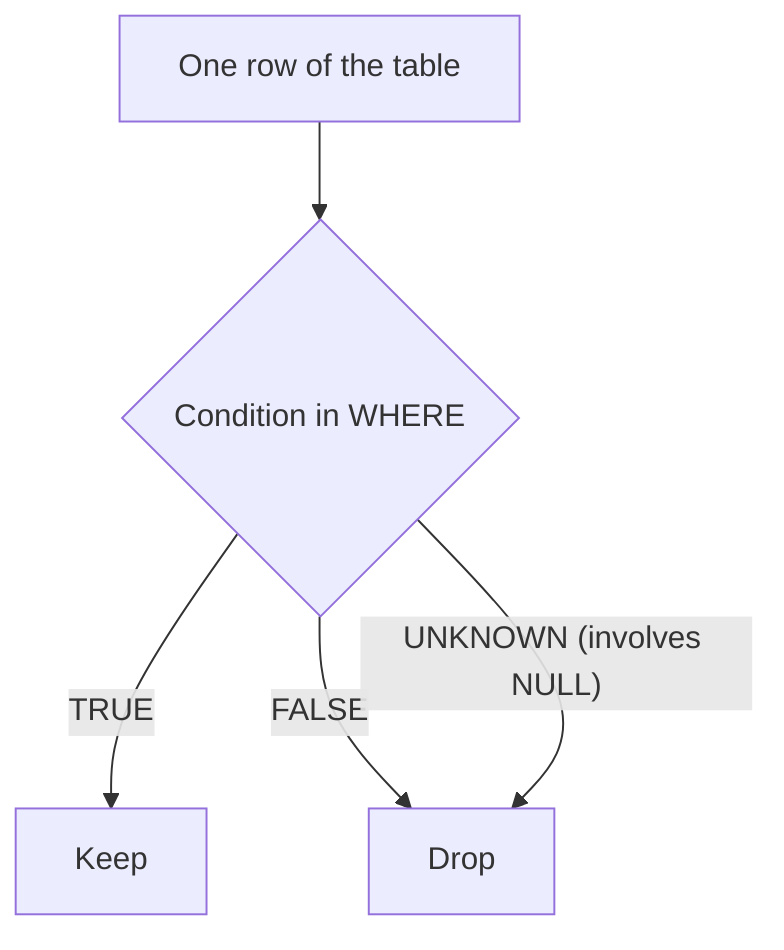

In SQL, `SELECT` picks columns, `WHERE` picks rows, and `WHERE` keeps only the rows for which the condition evaluates to TRUE. Every comparison with NULL, including `NULL = NULL`, evaluates to UNKNOWN, so `WHERE x = NULL` always returns 0 rows; to find missing cells you have to write `IS NULL`. The less obvious consequence is worse. On a simulated 6-row variant table run in SQLite 3.45.3, filtering for "Pathogenic" returns 2 rows, filtering for "not Pathogenic" also returns 2, the 2 rows with no annotation vanish from both, and `NOT IN` with a list that contains a NULL returns 0 rows. This article is for biology students and anyone who regularly filters variant tables or sample sheets full of empty cells. It ends with a six-step checklist to run before every filter.

<div class="callout callout-note">
<p class="callout-title">Quick summary</p>

- NULL means "unknown," not 0 and not an empty string.
- Comparing anything with NULL yields UNKNOWN; `WHERE` drops both FALSE and UNKNOWN.
- A NULL row is in neither "A" nor "not A"; `NOT IN (…, NULL)` returns 0 rows.
- Find missing cells with `IS NULL`; for NULL-aware comparisons use `IS DISTINCT FROM` (PostgreSQL) or `IS NOT` (SQLite).
- Check the totals: rows in "A" + "not A" + "NULL" must equal the total row count.

</div>

## 1. What SELECT and WHERE do

A basic query has three parts: `SELECT` says which columns, `FROM` says which table, and `WHERE` says which rows to keep. `SELECT *` returns every column; if you list column names, the result has exactly those columns in the order you wrote them. You can also compute on the data inside `SELECT`, name the result column with `AS`, and round with `ROUND`.

```sql
SELECT gene,
       consequence,
       ROUND(alt_reads * 1.0 / depth, 2) AS vaf,
       af AS "allele frequency"
FROM variant
WHERE clin_sig = 'Pathogenic';
```

The two kinds of quotes do different jobs. Single quotes wrap a string **value** (`'Pathogenic'`). Double quotes wrap a **name** (an identifier), which you need when a column name contains spaces or non-ASCII characters, as in `"allele frequency"` (PostgreSQL Global Development Group, n.d.-d). Write `WHERE clin_sig = "Pathogenic"` by mistake and PostgreSQL will go looking for a column called Pathogenic. SQLite is more forgiving: if no column has that name, it quietly treats the double-quoted text as a string value for backward compatibility, and the SQLite documentation itself calls this a "misfeature" (SQLite, n.d.-d). The query still runs, but don't rely on that.

`WHERE` takes a conditional expression and evaluates it on each row. The common operators are in the table below. The last column is the one people most often skip.

| Operator | Meaning | Example | When one side is NULL |
|---|---|---|---|
| `=`, `<>` (or `!=`) | equal, not equal | `clin_sig = 'Benign'` | UNKNOWN |
| `<`, `>`, `<=`, `>=` | ordering | `af < 0.01` | UNKNOWN |
| `BETWEEN a AND b` | in the range [a, b] | `af BETWEEN 0 AND 1` | UNKNOWN |
| `IN (…)` | in a list | `gene IN ('TP53','KRAS')` | UNKNOWN (if no element matches) |
| `LIKE` | pattern match, `%` and `_` | `gene LIKE 'BRCA%'` | UNKNOWN |
| `IS NULL`, `IS NOT NULL` | missing-value test | `af IS NULL` | always TRUE or FALSE |
| `AND`, `OR`, `NOT` | combine conditions | `af < 0.01 AND depth >= 20` | per the truth table in section 2 |

The whole article turns on that column. When they meet a NULL, comparison operators, `BETWEEN`, `IN` and `LIKE` don't answer "yes" or "no." They answer "don't know." `IN` has one exception: in SQLite, `1 IN (1, NULL)` gives 1 (TRUE) because the first element already matches, while `1 IN (2, NULL)` gives NULL because there is no way to rule out that the NULL is a 1.

<div class="callout callout-note">
<p class="callout-title">For R users</p>

If you already know `NA` in R, SQL's NULL works in the same spirit: missing values propagate through comparisons, and you test for them with a dedicated function or operator instead of `==` (→ Basic data types in R).

</div>

## 2. Three-valued logic: the truth table and the WHERE rule

### 2.1. Comparing with NULL yields UNKNOWN

SQL doesn't use two-valued true/false logic. It uses three values: TRUE, FALSE and UNKNOWN. SQLite represents TRUE as 1, FALSE as 0 and UNKNOWN as NULL, so you can see this directly:

```sql
SELECT NULL = NULL, NULL <> NULL, 1 = NULL, NULL IS NULL;
-- SQLite 3.45.3:  NULL | NULL | NULL | 1
```

`NULL = NULL` is not TRUE. If two cells are both "unknown," nobody can say they are equal: two patients who are both missing a blood pressure reading don't therefore have the same blood pressure. The PostgreSQL documentation says this plainly: do not write `expression = NULL`, because NULL is not "equal to" NULL; the null value represents an unknown value, and it is not known whether two unknown values are equal (PostgreSQL Global Development Group, n.d.-a).

### 2.2. The truth table

When conditions are combined with `AND`, `OR` and `NOT`, UNKNOWN propagates by the rules below. Table 1 was built from SQLite output and matches the SQLite documentation: `AND` is FALSE if either side is FALSE, `OR` is TRUE if either side is TRUE, and any other case involving UNKNOWN is UNKNOWN (SQLite, n.d.-a).

**Table 1.** Three-valued truth table (T = TRUE, F = FALSE, U = UNKNOWN)

| p | q | p AND q | p OR q | NOT p |
|---|---|---|---|---|
| T | U | U | T | F |
| F | U | F | U | T |
| U | U | U | U | U |

Read it intuitively: `FALSE AND (unknown)` is false no matter what the other side is, and `TRUE OR (unknown)` is true no matter what. But `NOT (unknown)` is still unknown.

### 2.3. WHERE keeps only TRUE

The `WHERE` rule is simple: rows whose condition is TRUE stay, rows that are FALSE or UNKNOWN go. At the filtering step, UNKNOWN is treated like FALSE. It is **not** FALSE, though. Pass it through `NOT` and FALSE becomes TRUE, while UNKNOWN stays UNKNOWN. That is how a row can fall out of both "A" and "not A."



*Figure 1. The path of one row through `WHERE`: only TRUE is kept.*

### 2.4. Writing it correctly: IS NULL, IS DISTINCT FROM and IS

To find missing cells, use `IS NULL` or `IS NOT NULL`; these two operators always return TRUE or FALSE. PostgreSQL also has a `transform_null_equals` setting: when it is on, PostgreSQL rewrites `x = NULL` as `x IS NULL` for compatibility with older applications that were written incorrectly (PostgreSQL Global Development Group, n.d.-a).

When you need to compare two values while still treating NULL as something comparable, PostgreSQL offers `IS DISTINCT FROM` and `IS NOT DISTINCT FROM` (PostgreSQL Global Development Group, n.d.-a). SQLite has `IS` and `IS NOT`, which work like `=` and `!=` but handle NULL (SQLite, n.d.-a); in testing with SQLite 3.45.3, the `IS DISTINCT FROM` spelling also ran and gave the same result.

```sql
-- PostgreSQL
SELECT * FROM variant WHERE clin_sig IS DISTINCT FROM 'Pathogenic';
-- SQLite
SELECT * FROM variant WHERE clin_sig IS NOT 'Pathogenic';
```

The SQL standard is not entirely clear about NULL. The SQLite developers note that the standard's description of NULL handling is ambiguous, so they chose their behavior by testing other database engines (SQLite, n.d.-b). One example: NULLs are treated as distinct in a `UNIQUE` column (several rows can all be NULL) but as identical in `SELECT DISTINCT` (SQLite, n.d.-b).

## 3. Experiment 1: filtering a variant table with missing annotations

### 3.1. Context and data

Variant tables in bioinformatics usually carry annotation columns such as clinical significance, of the kind aggregated in ClinVar (Landrum et al., 2018), and the variant's consequence for the gene, of the kind produced by the Ensembl Variant Effect Predictor (McLaren et al., 2016). Variants that haven't been interpreted usually leave the clinical significance column empty. Variants absent from population data usually leave the allele frequency column empty.

The experiment uses a **simulated** 6-row table (not real ClinVar data), run in SQLite, a very widely used embedded database engine (Gaffney et al., 2022), through Python's `sqlite3` module. The table has 2 rows missing `clin_sig`, 2 missing `af`, 1 missing `gene`, 1 missing `consequence`, and 1 row with `depth = 0`.

```python
import sqlite3

con = sqlite3.connect(":memory:")
con.executescript("""
CREATE TABLE variant (
  id INTEGER PRIMARY KEY, gene TEXT, consequence TEXT, clin_sig TEXT,
  af REAL, depth INTEGER, alt_reads INTEGER);
INSERT INTO variant VALUES
 (1, 'TP53',  'missense_variant',   'Pathogenic', 0.0004, 50,  25),
 (2, 'KRAS',  'missense_variant',   'Pathogenic', NULL,   100, 48),
 (3, 'tp53',  'synonymous_variant', NULL,         0.002,  40,  12),
 (4, 'BRCA1', NULL,                 'Benign',     0.21,   60,  30),
 (5, 'EGFR',  'synonymous_variant', 'Benign',     0.035,  0,   0),
 (6, NULL,    'intron_variant',     NULL,         NULL,   80,  20);
""")

def n(where):
    return con.execute(f"SELECT COUNT(*) FROM variant WHERE {where}").fetchone()[0]

print(n("clin_sig = NULL"), n("clin_sig IS NULL"))   # 0 2
```

### 3.2. Results

**Table 2.** Rows returned from the 6-row table (SQLite 3.45.3, run on November 22, 2026)

| `WHERE` condition | Rows returned | Rows the author usually wants |
|---|---|---|
| `clin_sig = NULL` | 0 | 2 |
| `clin_sig IS NULL` | 2 | 2 |
| `clin_sig = 'Pathogenic'` | 2 | 2 |
| `clin_sig <> 'Pathogenic'` | 2 | 4 |
| `NOT (clin_sig = 'Pathogenic')` | 2 | 4 |
| `clin_sig <> 'Pathogenic' OR clin_sig IS NULL` | 4 | 4 |
| `clin_sig IS NOT 'Pathogenic'` | 4 | 4 |
| `COALESCE(clin_sig, 'not_provided') <> 'Pathogenic'` | 4 | 4 |
| `af < 0.01` | 2 | – |
| `af >= 0.01` | 2 | – |
| `af BETWEEN 0 AND 1` | 4 | – |
| `gene IN ('TP53', 'KRAS', NULL)` | 2 | 2 |
| `gene NOT IN ('TP53', 'KRAS')` | 3 | 4 |
| `gene NOT IN ('TP53', 'KRAS', NULL)` | 0 | 4 |

`<>` and `NOT` return the same 2 rows, so "Pathogenic" plus "not Pathogenic" covers only 4 of 6. The frequency column behaves the same way: `af < 0.01` and `af >= 0.01` return 2 rows each. The two variants with no frequency are neither "rare" nor "common," and they also drop out of `BETWEEN 0 AND 1`. The last row of the table is the harshest case: add one NULL to a `NOT IN` list and the result goes to 0.


*Figure 2. Rows matching the condition, matching its negation, and in neither, on the simulated variant table (6 rows) and the simulated fish table from section 4 (8 rows). Counted with SQLite 3.45.3.*

### 3.3. Why NOT IN with a NULL returns 0 rows

`x NOT IN ('TP53', 'KRAS', NULL)` is equivalent to `x <> 'TP53' AND x <> 'KRAS' AND x <> NULL`. The last term is always UNKNOWN. By Table 1, `TRUE AND UNKNOWN` is UNKNOWN and `FALSE AND UNKNOWN` is FALSE, so no row ever reaches TRUE. `IN`, by contrast, is equivalent to a chain of `OR`s, and `TRUE OR UNKNOWN` is TRUE, so a NULL in the list does no harm to `IN`. The trap is most dangerous when the list is a subquery pulled from another table that has empty cells (→ [Subquery & CASE WHEN](/en/blog/subquery-and-case-when/)).

### 3.4. The totals check

For any condition P on a table, each row lands in exactly one of three groups: P is TRUE, P is FALSE, or P is UNKNOWN. So:

$$N_{P} + N_{\text{NOT } P} + N_{P \text{ IS UNKNOWN}} = N_{\text{total}}$$

```sql
SELECT SUM(clin_sig = 'Pathogenic')              AS a,
       SUM(NOT (clin_sig = 'Pathogenic'))        AS not_a,
       SUM((clin_sig = 'Pathogenic') IS NULL)    AS unknown,
       COUNT(*)                                  AS total
FROM variant;
-- 2 | 2 | 2 | 6
```

If `a + not_a` is smaller than `total`, the table has NULLs in a column the condition depends on. The check relies on SQLite representing TRUE as 1: the `SUM` of a condition is the number of rows where it is TRUE, and `SUM` skips NULLs on its own.

In variant analysis, a "drop Benign variants" filter written as `clin_sig <> 'Benign'` also drops every variant with no annotation. If the goal was to keep variants of uncertain significance for follow-up, that result is scientifically wrong, and SQL gives no warning.

## 4. Experiment 2: is an empty CSV cell NULL or an empty string?

Biological data usually reaches a database from a CSV file or a spreadsheet. The practical question: does an empty cell become NULL? This experiment uses a **simulated** CSV file of 8 fish with a `maturity` column (gonadal maturity stage, 1–4), where fish 1 is left blank.

```text
fish,length_cm,sex,maturity
1,18.2,F,
2,20.5,F,3
3,17.9,M,2
4,21.3,F,4
5,19.0,M,3
6,16.4,M,1
7,22.1,F,4
8,18.8,F,2
```

Method (a), loading with the `.import` command of the SQLite CLI 3.37.0 into a table that declares `maturity INTEGER`:

```sql
CREATE TABLE fish (fish INTEGER, length_cm REAL, sex TEXT, maturity INTEGER);
.import --csv --skip 1 fish.csv fish
SELECT typeof(maturity) FROM fish WHERE fish = 1;     -- text
SELECT COUNT(*) FROM fish WHERE maturity IS NULL;     -- 0
SELECT COUNT(*) FROM fish WHERE maturity = '';        -- 1
```

Method (b), reading with pandas and then writing to SQLite:

```python
import sqlite3
import pandas as pd

df = pd.read_csv("fish.csv")          # empty cell -> NaN
con = sqlite3.connect(":memory:")
df.to_sql("fish", con, index=False)   # NaN -> NULL
print(con.execute("SELECT typeof(maturity) FROM fish WHERE fish = 1").fetchone())  # ('null',)
```

**Table 3.** One CSV file, two ways to load it

| Query | (a) SQLite CLI 3.37.0 | (b) pandas 3.0.3 + sqlite3 |
|---|---|---|
| `typeof(maturity)` for fish 1 | text (empty string) | null |
| `maturity IS NULL` | 0 | 1 |
| `maturity = ''` | 1 | 0 |
| `maturity IN (3, 4)` | 4 | 4 |
| `maturity NOT IN (3, 4)` | 4 | 3 |

With method (a), no row disappears, but the fish with no measurement gets counted in the "not stage 3 or 4" group, as if it were known to be at stage 1 or 2. With method (b), that fish drops out of both groups, exactly the mechanism from section 2. Neither is automatically right. What you need is to know which state your data is in, and running `typeof()` on a few rows with empty cells right after loading is enough. This experiment only used SQLite CLI 3.37.0; other versions, or other systems' load commands, may handle empty cells differently, so check again on the tool you use. Notice also that the column declared `INTEGER` still accepted an empty string in method (a). In SQLite, a column's declared type is only an "affinity," a recommendation rather than a constraint: text that can't be read as a number is stored as TEXT (SQLite, n.d.-e).

You also need to decide what an empty cell means before loading. Codd (1986) distinguished "applicable" missing information (a value exists but is unknown) from "inapplicable" missing information (the attribute doesn't apply to the object). A juvenile fish with no developed gonads falls in the second category; a fish whose measurement someone forgot to record falls in the first. SQL has a single NULL for both.

## 5. Three more traps: AND/OR, case, and division

### 5.1. Precedence of AND and OR

In both SQLite and PostgreSQL, `NOT` binds tighter than `AND`, and `AND` binds tighter than `OR` (SQLite, n.d.-a; PostgreSQL Global Development Group, n.d.-d).

```sql
-- No parentheses: missense, OR (synonymous AND rare)  -> 3 rows (id 1, 2, 3)
SELECT id FROM variant
WHERE consequence = 'missense_variant'
   OR consequence = 'synonymous_variant' AND af < 0.01;

-- Parentheses: (missense OR synonymous) AND rare      -> 2 rows (id 1, 3)
SELECT id FROM variant
WHERE (consequence = 'missense_variant' OR consequence = 'synonymous_variant')
  AND af < 0.01;
```

Variant id 2, which is missing `af`, still gets into the unparenthesized query because `TRUE OR UNKNOWN` is TRUE. With parentheses, the `af < 0.01` term is UNKNOWN and `TRUE AND UNKNOWN` is UNKNOWN, so it is dropped.

### 5.2. Case sensitivity with = and LIKE

In SQLite, `'a' = 'A'` gives 0: equality is case-sensitive. `LIKE` is different. By default SQLite's `LIKE` is **not** case-sensitive for ASCII characters but is case-sensitive for characters beyond ASCII (SQLite, n.d.-a). On the variant table, `gene = 'tp53'` returns 1 row while `gene LIKE 'tp53'` returns 2 (`TP53` and `tp53`); `'ă' LIKE 'Ă'` gives 0. `PRAGMA case_sensitive_like = ON` makes `LIKE` case-sensitive (1 row), but the SQLite documentation marks this pragma as deprecated and kept only for backward compatibility, so don't depend on it (SQLite, n.d.-c).

PostgreSQL goes the other way: `LIKE` is case-sensitive, and for case-insensitive matching you use `ILIKE`, an extension that isn't part of the SQL standard (PostgreSQL Global Development Group, n.d.-b). In other systems, whether string comparison is case-sensitive depends on the collation; check the documentation for the system you use.

### 5.3. Integer division and division by zero

Dividing two integers gives an integer result, truncated toward zero, in both SQLite and PostgreSQL (SQLite, n.d.-a; PostgreSQL Global Development Group, n.d.-c): `7/2` gives 3, `-7/2` gives −3, and `7/2.0` gives 3.5. On the variant table, `alt_reads/depth` (two INTEGER columns) gives 0 in 5 rows and NULL in the `depth = 0` row. Multiply by `1.0` before dividing and you get 0.5, 0.48, 0.3, 0.5, NULL and 0.25.

Division by zero in SQLite raises no error: `1/0` and `1.0/0` both return NULL. The `depth = 0` row therefore has a VAF of NULL, a NULL created by computation rather than by the source data. PostgreSQL has a dedicated error code, `22012 division_by_zero`, in its error code list (PostgreSQL Global Development Group, n.d.-e), so don't expect it to quietly return NULL the way SQLite does; test it on the version you use.

## 6. Where NULL came from

Codd's (1970) relational model is the foundation of SQL (→ [A history of SQL](/en/blog/tutorial-biology-2/)), and the problem of cells with no value showed up soon after. Grant (1977) was already discussing null values in relational databases. Codd (1979) extended the relational model to capture more of the data's meaning, with new rules for insert, update and delete and new algebraic operators. Around the same time, Lipski (1979) and Imieliński and Lipski (1984) laid the theoretical groundwork for databases with incomplete information: when a cell is missing, what should a query answer?

Codd's (1986) split between "applicable" and "inapplicable," mentioned in section 4, is very practical for biological data: the gestational age of a sample from someone who isn't pregnant isn't "unknown," it is "not there." SQL in practice has one NULL for every meaning: not measured, not applicable, measurement failed, forgot to enter. If you want to tell them apart, whoever designs the table has to add that information, for example a column recording why the value is missing.

## 7. Does SQL give "certain" answers?

The theory of incomplete data uses the notion of certain answers: the rows that are correct under **every** possible way of filling in the missing values. Libkin (2016) showed that the results SQL computes with three-valued logic and the certain answers can be entirely different. A survey talk by the same author at PODS 2014 asked where the handling of incomplete data went wrong and how to fix it (Libkin, 2014).

Guagliardo and Libkin (2017) built a formal semantics for the core of SQL (SELECT–FROM–WHERE, subqueries, bag operations, NULLs), validated it against a large number of randomly generated queries, and proved that three-valued logic adds no expressive power to that fragment: every query in it can be rewritten using two-valued logic. On the user side, the survey by Toussaint et al. (2022) found that NULLs are common in real-world databases and that SQL's NULL-handling features cause users many problems. The debate over NULL isn't new either: Rubinson (2007) wrote an entire paper answering C. J. Date's critique of NULL and three-valued logic.

The practical lesson: the result of `WHERE` on a table with NULLs is the product of a convention, not the one "correct" answer, so you have to step in when that convention doesn't fit your scientific question.

## 8. Checklist for filtering data with missing values

The six steps below turn the results above into a routine to run before every filter.

1. **Count NULLs in each column.** `COUNT(*)` counts every row and `COUNT(col)` skips NULLs, so their difference is the number of missing cells. On the variant table, `SELECT COUNT(*) - COUNT(gene), COUNT(*) - COUNT(consequence), COUNT(*) - COUNT(clin_sig), COUNT(*) - COUNT(af) FROM variant;` returns 1, 1, 2, 2.
2. **Look for missing-value codes that aren't NULL.** A missing cell may be an empty string (as in Experiment 2), `'NA'`, `'.'` or `'not_provided'`. Find them with `WHERE clin_sig IN ('', 'NA', '.', 'not_provided')` and convert them to NULL once, with a record of what you did.
3. **When filtering for "not equal" or "not in," decide where NULL rows go.** To keep them, write `OR col IS NULL` explicitly, or use `IS DISTINCT FROM` (PostgreSQL) or `IS NOT` (SQLite). On the variant table, `clin_sig <> 'Benign'` returns 2 rows and `clin_sig IS NOT 'Benign'` returns 4.
4. **Avoid `NOT IN` when the list might contain NULL.** Use `NOT EXISTS` with a subquery instead; it keeps non-matching rows even when the list contains NULL. Details are in [Subquery & CASE WHEN](/en/blog/subquery-and-case-when/).
5. **Use `COALESCE` only when the replacement value means something scientifically.** Replacing a NULL `clin_sig` with `'not_provided'` is reasonable; replacing a NULL `af` with 0 is wrong, because a variant with no population data is not a variant with frequency 0.
6. **Check the totals and report them.** Run the check from section 3.4 for every important condition. In the Methods section, record how the data were loaded, how missing values were coded, and how many rows each filtering step dropped because of NULL.

Step 6 connects SQL to statistics. Dropping NULL rows from the main analysis is complete-case analysis, and it is unbiased only under certain conditions on the mechanism that produced the missing data; Rubin (1976) set out the conditions under which that mechanism can be ignored for inference. That topic comes up again with aggregate functions such as `AVG`, which also skip NULLs (→ Aggregate functions).

<div class="callout callout-example">
<p class="callout-title">Label missing rows instead of letting NULL make them vanish</p>

When you need groups, `CASE` puts missing rows into a named group instead of letting them fall out of the result:
```sql
SELECT id, gene,
       CASE WHEN af IS NULL THEN 'missing'
            WHEN af < 0.01  THEN 'rare'
            ELSE 'common' END AS freq_group
FROM variant;
```
On the variant table this gives 2 "rare" rows, 2 "common" rows and 2 "missing" rows: all 6.

</div>

## 9. Frequently asked questions

**Why does `WHERE x = NULL` return no rows?** Because `x = NULL` is always UNKNOWN, even when x is NULL, and `WHERE` keeps only rows where the condition is TRUE. Use `x IS NULL`.

**Is NULL the same as 0 or an empty string?** No. NULL means "unknown." Zero and the empty string are known values that `=` can compare. As Experiment 2 showed, the same empty CSV cell can become either NULL or an empty string depending on how you load it.

**Does `<>` skip NULLs?** Yes. `col <> 'A'` is UNKNOWN on a NULL row, so that row is dropped. To keep it, add `OR col IS NULL`.

**Why does `NOT IN` return nothing?** Because the list or subquery contains at least one NULL, which makes every row UNKNOWN or FALSE (section 3.3).

## 10. Conclusion

Errors caused by NULL come with no message. They only show up when you count. What to do now with the table you're working on: run the NULL count from step 1 of the checklist, then run the totals check from section 3.4 on your most important filter. If `a + not_a` falls short of `total`, rewrite the condition with `IS NULL`, `IS DISTINCT FROM` (PostgreSQL) or `IS NOT` (SQLite), and record the number of dropped rows in your Methods section.

The next article looks at where NULLs end up when you sort (→ [Sorting and searching](/en/blog/sap-xep-and-tim-kiem/)), and the one after that looks at how aggregate functions such as `COUNT` and `AVG` treat NULL (→ Aggregate functions).

## References

Codd, E. F. (1970). A relational model of data for large shared data banks. *Communications of the ACM, 13*(6), 377–387. https://doi.org/10.1145/362384.362685

Codd, E. F. (1979). Extending the database relational model to capture more meaning. *ACM Transactions on Database Systems, 4*(4), 397–434. https://doi.org/10.1145/320107.320109

Codd, E. F. (1986). Missing information (applicable and inapplicable) in relational databases. *ACM SIGMOD Record, 15*(4), 53. https://doi.org/10.1145/16301.16303

Gaffney, K. P., Prammer, M., Brasfield, L., Hipp, D. R., Kennedy, D., & Patel, J. M. (2022). SQLite: Past, present, and future. *Proceedings of the VLDB Endowment, 15*(12), 3535–3547. https://doi.org/10.14778/3554821.3554842

Grant, J. (1977). Null values in a relational data base. *Information Processing Letters, 6*(5), 156–157. https://doi.org/10.1016/0020-0190(77)90013-8

Guagliardo, P., & Libkin, L. (2017). A formal semantics of SQL queries, its validation, and applications. *Proceedings of the VLDB Endowment, 11*(1), 27–39. https://doi.org/10.14778/3151113.3151116

Imieliński, T., & Lipski, W. (1984). Incomplete information in relational databases. *Journal of the ACM, 31*(4), 761–791. https://doi.org/10.1145/1634.1886

Landrum, M. J., Lee, J. M., Benson, M., Brown, G. R., Chao, C., Chitipiralla, S., Gu, B., Hart, J., Hoffman, D., Jang, W., Karapetyan, K., Katz, K., Liu, C., Maddipatla, Z., Malheiro, A., McDaniel, K., Ovetsky, M., Riley, G., Zhou, G., … Maglott, D. R. (2018). ClinVar: Improving access to variant interpretations and supporting evidence. *Nucleic Acids Research, 46*(D1), D1062–D1067. https://doi.org/10.1093/nar/gkx1153

Libkin, L. (2014). Incomplete data: What went wrong, and how to fix it. In *Proceedings of the 33rd ACM SIGMOD-SIGACT-SIGART Symposium on Principles of Database Systems* (pp. 1–13). ACM. https://doi.org/10.1145/2594538.2594561

Libkin, L. (2016). SQL's three-valued logic and certain answers. *ACM Transactions on Database Systems, 41*(1), 1–28. https://doi.org/10.1145/2877206

Lipski, W. (1979). On semantic issues connected with incomplete information databases. *ACM Transactions on Database Systems, 4*(3), 262–296. https://doi.org/10.1145/320083.320088

McLaren, W., Gil, L., Hunt, S. E., Riat, H. S., Ritchie, G. R. S., Thormann, A., Flicek, P., & Cunningham, F. (2016). The Ensembl Variant Effect Predictor. *Genome Biology, 17*(1), 122. https://doi.org/10.1186/s13059-016-0974-4

PostgreSQL Global Development Group. (n.d.-a). *9.2. Comparison functions and operators*. PostgreSQL 18 documentation. Retrieved November 12, 2026, from https://www.postgresql.org/docs/current/functions-comparison.html

PostgreSQL Global Development Group. (n.d.-b). *9.7. Pattern matching*. PostgreSQL 18 documentation. Retrieved November 12, 2026, from https://www.postgresql.org/docs/current/functions-matching.html

PostgreSQL Global Development Group. (n.d.-c). *9.3. Mathematical functions and operators*. PostgreSQL 18 documentation. Retrieved November 12, 2026, from https://www.postgresql.org/docs/current/functions-math.html

PostgreSQL Global Development Group. (n.d.-d). *4.1. Lexical structure*. PostgreSQL 18 documentation. Retrieved November 12, 2026, from https://www.postgresql.org/docs/current/sql-syntax-lexical.html

PostgreSQL Global Development Group. (n.d.-e). *Appendix A. PostgreSQL error codes*. PostgreSQL 18 documentation. Retrieved November 22, 2026, from https://www.postgresql.org/docs/current/errcodes-appendix.html

Rubin, D. B. (1976). Inference and missing data. *Biometrika, 63*(3), 581–592. https://doi.org/10.1093/biomet/63.3.581

Rubinson, C. (2007). Nulls, three-valued logic, and ambiguity in SQL: Critiquing Date's critique. *ACM SIGMOD Record, 36*(4), 13–17. https://doi.org/10.1145/1361348.1361350

SQLite. (n.d.-a). *SQL language expressions*. Retrieved November 12, 2026, from https://www.sqlite.org/lang_expr.html

SQLite. (n.d.-b). *NULL handling in SQLite versus other database engines*. Retrieved November 12, 2026, from https://www.sqlite.org/nulls.html

SQLite. (n.d.-c). *PRAGMA statements: case_sensitive_like*. Retrieved November 12, 2026, from https://www.sqlite.org/pragma.html#pragma_case_sensitive_like

SQLite. (n.d.-d). *Quirks, caveats, and gotchas in SQLite*. Retrieved November 22, 2026, from https://www.sqlite.org/quirks.html

SQLite. (n.d.-e). *Datatypes in SQLite*. Retrieved November 22, 2026, from https://www.sqlite.org/datatype3.html

Toussaint, E., Guagliardo, P., Libkin, L., & Sequeda, J. (2022). Troubles with nulls, views from the users. *Proceedings of the VLDB Endowment, 15*(11), 2613–2625. https://doi.org/10.14778/3551793.3551818
