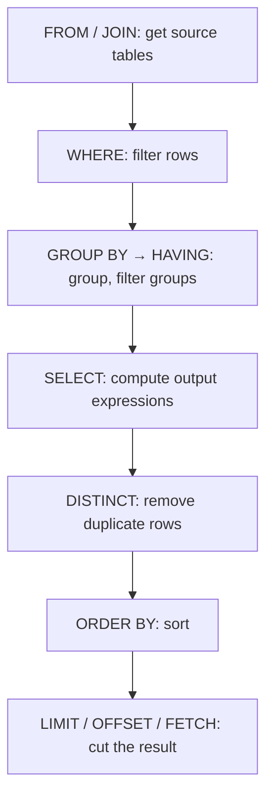

A SQL query has an order only when you write `ORDER BY`, and that order is fixed only when the sort key has no duplicate values. On a six-gene table where three genes share `padj = 0.001`, `ORDER BY padj LIMIT 2` returns (C, D). Add one index and the same statement on the same data returns (F, D) (tested on SQLite 3.45.3). NULLs don't land in the same place everywhere either: SQLite and MySQL put them first in an ascending sort, PostgreSQL puts them last. This article is for biology students and bioinformaticians who need a "top N genes" list, a paged variant table or a ranking that comes out the same every time the script runs. A seven-item checklist closes the article.

<div class="callout callout-note">
<p class="callout-title">Quick summary</p>

- Without `ORDER BY`, no order is guaranteed.
- If the `ORDER BY` key has duplicates, the order among tied rows is still up to the database engine; add a tie-breaker column, usually the primary key.
- NULLs come first under `ASC` in SQLite and MySQL and last in PostgreSQL. Write `NULLS LAST` or `ORDER BY (x IS NULL), x` explicitly.
- "Top N" with ties is a methods decision: keep exactly N rows, or keep the whole tie group.
- Page through large tables with keysets (`WHERE id > ?`) instead of deep `OFFSET`.

</div>

Table 1 is the opening experiment, run on six simulated genes where `padj` is the adjusted p-value.

**Table 1.** Same query, `SELECT gene, padj FROM de ORDER BY padj LIMIT 2`, same data, SQLite 3.45.3

| Table state | Execution plan | Result |
| --- | --- | --- |
| No index | table scan, sort with a temporary B-tree | C, D |
| Index on `(padj, gene DESC)` | scan via the index | F, D |

```sql
CREATE TABLE de (gene TEXT PRIMARY KEY, log2fc REAL, padj REAL);
INSERT INTO de VALUES
 ('A', 1.2, 0.020), ('B', -0.8, 0.300), ('C', 2.1, 0.001),
 ('D', -1.7, 0.001), ('E', 0.4, 0.040), ('F', 1.5, 0.001);

SELECT gene, padj FROM de ORDER BY padj LIMIT 2;   -- C, D
CREATE INDEX idx_padj ON de(padj, gene DESC);
SELECT gene, padj FROM de ORDER BY padj LIMIT 2;   -- F, D
```

Which result is correct? Both. The SQLite documentation states that the order of rows with equal sort-key values is undefined (SQLite, n.d.-b). The `(padj, gene DESC)` index was picked to make the effect easy to see, and not every index will flip the result. The point is that any change to the execution plan can change the order of tied rows. Here the index makes the engine read the data along a different path, so it meets the three tied genes in a different order.

## 1. What ORDER BY is, and why SQL has no default order

`ORDER BY` is the clause that sorts the result of a `SELECT` by one or more expressions. You need it because of the relational model: Codd (1970) defined a relation as a set of tuples, and the order of the rows carries no information. Date (2015) builds his approach to writing accurate SQL on that same model. If you want to read a table in some order, you have to say so.

The official documentation says exactly this. SQLite states that when a `SELECT` returning more than one row has no `ORDER BY`, the order is undefined (SQLite, n.d.-b). PostgreSQL explains that without sorting, the actual order depends on the scan and join plan types and on the order of the data on disk, and must not be relied on (The PostgreSQL Global Development Group [PGDG], n.d.-b). The order you see on a test run is a by-product of the execution plan.

The logical processing order of a `SELECT` differs from the order you type it in:



PostgreSQL documents that output expressions are computed before `DISTINCT`, `ORDER BY` and `LIMIT` are applied (PGDG, n.d.-d), which is why `ORDER BY` can use an alias defined in `SELECT`. `ORDER BY` is the **final sorting step** but not the last clause: after it come `LIMIT` and `OFFSET`, and in PostgreSQL also `FETCH` and `FOR UPDATE` (PGDG, n.d.-d). `LIMIT` cuts the result after sorting, so if the order is undefined, the part that gets cut is undefined too.

## 2. ORDER BY syntax and its small traps

`ASC` (the default) sorts ascending and `DESC` descending, and each key gets its own direction. With several keys, rows are sorted by the leftmost key, and the next key is consulted only when the previous one ties (SQLite, n.d.-b). For a table of fish measurements, `ORDER BY L DESC, fish_id` puts the longest fish first and breaks equal lengths by ID. It is the multi-level Sort in Excel ([database analysis in Excel](/en/blog/phan-tich-co-so-du-lieu/)), except that the levels are recorded in the statement.

The first trap is sorting by column position. `ORDER BY 2` means sort by the second column in the `SELECT` list. SQLite and PostgreSQL accept it (SQLite, n.d.-b; PGDG, n.d.-b), but MySQL 8.4 marks it as deprecated because the syntax has been removed from the SQL standard (Oracle, n.d.-c). Add a column at the front of the `SELECT` and the query quietly sorts by a different column. In code you keep for the long term, use column names or aliases.

The second trap is collation, the rules for comparing strings. By default SQLite uses BINARY, which compares bytes with `memcmp()`; NOCASE folds case only for ASCII letters (SQLite, n.d.-a). Vietnamese names, which carry diacritics, show the consequence right away (Table 2).

**Table 2.** Six names sorted ascending in SQLite 3.45.3

| Sort | Result |
| --- | --- |
| `ORDER BY name` (BINARY) | Bình, Zung, anh, ba, Ánh, Đức |
| `ORDER BY name COLLATE NOCASE` | anh, ba, Bình, Zung, Ánh, Đức |

Under BINARY, uppercase ASCII comes before lowercase, and "Ánh" and "Đức" sort after "Zung" because accented characters are encoded in UTF-8 with bytes larger than any ASCII letter. NOCASE does nothing for accented letters; sorting Vietnamese correctly needs a Unicode-aware collation. MySQL has the opposite problem: strings are usually compared case-insensitively, so the order of strings that differ only in case is undefined (Oracle, n.d.-d).

Pattern search on strings with `LIKE` is covered in the [SELECT and WHERE](/en/blog/select-and-where-truy-van-co-ban/) article; this one focuses on order.

## 3. Where do NULLs go? SQLite, MySQL and PostgreSQL compared

NULL means "unknown," so when sorting, the engine has to pick a place for it. According to Winand (n.d.-a), the SQL standard leaves the position of NULLs to the vendor, and SQL:2003 added `NULLS FIRST`/`NULLS LAST` so the query author can state it. Three popular engines chose differently (Table 3).

**Table 3.** Default position of NULLs when sorting, per the official documentation

| Engine | `ASC` | `DESC` | `NULLS FIRST/LAST` | Source |
| --- | --- | --- | --- | --- |
| SQLite | first (NULL is smaller than any value) | last | yes, since 3.30.0 (October 4, 2019) | SQLite (n.d.-b, 2019) |
| MySQL 8.4 | first | last | not in the syntax | Oracle (n.d.-b, n.d.-c) |
| PostgreSQL 18 | last (NULL treated as larger than any value) | first | yes | PGDG (n.d.-b) |

PostgreSQL sorts NULLs as if they were larger than any other value, so the default is `NULLS LAST` under `ASC` and `NULLS FIRST` under `DESC` (PGDG, n.d.-b). MySQL 8.4 puts NULLs first under `ASC` and last under `DESC` (Oracle, n.d.-b), and the `ORDER BY` syntax on its `SELECT` page lists only `ASC` and `DESC` (Oracle, n.d.-c). The queries in this article were run only on SQLite; the MySQL and PostgreSQL rows come from the documentation.

In biology the consequence shows up immediately. In a differential expression results table, some genes have an empty `padj`, for example because they were filtered out for low read counts. Add such a gene, G, to the simulated table and ask for "the three genes with the smallest padj":

```sql
INSERT INTO de VALUES ('G', 3.0, NULL);

SELECT gene, padj FROM de ORDER BY padj, gene LIMIT 3;
-- SQLite: G (NULL), C, D  → a gene with no test result comes first

SELECT gene, padj FROM de ORDER BY padj NULLS LAST, gene LIMIT 3;
-- SQLite ≥ 3.30, PostgreSQL: C, D, F

SELECT gene, padj FROM de ORDER BY (padj IS NULL), padj, gene LIMIT 3;
-- No NULLS LAST needed: C, D, F

SELECT gene, padj FROM de
ORDER BY CASE WHEN padj IS NULL THEN 1 ELSE 0 END, padj, gene LIMIT 3;
-- CASE form: C, D, F
```

In SQLite and MySQL, unless you write something extra, gene G tops the "most significant" list even though it has no test result at all; in PostgreSQL, the same statement pushes G to the bottom. This constructed example shows why the same script can produce a different list when you move it between PostgreSQL and SQLite.

The last two forms are portable: `(padj IS NULL)` gives 0 for rows with a value and 1 for NULLs, so every NULL is pushed to the end, and the `CASE` form does the same thing (Winand, n.d.-a). The working rule: if a sort column can contain NULLs, write out where the NULLs go. For NULL and three-valued logic, see the [SELECT and WHERE](/en/blog/select-and-where-truy-van-co-ban/) article.

## 4. Ties and top N: LIMIT, WITH TIES and RANK

The opening experiment isn't specific to SQLite. SQLite states that the order of two rows whose `ORDER BY` expressions are all equal is undefined (SQLite, n.d.-b). MySQL states that for tied rows the server is free to return them in any order, which may vary with the execution plan, and since `LIMIT` affects the plan, the same query with and without `LIMIT` can return rows in different orders (Oracle, n.d.-a).

Biological measurements tie often because they are recorded only to 0.1 cm. The table below simulates 12 fish: three (5, 7, 10) are all 21.0 cm long and two (11, 12) are both 22.0 cm; the `Msex` column (stage of sexual maturity) is empty for fish 1 and gets used in section 6.

```sql
CREATE TABLE fish (fish_id INTEGER PRIMARY KEY, L REAL, Msex TEXT);
INSERT INTO fish VALUES
 (1, 18.2, NULL), (2, 19.5, 'II'), (3, 20.4, 'III'), (4, 17.8, 'II'),
 (5, 21.0, 'IV'), (6, 22.6, 'IV'), (7, 21.0, 'III'), (8, 23.1, 'V'),
 (9, 19.9, 'III'), (10, 21.0, 'IV'), (11, 22.0, 'IV'), (12, 22.0, 'V');
```


*Figure 1. Lengths of 12 simulated fish, sorted in descending order. The three 21.0 cm fish (orange) sit right on the top-5 cutoff: there is one slot left for three fish.*

"The 5 longest fish" has no single answer. The first four are certain (8, 6, 11, 12), and the fifth slot goes to one of the three 21.0 cm fish. Table 4 compares the options on the same data.

**Table 4.** "Top 5 longest fish," by query form (SQLite 3.45.3)

| Query form | Result (`fish_id`) | Rows | Deterministic? |
| --- | --- | --- | --- |
| `ORDER BY L DESC LIMIT 5`, no index | 8, 6, 11, 12, 5 | 5 | no |
| Same query, after `CREATE INDEX idx_L ON fish(L)` | 8, 6, 12, 11, 10 | 5 | no |
| `ORDER BY L DESC, fish_id LIMIT 5` | 8, 6, 11, 12, 5 | 5 | yes |
| Keep the whole tie group at the cutoff (`WITH TIES`) | 8, 6, 11, 12, 5, 7, 10 | 7 | yes |
| `RANK() … <= 5` | 8, 6, 11, 12, 5, 7, 10 | 7 | yes |
| `DENSE_RANK() … <= 5` | 8, 6, 11, 12, 5, 7, 10, 3 | 8 | yes |

The first two rows are the same statement: with the index, both the fifth fish and the order of the 11, 12 pair change. The three deterministic forms answer three different questions:

```sql
-- 1. Exactly 5 rows, ties broken by the primary key
SELECT fish_id, L FROM fish ORDER BY L DESC, fish_id LIMIT 5;

-- 2. Keep the whole tie group at the cutoff (equivalent to FETCH FIRST 5 ROWS WITH TIES)
SELECT fish_id, L FROM fish
WHERE L >= (SELECT L FROM fish ORDER BY L DESC LIMIT 1 OFFSET 4)
ORDER BY L DESC, fish_id;

-- 3. Filter by rank with a window function
SELECT fish_id, L, rnk FROM (
  SELECT fish_id, L, RANK() OVER (ORDER BY L DESC) AS rnk FROM fish
) WHERE rnk <= 5
ORDER BY rnk, fish_id;
```

Form 1 answers "exactly five fish, by a rule anyone can repeat." The tie-breaker column needs no biological meaning, only uniqueness. What you do need is a rule you can state in words: "if lengths are equal, take the smaller ID."

Form 2 answers "which fish belong to the five greatest lengths," meaning the whole tie group stays. PostgreSQL has the standard syntax `FETCH FIRST 5 ROWS WITH TIES`, part of the SQL:2008 `OFFSET … FETCH` form (PGDG, n.d.-d); `WITH TIES` arrived in PostgreSQL 13, released September 24, 2020 (PGDG, 2020). SQLite doesn't have this syntax yet, so the query above takes the length of the fifth fish (`LIMIT 1 OFFSET 4`) and keeps every fish at least that long.

Form 3 uses a ranking function. `RANK()` gives tied fish the same rank and then skips the next ranks (the two 22.0 cm fish share rank 3, the three 21.0 cm fish share rank 5), so filtering on `<= 5` gives exactly the `WITH TIES` result. `DENSE_RANK()` skips nothing: the three 21.0 cm fish become rank 4 and fish 3 (20.4 cm) becomes rank 5, so the result has 8 fish. Details are in the [window functions](/en/blog/window-functions/) article.

This is a reproducibility issue. Among the ten rules Sandve et al. (2013) give for reproducible computational research are Rule 1 (for every result, keep track of how it was produced), Rule 3 (archive the exact versions of all external programs used) and Rule 6 (for analyses that include randomness, note the underlying random seeds). The order of tied rows behaves like a random factor without a seed. It changes when the index, the data or the version changes, and it can't be recorded, so the only option is to remove it with a tie-breaker column or a keep-the-ties rule. Wilson et al. (2017) collect "good enough" practices for data and code; Peng (2011) treats reproducibility as the minimum standard for computational science. A "top genes" list that shifts with the query plan falls short of that standard, even if every number in it is correct.

## 5. Pagination: OFFSET and keyset pagination

The familiar way to paginate uses `LIMIT` and `OFFSET`: `OFFSET M` means **skip the first M rows**, so `OFFSET 0` skips nothing and page 3 at 20 rows per page is `LIMIT 20 OFFSET 40`. In SQLite, a negative `OFFSET` is treated as 0, and the shorthand `LIMIT 2, 3` means skip 2 rows and take 3: the first number is the `OFFSET`, which runs against intuition (SQLite, n.d.-b).

```sql
-- Table t has ids 1..8
SELECT id FROM t ORDER BY id LIMIT 3 OFFSET 2;   -- 3, 4, 5
SELECT id FROM t ORDER BY id LIMIT 2, 3;         -- 3, 4, 5 (OFFSET first, LIMIT second)
SELECT id FROM t ORDER BY id LIMIT 3 OFFSET -5;  -- 1, 2, 3
```

Every paging query needs an `ORDER BY` on a unique key. PostgreSQL explains that using different `LIMIT`/`OFFSET` values to fetch different subsets of a query result will give inconsistent results unless you enforce a predictable order with `ORDER BY`, and stresses that this is not a bug but an inherent consequence (PGDG, n.d.-c).

Even with `ORDER BY`, `OFFSET` has two problems. First, the skipped rows still have to be computed inside the server, so a large `OFFSET` can be slow (PGDG, n.d.-c). Second, data "drifts" between pages when the table changes. Keyset pagination, which Winand calls the seek method, solves both: instead of counting and skipping M rows, you remember the key of the last row on the previous page and filter straight from there (Winand, 2014, n.d.-b).

```sql
-- First page
SELECT * FROM variants ORDER BY id LIMIT 20;
-- Next page: :last_id is the id of the last row on the previous page
SELECT * FROM variants WHERE id > :last_id ORDER BY id LIMIT 20;
```

A page-drift experiment: a table of 10 samples, newest first, 3 rows per page; between fetching page 1 and page 2, sample S11 is inserted.

```python
import sqlite3
con = sqlite3.connect(":memory:"); c = con.cursor()
c.execute("CREATE TABLE samples (sample_id INTEGER PRIMARY KEY, label TEXT)")
c.executemany("INSERT INTO samples VALUES (?, ?)", [(i, f"S{i:02d}") for i in range(1, 11)])
p1 = c.execute("SELECT label FROM samples ORDER BY sample_id DESC LIMIT 3").fetchall()
c.execute("INSERT INTO samples VALUES (11, 'S11')")   # a new sample arrives between the two page fetches
p2_offset = c.execute("SELECT label FROM samples ORDER BY sample_id DESC LIMIT 3 OFFSET 3").fetchall()
p2_keyset = c.execute("SELECT label FROM samples WHERE sample_id < 8 ORDER BY sample_id DESC LIMIT 3").fetchall()
print([r[0] for r in p1])          # ['S10', 'S09', 'S08']
print([r[0] for r in p2_offset])   # ['S08', 'S07', 'S06']  ← S08 appears again
print([r[0] for r in p2_keyset])   # ['S07', 'S06', 'S05']
```

With `OFFSET`, S11 slots in at the top and pushes every row down one place, so S08 shows up on both pages; if a row were deleted instead, some row would be skipped. Keyset is unaffected because page 2 is defined by a key value ("samples with an ID below 8"), not by position.

On speed, the experiment used a simulated 1-million-row `variants` table with an integer primary key and timed fetching one 20-row page at various positions, 30 runs per point (SQLite 3.45.3 in-memory, Python 3.13.2, Intel Core i5-5350U CPU, November 23, 2026). On the first page the two methods are nearly equal (medians of 0.029 ms and 0.027 ms). When skipping 900,000 rows, `OFFSET` takes a median of 12.97 ms while keyset stays at 0.028 ms (Figure 2). `EXPLAIN QUERY PLAN` shows that keyset is a single search on the primary key, with no walk through the preceding rows.


*Figure 2. Time to fetch one 20-row page by page position, 1-million-row table, log-scale y-axis. Median of 30 runs; error bars show the interquartile range. Results from a single machine, for relative comparison only.*

Absolute numbers depend on hardware and version. The shape is what holds: `OFFSET` time grows roughly linearly with the number of skipped rows, while keyset stays nearly flat when the key is indexed. Keyset has limits too: you can't jump straight to page k and have to move through pages in sequence (Winand, 2014), and it needs a unique sort key; if you sort by a column with duplicates, add the tie-breaker to both the `ORDER BY` and the `WHERE`. For genomic data the natural key is a composite coordinate. If `chrom` is a string, pairing `(chrom, start)` directly walks the pages in dictionary order, with chr10 before chr2 (Table 5 in section 7). Use the `rank` number from the lookup table in section 7 as the leading key instead: `WHERE (rank, start) > (:last_rank, :last_start)` together with `ORDER BY rank, start`. This form needs an engine that supports row-value comparison; SQLite does.

## 6. DISTINCT: NULLs, COUNT(DISTINCT) and order

`DISTINCT` removes duplicate rows and runs before `ORDER BY`. For NULLs, SQLite compares rows with `IS DISTINCT FROM`, so two NULLs count as equal and only one is kept (SQLite, n.d.-b). PostgreSQL also treats NULLs as equal for `DISTINCT` (PGDG, n.d.-a), and MySQL states that with `DISTINCT`, `GROUP BY` and `ORDER BY`, all NULL values are regarded as equal (Oracle, n.d.-b).

Aggregate functions behave differently. In the fish table from section 4, the `Msex` column has 11 values and one empty cell:

```sql
SELECT DISTINCT Msex FROM fish;
-- NULL, II, III, IV, V  → 5 rows

SELECT COUNT(DISTINCT Msex), COUNT(Msex), COUNT(*) FROM fish;
-- 4, 11, 12

SELECT DISTINCT Msex FROM fish ORDER BY Msex NULLS LAST;
-- II, III, IV, V, NULL
```

`SELECT DISTINCT` returns 5 rows including NULL, but `COUNT(DISTINCT Msex)` returns 4, because aggregate functions drop NULLs before counting. When you report the number of groups, say whether an "unknown" group is included. The [aggregate functions](/en/blog/ham-tong-hop-aggregate/) article covers this mechanism in more depth.

Two more notes. First, `DISTINCT` does not sort. The `SELECT DISTINCT` output above happens to look sorted, but that is a by-product of how the engine removes duplicates, and without `ORDER BY` the order is still undefined (SQLite, n.d.-b). Second, `DISTINCT` on several columns merges rows that match on **every** selected column. Two identical measurement rows might be a duplicate entry or two real individuals with the same measurements; `DISTINCT` can't tell them apart, so don't use it to "clean" data before you have checked the source.

## 7. Sorting conventions in bioinformatics

The UCSC Genome Browser requires BED input for bigBed to be sorted by the chrom field and then chromStart, and suggests the command `sort -k1,1 -k2,2n` (UCSC Genome Browser, n.d.). `-k1,1` sorts the chromosome column as text and `-k2,2n` sorts the start position numerically: that is exactly an `ORDER BY chrom, chromStart` with a different comparison rule for each key. BEDTools, a widely used suite for comparing genomic features (Quinlan & Hall, 2010), has a `bedtools sort` command; by default it sorts by chromosome and then start position, and the `-g` option sets the chromosome order from a file that lists the names (Quinlan, n.d.). Tabix, a tool for quickly retrieving features that overlap a genomic region, indexes position-sorted TAB-delimited files such as GFF, BED and SAM (Li, 2011). As with keysets in section 5, a sorted file lets you jump straight to the region you need.

In SQL, the trouble starts when chromosome names are strings (Table 5).

**Table 5.** Six regions on several chromosomes, sorted three ways (SQLite 3.45.3)

| Sort | Chromosome order |
| --- | --- |
| `ORDER BY chrom, start` (string) | chr1, chr1, chr10, chr11, chr2, chrX |
| `ORDER BY CAST(SUBSTR(chrom, 4) AS INTEGER), start` | chrX, chr1, chr1, chr2, chr10, chr11 |
| Join with lookup table `chrom_order`, `ORDER BY rank, start` | chr1, chr1, chr2, chr10, chr11, chrX |

Sorting as strings gives dictionary order, so chr10 and chr11 land before chr2. The "quick fix" with `CAST` creates a new error: "X" is not a number, SQLite converts it to 0, and chrX jumps to the top. The durable fix is a lookup table that assigns a sort number to each chromosome, which is the same idea as the `-g` option:

```sql
CREATE TABLE peaks (chrom TEXT, start INTEGER);
INSERT INTO peaks VALUES ('chr2', 500), ('chr10', 300), ('chr1', 900),
                         ('chrX', 100), ('chr1', 200), ('chr11', 50);
CREATE TABLE chrom_order (chrom TEXT PRIMARY KEY, rank INTEGER);
INSERT INTO chrom_order VALUES ('chr1', 1), ('chr2', 2), ('chr10', 10),
                               ('chr11', 11), ('chrX', 23);

SELECT p.chrom, p.start
FROM peaks AS p JOIN chrom_order AS o USING (chrom)
ORDER BY o.rank, p.start;
```

A lookup table forces every chromosome name to be declared, so an unexpected name (say "1" instead of "chr1") surfaces at the join instead of quietly sitting in the wrong place. Because an inner join drops rows whose names aren't in the lookup table, count the rows before and after the join.

## 8. Checklist and conclusion

Seven rules for reviewing a script before its results go into a report:

1. If there is a `LIMIT`, `OFFSET` or `FETCH`, there must be an `ORDER BY`.
2. The `ORDER BY` key must identify exactly one row; if it doesn't, add a tie-breaker column, usually the primary key.
3. If a sort column can contain NULLs, state where they go (`NULLS FIRST/LAST`, or `(x IS NULL)` when the engine doesn't support it).
4. For "top N" with ties, decide whether to keep exactly N rows or the whole tie group (`WITH TIES`, `RANK()`), and write that decision into the methods section.
5. For large tables or tables still receiving writes, paginate with keysets, not deep `OFFSET`.
6. Don't sort by column position (`ORDER BY 2`) in code you keep for the long term.
7. Record the database engine name and version alongside the query, in the spirit of Rule 3 from Sandve et al. (2013).

What the seven rules share: result order is a decision, not something that comes for free. Any order you don't write down, the engine picks for you, and it can change at any time. In biological analysis, where a list of "the 20 most significant genes" or "the 5 largest individuals" can go straight into a paper's results table, writing a complete `ORDER BY` matters as much as reporting the sample size or the p-value threshold. A quick test before you submit a table: add or drop an index and rerun the query; if the list changes, a tie-breaker is still missing. The next article in the series covers [aggregate functions](/en/blog/ham-tong-hop-aggregate/).

## References

Codd, E. F. (1970). A relational model of data for large shared data banks. *Communications of the ACM, 13*(6), 377–387. https://doi.org/10.1145/362384.362685

Date, C. J. (2015). *SQL and relational theory: How to write accurate SQL code* (3rd ed.). O'Reilly Media.

Li, H. (2011). Tabix: Fast retrieval of sequence features from generic TAB-delimited files. *Bioinformatics, 27*(5), 718–719. https://doi.org/10.1093/bioinformatics/btq671

Oracle. (n.d.-a). *MySQL 8.4 reference manual: LIMIT query optimization*. Retrieved November 12, 2026, from https://dev.mysql.com/doc/refman/8.4/en/limit-optimization.html

Oracle. (n.d.-b). *MySQL 8.4 reference manual: Problems with NULL values*. Retrieved November 12, 2026, from https://dev.mysql.com/doc/refman/8.4/en/problems-with-null.html

Oracle. (n.d.-c). *MySQL 8.4 reference manual: SELECT statement*. Retrieved November 12, 2026, from https://dev.mysql.com/doc/refman/8.4/en/select.html

Oracle. (n.d.-d). *MySQL 8.4 reference manual: Sorting rows*. Retrieved November 12, 2026, from https://dev.mysql.com/doc/refman/8.4/en/sorting-rows.html

Peng, R. D. (2011). Reproducible research in computational science. *Science, 334*(6060), 1226–1227. https://doi.org/10.1126/science.1213847

Quinlan, A. R. (n.d.). *sort* (bedtools documentation). Retrieved November 23, 2026, from https://bedtools.readthedocs.io/en/latest/content/tools/sort.html

Quinlan, A. R., & Hall, I. M. (2010). BEDTools: A flexible suite of utilities for comparing genomic features. *Bioinformatics, 26*(6), 841–842. https://doi.org/10.1093/bioinformatics/btq033

Sandve, G. K., Nekrutenko, A., Taylor, J., & Hovig, E. (2013). Ten simple rules for reproducible computational research. *PLoS Computational Biology, 9*(10), e1003285. https://doi.org/10.1371/journal.pcbi.1003285

SQLite. (n.d.-a). *Datatypes in SQLite* (Section 7, Collating sequences). Retrieved November 12, 2026, from https://www.sqlite.org/datatype3.html

SQLite. (n.d.-b). *The SELECT statement*. Retrieved November 12, 2026, from https://www.sqlite.org/lang_select.html

SQLite. (2019). *Release 3.30.0 (2019-10-04)*. Retrieved November 12, 2026, from https://www.sqlite.org/releaselog/3_30_0.html

The PostgreSQL Global Development Group. (n.d.-a). *PostgreSQL 18 documentation: 7.3. Select lists*. Retrieved November 12, 2026, from https://www.postgresql.org/docs/current/queries-select-lists.html

The PostgreSQL Global Development Group. (n.d.-b). *PostgreSQL 18 documentation: 7.5. Sorting rows (ORDER BY)*. Retrieved November 12, 2026, from https://www.postgresql.org/docs/current/queries-order.html

The PostgreSQL Global Development Group. (n.d.-c). *PostgreSQL 18 documentation: 7.6. LIMIT and OFFSET*. Retrieved November 12, 2026, from https://www.postgresql.org/docs/current/queries-limit.html

The PostgreSQL Global Development Group. (n.d.-d). *PostgreSQL 18 documentation: SELECT*. Retrieved November 12, 2026, from https://www.postgresql.org/docs/current/sql-select.html

The PostgreSQL Global Development Group. (2020). *PostgreSQL 13 release notes*. Retrieved November 12, 2026, from https://www.postgresql.org/docs/release/13.0/

UCSC Genome Browser. (n.d.). *bigBed track format*. Retrieved November 12, 2026, from https://genome.ucsc.edu/goldenPath/help/bigBed.html

Wilson, G., Bryan, J., Cranston, K., Kitzes, J., Nederbragt, L., & Teal, T. K. (2017). Good enough practices in scientific computing. *PLOS Computational Biology, 13*(6), e1005510. https://doi.org/10.1371/journal.pcbi.1005510

Winand, M. (2014). *We need tool support for keyset pagination*. Use The Index, Luke. Retrieved November 12, 2026, from https://use-the-index-luke.com/no-offset

Winand, M. (n.d.-a). *Null in SQL*. Modern SQL. Retrieved November 12, 2026, from https://modern-sql.com/concept/null

Winand, M. (n.d.-b). *Paging through results*. Use The Index, Luke. Retrieved November 12, 2026, from https://use-the-index-luke.com/sql/partial-results/fetch-next-page
