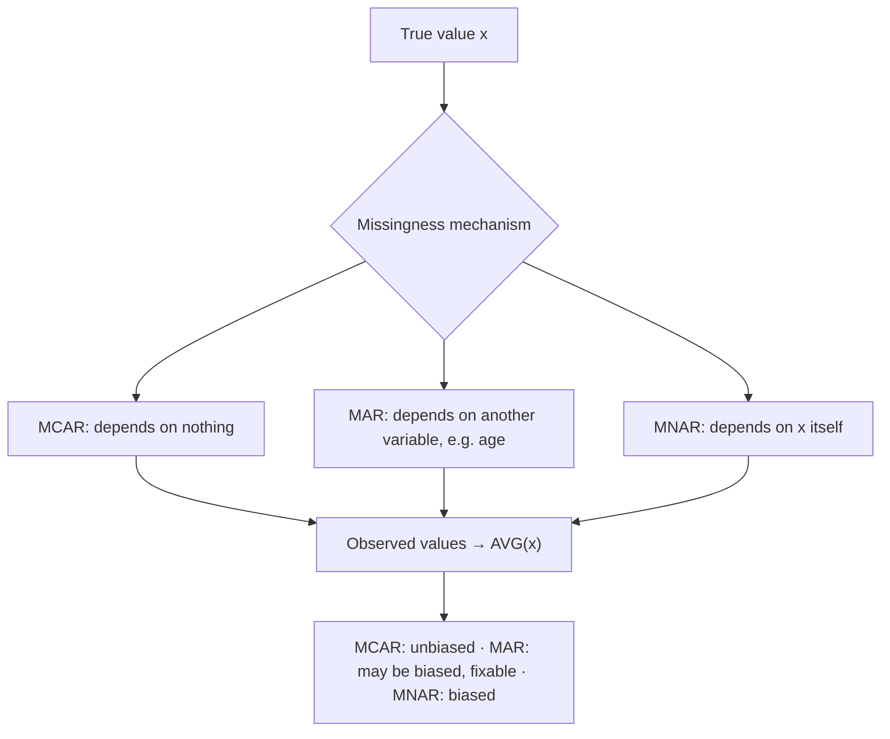

The SQL aggregate function `AVG` computes a mean over the rows that have a value: it divides the sum by `COUNT(column)`, not by `COUNT(*)`, so every NULL cell drops out of the calculation. In statistical terms that is a complete-case analysis. The result is unbiased when data are missing completely at random (MCAR), but it can drift when missingness depends on another variable (MAR) or on the missing value itself (MNAR). On 99 serum calcium values, deleting low values under an MNAR mechanism shifted `AVG` by +2.48 mg/L on average across 2,000 replicates, while losing 30% of values at random shifted it by only +0.01 mg/L. This article is for biology and biomedical students and anyone who works with lab data. It includes a table of how seven aggregate calls behave in SQLite and PostgreSQL, four technical traps, and five check queries you can run.

<div class="callout callout-note">
<p class="callout-title">Quick summary</p>

- `COUNT(*)` counts every row; `COUNT(x)`, `SUM(x)`, `AVG(x)`, `MIN(x)` and `MAX(x)` skip NULL.
- `AVG(x)` = `SUM(x) / COUNT(x)`: a complete-case analysis, safe only when data are missing completely at random.
- SQLite raises no error when `AVG` meets a string such as `'NA'` or `' '`; it counts that string as 0.
- `SUM` over a group with no values returns NULL, not 0; `MIN`/`MAX` on dates are right only when dates are stored as `YYYY-MM-DD`.
- Before you report any mean, report `COUNT(*)`, `COUNT(x)` and the difference between them.

</div>

## 1. Two AVG results for the same column

The practice dataset has 100 serum calcium results (mg/L), listed in full in the article on [sample statistics](/en/blog/3-dac-trung-thong-ke-cua-mot-mau-va-uoc-luong-tham-so-cua-tong-the/). In the spreadsheet, a helper column "calcium > 100 mg/L" keeps the value when the condition holds. Cells that fail the condition are not empty. They hold a single space, the kind of output a formula like `IF(…; value; " ")` produces. To the eye, the cell looks blank.

Load this column into SQLite as TEXT and take the mean: you get 65.85 mg/L, and `COUNT` reports 100 rows with a value. Turn the spaces into NULL with `NULLIF` and run it again: 109.76 mg/L over 60 rows (Table 1). Nobody changed the data. Only the way the "blank" cells were recorded is different.

```sql
-- Table ca(id INTEGER, ca REAL, over100 TEXT); failing cells hold ' '
SELECT COUNT(over100) AS n, ROUND(AVG(over100), 2) AS mean_val
FROM ca;                                   -- 100 | 65.85

SELECT COUNT(NULLIF(over100, ' ')) AS n,
       ROUND(AVG(NULLIF(over100, ' ')), 2) AS mean_val
FROM ca;                                   -- 60 | 109.76
```

**Table 1.** Two `AVG` results on the same "calcium > 100 mg/L" column (SQLite 3.45.3)

| How failing cells are stored | `COUNT(column)` | `AVG(column)` (mg/L) |
|---|---|---|
| A space `' '` (TEXT) | 100 | 65.85 |
| NULL (after `NULLIF`) | 60 | 109.76 |

The example raises two questions. First, how does the database understand "missing"? A space is not NULL, and SQLite counts strings that don't look like numbers as 0 (SQLite, n.d.-a); Section 5 covers this encoding problem. Second, even when the database skips NULL correctly, is the mean of what remains the mean you actually need? Sections 3 and 4 cover the statistics.

## 2. How seven aggregate calls handle NULL

An aggregate function takes many rows and returns one value. The five functions `COUNT`, `SUM`, `AVG`, `MIN` and `MAX`, with three forms of `COUNT`, give seven calls, summarized in Table 2.

`COUNT(*)` counts every row in the group, including rows where every column is NULL. `COUNT(x)` counts only rows where `x` is not NULL. `COUNT(DISTINCT x)` counts distinct values and also skips NULL, so a column holding `A`, `B` and NULL gives `COUNT(DISTINCT x)` = 2 (PostgreSQL Global Development Group, n.d.-b; SQLite, n.d.-a). The difference `COUNT(*) - COUNT(x)` is therefore exactly the number of NULL cells in column `x`, and it is the first number to look at before any mean. Aggregates skip NULL because of how SQL defines NULL: an "unknown" value, not zero and not an empty string, which brings in the three-valued logic discussed in the article on [NULL and three-valued logic](/en/blog/select-and-where-truy-van-co-ban/) (see Libkin, 2016, for a formal treatment).

`SUM(x)` and `AVG(x)` work only on non-NULL values. SQLite defines `avg()` as `total()/count()` (SQLite, n.d.-a), and PostgreSQL states that most aggregate functions ignore null inputs (PostgreSQL Global Development Group, n.d.-b).

When a group has no values at all (an empty table, a `WHERE` that filters everything out, or a column that is entirely NULL), `COUNT` returns 0 while `SUM`, `AVG`, `MIN` and `MAX` return NULL. SQLite explains that `sum()` returns NULL because the SQL standard requires it, and adds a nonstandard `total()` function that returns 0.0 (SQLite, n.d.-a). PostgreSQL notes that, except for `count`, aggregate functions return NULL when no rows are selected, and suggests `coalesce` when you need a zero (PostgreSQL Global Development Group, n.d.-a).

`MIN(x)` and `MAX(x)` return the values that would come first and last if you sorted the column with `ORDER BY`, skipping NULL (SQLite, n.d.-a). So the result depends on how the system compares values (see the article on [ORDER BY](/en/blog/sap-xep-and-tim-kiem/) and Section 5.4).

As for result types, SQLite's `AVG` always returns a floating-point number when there is at least one value (SQLite, n.d.-a), while PostgreSQL's `avg` on an `integer` column returns `numeric` (PostgreSQL Global Development Group, n.d.-a). The biggest difference is in the input type. PostgreSQL defines `avg` and `sum` for numeric types (and `interval`), so a text column matches no function signature (PostgreSQL Global Development Group, n.d.-a). SQLite raises no error: strings and BLOBs that don't look like numbers count as 0 (SQLite, n.d.-a). The 65.85 in Section 1 comes from exactly this.

**Table 2.** How aggregate functions handle NULL, per the documentation (PostgreSQL column from the docs, not yet tested)

| Function | With NULL | Group with no values | SQLite | PostgreSQL 18 |
|---|---|---|---|---|
| `COUNT(*)` | counts NULL rows too | 0 | standard | standard |
| `COUNT(x)` | skips | 0 | standard | standard |
| `COUNT(DISTINCT x)` | skips | 0 | standard | standard |
| `SUM(x)` | skips | NULL | also has `TOTAL(x)`, returns 0.0 | use `coalesce(sum(x), 0)` |
| `AVG(x)` | skips | NULL | = `total()/count()`, always floating point; non-numeric strings count as 0 | numeric types and `interval` only; `avg(integer)` → `numeric` |
| `MIN(x)`, `MAX(x)` | skips | NULL | first/last value in `ORDER BY` order | skips NULL |

## 3. AVG skipping NULL is a complete-case analysis

Let $R_i = 1$ if row $i$ has a value $x_i$ and $R_i = 0$ if $x_i$ is NULL. Then

$$\texttt{AVG}(x) = \frac{\sum_i R_i x_i}{\sum_i R_i}.$$

This is the mean of the observed cases, a complete-case analysis for a single variable. In R, `mean(x, na.rm = TRUE)` does exactly the same calculation (see [handling missing data in R](/en/blog/cac-thao-tac-voi-du-lieu-trong-r/)). SQL has no `na.rm` argument. Skipping NULL is the default, and you don't get to opt in.

Every time you write `AVG(x)` on a column with blank cells, you have quietly chosen a method for handling missing data. The question is whether that method is valid for your data. Rubin (1976) set out the conditions under which the process that produces missing data can be ignored in inference. For sampling-distribution inference, the data must be missing at random and the observed data must be "observed at random." For likelihood or Bayesian inference, the data must be missing at random and the parameters of the missingness process must be distinct from the parameters being estimated. Three labels are in common use today (Little & Rubin, 2019; Schafer & Graham, 2002):

- **MCAR** (missing completely at random): the probability of missingness depends on nothing. Example: a sample tube breaks in transit, unrelated to the patient.
- **MAR** (missing at random): the probability of missingness depends on another variable in the table. Example: younger people are less often ordered a glucose test, so missingness depends on age.
- **MNAR** (missing not at random): the probability of missingness depends on the missing value itself. Example: a concentration below the limit of detection, so no number is recorded.

Concentration data offer clear MNAR examples. In label-free quantitative proteomics, missing values have several different natures (Lazar et al., 2016); peptides below the detection limit are censored values, and ignoring them overestimates abundance (Karpievitch et al., 2012). In occupational hygiene, estimating an average concentration when some samples are nondetectable is a methods problem in its own right (Hornung & Reed, 1990).

These labels describe a mechanism, not a column. No query can look at a column of NULLs and tell you whether it is MCAR or MNAR; the missingness mechanism is an assumption you have to argue from how the data were collected (Schafer & Graham, 2002). The same glucose column with 30% blank cells could be MCAR if the analyzer broke down on a few random days, MAR if physicians rarely order the test for young patients, and MNAR if the lab doesn't record results below the measuring range. To find out which, you have to ask the people who collected the samples, read the protocol, and check the instrument logs. SQL can only help you count and compare (Figure 1).



**Figure 1.** Three missingness mechanisms and their effect on `AVG`.

## 4. Experiment: AVG under MCAR, MAR and MNAR

To put a number on the bias, the article runs two experiments with Python's `sqlite3` module (SQLite 3.45.3), seed 2026. All parameters were chosen by the author for illustration.

### 4.1. Experiment A: simulated glucose

The simulated dataset has 1,000 people aged 20 to 80, with fasting glucose drawn from a normal distribution with mean $5.0 + 0.02 \times (\text{age} - 50)$ mmol/L and standard deviation 1.0. From the complete glucose column, three columns with missing cells were created: MCAR (each value lost with probability 0.3), MAR (lost with probability 0.5 if age is under 40, 0.15 if 40 or older) and MNAR (values below 4.5 mmol/L lost with probability 0.7).

**Table 3.** Results of Experiment A (glucose, mmol/L)

| Column | `COUNT` | `AVG`, single run | Mean bias over 2,000 replicates |
|---|---|---|---|
| Complete | 1,000 | 4.946 | — |
| MCAR | 685 | 4.940 | 0.000 |
| MAR | 727 | 5.024 | +0.064 |
| MAR, stratified by age group | 727 | 4.962 | 0.000 |
| MNAR | 777 | 5.285 | +0.342 |

MCAR wipes out 315 values, yet the mean barely moves. MAR removes many young people, and in the simulation young people have lower glucose, so `AVG` gets pushed up. Because the variable driving the missingness (age) is in the table, you can fix this by stratifying: compute the mean within each age group, then take a weighted average using each group's head count.

```sql
WITH s AS (
  SELECT CASE WHEN age < 40 THEN 'under_40' ELSE 'age_40_plus' END AS age_group,
         COUNT(*)    AS n_group,     -- people in the group, including those missing
         AVG(g_mar)  AS group_mean   -- mean of people with a measurement
  FROM p
  GROUP BY age_group
)
SELECT ROUND(SUM(n_group * group_mean) / SUM(n_group), 3) AS stratified_mean
FROM s;                                    -- 4.962
```

MNAR is a different story. It removes 223 values, most of them low, so `AVG` is off by +0.342 mmol/L on average. Running the same age-stratified query on the MNAR column gives 5.265, which fixes almost nothing, because age is not what causes the missingness.

### 4.2. Experiment B: real calcium values, simulated missingness

Experiment B uses the 99 calcium values from Section 1 (dropping the 6.0 mg/L value, see Section 6), with a true mean of 102.97 mg/L. Across 2,000 replicates, each run creates one MCAR column (30% lost) and one MNAR column (values below 95 mg/L lost with probability 0.7), then computes `AVG` in SQLite.

<div class="callout callout-warning">
<p class="callout-title">The 95 mg/L threshold is an assumption</p>

The author chose this threshold to create an MNAR mechanism. It is not a real detection limit for a calcium assay. The missingness here is simulated on practice data, not real missing data.

</div>

The mean of the 2,000 `AVG` values is 102.97 mg/L under MCAR (bias +0.01; on average 69 values remain per run) and 105.45 mg/L under MNAR (bias +2.48 mg/L; on average 84 values remain). Figure 2 shows the two distributions barely overlap.


**Figure 2.** Distribution of 2,000 `AVG(calcium)` values under MCAR and MNAR; the dashed line is the true mean of the 99 values. Data: serum calcium practice dataset, simulated missingness, seed 2026.

### 4.3. Reading the results

MCAR costs only precision. With fewer values, `AVG` scatters more widely around the true mean (the standard deviation of the 2,000 `AVG` values in Experiment B is 0.70 mg/L), but it doesn't lean either way. The price is a wider confidence interval.

MAR introduces bias, but you can correct it when the variable driving the missingness is in the table. Perkins et al. (2018) showed something similar on epidemiologic data with a known missingness mechanism: under MAR, a naive method produced a spurious effect, while multiple imputation brought the estimate closer to the true value. Stratifying in SQL is a crude version of the same idea, and it only works when the variable driving the missingness is fully recorded.

MNAR biases the mean in a predictable direction. Lose the low values and the mean goes up; lose the high values and it goes down. Stratifying by another variable doesn't help, because the cause of the missingness sits in the very values you can't see. In Figure 2, the MNAR distribution is even narrower than the MCAR one, because each replicate keeps more values (84 versus 69). An `AVG` that looks "stable" can be stably wrong.

Table 3 is a single run (in that run, MCAR was off by −0.006 mmol/L and MAR by +0.078); the bias of each mechanism should be read from the 2,000-replicate column. With real data, the size of the bias depends on the actual mechanism and the actual missing rate.

## 5. Four technical traps unrelated to the missingness mechanism

Unlike the mechanism-driven bias in Sections 3 and 4, the four traps below are encoding errors: the way data are stored, or the way a query is written, makes an aggregate compute the wrong thing. Data cleaning fixes this kind of error completely.

### 5.1. SUM over an all-NULL group returns NULL, not 0

```sql
-- Table t has 3 rows, column x is NULL in all of them
SELECT SUM(x), TOTAL(x), AVG(x), COUNT(x), COUNT(*),
       COALESCE(SUM(x), 0)
FROM t;          -- NULL | 0.0 | NULL | 0 | 3 | 0
```

When you add up weekly case counts or reads per sample, a NULL total spreads into every calculation that uses it. NULL plus 5 is still NULL.

There are two fixes. `COALESCE(SUM(x), 0)` runs on both SQLite and PostgreSQL; `TOTAL(x)` is shorter but exists only in SQLite. Before you apply either one, ask whether 0 means the right thing. If no cases were reported in a week, a total of 0 is correct. If a sample hasn't been sequenced yet, its read count is "no data," and NULL is the honest answer; changing it to 0 turns that sample into one that "expresses nothing."

### 5.2. Strings counted as 0

```sql
-- Column v is TEXT holding '5.2', 'NA', '6.0'
SELECT ROUND(AVG(v), 2), COUNT(v) FROM s;                              -- 3.73 | 3
SELECT ROUND(AVG(NULLIF(v, 'NA')), 2), COUNT(NULLIF(v, 'NA')) FROM s;  -- 5.6 | 2
```

`'NA'` counts as 0, so the mean is (5.2 + 0 + 6.0) / 3 = 3.73 instead of 5.6, and `COUNT` still reports 3 values. This is exactly how the 65.85 in Section 1 came about: 40 spaces were counted as 40 zeros.

Biology spreadsheets often mark missing cells with `NA` (a habit from R, see data types and NA in R), `-`, `n.d.` (not detected), a blank cell, or a space. If you load them into SQLite without declaring column types, these codes stay behind as TEXT. The `typeof(x)` function tells you the storage class of each value; a "numeric" column with `text` rows is a sign that something needs checking. The cleanest fix is to normalize every missing-value code to NULL in one step:

```sql
SELECT ROUND(AVG(CASE WHEN TRIM(v) IN ('NA', '', '-', 'n.d.') THEN NULL
                      ELSE CAST(v AS REAL) END), 2) AS mean_val
FROM s;                                    -- 5.6
```

`n.d.` is a special case. It doesn't mean "unknown" but "below the detection limit," a textbook MNAR value: converting it to NULL fixes the encoding error, but `AVG` still leans upward, as in Section 4.

### 5.3. The wrong denominator: dividing by COUNT(*)

<div class="callout callout-example">
<p class="callout-title">Table of 25 *Coilia grayii*</p>

A table of biological traits for 25 grenadier anchovies (*Coilia grayii*) has a gonad maturity column, `msex`. Fish no. 1 (age 1+) has this cell blank. The reason is unclear; it may be that gonad maturity is hard to assess in young fish, but that is only a hypothesis. The same table appears in the article on [database analysis in Excel](/en/blog/phan-tich-co-so-du-lieu/).

</div>

```sql
SELECT COUNT(*), COUNT(msex),
       ROUND(AVG(msex), 2),                    -- 2.75
       ROUND(SUM(msex) * 1.0 / COUNT(*), 2)    -- 2.64
FROM fish;                                     -- 25 | 24 | 2.75 | 2.64
```

The maturity scores of the 24 fish with data add up to 66. `AVG` divides by 24 and gets 2.75; a hand-written formula that divides by 25 gets 2.64. Dividing by `COUNT(*)` is the same as filling the missing cell with 0, a kind of imputation nobody chose on purpose. The mistake tends to show up when `SUM(x)` and `COUNT(*)` sit side by side in one `SELECT`: fine when you want "the total" and "the number of rows," wrong when you divide one by the other.

Gonad maturity is an ordinal variable (stage 1, 2, 3…), so its mean here only illustrates the arithmetic. For ordinal variables, the median or a frequency table fits better.

### 5.4. MIN and MAX on dates and strings

SQLite has no dedicated date type. Dates are stored as ISO 8601 TEXT (`YYYY-MM-DD HH:MM:SS`), as a real number (Julian day) or as an integer (Unix time) (SQLite, n.d.-b, n.d.-c). `MIN` and `MAX` compare in `ORDER BY` order, so on a TEXT column they compare strings character by character from left to right.

```sql
-- dmy: '20/12/2023', '05/01/2024', '15/03/2024'; iso: the same three dates as YYYY-MM-DD
SELECT MIN(dmy), MAX(dmy), MIN(iso), MAX(iso) FROM d;
-- 05/01/2024 | 20/12/2023 | 2023-12-20 | 2024-03-15
```

With `DD/MM/YYYY`, both `MIN` and `MAX` are wrong, because the string is compared day first and year last. `YYYY-MM-DD` puts the year first, so string order matches chronological order. If your data are already stored as `DD/MM/YYYY`, you can convert on the fly in the query:

```sql
SELECT MIN(substr(dmy, 7, 4) || '-' || substr(dmy, 4, 2) || '-' || substr(dmy, 1, 2)) AS earliest,
       MAX(substr(dmy, 7, 4) || '-' || substr(dmy, 4, 2) || '-' || substr(dmy, 1, 2)) AS latest
FROM d;                                    -- 2023-12-20 | 2024-03-15
```

Numbers stored as strings behave the same way. Fish ages recorded as `'2+'`, `'5+'` and `'10+'` give `MIN` = `'10+'` and `MAX` = `'5+'`, because the character `'1'` sorts before `'2'`. The 25-fish table in Section 5.3 only covers ages 0+ to 5+, so the problem hasn't surfaced there yet. `CAST(age AS INTEGER)` reads the leading digits and gives `MIN` = 2, `MAX` = 10.

Text isn't simple "A to Z" either. The three names `'acetes'`, `'Copepoda'` and `'Ếch'` (Vietnamese for "frog") give `MIN` = `'Copepoda'`, because SQLite's default collation is BINARY, which compares bytes with `memcmp()` (SQLite, n.d.-b), and uppercase letters have smaller codes than lowercase ones. Add `COLLATE NOCASE` and `MIN` becomes `'acetes'`, while `'Ếch'` still sorts last; correct Vietnamese alphabetical order needs a dedicated collation.

**Table 4.** Four technical traps: symptom, how to detect, how to fix

| Trap | Symptom | Detection query | Fix |
|---|---|---|---|
| `SUM` over an all-NULL group | total is NULL, so later calculations are NULL too | `COUNT(x) = 0` in the group | `COALESCE(SUM(x), 0)` or `TOTAL(x)`, only when 0 means the right thing |
| Strings counted as 0 | `AVG` unusually low, `COUNT(x)` equals `COUNT(*)` | `typeof(x)`; count `'NA'`, `' '`, `'-'` | `NULLIF`, `CASE WHEN`, declare types on import |
| `COUNT(*)` as denominator | hand-computed mean smaller than `AVG(x)` | compare `COUNT(*)` with `COUNT(x)` | use `AVG(x)`, or state how missing cells were handled |
| Dates and numbers as strings in `MIN`/`MAX` | the "earliest" date isn't the earliest | look at the first few values under `ORDER BY` | store `YYYY-MM-DD`; `CAST`; `COLLATE` |

## 6. Five checks before you trust a number

Sections 3 and 5 boil down to five steps; the first four are SQL queries:

1. **Measure missingness**: `COUNT(*)`, `COUNT(x)`, the difference and the missing rate for each key column.
2. **Find disguised missing values**: count `'NA'`, `''`, `' '`, `'-'`, `'n.d.'` and any suspicious zeros.
3. **Use MIN/MAX as a quality check**: extremes are where data-entry errors show up most often.
4. **Compare rows with and without a value**: means of other variables split by `x IS NULL`.
5. **Decide how to handle it**: based on the missing rate and the most plausible mechanism.

```sql
-- 1. Missingness in one column
SELECT COUNT(*) AS n_rows, COUNT(msex) AS n_present,
       COUNT(*) - COUNT(msex) AS n_missing,
       ROUND(100.0 * (COUNT(*) - COUNT(msex)) / COUNT(*), 1) AS pct_missing
FROM fish;                                 -- 25 | 24 | 1 | 4.0

-- 2. Disguised missing values in a TEXT column
SELECT SUM(CASE WHEN TRIM(v) IN ('NA', '', '-', 'n.d.') THEN 1 ELSE 0 END) AS n_disguised,
       SUM(v IS NULL) AS n_null
FROM s;                                    -- 1 | 0

-- 3. Extremes
SELECT MIN(ca), MAX(ca), COUNT(*) FROM ca; -- 6.0 | 130.2 | 100

-- 4. Does missingness go with a different age?
SELECT g_mar IS NULL AS is_missing, COUNT(*) AS n, ROUND(AVG(age), 1) AS mean_age
FROM p
GROUP BY is_missing;                       -- 0 | 727 | 53.0  /  1 | 273 | 40.7
```

Step 3 on the calcium data gives `MIN` = 6.0 mg/L, while the other 99 values fall between 79.9 and 130.2 mg/L. Dropping this value moves the mean from 102.00 to 102.97 mg/L and the sample standard deviation from 14.39 down to 10.68. Only the data source can say whether that is an entry error or a different unit. The query only flags it; correcting the number means checking the source and logging the change, following a [documented data-cleaning process](/en/blog/process-data-from-dirty-to-clean/).

Step 4 on Experiment A shows that people missing glucose in the MAR column have a mean age of 40.7, against 53.0 for those with a measurement; in the MCAR column, the two groups are almost the same age (49.4 and 49.7). A clear gap is a sign that missingness depends on age. But two similar groups don't prove MCAR, and observed data cannot tell MAR apart from MNAR (Schafer & Graham, 2002).

Step 5 is where SQL stops. If MCAR is plausible, report `AVG` together with `COUNT(x)` and `COUNT(*)`. Sterne et al. (2009) recommend that any analysis that could be affected by missing data report the number of missing values for each variable of interest, or the number of complete cases for each part of the analysis. If you suspect MAR and know what drives it, stratify as in Section 4.1 or move to multiple imputation in R, for example with the `mice` package (van Buuren & Groothuis-Oudshoorn, 2011), following the practical guidance of White et al. (2011). If you suspect MNAR, as with results below a detection limit, run a sensitivity analysis under a few different assumptions and state the limits clearly.

Multiple imputation isn't always better than complete-case analysis. White and Carlin (2010) compared the bias and efficiency of the two approaches when covariates are missing. Hughes et al. (2019) showed that for most regression models, complete-case analysis is unbiased when the chance of a case being complete doesn't depend on the outcome after accounting for the covariates, including some MNAR situations, while multiple imputation that assumes MAR can be biased. Bartlett et al. (2015) reached a similar result for odds ratios in logistic regression. The common thread: choose the method by the reason data are missing, not by habit.

## 7. Frequently asked questions

**Does `AVG` count NULL cells?** No. `AVG(x)` divides the sum of non-NULL values by the number of non-NULL values, that is, `SUM(x) / COUNT(x)`. If you want missing cells treated as 0, you have to write `AVG(COALESCE(x, 0))` explicitly, and only do that when 0 really is the correct value.

**Does dropping missing rows distort the mean?** Not if the data are missing completely at random. Yes, if missingness is related to another variable or to the missing value itself.

**Can SQL do multiple imputation?** Not out of the box. SQL is good for measuring missingness and simple stratification; do imputation in R or Python.

## Conclusion

`AVG` skipping NULL is a statistical assumption built into the query language. It holds when data are missing completely at random, and it fails systematically when low or high values tend to go missing. No query will tell you which case your data are in. On top of that sits a layer of encoding errors, easier to fix but something you have to check for first.

Before you copy a mean into a report, ask three questions. How much is missing: `COUNT(*) - COUNT(x)`. How is it recorded: true NULL or a disguised string. Why is it missing: SQL can't answer that one. Knowing how the data were produced can.

Missing rates often differ between groups, like the two age groups in the MAR experiment. The next article, on GROUP BY and HAVING, puts `COUNT(x)` into each group so you can see which groups are underrepresented.

## References

Bartlett, J. W., Harel, O., & Carpenter, J. R. (2015). Asymptotically unbiased estimation of exposure odds ratios in complete records logistic regression. *American Journal of Epidemiology, 182*(8), 730–736. https://doi.org/10.1093/aje/kwv114

Hornung, R. W., & Reed, L. D. (1990). Estimation of average concentration in the presence of nondetectable values. *Applied Occupational and Environmental Hygiene, 5*(1), 46–51. https://doi.org/10.1080/1047322X.1990.10389587

Hughes, R. A., Heron, J., Sterne, J. A. C., & Tilling, K. (2019). Accounting for missing data in statistical analyses: Multiple imputation is not always the answer. *International Journal of Epidemiology, 48*(4), 1294–1304. https://doi.org/10.1093/ije/dyz032

Karpievitch, Y. V., Dabney, A. R., & Smith, R. D. (2012). Normalization and missing value imputation for label-free LC-MS analysis. *BMC Bioinformatics, 13*(Suppl 16), S5. https://doi.org/10.1186/1471-2105-13-S16-S5

Lazar, C., Gatto, L., Ferro, M., Bruley, C., & Burger, T. (2016). Accounting for the multiple natures of missing values in label-free quantitative proteomics data sets to compare imputation strategies. *Journal of Proteome Research, 15*(4), 1116–1125. https://doi.org/10.1021/acs.jproteome.5b00981

Libkin, L. (2016). SQL's three-valued logic and certain answers. *ACM Transactions on Database Systems, 41*(1), 1–28. https://doi.org/10.1145/2877206

Little, R. J. A., & Rubin, D. B. (2019). *Statistical analysis with missing data* (3rd ed.). Wiley. https://doi.org/10.1002/9781119482260

Perkins, N. J., Cole, S. R., Harel, O., Tchetgen Tchetgen, E. J., Sun, B., Mitchell, E. M., & Schisterman, E. F. (2018). Principled approaches to missing data in epidemiologic studies. *American Journal of Epidemiology, 187*(3), 568–575. https://doi.org/10.1093/aje/kwx348

PostgreSQL Global Development Group. (n.d.-a). *9.21. Aggregate functions*. PostgreSQL 18 documentation. Retrieved November 24, 2026, from https://www.postgresql.org/docs/18/functions-aggregate.html

PostgreSQL Global Development Group. (n.d.-b). *4.2. Value expressions*. PostgreSQL 18 documentation. Retrieved November 24, 2026, from https://www.postgresql.org/docs/18/sql-expressions.html

Rubin, D. B. (1976). Inference and missing data. *Biometrika, 63*(3), 581–592. https://doi.org/10.1093/biomet/63.3.581

Schafer, J. L., & Graham, J. W. (2002). Missing data: Our view of the state of the art. *Psychological Methods, 7*(2), 147–177. https://doi.org/10.1037/1082-989X.7.2.147

SQLite. (n.d.-a). *Built-in aggregate functions*. Retrieved November 24, 2026, from https://www.sqlite.org/lang_aggfunc.html

SQLite. (n.d.-b). *Datatypes in SQLite*. Retrieved November 24, 2026, from https://www.sqlite.org/datatype3.html

SQLite. (n.d.-c). *Date and time functions*. Retrieved November 24, 2026, from https://www.sqlite.org/lang_datefunc.html

Sterne, J. A. C., White, I. R., Carlin, J. B., Spratt, M., Royston, P., Kenward, M. G., Wood, A. M., & Carpenter, J. R. (2009). Multiple imputation for missing data in epidemiological and clinical research: Potential and pitfalls. *BMJ, 338*, b2393. https://doi.org/10.1136/bmj.b2393

van Buuren, S., & Groothuis-Oudshoorn, K. (2011). mice: Multivariate imputation by chained equations in R. *Journal of Statistical Software, 45*(3), 1–67. https://doi.org/10.18637/jss.v045.i03

White, I. R., & Carlin, J. B. (2010). Bias and efficiency of multiple imputation compared with complete-case analysis for missing covariate values. *Statistics in Medicine, 29*(28), 2920–2931. https://doi.org/10.1002/sim.3944

White, I. R., Royston, P., & Wood, A. M. (2011). Multiple imputation using chained equations: Issues and guidance for practice. *Statistics in Medicine, 30*(4), 377–399. https://doi.org/10.1002/sim.4067
