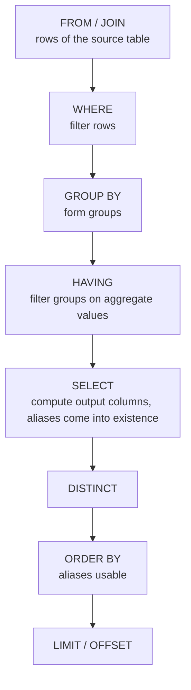
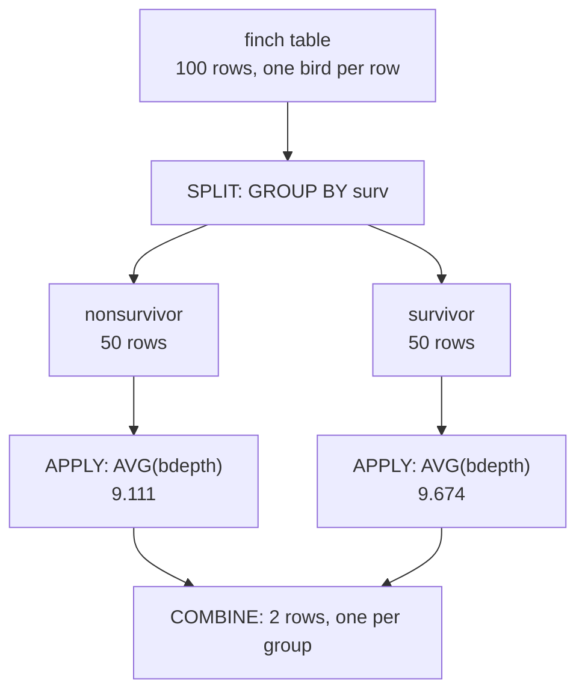

`GROUP BY` splits the rows of a table into groups by the value of a grouping key, computes aggregate functions for each group, and returns exactly one row per group; `HAVING` filters groups after aggregation, while `WHERE` filters rows before grouping. According to the PostgreSQL and SQL Server documentation, a `SELECT` statement is processed logically in the order FROM → WHERE → GROUP BY → HAVING → SELECT → DISTINCT → ORDER BY → LIMIT, which is quite different from the order in which it is written. On a dataset of 100 medium ground finches (*Geospiza fortis*), a single `GROUP BY` query gives a mean beak depth of 9.111 mm for birds that died in the drought and 9.674 mm for survivors. This article is for biology students and bioinformatics newcomers who already know `SELECT`, `WHERE`, and aggregate functions, and it includes experiments in SQLite and the equivalent workflow in R.

<div class="callout callout-note">
<p class="callout-title">Quick summary</p>

- `WHERE` filters rows before grouping; `HAVING` filters groups after aggregates are computed; `FILTER` restricts the input of a single aggregate.
- Logical processing order: FROM → WHERE → GROUP BY → HAVING → SELECT → ORDER BY → LIMIT. Under the standard, a SELECT alias does not exist yet in WHERE.
- SQLite is more permissive than the standard: it accepts aliases in WHERE and non-grouped ("bare") columns, and it has no ROLLUP.
- In R, `tapply`, `aggregate`, and `dplyr` treat NA differently; always state how missing values were handled.
- `HAVING COUNT(*) >= k` is a sample-size decision and belongs in your methods section.

</div>

## 1. What GROUP BY does: from one row per individual to one row per group

Biological data tables usually hold one row per bird, fish, or RNA-seq sample, yet the scientific question is about groups: do surviving birds have deeper beaks than birds that died? Aggregate functions such as `COUNT`, `AVG`, and `SUM` (→ [Aggregate functions](/en/blog/ham-tong-hop-aggregate/)) answer half of that question. Used on their own, they collapse the **whole table** into exactly one row, even when the table is empty (SQLite, n.d.-d):

```sql
SELECT COUNT(*), AVG(bdepth) FROM finch;                   -- 100 | 9.3924
SELECT COUNT(*), AVG(bdepth) FROM finch WHERE mass > 100;  -- 0   | NULL
```

`GROUP BY` adds a splitting step. Each row is assigned to a group by the value of the grouping expression; rows with the same value land in the same group, and the aggregate is computed separately within each group (SQLite, n.d.-d). The `finch` table below is an educational dataset from HHMI BioInteractive (2021), drawn from Peter and Rosemary Grant's data: 100 medium ground finches measured on Daphne Major, 50 that died in the 1977 drought and 50 that survived (→ Natural selection in Darwin's finches).

```sql
SELECT surv,
       COUNT(*)              AS n,
       ROUND(AVG(mass), 3)   AS mean_mass_g,
       ROUND(AVG(bdepth), 3) AS mean_bdepth_mm
FROM finch
GROUP BY surv
ORDER BY surv;
```

**Table 1.** Mean body mass and beak depth by survival group (SQLite 3.45.3)

| surv | n | mean_mass_g | mean_bdepth_mm |
| --- | --- | --- | --- |
| nonsurvivor | 50 | 15.713 | 9.111 |
| survivor | 50 | 16.994 | 9.674 |

The grouping key can be an **expression**, not just a column name. `GROUP BY strftime('%Y-%m', ngay_lay_mau)` groups samples by month; `GROUP BY CAST(l_cm AS INTEGER)` groups fish into 1 cm length bins, which yields a frequency table like the one Excel's Histogram tool produces (→ [Database analysis in Excel](/en/blog/phan-tich-co-so-du-lieu/)). For 25 *Coilia grayii* fish, the query below returns 8 bins from 15 to 22 cm, and the most crowded is the 21 cm bin with 6 fish:

```sql
SELECT CAST(l_cm AS INTEGER) AS l_bin, COUNT(*) AS n
FROM coilia
GROUP BY l_bin
ORDER BY l_bin;
```

A grouping key can also span several columns: `GROUP BY surv, sex` creates one group for each combination of values that is **actually present** in the data. A combination with no rows does not show up. Within a grouping key, NULL values are treated as equal and collected into one group (SQLite, n.d.-d), unlike the ordinary `=` comparison (→ [NULL and three-valued logic](/en/blog/select-and-where-truy-van-co-ban/)).

A `GROUP BY` query with no aggregate, such as `SELECT surv FROM finch GROUP BY surv`, returns the same result as `SELECT DISTINCT surv FROM finch`. When all you want is a list of distinct values, `DISTINCT` states the intent more clearly.

`GROUP BY` **makes no promise about row order**. The PostgreSQL documentation says that without `ORDER BY`, rows come back in whatever order the system finds fastest to produce (PostgreSQL Global Development Group, n.d.-c). If the printed table needs an order, write `ORDER BY` (→ [Sorting and searching](/en/blog/sap-xep-and-tim-kiem/)).

## 2. The logical processing order of a SELECT statement

A `SELECT` statement is **written** in the order SELECT → FROM → WHERE → GROUP BY → HAVING → ORDER BY → LIMIT, but it is **processed logically** in a different order. The PostgreSQL 18 documentation lists the steps as `WITH`, `FROM`, `WHERE`, `GROUP BY` and `HAVING`, the `SELECT` list, `DISTINCT`, `UNION`/`INTERSECT`/`EXCEPT`, `ORDER BY`, and then `LIMIT`/`OFFSET` (PostgreSQL Global Development Group, n.d.-c). SQL Server calls this the "binding" order: FROM, ON, JOIN, WHERE, GROUP BY, WITH CUBE/ROLLUP, HAVING, SELECT, DISTINCT, ORDER BY, TOP (Microsoft, 2026).

**Table 2.** Written order versus logical processing order

| Step | Written order | Logical processing order | What exists at this step |
| --- | --- | --- | --- |
| 1 | SELECT | FROM (and JOIN) | rows of the source table |
| 2 | FROM | WHERE | filtered rows, no groups yet |
| 3 | WHERE | GROUP BY | groups |
| 4 | GROUP BY | HAVING | aggregate values for each group |
| 5 | HAVING | SELECT | output columns and aliases |
| 6 | ORDER BY | DISTINCT | distinct output rows |
| 7 | LIMIT | ORDER BY, then LIMIT | order and number of returned rows |

"Logical processing order" is a more accurate phrase than "execution order." The list is a rule about **name scope**: at each step, which names already exist and which do not. It is not the machine's run schedule.



### Reading a query in logical order

The query below runs on the 25-fish *C. grayii* table. Read it in logical order, one step at a time:

```sql
SELECT main_food, COUNT(*) AS n, ROUND(AVG(l_cm), 2) AS mean_l
FROM coilia
WHERE l_cm >= 17
GROUP BY main_food
HAVING COUNT(*) >= 3
ORDER BY mean_l DESC
LIMIT 2;
-- Acetes   | 6 | 21.18
-- Copepoda | 6 | 19.07
```

FROM takes 25 rows. WHERE drops three fish shorter than 17 cm, leaving 22 rows. GROUP BY splits those 22 rows into six diet groups: Copepoda, Cladocera, and Acetes with 6 fish each, Polychaeta with 2, and Mysis and Amphipoda with 1 each. HAVING keeps the three groups with at least 3 fish. SELECT computes `n` and `mean_l` for those three. ORDER BY sorts by `mean_l` in descending order, and only at this step can the alias `mean_l` be used. LIMIT keeps the first two rows. Copepoda has 9 fish in the full table but only 6 here, because all three fish removed by WHERE ate Copepoda; its mean length also shifts from 18.00 to 19.07 cm.

### Consequence 1: aggregates cannot go in WHERE

`WHERE` decides which rows enter the aggregation, so it cannot use the result of that same aggregation (PostgreSQL Global Development Group, n.d.-a). SQLite rejects it immediately:

```sql
SELECT tissue FROM expr WHERE AVG(tpm) > 1000;
-- Error: misuse of aggregate function AVG()
```

A condition on an aggregate value belongs in `HAVING`.

### Consequence 2: aliases do not exist yet in WHERE

Aliases are assigned at the SELECT step, which comes after WHERE, GROUP BY, and HAVING. PostgreSQL states it plainly: an output column name can be used in `ORDER BY` and `GROUP BY`, but not in `WHERE` or `HAVING`, where you have to write out the expression instead (PostgreSQL Global Development Group, n.d.-c). SQL Server is even more explicit: because `WHERE`, `GROUP BY`, and `HAVING` are bound before `SELECT`, an alias defined in `SELECT` cannot be used in those three clauses, only in `ORDER BY` (Microsoft, 2026). An alias in `GROUP BY` is an extension beyond SQL-92 (PostgreSQL Global Development Group, n.d.-c); MySQL allows aliases in both `GROUP BY` and `HAVING` (Oracle, n.d.-b).

SQLite is more lenient: aliases work even in `WHERE`, a feature dating back to version 2.2.4 (SQLite, n.d.-c). This is SQLite's own extension, not standard behavior. The query below runs in SQLite, but according to the documentation PostgreSQL would reject it; if the query has to run in more than one place, repeat the expression `tpm * 2 > 50000` in `WHERE`:

```sql
SELECT sample, gene, tpm * 2 AS tpm2
FROM expr
WHERE tpm2 > 50000;   -- SQLite: 3 rows
```

### Consequence 3: logical, not physical

SQL Server notes that the actual order can differ from the binding list (Microsoft, 2026). The optimizer is free to rearrange steps as long as the result stays the same (Chaudhuri, 1998). For example, since version 3.19.0, SQLite automatically moves a `HAVING` condition that uses only grouping columns into `WHERE` so rows are filtered early (SQLite, n.d.-c). The logical order is a model for **reasoning** about results; the execution plan (`EXPLAIN`) is the tool for **tuning** speed.

## 3. WHERE, HAVING, and FILTER: filtering rows, groups, and inputs

`WHERE` selects rows before grouping, and `HAVING` selects groups after aggregates are computed (PostgreSQL Global Development Group, n.d.-a). A condition that needs no aggregate should go in `WHERE`. PostgreSQL notes that this is more efficient, because rows removed early never pass through the grouping step (PostgreSQL Global Development Group, n.d.-a).

`HAVING` does not require `GROUP BY`. Without `GROUP BY`, PostgreSQL treats all selected rows as a single group, and the query returns one row if the condition is true and no rows if it is false (PostgreSQL Global Development Group, n.d.-c). SQLite has allowed this only since version 3.39.0 (SQLite, n.d.-c). In the SQLite 3.37.0 CLI that ships with macOS, the query below fails with "a GROUP BY clause is required before HAVING"; in SQLite 3.45.3, bundled with Python, it returns 10:

```sql
SELECT COUNT(*) AS n FROM expr HAVING COUNT(*) > 5;
```

`FILTER` works at a third level: it filters only the input of one aggregate, while the other aggregates in the same row still see every row in the group (PostgreSQL Global Development Group, n.d.-a). SQLite supports this syntax too (SQLite, n.d.-a). Here is how to count males and females in the same row for each survival group:

```sql
SELECT surv,
       COUNT(*)                               AS n,
       COUNT(*) FILTER (WHERE sex = 'male')   AS n_male,
       COUNT(*) FILTER (WHERE sex = 'female') AS n_female,
       ROUND(AVG(bdepth), 3)                  AS mean_bdepth
FROM finch
GROUP BY surv
ORDER BY surv;
-- nonsurvivor | 50 | 20 | 10 | 9.111
-- survivor    | 50 | 27 |  9 | 9.674
```

With `WHERE sex = 'male'` instead, both `n` and `mean_bdepth` would be computed on males only.

**Table 3.** Three places to filter

| | WHERE | HAVING | FILTER |
| --- | --- | --- | --- |
| What it filters | rows | groups | the input of one aggregate |
| When | before GROUP BY | after aggregates are computed | while that aggregate is computed |
| Aggregates allowed in the condition | no | yes | no |
| Example | `WHERE mass IS NOT NULL` | `HAVING COUNT(*) >= 10` | `COUNT(*) FILTER (WHERE sex = 'male')` |

A `WHERE col IS NOT NULL` filter before aggregation is usually redundant for `SUM` and `AVG`, because both already ignore NULL (SQLite, n.d.-a). It only changes `COUNT(*)`. In the simulated `expr` table in section 6, the Liver tissue has 4 rows but only 3 TPM values: `COUNT(*)` = 4, `COUNT(tpm)` = 3, and `AVG(tpm)` = 13,833.83 with or without the filter.

One more SQLite detail: if `HAVING` contains a non-aggregate expression on a non-grouped column, that expression is evaluated on an arbitrarily chosen row of the group (SQLite, n.d.-d). That is one more reason to put ordinary conditions in `WHERE`.

<div class="callout callout-warning">
<p class="callout-title">Common filtering mistakes</p>

- `HAVING sex = 'male'` while grouping by `surv`: SQLite still runs it, but checks the condition against an arbitrary row of the group. Put it in `WHERE`.
- `HAVING n_measured >= 3` (an alias): runs in SQLite and MySQL, not in PostgreSQL. Write `HAVING COUNT(tpm) >= 3`.

</div>

## 4. Foundations: relational algebra and the split-apply-combine strategy

Codd's (1970) relational model treats a table as a relation, that is, a set of tuples. The original relational algebra had selection, projection, and join, but no grouping or aggregate functions. Klug (1982) examined relational algebra and relational calculus extended with aggregate functions and showed that the two languages remain equivalent. The practical consequence: the result of `GROUP BY` is itself a relation, so it can feed another query through a subquery or a CTE (→ [CTEs and set operations](/en/blog/cte-and-set-operations/)).

Wickham (2011) named the general pattern the **split-apply-combine strategy**: break a big problem into pieces, operate on each piece independently, then put the results back together. Mapped onto SQL, split is `GROUP BY`, apply is the aggregate function, and combine is the result table with one row per group.



MapReduce follows the same template: map emits key–value pairs, the system groups them by key, and reduce combines each group (Dean & Ghemawat, 2008).

`GROUP BY` is only easy when the data are tidy, with one variable per column and one observation per row (Wickham, 2014). A "gene × sample" expression matrix (one column per sample) has to be reshaped into the long form `(sample, tissue, gene, tpm)` before you can group by tissue (→ [Data frames and tidy data](/en/blog/data-frames/)).

## 5. Non-grouped columns: the standard, functional dependency, and "bare columns"

The familiar rule: every column in `SELECT` must appear in `GROUP BY` or inside an aggregate function. The reason is determinism. A non-grouped column can hold several values within one group, and the database has no way to know which one to return.

PostgreSQL enforces this rule with one exception: a non-grouped column is allowed if it is **functionally dependent** on the grouping columns. PostgreSQL recognizes functional dependency only when the table's primary key is in `GROUP BY` (PostgreSQL Global Development Group, n.d.-c). For example, `GROUP BY band`, with `band` as the primary key, lets you also select `sex`, because each `band` has only one sex.

MySQL 8.4 enables `ONLY_FULL_GROUP_BY` mode by default and also detects functional dependency. When you know a column has only one value per group but MySQL cannot infer it, you can wrap the column in `ANY_VALUE()`. If the mode is disabled, the server is free to choose any value in the group (Oracle, n.d.-b).

SQLite **does not check** the rule at all (SQLite, n.d.-b). A non-grouped column, called a "bare column," takes its value from an arbitrary row of the group. On the `expr` table:

```sql
SELECT tissue, gene, AVG(tpm) AS mean_tpm
FROM expr
GROUP BY tissue;
-- Liver     | ALB | 13833.83
-- Pancreas  | INS | 24166.67
-- Pituitary | GH1 | 20500.2
```

The query runs with no warning. The Pancreas tissue has two genes, yet the `gene` column shows only INS while `mean_tpm` is computed over both INS and PRSS1; a reader could easily take it to mean "INS in the pancreas has a mean TPM of 24,166." PostgreSQL would reject this query.

There is one deliberate exception: when the query has exactly one `min()` or `max()`, bare columns come from the row holding the extreme value; if several rows tie for that value, the choice is still arbitrary (SQLite, n.d.-b, n.d.-d).

```sql
SELECT surv, band, MAX(bdepth) AS max_bdepth
FROM finch
GROUP BY surv;
-- nonsurvivor |  283 | 11.2
-- survivor    | 1019 | 11.21
```

This result is correct because there are no ties, but it will not run in PostgreSQL. The portable approach is the window function `ROW_NUMBER()`, which numbers the rows within each group so you can keep row 1 (→ [Window functions](/en/blog/window-functions/)). The second `band` column in `ORDER BY` is a tiebreaker, so the result stays deterministic even if two birds share the same beak depth:

```sql
SELECT surv, band, bdepth
FROM (
  SELECT surv, band, bdepth,
         ROW_NUMBER() OVER (PARTITION BY surv ORDER BY bdepth DESC, band) AS rn
  FROM finch
)
WHERE rn = 1
ORDER BY surv;
-- nonsurvivor |  283 | 11.2
-- survivor    | 1019 | 11.21
```

The two tools differ in their output. `GROUP BY` collapses each group into one row. A window function also computes over the group but keeps every row.

## 6. Experiment: the same SQL across several database systems

The test table `expr(sample, tissue, gene, tpm)` is **simulated** data with 10 rows, including two NULL values. The TPM numbers are for illustration only and do not come from GTEx or any study:

```sql
CREATE TABLE expr (sample TEXT, tissue TEXT, gene TEXT, tpm REAL);
INSERT INTO expr VALUES
 ('S1','Liver','ALB',18500),     ('S1','Liver','INS',1.5),
 ('S2','Liver','ALB',23000),     ('S2','Liver','INS',NULL),
 ('S3','Pancreas','INS',15200),  ('S3','Pancreas','PRSS1',30500),
 ('S4','Pancreas','INS',NULL),   ('S4','Pancreas','PRSS1',26800),
 ('S5','Pituitary','GH1',41000), ('S5','Pituitary','INS',0.4);
```

Ten queries were actually run on SQLite 3.45.3 (Python's `sqlite3` module) and SQLite 3.37.0 (the CLI that ships with macOS) on November 25, 2026. The PostgreSQL and MySQL columns are based on the official documentation and were not run.

**Table 4.** Ten queries × database systems (✅ runs, ❌ error, ⚠️ runs but the result is nondeterministic)

| # | Query | SQLite 3.37.0 | SQLite 3.45.3 | PostgreSQL 18 (docs) | MySQL 8.4 (docs) |
| --- | --- | --- | --- | --- | --- |
| 1 | alias in WHERE | ✅ | ✅ | ❌ | – |
| 2 | alias in GROUP BY | ✅ | ✅ | ✅ | ✅ |
| 3 | alias in HAVING | ✅ | ✅ | ❌ | ✅ |
| 4 | alias with the same name as an input column in GROUP BY | groups by the input column | groups by the input column | groups by the input column | – |
| 5 | HAVING without GROUP BY | ❌ | ✅ | ✅ | – |
| 6 | non-grouped column | ⚠️ | ⚠️ | ❌ (except functional dependency) | ❌ with ONLY_FULL_GROUP_BY on |
| 7 | aggregate in WHERE | ❌ | ❌ | ❌ | ❌ |
| 8 | `COUNT(*) FILTER (WHERE …)` | ✅ | ✅ | ✅ | – |
| 9 | `GROUP BY ROLLUP(…)` | ❌ | ❌ | ✅ | ✅ |
| 10 | `GROUPING SETS` | ❌ | ❌ | ✅ | – |

Sources for the PostgreSQL column: PostgreSQL Global Development Group (n.d.-a, n.d.-b, n.d.-c). MySQL column: Oracle (n.d.-a, n.d.-b). A dash means the documentation pages consulted do not cover the case. Query 7 fails everywhere for the same logical reason.

The most surprising result is query 4:

```sql
SELECT substr(tissue, 1, 1) AS tissue, COUNT(*) AS n
FROM expr
GROUP BY tissue
ORDER BY 1;
-- L | 4
-- P | 4
-- P | 2
```

The two "P" rows show that `GROUP BY tissue` groups by the **input column** (three tissues), not by the alias (two letters). PostgreSQL documents exactly this rule: when a name is ambiguous, `GROUP BY` reads it as an input column and `ORDER BY` reads it as an output column (PostgreSQL Global Development Group, n.d.-c). Both SQLite versions tested behave the same way. The simple fix: don't give an alias the same name as a column.

Table 4 shows two kinds of difference. The first lies **between database systems**: a query drafted in SQLite can break when moved to PostgreSQL. The second lies **between versions** of the same system: SQLite 3.37.0 and 3.45.3 give different results for query 5. To find out which version you are running, type `SELECT sqlite_version();`.

## 7. The R equivalents: tapply, aggregate, and dplyr

R has at least three ways to do split-apply-combine:

- `tapply(x, group, FUN)` works on vectors (→ [Functions and the apply family in R](/en/blog/functions/)).
- `aggregate()` comes in two forms. The formula form `aggregate(y ~ g, data, FUN)` defaults to `na.action = na.omit`, so it only considers complete rows; the data frame form `aggregate(x, by, FUN)` drops rows with NA in the grouping variable (R Core Team, n.d.).
- `dplyr::group_by() |> summarise()` returns one row for each combination of grouping variables (Wickham et al., n.d.); dplyr is part of the tidyverse ecosystem (Wickham et al., 2019).

Run on the same `expr` table with R 4.4.3 and dplyr 1.2.1:

```r
library(dplyr)
d <- data.frame(
  sample = c("S1","S1","S2","S2","S3","S3","S4","S4","S5","S5"),
  tissue = c("Liver","Liver","Liver","Liver","Pancreas","Pancreas",
             "Pancreas","Pancreas","Pituitary","Pituitary"),
  gene   = c("ALB","INS","ALB","INS","INS","PRSS1","INS","PRSS1","GH1","INS"),
  tpm    = c(18500, 1.5, 23000, NA, 15200, 30500, NA, 26800, 41000, 0.4)
)
tapply(d$tpm, d$tissue, mean)                       # NA for Liver, Pancreas
tapply(d$tpm, d$tissue, mean, na.rm = TRUE)         # 13833.83 24166.67 20500.20
aggregate(tpm ~ tissue, data = d, FUN = mean)       # drops incomplete rows
aggregate(d$tpm, by = list(tissue = d$tissue), FUN = mean)  # NA
d |> group_by(tissue) |> summarise(mean_tpm = mean(tpm))    # NA
```

**Table 5.** The same question, "mean TPM by tissue": SQL and five ways in R

| Method | Liver | Pancreas | Pituitary |
| --- | --- | --- | --- |
| SQL `AVG(tpm) … GROUP BY tissue` | 13,833.83 | 24,166.67 | 20,500.2 |
| `tapply(…, mean)` | NA | NA | 20,500.2 |
| `tapply(…, mean, na.rm = TRUE)` | 13,833.83 | 24,166.67 | 20,500.2 |
| `aggregate(tpm ~ tissue, …)` | 13,833.83 | 24,166.67 | 20,500.2 |
| `aggregate(d$tpm, by = …)` | NA | NA | 20,500.2 |
| `summarise(mean(tpm))` | NA | NA | 20,500.2 |

One question, two kinds of answer: full numbers for all three tissues, or NA for Liver and Pancreas. SQL silently skips NULL (SQLite, n.d.-a). R's `mean()`, by default, returns NA as soon as it meets a missing value.

To map this onto SQL clauses: `filter()` before `summarise()` acts like `WHERE`, and `filter()` after `summarise()` acts like `HAVING`:

```r
d |>
  group_by(tissue) |>
  summarise(n = n(), n_tpm = sum(!is.na(tpm)),
            mean_tpm = mean(tpm, na.rm = TRUE)) |>
  filter(n_tpm >= 3)          # keeps Liver and Pancreas
```

When you group by several variables, `summarise()` defaults to `.groups = "drop_last"`: it drops the last grouping level, keeps the others, and prints a message (Wickham et al., n.d.). The result is still grouped by `tissue`, so a following `mutate()` will compute within each tissue. To drop all grouping, set `.groups = "drop"` explicitly.

Excel does the same job: the Rows field of a PivotTable is `GROUP BY`, the Values box holds the aggregate, and the PivotTable filter or Advanced Filter plays the role of `WHERE` (→ [Database analysis in Excel](/en/blog/phan-tich-co-so-du-lieu/)).

## 8. Generalizing: ROLLUP, CUBE, and GROUPING SETS

A subtotal table is familiar to anyone who has used a PivotTable: a total row for each group plus a grand total. Gray and colleagues (1997) pointed out that standard `GROUP BY` only supports zero- or one-dimensional aggregation, and they proposed the **data cube** operator, which generalizes `GROUP BY`, cross-tabs, and sub-totals; the key point is that the cube is still a relation. The ICDE 1996 conference paper presents the same idea (Gray et al., 1996).

In modern SQL, `ROLLUP(a, b, c)` is equivalent to `GROUPING SETS ((a, b, c), (a, b), (a), ())`, and `CUBE(a, b, c)` produces every subset of the three columns. In subtotal rows, columns that do not take part in the grouping show NULL (PostgreSQL Global Development Group, n.d.-b). Those NULLs are easy to confuse with real NULLs in the data, so use the `GROUPING()` function to tell them apart (PostgreSQL Global Development Group, n.d.-b; Oracle, n.d.-a). MySQL 8.4 supports `WITH ROLLUP`, `ROLLUP()`, and `GROUPING()` (Oracle, n.d.-a).

SQLite does not have these operators yet. You can emulate them with a `UNION ALL` of several `GROUP BY` queries:

```sql
SELECT surv, sex, n, mean_bdepth FROM (
  SELECT 0 AS lvl, surv, sex, COUNT(*) AS n, ROUND(AVG(bdepth), 3) AS mean_bdepth
  FROM finch GROUP BY surv, sex
  UNION ALL
  SELECT 1, surv, '(all)', COUNT(*), ROUND(AVG(bdepth), 3)
  FROM finch GROUP BY surv
  UNION ALL
  SELECT 2, '(all)', '(all)', COUNT(*), ROUND(AVG(bdepth), 3)
  FROM finch
) ORDER BY lvl = 2, surv, lvl, sex;
```

**Table 6.** Beak depth by survival × sex, with subtotals

| surv | sex | n | mean_bdepth (mm) |
| --- | --- | --- | --- |
| nonsurvivor | female | 10 | 8.930 |
| nonsurvivor | male | 20 | 9.165 |
| nonsurvivor | unknown | 20 | 9.147 |
| nonsurvivor | (all) | 50 | 9.111 |
| survivor | female | 9 | 9.583 |
| survivor | male | 27 | 9.991 |
| survivor | unknown | 14 | 9.121 |
| survivor | (all) | 50 | 9.674 |
| (all) | (all) | 100 | 9.392 |

Means **do not roll up**. The survivor mean is 9.674 mm, while the plain average of the three subgroup means (9.583, 9.991, 9.121) is only 9.565 mm, because the three subgroups contain 9, 27, and 14 birds. A subtotal row has to be recomputed from the raw data.

## 9. Biological applications

### 9a. Finches on Daphne Major

Boag and Grant (1981) described intense natural selection in a population of Darwin's finches in the Galápagos: survival through the drought was not random, and large birds, especially males with large beaks, survived best. Table 1 shows that trend in the 100-bird dataset; Table 6 shows how uneven the group sizes become once you also split by sex: 10 females, 20 males, and 20 "unknown" among nonsurvivors; 9 females, 27 males, and 14 "unknown" among survivors.

```sql
SELECT surv, sex, COUNT(*) AS n, ROUND(AVG(bdepth), 3) AS mean_bdepth
FROM finch
GROUP BY surv, sex
HAVING COUNT(*) >= 10
ORDER BY surv, sex;
```

A threshold of 10 removes the surviving females (n = 9). The threshold is a scientific decision, not a syntax detail: set it too low and the means of small groups swing widely; set it too high and you lose biologically meaningful groups. Choose the threshold before looking at the results, state it in your methods, and report the groups it removed.

This section uses descriptive statistics only, to illustrate the technique; testing the difference between the two groups is the job of the Darwin's finches article.


**Figure 1.** Beak depth of 100 *G. fortis* finches by survival × sex group. Black bars are group means; gray × marks show the group removed by `HAVING COUNT(*) >= 10`. Data: HHMI BioInteractive (2021).

"unknown" is a real value, meaning the bird's sex could not be determined; it is not NULL. It forms its own group like any other. Converting it to NULL would blur that meaning.

### 9b. *Coilia grayii* fish

The 25-fish *Coilia grayii* table (→ [Database analysis in Excel](/en/blog/phan-tich-co-so-du-lieu/)) grouped by main diet gives: Copepoda, 9 fish, mean length 18.00 cm; Cladocera, 6 fish, 18.52 cm; Acetes, 6 fish, 21.18 cm; Polychaeta, 2 fish; Amphipoda and Mysis, 1 fish each. `HAVING COUNT(*) >= 3` keeps the first three groups.

Grouped by age: the 1+ group has only 1 fish, and that fish's gonad maturity cell is empty, so `COUNT(*)` = 1 while `COUNT(msex)` = 0. Age is stored as text, "0+" and "1+": sorting as text happens to work here, but "10+" would sort before "2+" (→ [Data types](/en/blog/basic-data-types/)).

### 9c. Gene expression by tissue

For multi-tissue expression data such as GTEx (The GTEx Consortium, 2020) in long format, the natural aggregation is `GROUP BY tissue, gene`. TPM distributions are often right-skewed; in that case the median is pulled around less by a few extreme values than the mean is. The SQLite CLI has had `median()` since version 3.47.0; from 3.51.0 the percentile extension is included in the amalgamation but disabled by default (SQLite, n.d.-c). Large expression matrices are better left to Bioconductor's data structures (Huber et al., 2015); SQL suits sample metadata tables and result tables.

## 10. Checklist for reproducible aggregate queries

1. Every column in `SELECT` appears in `GROUP BY` or inside an aggregate, so the query runs in PostgreSQL (PostgreSQL Global Development Group, n.d.-c).
2. Row conditions go in `WHERE`; only conditions on aggregates go in `HAVING` (PostgreSQL Global Development Group, n.d.-a).
3. State how NULL/NA was handled: `COUNT(*)` versus `COUNT(col)`, `na.rm` in R, `na.action` in `aggregate` (SQLite, n.d.-a; R Core Team, n.d.).
4. Report `COUNT(*)` next to every mean; state and justify any `HAVING` threshold.
5. Always include `ORDER BY` when presenting results; when you use `LIMIT`, add a tiebreaker column so the result does not change between runs.
6. Record the versions of the database system and R packages, and store scripts alongside the data (Sandve et al., 2013).

## 11. Conclusion

`GROUP BY` is how SQL does split-apply-combine, the same template as `tapply`, `aggregate`, `dplyr`, and the PivotTable. When an aggregate query throws an error or returns odd numbers, read it in the logical processing order from section 2: most mistakes come from using a name before the step that creates it, such as an aggregate in `WHERE` or an alias in `HAVING`. Database systems, including the two SQLite versions in Table 4, differ on exactly these details. So before an aggregate table goes into a report, run through the checklist in section 10 and record the output of `SELECT sqlite_version();` or the version of whatever database system you use.

The next article in the series joins multiple tables with JOIN (→ [JOIN](/en/blog/join-ket-hop-nhieu-bang/)), followed by window functions, which compute over groups without collapsing rows.

## References

Boag, P. T., & Grant, P. R. (1981). Intense natural selection in a population of Darwin's finches (Geospizinae) in the Galápagos. *Science, 214*(4516), 82–85. https://doi.org/10.1126/science.214.4516.82

Chaudhuri, S. (1998). An overview of query optimization in relational systems. In *Proceedings of the Seventeenth ACM SIGACT-SIGMOD-SIGART Symposium on Principles of Database Systems* (pp. 34–43). ACM. https://doi.org/10.1145/275487.275492

Codd, E. F. (1970). A relational model of data for large shared data banks. *Communications of the ACM, 13*(6), 377–387. https://doi.org/10.1145/362384.362685

Dean, J., & Ghemawat, S. (2008). MapReduce: Simplified data processing on large clusters. *Communications of the ACM, 51*(1), 107–113. https://doi.org/10.1145/1327452.1327492

Gray, J., Bosworth, A., Layman, A., & Pirahesh, H. (1996). Data cube: A relational aggregation operator generalizing GROUP-BY, CROSS-TAB, and SUB-TOTALS. In *Proceedings of the Twelfth International Conference on Data Engineering* (pp. 152–159). IEEE. https://doi.org/10.1109/ICDE.1996.492099

Gray, J., Chaudhuri, S., Bosworth, A., Layman, A., Reichart, D., Venkatrao, M., Pellow, F., & Pirahesh, H. (1997). Data cube: A relational aggregation operator generalizing group-by, cross-tab, and sub-totals. *Data Mining and Knowledge Discovery, 1*(1), 29–53. https://doi.org/10.1023/A:1009726021843

HHMI BioInteractive. (2021). *Evolution in action: Data analysis* [Student handout, version 2]. Howard Hughes Medical Institute. https://www.biointeractive.org/classroom-resources/evolution-action-data-analysis

Huber, W., Carey, V. J., Gentleman, R., Anders, S., Carlson, M., Carvalho, B. S., Bravo, H. C., Davis, S., Gatto, L., Girke, T., Gottardo, R., Hahne, F., Hansen, K. D., Irizarry, R. A., Lawrence, M., Love, M. I., MacDonald, J., Obenchain, V., Oleś, A. K., … Morgan, M. (2015). Orchestrating high-throughput genomic analysis with Bioconductor. *Nature Methods, 12*(2), 115–121. https://doi.org/10.1038/nmeth.3252

Klug, A. (1982). Equivalence of relational algebra and relational calculus query languages having aggregate functions. *Journal of the ACM, 29*(3), 699–717. https://doi.org/10.1145/322326.322332

Microsoft. (2026). *SELECT (Transact-SQL)*. Microsoft Learn. Retrieved November 12, 2026, from https://learn.microsoft.com/en-us/sql/t-sql/queries/select-transact-sql

Oracle. (n.d.-a). *MySQL 8.4 reference manual: 14.19.2 GROUP BY modifiers*. Retrieved November 12, 2026, from https://dev.mysql.com/doc/refman/8.4/en/group-by-modifiers.html

Oracle. (n.d.-b). *MySQL 8.4 reference manual: 14.19.3 MySQL handling of GROUP BY*. Retrieved November 12, 2026, from https://dev.mysql.com/doc/refman/8.4/en/group-by-handling.html

PostgreSQL Global Development Group. (n.d.-a). *2.7. Aggregate functions*. PostgreSQL 18 documentation. Retrieved November 12, 2026, from https://www.postgresql.org/docs/current/tutorial-agg.html

PostgreSQL Global Development Group. (n.d.-b). *7.2. Table expressions*. PostgreSQL 18 documentation. Retrieved November 12, 2026, from https://www.postgresql.org/docs/current/queries-table-expressions.html

PostgreSQL Global Development Group. (n.d.-c). *SELECT*. PostgreSQL 18 documentation. Retrieved November 25, 2026, from https://www.postgresql.org/docs/current/sql-select.html

R Core Team. (n.d.). *aggregate: Compute summary statistics of data subsets*. R documentation, package stats. Retrieved November 12, 2026, from https://stat.ethz.ch/R-manual/R-devel/library/stats/html/aggregate.html

Sandve, G. K., Nekrutenko, A., Taylor, J., & Hovig, E. (2013). Ten simple rules for reproducible computational research. *PLoS Computational Biology, 9*(10), e1003285. https://doi.org/10.1371/journal.pcbi.1003285

SQLite. (n.d.-a). *Built-in aggregate functions*. Retrieved November 12, 2026, from https://www.sqlite.org/lang_aggfunc.html

SQLite. (n.d.-b). *Quirks, caveats, and gotchas in SQLite*. Retrieved November 12, 2026, from https://www.sqlite.org/quirks.html

SQLite. (n.d.-c). *Release history*. Retrieved November 25, 2026, from https://www.sqlite.org/changes.html

SQLite. (n.d.-d). *The SELECT statement*. Retrieved November 12, 2026, from https://www.sqlite.org/lang_select.html

The GTEx Consortium. (2020). The GTEx Consortium atlas of genetic regulatory effects across human tissues. *Science, 369*(6509), 1318–1330. https://doi.org/10.1126/science.aaz1776

Wickham, H. (2011). The split-apply-combine strategy for data analysis. *Journal of Statistical Software, 40*(1), 1–29. https://doi.org/10.18637/jss.v040.i01

Wickham, H. (2014). Tidy data. *Journal of Statistical Software, 59*(10). https://doi.org/10.18637/jss.v059.i10

Wickham, H., Averick, M., Bryan, J., Chang, W., McGowan, L. D., François, R., Grolemund, G., Hayes, A., Henry, L., Hester, J., Kuhn, M., Pedersen, T. L., Miller, E., Bache, S. M., Müller, K., Ooms, J., Robinson, D., Seidel, D. P., Spinu, V., … Yutani, H. (2019). Welcome to the tidyverse. *Journal of Open Source Software, 4*(43), 1686. https://doi.org/10.21105/joss.01686

Wickham, H., François, R., Henry, L., Müller, K., & Vaughan, D. (n.d.). *summarise(): Summarise each group down to one row*. dplyr 1.2.1 reference. Retrieved November 12, 2026, from https://dplyr.tidyverse.org/reference/summarise.html
