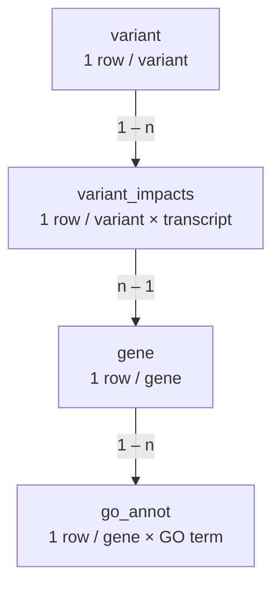
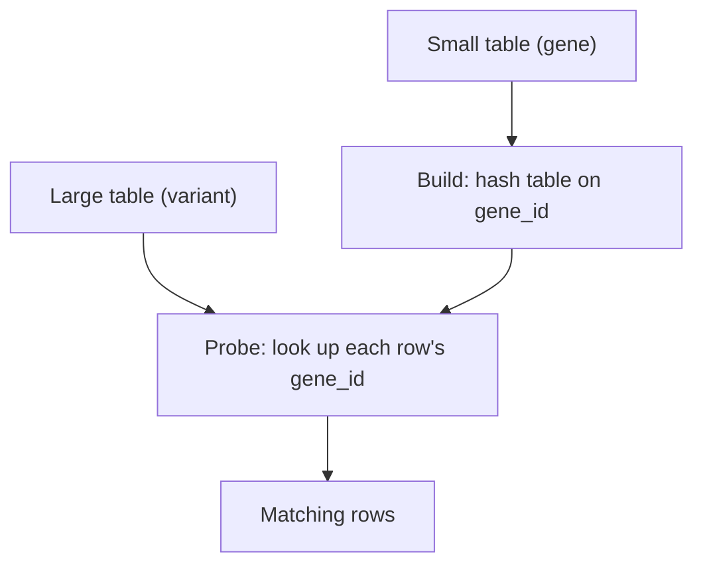
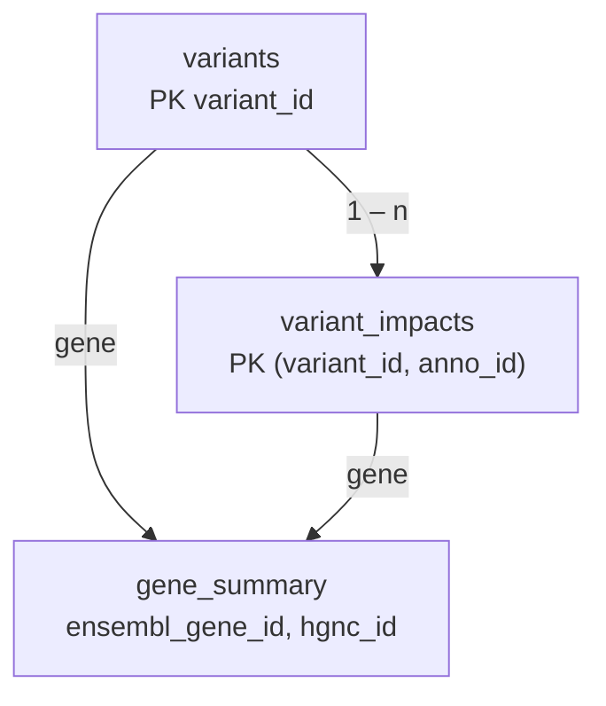

A JOIN combines rows from several tables according to a condition. It is also the place in SQL where you can most easily get a wrong number without any error message. This article explains JOINs on three levels: why data gets split into several tables, which set of rows each kind of JOIN returns, and how a database engine actually joins two tables. The hands-on part uses SQLite on simulated variant and gene-annotation data, with a case study built on the GEMINI schema and a checklist for testing a result before you trust it.

## 1. Introduction: a wrong number with no error

Say you have three tables: variants (`variant`, each row with a `gene_id` and a quality score `qual`), genes (`gene`), and Gene Ontology annotations (`go_annot`, where each gene has zero or a few GO terms). The question: what is the total QUAL of variants that fall in genes with at least one GO annotation? The most natural way to write it is to join all three tables and take `SUM(v.qual)`. On the simulated dataset of 200,000 variants in section 5, that query returns 29,448,785.6. The correct answer is 8,437,067.6. The query raises no error and no warning. It simply adds each variant several times, once for every GO term of its gene.

Biological data almost never sits in a single table. Variants come from VCF files (Danecek et al., 2011); per-transcript consequences come from annotation tools such as VEP (McLaren et al., 2016) or ANNOVAR (Wang et al., 2010); gene names and identifiers come from HGNC (Seal et al., 2023); function comes from GO (Gene Ontology Consortium, 2023). Integrating these sources is a long-standing theme in bioinformatics (Stein, 2002; Goble & Stevens, 2008), and systems such as Ensembl BioMart were built to join data across many species (Kinsella et al., 2011). At the scale of a single project, though, the join is usually one SQL statement written by the analyst.


*Figure 1. Four tables common in variant annotation and the cardinality between them. Every "1 – n" arrow is a place where the row count can grow.*

This article follows on from [why biological data needs relational databases](/en/blog/gioi-thieu-du-lieu-and-database/) and answers three questions: which rows each kind of JOIN returns (sections 2–3), how the engine joins two tables and how to tell whether a query is fast enough (sections 4–5), and why the row count changes after a JOIN and how to keep the final number right (sections 6–8). Every query was run in SQLite; the figures come from simulated data.

## 2. Why data lives in several tables

The relational model proposed by Codd (1970) organizes data into relations, meaning tables with defined columns, and separates how data is stored from how users query it. Each table has a primary key that uniquely identifies every row; one table refers to another through a foreign key, a column holding values of the other table's primary key. A JOIN rebuilds information that was split apart along those keys.

The reason for splitting is normalization. Kent (1983) gives an accessible account of five normal forms; the shared idea is that each fact should be recorded in one place only. Consider this flat table:

| var_id | gene_id | symbol | qual |
| --- | --- | --- | --- |
| 1 | ENSG00000141510 | TP53 | 50 |
| 2 | ENSG00000141510 | TP53 | 30 |
| 3 | ENSG00000135679 | MDM2 | 80 |

The symbol `TP53` repeats for every variant in the gene. That repetition causes three familiar anomalies. Update anomaly: when a gene name changes, every row has to be edited, and missing one leaves the data contradicting itself, with one `gene_id` carrying two symbols. Insertion anomaly: you cannot record a gene that has no variants yet, because every row must be a variant. Deletion anomaly: deleting the last MDM2 variant also deletes the fact that `ENSG00000135679` is MDM2. Split the data into `gene(gene_id, symbol)` and `variant(var_id, gene_id, qual)`, and the gene name lives in one place, a gene can exist without variants, and `variant.gene_id` becomes a foreign key pointing to `gene`.

```sql
PRAGMA foreign_keys = ON;
CREATE TABLE gene(gene_id TEXT PRIMARY KEY, symbol TEXT NOT NULL, family TEXT);
CREATE TABLE variant(var_id INTEGER PRIMARY KEY,
  gene_id TEXT REFERENCES gene(gene_id), qual REAL NOT NULL);
INSERT INTO gene VALUES ('ENSG00000141510','TP53','p53'),
  ('ENSG00000135679','MDM2',NULL), ('ENSG00000078900','TP73','p53'),
  ('ENSG00000073282','TP63','p53');
INSERT INTO variant VALUES (1,'ENSG00000141510',50),
  (2,'ENSG00000141510',30), (3,'ENSG00000135679',80);
-- The next row is rejected: FOREIGN KEY constraint failed
INSERT INTO variant VALUES (4,'ENSG99999999999',10);

SELECT v.var_id, g.symbol, v.qual
FROM variant v
JOIN gene g ON g.gene_id = v.gene_id;
```

The `PRAGMA` line at the top matters. In SQLite, foreign key enforcement is off by default and has to be switched on for each connection (SQLite, n.d.-c). Without it, the fourth row is inserted anyway and only shows up later, when a JOIN silently drops it.

Normalization has a cost: data that is clean on write costs joins on read. Sometimes good design means deliberately not normalizing. GEMINI, a tool that loads VCF files into SQLite for variant exploration, does not store genotypes in a separate table with one row per variant–sample pair, because a million variants times 1,000 samples would be a billion rows; genotypes are compressed into arrays inside the variant table (Paila et al., 2013). The trade-off is intentional. Genotype queries have to decompress the arrays in software rather than use a JOIN, and in return the database file stays small and fast. What you need to know is which shape your data is in and whether each JOIN will multiply or preserve the row count.

## 3. JOIN semantics

The SQLite documentation describes every join in terms of the Cartesian product of two tables: all left–right pairs of rows, from which the pairs that satisfy the condition are kept (SQLite, n.d.-e). Joining "on a shared column" is just the most common case, called an equi-join. The condition can also be an inequality (a theta-join), for example matching variants to gene regions with `v.pos BETWEEN g.start AND g.end`. `NATURAL JOIN` joins automatically on every column with the same name, while `USING (gene_id)` joins on the column you name (PostgreSQL Global Development Group, n.d.-b). Avoid `NATURAL JOIN` in analysis code: if someone adds a `chrom` column to both tables, the join condition changes without a word.

If you know R, `dplyr::inner_join()`, `left_join()`, `full_join()` and `merge()` keep rows by the same logic; the article on summarizing data in R uses them on data frames. The row multiplication in section 6 applies exactly the same way. NULL handling is different: by default dplyr treats two `NA` values as a match, like `merge()` (the argument `na_matches = "na"`), and SQL does not (Wickham et al., n.d.).

The table below runs on a small example: 5 variants (101–105, where 104 has a NULL `gene_id` and 105 points to gene 9, which does not exist) and 3 genes (TP53, BRCA2, CFTR; CFTR has no variants).

```sql
-- Run in a fresh database, separate from the section 2 example
CREATE TABLE variant(var_id INTEGER PRIMARY KEY, gene_id INTEGER, qual REAL);
CREATE TABLE gene(gene_id INTEGER PRIMARY KEY, symbol TEXT NOT NULL);
CREATE TABLE impact(var_id INTEGER NOT NULL, transcript TEXT NOT NULL,
  impact TEXT NOT NULL);
INSERT INTO gene VALUES (1,'TP53'), (2,'BRCA2'), (3,'CFTR');
INSERT INTO variant VALUES (101,1,50.0), (102,1,30.0), (103,2,80.0),
  (104,NULL,20.0), (105,9,40.0);
INSERT INTO impact VALUES (101,'T1','HIGH'), (101,'T2','MODERATE'),
  (102,'T1','LOW'), (103,'T3','MODERATE');
```

| JOIN type | Rows kept | Result on the example |
| --- | --- | --- |
| `INNER JOIN` | Matching pairs only | 3 rows (101, 102, 103) |
| `LEFT JOIN` | Every row of the left table; right columns NULL when unmatched | 5 rows |
| `RIGHT JOIN` | Every row of the right table | 4 rows (adds CFTR with a NULL `var_id`) |
| `FULL OUTER JOIN` | Every row from both sides | 6 rows |
| `CROSS JOIN` | Every pair, no condition | 15 rows (5 × 3) |
| Self-join | A table joined to itself | Pairs of genes in the same family |

INNER JOIN drops 104 and 105 (no matching gene) and CFTR (no variant points to it); LEFT JOIN keeps 104 and 105 with a NULL `symbol`; RIGHT JOIN keeps CFTR; FULL OUTER JOIN keeps all three. Variant 104 would match no gene even if the gene table (hypothetically) had a row with a NULL `gene_id`, because in SQL `NULL = NULL` is not true but NULL. In practice, intergenic variants often have an empty `gene_id`, and an INNER JOIN to the gene table quietly removes that whole group from the analysis.

A self-join needs aliases because the same table appears twice. For example, using the `gene` table from section 2 (which has a `family` column), find pairs of genes in the p53 family:

```sql
SELECT a.symbol AS gene_a, b.symbol AS gene_b
FROM gene a
JOIN gene b ON a.family = b.family AND a.gene_id < b.gene_id;
```

Outside this case, aliases are not required by the syntax; they just make the statement easier to read. There is also a limit on how many tables a join can involve: SQLite will not join more than 64 tables (SQLite, n.d.-d).

`RIGHT JOIN` and `FULL OUTER JOIN` have been available in SQLite since version 3.39.0, released on June 25, 2022 (SQLite, 2022). Older versions raise an error:

```sql
SELECT v.var_id, g.symbol
FROM variant v
RIGHT JOIN gene g ON v.gene_id = g.gene_id;
-- SQLite 3.37.0: RIGHT and FULL OUTER JOINs are not currently supported
-- SQLite 3.54.0: 4 rows, the last one is |CFTR
```

Check your version with `SELECT sqlite_version();`. On an older version, rewrite the `RIGHT JOIN` as a `LEFT JOIN` and swap the two tables.

### Conditions in ON versus WHERE

With an INNER JOIN, putting a condition in `ON` or in `WHERE` gives the same result. With an outer join it does not: a condition in `ON` is applied while joining, and `WHERE` filters after the join (PostgreSQL Global Development Group, n.d.-b). Using the `impact` table above (4 annotation rows for variants 101–103), compare two queries:

```sql
-- (1) Condition in ON: keep every variant, attach only HIGH annotations
SELECT v.var_id, i.transcript, i.impact
FROM variant v
LEFT JOIN impact i ON i.var_id = v.var_id AND i.impact = 'HIGH';

-- (2) Condition in WHERE: filter after joining, NULL rows are dropped
SELECT v.var_id, i.transcript, i.impact
FROM variant v
LEFT JOIN impact i ON i.var_id = v.var_id
WHERE i.impact = 'HIGH';
```

| Query | Rows | Meaning |
| --- | --- | --- |
| (1) ON | 5 | Every variant; only 101 has a HIGH annotation |
| (2) WHERE | 1 | Only variants with a HIGH annotation |

Query (2) is really an INNER JOIN. SQLite recognizes this and downgrades the LEFT JOIN to a plain JOIN when the `WHERE` clause forces a right-table column to be non-NULL (SQLite, n.d.-f); the query plan for (2) starts with `SCAN i`, meaning the two tables have been reordered. Both queries are correct, but they answer different questions. Query (1) asks "list every variant, with its HIGH annotation if there is one"; query (2) asks "which variants have a HIGH annotation." Write (2) when you need (1), and the report is missing every variant that has not been annotated, with no NULL rows to remind you. An easy rule to remember: with a LEFT JOIN, conditions on the right table go in `ON`, conditions on the left table go in `WHERE`.

## 4. Inside the engine: nested loop, sort-merge, hash join

A JOIN statement says only **what result** you want; **how** to get it is up to the database engine. Surveys of join processing distinguish a few main families of algorithms (Mishra & Eich, 1992; Graefe, 1993). The description below is intuitive, enough to read the query plans in section 5; the exact cost depends on memory, on-disk layout and the size of each table.

**Nested loop** walks through each row of the outer table and, for each one, scans the whole inner table; the number of comparisons is roughly the product of the row counts. **Index nested loop** replaces the inner loop with an index lookup on the join key: a B-tree index lets the engine jump straight to the rows with the `gene_id` it needs instead of reading the whole table, so each outer row costs only a few lookup steps. **Sort-merge** sorts both tables on the key and then walks through them in step. **Hash join** builds a hash table from the smaller table (build), then scans the other table and looks each row up (probe); Shapiro (1986) analyzes join algorithms in the context of large main memories.


*Figure 2. Hash join: build a hash table from the small table, then probe it with each row of the large table.*

| Algorithm | Requires | Memory | Good for |
| --- | --- | --- | --- |
| Nested loop | Nothing | Low | Very small tables, any condition |
| Index nested loop | Index on the inner table's key | Low | Small outer table, index available |
| Sort-merge | Data sortable on the key | Medium | Data already in order |
| Hash join | Equality condition | Hash table | Equi-joins without an index |

With three or more tables there is one more decision: join order. Joining `variant` to `go_annot` first and filtering by `gene` afterward can create an intermediate result many times larger than starting from `gene`. Choosing the algorithm and the join order is the job of the query optimizer. The cost-based approach goes back to System R (Selinger et al., 1979). Its quality depends on row-count estimates; Leis et al. (2015) showed that cardinality estimators in database systems used in practice, both open-source and commercial, are routinely far off, and that these errors affect performance more than the cost model does.

SQLite carries out every join as a nested loop, and for outer joins it does not reorder tables as freely as it does for inner joins (SQLite, n.d.-f). When the join key has no index, SQLite may build a temporary automatic index for that query; the SQLite documentation describes this as close to a hash join, except that it uses a B-tree instead of a hash table (SQLite, n.d.-f). So SQLite has no separate hash join operator, yet it still avoids a pure nested loop in most cases. PostgreSQL does have all three strategies: nested loop, merge join and hash join (PostgreSQL Global Development Group, n.d.-a). Its `EXPLAIN` shows the strategy chosen at each node of the plan, and `EXPLAIN ANALYZE` actually runs the query and reports the real row counts and timing for each node (PostgreSQL Global Development Group, n.d.-c). Section 5 reads query plans the same way in SQLite.

## 5. Experiment: EXPLAIN QUERY PLAN with and without indexes

Simulated data: `gene` has 20,000 rows, `variant` has 200,000 rows with `gene_id` drawn at random from 20,500 values (about 2.5% are missing from `gene`), and `go_annot` gives each gene 0–6 GO terms; seed 42; SQLite 3.45.3 through Python. The query:

```sql
SELECT g.symbol, COUNT(*) AS n_rows, SUM(v.qual) AS total_qual
FROM variant v
JOIN gene g ON v.gene_id = g.gene_id
JOIN go_annot a ON a.gene_id = g.gene_id
GROUP BY g.gene_id;
```

Three conditions: (a) no index, automatic indexing on (the default); (b) no index, `PRAGMA automatic_index = OFF`; (c) indexes on `variant(gene_id)` and `go_annot(gene_id)`, with `ANALYZE` already run. Put `EXPLAIN QUERY PLAN` in front of the query to see the plan; `SCAN` means a full table scan, and `SEARCH` means only part of the table is accessed through an index (SQLite, n.d.-b).

| Condition | Plan (verbatim) | Median of 7 runs |
| --- | --- | --- |
| (a) | `SCAN g` → `BLOOM FILTER ON v` → `SEARCH v USING AUTOMATIC COVERING INDEX` → `BLOOM FILTER ON a` → `SEARCH a USING AUTOMATIC COVERING INDEX` | 0.59 s |
| (b) | `SCAN v` → `SCAN a` → `SEARCH g USING INTEGER PRIMARY KEY` → `USE TEMP B-TREE FOR GROUP BY` | not measured at this size |
| (c) | `SCAN g` → `SEARCH v USING INDEX ix_var_gene` → `SEARCH a USING COVERING INDEX ix_annot_gene` | 0.27 s |

Both (a) and (c) return 17,194 groups. Read the plan from top to bottom the way you would read nested loops: the first line is the outermost loop.

In (a), SQLite chooses on its own to start from `gene` (the smallest table), then for each gene looks up `variant` and `go_annot` through two temporary automatic indexes. A `BLOOM FILTER` is a probabilistic filter that quickly rules out keys that are certainly absent from the other table before the index lookup. In (c), the plan has the same order as (a) but uses the existing indexes, so no time goes into building temporary indexes on every run; the time drops from 0.59 to 0.27 seconds. `COVERING` means the index holds every column the query needs, so the base table does not have to be read again; `ix_var_gene` lacks `qual`, so it is not a covering index.

In (b), with automatic indexing turned off, the plan is two nested `SCAN`s: every `variant` row triggers a full scan of `go_annot`. At 200,000 variants that comes to roughly 12 billion pairs, so this condition was only measured on smaller data. Figure 3 measures all three conditions at several data sizes (the number of genes is one tenth of the number of variants), with each point the median of 5 runs.


*Figure 3. Three-table query time by data size. Condition (b) was measured only up to 20,000 variants.*

At 20,000 variants, (b) takes 6.18 seconds, (a) 0.033 seconds and (c) 0.022 seconds. The time for (b) grows about fourfold each time the data doubles (1.60 seconds at 10,000 variants, 6.18 seconds at 20,000), which is the signature of growth with the product of row counts: when both tables double, the number of pairs quadruples. Lines (a) and (c) grow almost linearly, and (c) is always faster than (a) because it does not have to build temporary indexes. Automatic indexing is a good safety net, but for a table you query again and again, an index on the foreign key column is still worth creating, because the cost of building the temporary index is paid again on every run.

<div class="callout callout-warning">
<p class="callout-title">Limits of the experiment</p>

Timings were taken on one personal computer, with one SQLite version (3.45.3), with the data in memory (`:memory:`). The numbers only illustrate the trend across the three conditions and should not be used to compare SQLite with other database systems. A different SQLite version may pick a different plan for the same query, so always record the version alongside the results.

</div>

## 6. The row multiplication trap in one-to-many relationships

When a row in the left table matches k rows in the right table, it appears k times in the result. With `SUM` and `COUNT`, every appearance is counted.

| Approach | Rows before aggregation | SUM(qual) |
| --- | --- | --- |
| Join `variant`–`gene` (no GO filter) | 195,048 | 9,822,974.0 |
| Join `go_annot` in directly as well | 584,698 | 29,448,785.6 |
| `EXISTS` | 167,568 | 8,437,067.6 |
| Aggregate `go_annot` first, then join | 167,568 | 8,437,067.6 |
| `COUNT(DISTINCT v.var_id)` after the direct join | 167,568 variants | not applicable |

The correct figure is 8,437,067.6 from 167,568 variants. The direct join gives a number 3.49 times larger, approximately the average number of GO terms per gene counted per variant. The simulation gives each gene 0–6 GO terms, an average of 3.00 across all genes. The 3.49 is higher than 3.00 because genes with no GO terms (2,803 of 20,000) were already dropped by the INNER JOIN; among the rest, each variant is multiplied by 3.49 on average. If you compare against the total QUAL of all variants with a gene (9,822,974.0), the ratio is 3.00, but that comparison uses the wrong denominator: the two numbers answer different questions.

The query runs fast and the number looks plausible. Unless you already have the correct figure to compare against, you have no reason to be suspicious.


*Figure 4. The same question gives four different numbers depending on how the tables are joined.*

```sql
-- Option 1: filtering only, use EXISTS
SELECT SUM(v.qual)
FROM variant v
WHERE EXISTS (SELECT 1 FROM go_annot a WHERE a.gene_id = v.gene_id);

-- Option 2: aggregate the child table first, one row per gene
SELECT SUM(v.qual)
FROM variant v
JOIN (SELECT gene_id, COUNT(*) AS n_go
      FROM go_annot GROUP BY gene_id) a ON a.gene_id = v.gene_id;

-- Option 3: for counting only
SELECT COUNT(DISTINCT v.var_id)
FROM variant v JOIN go_annot a ON a.gene_id = v.gene_id;
```

`COUNT(DISTINCT …)` fixes a count but not a `SUM`, because `SUM(DISTINCT qual)` merges two different variants that happen to share a QUAL value. Option 1 fits when the right table is used only for filtering. Option 2 fits when you also need information from the right table, such as the number of GO terms per gene, because after `GROUP BY gene_id` the subquery has one row per gene and the relationship becomes one-to-one. The articles on [GROUP BY and HAVING](/en/blog/group-by-and-having-tong-hop-du-lieu/) and [aggregate functions](/en/blog/ham-tong-hop-aggregate/) cover this aggregation step in more detail.

The trap is not specific to biological data. A revenue-by-category query that joins `order_details` → `products` → `categories` → `orders` gives the right answer because each order-detail row matches exactly one product, one category and one order: every join goes from the "many" side to the "one" side. Add a `reviews` table (many reviews per product) to the same query, and each product's revenue is multiplied by its number of reviews. The general rule: joining from the "many" side to the "one" side is safe; joining toward a "many" side increases the row count.

So before aggregating, count rows before and after each JOIN, and check that the key on the "one" side really is unique:

```sql
SELECT gene_id, COUNT(*) FROM gene GROUP BY gene_id HAVING COUNT(*) > 1;
```

## 7. Anti-joins: finding what is missing

The question "which variants do not belong to a known gene" can be written three ways:

```sql
-- (1) LEFT JOIN … IS NULL
SELECT v.var_id FROM variant v
LEFT JOIN gene g ON v.gene_id = g.gene_id
WHERE g.gene_id IS NULL;

-- (2) NOT EXISTS
SELECT v.var_id FROM variant v
WHERE NOT EXISTS (SELECT 1 FROM gene g WHERE g.gene_id = v.gene_id);

-- (3) NOT IN
SELECT v.var_id FROM variant v
WHERE v.gene_id NOT IN (SELECT gene_id FROM gene);
```

| Approach | Rows | Median of 7 runs | Plan |
| --- | --- | --- | --- |
| LEFT JOIN … IS NULL | 4,952 | 0.018 s | `SEARCH g USING INTEGER PRIMARY KEY … LEFT-JOIN` |
| NOT EXISTS | 4,952 | 0.050 s | `CORRELATED SCALAR SUBQUERY` |
| NOT IN | 4,952 | 0.017 s | `USING ROWID SEARCH ON TABLE gene FOR IN-OPERATOR` |

The LEFT JOIN pattern is only correct when the column tested with `IS NULL` can never be NULL in the right table, which usually means the primary key. NOT IN is dangerous when the subquery list contains a NULL: if a value is not in the list and the list contains NULL, `NOT IN` returns NULL rather than true (SQLite, n.d.-a). On the small example from section 3 (variant 104 has a NULL `gene_id`), asking "which genes have no variants" with `NOT IN` returns 0 rows, while `NOT EXISTS` returns 1 row (CFTR):

```sql
SELECT COUNT(*) FROM gene g
WHERE g.gene_id NOT IN (SELECT gene_id FROM variant);          -- 0
SELECT COUNT(*) FROM gene g
WHERE NOT EXISTS (SELECT 1 FROM variant v
                  WHERE v.gene_id = g.gene_id);                -- 1
```

In the large experiment, the three approaches return the same 4,952 rows only because `gene.gene_id` is a primary key and is never NULL. In biological data, a foreign key column with NULLs is common (intergenic variants), so `NOT IN` on that column is a risk. `NOT EXISTS` is semantically safe in every case; in this experiment it was about three times slower because SQLite runs the correlated subquery for each row, but 0.05 seconds for 200,000 rows is still fast enough for most analyses. Subqueries and NULL are covered in more depth in [subqueries and CASE WHEN](/en/blog/subquery-and-case-when/).

## 8. Biology case study: the GEMINI schema

GEMINI loads an annotated VCF into a SQLite database; its authors chose SQL for its expressive power and SQLite because the whole database is a single, easily shared file (Paila et al., 2013). The schema (GEMINI, n.d.) has a `variants` table (one row per variant, with a `gene` column and an `impact` column describing the most severely affected transcript), a `variant_impacts` table whose primary key is `variant_id` plus `anno_id`, with one row per transcript, and two gene tables, `gene_summary` and `gene_detailed`, built on Ensembl 75, with the columns `ensembl_gene_id`, `hgnc_id`, `is_hgnc` and `in_cosmic_census`.


*Figure 5. Simplified GEMINI schema: the three tables used in the example query, redrawn from the schema documentation (GEMINI, n.d.).*

The `variants` → `variant_impacts` relationship is one-to-many, because a variant lies on several transcripts of the same gene. This is the row multiplication from section 6 in a real schema. GEMINI's design partly handles the problem by copying the information for the most severely affected transcript into the `variants` table, so many queries need no JOIN at all. But a variant can be missense on one transcript while its most severe consequence sits on another (disrupting a splice site, for example); to find "missense on any transcript," you have to go through `variant_impacts`.

Example query: rare missense variants (`max_aaf_all < 0.01`) in genes on the COSMIC Cancer Gene Census. The version below runs on toy data with 4 variants and 7 impact rows, using column names from the schema documentation but keeping only the columns needed; values in the `impact_so` column use Sequence Ontology term names and may differ between annotation tools.

```sql
-- Direct join: 5 rows for 2 variants
SELECT v.variant_id, v.gene, i.transcript
FROM variants v
JOIN variant_impacts i ON i.variant_id = v.variant_id
JOIN gene_summary g ON g.gene = i.gene
WHERE i.impact_so = 'missense_variant'
  AND v.max_aaf_all < 0.01
  AND g.in_cosmic_census = 1;

-- Filter with EXISTS: 2 rows, one per variant
SELECT v.variant_id, v.gene, v.max_aaf_all
FROM variants v
JOIN gene_summary g ON g.gene = v.gene
WHERE v.max_aaf_all < 0.01
  AND g.in_cosmic_census = 1
  AND EXISTS (SELECT 1 FROM variant_impacts i
              WHERE i.variant_id = v.variant_id
                AND i.impact_so = 'missense_variant');
```

The first query returns 5 rows for 2 variants because the TP53 variant lies on three transcripts and the BRCA2 variant on two. Counting or summing on top of this result goes wrong in the same way as in section 6. The second query uses `variant_impacts` only as a filter, so each variant keeps a single row.

The join key in this example is the `gene` column, the gene symbol, and that is a weak point. Gene symbols are easily corrupted in spreadsheets: Excel converts some gene names to dates or numbers by default, and Ziemann et al. (2016) found this error in roughly one fifth of papers with gene lists in Excel files. Gene symbols are also maintained and updated by HGNC under naming guidelines (Bruford et al., 2020; Seal et al., 2023), so two annotation sources from different dates may use different symbols for the same gene. When joining data from several sources, prefer `ensembl_gene_id` or the HGNC ID, record the annotation version (GEMINI uses Ensembl 75), and check that the key is unique in the gene table before joining:

```sql
SELECT gene, COUNT(*) FROM gene_summary
GROUP BY gene HAVING COUNT(*) > 1;
```

GEMINI is not a special case. VEP (McLaren et al., 2016) and ANNOVAR (Wang et al., 2010) annotate variants by transcript and by gene, so a single variant usually carries several annotations. Joining annotation output to a gene table, ClinVar or GO is usually left to the analyst; Buffalo (2015) devotes a chapter to SQLite and JOINs in bioinformatics workflows. The article on [biological data formats and databases](/en/blog/dinh-dang-du-lieu-va-co-so-du-lieu-sinh-hoc/) introduces these annotation sources.

A note on tooling: the README of the GEMINI repository says the tool has largely been superseded by slivar and recommends that users switch to slivar (arq5x, n.d.). Here GEMINI serves only as an example of schema design, not as a recommendation for new projects.

## 9. Conclusion and a JOIN checklist for biological data

"Matching two tables on a shared column" is enough for a first example, but with real data you need to keep three more things in mind. A JOIN returns a set of row pairs, so the row count is a result you have to check. NULL matches nothing, so rows with a missing key disappear from an INNER JOIN, and a condition in the wrong place turns a LEFT JOIN into an INNER JOIN. Performance depends more on indexes and the optimizer than on how you phrase the query, and `EXPLAIN QUERY PLAN` lets you look instead of guess.

A checklist before you trust a number that came out of a JOIN:

1. **Map the cardinality** of each pair of tables: one-to-one, one-to-many or many-to-many. Every join toward a "many" side is a place where the row count grows.
2. **Pick a stable key**: an Ensembl ID or HGNC ID rather than a gene symbol; confirm the key on the "one" side is unique with `GROUP BY … HAVING COUNT(*) > 1`.
3. **Choose INNER or OUTER based on the question**: if you need to keep variants that have no annotation yet, use a LEFT JOIN.
4. **Put right-table conditions in `ON`** when using an outer join, unless you really do want to drop unmatched rows.
5. **Count rows before and after each JOIN**; if you need to aggregate, aggregate the child table first or use `EXISTS`.
6. **Read `EXPLAIN QUERY PLAN`**: if you see two nested `SCAN`s over large tables, create an index on the foreign key column.
7. **Record versions**: the SQLite version (`SELECT sqlite_version();`) and the annotation version alongside your results.

The next articles in the series pick up two threads started here: [subqueries and CASE WHEN](/en/blog/subquery-and-case-when/) for `EXISTS`, `NOT IN` and NULL, and [CTEs and set operations](/en/blog/cte-and-set-operations/) for splitting a multi-JOIN query into named steps so you can check the row count at each one.

## References

arq5x. (n.d.). *gemini* [README]. GitHub. Retrieved November 12, 2026, from https://github.com/arq5x/gemini

Bruford, E. A., Braschi, B., Denny, P., Jones, T. E. M., Seal, R. L., & Tweedie, S. (2020). Guidelines for human gene nomenclature. *Nature Genetics, 52*(8), 754–758. https://doi.org/10.1038/s41588-020-0669-3

Buffalo, V. (2015). *Bioinformatics data skills: Reproducible and robust research with open source tools*. O'Reilly Media.

Codd, E. F. (1970). A relational model of data for large shared data banks. *Communications of the ACM, 13*(6), 377–387. https://doi.org/10.1145/362384.362685

Danecek, P., Auton, A., Abecasis, G., Albers, C. A., Banks, E., DePristo, M. A., Handsaker, R. E., Lunter, G., Marth, G. T., Sherry, S. T., McVean, G., Durbin, R., & 1000 Genomes Project Analysis Group. (2011). The variant call format and VCFtools. *Bioinformatics, 27*(15), 2156–2158. https://doi.org/10.1093/bioinformatics/btr330

GEMINI. (n.d.). *The GEMINI database schema*. Retrieved November 19, 2026, from https://gemini.readthedocs.io/en/latest/content/database_schema.html

Gene Ontology Consortium. (2023). The Gene Ontology knowledgebase in 2023. *Genetics, 224*(1), iyad031. https://doi.org/10.1093/genetics/iyad031

Goble, C., & Stevens, R. (2008). State of the nation in data integration for bioinformatics. *Journal of Biomedical Informatics, 41*(5), 687–693. https://doi.org/10.1016/j.jbi.2008.01.008

Graefe, G. (1993). Query evaluation techniques for large databases. *ACM Computing Surveys, 25*(2), 73–169. https://doi.org/10.1145/152610.152611

Kent, W. (1983). A simple guide to five normal forms in relational database theory. *Communications of the ACM, 26*(2), 120–125. https://doi.org/10.1145/358024.358054

Kinsella, R. J., Kähäri, A., Haider, S., Zamora, J., Proctor, G., Spudich, G., Almeida-King, J., Staines, D., Derwent, P., Kerhornou, A., Kersey, P., & Flicek, P. (2011). Ensembl BioMarts: A hub for data retrieval across taxonomic space. *Database, 2011*, bar030. https://doi.org/10.1093/database/bar030

Leis, V., Gubichev, A., Mirchev, A., Boncz, P., Kemper, A., & Neumann, T. (2015). How good are query optimizers, really? *Proceedings of the VLDB Endowment, 9*(3), 204–215. https://doi.org/10.14778/2850583.2850594

McLaren, W., Gil, L., Hunt, S. E., Riat, H. S., Ritchie, G. R. S., Thormann, A., Flicek, P., & Cunningham, F. (2016). The Ensembl Variant Effect Predictor. *Genome Biology, 17*(1), 122. https://doi.org/10.1186/s13059-016-0974-4

Mishra, P., & Eich, M. H. (1992). Join processing in relational databases. *ACM Computing Surveys, 24*(1), 63–113. https://doi.org/10.1145/128762.128764

Paila, U., Chapman, B. A., Kirchner, R., & Quinlan, A. R. (2013). GEMINI: Integrative exploration of genetic variation and genome annotations. *PLoS Computational Biology, 9*(7), e1003153. https://doi.org/10.1371/journal.pcbi.1003153

PostgreSQL Global Development Group. (n.d.-a). *51.5. Planner/Optimizer*. PostgreSQL 18 documentation. Retrieved November 19, 2026, from https://www.postgresql.org/docs/current/planner-optimizer.html

PostgreSQL Global Development Group. (n.d.-b). *7.2. Table expressions*. PostgreSQL 18 documentation. Retrieved November 12, 2026, from https://www.postgresql.org/docs/current/queries-table-expressions.html

PostgreSQL Global Development Group. (n.d.-c). *14.1. Using EXPLAIN*. PostgreSQL 18 documentation. Retrieved November 19, 2026, from https://www.postgresql.org/docs/current/using-explain.html

Seal, R. L., Braschi, B., Gray, K., Jones, T. E. M., Tweedie, S., Haim-Vilmovsky, L., & Bruford, E. A. (2023). Genenames.org: The HGNC resources in 2023. *Nucleic Acids Research, 51*(D1), D1003–D1009. https://doi.org/10.1093/nar/gkac888

Selinger, P. G., Astrahan, M. M., Chamberlin, D. D., Lorie, R. A., & Price, T. G. (1979). Access path selection in a relational database management system. In *Proceedings of the 1979 ACM SIGMOD International Conference on Management of Data* (pp. 23–34). ACM. https://doi.org/10.1145/582095.582099

Shapiro, L. D. (1986). Join processing in database systems with large main memories. *ACM Transactions on Database Systems, 11*(3), 239–264. https://doi.org/10.1145/6314.6315

SQLite. (2022). *Release 3.39.0 on 2022-06-25*. Retrieved November 12, 2026, from https://www.sqlite.org/releaselog/3_39_0.html

SQLite. (n.d.-a). *SQL language expressions*. Retrieved November 12, 2026, from https://www.sqlite.org/lang_expr.html

SQLite. (n.d.-b). *EXPLAIN QUERY PLAN*. Retrieved November 12, 2026, from https://www.sqlite.org/eqp.html

SQLite. (n.d.-c). *SQLite foreign key support*. Retrieved November 12, 2026, from https://www.sqlite.org/foreignkeys.html

SQLite. (n.d.-d). *Limits in SQLite*. Retrieved November 12, 2026, from https://www.sqlite.org/limits.html

SQLite. (n.d.-e). *SELECT*. Retrieved November 12, 2026, from https://www.sqlite.org/lang_select.html

SQLite. (n.d.-f). *The SQLite query optimizer overview*. Retrieved November 12, 2026, from https://www.sqlite.org/optoverview.html

Stein, L. (2002). Creating a bioinformatics nation. *Nature, 417*(6885), 119–120. https://doi.org/10.1038/417119a

Wang, K., Li, M., & Hakonarson, H. (2010). ANNOVAR: Functional annotation of genetic variants from high-throughput sequencing data. *Nucleic Acids Research, 38*(16), e164. https://doi.org/10.1093/nar/gkq603

Wickham, H., François, R., Henry, L., Müller, K., & Vaughan, D. (n.d.). *Mutating joins* [dplyr reference]. Retrieved November 19, 2026, from https://dplyr.tidyverse.org/reference/mutate-joins.html

Ziemann, M., Eren, Y., & El-Osta, A. (2016). Gene name errors are widespread in the scientific literature. *Genome Biology, 17*(1), 177. https://doi.org/10.1186/s13059-016-1044-7
