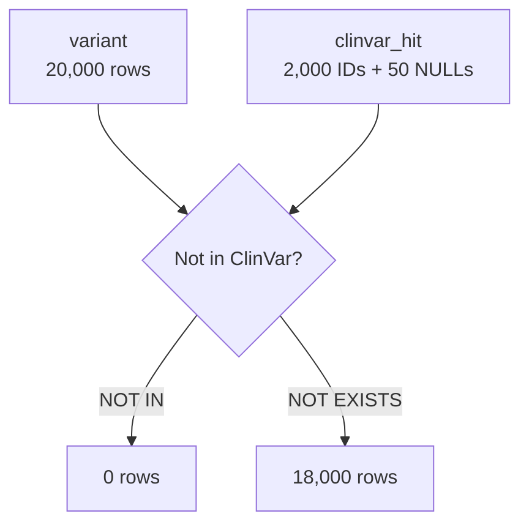
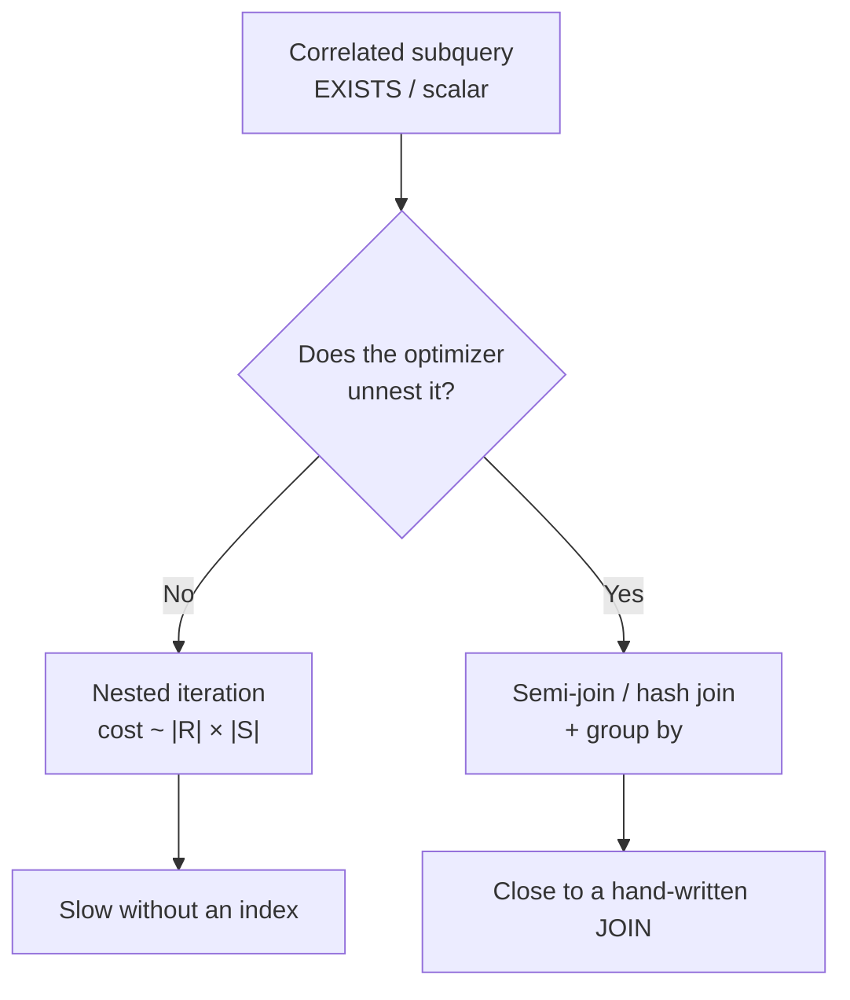

A subquery is a `SELECT` statement nested inside another SQL statement. `IN`, `EXISTS` and `CASE WHEN` are the three most common ways to use one for filtering and grouping data. With biological data full of blanks, a single NULL in the subquery's list is enough to make `NOT IN` return zero rows: on 20,000 simulated variants, `NOT IN` returns 0 while `NOT EXISTS` returns 18,000. The familiar rule "EXISTS is faster than IN" doesn't hold in general either. Without an index, SQLite 3.45.3 takes 2.18 seconds to run EXISTS and only 0.0074 seconds to run IN; SQLite 3.54.0 and DuckDB 2.0.1 bring EXISTS down to about 0.003 seconds. This article is for readers who already know `SELECT`, `WHERE`, `JOIN` and `GROUP BY`. Every query here was run on SQLite and DuckDB.

<div class="callout callout-note">
<p class="callout-title">Key points</p>

- Choosing between `IN` and `EXISTS` is first a question of correctness when NULLs are present, and only then a question of speed.
- `x NOT IN (…)` is never true if the subquery list contains a NULL; use `NOT EXISTS` or filter with `IS NOT NULL`.
- Speed depends on the optimizer, indexes and version, not on syntax: read `EXPLAIN QUERY PLAN`.
- In `CASE`, the first true condition wins; NULL falls through to `ELSE` unless there is an `IS NULL` branch.

</div>

## 1. A syntactically valid query that returns zero rows

Say you have a `variant` table holding the variants from one exome sample, and a `clinvar_hit` table holding the variants already present in ClinVar, the public database of clinical variant interpretations (Landrum et al., 2018). Some rows in `clinvar_hit` could not be mapped back to a `variant_id`, so that column is NULL. The question "which variants have never been reported?" looks perfectly natural written with `NOT IN`:

```sql
SELECT COUNT(*) FROM variant
WHERE variant_id NOT IN (SELECT variant_id FROM clinvar_hit);      -- 0

SELECT COUNT(*) FROM variant v
WHERE NOT EXISTS (SELECT 1 FROM clinvar_hit c
                  WHERE c.variant_id = v.variant_id);              -- 18000
```

On the simulated data from section 5 (20,000 variants, 2,000 valid ClinVar rows and 50 NULL rows), the first query returns 0 and the second returns 18,000. No error, no warning. At 200,000 variants, it's 0 versus 180,000.


*Figure 1. Same question, two ways to write it, two results. Fifty NULLs in the inner table are enough to make `NOT IN` come back empty.*

Sections 2–3 explain why, sections 4–5 deal with speed, and sections 6–7 turn to `CASE WHEN`.

## 2. What a subquery is: scalar, list and correlated

A subquery is a `SELECT` in parentheses, placed in the `WHERE`, `FROM`, `SELECT` or `HAVING` clause of an outer query. The most useful way to classify subqueries rests on two things: how many values the subquery returns, and whether it references columns from the outer query.

A **scalar subquery** returns exactly one value and works with `=`, `>` and `<`. For example, variants whose allele frequency (AF) is above the mean AF of the whole dataset:

```sql
SELECT variant_id, af FROM variant
WHERE af > (SELECT AVG(af) FROM variant);
```

If the subquery accidentally returns several rows, systems behave differently. DuckDB 2.0.1 raises the error "More than one row returned by a subquery used as an expression". SQLite 3.54.0 says nothing and quietly takes the first row it happens to meet. Which row counts as "first" isn't guaranteed without an `ORDER BY`. With a table `t` holding 1, 2, 3, the expression `2 > (SELECT x FROM t)` returned 1 (true) in a test run, because 2 was compared only with 1.

A **list subquery** returns one column with many rows and goes with `IN`, `ANY` or `ALL`. `x IN (SELECT …)` asks whether x equals at least one element of the list; `x > ALL (SELECT …)` asks whether x is greater than every element. SQLite doesn't support `ANY` and `ALL`: SQLite 3.54.0 reports a syntax error at `5 > ALL (SELECT 1)`, so on SQLite you rewrite these with `MAX` or `MIN`, such as `af > (SELECT MAX(af) FROM …)`. DuckDB 2.0.1 runs them, and shows that `ALL` falls into the NULL trap too: `5 > ALL` over the list (1, NULL) returns NULL rather than TRUE, because there is no way to claim 5 is greater than an unknown value. The `MAX` version avoids the trap because `MAX` ignores NULLs, but in exchange it also silently ignores missing data.

A **correlated subquery** references a column of the outer query, so conceptually it is recomputed for every outer row. For example, "variants whose AF is above the mean AF of their own gene":

```sql
SELECT v.variant_id, v.gene_id, v.af FROM variant v
WHERE v.af > (SELECT AVG(v2.af) FROM variant v2
              WHERE v2.gene_id = v.gene_id);
```

Unlike an ordinary subquery, a correlated subquery can't run on its own. Pull the part in parentheses out and run it separately, and SQLite reports that there is no column `v.gene_id`, because `v` exists only in the outer query. That's also the quickest way to tell whether a subquery is correlated.

The phrase "the inner query runs first" is true only for uncorrelated subqueries, and even then the optimizer is free to rewrite the whole statement as a join (Kim, 1982). Kim distinguishes five basic types of nesting and shows that each type can be transformed into an equivalent unnested query.

| Type | Returns | Used with | Biology example |
| --- | --- | --- | --- |
| Scalar | 1 value | `=`, `>`, `<` | AF > overall mean AF |
| List | 1 column, n rows | `IN`, `ANY`, `ALL` | variants whose ID is in ClinVar |
| Correlated scalar | 1 value per outer row | `=`, `>`, `<` | AF > mean AF of the same gene |
| `EXISTS` | TRUE/FALSE | `WHERE`, `CASE` | genes with at least one pathogenic variant |
| Derived table | table | `FROM`, `JOIN` | table of mean AF per gene |

*Table 1. Types of subquery by return value and usage.*

The last row of Table 1, the derived table, is a subquery in `FROM`. It is exactly how you write the unnested version in section 5 by hand: compute the mean AF per gene once as a temporary table, then join it to `variant`. When a derived table is used more than once, naming it with `WITH` reads more easily; that's the subject of the [article on CTEs and set operations](/en/blog/cte-and-set-operations/).

## 3. NULL semantics: IN, EXISTS, NOT IN, NOT EXISTS

SQL uses three-valued logic: a condition can be TRUE, FALSE or UNKNOWN. Codd (1979) presented null values for representing missing information in his extension of the relational model. A `WHERE` clause keeps only rows whose condition is TRUE; UNKNOWN is discarded just like FALSE.

`x IN (s1, s2, s3)` is equivalent to `x = s1 OR x = s2 OR x = s3`. `x NOT IN (s1, s2, s3)` is equivalent to `x <> s1 AND x <> s2 AND x <> s3`. If one `si` is NULL, then `x <> si` is UNKNOWN, and a chain of ANDs with one UNKNOWN term can never be TRUE. The PostgreSQL documentation states it plainly: if no equal value is found and the subquery produces at least one null row, the result of `NOT IN` is null, not true; if the left-hand expression is null, the result is null as well (PostgreSQL Global Development Group, n.d.-c).

`EXISTS` asks only "does the subquery return any row?" It compares no values, so it always yields TRUE or FALSE. That's why `NOT EXISTS` doesn't fall into the trap.

| Expression | Result | Why |
| --- | --- | --- |
| `1 IN (1, NULL)` | 1 (TRUE) | one element is equal |
| `1 IN (2, NULL)` | NULL | no equal element, but there is a NULL |
| `1 NOT IN (2, NULL)` | NULL | `1 <> NULL` is UNKNOWN |
| `NULL NOT IN (2, 3)` | NULL | left-hand side is NULL |
| `NULL = NULL` | NULL | comparison with NULL is always UNKNOWN |
| `NULL IS NULL` | 1 (TRUE) | `IS` tests for NULL directly |
| `EXISTS (SELECT NULL)` | 1 (TRUE) | there is one row, even though its value is NULL |

*Table 2. Truth values with NULLs, run on SQLite 3.54.0; `1 NOT IN (2, NULL)` also gives NULL on DuckDB 2.0.1.*

A NULL on the **left-hand side** breaks things in the opposite direction. Take a six-row sample table in which sample S3 has no tissue recorded:

```sql
CREATE TABLE sample(sample_id TEXT, tissue TEXT);
INSERT INTO sample VALUES ('S1','liver'), ('S2','kidney'), ('S3',NULL),
                          ('S4','brain'), ('S5','liver'), ('S6','heart');
SELECT sample_id FROM sample WHERE tissue IN ('liver','kidney');     -- S1, S2, S5
SELECT sample_id FROM sample WHERE tissue NOT IN ('liver','kidney'); -- S4, S6
```

Three plus two is five, yet the table has six rows. S3 lands in neither group because both conditions are UNKNOWN. When you split data into "in" and "not in" and add them back up as a cross-check, the total comes up short by exactly the number of NULLs in the column you filtered on.

In biological data, NULLs in key columns show up more often than people expect: IDs that fail to map after a switch to a new reference genome build, records merged or retired in the source database, or a loading step that leaves an optional column blank. Before writing an anti-join, check once:

```sql
SELECT COUNT(*), COUNT(variant_id), COUNT(*) - COUNT(variant_id) AS n_null
FROM clinvar_hit;                                   -- 2050, 2000, 50
```

`COUNT(*)` counts every row and `COUNT(column)` counts only rows with a value, so the difference is the number of NULLs. Checks like this belong to [data cleaning](/en/blog/process-data-from-dirty-to-clean/) and should run before any analysis.

These semantics once tripped up the people building the engines, too: SQLite has handled NULL in `IN` and `NOT IN` according to the standard only since version 3.6.0 beta (2008-07-16), and the release notes call it a potentially incompatible change (SQLite, n.d.-b). On the theory side, Libkin (2016) shows that with NULLs, the result SQL returns can differ sharply from the set of "certain answers"; Guagliardo and Libkin (2017) build a formal semantics for SQL queries with subqueries and NULLs.

There are three correct ways to write an anti-join, meaning the question "in A but not in B":

```sql
-- (1) NOT EXISTS
SELECT COUNT(*) FROM variant v
WHERE NOT EXISTS (SELECT 1 FROM clinvar_hit c WHERE c.variant_id = v.variant_id);
-- (2) NOT IN with NULLs filtered out
SELECT COUNT(*) FROM variant
WHERE variant_id NOT IN (SELECT variant_id FROM clinvar_hit WHERE variant_id IS NOT NULL);
-- (3) LEFT JOIN … IS NULL
SELECT COUNT(*) FROM variant v
LEFT JOIN (SELECT DISTINCT variant_id FROM clinvar_hit) c ON c.variant_id = v.variant_id
WHERE c.variant_id IS NULL;
```

All three return 18,000 rows on the simulated data. The `LEFT JOIN` pattern is covered in detail in the [JOIN article](/en/blog/join-ket-hop-nhieu-bang/), and `EXCEPT`, a fourth option, is covered in the [article on CTEs and set operations](/en/blog/cte-and-set-operations/).

## 4. How the optimizer unnests a query

The naive way to evaluate a correlated subquery is **nested iteration**: for each row of the outer table R, scan the inner table S to compute the subquery. Without an index, the cost is on the order of |R| × |S|. With 20,000 variants and 2,050 ClinVar rows, that's about 41 million comparisons.

Unnesting means rewriting the subquery as a join with the same result. For `EXISTS`, that join is a **semi-join**: keep each row of R if at least one row of S matches, without duplicating rows when several match. `NOT EXISTS` corresponds to an **anti-join**: keep a row of R when nothing matches. Once it's a join, the engine can build a hash table on S once and probe it with each row of R, at a cost on the order of |R| + |S| instead of |R| × |S|.

Kim (1982) proposed turning nested queries into equivalent joins (unnesting) so the optimizer can pick the best join algorithm under its cost model, following the approach Selinger et al. (1979) laid down for access path selection. The transformation isn't simple. Ganski and Wong (1987) revisited Kim's algorithm, described one major known bug and one new one, and gave fixes. The bug cited most often is usually called the **COUNT bug**: when the subquery contains `COUNT`, a plain join drops outer rows that have no matching row at all, which are exactly the rows whose count should be 0.

Example: "which genes have fewer than two variants?"

```sql
-- Correlated: correct
SELECT COUNT(*) FROM gene g
WHERE (SELECT COUNT(*) FROM variant v WHERE v.gene_id = g.gene_id) < 2;     -- 14747
-- Naive unnesting with JOIN + GROUP BY: loses genes that have no variants
SELECT COUNT(*) FROM (SELECT g.gene_id FROM gene g JOIN variant v ON v.gene_id = g.gene_id
                      GROUP BY g.gene_id HAVING COUNT(*) < 2);              -- 7442
-- Fix with LEFT JOIN and count a column from the right-hand table
SELECT COUNT(*) FROM (SELECT g.gene_id FROM gene g LEFT JOIN variant v ON v.gene_id = g.gene_id
                      GROUP BY g.gene_id HAVING COUNT(v.variant_id) < 2);   -- 14747
```

The difference, 14,747 − 7,442 = 7,305, equals the number of genes with no variants in the simulated data.

After Kim, research groups extended unnesting to quantifiers such as `EXISTS` and `ALL` (Dayal, 1983) and to complex queries (Seshadri et al., 1996). SQL Server decorrelates with the Apply operator so the execution plan doesn't depend on how the subquery is written (Galindo-Legaria & Joshi, 2001); Oracle has subquery coalescing, subquery removal and an anti-join variant for nullable columns (Bellamkonda et al., 2009). Neumann and Kemper (2015) gave an algorithm that unnests **arbitrary** nested queries using the dependent join, and Neumann (2025) improved it for more complex queries. DuckDB follows this approach: every subquery is unnested before execution (Raasveldt, 2023).


*Figure 2. One correlated subquery, two fates, depending on the optimizer.*

Good unnesting doesn't mean the optimizer always chooses well. Leis et al. (2015) measured a realistic query workload and found that every cardinality estimator routinely produced large errors. SQLite is an embedded library with a compact optimizer (Gaffney et al., 2022), and its history shows that performance rules change between versions: 3.35.0 added an EXISTS-to-IN transformation and 3.36.0 removed it because it often made queries slower; 3.51.0 (2025-11-04) added an EXISTS-to-JOIN optimization, 3.51.1 (2025-11-28) had to fix incorrect results from nested EXISTS queries caused by that very optimization, and 3.53.0 (2026-04-09) extended it (SQLite, n.d.-b). If you're on the 3.51 branch, avoid 3.51.0.

## 5. Experiment: IN, EXISTS, JOIN and correlated subqueries on four engines

**Data.** A Python script (numpy, seed 42) creates a `gene` table with 20,000 rows; `variant(variant_id, gene_id, af)` with AF drawn from a Beta(0.3, 3) distribution and 3% NULL values; and `clinvar_hit(variant_id, clnsig)` made of a random 10% of the variants plus 50 rows with a NULL `variant_id`. Two sizes: 20,000 and 200,000 variants.

**Queries.** Eight queries: IN, EXISTS, JOIN + `COUNT(DISTINCT)`, NOT IN, NOT IN with NULLs filtered out, NOT EXISTS, a correlated scalar subquery (AF above the mean AF of the same gene), and a hand-unnested version (a JOIN with a `GROUP BY gene_id` table).

**Conditions.** No index, and with indexes on `clinvar_hit(variant_id)` and `variant(gene_id, af)` plus `ANALYZE`.

**Engines.** SQLite 3.37.0 (the command-line tool bundled with macOS), SQLite 3.45.3 (Python 3.13's `sqlite3` module), SQLite 3.54.0 (command-line tool) and DuckDB 2.0.1 (Python). Machine: macOS 12.7.6, x86_64. Each query ran 5 times and the median is reported; the correlated subquery without an index ran once because it took more than 25 seconds.

| Query | SQLite 3.37.0 | SQLite 3.45.3 | SQLite 3.54.0 | DuckDB 2.0.1 |
| --- | --- | --- | --- | --- |
| IN | 0.0020 | 0.0074 | 0.0016 | 0.0031 |
| EXISTS | 2.12 | 2.18 | 0.0027 | 0.0031 |
| JOIN + COUNT DISTINCT | 0.0020 | 0.0015 | 0.0016 | 0.0035 |
| NOT EXISTS | 2.28 | 2.09 | 2.48 | 0.0025 |
| Correlated scalar | not run | 25.05 | 26.49 | 0.0059 |
| Hand-unnested | 0.035 | 0.038 | 0.040 | 0.0059 |

*Table 3. Time (seconds, median) on 20,000 variants, no index. Row counts are identical across engines: 2,000 (IN, EXISTS, JOIN), 18,000 (NOT EXISTS), 5,477 (correlated and hand-unnested).*

`EXPLAIN QUERY PLAN` explains the numbers. On SQLite 3.37.0 and 3.45.3, `IN` becomes a `LIST SUBQUERY`: the inner list is computed once, then each element is looked up by primary key. `EXISTS` becomes a `CORRELATED SCALAR SUBQUERY` with `SCAN c`: a full scan of the ClinVar table for every variant. SQLite 3.54.0 changes the `EXISTS` plan to `BLOOM FILTER ON c` and `SEARCH c EXISTS USING AUTOMATIC PARTIAL COVERING INDEX`: the engine builds a temporary index and a Bloom filter on its own, which means it has rewritten EXISTS as a join. `NOT EXISTS` and the correlated scalar on 3.54.0 are still a `CORRELATED SCALAR SUBQUERY`. DuckDB 2.0.1 turns `EXISTS` into a `SEMI` hash join, `NOT IN` into a `MARK` hash join, and the correlated scalar into a hash join against the output of a hash group by, so it has unnested them.


*Figure 3. Run time (log scale) of five queries on four engines, 20,000 variants, no index.*

You can inspect the execution plan on your own data by putting `EXPLAIN QUERY PLAN` in front of a query in SQLite, or by typing `.eqp on` in the command-line tool so that every following statement prints its plan; DuckDB and PostgreSQL use `EXPLAIN`. Three signs to watch for on SQLite: `CORRELATED SCALAR SUBQUERY` together with `SCAN` means the inner table is rescanned for each outer row; `LIST SUBQUERY` means the list is computed once; `AUTOMATIC INDEX` means the engine built a temporary index because no suitable one exists, a hint that you should create a real index.

Indexes change the picture. With indexes and `ANALYZE`, on 20,000 variants SQLite 3.45.3 runs IN in 0.0018 seconds, EXISTS in 0.0047 seconds, the correlated scalar in 0.0145 seconds and the unnested version in 0.0091 seconds. At 200,000 variants with indexes, SQLite 3.45.3 runs IN in 0.0117 seconds, EXISTS in 0.0551 seconds, JOIN in 0.0125 seconds, the correlated scalar in 0.53 seconds and the unnested version in 0.037 seconds; DuckDB 2.0.1 runs IN in 0.0044, EXISTS in 0.0046 and the correlated scalar in 0.0167 seconds. At 200,000 variants without an index, `NOT IN` with NULLs filtered out takes 0.073 seconds on SQLite 3.45.3 and returns exactly 180,000 rows; unfiltered `NOT IN` still returns 0.

**Interpretation.** On SQLite before 3.51.0, without an index, the practical rule is nearly the reverse of "EXISTS is faster than IN": IN is anywhere from hundreds to more than a thousand times faster. With indexes the gap narrows, but IN still wins. On an engine that unnests, the choice of syntax barely affects speed anymore. And the correlated scalar subquery is where a hand rewrite pays off most on SQLite: from 25 seconds down to 0.038 seconds.

**Limitations.** Results come from one machine, simulated data with a fixed seed, and a single experimental round (5 runs per query); this is not a general benchmark. PostgreSQL was not measured in this experiment.

## 6. CASE WHEN and COALESCE: evaluation order and the NULL trap

`CASE` comes in two forms. The simple form compares one base value with each branch (`CASE clnsig WHEN 'Pathogenic' THEN …`); the searched form tests each condition in turn (`CASE WHEN af >= 0.05 THEN …`). SQLite documents that both forms short-circuit: the first true branch is chosen and later branches are not evaluated (SQLite, n.d.-c).

First consequence: **WHEN order decides the result**. Binning AF by the 0.5% and 5% thresholds used by the 1000 Genomes Project (1000 Genomes Project Consortium, 2015):

```sql
SELECT CASE WHEN af IS NULL   THEN 'missing'
            WHEN af >= 0.05   THEN 'common'
            WHEN af >= 0.005  THEN 'low-frequency'
            ELSE 'rare' END AS af_group,
       COUNT(*) AS n
FROM variant
GROUP BY af_group;
```

Swap the `>= 0.005` and `>= 0.05` branches, and every common variant matches `>= 0.005` first; the common group disappears.

Second consequence: **NULL falls into ELSE**. `NULL >= 0.05` is UNKNOWN, not TRUE, so a variant with no AF passes through every branch and lands in `ELSE 'rare'`.

| Version | common | low-frequency | rare | missing |
| --- | --- | --- | --- | --- |
| With an `IS NULL` branch, high threshold first | 7,866 | 5,693 | 5,827 | 614 |
| No `IS NULL` branch | 7,866 | 5,693 | 6,441 | — |
| Low threshold first | — | 13,559 | 6,441 | — |

*Table 4. Three ways to write the CASE on 20,000 simulated variants (SQLite 3.45.3).*

Dropping the `IS NULL` branch labels 614 variants with no data as "rare." That's also why many binning queries add `WHERE af IS NOT NULL` before `GROUP BY`: missing rows are excluded on purpose rather than slipping into the last group.

Third consequence: CASE doubles as a conditional counter. Put CASE inside an aggregate function and you get the number of pathogenic variants and the number of variants missing AF for each gene in a single pass:

```sql
SELECT v.gene_id,
       COUNT(*) AS n_variant,
       SUM(CASE WHEN c.clnsig = 'Pathogenic' THEN 1 ELSE 0 END) AS n_pathogenic,
       SUM(CASE WHEN v.af IS NULL THEN 1 ELSE 0 END) AS n_missing_af
FROM variant v
LEFT JOIN clinvar_hit c ON c.variant_id = v.variant_id
GROUP BY v.gene_id
ORDER BY n_pathogenic DESC, n_variant DESC
LIMIT 3;
```

On the simulated data, gene 13763 comes out on top with 7 variants, 2 of them pathogenic. The result is correct because each `variant_id` appears at most once in `clinvar_hit`; if a variant had several interpretation rows, the `LEFT JOIN` would duplicate rows and inflate `COUNT(*)`, as discussed in the [JOIN article](/en/blog/join-ket-hop-nhieu-bang/).

**Short-circuiting isn't absolute.** On SQLite, `abs(-9223372036854775807 - 1)` raises an integer overflow error, but `CASE WHEN 1 > 0 THEN 'ok' ELSE abs(-9223372036854775807 - 1) END` returns 'ok' because the ELSE branch is never evaluated. PostgreSQL warns that the order in which subexpressions are evaluated is generally undefined, and that a constant expression in a branch that never runs can still be evaluated early at planning time; `1/0`, for instance, raises a division-by-zero error (PostgreSQL Global Development Group, n.d.-a). DuckDB 2.0.1 returns 1 for `CASE WHEN 1>0 THEN 1 ELSE CAST('abc' AS INTEGER) END`. So don't make CASE the only guard around a calculation that can fail.

**COALESCE** returns the first non-NULL argument and evaluates only up to that argument (PostgreSQL Global Development Group, n.d.-b). `COALESCE(af, 0)` runs, but it's wrong biologically: missing frequency data doesn't mean the frequency is zero. On the simulated data, `AVG(af)` is 0.0904 while `AVG(COALESCE(af, 0))` is 0.0877.

**Aliases in GROUP BY.** SQLite accepts `GROUP BY af_group` where `af_group` is the alias of the CASE. Not every system allows this; the safe approach is to repeat the CASE expression in `GROUP BY` or wrap it in a subquery or CTE. Aggregate functions with `GROUP BY` are covered in depth in the GROUP BY and HAVING article.

## 7. Biology case: filtering and binning variants

After annotating a VCF file, analysts typically filter for rare variants by population frequency and cross-check them against existing clinical interpretations. gnomAD is a large source of population frequencies; its v2 release aggregates 125,748 exomes and 15,708 genomes (Karczewski et al., 2020). ClinVar is where clinical interpretations are collected (Landrum et al., 2018). Variant data can be queried directly with SQL: GEMINI loads variants and annotations into SQLite, and its authors chose SQLite for its speed, ubiquity and the fact that the whole database is a single file (Paila et al., 2013).

The bin thresholds in section 6 come from 1000 Genomes, where roughly 64 million autosomal variants have a frequency below 0.5%, 12 million fall between 0.5% and 5%, and 8 million are above 5% (1000 Genomes Project Consortium, 2015). Real data are therefore heavily skewed toward rare variants; the Beta(0.3, 3) distribution in this article only serves to illustrate the queries.

One query that puts it all together:

```sql
SELECT v.variant_id, v.gene_id, v.af,
       CASE WHEN v.af IS NULL  THEN 'missing'
            WHEN v.af >= 0.05  THEN 'common'
            WHEN v.af >= 0.005 THEN 'low-frequency'
            ELSE 'rare' END AS af_group,
       CASE WHEN EXISTS (SELECT 1 FROM clinvar_hit c
                         WHERE c.variant_id = v.variant_id)
            THEN 'in ClinVar' ELSE 'not reported' END AS clinvar_status
FROM variant v
WHERE v.af > (SELECT AVG(v2.af) FROM variant v2 WHERE v2.gene_id = v.gene_id)
   OR v.af IS NULL;
```


*Figure 4. Left: simulated AF distribution (log scale); dashed lines mark the 0.5% and 5% thresholds. Right: number of variants per group when the CASE has an `IS NULL` branch.*

A threshold in SQL is only a filtering step. Clinical classification under the ACMG/AMP guidelines is a multi-criteria process; within it, criterion BA1, an allele frequency above 5% in the Exome Sequencing Project, 1000 Genomes or ExAC, counts as stand-alone evidence of a benign variant (Richards et al., 2015).

## 8. String and date functions, and portability across systems

`concat()` and `concat_ws()` have been in SQLite since 3.44.0 (2023-11-01) (SQLite, n.d.-b). On SQLite 3.37.0, `SELECT concat('chr1', ':', 12345)` reports "no such function: concat"; on 3.54.0 it returns `chr1:12345`. The `||` operator works in every version:

```sql
SELECT 'chr1' || ':' || 12345 || 'A' || '>' || 'G';     -- chr1:12345A>G
SELECT concat_ws(':', 'chr1', 12345, 'A', 'G');         -- chr1:12345:A:G (SQLite ≥ 3.44.0)
```

SQLite has no dedicated storage class for dates and times; its date and time functions work with TEXT in ISO 8601 format, REAL (Julian day numbers) or INTEGER (Unix time) (SQLite, n.d.-a). `strftime` returns TEXT. For example, `date('2026-11-23', '+30 days')` gives `2026-12-23`, `typeof(strftime('%Y', '2026-11-23'))` gives `text`, and `julianday('2026-11-23') - julianday('2026-10-24')` gives 30.0 days. Because `strftime` returns a string, comparing `strftime('%Y', sample_date) = 2026` with an integer won't match; compare with the string `'2026'` or convert with `CAST`. Dates stored as TEXT sort correctly only when they follow ISO 8601 (`YYYY-MM-DD`) exactly, one more reason to standardize dates as soon as the data are loaded.

## 9. Conclusion and checklist

Choosing between `IN` and `EXISTS` is first a question of semantics. Speed comes second, and it belongs to the optimizer, not to the syntax. A slow query only makes you wait. A `NOT IN` that meets a NULL leads you to a wrong conclusion without any sign that something went wrong. Before running subqueries and CASE on biological data, go through this list:

- Use `NOT EXISTS` instead of `NOT IN`, or filter with `IS NOT NULL` inside the subquery.
- Always include an `IS NULL` branch in a CASE that bins biological data.
- Order WHEN branches from the highest threshold to the lowest.
- Read `EXPLAIN QUERY PLAN` before trusting a performance rule, and record the engine version.
- Rewrite a correlated subquery as JOIN + GROUP BY when the engine doesn't unnest it for you.
- When unnesting a query with `COUNT`, use `LEFT JOIN` and count a column from the right-hand table so groups with a count of 0 aren't lost.
- Don't replace NULL with 0 in a frequency column just to make the query run cleanly.

The next article in the series combines subqueries, joins and aggregation into a complete workflow: putting all the skills together; naming subqueries and writing recursive queries are covered in the [CTE article](/en/blog/cte-and-set-operations/).

## Frequently asked questions

**Why does `NOT IN` return nothing when there is clearly data that meets the condition?** Because the subquery list contains at least one NULL. `x NOT IN (…, NULL)` is UNKNOWN for every x not in the list, and `WHERE` drops every UNKNOWN row. Use `NOT EXISTS` or add `WHERE column IS NOT NULL` to the subquery.

**Is EXISTS faster than IN?** It depends on the engine and the version; Table 3 shows the result flipping between SQLite 3.45.3 and 3.54.0. Measure, and read the execution plan on the system you use.

**Why do variants with no AF end up in the "rare" group?** Because every `WHEN` branch that compares against NULL yields UNKNOWN. Add `WHEN af IS NULL THEN 'missing'` as the first branch.

## References

1000 Genomes Project Consortium. (2015). A global reference for human genetic variation. *Nature, 526*(7571), 68–74. https://doi.org/10.1038/nature15393

Bellamkonda, S., Ahmed, R., Witkowski, A., Amor, A., Zait, M., & Lin, C.-C. (2009). Enhanced subquery optimizations in Oracle. *Proceedings of the VLDB Endowment, 2*(2), 1366–1377. https://doi.org/10.14778/1687553.1687563

Codd, E. F. (1979). Extending the database relational model to capture more meaning. *ACM Transactions on Database Systems, 4*(4), 397–434. https://doi.org/10.1145/320107.320109

Dayal, U. (1983). Processing queries with quantifiers: A horticultural approach. In *Proceedings of the 2nd ACM SIGACT-SIGMOD Symposium on Principles of Database Systems* (p. 125). ACM. https://doi.org/10.1145/588058.588075

Gaffney, K. P., Prammer, M., Brasfield, L., Hipp, D. R., Kennedy, D., & Patel, J. M. (2022). SQLite: Past, present, and future. *Proceedings of the VLDB Endowment, 15*(12), 3535–3547. https://doi.org/10.14778/3554821.3554842

Galindo-Legaria, C., & Joshi, M. (2001). Orthogonal optimization of subqueries and aggregation. In *Proceedings of the 2001 ACM SIGMOD International Conference on Management of Data* (pp. 571–581). ACM. https://doi.org/10.1145/375663.375748

Ganski, R. A., & Wong, H. K. T. (1987). Optimization of nested SQL queries revisited. In *Proceedings of the 1987 ACM SIGMOD International Conference on Management of Data* (pp. 23–33). ACM. https://doi.org/10.1145/38713.38723

Guagliardo, P., & Libkin, L. (2017). A formal semantics of SQL queries, its validation, and applications. *Proceedings of the VLDB Endowment, 11*(1), 27–39. https://doi.org/10.14778/3151113.3151116

Karczewski, K. J., Francioli, L. C., Tiao, G., Cummings, B. B., Alföldi, J., Wang, Q., Collins, R. L., Laricchia, K. M., Ganna, A., Birnbaum, D. P., Gauthier, L. D., Brand, H., Solomonson, M., Watts, N. A., Rhodes, D., Singer-Berk, M., England, E. M., Seaby, E. G., Kosmicki, J. A., … MacArthur, D. G. (2020). The mutational constraint spectrum quantified from variation in 141,456 humans. *Nature, 581*(7809), 434–443. https://doi.org/10.1038/s41586-020-2308-7

Kim, W. (1982). On optimizing an SQL-like nested query. *ACM Transactions on Database Systems, 7*(3), 443–469. https://doi.org/10.1145/319732.319745

Landrum, M. J., Lee, J. M., Benson, M., Brown, G. R., Chao, C., Chitipiralla, S., Gu, B., Hart, J., Hoffman, D., Jang, W., Karapetyan, K., Katz, K., Liu, C., Maddipatla, Z., Malheiro, A., McDaniel, K., Ovetsky, M., Riley, G., Zhou, G., … Maglott, D. R. (2018). ClinVar: Improving access to variant interpretations and supporting evidence. *Nucleic Acids Research, 46*(D1), D1062–D1067. https://doi.org/10.1093/nar/gkx1153

Leis, V., Gubichev, A., Mirchev, A., Boncz, P., Kemper, A., & Neumann, T. (2015). How good are query optimizers, really? *Proceedings of the VLDB Endowment, 9*(3), 204–215. https://doi.org/10.14778/2850583.2850594

Libkin, L. (2016). SQL's three-valued logic and certain answers. *ACM Transactions on Database Systems, 41*(1), 1–28. https://doi.org/10.1145/2877206

Neumann, T. (2025). Improving unnesting of complex queries. In *Datenbanksysteme für Business, Technologie und Web (BTW 2025)* (Lecture Notes in Informatics P-361, pp. 25–47). Gesellschaft für Informatik. https://doi.org/10.18420/BTW2025-01

Neumann, T., & Kemper, A. (2015). Unnesting arbitrary queries. In T. Seidl, N. Ritter, H. Schöning, K.-U. Sattler, T. Härder, S. Friedrich, & W. Wingerath (Eds.), *Datenbanksysteme für Business, Technologie und Web (BTW 2015)* (Lecture Notes in Informatics P-241, pp. 383–402). Gesellschaft für Informatik. https://dl.gi.de/handle/20.500.12116/2418

Paila, U., Chapman, B. A., Kirchner, R., & Quinlan, A. R. (2013). GEMINI: Integrative exploration of genetic variation and genome annotations. *PLoS Computational Biology, 9*(7), e1003153. https://doi.org/10.1371/journal.pcbi.1003153

PostgreSQL Global Development Group. (n.d.-a). *4.2.14. Expression evaluation rules*. PostgreSQL 19 documentation. Retrieved November 23, 2026, from https://www.postgresql.org/docs/current/sql-expressions.html

PostgreSQL Global Development Group. (n.d.-b). *9.19. Conditional expressions*. PostgreSQL 19 documentation. Retrieved November 23, 2026, from https://www.postgresql.org/docs/current/functions-conditional.html

PostgreSQL Global Development Group. (n.d.-c). *9.25. Subquery expressions*. PostgreSQL 19 documentation. Retrieved November 23, 2026, from https://www.postgresql.org/docs/current/functions-subquery.html

Raasveldt, M. (2023, May 26). *Correlated subqueries in SQL*. DuckDB. Retrieved November 23, 2026, from https://duckdb.org/2023/05/26/correlated-subqueries-in-sql.html

Richards, S., Aziz, N., Bale, S., Bick, D., Das, S., Gastier-Foster, J., Grody, W. W., Hegde, M., Lyon, E., Spector, E., Voelkerding, K., & Rehm, H. L. (2015). Standards and guidelines for the interpretation of sequence variants: A joint consensus recommendation of the American College of Medical Genetics and Genomics and the Association for Molecular Pathology. *Genetics in Medicine, 17*(5), 405–424. https://doi.org/10.1038/gim.2015.30

Selinger, P. G., Astrahan, M. M., Chamberlin, D. D., Lorie, R. A., & Price, T. G. (1979). Access path selection in a relational database management system. In *Proceedings of the 1979 ACM SIGMOD International Conference on Management of Data* (p. 23). ACM. https://doi.org/10.1145/582095.582099

Seshadri, P., Pirahesh, H., & Leung, T. Y. C. (1996). Complex query decorrelation. In *Proceedings of the Twelfth International Conference on Data Engineering* (pp. 450–458). IEEE. https://doi.org/10.1109/ICDE.1996.492194

SQLite. (n.d.-a). *Datatypes in SQLite*. Retrieved November 12, 2026, from https://www.sqlite.org/datatype3.html

SQLite. (n.d.-b). *Release history*. Retrieved November 23, 2026, from https://www.sqlite.org/changes.html

SQLite. (n.d.-c). *SQL language expressions*. Retrieved November 12, 2026, from https://www.sqlite.org/lang_expr.html
