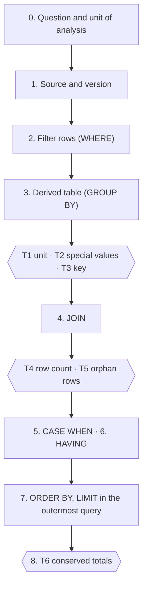
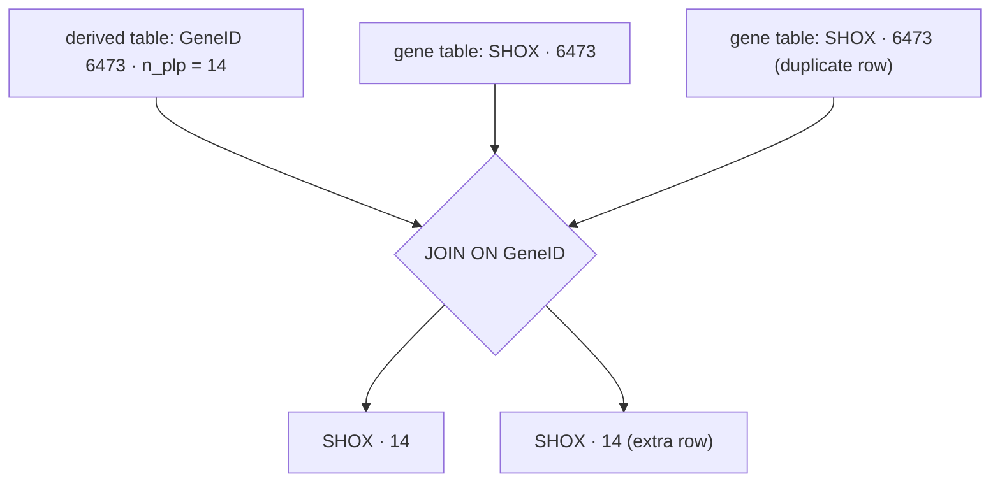

A multi-layer analytical SQL query that combines a derived table, JOIN, CASE WHEN and GROUP BY can only be trusted once every layer has passed a test on row counts and keys. This article builds such a query on the full ClinVar release from November 2026 to answer one question: which genes have accumulated the most well-reviewed disease-causing variants? Count rows instead of variants and forget to filter by genome assembly, and the number of "pathogenic variants" doubles: 834,444 rows versus 408,062 actual variants. It is written for people who can already write each SQL clause but have not yet put them together into a report; at the end you will find an 8-step checklist and 6 tests.

<div class="callout callout-note">
<p class="callout-title">Quick summary</p>

- Write down the unit of analysis before writing the query: what one result row is, and which key defines one "variant."
- Build the query from the inside out; run and test each layer (row count, duplicate keys, orphan rows, conserved totals) before wrapping the next one around it.
- ORDER BY only guarantees order in the outermost query; ORDER BY inside a derived table only matters when paired with LIMIT.
- Record the date, size and checksum of the data file and the engine version next to every number.

</div>

## 1. What derived tables and multi-layer queries are

A derived table is a SELECT statement placed in the FROM clause of another SELECT. The outer query treats its result like any other table: it can pick columns, join it to other tables, filter it, group it. This works because in the relational model, the result of a query over relations is itself a relation (Codd, 1970), so it can feed the next operation.

"Multi-layer query" is a loose name for any SQL statement with at least one such layer. A very common reporting pattern:

```sql
SELECT g.Symbol, d.n_plp
FROM (
    SELECT GeneID, COUNT(DISTINCT VariationID) AS n_plp
    FROM variant_summary
    WHERE Assembly = 'GRCh38' AND ClinSigSimple = 1 AND GeneID <> -1
    GROUP BY GeneID
) AS d
JOIN gene_summary AS g ON g.GeneID = d.GeneID
ORDER BY d.n_plp DESC;
```

The inner layer collapses the data to one row per gene. The outer layer attaches gene names and sorts. Because each layer does one job, you can run the inner layer on its own first and only then put the outer layer on top.

### How a derived table differs from a subquery in WHERE or SELECT

A subquery in WHERE (see also [Subqueries and CASE WHEN](/en/blog/subquery-and-case-when/)) usually returns a single value (a scalar subquery, for example `WHERE n > (SELECT AVG(n) FROM …)`) or a list to compare against with `IN`. A subquery in SELECT returns one value per row. A derived table returns an entire table, with multiple columns and rows, and the outer query refers to its columns by name.

As for performance, the way you write a query does not decide how it runs. A query optimizer can unnest a subquery into an equivalent join; Kim (1982) described these transformations back in the early 1980s. SQLite has its own rule, called query flattening: it merges a derived table into the outer query when a list of conditions holds, including conditions about LIMIT and ORDER BY inside the subquery (SQLite, n.d.-b). So pick whichever form reads most clearly, and look at the execution plan when you actually need to (section 10).

### Does a derived table need an alias?

It depends on the engine:

| Engine | Derived table without an alias | Source |
| --- | --- | --- |
| MySQL 8.4 | Error: the `[AS] tbl_name` clause is mandatory because every table in FROM must have a name | Oracle (n.d.) |
| SQL Server | Required: the documentation calls it a "required table_alias" | Microsoft (n.d.-b) |
| SQL standard | Requires an alias (according to the PostgreSQL documentation) | PostgreSQL Global Development Group (n.d.) |
| PostgreSQL ≥ 16 | Alias optional since version 16 (released September 14, 2023) | PostgreSQL Global Development Group (2023) |
| SQLite 3.37.0 and 3.45.3 | Runs (tested November 23, 2026) | direct test |

*Table 1. Derived tables without an alias, engine by engine.*

The safe choice is to always add an alias, with `AS`. An alias makes the query easier to read (`d.n_plp` tells you which layer the column comes from), and the same `.sql` file then runs on every engine.

## 2. An 8-step process, one test per step

The familiar checklist for writing an SQL report has six steps: identify the data source, JOIN, WHERE, GROUP BY, HAVING, ORDER BY. That order is close to the logical processing order of a SELECT statement (FROM and JOIN, then WHERE, GROUP BY, HAVING, SELECT, ORDER BY, and finally LIMIT). The list misses three things: the SELECT step, where expressions and CASE WHEN are computed; the LIMIT step; and, most important, a step before everything else that states what you are counting.

This article proposes the 8-step process below. Step 0 involves no SQL; step 8 adds no new clause but checks the whole thing again.

0. **Question and unit of analysis.** Write the question as one sentence, then state what one result row is (one gene) and what is being counted (one variant, defined by which key).
1. **Source and version.** Record the URL, update date, file size and engine version.
2. **Filter rows (WHERE).** Keep only rows that belong to the unit of analysis.
3. **Aggregate in a derived table (GROUP BY).** Bring the data down to exactly one row per key.
4. **JOIN.** Attach descriptive information (the gene name) to the aggregated result.
5. **Tiering (CASE WHEN in SELECT).**
6. **Filter groups (HAVING).**
7. **Sort and limit (ORDER BY, LIMIT) in the outermost query.**
8. **Whole-query test.** Conserved totals, plus a comparison with an independent number.

The 2 → 3 → 4 order is deliberate: aggregate first, then join. Joining the variant table (millions of rows) to the gene table and grouping afterward gives the same answer if the keys are clean. But when the gene table has duplicate keys, the row multiplication happens at the level of individual variants and is much harder to trace. Aggregate first, and the inner layer already has exactly one row per gene, so any later change in row count can only come from the JOIN.

Each step has a test with a numeric pass criterion, named T1–T6 in the sections that follow. The rationale comes from guidance on reproducible computational research: record how every result was produced, avoid manual edits to data, and archive the exact versions of programs and data (Sandve et al., 2013); keep raw data untouched, break work into small steps and check each one (Wilson et al., 2014, 2017); and organize a project so someone else can rerun it from scratch (Noble, 2009).



*Figure 1. The 8-step process; each hexagon is a test that must pass before moving on.*

## 3. One question, two numbers

ClinVar is NCBI's public archive of human genetic variants and how they are classified in relation to disease, along with supporting evidence submitted by clinical laboratories, research groups and expert panels (Landrum et al., 2014, 2018). The full dataset can be downloaded as tab-delimited files (Landrum et al., 2020). According to the 2025 update paper, ClinVar holds more than 3 million variants from more than 2,800 organizations (Landrum et al., 2025).

The case-study question: **which genes have accumulated the most well-reviewed pathogenic or likely pathogenic (P/LP) variants, and how are genes distributed across levels of accumulation?**

The quickest approach counts rows that are "P/LP" and "belong to a gene." A second approach counts distinct VariationIDs on one genome assembly. Both run without errors:

| Query | Result |
| --- | --- |
| `SELECT COUNT(*) FROM variant_summary WHERE ClinSigSimple = 1 AND GeneID <> -1` | 834,444 |
| `SELECT COUNT(DISTINCT VariationID) FROM variant_summary WHERE ClinSigSimple = 1 AND GeneID <> -1 AND Assembly = 'GRCh38'` | 408,062 |

*Table 2. Two queries on the `variant_summary` file released November 16, 2026.*

The first number is 2.04 times the second. The two queries differ in how they count (`COUNT(*)` versus `COUNT(DISTINCT VariationID)`) and in the `Assembly` condition. Almost all of the gap comes from the second difference: `variant_summary` has one row for each genome assembly a variant is mapped to, and most variants have both a GRCh37 and a GRCh38 row (National Center for Biotechnology Information [NCBI], 2026a). There is no syntax error anywhere here. The mistake sits at step 0: nobody said what "one variant" means.

## 4. The data: two ClinVar tab-delimited files

### 4.1. Source, version and license

The article uses two files from the `tab_delimited` directory of the ClinVar FTP site (NCBI, 2026b):

- `variant_summary.txt.gz`: Last-Modified November 16, 2026, 458,480,521 bytes, 9,355,006 data rows. The SHA-256 of the compressed file is `dcaceeef53664d137d1166da43685d46e1c5684269fc3217016c1c07607b33ac`; record this value so others can check they have the same release.
- `gene_specific_summary.txt`: the first line reads "dated November 15, 2026," 92,985 data rows.

The files are regenerated weekly and archived monthly (NCBI, 2026a), so every number in this article holds only for this release. NCBI places no restrictions on the use or distribution of data in its molecular databases, but notes that submitters may claim rights to some of the data they submit (NCBI, n.d.). This article publishes only aggregate tables and does not redistribute the original files.

Engine: SQLite 3.45.3, called from Python. The compressed file was read as a stream and the 11 needed columns were loaded into an SQLite table; no cell was edited by hand.

### 4.2. Columns used in this article

| Column | Meaning (paraphrased from the README) |
| --- | --- |
| `AlleleID` | ClinVar allele identifier |
| `VariationID` | Variant identifier; the key of the variant page on the ClinVar website |
| `GeneID` | NCBI Gene ID; −1 when the variant overlaps more than one gene |
| `GeneSymbol` | Gene symbol |
| `ClinicalSignificance` | Aggregate classification, as text |
| `ClinSigSimple` | 1: at least one current record classifies it as P/LP; 0: none does; −1: no data |
| `ReviewStatus` | Review level of the aggregate classification |
| `Assembly` | Genome assembly: GRCh37, GRCh38, NCBI36 or `na` |
| `Symbol`, `GeneID` (gene table) | Gene symbol and ID in `gene_specific_summary` |
| `Alleles_reported_Pathogenic_Likely_pathogenic` | Number of P/LP alleles per gene, as tallied by ClinVar itself |

*Table 3. Abridged data dictionary (NCBI, 2026a).*

Two points in these definitions deserve a careful read. `ClinSigSimple = 1` is a broad definition: a single current record classifying the variant as P/LP is enough, including labels such as "low penetrance" or "likely risk allele," and assertion criteria are not considered (NCBI, 2026a). And `GeneID = −1` is a special value with a meaning, not missing data.

### 4.3. Unit of analysis: one VariationID on GRCh38

In this release, each AlleleID maps to exactly one VariationID: both have 4,711,863 distinct values. The article uses VariationID because readers can look it up on the ClinVar website. The change history in the README shows that the reporting scheme has changed over time; for example, starting in October 2016 `variant_summary` reports by AlleleID (NCBI, 2026a). That is why the file version must sit next to every number.

The full unit of analysis: **one variant = one distinct VariationID mapped to GRCh38**. One result row = one GeneID.

### 4.4. Join on GeneID, not on gene symbol

Gene symbols change when HGNC updates the nomenclature, while identifiers stay stable (Seal et al., 2023). Spreadsheets also tend to turn gene symbols into dates: Ziemann et al. (2016) found this error to be widespread in supplementary files of scientific papers (details in the [data cleaning](/en/blog/process-data-from-dirty-to-clean/) article). A numeric key such as GeneID avoids both problems.

## 5. Steps 1–3: filter rows and aggregate in a derived table

The innermost layer answers "how many well-reviewed P/LP variants does each gene have":

```sql
-- Steps 2–3: filter rows, then aggregate to one row per gene
SELECT GeneID, COUNT(DISTINCT VariationID) AS n_plp
FROM variant_summary
WHERE Assembly = 'GRCh38'
  AND ClinSigSimple = 1
  AND GeneID <> -1
  AND ReviewStatus IN ('criteria provided, multiple submitters, no conflicts',
                       'reviewed by expert panel',
                       'practice guideline')
GROUP BY GeneID;
```

Run this block on its own before wrapping it in an outer query. Three tests go with it:

**T1 – unit.** Count rows and distinct VariationIDs for each `Assembly`:

```sql
SELECT Assembly, COUNT(*) AS n_rows, COUNT(DISTINCT VariationID) AS n_variants
FROM variant_summary
GROUP BY Assembly;
```

| Assembly | Rows | Distinct VariationIDs |
| --- | --- | --- |
| GRCh37 | 4,696,816 | 4,694,326 |
| GRCh38 | 4,643,848 | 4,641,428 |
| `na` | 9,571 | 9,571 |
| NCBI36 | 4,771 | 4,771 |
| Whole file | 9,355,006 | 4,711,863 |

*Table 4. Rows and distinct VariationIDs by genome assembly (ClinVar, November 16, 2026).*

The whole file has almost twice as many rows as variants. Even within GRCh38 there are 2,420 more rows than VariationIDs, meaning some variants have more than one row on the same assembly. That is why the query uses `COUNT(DISTINCT VariationID)` rather than `COUNT(*)`, even after filtering on `Assembly`.

**T2 – special values.** On GRCh38, `GeneID = −1` accounts for 28,184 of 4,643,848 rows (0.6%). Within the broad P/LP group, the `GeneID <> -1` condition removes 7,503 VariationIDs. This decision has consequences: among GRCh38 rows with `GeneID = −1`, besides 11,669 rows of single nucleotide variants there are 6,915 rows of copy number gain, 6,361 rows of copy number loss, 1,804 deletions and 848 duplications. Large structural variants drop out of a gene-level ranking, and the report has to say so.

**T3 – key.** The result has 3,514 rows and 3,514 distinct GeneIDs. GROUP BY guarantees this, but writing it down as a test still pays off: if someone later adds `GeneSymbol` to the GROUP BY, T3 flags it immediately.

To see how much the review-status filter removes: the broad definition (`ClinSigSimple = 1` alone) gives 408,062 variants across 5,890 genes; adding the `ReviewStatus` condition leaves 108,863 variants across 3,514 genes. Most P/LP variants in ClinVar have a single submitter ("criteria provided, single submitter": 236,540 VariationIDs).

<div class="callout callout-warning">
<p class="callout-title">Common mistakes in the inner layer</p>

- Using `COUNT(*)` instead of `COUNT(DISTINCT VariationID)`: the number then depends on how many rows each variant has, not on how many variants there are.
- Putting row-level conditions (`ReviewStatus`, `Assembly`) in HAVING: SQLite may run it, but the condition only checks one representative row per group, so the result is wrong without any error.
- Forgetting that `GeneID = -1` is a code, not NULL: `WHERE GeneID IS NOT NULL` removes no rows at all.

</div>

## 6. Step 4: JOIN with the gene table and the duplicate-key trap

The inner layer only has GeneID. To get gene names you join it to `gene_specific_summary` (join types are covered in [JOIN and multi-table joins](/en/blog/join-ket-hop-nhieu-bang/)). The most important test in this article lives at this step.

**T4 – row count (cardinality).** After the JOIN, the row count must equal the row count of the derived table, because each gene can only have one name. Result: 3,514 rows before, 3,516 after. With the broad definition: 5,890 before, 5,893 after.

Trace the cause with a duplicate-key query:

```sql
SELECT GeneID, Symbol, COUNT(*) AS n
FROM gene_summary
GROUP BY GeneID
HAVING COUNT(*) > 1;
```

The gene table has 92,985 rows but only 92,972 distinct GeneIDs. Twelve GeneIDs appear more than once, and the duplicate rows are identical in every column:

| Rows | Gene | Chromosome of the variants (GRCh38) |
| --- | --- | --- |
| 3 | IGH | 14 |
| 2 | AKAP17A, ASMT, ASMTL, CD99, CRLF2, CSF2RA, IL3RA, SHOX, SLC25A6 | X and Y |
| 2 | DDI2 | 1 |
| 2 | MYO18A | 17 |

*Table 5. Duplicate GeneIDs in `gene_specific_summary.txt`, November 15, 2026 release.*

Nine of the twelve genes have variants mapped to both X and Y. That suggests they lie in the pseudoautosomal region, where a gene has a copy on both sex chromosomes; the README gives no reason, so this is only a hint from the data. The other three (IGH, DDI2, MYO18A) do not fit that explanation. For the analysis, the consequence is what matters. Among the 3,514 genes under the narrow definition, only CSF2RA (5 variants) and SHOX (14) get doubled, but that is enough to throw off every sum downstream (T6, section 7).



*Figure 2. One row on the left meets two rows with the same key on the right and produces two result rows; the variant total grows by 14.*

The fix: deduplicate the gene table before joining, with a second derived table `(SELECT DISTINCT GeneID, Symbol FROM gene_summary) AS g`. Rerun T4: 3,514 rows before and after. If the duplicate rows differ in some column, `DISTINCT` is not enough; you then have to aggregate the gene table to one row per GeneID and state the rule used to pick it.

**T5 – orphan rows.** Count GeneIDs in the derived table that have no match in the gene table:

```sql
SELECT COUNT(*)
FROM (
    -- derived table from step 3, copied as-is from section 5
    SELECT GeneID, COUNT(DISTINCT VariationID) AS n_plp
    FROM variant_summary
    WHERE Assembly = 'GRCh38'
      AND ClinSigSimple = 1
      AND GeneID <> -1
      AND ReviewStatus IN ('criteria provided, multiple submitters, no conflicts',
                           'reviewed by expert panel',
                           'practice guideline')
    GROUP BY GeneID
) AS d
LEFT JOIN gene_summary AS g ON g.GeneID = d.GeneID
WHERE g.GeneID IS NULL;
```

The result is 0 under both definitions, so the INNER JOIN loses no genes. If it were not 0, an INNER JOIN would silently drop those genes.

**INNER or LEFT.** The question "every gene, including genes with no P/LP variants" requires starting from the gene table and LEFT JOINing the derived table, with `COALESCE(d.n_plp, 0)`. The same mistake shows up in business reports: tiering customers with an INNER JOIN against an orders table filtered to "Completed" drops every customer without a completed order, so the lowest tier in the report is missing exactly the customers who need the most attention. Bioinformatics systems built on SQLite, such as GEMINI, also join variants to annotations through keys and have to pick stable ones (Paila et al., 2013).

## 7. Steps 5–6: CASE WHEN, thresholds and group filters

The complete query:

```sql
SELECT g.Symbol, d.GeneID, d.n_plp,
       CASE
           WHEN d.n_plp >= 100 THEN 'high'
           WHEN d.n_plp >= 20  THEN 'medium'
           ELSE 'low'
       END AS tier
FROM (
    SELECT GeneID, COUNT(DISTINCT VariationID) AS n_plp
    FROM variant_summary
    WHERE Assembly = 'GRCh38'
      AND ClinSigSimple = 1
      AND GeneID <> -1
      AND ReviewStatus IN ('criteria provided, multiple submitters, no conflicts',
                           'reviewed by expert panel',
                           'practice guideline')
    GROUP BY GeneID
) AS d
JOIN (SELECT DISTINCT GeneID, Symbol FROM gene_summary) AS g
  ON g.GeneID = d.GeneID
ORDER BY d.n_plp DESC, g.Symbol;
```

CASE evaluates its WHEN branches in order and stops at the first true one, so thresholds must be written from highest to lowest. Swap them (`>= 20` before `>= 100`) and no gene can ever reach the "high" tier.

### 7.1. A threshold is an analytical decision

The thresholds of 100 and 20 are illustrative conventions, not biological boundaries. The honest approach is to report sensitivity: rerun with a few threshold sets and see which conclusions still hold.


*Figure 3. Number of genes per tier under three threshold sets (log-scale y-axis). Data: ClinVar November 16, 2026, GRCh38, narrow definition.*

| Threshold set (high / medium) | high | medium | low |
| --- | --- | --- | --- |
| ≥ 50 / ≥ 10 | 425 genes · 79,096 variants | 1,024 · 22,949 | 2,065 · 6,818 |
| ≥ 100 / ≥ 20 | 206 · 63,603 | 737 · 31,485 | 2,571 · 13,775 |
| ≥ 200 / ≥ 50 | 91 · 47,836 | 334 · 31,260 | 3,089 · 29,767 |

*Table 6. Genes and variants per tier under three threshold sets.*

The number of "high" genes changes almost fivefold between the lowest and highest threshold sets. What stays constant is the shape of the distribution: a small number of genes hold most of the variants. With the middle threshold set, 206 genes (5.9% of genes) contain 63,603 of the 108,863 variants (58%). The median is only 7 variants per gene, and 705 genes have exactly one variant. A conclusion should rest on that shape, not on the number 206.

**T6 – conserved totals.** Summing variants across the three tiers must give the derived-table total: 63,603 + 31,485 + 13,775 = 108,863. Before the gene table was deduplicated, this total was off by exactly 19 (5 from CSF2RA and 14 from SHOX).

### 7.2. HAVING and a check against an independent number

HAVING filters groups after GROUP BY (see GROUP BY and HAVING). To drop genes with too little data, add `HAVING COUNT(DISTINCT VariationID) >= 5` to the derived table: 2,042 genes remain. Row-level conditions (assembly, review status) belong in WHERE; conditions on aggregated results belong in HAVING.

| Gene | P/LP variants (narrow definition) | ClinVar's P/LP column |
| --- | --- | --- |
| BRCA2 | 3,778 | 6,030 |
| BRCA1 | 2,941 | 4,745 |
| NF1 | 1,868 | 6,002 |
| ATM | 1,847 | 4,137 |
| TTN | 1,409 | 6,192 |
| LDLR | 1,338 | 2,333 |
| MSH2 | 1,154 | 2,485 |
| MSH6 | 1,150 | 2,412 |
| APC | 1,147 | 2,754 |
| MLH1 | 1,103 | 2,110 |
| FBN1 | 1,086 | 3,860 |
| USH2A | 901 | 2,538 |
| CFTR | 843 | 1,701 |
| PALB2 | 813 | 1,601 |
| PAH | 767 | 932 |

*Table 7. The fifteen genes with the most well-reviewed P/LP variants (ClinVar, November 16, 2026).*

The right-hand column is `Alleles_reported_Pathogenic_Likely_pathogenic`, which ClinVar computes itself. The two columns cannot match, because ClinVar's column does not filter on review status and uses its own definition. Use it as an order-of-magnitude check: if your number is larger than ClinVar's, your query is almost certainly multiplying rows.

Rankings depend on the definition. Drop the review-status condition and TTN comes first with 6,478 variants, NF1 second (6,108), BRCA2 third (5,939). A narrow definition based on the text column (`ClinicalSignificance` exactly Pathogenic, Likely pathogenic or Pathogenic/Likely pathogenic) combined with review status gives 105,412 variants, 3,451 fewer than the definition based on `ClinSigSimple`.

## 8. Step 7: ORDER BY, LIMIT and ties

A popular "top N" pattern puts ORDER BY and LIMIT inside the derived table, then joins to get names. To keep the code block short, the inner layer from section 5 is first saved as a temporary table `d`:

```sql
-- Save the derived table from section 5 as temporary table d
CREATE TEMP TABLE d AS
SELECT GeneID, COUNT(DISTINCT VariationID) AS n_plp
FROM variant_summary
WHERE Assembly = 'GRCh38'
  AND ClinSigSimple = 1
  AND GeneID <> -1
  AND ReviewStatus IN ('criteria provided, multiple submitters, no conflicts',
                       'reviewed by expert panel',
                       'practice guideline')
GROUP BY GeneID;

-- Top 10: ORDER BY and LIMIT inside, no outer ORDER BY
SELECT g.Symbol, t.n_plp
FROM (SELECT GeneID, n_plp FROM d ORDER BY n_plp DESC LIMIT 10) AS t
JOIN (SELECT DISTINCT GeneID, Symbol FROM gene_summary) AS g
  ON g.GeneID = t.GeneID;
```

The inner ORDER BY is necessary: it decides which 10 rows LIMIT keeps. But it does not decide the output order after the JOIN. The SQLite documentation says a SELECT without ORDER BY returns rows in an undefined order (SQLite, n.d.-a). The SQL Server documentation states plainly that ORDER BY in a derived table is used only to pick rows for TOP or OFFSET and does not guarantee the order of the result (Microsoft, n.d.-a).

| Position | No outer ORDER BY, gene table first | With `ORDER BY t.n_plp DESC, g.Symbol` |
| --- | --- | --- |
| 1 | APC 1,147 | BRCA2 3,778 |
| 2 | ATM 1,847 | BRCA1 2,941 |
| 3 | BRCA1 2,941 | NF1 1,868 |
| 4 | BRCA2 3,778 | ATM 1,847 |
| 5 | LDLR 1,338 | TTN 1,409 |
| 6 | MLH1 1,103 | LDLR 1,338 |
| 7 | MSH2 1,154 | MSH2 1,154 |
| 8 | MSH6 1,150 | MSH6 1,150 |
| 9 | NF1 1,868 | APC 1,147 |
| 10 | TTN 1,409 | MLH1 1,103 |

*Table 8. The same 10 genes in two orders (SQLite 3.45.3).*

With the query above, SQLite happens to put the derived table in the outer loop, and the output comes out in descending order. Change the join order (middle column, forcing the gene table first with `CROSS JOIN`) and the output comes out alphabetically. Same query, same data, different execution plan. That plan can change as the data grows or when you switch engines. If you want a fixed order, ORDER BY belongs in the outermost query.

**Ties at the LIMIT boundary.** The current top 15 has no two genes with the same count, but further down there are many ties (705 genes each have one variant). When two genes tie at position N, which one `LIMIT N` keeps is up to the engine. Two ways to handle it: add a tiebreaker so the order is deterministic (`ORDER BY n_plp DESC, Symbol`), or use the `RANK()` window function to keep every tied gene.

## 9. GROUP BY the key, not the name

A common customer-tiering pattern uses `GROUP BY c.full_name`. Two customers with the same name get merged into one, their spending is added together, and they may jump to a higher tier. The correct approach is to group by the key and carry the name along for display: `GROUP BY c.id, c.full_name`.

The biology version of this mistake is grouping by `GeneSymbol` instead of `GeneID`. In the ClinVar release used here, no symbol in the gene table maps to more than one GeneID, so both groupings give the same result. That is a coincidence of one release, not a guarantee: gene nomenclature changes (Seal et al., 2023), and symbols are the thing tools most easily corrupt (Ziemann et al., 2016). Group by the key and the query stays correct for future releases too.

## 10. What the engine does with a multi-layer query

`EXPLAIN QUERY PLAN` shows how SQLite processes the complete query from section 7:

| No index | With index `(Assembly, ClinSigSimple, GeneID)` |
| --- | --- |
| CO-ROUTINE d | CO-ROUTINE d |
| SCAN variant_summary | SEARCH variant_summary USING INDEX ix_vs (Assembly=? AND ClinSigSimple=?) |
| USE TEMP B-TREE FOR GROUP BY | — |
| USE TEMP B-TREE FOR count(DISTINCT) | USE TEMP B-TREE FOR count(DISTINCT) |
| MATERIALIZE g · SCAN gene_summary · USE TEMP B-TREE FOR DISTINCT | same as left |
| SCAN d · BLOOM FILTER ON g · SEARCH g USING AUTOMATIC COVERING INDEX | same as left |
| USE TEMP B-TREE FOR ORDER BY | USE TEMP B-TREE FOR ORDER BY |
| 1.70–1.80 seconds per run (3 runs) | 1.37–1.47 seconds |

*Table 9. Execution plan on 9,355,006 rows, SQLite 3.45.3.*

The derived table `d` runs as a co-routine, feeding rows one at a time to the outer query. The deduplicated gene table is materialized, and SQLite then builds a temporary index (automatic covering index) and a bloom filter to look up GeneIDs. The index on `(Assembly, ClinSigSimple, GeneID)` lets SQLite go straight to GRCh38 rows with `ClinSigSimple = 1` and skip the sort for GROUP BY, but it is only about 20% faster, because counting DISTINCT still needs a temporary B-tree.

The optimizer picks a plan based on row-count estimates at each step, and those estimates are often the largest source of error (Leis et al., 2015). That is also why T4 counts the actual rows after the JOIN instead of guessing.

## 11. Checklist and limitations

| Step | Task | Test |
| --- | --- | --- |
| 0 | Question, unit of analysis | You can write "one result row is…", "one variant is…" |
| 1 | Source, date, size, checksum, engine version | Someone else can download exactly the same release |
| 2–3 | WHERE, GROUP BY in the derived table | T1 unit · T2 special values · T3 no duplicate keys |
| 4 | JOIN | T4 row count unchanged · T5 orphan rows = 0 |
| 5–6 | CASE WHEN, HAVING | Thresholds from high to low; rerun with at least two other threshold sets |
| 7 | ORDER BY, LIMIT in the outermost query | A tiebreaker or RANK() for ties |
| 8 | Whole-query test | T6 conserved totals; magnitude check against an independent number |

*Table 10. The 8-step checklist.*

Write each test as a query that returns 0 rows when it passes, and run it automatically after every change to code or data. Together with a file recording versions, that covers most of what the reproducible-research guidelines ask for (Sandve et al., 2013; Wilson et al., 2017).

This case study has limits. A gene's count of P/LP variants in ClinVar reflects how heavily that gene is tested and submitted, not how "dangerous" the gene is. P/LP classifications are made by submitters, mostly under the ACMG/AMP five-tier framework (Richards et al., 2015); this article re-evaluates no classification and draws no clinical conclusions.

The next step in the series is to rewrite the same query with CTEs (`WITH d AS (…), g AS (…)`), so each layer has a name and can be tested on its own, and then to use window functions for rankings with ties.

## Frequently asked questions

**Does a subquery in FROM need an alias?** MySQL and SQL Server require one. PostgreSQL from version 16 and SQLite (tested on 3.37.0 and 3.45.3) run without it. Add one anyway so the query runs everywhere.

**Does ORDER BY in a subquery do anything?** Yes, when paired with LIMIT to choose rows. No, if you are counting on it to order the final result.

**Why does a JOIN increase the row count?** Because the other table has duplicate keys. Compare row counts before and after the JOIN, then find duplicate keys with `GROUP BY key HAVING COUNT(*) > 1`.

## References

Codd, E. F. (1970). A relational model of data for large shared data banks. *Communications of the ACM, 13*(6), 377–387. https://doi.org/10.1145/362384.362685

Kim, W. (1982). On optimizing an SQL-like nested query. *ACM Transactions on Database Systems, 7*(3), 443–469. https://doi.org/10.1145/319732.319745

Landrum, M. J., Chitipiralla, S., Brown, G. R., Chen, C., Gu, B., Hart, J., … Kattman, B. L. (2020). ClinVar: Improvements to accessing data. *Nucleic Acids Research, 48*(D1), D835–D844. https://doi.org/10.1093/nar/gkz972

Landrum, M. J., Chitipiralla, S., Kaur, K., Brown, G., Chen, C., Hart, J., … Kattman, B. L. (2025). ClinVar: Updates to support classifications of both germline and somatic variants. *Nucleic Acids Research, 53*(D1), D1313–D1321. https://doi.org/10.1093/nar/gkae1090

Landrum, M. J., Lee, J. M., Benson, M., Brown, G. R., Chao, C., Chitipiralla, S., … Maglott, D. R. (2018). ClinVar: Improving access to variant interpretations and supporting evidence. *Nucleic Acids Research, 46*(D1), D1062–D1067. https://doi.org/10.1093/nar/gkx1153

Landrum, M. J., Lee, J. M., Riley, G. R., Jang, W., Rubinstein, W. S., Church, D. M., & Maglott, D. R. (2014). ClinVar: Public archive of relationships among sequence variation and human phenotype. *Nucleic Acids Research, 42*(D1), D980–D985. https://doi.org/10.1093/nar/gkt1113

Leis, V., Gubichev, A., Mirchev, A., Boncz, P., Kemper, A., & Neumann, T. (2015). How good are query optimizers, really? *Proceedings of the VLDB Endowment, 9*(3), 204–215. https://doi.org/10.14778/2850583.2850594

Microsoft. (n.d.-a). *ORDER BY clause (Transact-SQL)*. Microsoft Learn. Retrieved November 12, 2026, from https://learn.microsoft.com/en-us/sql/t-sql/queries/select-order-by-clause-transact-sql

Microsoft. (n.d.-b). *FROM clause plus JOIN, APPLY, PIVOT (Transact-SQL)*. Microsoft Learn. Retrieved November 23, 2026, from https://learn.microsoft.com/en-us/sql/t-sql/queries/from-transact-sql

National Center for Biotechnology Information. (n.d.). *Policies and disclaimers*. Retrieved November 12, 2026, from https://www.ncbi.nlm.nih.gov/home/about/policies/

National Center for Biotechnology Information. (2026a). *README file for ftp://ftp.ncbi.nih.gov/pub/clinvar*. Retrieved November 23, 2026, from https://ftp.ncbi.nlm.nih.gov/pub/clinvar/tab_delimited/README

National Center for Biotechnology Information. (2026b). *ClinVar variant_summary.txt.gz (November 16, 2026) and gene_specific_summary.txt (November 15, 2026)* [Data set]. Retrieved November 23, 2026, from https://ftp.ncbi.nlm.nih.gov/pub/clinvar/tab_delimited/

Noble, W. S. (2009). A quick guide to organizing computational biology projects. *PLoS Computational Biology, 5*(7), e1000424. https://doi.org/10.1371/journal.pcbi.1000424

Oracle. (n.d.). *Derived tables*. MySQL 8.4 Reference Manual. Retrieved November 23, 2026, from https://dev.mysql.com/doc/refman/8.4/en/derived-tables.html

Paila, U., Chapman, B. A., Kirchner, R., & Quinlan, A. R. (2013). GEMINI: Integrative exploration of genetic variation and genome annotations. *PLoS Computational Biology, 9*(7), e1003153. https://doi.org/10.1371/journal.pcbi.1003153

PostgreSQL Global Development Group. (2023). *E.16. Release 16*. PostgreSQL Documentation. Retrieved November 12, 2026, from https://www.postgresql.org/docs/release/16.0/

PostgreSQL Global Development Group. (n.d.). *SELECT*. PostgreSQL 18 Documentation. Retrieved November 12, 2026, from https://www.postgresql.org/docs/current/sql-select.html

Richards, S., Aziz, N., Bale, S., Bick, D., Das, S., Gastier-Foster, J., Grody, W. W., Hegde, M., Lyon, E., Spector, E., Voelkerding, K., & Rehm, H. L. (2015). Standards and guidelines for the interpretation of sequence variants: A joint consensus recommendation of the American College of Medical Genetics and Genomics and the Association for Molecular Pathology. *Genetics in Medicine, 17*(5), 405–424. https://doi.org/10.1038/gim.2015.30

Sandve, G. K., Nekrutenko, A., Taylor, J., & Hovig, E. (2013). Ten simple rules for reproducible computational research. *PLoS Computational Biology, 9*(10), e1003285. https://doi.org/10.1371/journal.pcbi.1003285

Seal, R. L., Braschi, B., Gray, K., Jones, T. E. M., Tweedie, S., Haim-Vilmovsky, L., & Bruford, E. A. (2023). Genenames.org: The HGNC resources in 2023. *Nucleic Acids Research, 51*(D1), D1003–D1009. https://doi.org/10.1093/nar/gkac888

SQLite. (n.d.-a). *SELECT*. Retrieved November 12, 2026, from https://www.sqlite.org/lang_select.html

SQLite. (n.d.-b). *The SQLite query optimizer overview*. Retrieved November 12, 2026, from https://www.sqlite.org/optoverview.html

Wilson, G., Aruliah, D. A., Brown, C. T., Chue Hong, N. P., Davis, M., Guy, R. T., Haddock, S. H. D., Huff, K. D., Mitchell, I. M., Plumbley, M. D., Waugh, B., White, E. P., & Wilson, P. (2014). Best practices for scientific computing. *PLoS Biology, 12*(1), e1001745. https://doi.org/10.1371/journal.pbio.1001745

Wilson, G., Bryan, J., Cranston, K., Kitzes, J., Nederbragt, L., & Teal, T. K. (2017). Good enough practices in scientific computing. *PLOS Computational Biology, 13*(6), e1005510. https://doi.org/10.1371/journal.pcbi.1005510

Ziemann, M., Eren, Y., & El-Osta, A. (2016). Gene name errors are widespread in the scientific literature. *Genome Biology, 17*(1), 177. https://doi.org/10.1186/s13059-016-1044-7
