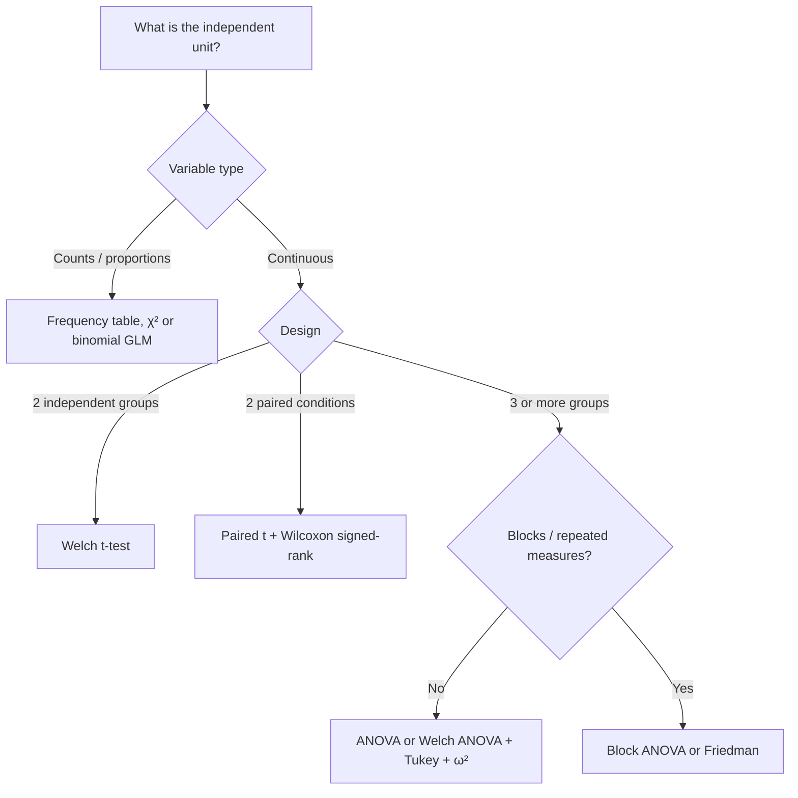

When the smaller group has twice the standard deviation of the larger one, Student's t-test rejects a true null hypothesis about 16% of the time at α = 0.05, the "F-test first, then choose a t-test" procedure about 7%, and Welch's t-test holds at 5%. This article walks through the test-selection decisions that come up most often in biology experiments: two independent samples, paired samples, three or more groups, χ² frequency tables, and heritability computed from an ANOVA table. Each rule is checked against the methodological literature and re-run on 14 practice datasets, with Python and R code so you can verify the results yourself.

## 1. Introduction: four rules for choosing a test, and why they deserve a second look

People who learn biostatistics with Excel's *Data Analysis ToolPak* often pick tests by four tidy rules: run an F-test on the variances first, then choose the "equal" or "unequal variances" t-test; use t below 30 observations and z above 30; for three or more groups, run an ANOVA and stop once F is significant; and when comparing varieties, compute heritability (h²) from the ANOVA table.

These four rules line up with the buttons the ToolPak offers, but the current methodological literature recommends something different on all four counts: the two-step procedure distorts the Type I error rate, the n = 30 threshold is unnecessary once Welch's t-test is available, an ANOVA needs post hoc comparisons and an effect size, and h² from an ANOVA is a specific quantity that has to be named precisely.

The article uses 14 practice datasets of the kind found in biostatistics textbooks (Table 1). The original measurement source of most of them could not be verified, so every biological remark here serves only to illustrate the methods. Calculations use Python 3 (scipy, pandas) and R.

Most "there is a difference" conclusions survive reanalysis; what changes is how the test is chosen, how results are reported, and in a few cases the substance of the conclusion itself.

**Table 1.** The datasets, the recommended analysis, and what changes

| Dataset | Common approach | Recommended analysis | Does the conclusion change? |
|---|---|---|---|
| Vaccine: 2 lots × 3 reaction levels | χ², "accept H0 at 99%" | χ² + exact p + proportions | No; the wording changes |
| Fertilizer × flowering (734 plants) | χ², ranked by plant counts | χ² + proportions + residuals | **Yes**: rank by proportion |
| Milk from two herds (169 cows) | χ² on 18 classes | Welch t on the means | No; the question changes |
| Carboxylesterase 29 vs. 27 | F-test → Student t | Welch t | No |
| IgA, serum protein 14 vs. 11 | F-test → Student t | Welch t | No; df and p change |
| Chlorophyll a/b, C3 vs. C4 | F-test → Student t | Welch t | No |
| Carboxylesterase 35 vs. 35 | z-test | Welch t on independent units | **Yes**: effective n is 10 |
| Infant mortality, two communes | t-test on 2 rates per commune | 2×2 tables, Mantel–Haenszel, logistic | **Yes**: from "inconclusive" to evidence |
| Shoot counts, 22 pairs | Paired t | Paired t + Wilcoxon | No |
| 4 rice varieties × 5 replicates | ANOVA | ANOVA + Tukey + ω² | **Yes**: G1 and G2 in the same group |
| 3 bee strains × 9 hives | ANOVA | Welch ANOVA + Tukey | **Yes**: c and a in the same group |
| Maize, 4 fertilizer regimes × 3 runs | One-way ANOVA | Block ANOVA if "run" is a block | Depends on the design |
| Chlorophyll a, 3 species × 3 leaves | ANOVA + h² | Block ANOVA; no h² | Drop h² |
| Fish deaths by concentration × time | Two-way ANOVA | Binomial GLM, dose–response model | Different analysis |

## 2. The language of testing: never "accept H0"

The last step of a hypothesis test is often written as "reject or accept H0," and the word "accept" is misleading. The American Statistical Association (ASA) statement sets out six principles, among them that a p-value does not measure the probability that a hypothesis is true, does not measure the size or importance of an effect, and that scientific conclusions should not rest solely on whether p crosses a threshold (Wasserstein & Lazar, 2016). Greenland et al. (2016) list dozens of common misinterpretations, including treating a "not statistically significant" result as evidence that there is no effect.

The vaccine example shows this clearly. Two vaccine lots were tested on 348 mice, and reactions were recorded as mild, moderate, or severe. Lot A had 12/177 mice with a mild reaction (6.8%), lot B 29/171 (17.0%). The χ² test gives $\chi^2 = 8.71$, df = 2. Writing "reject H0 at α = 0.05, accept H0 at α = 0.01" leads readers to think that at the 99% level the two lots are "the same," which the data do not say at all.

A better version: $\chi^2(2) = 8.71$, p = 0.013. The data provide moderate evidence that the distribution of reaction severity differs between the two lots; the difference lies mainly in the proportion of mild reactions, which is higher in lot B (17.0% vs. 6.8%; adjusted standardized residual ±2.94).

It also helps to separate the **significance level** α = 0.01, which belongs to the test, from the **confidence level** of 99%, which belongs to a confidence interval; "different at 99% confidence" does not mean "a 99% probability that there is a difference." How to compute and read confidence intervals is covered in [the previous article on confidence intervals](/en/blog/3-dac-trung-thong-ke-cua-mot-mau-va-uoc-luong-tham-so-cua-tong-the/); the foundations of the p-value are in the note on hypothesis testing and p-values.

Finally, statistics can only answer the question the design allows. Comparing a purebred herd with a crossbred herd compares two observational groups that differ in many things at once; concluding that they "differ in their genetic makeup" goes beyond what a t-test or χ² can show, because no part of the design separates genetics from environment.

<div class="callout callout-note">
<p class="callout-title">A reporting template</p>

"The mean in group A was 0.12 units higher than in group B (95% CI 0.08–0.15; Welch t(53.1) = 6.53; p = 2.6 × 10⁻⁸; Cohen's d = 1.73)." One sentence carries the direction, size, precision, and evidence.

</div>

## 3. Two independent samples: Welch by default, no F-test needed

### 3.1. What Welch's t-test is

Student's two-sample t-test assumes the two populations have the same variance and pools the two sample variances into a single common variance. Welch (1947) generalized the problem to unequal variances: the t statistic uses a standard error computed separately for each group,

$$t = \frac{\bar x_1 - \bar x_2}{\sqrt{s_1^2/n_1 + s_2^2/n_2}},$$

and the degrees of freedom are approximated with the Welch–Satterthwaite formula:

$$\nu \approx \frac{\left(s_1^2/n_1 + s_2^2/n_2\right)^2}{\dfrac{(s_1^2/n_1)^2}{n_1-1} + \dfrac{(s_2^2/n_2)^2}{n_2-1}}.$$

The degrees of freedom are usually fractional and fall between $\min(n_1, n_2) - 1$ and $n_1 + n_2 - 2$. In Excel this is the *t-Test: Two-Sample Assuming Unequal Variances* tool; in R it is the default of `t.test()`; in Python it is `scipy.stats.ttest_ind(x, y, equal_var=False)`.

### 3.2. Why you should not run an F-test first

The two-step procedure looks careful, but the decision at step two depends on the random outcome of step one, so the Type I error rate of the whole procedure is no longer the nominal α. Zimmerman (2004) showed that a preliminary test of equal variances followed by a test chosen on its result does not protect the Type I error rate, and that using Welch unconditionally does better. Rasch et al. (2011) put the conclusion right in their title: pre-testing the assumptions of the two-sample t-test "does not pay off." Ruxton (2006) for behavioral ecology and Delacre et al. (2017) for psychology both recommend Welch as the default.

A small simulation shows how large the problem is: two groups drawn from normal distributions with the same mean (H0 true), repeated 20,000 times, counting the rejection rate at α = 0.05; a good procedure should give a rate close to 0.05.

```python
import numpy as np
from scipy import stats

rng = np.random.default_rng(2026)

def type1(n1, n2, sd1, sd2, reps=20000, alpha=0.05):
    """False rejection rate when H0 is true (both means equal 0)."""
    hits = np.zeros(3)  # two-step, Student, Welch
    for _ in range(reps):
        x = rng.normal(0, sd1, n1)
        y = rng.normal(0, sd2, n2)
        F = x.var(ddof=1) / y.var(ddof=1)
        p_F = 2 * min(stats.f.cdf(F, n1 - 1, n2 - 1), stats.f.sf(F, n1 - 1, n2 - 1))
        p_student = stats.ttest_ind(x, y).pvalue
        p_welch = stats.ttest_ind(x, y, equal_var=False).pvalue
        p_twostep = p_student if p_F > 0.05 else p_welch
        hits += [p_twostep < alpha, p_student < alpha, p_welch < alpha]
    return hits / reps

print(type1(10, 30, 2, 1))  # roughly [0.07, 0.16, 0.05]
```

**Table 2.** Simulated Type I error rates (20,000 replications per scenario, seed 2026, α = 0.05)

| Scenario | Two-step (F → t) | Student | Welch |
|---|---|---|---|
| n₁ = 10, n₂ = 30, SD₁ = 2, SD₂ = 1 | 0.073 | 0.160 | 0.051 |
| n₁ = 30, n₂ = 10, SD₁ = 2, SD₂ = 1 | 0.040 | 0.008 | 0.050 |
| n₁ = n₂ = 15, equal SDs | 0.048 | 0.048 | 0.047 |
| n₁ = 10, n₂ = 30, equal SDs | 0.053 | 0.050 | 0.051 |


**Figure 1.** False rejection rates of the three procedures in four simulated scenarios. The dashed line marks α = 0.05.

When the smaller group has the larger variance, Student's test rejects falsely at three times the nominal rate; the "gatekeeper" F-test fixes only part of the problem, because with 10 observations it often lacks the power to detect unequal variances. When the larger group has the larger variance, Student's test becomes overly conservative (0.008), which means lost power. Welch stays near 0.05 in all four scenarios, and when the variances really are equal it loses almost nothing relative to Student. The cost of Welch when the assumption holds is very small, while the cost of Student when the assumption fails can be large (Delacre et al., 2017).

### 3.3. Re-running the examples with Welch

**Carboxylesterase in people exposed to organophosphate insecticides** (29 exposed vs. 27 controls): Welch t = 6.53, df = 53.1, p = 2.6 × 10⁻⁸. The mean difference is 0.116 (95% CI 0.081–0.152), Cohen's d ≈ 1.73 (computed with the pooled standard deviation). Student gives t = 6.48, df = 54, nearly identical because the two groups are almost the same size.

**Serum IgA** (14 healthy people vs. 11 with viral hepatitis): Welch t = −22.7, df = 16.6, p ≈ 6 × 10⁻¹⁴. The difference is so large that any test gives the same conclusion.

**Serum protein** in the same two groups is the most instructive example. The variance is 133.2 in the patient group and 34.5 in the healthy group, a ratio of about 3.9; the F-test gives p = 0.026. If α = 0.01 is used throughout, the F-test "fails to reject" equal variances, and the two-step procedure picks Student: t = −5.35, df = 23, p = 2.0 × 10⁻⁵. Welch gives t = −4.97, df = 14.0, p = 2.1 × 10⁻⁴, with a 95% CI for the difference from −27.1 to −10.8 mg/ml. The conclusion stands, but a variance ratio near 4 with n of only 11 and 14 is exactly the kind of situation in which the simulation shows Student can go astray.

**Chlorophyll a/b ratio in C3 and C4 plants** (10 and 13 species): Welch t = −4.66, df = 19.7, p = 1.6 × 10⁻⁴; 95% CI for the difference from −1.34 to −0.51. No change. The physiological background of the two groups is in the note on photosynthesis in C3 and C4 plants.

### 3.4. When you still need a nonparametric test

The Mann–Whitney test (Wilcoxon rank-sum) is not a "t-test for non-normal data": it tests a different hypothesis, about whether one group tends to produce larger values than the other, not whether two means are equal (Fagerland, 2012; Ruxton, 2006). When two groups differ in variance or in the shape of their distributions, Mann–Whitney can reject even though the two means are equal. Fagerland (2012) also notes that with large samples the t-test and the confidence interval for the mean difference should still be used even when the data are skewed. Nonparametric tests are useful when the question is about ranks, when the data are ordinal, or as a sensitivity analysis. For the carboxylesterase example, Mann–Whitney gives p = 8.7 × 10⁻⁷, consistent with Welch.

### 3.5. A test-selection flowchart

The flowchart below replaces the four rules from Section 1 with questions about design and data type.



**Figure 2.** A test-selection flowchart based on the independent unit, the variable type, and the design. There is no "F-test" or "n > 30" branch.

## 4. "Use z when n > 30" and the problem of too few observations

### 4.1. A z-test with sample variances is a Welch t-test with infinite df

The ToolPak's *z-Test: Two Sample for Means* tool asks for "known" variances; in practice, users enter the sample variances. The z statistic then has exactly the same formula as the Welch t statistic in Section 3.1; the only difference is that z is compared with the normal distribution, which is the t distribution with infinite degrees of freedom. So there is no reason to switch tests at a sample-size threshold: with large n the two approaches nearly coincide, and with small n z ignores the error in estimating the variance and is overconfident. If you do use the "Known Variance" boxes, enter the sample variance with the n − 1 divisor (`VAR.S`), not `VAR.P`; with 35 observations the two values are 0.0629 and 0.0611.

A concrete example: the carboxylesterase activity dataset with 35 observations per group gives z = 5.01. Against the normal distribution, p = 5.4 × 10⁻⁷; against Welch's t distribution (df = 39.5), p = 1.2 × 10⁻⁵, about 20 times larger.

### 4.2. Thirty-five rows, ten observations

This 35 + 35 dataset has a more important feature. Looking closely at the control column, the 35 values are really one block of 10 values (2.35, 2.48, 2.49, 2.52, 2.49, 2.47, 2.11, 1.64, 2.19, 2.38) repeated three and a half times (Figure 3). The treatment column likewise contains only 10 distinct values, repeated in segments. Whether this came from copying data or from duplicating rows to build an example, if the real data hold only 10 independent observations per group, then analyzing 35 rows is **pseudoreplication**: treating non-independent observations as if they were independent, which inflates the sample size and shrinks the standard error (Hurlbert, 1984).


**Figure 3.** The 35 control-group values in row order. Each color is a 10-row block; the pattern repeats exactly.

The consequences are clear. Welch on 35 rows per group gives t = 5.01, p = 1.2 × 10⁻⁵. Welch on the first 10 rows, the 10 independent observations, gives t = 2.41, df = 9.9, p = 0.037, with a 95% CI for the difference from 0.016 to 0.41. The conclusion is still "a difference" at α = 0.05, but the confidence interval nearly touches 0. **n is the number of independent units, not the number of rows in the table.** Three measurements on the same plant or two wells from the same sample do not increase n. Checking for duplicates before analysis is one step of [the data-cleaning workflow](/en/blog/process-data-from-dirty-to-clean/).

### 4.3. Two observations per group: when a t-test cannot answer

Another dataset asks about mortality among infants under one year old in two communes (the smallest rural administrative unit in Vietnam), one in an area sprayed with herbicides and one comparison commune, over two periods, 1971–1975 and 1981–1986. If each mortality rate is treated as one "observation," each commune has only 2 observations. Student's t-test gives t = 1.65, df = 2, p = 0.24, and nothing can be concluded.

That result was all but predetermined. With 2 observations per group, the power of a two-sided t-test at α = 0.05 to detect a large effect (d = 1) is only about 9.5% (computed from the noncentral t distribution; in R: `power.t.test(n = 2, delta = 1)`). A "not significant" result here carries no information.

The root problem is analyzing the wrong kind of data. The actual data are numbers of infants who died and who survived: 92/1,352 and 19/895 in the first period, 61/1,757 and 20/773 in the second. The independent unit is each infant. The analysis that fits this kind of data is a 2×2 table for each period, pooled across the two periods with the Mantel–Haenszel method (Mantel & Haenszel, 1959), plus logistic regression to check whether the odds ratio is homogeneous across periods.

```r
# Infant deaths / survivors by commune and period
d <- data.frame(
  commune = c("A", "B", "A", "B"),
  period  = c("1971-1975", "1971-1975", "1981-1986", "1981-1986"),
  dead    = c(92, 19, 61, 20),
  alive   = c(1260, 876, 1696, 753)
)

# 2x2x2 table for Mantel-Haenszel: rows = dead/alive, columns = commune, strata = period
tab <- array(c(92, 1260, 19, 876, 61, 1696, 20, 753), dim = c(2, 2, 2))
mantelhaen.test(tab, correct = FALSE)   # common OR ~ 2.25 (1.57-3.20)

# Logistic regression: commune x period interaction
m0 <- glm(cbind(dead, alive) ~ commune + period, family = binomial, data = d)
m1 <- glm(cbind(dead, alive) ~ commune * period, family = binomial, data = d)
anova(m0, m1, test = "Chisq")           # p ~ 0.013
```

In 1971–1975, the odds of death in commune A were 3.37 times those in commune B (exact 95% CI 2.02–5.89; χ² p ≈ 5 × 10⁻⁷). In 1981–1986, OR = 1.35 (0.80–2.39; p = 0.24). The pooled Mantel–Haenszel odds ratio is 2.25 (95% CI 1.57–3.20; p = 3.7 × 10⁻⁶). But logistic regression shows a significant commune × period interaction (deviance comparison, p = 0.013): the difference between the two communes is clearly smaller in the later period than in the earlier one. When the odds ratio is not homogeneous across strata, a single pooled number is not enough to describe the data; each period has to be reported separately, as in Figure 4.


**Figure 4.** Odds ratio of death before age one, commune A vs. commune B, by period and pooled with Mantel–Haenszel. Horizontal bars are 95% confidence intervals; the horizontal axis is on a log scale.

Instead of "inconclusive," analyzing the right kind of data gives strong evidence of a difference in the first period and a small, unclear difference in the second. One limitation must be kept in view: this is an ecological comparison of two localities that may differ in geography, health care, and how deaths were recorded, so it does not support a causal conclusion about the herbicides.

<div class="callout callout-warning">
<p class="callout-title">When the data are counts</p>

If you have a numerator and a denominator (deaths/total, germinated/seeds sown), analyze those counts directly with a frequency table or a binomial GLM. Computing proportions and feeding them into a t-test or ANOVA throws away the information about the sample size behind each proportion.

</div>

## 5. Two paired samples, and three or more related samples

When each observation under condition 1 is paired with exactly one observation under condition 2, the analysis is based on the difference $d_i$ within each pair: $t = \bar d / (s_d/\sqrt n)$, df = n − 1. Pairing removes the variation between pairs, so it is usually much more powerful than treating the two columns as independent.

Example: 22 pairs of tissue-culture explants on two media, with shoots counted per tube. The means are 3.05 and 4.68 shoots; paired t = −6.52, df = 21, p = 1.8 × 10⁻⁶. Two practical notes. First, the ToolPak takes α from the *Alpha* box in the dialog, 0.05 by default, and the *t Critical two-tail* value it prints depends on that box. With df = 21, the two-sided critical value is 2.08 at α = 0.05 and 2.83 at α = 0.01; if you intend to test at α = 0.01 and see 2.08, the *Alpha* box was not changed. Reporting the exact p avoids the problem entirely. Second, shoot numbers are small counts (0–8), so running a Wilcoxon signed-rank test as a sensitivity analysis is sensible.

When there are three or more conditions on the same units, for example three pollen culture media with 9 replicates each, running a paired t-test for every pair (3 comparisons) neither corrects for multiple comparisons nor uses the shared structure. If the 9 replicates really are 9 blocks (the same pollen batch split across the three media), the right approach is a randomized block ANOVA, or the Friedman test for a nonparametric version (Friedman, 1937), followed by adjusted pairwise comparisons. If the replicates are independent of one another, they are three independent samples, and Section 6 applies.

## 6. An ANOVA is not finished when F is significant

### 6.1. F only says "at least one difference"

A significant F only tells you that H0, "all means are equal," does not fit the data; it does not say which groups differ from which. Answering "which variety should we choose" requires pairwise comparisons that control the family-wise error rate (FWER). The most common method is Tukey's HSD; when the groups have unequal sizes, Kramer's (1956) extension, usually called Tukey–Kramer, is the standard choice. When group variances clearly differ, use Welch's ANOVA (`oneway.test` in R).

Alongside p, report an effect size. η² = SS_A / SS_T is easy to understand (the share of variation due to the factor) but is positively biased, especially with small samples; ω² is less biased; in multifactor designs, partial η² cannot be compared across designs, and generalized η² or generalized ω² have been proposed to solve that (Olejnik & Algina, 2003; Lakens, 2013). The formula for ω² in a one-way ANOVA:

$$\omega^2 = \frac{SS_A - (a-1)\,MS_E}{SS_T + MS_E}.$$

Kruskal–Wallis is the nonparametric version for three or more independent groups (Kruskal & Wallis, 1952) and works well as a sensitivity analysis.

### 6.2. Four rice varieties

Grain yield of four rice varieties, 5 replicates each. The code below does the whole job: ANOVA, η², ω², Tukey HSD, Bartlett's test, and the two heritability estimates used in Section 7.

```python
import numpy as np
import pandas as pd
from scipy import stats

rice = pd.DataFrame({
    "variety": np.repeat(["G1", "G2", "G3", "G4"], 5),
    "grain_yield": [8, 7, 6, 6, 8, 9, 10, 7, 9, 8, 5, 5, 4, 3, 6, 5, 4, 5, 5, 6],
})
groups = [g["grain_yield"].to_numpy(float) for _, g in rice.groupby("variety")]
a, m = len(groups), len(groups[0])          # number of varieties, number of replicates
N = a * m

F, p = stats.f_oneway(*groups)
grand = rice["grain_yield"].mean()
ss_a = sum(m * (g.mean() - grand) ** 2 for g in groups)
ss_e = sum(((g - g.mean()) ** 2).sum() for g in groups)
ms_a, ms_e = ss_a / (a - 1), ss_e / (N - a)

eta2 = ss_a / (ss_a + ss_e)
omega2 = (ss_a - (a - 1) * ms_e) / (ss_a + ss_e + ms_e)
print(f"F({a-1},{N-a}) = {F:.2f}, p = {p:.1e}, eta2 = {eta2:.2f}, omega2 = {omega2:.2f}")

print(stats.tukey_hsd(*groups))             # pairwise comparisons, FWER controlled
print("Bartlett p =", round(stats.bartlett(*groups).pvalue, 3))

s2_g = (ms_a - ms_e) / m                     # divide by the number of replicates m
H2_plot = s2_g / (s2_g + ms_e)
H2_mean = s2_g / (s2_g + ms_e / m)
print(f"s2_g = {s2_g:.2f}; plot-level H2 = {H2_plot:.2f}; "
      f"entry-mean H2 = {H2_mean:.3f}; 1 - 1/F = {1 - 1/F:.3f}")
```

Results: F(3, 16) = 16.85, p = 3.3 × 10⁻⁵; η² = 0.76, ω² = 0.70. Tukey's HSD gives G2 > G3 and G2 > G4 (both p < 0.001), G1 > G3 (p = 0.009), and G1 > G4 (p = 0.030). But **G2 and G1 do not differ significantly** (p = 0.098; difference 1.6, 95% CI from −0.23 to 3.43). The statement "G2 has the highest yield" therefore needs rewriting: G2 and G1 belong to the same high-yield group, and G3 and G4 to the low-yield group (Figure 5). The assumption checks are all fine: Bartlett p = 0.81, Welch ANOVA p = 0.0011, Kruskal–Wallis p = 0.002.

### 6.3. Three bee strains

Honey yield of three bee strains, 9 hives each: F(2, 24) = 9.75, p = 0.0008; η² = 0.45, ω² = 0.39. Tukey: c > b (p < 0.001), a > b (p = 0.014), but **c and a do not differ** (p = 0.46). The variances are unequal: strain c has a variance of 0.53 and strain a 3.81, more than seven times larger; Bartlett p = 0.041, while Fligner–Killeen, which is less sensitive to non-normality, gives p = 0.13. Welch's ANOVA, which does not assume equal variances, gives F = 13.8, p = 0.0005, so the overall conclusion is robust.

The correct interpretation: strain c is the most consistent (smallest variance), but its mean yield is not significantly higher than that of strain a. Consistency is a valuable selection criterion in its own right, but it is not the same thing as mean yield.


**Figure 5.** Individual observations (gray dots), means and 95% confidence intervals (blue) for the four rice varieties and three bee strains. Red letters are Tukey groupings: two groups sharing a letter do not differ significantly at α = 0.05.

### 6.4. When "run" is a block

The maize example has four micronutrient fertilizer regimes, each with 3 "experimental runs," and the response is resistance to pests and disease. A one-way ANOVA gives F = 4.21, p = 0.046, right at the threshold, and Tukey finds no pair that differs at α = 0.05. But in the data, all four regimes increase from run 1 to run 3; if a "run" is one of three separate rounds of the experiment, each including all four regimes, then "run" is a blocking factor. A two-way ANOVA without replication, with run as a block, gives F for fertilizer regime = 36.9, p = 0.0003, and Tukey separates four of the six pairs (for example N3 > N2, p = 0.0003). Two analyses of the same 12 numbers give completely different conclusions; what decides between them is the actual design of the experiment.

The chlorophyll a example on leaves 1, 2, and 3 of rice, maize, and cotton is similar: leaf position is a blocking factor. A one-way ANOVA gives F = 18.56, p = 0.0027; adding leaf position to the model gives F for species = 17.8, p = 0.010, while leaf position is not significant (F = 0.87). Tukey: cotton is higher than rice and maize, and rice and maize do not differ (p = 0.085).

### 6.5. Two-way ANOVA without replication, and data that are not continuous

A two-way ANOVA without replication (one observation per cell) cannot estimate the interaction, because the residual is the interaction. Such an analysis implicitly assumes the two factors act additively, and that assumption should be stated. If one factor is "time of day" measured on the same leaf, consecutive measurements are autocorrelated, which at the very least should be stated as a limitation.

The number of fish dying out of 100 by insecticide concentration and exposure time is binomial data. An ANOVA on percentages, even after an arcsine transformation, is inferior to logistic regression in both interpretation and power (Warton & Hui, 2011). The standard approach is a dose–response model that estimates LC50 over time, for example with the `drc` package in R (Ritz et al., 2015; Ritz & Streibig, 2005). An experimental example of toxicity in fish embryos is in the note on propylene glycol toxicity in zebrafish embryos.

**Table 3.** ANOVA, effect sizes, and post hoc results for four datasets

| Dataset | F (df) | p | η² | ω² | Tukey (notable pairs that do not differ) | Assumption notes |
|---|---|---|---|---|---|---|
| 4 rice varieties | 16.85 (3, 16) | 3.3 × 10⁻⁵ | 0.76 | 0.70 | G1 – G2: p = 0.098 | Bartlett p = 0.81 |
| 3 bee strains | 9.75 (2, 24) | 0.0008 | 0.45 | 0.39 | a – c: p = 0.46 | Bartlett p = 0.041; Welch ANOVA p = 0.0005 |
| Maize, 4 fertilizer regimes | 4.21 (3, 8) | 0.046 | 0.61 | 0.45 | No pair with p < 0.05 | With blocks: F = 36.9; p = 0.0003 |
| Chlorophyll, 3 species | 18.56 (2, 6) | 0.0027 | 0.86 | 0.80 | Rice – maize: p = 0.085 | With leaf blocks: F = 17.8; p = 0.010 |

## 7. Heritability from ANOVA: which h² are you computing?

### 7.1. From expected mean squares to variance components

When the varieties in a trial are treated as a random sample from a population of genotypes, the one-way ANOVA model is $x_{ij} = \mu + g_i + e_{ij}$, where $g_i$ has variance $\sigma^2_g$ (the genotypic variance) and $e_{ij}$ has variance $\sigma^2_e$. With a varieties and m replicates per variety, the expected values of the two mean squares are

$$E(MS_A) = \sigma^2_e + m\,\sigma^2_g, \qquad E(MS_E) = \sigma^2_e.$$

The method-of-moments estimates follow:

$$\hat\sigma^2_e = MS_E, \qquad \hat\sigma^2_g = \frac{MS_A - MS_E}{m}.$$

The denominator is **m, the number of replicates**, because m is the coefficient in front of $\sigma^2_g$ in $E(MS_A)$. If F < 1 the estimate is negative and is usually set to 0.

### 7.2. Two different heritabilities

From the two variance components you can define two broad-sense heritabilities (H²). On an **individual plot** basis (one plant, one field plot):

$$H^2_{\text{plot}} = \frac{\sigma^2_g}{\sigma^2_g + \sigma^2_e}.$$

On an **entry-mean** basis, that is, the mean of m replicates:

$$H^2_{\bar x} = \frac{\sigma^2_g}{\sigma^2_g + \sigma^2_e/m}.$$

The second form is the one commonly used in plant breeding, because selection decisions are based on means over several replicates (Holland et al., 2002). Piepho and Möhring (2007) describe heritability as a measure of the precision of a trial whose main use is to compute the response to selection, and note that the familiar formulas implicitly assume balanced data.

Substituting the estimates into $H^2_{\bar x}$ gives a simple result worth remembering. Since $\hat\sigma^2_g + \hat\sigma^2_e/m = (MS_A - MS_E)/m + MS_E/m = MS_A/m$,

$$\hat H^2_{\bar x} = \frac{MS_A - MS_E}{MS_A} = 1 - \frac{1}{F}.$$

In a balanced design, entry-mean H² depends only on the F from the ANOVA table.

<div class="callout callout-warning">
<p class="callout-title">An algebra trap</p>

If you divide $MS_A - MS_E$ by the number of varieties a instead of the number of replicates m, the component $\hat\sigma^2_g$ is wrong whenever a ≠ m. But if the denominator of h² also uses $MS_E/a$, the constant a cancels and the ratio still comes out as exactly $1 - 1/F$, that is, $H^2_{\bar x}$. The final h² can be right while the variance component and the explanation that goes with it are both wrong. To check, compare h² with 1 − 1/F.

</div>

### 7.3. Applying it to the rice varieties and bee strains

**Table 4.** Variance components and two broad-sense heritabilities

| Dataset | MS_A | MS_E | m | $\hat\sigma^2_g$ | Plot-level H² | Entry-mean H² (= 1 − 1/F) |
|---|---|---|---|---|---|---|
| 4 rice varieties | 17.27 | 1.025 | 5 | 3.25 | 0.76 | 0.94 |
| 3 bee strains | 21.51 | 2.207 | 9 | 2.15 | 0.49 | 0.90 |

For the bee strains, entry-mean H² is 0.90: ranking the three strains by their 9-hive means would be fairly stable if the trial were repeated under the same conditions. But plot-level H² is only 0.49: about half the variation among individual hives comes from environment and error. Reporting h² without saying on what basis leaves the reader unable to tell which question it answers. With the wrong denominator a = 3 instead of m = 9, $\hat\sigma^2_g$ would be 6.44 instead of 2.15, three times too large.

### 7.4. Interpretation: h² is not "how much is determined by genes"

Heritability is a ratio of variances in **one population, one environment, at one time**. According to Visscher et al. (2008), h² does not tell you what "percentage of a trait is determined by genes" in an individual, it is not constant when the population or environment changes, and a high h² does not mean the environment cannot change the trait.

With inbred varieties, $\sigma^2_g$ is the variance **among varieties**, which includes additive, dominance, and epistatic effects; that is broad-sense heritability, not the narrow-sense heritability (h²) used to predict the response to selection in an outcrossing population (Holland et al., 2002; Visscher et al., 2008). One more limitation: in a trial at a single location in a single season, the genotype × environment interaction variance is lumped into $\sigma^2_g$, so H² tends to be overestimated (Holland et al., 2002). The bee example (one region, one season) has the same limitation.

Finally, h² only makes sense when the groups are genotypes within the same species. The chlorophyll example on rice, maize, and cotton compares **three different species**, and differences between species are not genetic variation within a population; for that dataset, ANOVA and Tukey are enough, and h² should not be computed.

## 8. χ²: expected counts, the right question, and the right unit of comparison

### 8.1. The expected-count condition

The statistic $\chi^2 = \sum (O - E)^2 / E$ only approximates the χ² distribution well when expected counts are not too small. The rule usually cited from Cochran (1954): no cell should have an expected count below 1, and no more than 20% of cells should have expected counts below 5. For small-sample 2×2 tables, Campbell (2007) recommends the "N − 1" χ² test when all expected counts are at least 1, and the Fisher–Irwin test otherwise. When the condition is not met, a Monte Carlo simulated p-value (`chisq.test(..., simulate.p.value = TRUE)` in R) is a simple option. The vaccine example in Section 2 has a smallest expected count of 7.86, which meets the condition. The theory behind tests of independence is in the note on inference about independence, and a familiar application is testing Mendelian segregation ratios.

### 8.2. Fertilizer and flowering: rank by proportion, not by plant count

A trial with three fertilizers and a control recorded the number of plants that flowered, did not flower, or died; the number of plants per treatment was 168, 206, 194, and 166.

```python
import numpy as np
import pandas as pd
from scipy import stats

obs = pd.DataFrame(
    [[157, 189, 170, 132], [8, 12, 17, 28], [3, 5, 7, 6]],
    index=["Flowered", "Did not flower", "Died"],
    columns=["Fertilizer A", "Fertilizer B", "Fertilizer C", "Control"],
)
res = stats.chi2_contingency(obs, correction=False)
E = res.expected_freq
print(f"chi2 = {res.statistic:.2f}, df = {res.dof}, p = {res.pvalue:.4f}")
print(f"Cells with E < 5: {(E < 5).sum()}/{E.size}; smallest E = {E.min():.2f}")

# Column proportions and adjusted standardized residuals
print((obs / obs.sum()).round(3))
n = obs.to_numpy().sum()
row = obs.sum(axis=1).to_numpy()[:, None] / n
col = obs.sum(axis=0).to_numpy()[None, :] / n
adj = (obs - E) / np.sqrt(E * (1 - row) * (1 - col))
print(adj.round(2))
```

Results: $\chi^2(6) = 21.11$, p = 0.0017; 2/12 cells have expected counts below 5 (4.75 and 4.81), still within the 20% limit; the Monte Carlo p (100,000 replicates) is 0.0017, matching the asymptotic p.

Which fertilizer is best? Fertilizer B has the most flowering plants (189), but it also has the most plants. The flowering proportion is what can be compared: **fertilizer A 93.5%**, fertilizer B 91.7%, fertilizer C 87.6%, control 79.5%.

Adjusted standardized residuals show which cells drive the difference; absolute values above about 2 are noteworthy. Figure 6 shows that the difference is concentrated in the **control**: fewer flowering plants than expected (−3.99) and more non-flowering plants than expected (+4.13). The overall χ² mainly shows that fertilizing beats not fertilizing; it does not show that A is better than B. Ranking them would require adjusted pairwise comparisons of proportions, and 93.5% vs. 91.7% on about 200 plants per group is hard to tell apart.


**Figure 6.** Adjusted standardized residuals for the fertilizer × outcome table. Red: more than expected; blue: fewer than expected.

### 8.3. Milk from two herds: χ² is not the tool for this question

The third dataset records milk yield for 97 purebred cows and 72 F1 crossbred cows, grouped into 18 classes 10 units wide (from 145 to 315). A χ² test on the 2 × 18 table gives $\chi^2(17) = 36.23$, p = 0.0043, above the critical value of 33.41 at α = 0.01. But 24/36 cells have expected counts below 5, a serious violation of the condition in Section 8.1. The Monte Carlo p is about 0.0007, so the conclusion that "the two distributions differ" still stands, but the asymptotic p cannot be relied on.

The bigger problem is that χ² answers the wrong question: "which herd gives more milk" is a question about means, and a χ² test on binned data discards the order of the classes. Using class midpoints, the purebred herd's mean is 217.6 and the crossbred herd's is 238.2; Welch t = −4.76, df = 158.7, p = 4 × 10⁻⁶; 95% CI for the difference from −29.2 to −12.1. Because the data were binned, these numbers are approximate, but they give exactly what is needed: the direction and size of the difference.

## 9. Conclusion and a test-selection checklist

Most "there is a difference" conclusions hold when you switch to the recommended methods. The substantive changes are in four places: the fertilizer ranking when compared by proportion, the conclusion about infant mortality when the right kind of data is analyzed, the effective sample size of the 35 + 35 dataset, and the meaning of h² computed from ANOVA. None of the four is a calculation error; they are matters of choosing the unit, choosing the question, and interpreting the result. The eight questions below sum up the lessons:

1. **What is the independent unit?** A plant, a field plot, an animal, or an infant; not the number of rows in the table.
2. **Is the variable a count, a proportion, or continuous?** If you have a numerator and a denominator, analyze the counts (frequency table, binomial GLM).
3. **Is there pairing or blocking?** If so, the model must reflect that structure (paired t, block ANOVA, Friedman).
4. **Two independent groups: use Welch by default**, and drop the F-test and the n = 30 threshold.
5. **Three or more groups: ANOVA (or Welch ANOVA) with Tukey and ω²**, checking variances with plots and Levene's or Fligner's test.
6. **χ²: check expected counts**, look at the residuals, and compare proportions rather than raw counts.
7. **Report exact p-values, confidence intervals, and effect sizes.**
8. **Do not write "accept H0."** Write "insufficient evidence," along with the power or the width of the confidence interval.

**Table 5.** What the Excel ToolPak can do

| Task | ToolPak | Alternative |
|---|---|---|
| Welch t-test | Yes: *t-Test: Two-Sample Assuming Unequal Variances* | `t.test()` (R), `ttest_ind(equal_var=False)` |
| Tukey / Tukey–Kramer post hoc | No | `TukeyHSD()` (R), `scipy.stats.tukey_hsd` |
| Welch ANOVA | No | `oneway.test()` (R) |
| Kruskal–Wallis, Friedman, Wilcoxon | No | `kruskal.test()`, `friedman.test()`, `wilcox.test()` |
| χ² with Monte Carlo p, residuals | No (only the `CHISQ.TEST` function) | `chisq.test()` (R) |
| Binomial GLM, Mantel–Haenszel | No | `glm()`, `mantelhaen.test()` (R) |

According to Microsoft's support page (Microsoft, n.d.), the ToolPak's tools include ANOVA, the F-test, three kinds of t-test, and the z-test, with no post hoc tool. Excel is still fine for entering and describing data; inference beyond the t-test and ANOVA is better moved to R ([getting started with R](/en/blog/lam-quen-voi-r/)) or Python.

Two topics remain open, regression and generalized linear models (GLMs), and they are taken up in [the article on correlation and regression](/en/blog/tuong-quan-va-hoi-quy/), where the analysis of fish mortality by concentration gets room to be done in full.

## References

Campbell, I. (2007). Chi-squared and Fisher–Irwin tests of two-by-two tables with small sample recommendations. *Statistics in Medicine, 26*(19), 3661–3675. https://doi.org/10.1002/sim.2832

Cochran, W. G. (1954). Some methods for strengthening the common χ² tests. *Biometrics, 10*(4), 417–451. https://doi.org/10.2307/3001616

Delacre, M., Lakens, D., & Leys, C. (2017). Why psychologists should by default use Welch's t-test instead of Student's t-test. *International Review of Social Psychology, 30*(1), 92–101. https://doi.org/10.5334/irsp.82

Fagerland, M. W. (2012). t-tests, non-parametric tests, and large studies—a paradox of statistical practice? *BMC Medical Research Methodology, 12*, 78. https://doi.org/10.1186/1471-2288-12-78

Friedman, M. (1937). The use of ranks to avoid the assumption of normality implicit in the analysis of variance. *Journal of the American Statistical Association, 32*(200), 675–701. https://doi.org/10.1080/01621459.1937.10503522

Greenland, S., Senn, S. J., Rothman, K. J., Carlin, J. B., Poole, C., Goodman, S. N., & Altman, D. G. (2016). Statistical tests, P values, confidence intervals, and power: A guide to misinterpretations. *European Journal of Epidemiology, 31*(4), 337–350. https://doi.org/10.1007/s10654-016-0149-3

Holland, J. B., Nyquist, W. E., & Cervantes-Martínez, C. T. (2002). Estimating and interpreting heritability for plant breeding: An update. *Plant Breeding Reviews*, 9–112. https://doi.org/10.1002/9780470650202.ch2

Hurlbert, S. H. (1984). Pseudoreplication and the design of ecological field experiments. *Ecological Monographs, 54*(2), 187–211. https://doi.org/10.2307/1942661

Kramer, C. Y. (1956). Extension of multiple range tests to group means with unequal numbers of replications. *Biometrics, 12*(3), 307–310. https://doi.org/10.2307/3001469

Kruskal, W. H., & Wallis, W. A. (1952). Use of ranks in one-criterion variance analysis. *Journal of the American Statistical Association, 47*(260), 583–621. https://doi.org/10.1080/01621459.1952.10483441

Lakens, D. (2013). Calculating and reporting effect sizes to facilitate cumulative science: A practical primer for t-tests and ANOVAs. *Frontiers in Psychology, 4*, 863. https://doi.org/10.3389/fpsyg.2013.00863

Mantel, N., & Haenszel, W. (1959). Statistical aspects of the analysis of data from retrospective studies of disease. *Journal of the National Cancer Institute, 22*(4), 719–748. https://doi.org/10.1093/jnci/22.4.719

Microsoft. (n.d.). *Use the Analysis ToolPak to perform complex data analysis*. Microsoft Support. https://support.microsoft.com/en-us/office/use-the-analysis-toolpak-to-perform-complex-data-analysis-6c67ccf0-f4a9-487c-8dec-bdb5a2cefab6

Olejnik, S., & Algina, J. (2003). Generalized eta and omega squared statistics: Measures of effect size for some common research designs. *Psychological Methods, 8*(4), 434–447. https://doi.org/10.1037/1082-989X.8.4.434

Piepho, H.-P., & Möhring, J. (2007). Computing heritability and selection response from unbalanced plant breeding trials. *Genetics, 177*(3), 1881–1888. https://doi.org/10.1534/genetics.107.074229

Rasch, D., Kubinger, K. D., & Moder, K. (2011). The two-sample t test: Pre-testing its assumptions does not pay off. *Statistical Papers, 52*(1), 219–231. https://doi.org/10.1007/s00362-009-0224-x

Ritz, C., Baty, F., Streibig, J. C., & Gerhard, D. (2015). Dose-response analysis using R. *PLOS ONE, 10*(12), e0146021. https://doi.org/10.1371/journal.pone.0146021

Ritz, C., & Streibig, J. C. (2005). Bioassay analysis using R. *Journal of Statistical Software, 12*(5). https://doi.org/10.18637/jss.v012.i05

Ruxton, G. D. (2006). The unequal variance t-test is an underused alternative to Student's t-test and the Mann–Whitney U test. *Behavioral Ecology, 17*(4), 688–690. https://doi.org/10.1093/beheco/ark016

Visscher, P. M., Hill, W. G., & Wray, N. R. (2008). Heritability in the genomics era — concepts and misconceptions. *Nature Reviews Genetics, 9*(4), 255–266. https://doi.org/10.1038/nrg2322

Warton, D. I., & Hui, F. K. C. (2011). The arcsine is asinine: The analysis of proportions in ecology. *Ecology, 92*(1), 3–10. https://doi.org/10.1890/10-0340.1

Wasserstein, R. L., & Lazar, N. A. (2016). The ASA statement on p-values: Context, process, and purpose. *The American Statistician, 70*(2), 129–133. https://doi.org/10.1080/00031305.2016.1154108

Welch, B. L. (1947). The generalization of 'Student's' problem when several different population variances are involved. *Biometrika, 34*(1–2), 28–35. https://doi.org/10.1093/biomet/34.1-2.28

Zimmerman, D. W. (2004). A note on preliminary tests of equality of variances. *British Journal of Mathematical and Statistical Psychology, 57*(1), 173–181. https://doi.org/10.1348/000711004849222
