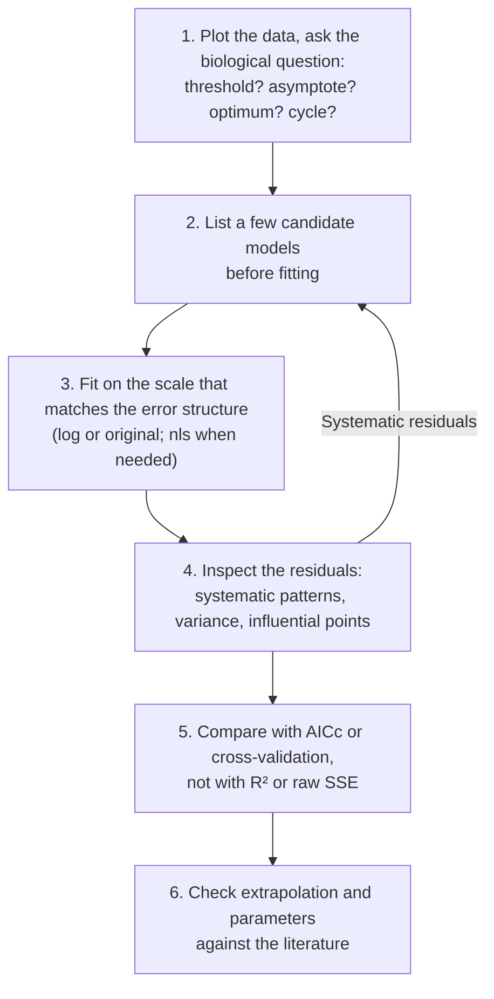

A degree-4 polynomial fits nine hatching times of fruit fly eggs with R² = 0.9997, yet it predicts that eggs hatch after almost 180 hours at 10 °C, a temperature at which they barely develop at all. This tutorial shows how to choose a regression model for growth and development data when nearly every candidate has a "great" R²: why high-degree polynomials mislead, how to use AICc and cross-validation, and when to log-linearize versus fit a nonlinear model directly. Every number can be reproduced with the accompanying Python and R code.

## 1. Introduction: a results table that looks "too good"

Start with a small dataset: the time from oviposition to hatching of *Drosophila melanogaster* eggs (H, hours) at nine temperatures from 16 to 32 °C. At 16 °C the eggs need 56.5 hours, at 30 °C only 15.5 hours, and at 32 °C the time rises again to 19 hours. The familiar biostatistics exercise is "find a suitable regression equation."

The common approach in Excel is to try several functional forms (linear, exponential, hyperbolic, polynomial), compute the sum of squared errors (SSE) for each, and pick the form with the smallest SSE. The degree-4 polynomial wins by a mile: SSE 0.48, R² = 0.9997, and all five coefficients have p < 0.05. The straight line has an SSE of 315, the exponential 113, and the degree-day model 25.4.

The problem surfaces as soon as you ask two biological questions. What do the polynomial's coefficients, such as the intercept of 1027.5 or the linear coefficient of −153.2, mean? Nothing: they only help the curve pass through the points. And what does the model predict outside 16–32 °C? Figure 1 shows the polynomial predicting 179.7 hours at 10 °C, below the developmental threshold, and 84.6 hours at 38 °C, driven purely by the fourth-power term. The two-parameter degree-day model, by contrast, sends the time to infinity as temperature approaches the threshold, and its two parameters are the threshold temperature and the thermal constant that entomologists actually use.


*Figure 1. Four models fitted to nine hatching times of fruit fly eggs, plotted over 10–38 °C. The gray band is the range covered by data. The dash-dot vertical line is the threshold d estimated by the degree-day model.*

The article works through four cases: high-degree polynomials on few points (Section 3), *Drosophila* eggs and the degree-day model (Section 4), log-linearization versus nonlinear regression for barramundi and vitamin C (Section 5), and the von Bertalanffy growth curve (Section 6). Section 7 wraps everything into a six-step workflow that works in Excel as well as in R or Python.

The datasets are practice data of the kind found in biostatistics textbooks. The original measurement source of most of them could not be verified, a few do not state units, and many are group means by age or by temperature. The standard errors and p-values in this article are therefore only meant to illustrate the methods.

## 2. A refresher: regression, R², F and t in Excel output

### 2.1. From correlation to regression

The Pearson correlation coefficient $r$ measures the strength of a **linear** association between two variables and lies in $[-1, 1]$:

$$r = \frac{\sum (x_i - \bar{x})(y_i - \bar{y})}{\sqrt{\sum (x_i - \bar{x})^2 \sum (y_i - \bar{y})^2}}$$

For nonlinear relationships, the correlation ratio ($\eta \in [0, 1]$) measures how tight the association is without requiring a straight line. The test of $H_0: \rho = 0$ uses $t_r = r\sqrt{n-2}/\sqrt{1-r^2}$ with $n - 2$ degrees of freedom. Five points with $r = 0.871$ give $t_r = 3.07 < t_{0.05;\,3} = 3.18$. The correct conclusion is "not enough evidence to reject $H_0$," not "$H_0$ is accepted": with five points, the test has almost no power to detect even a fairly strong correlation (see also the [article on choosing a statistical test](/en/blog/kiem-dinh-gia-thiet-thong-ke-trong-nghien-cuu-sinh-hoc/)).

Simple linear regression assumes $y_i = \alpha + \beta x_i + \varepsilon_i$, with independent, normally distributed errors of constant variance $\sigma^2$. Least squares chooses $\hat\alpha, \hat\beta$ to minimize the sum of squared residuals $e_i = y_i - \hat y_i$. A polynomial $y = a + bx + cx^2 + \dots$ is really a **multiple regression**: you add columns $x^2, x^3, \dots$ and run *Regression* as if they were several independent variables, so it is subject to the conditions of multiple regression, including the requirement that the predictors are not perfectly collinear. The same concepts in R appear in the [Boston housing data analysis](/en/blog/tieu-luan-van-dung-r-phan-tich-du-lieu-nha-o-boston/).

### 2.2. Reading Excel's *Regression* output

Table 1 annotates the key cells in the output of *Data → Data Analysis → Regression*.

**Table 1.** Main quantities in Excel's Regression output

| Output cell | Meaning | What to watch for |
|---|---|---|
| *R Square* | Proportion of the variation in Y explained by the model, $1 - SS_{res}/SS_{tot}$ | Always increases when you add variables; says nothing about whether the functional form is right |
| *Standard Error* | Residual standard deviation $s = \sqrt{MS_{Residual}}$, in the units of Y | This is the error of prediction, unrelated to the error of the correlation coefficient |
| *ANOVA: df Residual* | $n - p - 1$ for $p$ predictors (including $x^2, x^3$…) | Use this df for the critical t of each coefficient |
| *F* | $MS_{Regression}/MS_{Residual}$ | Compare with the critical value $F_{0.05;\,p,\,n-p-1}$, or look at *Significance F* |
| *Significance F* | p-value of the F test | < 0.05: at least one coefficient differs from 0, i.e., the equation is significant |
| *Coefficients, Standard Error, t Stat* | Estimate, standard error and $t = \hat b/s_b$ for each coefficient | Depend on the parameterization (Section 3.3) |
| *P-value* | Two-sided p for each coefficient, already using the correct df Residual | Safer to read than comparing t Stat with a table value yourself |

Two points deserve emphasis. *F* is a statistic; the number to compare with 0.05 is *Significance F*. And **the degrees of freedom for each coefficient's critical t are df Residual**; the $n - 2$ formula only holds for regression on a single predictor. With nine points and a degree-4 polynomial, df Residual = 9 − 4 − 1 = 4, so $t_{0.05;\,4} = 2.776$ (Excel: `=T.INV.2T(0.05, 4)`); mistakenly using df = 7 gives 2.365 and makes it easy to declare a coefficient "significant" when it is not. With seven points and degree 4, df Residual = 2 and $t_{0.05;\,2} = 4.303$. The *P-value* column already uses the correct df, so reading it directly is the simplest way to avoid the mistake.

Most important of all: R² measures **goodness of fit**, not **whether the functional form is correct**. Anscombe's quartet (Anscombe, 1973) consists of four sets of 11 points with the same means, variances, correlation coefficient and regression line, yet one is a noisy straight line, one is a curve, and two are dominated by a single point; only plots of the data and the residuals tell them apart. For nonlinear models, simulations by Spiess and Neumeyer (2010) show that R² and adjusted R² almost always favor the model with more parameters, whereas AICc and BIC identify the true model far more often.

## 3. High-degree polynomials on few points

### 3.1. Overfitting: the model learns the noise

With $n$ points there is always a polynomial of degree $n - 1$ that passes through every point with R² = 1, tracking the measurement noise along with everything else. That is overfitting: the model describes the sample at hand very well but does not replicate on new samples. Babyak (2004) stresses that the number of observations sets an upper limit on the complexity the data can support; beyond that limit, the coefficients and their accompanying tests become illusory.

Four datasets illustrate the point. Three record mean body measurements by age (6–17 years) in schoolgirls: subcutaneous fat thickness, lean body mass and body fat mass. The fourth is the hyphal length (mm) of a fungus at seven temperatures from 0 to 32 °C. A degree-5 polynomial uses 6 parameters for 12 points; degree 4 for the hyphae uses 5 parameters for 7 points, leaving only 2 degrees of freedom.

### 3.2. Multicollinearity: why "no coefficient is significant"

The columns $X, X^2, \dots, X^5$ with $X$ running from 6 to 17 or from 16 to 32 are nearly proportional to one another. For the nine temperatures in the fruit fly data, the correlation between $T$ and $T^4$ is 0.966, between $T^3$ and $T^4$ it is 0.997, and the condition number of the design matrix is about $4 \times 10^8$. This is multicollinearity: the data cannot separate the individual contribution of each column, so the coefficients' standard errors balloon, t values shrink, p values grow, and the confidence intervals often include 0.

That is why the statement "Significance F < 0.05 but no coefficient has p < 0.05, so the equation is not significant" is a misreading. The F test asks "is at least one coefficient different from 0?", and the answer is yes. Each t test asks "is this coefficient different from 0 **given that the other terms are already in the model**?"; when $X^4$ and $X^5$ carry almost the same information as $X^3$, dropping any single term barely makes the model worse. This combination is a **symptom of an over-parameterized model**, and the remedy is to lower the degree.

<div class="callout callout-warning">
<p class="callout-title">Reading the F and t combination correctly</p>

- F significant, all t significant: the model may be acceptable, but you still need to check the residuals and compare it with simpler models.
- F significant, t values not significant: the equation **is** significant, but it has too many terms carrying overlapping information. Lower the degree and compare with AICc or cross-validation.
- F not significant: the data do not provide enough evidence for a relationship of this form; with few points, that does not prove there is no relationship.

</div>

### 3.3. A coefficient's p-value depends on the parameterization

The subcutaneous fat dataset gives the opposite result: with degree 5 written in raw powers, all six coefficients have p < 0.05. But rewrite it with orthogonal polynomials (`poly(X, 5)` in R), with the same curve, the same R² and the same SSE, and the degree-4 term has p = 0.18 and the degree-3 term p = 0.052. The verdict on "which coefficients are significant" changes with how the equation is written, so it cannot be the criterion for choosing the degree. You need a criterion that compares **whole models** and accounts for complexity.

### 3.4. AICc: penalizing complexity in a principled way

The Akaike information criterion (AIC) balances fit against the number of parameters: $\mathrm{AIC} = -2\ln\hat{\mathcal L} + 2k$, where $\hat{\mathcal L}$ is the maximized likelihood and $k$ is the number of estimated parameters. With small samples, AIC does not penalize enough; Hurvich and Tsai (1989) proposed the corrected version

$$\mathrm{AICc} = \mathrm{AIC} + \frac{2k(k+1)}{n - k - 1}.$$

For least squares with normal errors, $-2\ln\hat{\mathcal L} = n\ln(2\pi\,\mathrm{SSE}/n) + n$, and $k$ is the number of regression coefficients plus 1 for $\sigma^2$. Smaller AICc is preferred; only differences between models fitted to **the same data and the same response variable** are meaningful. Johnson and Omland (2004) review the information-criterion framework for model selection in ecology and evolution, and Burnham and Anderson (2002) give the full treatment. The alternative is cross-validation (James et al., 2013): fit on part of the data and measure prediction error on the held-out part; with a few dozen points, use the leave-one-out version (LOOCV).

The code below computes R², AICc and the number of significant coefficients for polynomials of degree 1 to 5.

```python
import numpy as np
from scipy import stats

def aicc_from_sse(sse, n, k):
    """AICc from the normal log-likelihood; k = number of regression coefficients + 1 (variance)."""
    aic = n * np.log(2 * np.pi * sse / n) + n + 2 * k
    return aic + 2 * k * (k + 1) / (n - k - 1)

def poly_table(x, y, max_deg=5):
    n = len(x)
    for d in range(1, max_deg + 1):
        X = np.vander(x, d + 1, increasing=True)        # columns 1, x, x^2, ...
        beta, *_ = np.linalg.lstsq(X, y, rcond=None)
        sse = np.sum((y - X @ beta) ** 2)
        df = n - d - 1                                   # residual df
        se = np.sqrt(np.diag(sse / df * np.linalg.inv(X.T @ X)))
        p = 2 * stats.t.sf(np.abs(beta / se), df)
        r2 = 1 - sse / np.sum((y - y.mean()) ** 2)
        k = d + 2
        a = aicc_from_sse(sse, n, k) if n - k - 1 > 0 else float("nan")
        print(f"degree {d}: R2={r2:.4f}  AICc={a:6.1f}  coefficients with p<0.05: {np.sum(p < 0.05)}/{d + 1}")

age = np.arange(6, 18, dtype=float)
subcut_fat = np.array([2.7, 2.5, 3.2, 3.4, 3.5, 3.8, 4.0, 4.3, 4.9, 5.7, 6.5, 6.9])
poly_table(age, subcut_fat)
```

Table 2 summarizes the results for the four datasets.

**Table 2.** R², AICc and the number of coefficients with p < 0.05 (raw-power polynomials) by polynomial degree. Bold: lowest AICc.

| Degree | Subcutaneous fat (n = 12) | Lean mass (n = 12) | Fat mass (n = 12) | Hyphae (n = 7) |
|---|---|---|---|---|
| 1 | R² 0.928 · AICc 19.2 · 1/2 | R² 0.988 · AICc 38.4 · 2/2 | R² 0.916 · AICc 18.7 · 2/2 | R² 0.532 · **AICc 34.0** · 0/2 |
| 2 | R² 0.982 · **AICc 7.2** · 3/3 | R² 0.988 · AICc 43.0 · 1/3 | R² 0.995 · **AICc −9.5** · 3/3 | R² 0.658 · AICc 45.8 · 0/3 |
| 3 | R² 0.985 · AICc 11.0 · 0/4 | R² 0.995 · **AICc 37.9** · 4/4 | R² 0.995 · AICc −5.0 · 1/4 | R² 0.988 · AICc 64.6 · 3/4 |
| 4 | R² 0.987 · AICc 18.6 · 0/5 | R² 0.997 · AICc 40.9 · 0/5 | R² 0.995 · AICc 3.7 · 0/5 | R² 0.993 · not computable · 0/5 |
| 5 | R² 0.997 · AICc 15.9 · 6/6 | R² 0.997 · AICc 53.7 · 0/6 | R² 0.997 · AICc 12.8 · 0/6 | R² 1.000 · not computable · 0/6 |

The three age datasets give clear answers. Subcutaneous fat thickness and fat mass select degree 2: a curve that accelerates during puberty. For lean mass, degrees 3 and 1 are nearly tied (37.9 and 38.4), so a straight line with a slope of about 2.2 units per year describes the data adequately. Degree 5 has the highest R² but one of the worst AICc values. Figure 2 shows why: within the data range, degrees 2 and 5 almost coincide, but extend them just 12% beyond each end and degree 5 bends absurdly; subcutaneous fat, for example, drops abruptly after age 17.


*Figure 2. Degree-2 (blue) and degree-5 (red, dashed) polynomials for the four datasets, extended 12% beyond each end of the data range.*

The hyphae dataset is a reminder that AICc is not an absolute referee. With seven points the correction term grows very quickly (degree 3 has a denominator $n - k - 1 = 1$, and degree 4 cannot be computed), so AICc picks a straight line with R² = 0.53, even though the data clearly rise and then fall. The real issue is the family of functions: hyphal length as a function of temperature is a thermal performance curve with a lower limit, an optimum and an upper limit, and the point at 0 °C with length 0 is most likely a threshold rather than a point on the same smooth curve. A threshold model such as the Briere model (Section 4.4) is more appropriate, but seven points are not enough to compare three- and four-parameter models with confidence.

### 3.5. Cyclical data: the polynomial is the wrong functional form

Another dataset counts the plant species flowering and fruiting each month in a high-mountain region; the number of flowering species rises from 74 (January) to 621 (July) and then falls to 95 (December). A degree-5 polynomial gives R² = 0.917, but month is a circular variable: December sits next to the following January, whereas the two ends of a polynomial drift freely (Figure 3).

The natural functional form is harmonic regression, $Y = a + b\sin(2\pi m/12) + c\cos(2\pi m/12)$: three parameters, December automatically joins up with January, and the timing of the peak falls straight out (around early July for flowering and August for fruiting). R² is lower (0.849), but AICc is 150.4 versus 171.5 for degree 5; for fruiting species it is 123.7 versus 148.5.


*Figure 3. Number of flowering species by month: 12-month harmonic regression (3 parameters) and degree-5 polynomial (6 parameters), extended to the previous December and to January–February of the following year.*

These are also counts. A Poisson regression with the same three harmonic terms gives a dispersion ratio of about 7, meaning the variance is roughly seven times what a Poisson model expects, so the sensible next step is a quasi-Poisson or negative binomial GLM; the Excel Analysis ToolPak cannot do this, while `glm()` in R does it in one line.

## 4. *Drosophila* eggs: the degree-day model versus the polynomial

### 4.1. The law of total effective temperature

In insects and many other ectotherms, within the mid-temperature range, development only occurs above a lower threshold $d$, and the product of the development time $H$ and the temperature excess above the threshold is a constant $k$:

$$H\,(T - d) = k \quad\Longleftrightarrow\quad H = \frac{k}{T - d}.$$

$k$ (in degree-hours or degree-days) is the thermal constant. Written as a development rate, $1/H = T/k - d/k$ is a straight line. This is the law of total effective temperature, the foundation of degree-day models for forecasting insect development (Ikemoto & Takai, 2000), and both parameters have biological meaning.

### 4.2. Two ways to fit, and a minus sign to watch

The usual Excel approach is to regress $1/H$ on $T$, obtaining the slope $b = 1/k$ and the intercept $a = -d/k$, and then back-transform: $k = 1/b$, $d = -a/b$. The nine points give $k = 359.3$ degree-hours and $d = +8.54$ °C. The back-transformation is an easy place to get the sign wrong: $a$ is negative, so $d$ is positive. Taking $d = -8.54$ by mistake gives about 14.6 hours at 16 °C instead of nearly 48 hours and pushes the SSE into the thousands, turning a good model into the worst one. Always plug the parameters back into the formula and check them against a few data points before computing the SSE. With the correct back-transformation, SSE = 103.0.

The second approach is to fit $H = k/(T-d)$ directly on the original scale with nonlinear least squares (`nls` in R, `scipy.optimize.curve_fit` in Python, Solver in Excel), using the linearized estimates as starting values (Ritz & Streibig, 2008). Result: $k = 307.1$ (SE 18.8), $d = 10.54$ °C (SE 0.44), SSE = 25.4.

```python
import numpy as np
from scipy import stats, optimize

T = np.array([16, 18, 20, 22, 24, 26, 28, 30, 32], dtype=float)
H = np.array([56.5, 41, 32.5, 26, 22, 19, 16.5, 15.5, 19])

# Method 1: linearize, regress 1/H on T
fit = stats.linregress(T, 1 / H)
k_lin = 1 / fit.slope
d_lin = -fit.intercept * k_lin          # watch the sign: d = -(intercept) * k
sse_lin = np.sum((H - k_lin / (T - d_lin)) ** 2)
print(f"1/H on T: k = {k_lin:.1f}, d = {d_lin:.2f}, SSE = {sse_lin:.1f}")

# Method 2: direct nonlinear fit on H
f = lambda t, k, d: k / (t - d)
(k, d), cov = optimize.curve_fit(f, T, H, p0=[k_lin, d_lin])
se_k, se_d = np.sqrt(np.diag(cov))
print(f"Nonlinear: k = {k:.1f} (SE {se_k:.1f}), d = {d:.2f} (SE {se_d:.2f}), "
      f"SSE = {np.sum((H - f(T, k, d)) ** 2):.1f}")

# Leave-one-out cross-validation for both models
def loocv(predict, x, y):
    err = [y[i] - predict(np.delete(x, i), np.delete(y, i), x[i]) for i in range(len(x))]
    return np.sqrt(np.mean(np.square(err)))

pred_dd = lambda x, y, x0: f(x0, *optimize.curve_fit(f, x, y, p0=[300, 10])[0])
pred_p4 = lambda x, y, x0: np.polyval(np.polyfit(x, y, 4), x0)
for name, m in [("9 points", T > 0), ("without 32 °C", T < 32)]:
    print(name, "LOOCV RMSE: degree-day %.2f, degree 4 %.2f"
          % (loocv(pred_dd, T[m], H[m]), loocv(pred_p4, T[m], H[m])))
```

The two methods differ because regressing $1/H$ assumes constant variance **on the rate scale**, so it weights the points differently from a fit on the time scale. Ikemoto and Takai (2000) showed that regressing $1/H$ on $T$ tends to give a lower threshold and a larger thermal constant, exactly as here (8.54 °C and 359 versus 10.54 °C and 307). They proposed regressing $H \cdot T$ on $H$ instead: from $HT = k + dH$, the slope is $d$ and the intercept is $k$; they also discuss the fact that both variables carry measurement error.

### 4.3. Comparing the four models

Table 3 compares the four models on the same nine points, with the same response variable $H$ on the hours scale.

**Table 3.** Model comparison for fruit fly egg hatching time (9 points, 16–32 °C)

| Model | Regression parameters | SSE | R² | AICc | LOOCV RMSE (h) |
|---|---|---|---|---|---|
| Linear $H = a + bT$ | 2 | 315.4 | 0.788 | 68.4 | 8.72 |
| Exponential $H = a e^{bT}$ (nonlinear fit) | 2 | 112.9 | 0.924 | 59.1 | 5.54 |
| Degree-4 polynomial | 5 | 0.48 | 0.9997 | 53.1 | 0.71 |
| Degree-day $H = k/(T-d)$ (nonlinear fit) | 2 | 25.4 | 0.983 | **45.7** | 1.99 |

By SSE and R², the degree-4 polynomial wins outright. By AICc, the two-parameter degree-day model comes first: cutting SSE from 25.4 to 0.48 does not pay for three extra parameters on nine points. By LOOCV, the polynomial does better again. The three criteria disagree because of a single data point. In R:

```r
T <- c(16, 18, 20, 22, 24, 26, 28, 30, 32)
H <- c(56.5, 41, 32.5, 26, 22, 19, 16.5, 15.5, 19)
aicc <- function(m) { k <- length(coef(m)) + 1; n <- nobs(m)
  AIC(m) + 2 * k * (k + 1) / (n - k - 1) }
m_lin <- lm(H ~ T)
m_p4  <- lm(H ~ poly(T, 4))
m_dd  <- nls(H ~ k / (T - d), start = list(k = 359, d = 8.5))
m_exp <- nls(H ~ a * exp(b * T), start = list(a = 200, b = -0.08))
sapply(list(linear = m_lin, degree4 = m_p4, degree_day = m_dd, exponential = m_exp), aicc)
```

### 4.4. The 32 °C point: the far side of the optimum

Hatching time falls steadily to 15.5 hours at 30 °C and then rises to 19 hours at 32 °C: the data have passed the optimum temperature. On a plot of $1/H$ against $T$ (Figure 4), the eight points from 16 to 30 °C lie almost perfectly on a straight line, while the 32 °C point drops below it.


*Figure 4. Development rate 1/H versus temperature. The line fitted to the eight points from 16 to 30 °C crosses the x-axis at the threshold d; the 32 °C point (red diamond) lies below the line.*

This matches experimental evidence. Kuntz and Eisen (2014) filmed time-lapse embryogenesis in several *Drosophila* species at seven temperatures from 17.5 to 32.5 °C; for *D. melanogaster*, embryonic development took about 33 hours at 17.5 °C, was fastest (about 16 hours) at 27.5 °C, and slowed at higher temperatures. The law of total effective temperature only describes the branch below the optimum and cannot "turn around," so the 32 °C point makes it lose on LOOCV. The polynomial can bend to follow it, at the cost of absurd predictions just outside the data range (Figure 1).

There are two ways to handle this, and both start from the biological question. The first is to restrict the range: fitting the degree-day model to the eight points from 16 to 30 °C gives SSE 0.90, $d = 10.86$ °C (SE 0.09) and $k = 291.5$ degree-hours (SE 3.8); LOOCV flips, 0.62 hours versus 1.12 hours for the degree-4 polynomial. Ikemoto and Takai's linearization gives almost the same result ($d = 10.93$ °C, $k = 288.7$). The second is to use a model that also describes the upper branch: Briere et al. (1999) proposed three- and four-parameter models that estimate both the lower and the upper threshold; the three-parameter form is $1/H = aT(T - T_L)\sqrt{T_U - T}$. But a single point above the optimum is not enough to estimate $T_U$; the experiment would need several more temperatures above 30 °C.

<div class="callout callout-note">
<p class="callout-title">Is a threshold of 10.5–10.9 °C plausible?</p>

The threshold estimated here (10.5–10.9 °C) has not been checked against studies that directly measure the developmental threshold of *D. melanogaster* eggs, so it is an illustrative result only. The practice data give 41 hours at 18 °C, longer than the roughly 33 hours at 17.5 °C reported by Kuntz and Eisen (2014); the difference may come from the fly strain, how the moment of "hatching" is defined, and the measurement conditions.

</div>

### 4.5. Extrapolation: a test of biological plausibility

A good model also has to behave sensibly under conditions that were not measured. As $T$ approaches $d$, the degree-day model sends $H$ to infinity, consistent with what a threshold means; at 12 °C it predicts about 210 hours. The degree-4 polynomial predicts 120.7 hours at 12 °C, 179.7 hours at 10 °C (eggs still hatching below the threshold) and 84.6 hours at 38 °C, numbers that only reflect the shape of $T^4$. Extrapolation is always risky, but a model with biological parameters at least tells you **why** it predicts what it does and where it goes wrong when its assumptions are violated.

## 5. Log-linearization or nonlinear regression

### 5.1. Two different error assumptions

The exponential $Y = ae^{bX}$ and the power law $W = aL^b$ are often linearized with logarithms: $\ln Y = \ln a + bX$, $\ln W = \ln a + b\ln L$. But taking logs also changes the assumption about the errors:

- $\ln W = \ln a + b\ln L + \varepsilon$: additive error on the log scale, which means **multiplicative** error on the original scale. The variance of $W$ grows with its mean; large fish vary more than small fish by a fixed proportion.
- $W = aL^b + \varepsilon$: **additive** error with constant variance on the original scale. Every fish scatters around the curve by the same absolute amount.

Simulations by Xiao et al. (2011) show that with multiplicative, lognormal errors, regression on the log scale performs better, and with additive, normal errors, nonlinear regression performs better; they recommend choosing based on the biological plausibility of the error structure combined with residual checks, not out of habit. One more caveat: R² on the log scale measures the variation in $\ln W$, while the R² of a nonlinear model measures the variation in $W$, so the two cannot be compared directly; to compare them, back-transform the predictions to the same original scale and compute the SSE.

### 5.2. Barramundi *Lates calcarifer*: an exponent of 2.32 or 3.06?

In the fish length–weight relationship (LWR) $W = aL^b$, $b = 3$ indicates isometric growth, $b < 3$ means the fish becomes more slender as it grows, and $b > 3$ means it becomes plumper. A meta-analysis of 3,929 LWRs for 1,773 species found that $b$ usually lies between 2.5 and 3.5 (Froese, 2006).

The dataset records mean length and weight by age (1–9 years) for barramundi raised in a brackish-water pond, with lengths of 56–281 and weights of 12–420; units are not given, and the most reasonable assumption is mm and g.

```python
import numpy as np
from scipy import stats, optimize

L = np.array([56, 94, 135, 167, 201, 223, 248, 252, 281], dtype=float)
W = np.array([12, 24, 45, 72, 146, 219, 291, 357, 420], dtype=float)

# Method 1: log-log, multiplicative error
r = stats.linregress(np.log(L), np.log(W))
tc = stats.t.ppf(0.975, len(L) - 2)
a1, b1 = np.exp(r.intercept), r.slope
print(f"log-log: a = {a1:.5f}, b = {b1:.2f} (95% CI: {b1 - tc*r.stderr:.2f}–{b1 + tc*r.stderr:.2f})")
print("log-scale residuals:", np.round(np.log(W) - np.log(a1 * L**b1), 2))

# Method 2: nonlinear on the original scale, additive error
(a2, b2), cov = optimize.curve_fit(lambda l, a, b: a * l**b, L, W, p0=[a1, b1], maxfev=20000)
print(f"nonlinear: b = {b2:.2f} (SE {np.sqrt(cov[1, 1]):.2f})")
for name, a, b in [("log-log", a1, b1), ("nonlinear", a2, b2)]:
    print(name, "SSE on original scale =", round(np.sum((W - a * L**b) ** 2)))
```

The log–log fit gives $a = 0.00073$, $b = 2.32$ (95% CI: 1.88–2.76), with R² = 0.957 on the log scale. The nonlinear fit gives $b = 3.06$ (SE 0.25; approximate 95% CI 2.48–3.64). On the original scale, the SSE is 2,828 versus 14,431 for the back-transformed log–log model.

The log–log residuals show a clear U shape (Figure 5, right): +0.37 for the smallest fish, about −0.35 to −0.38 at ages 3–4, and +0.27 at age 8. That is a sign of the wrong functional form. On the log scale, the two smallest fish carry about as much weight as the large fish and pull the slope down; on the original scale, the large fish dominate and the slope is close to 3.


*Figure 5. Barramundi: left, the data on a log–log scale with the log–log line (b = 2.32) and the nonlinear curve (b = 3.06); right, the U-shaped residuals of the log–log model.*

Compared with the literature, $b \approx 3.06$ is the more plausible value. FishBase (accessed November 12, 2026) gives a Bayesian LWR estimate for *L. calcarifer* of $a = 0.00977$, $b = 3.00$ (2.86–3.14), with total length in cm (Froese et al., 2014; FishBase, n.d.), whereas 2.32 lies outside the usual 2.5–3.5 range.

**Table 4.** Barramundi LWR parameters from the two fitting methods and from FishBase

| Source | $a$ | $b$ | Range of $b$ | Units |
|---|---|---|---|---|
| Log–log (dataset) | 0.00073 | 2.32 | 1.88–2.76 (95% CI) | Unknown, assumed mm and g |
| Nonlinear on original scale (dataset) | $1.4 \times 10^{-5}$ | 3.06 | 2.48–3.64 (approx. 95% CI) | Unknown, assumed mm and g |
| FishBase, Bayesian | 0.00977 | 3.00 | 2.86–3.14 | cm, g, total length |

Two caveats. The coefficient $a$ depends on the units and on the type of length measured (total, fork or standard length), so only compare $a$ values when those match; $b$ does not depend on units. And even under the mm-and-g assumption, a 28.1 cm fish weighing 420 g is almost twice the roughly 217 g predicted by the FishBase LWR; the lengths may be standard lengths, farmed fish may be heavier for their length, or the units may differ from what was assumed. With nine mean values, the true error structure cannot be assessed; the safe conclusion is that log–log gives systematic residuals and an exponent far from the literature, and that a usable LWR requires individual measurements with clearly stated units.

### 5.3. Vitamin C: three values at the detection limit

The second dataset records vitamin C content (Y) declining with a variable X (0.2 to 9; what X represents is not clearly described), from 254 down to 5. Log-linearization gives $Y = 264.1 \cdot 0.608^X$ (log-scale R² 0.978); the nonlinear fit gives $Y = 283.7 \cdot 0.586^X$. The SSE on the original scale is 802 versus 162; at X = 0.2 the two methods predict 239 and 255, and the measured value is 254.

The cause is that the last three values all equal 5, a sign of a detection limit or rounding. On the original scale they are close to 0 and have little influence; on the log scale they become three points at $\ln 5 = 1.61$ lying flat, dragging the tail of the line and worsening the fit at the start of the curve, where most of the information is. For values at the detection limit, flag them clearly and consider excluding them from the fit or using a model for censored data.

The general message: a log transformation is a **modeling decision**, appropriate when the errors are multiplicative and no values are bounded; when the log-scale residuals are systematic, a nonlinear fit on the original scale is usually more trustworthy.

## 6. The von Bertalanffy curve via the Ford–Walford plot

### 6.1. The model and what its parameters mean

The von Bertalanffy growth model describes length at age in fish and many other animals (von Bertalanffy, 1957):

$$L_t = L_\infty\left(1 - e^{-K(t - t_0)}\right).$$

$L_\infty$ is the asymptotic length, $K$ (year⁻¹) describes how quickly $L_t$ approaches $L_\infty$, and $t_0$ is the theoretical "age" at which length would be zero, usually a small negative number. The dataset records mean length at six ages: 35, 55, 75, 90, 105 and 115 (units not given).

### 6.2. The Ford–Walford plot

Ford (1933) and Walford (1946) developed a graphical trick for estimating growth parameters. For a one-year age interval, the von Bertalanffy model gives

$$L_{t+1} = L_\infty(1 - e^{-K}) + e^{-K} L_t = a + s\,L_t,$$

so $L_{t+1}$ is a linear function of $L_t$ with slope $s = e^{-K}$. This line crosses the diagonal $y = x$ at $L_\infty$, where the fish stops getting longer (Figure 6, left), so $K = -\ln s$ and $L_\infty = a/(1 - s)$.

If you instead regress the increment $L_{t+1} - L_t = a + bL_t$, then $s = 1 + b$. The five pairs give $L_{t+1} - L_t = 26.17 - 0.1412\,L_t$, so $s = 0.8588$, $K = 0.152$ year⁻¹ and $L_\infty = 26.17/0.1412 = 185.3$.

To find $t_0$, regress $\ln(1 - L_t/L_\infty) = K t_0 - K t$ on $t$ and divide the intercept by $K$: $t_0 \approx -0.34$ years.

```python
import numpy as np
from scipy import stats, optimize

t = np.arange(1, 7, dtype=float)
L = np.array([35, 55, 75, 90, 105, 115], dtype=float)

# Ford–Walford: L(t+1) = a + s * L(t)
fw = stats.linregress(L[:-1], L[1:])
s, a = fw.slope, fw.intercept
K = -np.log(s)
L_inf = a / (1 - s)
# t0 from ln(1 - L/L_inf) = K*t0 - K*t
g = stats.linregress(t, np.log(1 - L / L_inf))
t0 = g.intercept / K
print(f"Ford–Walford: s = {s:.4f}, K = {K:.3f}/year, L_inf = {L_inf:.1f}, t0 = {t0:.2f}")

# Direct von Bertalanffy fit
vb = lambda t, Linf, K, t0: Linf * (1 - np.exp(-K * (t - t0)))
p, cov = optimize.curve_fit(vb, t, L, p0=[L_inf, K, t0])
print("Nonlinear: L_inf, K, t0 =", np.round(p, 3), " SE =", np.round(np.sqrt(np.diag(cov)), 3))
```

### 6.3. Direct fitting and its limits

A direct fit to the six points, starting from the Ford–Walford values, gives $L_\infty = 186.6$ (SE 14.8), $K = 0.152$ (SE 0.021) and $t_0 = -0.34$ (SE 0.10): almost identical to Ford–Walford, which is common with low-noise mean values (Figure 6, right).


*Figure 6. Left: Ford–Walford plot; the regression line crosses y = x at L∞ ≈ 185. Right: von Bertalanffy curve from the direct fit; the gray band is the age range covered by data.*

Three limitations are worth keeping in mind. There are only six ages and five pairs. In Ford–Walford, the same $L_t$ is the predictor in one pair and the response in the previous pair, so the standard errors and p-values of that regression violate its assumptions; it is good for exploration and for finding starting values, but formal estimates should come from the nonlinear fit. And the largest observed length is 115 while $L_\infty \approx 185$: the most important parameter is an **extrapolation**, and the SE of 14.8 is optimistic. The predictions of 148 at age 10 and 178 at age 20 are only credible if the population actually lives that long.

The idea of "linearize to get starting values, then fit directly" is also how Ritz and Streibig (2005) approach bioassay analysis in R, for example fitting Michaelis–Menten kinetics directly rather than through a Lineweaver–Burk plot; the [nonlinear regression section of the Virtual Lab project](/projects/virtual-lab/tai-lieu-drive-cho-giai-doan-6/) applies exactly this approach.

## 7. A six-step workflow for choosing a regression model

The four cases come together in six steps; the biological question comes first, the statistical criteria second.



**Step 1. Plot the data and ask the biological question** (Anscombe, 1973): is there a threshold, an asymptote, an optimum or a cycle? Is the response a count, a proportion or a continuous measurement?

**Step 2. List a few candidate models with a biological rationale before fitting**, favoring parameters you can interpret (Johnson & Omland, 2004; Burnham & Anderson, 2002). Trying a long list of functional forms and keeping the best one is overfitting at the model-selection level.

**Step 3. Fit on the scale that matches the error structure**: if the error is proportional to the mean, consider the log scale; if it is uniform, fit a nonlinear model on the original scale (Xiao et al., 2011), using linearization to get starting values (Ritz & Streibig, 2008).

**Step 4. Inspect the residuals** against the predictor and against the fitted values: a U or S shape means the wrong functional form, a funnel means unequal variance, and large outliers deserve a biological look. If the residuals are systematic, go back to step 2.

**Step 5. Compare with AICc or cross-validation** on the same data, the same response variable and the same scale. Below about ten points, both are unstable; use them alongside biological reasoning.

**Step 6. Check extrapolation and parameters**: draw the model a little beyond the data range and compare the parameters with the literature, such as the LWR $b$ with FishBase or the developmental threshold with studies of the same species.

Table 5 shows how far each step can be taken in Excel.

**Table 5.** Carrying out the workflow in Excel and R

| Step | Excel | R |
|---|---|---|
| Plot the data | *Insert → Scatter* | `plot()`, `ggplot2` |
| Linear, polynomial, log fits | *Data Analysis → Regression* (add columns $X^2$, $\ln Y$…) | `lm()` |
| Nonlinear fit | Solver: minimize the SSE cell by changing the parameter cells | `nls()` |
| Residuals | Check *Residuals* and *Residual Plots* in the Regression dialog | `plot(residuals(m) ~ fitted(m))` |
| AICc | Compute by hand from *SS Residual* (box below) | `AIC()` + correction |
| Cross-validation | Manual and very laborious | A loop of a few lines |

<div class="callout callout-example">
<p class="callout-title">Computing AICc in Excel from the Regression output</p>

Take SSE from the *SS* cell of the *Residual* row in the ANOVA table, $n$ from the *Observations* cell, and $k$ = number of coefficients (including the *Intercept*) + 1. Formula:
`= n*LN(SSE/n) + 2*k + 2*k*(k+1)/(n-k-1)`
The formula drops the constant $n\ln(2\pi) + n$ relative to R's `AIC()`, so the numbers differ from R, but the **difference** between two models is the same: for the fruit fly eggs, Excel gives 20.1 (degree-day) and 27.6 (degree 4), a gap of 7.4, exactly matching the gap between 45.7 and 53.1 in Table 3. With Solver, SSE is the cell you minimize and $k$ is the number of parameter cells + 1.

</div>

## 8. Conclusion

The four cases teach the same lesson: choosing a regression model is a biological decision supported by statistics, not an R² contest. R² and Significance F tell you that the model fits and that the relationship is real, but they do not tell you whether the functional form is right, they do not penalize complexity, and they know nothing about thermal thresholds, asymptotic lengths or seasonal cycles.

In short: a significant F with non-significant polynomial coefficients means the model is over-parameterized, so lower the degree. The critical t for each coefficient uses df Residual; reading the P-value column directly is the safest option. Compare models with different numbers of parameters using AICc or cross-validation, not raw SSE. A log transformation is an assumption about the errors and needs to be confirmed by the residuals. And when there is a model whose parameters carry biological meaning, like the degree-day or von Bertalanffy model, start from it: even if it fits slightly worse than a polynomial, it yields numbers you can check against the literature and predictions you can test.

The next article moves on to [database analysis in Excel](/en/blog/phan-tich-co-so-du-lieu/): organizing biological data tables before they go into any model.

## References

Anscombe, F. J. (1973). Graphs in statistical analysis. *The American Statistician, 27*(1), 17–21. https://doi.org/10.1080/00031305.1973.10478966

Babyak, M. A. (2004). What you see may not be what you get: A brief, nontechnical introduction to overfitting in regression-type models. *Psychosomatic Medicine, 66*(3), 411–421. https://doi.org/10.1097/01.psy.0000127692.23278.a9

Briere, J.-F., Pracros, P., Le Roux, A.-Y., & Pierre, J.-S. (1999). A novel rate model of temperature-dependent development for arthropods. *Environmental Entomology, 28*(1), 22–29. https://doi.org/10.1093/ee/28.1.22

Burnham, K. P., & Anderson, D. R. (2002). *Model selection and multimodel inference: A practical information-theoretic approach* (2nd ed.). Springer. https://doi.org/10.1007/b97636

FishBase. (n.d.). *Lates calcarifer*, Barramundi: Species summary. Retrieved November 12, 2026, from https://www.fishbase.se/summary/346

Ford, E. (1933). An account of the herring investigations conducted at Plymouth during the years from 1924 to 1933. *Journal of the Marine Biological Association of the United Kingdom, 19*(1), 305–384. https://doi.org/10.1017/S0025315400055910

Froese, R. (2006). Cube law, condition factor and weight–length relationships: History, meta-analysis and recommendations. *Journal of Applied Ichthyology, 22*(4), 241–253. https://doi.org/10.1111/j.1439-0426.2006.00805.x

Froese, R., Thorson, J. T., & Reyes, R. B., Jr. (2014). A Bayesian approach for estimating length-weight relationships in fishes. *Journal of Applied Ichthyology, 30*(1), 78–85. https://doi.org/10.1111/jai.12299

Hurvich, C. M., & Tsai, C.-L. (1989). Regression and time series model selection in small samples. *Biometrika, 76*(2), 297–307. https://doi.org/10.1093/biomet/76.2.297

Ikemoto, T., & Takai, K. (2000). A new linearized formula for the law of total effective temperature and the evaluation of line-fitting methods with both variables subject to error. *Environmental Entomology, 29*(4), 671–682. https://doi.org/10.1603/0046-225X-29.4.671

James, G., Witten, D., Hastie, T., & Tibshirani, R. (2013). Resampling methods. In *An introduction to statistical learning: With applications in R* (pp. 175–201). Springer. https://doi.org/10.1007/978-1-4614-7138-7_5

Johnson, J. B., & Omland, K. S. (2004). Model selection in ecology and evolution. *Trends in Ecology & Evolution, 19*(2), 101–108. https://doi.org/10.1016/j.tree.2003.10.013

Kuntz, S. G., & Eisen, M. B. (2014). *Drosophila* embryogenesis scales uniformly across temperature in developmentally diverse species. *PLoS Genetics, 10*(4), e1004293. https://doi.org/10.1371/journal.pgen.1004293

Ritz, C., & Streibig, J. C. (2005). Bioassay analysis using R. *Journal of Statistical Software, 12*(5). https://doi.org/10.18637/jss.v012.i05

Ritz, C., & Streibig, J. C. (2008). *Nonlinear regression with R*. Springer. https://doi.org/10.1007/978-0-387-09616-2

Spiess, A.-N., & Neumeyer, N. (2010). An evaluation of R2 as an inadequate measure for nonlinear models in pharmacological and biochemical research: A Monte Carlo approach. *BMC Pharmacology, 10*, 6. https://doi.org/10.1186/1471-2210-10-6

von Bertalanffy, L. (1957). Quantitative laws in metabolism and growth. *The Quarterly Review of Biology, 32*(3), 217–231. https://doi.org/10.1086/401873

Walford, L. A. (1946). A new graphic method of describing the growth of animals. *The Biological Bulletin, 90*(2), 141–147. https://doi.org/10.2307/1538217

Xiao, X., White, E. P., Hooten, M. B., & Durham, S. L. (2011). On the use of log-transformation vs. nonlinear regression for analyzing biological power laws. *Ecology, 92*(10), 1887–1894. https://doi.org/10.1890/11-0538.1
