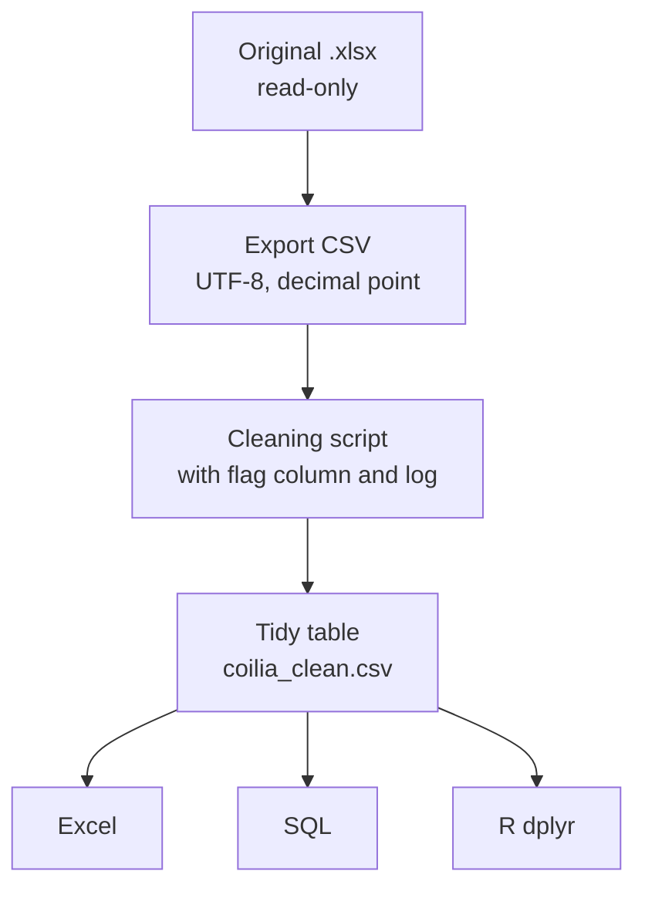
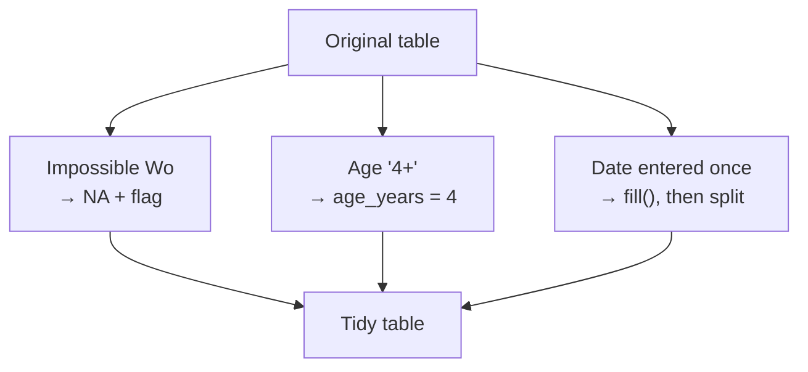

A *Coilia grayii* weighs 31.4 g whole and 38.8 g after gutting, and Excel still filters, aggregates, and sorts the table that contains it without a single warning. This tutorial takes four of Excel's "database" operations (Advanced Filter, `DMAX`/`DAVERAGE`, multi-key Sort, and Histogram) and writes each one side by side in SQL and R `dplyr` on the same 25-fish table, so that all three tools return the same result. The main argument: writing the query is easy; the hard part is whether the table is clean enough for the query to be right. The CSV data and every piece of code are included so you can rerun everything.

## 1. Introduction: the spreadsheet is a biologist's first database

For many biology students, the first database they ever build is an Excel sheet: one row per fish or blood sample, one column per measurement. Excel calls this block a **Database Range**: the top row holds the field names, and the rows below are records. Data science calls the same structure **rectangular data**, with rows as observations and columns as variables (Bruce & Bruce, 2017). Database theory calls it a **relation**: Codd (1970) proposed the relational model of data, the theoretical foundation of the relational database management systems that SQL is used to query (→ [Data and databases](/en/blog/gioi-thieu-du-lieu-and-database/)).

Because the structure is the same, every operation on an Excel Database Range has a matching statement in SQL and in R. Being able to express the same query in all three tools has three benefits:

- **Reproducibility**: an SQL statement or R script records the exact filter conditions; mouse clicks in a dialog box do not. Wilson et al. (2017) recommend recording every data-processing step, ideally in a script.
- **Scale**: data with many sampling trips, several tables to join, or more rows than a sheet comfortably holds are handled more cleanly in SQL and R.
- **Cross-checking**: two independent tools returning the same number is good evidence that the condition was written correctly; when they disagree, the disagreement usually points to a blank cell or an odd value.

The article proceeds in order: describing the data (Section 2), auditing the table before querying (Section 3), then filtering (Section 4), aggregating (Section 5), sorting with a biological sanity check (Section 6), and frequency distributions (Section 7), each with an Excel ↔ SQL ↔ `dplyr` comparison.

## 2. Data and reproducibility

### 2.1. Three data tables

The main example is a table of biological traits for 25 *Coilia grayii*, a grenadier anchovy, used in teaching biostatistics; its author, year, and sampling site are unknown. The table has 13 fields: length and weight measurements, categorical fields (sex, gonad maturity, age, main food), and a condition factor K. Length L ranges from 15.5 to 22.3 cm (mean 19.36; standard deviation 1.93), and weight W from 12.4 to 44.8 g (mean 28.0; standard deviation 8.77).

The second table holds 165 individuals of an unidentified fishery species from the Gulf of Tonkin, collected on 6 sampling trips (July–August), with lengths L and Ls (mm), weights W and Wo (g), and a few coded fields. The third table contains anthropometric measurements of 98 high-school girls; because these are data on real people, the article uses only summary figures.

Table 1 is the data dictionary for the *C. grayii* table, with field names in lowercase, without accents or spaces, so they can be used directly in SQL and R. Ellis and Leek (2018) recommend that every shared dataset come with such a table.

**Table 1.** Data dictionary for the *C. grayii* table

| Field | Original name | Type, unit | Notes |
| --- | --- | --- | --- |
| `fish` | Fish | integer | fish ID, primary key |
| `l_cm`, `lo_cm` | L(cm), Lo(cm) | real, cm | unclear whether L is total length or standard length |
| `w_g`, `wo_g`, `wf_g` | W(g), Wo(g), Wf(g) | real, g | whole, gutted (Wo ≤ W must hold); meaning of Wf unknown |
| `sex`, `msex` | Sex, Msex | integer | 0/1 without a legend; gonad maturity 2–5 |
| `fs`, `ls` | FS, LS | integer | meaning unknown |
| `age`, `age_years` | Age | text; integer | original label "0+" … "5+"; added numeric column |
| `main_food` | Main-Food | text | 6 food groups |
| `k_fulton` | K | real | recomputed as 100·W/L³ |

### 2.2. Workflow

The first principle is to treat raw data as read-only (Buffalo, 2015): never edit a cell and save over the file; let a script read the original and write results to a new file. Figure 1 summarizes the workflow used here; each step produces its own output file, so anyone can rerun it from the start (Broman & Woo, 2018; Wilson et al., 2017; → Reproducible workflows).



**Figure 1.** From the original file to three query tools.

The *C. grayii* table is small enough to reproduce in full. Save the block below as `coilia_raw.csv`; the K column is dropped because it will be recomputed from W and L, and the `msex` cell for fish 1 is left blank, exactly as in the original.

```csv
fish,l_cm,lo_cm,w_g,wo_g,wf_g,sex,msex,fs,ls,age,main_food
1,19.4,17.2,26.6,24.5,0.17,0,,4,0,1+,Copepoda
2,15.9,13.9,12.8,11.7,0.11,0,3,4,2,0+,Copepoda
3,17.7,15.5,20.2,17.9,0.15,1,2,4,3,2+,Cladocera
4,17.3,15.4,17.2,15.5,0.11,0,3,1,3,2+,Copepoda
5,17.4,15.1,16.3,15.2,0.1,0,2,3,3,3+,Copepoda
6,20.7,18.6,33.0,29.7,0.14,0,4,2,3,4+,Polychaeta
7,21.0,18.9,33.3,30.0,0.16,1,2,4,4,5+,Acetes
8,21.5,19.5,33.3,29.8,0.11,1,3,2,3,5+,Acetes
9,19.2,17.3,33.6,30.2,0.12,1,4,2,3,3+,Cladocera
10,19.6,17.5,37.4,30.1,0.16,0,2,2,3,3+,Copepoda
11,22.3,20.1,44.8,41.1,0.17,1,3,4,3,4+,Acetes
12,21.1,19.0,33.3,30.7,0.16,1,2,4,3,4+,Acetes
13,20.6,18.6,30.5,28.3,0.16,0,2,4,3,4+,Copepoda
14,21.0,18.7,33.7,31.4,0.12,0,4,3,3,5+,Acetes
15,21.6,19.3,34.3,31.7,0.12,0,2,3,3,5+,Amphipoda
16,19.5,17.3,33.0,29.7,0.17,1,2,4,3,4+,Cladocera
17,21.0,18.9,34.8,30.8,0.18,1,3,3,3,4+,Polychaeta
18,20.1,18.1,31.4,38.8,0.17,1,4,2,3,4+,Copepoda
19,20.6,18.6,33.3,30.7,0.2,0,2,4,4,3+,Mysis
20,19.5,17.3,28.9,25.4,0.14,1,5,1,4,4+,Cladocera
21,18.0,16.2,23.0,20.2,0.13,1,2,3,3,3+,Cladocera
22,20.2,18.1,31.8,28.7,0.21,1,3,4,4,5+,Acetes
23,17.2,15.4,17.1,15.6,0.12,0,2,4,1,3+,Cladocera
24,16.2,14.2,12.4,11.9,0.13,0,2,4,1,3+,Copepoda
25,15.5,14.0,14.0,12.7,0.1,0,3,1,1,2+,Copepoda
```

All code in this article was run with R 4.4 with `dplyr` 1.2.1 and `tidyr` 1.3.2 (Wickham et al., 2019; → tidyverse, Data frames), SQLite 3.37, and Python 3.13 with pandas 3.0.

## 3. Giving the spreadsheet a health check before querying

A spreadsheet that "looks right" can still produce wrong query results. Before filtering or computing anything, check the table against two sets of principles: the 12 recommendations for organizing spreadsheet data by Broman and Woo (2018), such as no empty cells, one thing per cell, and no calculations in the raw data file; and the three rules of tidy data by Wickham (2014): each variable is a column, each observation is a row, and each type of observational unit is a table. Table 2 logs the problems found in the three data tables.

**Table 2.** Data problem log

| Problem | Location | Evidence | Handling |
| --- | --- | --- | --- |
| Impossible value | fish 18 | Wo = 38.8 g > W = 31.4 g; the other 24 fish have Wo/W from 0.805 to 0.960 | flag, Wo = NA, check the field sheet |
| Empty cell | `msex` of fish 1 | "not determined" or "forgot to enter"? | record an explicit NA, flag |
| Number stored as text | `age` | "0+" … "5+" cannot be compared numerically | add `age_years` |
| Calculation in raw data | column K | K = 100·W/L³, difference below 10⁻¹⁵ | drop the column, recompute in a script |
| Inconsistent coding | sex | 0/1 in table 1; d/c/dc (77/77/11) in table 2; no legend | unify codes, record them in the dictionary |
| Value entered only once | Date, table 2 | 6/165 rows have a value | fill down with `fill()` |
| Two variables in one cell | Date, table 2 | "Me1,5/7": trip code plus day, no year | split into two columns |
| Formatting hides values | Ls, table 2 | 86/165 cells have decimals, but the "0" format shows integers | "estimated" flag column, ask the data source |
| Suspected entry error | 3 fish, table 2 | Fulton's K of 4.04, 2.66, 2.00 against a median of 0.72 | flag, check the field sheet |
| Duplicates, extreme values | anthropometric table | 1 pair identical on all 13 measurements; 8 values more than 3.5 normalized MADs from the median | check with the source |

### 3.1. Errors a filter cannot see

**Impossible values.** A gutted fish cannot weigh more than the whole fish. This is a constraint between two columns, and no filter function checks it automatically; it has to be written as a test, `wo_g <= w_g`. If it is not handled at the start, every extract taken from the original table carries the error along. The right response is to mark the value NA and record why, not to guess, because there is no way to know whether W or Wo was mistyped.

**Empty cells and text variables.** Broman and Woo (2018) recommend recording missing values with one consistent code such as NA. Empty cells also cause trouble when you switch tools: CSV has no concept of NULL, so SQLite loads an empty cell as an empty string (Section 4.2). A label like "4+" is readable by eye but cannot be compared with 3, so the condition "age 3 or older" needs the numeric column `age_years`.

**Calculations in raw data.** Column K is Fulton's condition factor, 100·W/L³. If K holds pasted values, correcting one fish's W will not update its K. For the same reason, criteria ranges, output ranges, and frequency tables belong on a separate sheet; Microsoft also warns against placing the criteria range on top of the list (Microsoft, n.d.-a). When copying formulas, two ranges offset by one row, such as `MIN(B9:B34)` and `MAX(B10:B34)`, are harmless if the extra row is a header, but fail silently if it is data.

**Values entered only once.** In the second table, the Date column has a value only in the first row of each sampling trip, a layout that looks natural on a printed page. Under tidy data, each row is one observation (Wickham, 2014), so each row must carry its own trip value; otherwise, filtering by trip misses 159 rows. "Me1,5/7" also packs two variables into one cell, and "5/7" (day/month) has no year, so it cannot be converted to YYYY-MM-DD.

**Formatting that hides real values.** 86 Ls cells hold decimals such as 239.41 but display 239. All 86 values lie exactly on the line Ls = 1.024·L − 22.67 (deviation below 10⁻¹²) and belong to the last three sampling trips, so they were most likely calculated from L rather than measured. This needs to be confirmed with the data source; in the meantime, add a "measured" or "estimated" flag column, because any analysis of the L–Ls relationship on the estimated rows would show a spurious perfect correlation.

### 3.2. Fix with a script, not by hand

Figure 2 summarizes the transformations from the original table to the tidy table.



**Figure 2.** The main transformations from the original table to the tidy table.

The R script below applies these transformations to the *C. grayii* table and writes `coilia_clean.csv`:

```r
library(dplyr)

raw <- read.csv("coilia_raw.csv")             # empty cells are read as NA

clean <- raw |>
  mutate(
    age_years = as.integer(sub("+", "", age, fixed = TRUE)),  # "4+" -> 4
    flag = case_when(
      wo_g > w_g  ~ "wo_g > w_g: check field sheet",
      is.na(msex) ~ "msex blank",
      .default = ""
    ),
    wo_g = if_else(wo_g > w_g, NA_real_, wo_g),   # set NA, never guess a value
    k_fulton = 100 * w_g / l_cm^3                 # recompute from raw data
  )
write.csv(clean, "coilia_clean.csv", row.names = FALSE, na = "")
clean |> filter(flag != "") |> select(fish, w_g, wo_g, msex, flag)
```

```text
  fish  w_g wo_g msex                          flag
1    1 26.6 24.5   NA                    msex blank
2   18 31.4   NA    4 wo_g > w_g: check field sheet
```

For the Date column of the second table, `fill()` carries values down into the blank rows, and `separate_wider_delim()` splits the trip code from the day (five real rows of the table, with the rows in between omitted; → [Data manipulation in R](/en/blog/cac-thao-tac-voi-du-lieu-trong-r/)):

```r
library(dplyr)
library(tidyr)

# Five real rows from the second table (rows tt = 2–23 omitted)
mt <- tibble::tribble(
  ~date,      ~tt, ~l_mm, ~w_g, ~dc,
  "Me1,5/7",    1,   190,   49, "d",
  NA,          24,   140,   32, "c",
  NA,          25,   200,   71, "c",
  "Me2,5/7",   26,   208,   69, "c",
  NA,          27,   205,   55, "d"
)

mt |>
  fill(date) |>                                        # every row carries its own batch
  separate_wider_delim(date, ",", names = c("batch", "day"))  # one value per cell
```

```text
# A tibble: 5 × 6
  batch day      tt  l_mm   w_g dc
  <chr> <chr> <dbl> <dbl> <dbl> <chr>
1 Me1   5/7       1   190    49 d
2 Me1   5/7      24   140    32 c
3 Me1   5/7      25   200    71 c
4 Me2   5/7      26   208    69 c
5 Me2   5/7      27   205    55 d
```

### 3.3. Decimal commas and Excel's automatic conversions

In an .xlsx file, numbers are stored as numbers; the decimal comma is only a display choice of the Vietnamese regional settings, which, like many European locales, write 19,4 for 19.4. The real risk appears when you export CSV under those settings: the comma becomes the decimal separator, the semicolon becomes the column separator, and pandas, SQLite, or `read.csv()` will misread the entire table. That is why the workflow in Figure 1 exports CSV with a decimal point.

If you use Excel for gene data, there is one more risk: Excel automatically converts some gene names into dates, for example DEC1 into "1-DEC"; Zeeberg et al. (2004) counted at least 30 gene names converted this way. About one in five papers with Excel gene lists in their supplementary files contained such errors (Ziemann et al., 2016), and a survey of PubMed Central for 2014–2020 found the errors still accumulating: 30.9% (3,436/11,117) of papers, partly because the screening software detected a new type of error (Abeysooriya et al., 2021). How to prevent them is covered in [the article on data cleaning](/en/blog/process-data-from-dirty-to-clean/).

## 4. Filtering records: Advanced Filter ↔ WHERE ↔ filter()

### 4.1. The AND and OR rules of the criteria range

Advanced Filter (Data → Advanced) needs a List range (the Database Range), a Criteria range, and a destination if you copy the results elsewhere. The criteria range contains at least one column label and at least one condition cell below it. The reading rule: conditions **on the same row** are joined with AND, conditions **on different rows** with OR (Microsoft, n.d.-a). Labels should match the field names exactly; the documentation does not say so directly, but all of Microsoft's examples use labels identical to the column names.

Suppose the data sit in A1:L26 with the same headers as the CSV in Section 2. The two filter queries use these criteria ranges:

```text
Query 1: L > 21 OR age 5+               Query 2: Msex = 3 OR 4
   O        P                               R
1  l_cm     age                          1  msex
2  >21                                   2  3
3           5+                           3  4
```

In query 1, ">21" and "5+" sit on different rows, so they are joined with OR. Put them both on row 2 and the condition becomes "L > 21 **and** age 5+", which leaves only 2 fish (8 and 15). The mistake is easy to make because the two criteria ranges look almost identical.

### 4.2. The same query in three tools

In SQL, `WHERE` takes conditions written with `AND`, `OR`, and `IN` (→ [SELECT & WHERE](/en/blog/select-and-where-truy-van-co-ban/)). The code below creates a table in SQLite, loads `coilia_clean.csv`, and runs the two filter queries. The column types are declared before loading so that numeric columns are not stored as text.

```sql
CREATE TABLE fish (
  fish INTEGER PRIMARY KEY, l_cm REAL, lo_cm REAL, w_g REAL, wo_g REAL,
  wf_g REAL, sex INTEGER, msex INTEGER, fs INTEGER, ls INTEGER, age TEXT,
  main_food TEXT, age_years INTEGER, flag TEXT, k_fulton REAL
);
.import --csv --skip 1 coilia_clean.csv fish
-- CSV has no notion of NULL: empty cells are loaded as the empty string ''
UPDATE fish SET msex = NULLIF(msex, ''), wo_g = NULLIF(wo_g, '');
.mode column
.headers on

-- Query 1: L > 21 or age 5+
SELECT fish, sex, msex, l_cm, age FROM fish
WHERE l_cm > 21 OR age = '5+';

-- Query 2: Msex = 3 or 4
SELECT msex, COUNT(*) AS n FROM fish
WHERE msex IN (3, 4) GROUP BY msex;
```

```text
fish  sex  msex  l_cm  age
----  ---  ----  ----  ---
7     1    2     21.0  5+
8     1    3     21.5  5+
11    1    3     22.3  4+
12    1    2     21.1  4+
14    0    4     21.0  5+
15    0    2     21.6  5+
22    1    3     20.2  5+
msex  n
----  -
3     7
4     4
```

In `dplyr`, `filter()` uses `|` for OR and `%in%` for a set of values:

```r
library(dplyr)
fish <- read.csv("coilia_clean.csv")

fish |> filter(l_cm > 21 | age == "5+") |> pull(fish)             # query 1
fish |> filter(msex %in% c(3, 4)) |> count(msex)                  # query 2
fish |> filter(l_cm >= 19, l_cm < 21) |>                          # query 3
  summarise(n = n(), w_max = max(w_g))
fish |> filter(ls >= 3) |> summarise(n = n(), l_mean = mean(l_cm)) # query 4
fish |> group_by(age) |>                                          # extension
  summarise(n = n(), l_mean = mean(l_cm), w_mean = mean(w_g))
```

```text
[1]  7  8 11 12 14 15 22
  msex n
1    3 7
2    4 4
   n w_max
1 10  37.4
   n l_mean
1 20 19.995
# A tibble: 6 × 4
  age       n l_mean w_mean
  <chr> <int>  <dbl>  <dbl>
1 0+        1   15.9   12.8
2 1+        1   19.4   26.6
3 2+        3   16.8   17.1
4 3+        7   18.3   24.7
5 4+        8   20.6   33.7
6 5+        5   21.1   33.3
```

All three tools return 7 records for query 1 and 11 records for query 2 (Table 3). Fish 7, 14, and 17 are exactly 21.0 cm long: the first two are included because they are 5+, but fish 17 (4+) is not, because "L > 21" excludes 21.0.

**Table 3.** Filtering records in three tools

| Query | Excel (criteria range) | SQL | `dplyr` | Result |
| --- | --- | --- | --- | --- |
| L > 21 or age 5+ | ">21" and "5+" on two rows | `WHERE l_cm > 21 OR age = '5+'` | `filter(l_cm > 21 \| age == "5+")` | 7 fish: 7, 8, 11, 12, 14, 15, 22 |
| Msex = 3 or 4 | 3 and 4 on two rows under `msex` | `WHERE msex IN (3, 4)` | `filter(msex %in% c(3, 4))` | 11 fish |
| 19 ≤ L < 21 | two `l_cm` columns on one row: ">=19", "<21" | `WHERE l_cm >= 19 AND l_cm < 21` | `filter(l_cm >= 19, l_cm < 21)` | 10 fish |

The range condition in the last row needs two columns both labeled `l_cm`, side by side, in Excel's criteria range. In SQL, do not write `BETWEEN 19 AND 21`: `BETWEEN` is equivalent to `>= 19 AND <= 21` and includes both endpoints (SQLite, n.d.-a), so it also counts the three fish that are exactly 21.0 cm, giving 13 instead of 10.

### 4.3. The missing-value trap

Fish 1 has a blank Msex, so it is excluded from query 2 in all three tools. Negated conditions are different. Ask "how many fish have Msex other than 3?" and SQL and `dplyr` both answer 17, skipping fish 1, because comparing NULL or NA with anything never yields TRUE. pandas answers 18, because `NaN != 3` evaluates to `True`:

```sql
SELECT COUNT(*) AS not_3 FROM fish WHERE msex <> 3;
SELECT COUNT(*) AS not_3_or_blank FROM fish WHERE msex <> 3 OR msex IS NULL;
```

```text
not_3
-----
17
not_3_or_blank
--------------
18
```

```r
fish |> filter(msex != 3) |> nrow()                 # 17: NA rows dropped
fish |> filter(msex != 3 | is.na(msex)) |> nrow()   # 18
```

```python
import pandas as pd

fish = pd.read_csv("coilia_clean.csv")
print(len(fish[fish["msex"] != 3]))                            # NaN != 3 is True
print(len(fish[fish["msex"].ne(3) & fish["msex"].notna()]))   # exclude blanks explicitly
```

```text
18
17
```

None of these answers is wrong; each tool follows its own convention. In Excel, test the "<>3" condition on a range that contains a blank cell before trusting the result. The safe approach in every tool is to state the intent explicitly: "not 3 **and** not missing," or "not 3 **or** blank."

## 5. Database functions and aggregation: DMAX, DAVERAGE ↔ MAX, AVG ↔ summarise()

Excel's database functions share the syntax `Dxxx(database, field, criteria)`: `database` is the Database Range including the header row, `field` is a column label in double quotes or the column's position number, and `criteria` is a criteria range following the AND/OR rules from Section 4 (Microsoft, n.d.-a). On systems that use the decimal comma, arguments are usually separated by semicolons. The two queries below use `DMAX` and `DAVERAGE`, with the criteria range placed to the right of the data:

```text
   O       P       R
1  l_cm    l_cm    ls
2  >=19    <21     >=3

=DMAX(A1:L26, "w_g", O1:P2)        -> 37.4
=DAVERAGE(A1:L26, "l_cm", R1:R2)   -> 19.995
```

**Query 3**: among the 10 fish with 19 ≤ L < 21, the maximum W is **37.4 g**, from fish 10 (L = 19.6 cm). **Query 4**: among the 20 fish with LS ≥ 3, the mean L is **19.995 cm**. SQL uses the aggregate functions `MAX()` and `AVG()` after `WHERE` (→ Aggregate functions):

```sql
-- Query 3: maximum W where 19 <= L < 21
SELECT COUNT(*) AS n, MAX(w_g) AS w_max FROM fish
WHERE l_cm >= 19 AND l_cm < 21;

-- Query 4: mean L where LS >= 3
SELECT COUNT(*) AS n, AVG(l_cm) AS l_mean FROM fish WHERE ls >= 3;

-- BETWEEN includes both endpoints: 19 <= L <= 21
SELECT COUNT(*) AS n FROM fish WHERE l_cm BETWEEN 19 AND 21;

-- Extension: summary by age group
SELECT age, COUNT(*) AS n, ROUND(AVG(l_cm), 2) AS l_mean,
       ROUND(AVG(w_g), 2) AS w_mean
FROM fish GROUP BY age ORDER BY age;
```

```text
n   w_max
--  -----
10  37.4
n   l_mean
--  ------
20  19.995
n
--
13
age  n  l_mean  w_mean
---  -  ------  ------
0+   1  15.9    12.8
1+   1  19.4    26.6
2+   3  16.83   17.13
3+   7  18.31   24.73
4+   8  20.6    33.71
5+   5  21.06   33.28
```

**Table 4.** Database-function results in three tools

| Query | Excel | SQL | `dplyr` | n | Result |
| --- | --- | --- | --- | --- | --- |
| Maximum W where 19 ≤ L < 21 | `DMAX` | `MAX(w_g) … WHERE` | `filter() \|> summarise(max())` | 10 | 37.4 g |
| Mean L where LS ≥ 3 | `DAVERAGE` | `AVG(l_cm) … WHERE` | `filter() \|> summarise(mean())` | 20 | 19.995 cm |

Each D-function returns **one** number. To compute it for every group, Excel needs a PivotTable, SQL uses `GROUP BY`, and R uses `group_by()` followed by `summarise()` (→ GROUP BY & HAVING). In Table 5, length and weight increase with age up to 4+ and then roughly level off, but the 0+ and 1+ groups have only one fish each, so the comparison is descriptive only. By main food, Copepoda account for 9 fish, Cladocera and Acetes 6 each, Polychaeta 2, and Amphipoda and Mysis 1 each.

**Table 5.** Mean length and weight by age group

| Age | n | Mean L (cm) | Mean W (g) |
| --- | --- | --- | --- |
| 0+ | 1 | 15.90 | 12.80 |
| 1+ | 1 | 19.40 | 26.60 |
| 2+ | 3 | 16.83 | 17.13 |
| 3+ | 7 | 18.31 | 24.73 |
| 4+ | 8 | 20.60 | 33.71 |
| 5+ | 5 | 21.06 | 33.28 |

## 6. Multi-key sorting and a biological check: the condition factor K

### 6.1. Sorting and where missing values go

Query 5 sorts in ascending order by Wo (primary key), then Wf, then Msex (secondary keys). In Excel, that is Data → Sort with three levels; in SQL, `ORDER BY wo_g, wf_g, msex`; in R, `arrange(wo_g, wf_g, msex)` (→ [Sorting and searching](/en/blog/sap-xep-and-tim-kiem/)). The point to watch is where missing values end up. SQLite treats NULL as smaller than any other value, so NULL comes first in an ascending sort; the `NULLS LAST` syntax reverses this (SQLite, n.d.-b). `dplyr`'s `arrange()` always puts NA at the end.

```sql
-- Query 5: Wo ascending, then Wf, then Msex
SELECT fish, wo_g, wf_g, msex FROM fish
ORDER BY wo_g, wf_g, msex LIMIT 3;

SELECT fish, wo_g, wf_g, msex FROM fish
ORDER BY wo_g NULLS LAST, wf_g, msex LIMIT 3;
```

```text
fish  wo_g  wf_g  msex
----  ----  ----  ----
18          0.17  4
2     11.7  0.11  3
24    11.9  0.13  2
fish  wo_g  wf_g  msex
----  ----  ----  ----
2     11.7  0.11  3
24    11.9  0.13  2
25    12.7  0.1   3
```

```r
library(dplyr)
fish <- read.csv("coilia_clean.csv")
fish |> arrange(wo_g, wf_g, msex) |> select(fish, wo_g, wf_g, msex) |> tail(3)
```

```text
   fish wo_g wf_g msex
23   15 31.7 0.12    2
24   11 41.1 0.17    3
25   18   NA 0.17    4
```

With the same statement, fish 18 lands at the top of the SQL result and at the bottom of the R result; reporting "the three fish with the lowest Wo" from SQL without noticing this puts a fish with no Wo on the list.

Sorting is also a cheap error detector. On the uncleaned table, sorting by Wo places fish 18 (38.8 g, 20.1 cm long) right next to fish 11 (41.1 g), the longest fish in the table at 22.3 cm. A mid-sized fish sitting next to the largest one is a sign that the row deserves a second look.

### 6.2. How K in the table was computed

Recomputing each row shows that K = 100·W/L³ (W in g, L in cm), that is, Fulton's condition factor, with differences below 10⁻¹⁵. Mean K is 0.372 (standard deviation 0.047; range 0.29 to 0.50), and its correlation with L is r = 0.28. If the fish grew isometrically, meaning weight proportional to the cube of length, K would not depend on L.

The weight–length relationship W = a·L^b becomes a straight line after taking logs of both sides (→ [Correlation and regression](/en/blog/tuong-quan-va-hoi-quy/)). For the 25 fish, log₁₀W = −2.931 + 3.388·log₁₀L, R² = 0.90. The standard error of b is 0.233, so the 95% confidence interval for b is roughly 2.91–3.87. The interval contains 3: with n = 25, there is not enough evidence to say growth is allometric (→ [Hypothesis testing](/en/blog/kiem-dinh-gia-thiet-thong-ke-trong-nghien-cuu-sinh-hoc/)).

Froese (2006) shows that the mean K implied by a weight–length relationship equals 100·a·L^(b−3), so when b differs from 3, K depends on length: with this table's coefficients, predicted K is 0.34 at L = 16 cm and 0.39 at L = 22 cm. Comparing Fulton's K between groups of fish of different sizes therefore easily confounds a size effect with differences in condition. Le Cren (1951) proposed the relative condition factor Kn = W/(a·L^b), which compares actual weight with predicted weight; Froese (2006) proposed a relative weight computed from the species' mean a and b for comparing condition across populations.


**Figure 3.** log W against log L for 25 *C. grayii*, with the fitted regression line and the line from FishBase coefficients. Fish 18 sits close to the regression line: its error is in Wo, not in W.

### 6.3. Comparison with FishBase

FishBase gives a Bayesian estimate for *C. grayii* of a = 0.00229 and b = 3.10, with L as total length in cm (FishBase, n.d.). If L in the table is total length, mean Kn based on the FishBase coefficients is 1.21 (range 0.96 to 1.61), meaning the fish are about 20% heavier than predicted. But L may not be total length: in species whose bodies taper toward the tail, like *Coilia*, measuring conventions can differ, and because W scales with roughly the cube of L, a length difference of about 6% is enough to produce that 20%. So 1.21 is only a plausibility check, not a conclusion about condition (→ Aquatic vertebrates).

**Table 6.** Condition factors by age group

| Age | n | Fulton's K | Kn (table's a, b) | Kn (FishBase a, b) |
| --- | --- | --- | --- | --- |
| 0+ | 1 | 0.32 | 0.93 | 1.05 |
| 1+ | 1 | 0.36 | 0.98 | 1.18 |
| 2+ | 3 | 0.36 | 1.02 | 1.18 |
| 3+ | 7 | 0.38 | 1.06 | 1.25 |
| 4+ | 8 | 0.38 | 1.02 | 1.24 |
| 5+ | 5 | 0.36 | 0.93 | 1.15 |
| Whole table | 25 | 0.37 | 1.01 | 1.21 |

Kn based on the table's own coefficients averages about 1 by construction, so it is useful only for comparisons within the same table. Mean Fulton's K in the second table is 0.78, twice that of the *C. grayii* table, suggesting a species with a very different body shape.

According to FishBase, *C. grayii* lives in coastal waters and estuaries of the East China Sea and the South China Sea (known in Vietnam as the East Sea), may occur in Vietnam, and reaches a maximum standard length of about 33 cm (FishBase, n.d.). In the food web of the Pearl River, China, the species sits at a high trophic level, estimated at 5.0 (Tang et al., 2022). Some sources spell the name *Coilia grayi*.

## 7. Frequency distributions: fixed bins or a rule?

### 7.1. How Excel's Histogram counts

The Histogram tool in the Analysis ToolPak takes a data column and a bin column. Each number in the bin column is an **upper bound, endpoint included**: a value is counted in a bin if it is greater than the previous bin number and less than or equal to the current one (Microsoft, n.d.-b). If the Bin Range is left blank, Excel creates evenly distributed bins itself.

A common way to build the bin column is: the first bin equals the data's `MIN`, each subsequent bin adds the width a, and the last bin equals `MAX`. With L from 15.5 to 22.3 cm and a = 1 cm, the bin column reads 15.5, 16.5, …, 21.5, 22.3. Read with the upper-bound rule, the label "15.5" really means "≤ 15.5" and holds only the minimum value (fish 25); the label "21.5" is the interval (20.5, 21.5], with 8 fish; and the last bin is only 0.8 cm wide because it is `MAX`, not 21.5 + 1. So when you present a frequency table, write bins as intervals rather than single points, like the `bin` column in the R output below.

SQL and R must follow the same "right-closed" convention to match Excel. In SQL, the most readable approach is a bin table with lower and upper bounds, joined to the data on `l_cm > lo AND l_cm <= hi`; the `LEFT JOIN` keeps empty bins:

```sql
-- Frequency table for L, right-closed like Excel's Histogram
WITH bins(lo, hi) AS (
  VALUES (-1e9, 15.5), (15.5, 16.5), (16.5, 17.5), (17.5, 18.5),
         (18.5, 19.5), (19.5, 20.5), (20.5, 21.5), (21.5, 22.3)
)
SELECT b.hi AS bin, COUNT(f.fish) AS frequency
FROM bins b LEFT JOIN fish f ON f.l_cm > b.lo AND f.l_cm <= b.hi
GROUP BY b.lo, b.hi ORDER BY b.hi;
```

```text
bin   frequency
----  ---------
15.5  1
16.5  2
17.5  3
18.5  2
19.5  4
20.5  3
21.5  8
22.3  2
```

In R, `cut(..., right = TRUE)` creates right-closed intervals and `count()` tallies them; `nclass.FD()` and `nclass.Sturges()` return the number of bins under the two rules in Section 7.2:

```r
library(dplyr)
fish <- read.csv("coilia_clean.csv")
breaks <- c(-Inf, seq(15.5, 21.5, by = 1), 22.3)
fish |> count(bin = cut(l_cm, breaks = breaks, right = TRUE))
nclass.FD(fish$l_cm)        # number of bins, Freedman–Diaconis
nclass.Sturges(fish$l_cm)   # number of bins, Sturges
```

```text
          bin n
1 (-Inf,15.5] 1
2 (15.5,16.5] 2
3 (16.5,17.5] 3
4 (17.5,18.5] 2
5 (18.5,19.5] 4
6 (19.5,20.5] 3
7 (20.5,21.5] 8
8 (21.5,22.3] 2
[1] 4
[1] 6
```

Libraries do not share one endpoint convention: R's `hist()` is right-closed by default, like Excel, whereas `numpy.histogram` and Matplotlib use [a, b) for every bin except the last, so they can disagree on values that fall exactly on an edge, such as 21.5.

### 7.2. Bin width by rule

A 1 cm width is a subjective choice. The Freedman–Diaconis rule sets the width to h = 2·IQR·n^(−1/3) (Freedman & Diaconis, 1981; NumPy Developers, n.d.); the Sturges rule sets the number of bins to k = 1 + log₂n (Sturges, 1926); Scott's (1979) rule uses the standard deviation instead of the IQR, which makes it less robust when the distribution has a long tail.

For L in *C. grayii* (n = 25, IQR = 3.3 cm), Freedman–Diaconis gives h ≈ 2.26 cm, or about three bins over the 6.8 cm range; R and NumPy round up to 4 bins 1.7 cm wide. Sturges gives k ≈ 5.6, rounded to 6 bins. A 1 cm width gives 8 bins, many holding only 1–3 fish. In Figure 4, the 1 cm bins produce a sharp peak at (20.5, 21.5] and a few "secondary peaks" to the left; with 4 bins, the picture is just a left-skewed distribution. With n = 25, the secondary peaks are almost certainly sampling noise. The NumPy documentation also notes that Freedman–Diaconis can be too conservative for small datasets, while Sturges assumes roughly normal data (NumPy Developers, n.d.).


**Figure 4.** Distribution of length L for 25 *C. grayii* under three binning choices. The 1 cm bins follow Excel's right-closed convention.

For weight W in the second table (n = 165, from 13 to 272 g, median 55 g, IQR = 38 g, skewness ≈ 2.33), Freedman–Diaconis gives h ≈ 13.9 g, or 19 bins; Sturges gives about 9 bins. A bin column of 13, 23, …, 263, 272 built as in Section 7.1 gives 27 bins, 8 of them empty in the right tail. All three choices (Figure 5) lead to the same conclusion: a clearly right-skewed distribution, a peak at (53, 63] g with 27 fish, and 124/165 fish (75%) in (23, 83] g. On a log scale, the distribution is much closer to symmetric.


**Figure 5.** Distribution of weight W for the 165 individuals in the second table: 10 g bins (right-closed), Freedman–Diaconis, and a log scale with the number of bins from Sturges.

Three recommendations follow: keep empty bins in the plot and try several widths before choosing (Bruce & Bruce, 2017); state the binning rule and endpoint convention in the methods; and describe right-skewed distributions such as W with the median and IQR rather than the mean and standard deviation (→ [Sample statistics](/en/blog/3-dac-trung-thong-ke-cua-mot-mau-va-uoc-luong-tham-so-cua-tong-the/)).

## 8. Discussion: when to stay in Excel and when to move to SQL or R

Excel remains a good tool for controlled data entry (data validation blocks out-of-range values as you type) and for a quick look at a small table. SQL and R come into their own when results must be reproducible, when the data span several joined tables, or when an analysis has to be rerun for many sampling trips (Broman & Woo, 2018; Wilson et al., 2017). The practical dividing line is whether an operation needs to be recorded: a filter for a quick look can be done with the mouse, but a number that will go into a report should come from a line of code.

Three core principles apply to every tool: treat raw data as read-only (Buffalo, 2015); one variable per column, one observation per row (Wickham, 2014); and include a data dictionary when sharing (Ellis & Leek, 2018). Keep these three, and moving from Excel to SQL or R becomes little more than a change of syntax.

Before sending a data file to a supervisor or collaborator, run through these ten points, compiled from Broman and Woo (2018) and Ellis and Leek (2018):

1. One rectangle: a single header row, one observation per row, one variable per column.
2. Short column names without accents or spaces; units in the name or in the dictionary.
3. Missing values recorded with one consistent code such as NA, never left blank.
4. One value per cell.
5. No merged cells and no values "entered once" for a whole group of rows.
6. Dates as YYYY-MM-DD, with the year.
7. Consistent coding across tables, with a legend.
8. No calculations, criteria ranges, or output ranges in the raw data file.
9. No color or formatting used to carry information or hide real values.
10. A data dictionary and a CSV export that uses the decimal point.

The article has two limitations. The dataset is a small teaching table of unknown provenance and sampling site, so every biological remark about *C. grayii* is only a plausibility check. The meaning of several codes and the exact definition of L remain unclear; these very gaps show why a data dictionary matters. Syntax for other tools is collected in the [programming reference table](/en/blog/programming-bang-tra-cuu-lenh-r-sql-cong-cu-tin-sinh-va-hoa-chat/).

## 9. Conclusion

Each of Excel's four "database" operations has a one-line equivalent in SQL and `dplyr`: criteria on the same row are `AND`, on different rows `OR`; `DMAX` and `DAVERAGE` are `MAX` and `AVG` after `WHERE`; a multi-key Sort is `ORDER BY` and `arrange()`; and a Histogram is a right-closed bin table joined to the data. On the 25-fish *C. grayii* table, all three tools give the same results: 7 and 11 records for the two filters, a maximum W of 37.4 g where 19 ≤ L < 21, and a mean L of 19.995 cm where LS ≥ 3.

The hard part comes before the statement. A gutted weight greater than the whole weight, a blank cell, an age label stored as text, or formatting that hides decimals does not make Excel raise an error, but it does make queries wrong or makes the three tools disagree: missing values go to the top in SQLite and to the bottom in R; `NaN != 3` is true in pandas, while NA is dropped in `dplyr`. Bins and condition factors also need explicit rules: write bins as intervals, choose the width by a named rule, and compare Fulton's K between groups only after accounting for the exponent b. Clean the table first, then query.

## References

Abeysooriya, M., Soria, M., Kasu, M. S., & Ziemann, M. (2021). Gene name errors: Lessons not learned. *PLOS Computational Biology, 17*(7), e1008984. https://doi.org/10.1371/journal.pcbi.1008984

Broman, K. W., & Woo, K. H. (2018). Data organization in spreadsheets. *The American Statistician, 72*(1), 2–10. https://doi.org/10.1080/00031305.2017.1375989

Bruce, P., & Bruce, A. (2017). *Practical statistics for data scientists: 50 essential concepts*. O'Reilly Media.

Buffalo, V. (2015). *Bioinformatics data skills: Reproducible and robust research with open source tools*. O'Reilly Media.

Codd, E. F. (1970). A relational model of data for large shared data banks. *Communications of the ACM, 13*(6), 377–387. https://doi.org/10.1145/362384.362685

Ellis, S. E., & Leek, J. T. (2018). How to share data for collaboration. *The American Statistician, 72*(1), 53–57. https://doi.org/10.1080/00031305.2017.1375987

FishBase. (n.d.). *Coilia grayii* Richardson, 1845: Gray's grenadier anchovy. Retrieved November 12, 2026, from https://www.fishbase.se/summary/626

Freedman, D., & Diaconis, P. (1981). On the histogram as a density estimator: L₂ theory. *Zeitschrift für Wahrscheinlichkeitstheorie und Verwandte Gebiete, 57*(4), 453–476. https://doi.org/10.1007/BF01025868

Froese, R. (2006). Cube law, condition factor and weight–length relationships: History, meta-analysis and recommendations. *Journal of Applied Ichthyology, 22*(4), 241–253. https://doi.org/10.1111/j.1439-0426.2006.00805.x

Le Cren, E. D. (1951). The length-weight relationship and seasonal cycle in gonad weight and condition in the perch (*Perca fluviatilis*). *Journal of Animal Ecology, 20*(2), 201–219. https://doi.org/10.2307/1540

Microsoft. (n.d.-a). *DAVERAGE function*. Microsoft Support. https://support.microsoft.com/en-us/office/daverage-function-a6a2d5ac-4b4b-48cd-a1d8-7b37834e5aee

Microsoft. (n.d.-b). *Create a histogram*. Microsoft Support. https://support.microsoft.com/en-us/office/create-a-histogram-85680173-064b-4024-b39d-80f17ff2f4e8

NumPy Developers. (n.d.). *numpy.histogram_bin_edges*. NumPy documentation. https://numpy.org/doc/stable/reference/generated/numpy.histogram_bin_edges.html

Scott, D. W. (1979). On optimal and data-based histograms. *Biometrika, 66*(3), 605–610. https://doi.org/10.1093/biomet/66.3.605

SQLite. (n.d.-a). *SQL language expressions*. https://www.sqlite.org/lang_expr.html

SQLite. (n.d.-b). *SELECT*. https://www.sqlite.org/lang_select.html

Sturges, H. A. (1926). The choice of a class interval. *Journal of the American Statistical Association, 21*(153), 65–66. https://doi.org/10.1080/01621459.1926.10502161

Tang, J., Zhang, J., Su, L., Jia, Y., & Yang, Y. (2022). Bioavailability and trophic magnification of antibiotics in aquatic food webs of Pearl River, China: Influence of physicochemical characteristics and biotransformation. *Science of the Total Environment, 820*, 153285. https://doi.org/10.1016/j.scitotenv.2022.153285

Wickham, H. (2014). Tidy data. *Journal of Statistical Software, 59*(10). https://doi.org/10.18637/jss.v059.i10

Wickham, H., Averick, M., Bryan, J., Chang, W., McGowan, L. D., François, R., Grolemund, G., Hayes, A., Henry, L., Hester, J., Kuhn, M., Pedersen, T. L., Miller, E., Bache, S. M., Müller, K., Ooms, J., Robinson, D., Seidel, D. P., Spinu, V., … Yutani, H. (2019). Welcome to the tidyverse. *Journal of Open Source Software, 4*(43), 1686. https://doi.org/10.21105/joss.01686

Wilson, G., Bryan, J., Cranston, K., Kitzes, J., Nederbragt, L., & Teal, T. K. (2017). Good enough practices in scientific computing. *PLOS Computational Biology, 13*(6), e1005510. https://doi.org/10.1371/journal.pcbi.1005510

Zeeberg, B. R., Riss, J., Kane, D. W., Bussey, K. J., Uchio, E., Linehan, W. M., Barrett, J. C., & Weinstein, J. N. (2004). Mistaken identifiers: Gene name errors can be introduced inadvertently when using Excel in bioinformatics. *BMC Bioinformatics, 5*, 80. https://doi.org/10.1186/1471-2105-5-80

Ziemann, M., Eren, Y., & El-Osta, A. (2016). Gene name errors are widespread in the scientific literature. *Genome Biology, 17*, 177. https://doi.org/10.1186/s13059-016-1044-7
