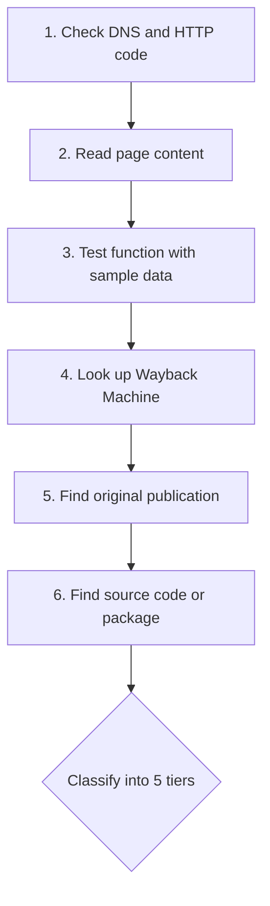

Web-based bioinformatics tools appear quickly and disappear just as quickly: of 3,649 web services published between 1994 and 2017, only 69% were still working when checked again (Ősz et al., 2019). This article repeats that kind of check on a small scale, on a reference table of 19 bioinformatics tools commonly met when learning sequence alignment, motif finding and genome browsing, using a six-step procedure you can rerun yourself. The results show that a "works / unreachable" label hides a lot: some tools have simply moved, and some pages are still up while the tool behind them no longer runs. The article ends with a checklist to keep your lab reports reproducible years from now.

## 1. Abstract

In a list of 19 bioinformatics tools (21 URLs), how many still worked in November 2026, and how did the "dead" ones die? Each URL was checked twice, one week apart (November 11 and 18, 2026), with `host` and `curl`, and cross-checked against the Wayback Machine, the original publication (via Crossref and PubMed) and Bioconda. On November 18, 2026, 15 of 21 URLs returned HTTP 200, but only 12 of them were tool pages working normally; 3 domains no longer resolved in DNS; 2 servers did not respond. At the tool level, 11 of 19 were alive, 3 partly alive, 1 moved and 4 lost. The web versions of all lost tools were published in 2002–2004, consistent with the decline in availability with tool age reported by large surveys (Kern et al., 2020; Mangul, Mosqueiro, et al., 2019; Ősz et al., 2019). Main recommendation: choose tools that have source code and an installable package, and record the version and access date in every report.

## 2. Introduction: why bioinformatics tool links "die"

MAVID, a tool for aligning multiple genomic sequences, was published in 2004 (Bray & Pachter, 2004). Type MAVID's web address into a browser today and you get a "server not found" error: the domain `baboon.math.berkeley.edu` no longer exists. The algorithm is still in the paper, but the tool you could click on and run is gone.

The bioinformatics tool tables that students often build for themselves while working on [sequence alignment and BLAST](/en/blog/phan-tich-trinh-tu/) assignments usually have a simple status column. The table used here is no different: each row has the tool name, its role, a link, the platform, and a label **O** (works) or **X** (unreachable); 12 tools are labeled O and 7 are labeled X. A binary label answers "does the link open?", but not "where, and how, can the tool still be used?"

Dead links in the scientific literature have been measured many times; Table 1 summarizes the main studies.

**Table 1.** Studies on the persistence of URLs and web services in bioinformatics

| Study | Sample | Main findings |
|---|---|---|
| Wren (2004) | 1,630 URLs in MEDLINE abstracts | About 12% of URLs were malformed or misspelled at publication; after correction, about 63% were consistently available and 19% intermittently available |
| Schultheiss et al. (2011) | 927 web services from the *Nucleic Acids Research* Web Server issues, 2003–2009 | 72% still at the published address, 9% completely gone, but functionality confirmed for only 45% |
| Ősz et al. (2019) | 3,649 web services published 1994–2017 | 69% still working; over 95% running in the first 2 years, 84% in the third year; mean half-life of 10.39 years |
| Mangul, Mosqueiro, et al. (2019) | 36,702 omics resources published 2005–2017 | Almost 28% not reachable through the URL in the original paper; of 98 tools tested for installation, 51% easy to install, 28% failed to install |
| Kern et al. (2020) | 2,396 web tools published over 10 years, monitored for 133 days | About 90% of 2019–2020 tools reachable versus about 50% of 2010 tools; 31% always up, 48.4% intermittent, 20.6% never reachable |

Wren (2004) named the problem after the familiar error code itself: "404 not found." Schultheiss et al. (2011) added a key distinction: a service still at its old address is not necessarily still working, and the gap between 72% and 45% is exactly what an O/X column cannot see. Kern et al. (2020) found that nearly half of all tools were intermittently available, with a median downtime of 1 day, so a single check can lead to the wrong conclusion. "Reference rot" also affects scholarly articles in general, not just bioinformatics (Klein et al., 2014).

These studies sample papers and then check the printed URLs, which is the tool authors' point of view. This article takes the **user's** point of view: a list of tools students actually use, and a more practical question than "is the link alive?": if the link is dead, can the analysis still be rerun?

## 3. Data and methods

### 3.1. Input data

The reference table lists 19 tools. Clustal W (GenomeNet and DDBJ) and the human genome row (UCSC and Ensembl's US East mirror) each have two URLs, for 21 URLs in total. The ENA (European Nucleotide Archive) link is a template that needs an SRA accession filled in, so the root ENA browser page was checked instead. Roles in Table 2 follow the original publications.

**Table 2.** Structure of the input data

| Original label | Tools | Role |
|---|---|---|
| O | Genome VISTA, CHAOS-DIALIGN, POASTA (partial order alignment), Clustal W | Sequence alignment and genome comparison |
| O | OLIGO, Primer3 | PCR primer design and analysis |
| O | BLAST | Homologous sequence search |
| O | iCn3D | 3D protein structure viewer |
| O | UCSC Genome Browser, Ensembl, NGDC Database Commons | Human and plant genome data |
| O | ENA, Galaxy | Downloading raw data by SRA accession; processing large files |
| X | DIALIGN (Bielefeld server), MAVID | Multiple sequence alignment |
| X | WAViS | Displaying and presenting alignments |
| X | AlignACE, Gibbs Motif Sampler | Motif finding in unaligned sequences |
| X | Meta-MEME | Motif-based hidden Markov models (HMMs) of protein families |
| X | GTOP | Database of protein structures predicted from genome sequences |

Sources for the X-group roles: Lawrence et al. (1993), Roth et al. (1998), Thompson et al. (2003), Grundy et al. (1997), Kawabata et al. (2002).

### 3.2. A six-step checking procedure



**Figure 1.** Checking procedure for one tool, from URL to classification

**Step 1: DNS and HTTP code.** `host` tells you whether the domain still resolves; `curl -L` follows redirects and returns the final HTTP code and URL. The script below runs on macOS and Linux and records the UTC time:

```bash
# Check DNS, final HTTP code and final URL for each "name|URL" line
while IFS='|' read -r name url; do
  server=$(echo "$url" | sed -E 's#https?://([^/]+).*#\1#')
  if host "$server" > /dev/null 2>&1; then dns="ok"; else dns="no_resolve"; fi
  result=$(curl -sL -o /dev/null -m 20 -w "%{http_code},%{url_effective}" "$url")
  echo "$(date -u +%Y-%m-%dT%H:%M:%SZ),$name,$dns,$result"
done <<'DS'
MAVID|http://baboon.math.berkeley.edu/mavid/
Primer3|https://primer3.ut.ee/
Genome VISTA|https://genome.lbl.gov/vista/index.shtml
DS
```

Run on November 18, 2026, the three sample lines returned `no_resolve,000` for MAVID, `200` for Primer3, and `200` with the final URL `.../vista/shutdown.html` for Genome VISTA, which is why step 2 is needed.

**Step 2: Read the content.** A 200 code does not tell you what the page is: a real tool page, a leftover static page, a "we have moved" notice, or an error page served with 200 (a soft 404).

**Step 3: Test the function.** For tools with a form, run a small query (for example, three short sequences) and record whether it returns a result. This is the "still working correctly" tier that Schultheiss et al. (2011) separate from "still at its address."

**Step 4: Wayback Machine.** The Internet Archive's CDX API returns a URL's captures with their status codes; the first and last 200 captures bound the period in which the page was definitely alive:

```python
import json
import urllib.parse
import urllib.request

def captures_200(url):
    """Return (first 200 capture, last 200 capture) from the Wayback CDX API."""
    result = []
    for limit in (1, -1):  # 1: first capture, -1: last capture
        q = urllib.parse.urlencode({"url": url, "filter": "statuscode:200",
                                    "fl": "timestamp", "limit": limit,
                                    "output": "json"})
        with urllib.request.urlopen("https://web.archive.org/cdx/search/cdx?" + q,
                                    timeout=60) as r:
            rows = json.load(r)
        result.append(rows[1][0] if len(rows) > 1 else None)  # row 0 is the header
    return tuple(result)

print(captures_200("baboon.math.berkeley.edu/mavid/"))
# ('20021206111657', '20100102055555')
```

**Step 5: Original publication.** Find the paper describing the tool, verify the DOI through Crossref and the PMID through PubMed, and record the publication year and the URL printed in the abstract. The abstract's URL often differs from the one users have saved, which is evidence that the tool has moved.

**Step 6: Source code and packages.** Look for the authors' new page, GitHub, and a Bioconda package via the API `api.anaconda.org/package/bioconda/<name>`.

### 3.3. Five-tier classification

Instead of O/X, each tool is placed in one of five tiers:

- **Alive**: the URL returns 200 and serves a working tool page.
- **Partly alive**: the page exists but the tool cannot be used right away (old static page, maintenance page, software available only under license).
- **Moved**: the old URL is dead, but the tool runs at a new address.
- **Code or package only**: no web service anymore, but it can still be installed and run locally.
- **Lost**: no page, source code or package found within the scope of the check.

Writing the rules as code ensures they are applied the same way to every row. An example with the X group:

```python
import io
import pandas as pd

csv = """tool,pub_year,final_http,content,new_address,package,last_200
DIALIGN (Bielefeld),1999,000,,dialign.gobics.de,dialign2,2025-05-12
AlignACE,1998,200,license_required,,,2026-10-19
MAVID,2004,000,,,,2010-01-02
WAViS,2004,000,,,,2020-02-23
Gibbs Motif Sampler (Brown),2003,000,,,,2018-08-02
Meta-MEME (UCL),1997,200,old_static_page,,,
GTOP,2002,000,,,,2022-06-15
"""
df = pd.read_csv(io.StringIO(csv), dtype={"final_http": str})

def tier(d):
    if d.final_http == "200" and d.content == "tool_page":
        return "Alive"
    if d.final_http == "200":
        return "Partly alive"
    if pd.notna(d.new_address):
        return "Moved"
    if pd.notna(d.package):
        return "Code/package only"
    return "Lost"

df["tier"] = df.apply(tier, axis=1)
df["last_200"] = pd.to_datetime(df["last_200"])
# Rough "web lifetime" = year of last 200 capture - publication year (a lower bound only)
gone = df["tier"].isin(["Lost", "Moved"])
df.loc[gone, "rough_lifetime"] = df.loc[gone, "last_200"].dt.year - df.loc[gone, "pub_year"]
print(df[["tool", "tier", "rough_lifetime"]].to_string(index=False))
print(df["tier"].value_counts().to_string())
```

## 4. Results

### 4.1. The overall picture

On November 18, 2026 (15:25 UTC), 15 of 21 URLs returned HTTP 200, but only 12 were tool pages working normally; the other three were Genome VISTA's maintenance page, AlignACE's software page and a static Meta-MEME documentation page. Of the 6 URLs that did not return 200, three domains no longer resolved (Bielefeld, Berkeley, and the WAViS server in Prague), two servers did not respond (Brown and Japan's National Institute of Genetics), and one was Ensembl's US East mirror.

Genome VISTA still returned HTTP 200 on November 11, but by November 18 it redirected to a page announcing unplanned maintenance; the Wayback Machine still has a 200 capture of the home page from November 7, 2026. This is exactly the "sometimes up, sometimes down" pattern Kern et al. (2020) warned about, so VISTA is classified as "partly alive" rather than "lost."

The `useast.ensembl.org` mirror is a different case. Its DNS now points to `jun2026.archive.ensembl.org`: Ensembl announced on October 23, 2026 that the US East and Asia mirrors were being retired, and that both addresses would keep working but serve the release 116 archive instead of the latest release (Ensembl, 2026). The link is still "alive," but the data behind it is frozen, so it is better to switch to `www.ensembl.org` or record the release you used.

Two measurement artifacts are worth knowing when you run checks yourself: OLIGO returned code 406 to default `curl` but 200 when sent browser-like headers (the server blocks bots), and UCSC raised a certificate error on the checking machine, which runs an old macOS version, but returned 200 from an external service. An error code should be rechecked from another environment before drawing conclusions.


**Figure 2.** The 19 tools classified into five tiers, split by original label. Source: check of November 18, 2026.

At the tool level (Figure 2), 11 of 19 tools are alive, 3 partly alive, 1 moved and 4 lost. The O label holds up fairly well: 11 of 12 tools are alive. The X label is mixed: of the 7 X tools, only 4 are truly lost, 2 still have pages and 1 runs at a new address.

### 4.2. The seven tools labeled X

**Table 3.** Check results for the seven tools labeled X (November 18, 2026)

| Tool | Old URL | Last 200 capture (Wayback) | Original paper | Source code or package | Tier |
|---|---|---|---|---|---|
| DIALIGN (Bielefeld) | DNS does not resolve | 2025-05-12 | 1999 | Runs at GOBICS; Bioconda `dialign2` 2.2.1, `dialign-tx` 1.0.2 | Moved |
| AlignACE | HTTP 200, static page | 2026-10-19 | 1998 | Requires contacting the licensing office; not on Bioconda | Partly alive |
| MAVID | DNS does not resolve | 2010-01-02 | 2004 | Not on Bioconda | Lost |
| WAViS | DNS does not resolve | 2020-02-23 | 2004 | Not on Bioconda | Lost |
| Gibbs Motif Sampler (Brown) | Timed out | 2018-08-02 | 1993; web version 2003 | Not on Bioconda | Lost |
| Meta-MEME (UCL) | HTTP 200, static MEME 4.7.0 docs | No captures | 1997 | MEME Suite is on Bioconda (`meme` 5.5.9) | Partly alive |
| GTOP | Timed out | 2022-06-15 | 2002 | Not on Bioconda | Lost |

Sources for publication years: Morgenstern (1999); Roth et al. (1998); Bray and Pachter (2004); Zika et al. (2004); Lawrence et al. (1993); Thompson et al. (2003); Grundy et al. (1997); Kawabata et al. (2002).

The following three cases show why a single X is not enough.

<div class="callout callout-example">
<p class="callout-title">DIALIGN: dead in Bielefeld, alive in Göttingen</p>

DIALIGN 2 (Morgenstern, 1999) ran for years on the BiBiServ server at Bielefeld University. That domain no longer has a DNS record. But DIALIGN did not die: the page `dialign.gobics.de` in Göttingen presents itself as DIALIGN's new home (Al Ait et al., 2013), CHAOS-DIALIGN in the O group runs on this very server (Brudno et al., 2004), and Bioconda has a `dialign2` package. The same reference table holds both the dead old address and its "successor."

</div>

<div class="callout callout-example">
<p class="callout-title">AlignACE: the page survives, the software is not freely downloadable</p>

AlignACE finds regulatory motifs in the noncoding regions of genes with similar expression (Roth et al., 1998). The tool page was archived by the Wayback Machine from 1999 to October 2026 and still returns 200, but getting the software requires contacting a licensing office: the "page exists but not usable right away" tier that O/X cannot distinguish.

</div>

<div class="callout callout-example">
<p class="callout-title">MAVID: a web lifetime of about six years</p>

MAVID was published in 2004; its last 200 capture on the Wayback Machine is from January 2, 2010. The tool page lived at least about six years, much shorter than the mean half-life of 10.39 years estimated by Ősz et al. (2019).

</div>


**Figure 3.** Year of the original paper and the span of HTTP 200 captures on the Wayback Machine for the seven tools labeled X. Source: Wayback CDX API, queried November 18, 2026; publication years from DOIs.

Subtracting the publication year from the year of the last 200 capture (Figure 3) gives a rough "web lifetime": about 6 years for MAVID, about 15 years for Gibbs Motif Sampler at the Brown address (counted from the 2003 web version), about 16 years for WAViS, and about 20 years for GTOP. These are **lower bounds**: the last capture only shows the page was alive at least until that date, not when the server was switched off.

The 2003 abstract of the Gibbs Recursive Sampler printed addresses at the Wadsworth Center and Rensselaer Polytechnic Institute (Thompson et al., 2003), not Brown, and the first 200 capture at Brown dates from 2009: the tool moved at least once before it was lost. For Meta-MEME, what remains is a static copy of the MEME Suite 4.7.0 documentation that the Wayback Machine never captured. MEME Suite is still on Bioconda, but it could not be confirmed whether Meta-MEME is part of the current release.

### 4.3. The twelve tools labeled O

The surviving tools are not necessarily "younger." Clustal W was published in 1994 (Thompson et al., 1994), VISTA in 2000 (Mayor et al., 2000) with its web tool suite in 2004 (Frazer et al., 2004), and Primer3 received a major update in 2012 (Untergasser et al., 2012); the youngest is POASTA (van Dijk et al., 2025). What they share lies elsewhere. Most are hosted at large data centers: NCBI (BLAST, iCn3D), EMBL-EBI (ENA), UCSC, DDBJ, GenomeNet, NGDC. Many have source code or installable packages: Bioconda has `clustalw` 2.1, `primer3` 2.6.1 and `blast` 2.17.0; POASTA distributes its source code on GitHub. Galaxy runs mainly through free public servers maintained by its community (The Galaxy Community et al., 2024).

## 5. Discussion

### 5.1. Comparison with the literature

At the URL level, 6 of 21 URLs (29%) did not return 200 on November 18, 2026, and 3 more returned 200 without serving a usable tool. At the tool level, 4 of 19 (21%) were lost within the scope of the check. These figures fall in the same range as the almost 28% reported by Mangul, Mosqueiro, et al. (2019) and the 20.6% of tools never reachable in Kern et al. (2020); note that the 31% in Kern et al. is the share **always up**, not the share dead.

The comparison is only qualitative: n = 19 is far too small for statistical inference, and the list leans toward older tools (all seven X tools were published 1993–2004). Kern et al. (2020) surveyed only tools from 2010–2020, so their figures cannot be applied directly to pre-2010 tools; but their finding that older tools are less reachable, together with the decline after the second year reported by Ősz et al. (2019), is consistent with the web versions of all "lost" tools here having been published in 2002–2004.

The "partly alive" tier (VISTA, AlignACE, Meta-MEME) mirrors the gap between the 72% of services still at their address and the 45% with confirmed functionality in Schultheiss et al. (2011). A survey based only on HTTP codes would count all three as "alive."

### 5.2. Why tools die

Schultheiss et al. (2011) point to a human cause: most services were developed by people without permanent positions, and a quarter had no maintenance plan. Among the seven X tools, the dead addresses all sit on department- or group-level domains (`techfak` at Bielefeld, `math` at Berkeley, `ccmbweb` at Brown). This is an observation on a handful of cases, not enough to generalize, but it suggests a question to ask when choosing a tool: who maintains this server?

### 5.3. Why some tools survive

Surviving tools tend to belong to national or international infrastructure, to have a community and open source code, or to have an installable package. Kern et al. (2020) found that citation counts correlate positively with continued availability. Mangul, Mosqueiro, et al. (2019) found that tools with an easy installation process received more citations, and the same group of authors proposed measures, including journal policies, to improve the installability and archival stability of bioinformatics software (Mangul, Martin, et al., 2019).

DIALIGN illustrates the most important point: when an algorithm is packaged and distributed through a durable channel, it outlives the first server that ran it.

### 5.4. Infrastructure solutions

**Bioconda** is a distribution channel for bioinformatics software for the Conda package manager, letting you install a specific version of a tool with one command (The Bioconda Team et al., 2018). **BioContainers** provides platform-independent execution environments based on Docker and can keep multiple versions of the same software (da Veiga Leprevost et al., 2017). **Galaxy** brings tools to a web interface that records the analysis history, a good fit for people new to the command line (The Galaxy Community et al., 2024). Grüning, Chilton, et al. (2018) propose combining these layers: portable software packages, containers to isolate environments, and workflow systems to orchestrate whole pipelines (→ [reproducible workflows and containers](/en/blog/quy-trinh-tai-lap-workflow-container-hpc-va-cloud/)).

### 5.5. Limitations

The sample is small, non-random and skewed toward alignment and motif-finding tools. Two checks a week apart are not enough to separate temporary outages from permanent death the way Kern et al. (2020) did. The Wayback Machine does not capture every page, so a missing capture does not mean a page never existed. And functionality was not tested with sample queries, so "alive" here means the tool page is still served, not that it has been confirmed to run correctly.

## 6. Practical recommendations for students

The checklist below can be used right away for any lab report with a bioinformatics component.

**When choosing a tool**

- [ ] Prefer tools with public source code and a Bioconda or BioContainers package, or that are available on Galaxy.
- [ ] For web-only tools, check the original paper for a way to install locally.
- [ ] Prefer servers at large centers (NCBI, EMBL-EBI, DDBJ) over servers run by a small group.

**When writing the methods**

- [ ] Record the tool name, **version**, URL and **access date**.
- [ ] Record any non-default parameters.
- [ ] Record database versions: the BLAST database, the reference genome build, the Ensembl release.

Sandve et al. (2013) wrap these requirements into ten rules, including archiving the exact versions of all external programs used, avoiding manual data manipulation steps, and keeping track of how every result was produced.

**When saving results**

- [ ] Keep the input files, raw outputs and the parameters used.
- [ ] If you use Conda, export the environment with `conda env export > environment.yml`.

**When you hit a dead link**

1. Look it up on the Wayback Machine to see what the tool was and how long it lived.
2. Find the original paper via PubMed or Crossref.
3. Search for the tool name on Bioconda and GitHub.
4. Look for a successor in later papers by the same authors, as with DIALIGN moving to GOBICS.

**For your own tool reference table**

- [ ] Add "Date checked" and "Version" columns.
- [ ] Replace the O/X column with five tiers: alive, partly alive, moved, code or package only, lost.
- [ ] Include the DOI of the original paper so you can trace the tool when its address changes (→ [organizing and querying tabular data](/en/blog/phan-tich-co-so-du-lieu/)).

## 7. Conclusion

Re-checking 19 bioinformatics tools shows the same trend that large surveys have reported: the older a web tool, the more likely it is to be lost, and a share of tools "still have a link" but cannot be used right away. "Death" is often the death of a URL, not necessarily of an algorithm: DIALIGN lives on at a new address and on Bioconda, while tools that existed only as a web page on a department server vanished with that server. For students, the best way to reduce the risk is not to hunt for more "durable" web services, but to choose tools with source code and installable packages, and to record the version and access date in every report.

## References

Al Ait, L., Yamak, Z., & Morgenstern, B. (2013). DIALIGN at GOBICS—multiple sequence alignment using various sources of external information. *Nucleic Acids Research, 41*(W1), W3–W7. https://doi.org/10.1093/nar/gkt283

Bray, N., & Pachter, L. (2004). MAVID: Constrained ancestral alignment of multiple sequences. *Genome Research, 14*(4), 693–699. https://doi.org/10.1101/gr.1960404

Brudno, M., Steinkamp, R., & Morgenstern, B. (2004). The CHAOS/DIALIGN WWW server for multiple alignment of genomic sequences. *Nucleic Acids Research, 32*(Web Server issue), W41–W44. https://doi.org/10.1093/nar/gkh361

da Veiga Leprevost, F., Grüning, B. A., Alves Aflitos, S., Röst, H. L., Uszkoreit, J., Barsnes, H., Vaudel, M., Moreno, P., Gatto, L., Weber, J., Bai, M., Jimenez, R. C., Sachsenberg, T., Pfeuffer, J., Vera Alvarez, R., Griss, J., Nesvizhskii, A. I., & Perez-Riverol, Y. (2017). BioContainers: An open-source and community-driven framework for software standardization. *Bioinformatics, 33*(16), 2580–2582. https://doi.org/10.1093/bioinformatics/btx192

Ensembl. (2026, October 23). *Ensembl USEast and Asia mirror sites are being retired*. Ensembl Blog. https://www.ensembl.info/2026/10/23/ensembl-useast-and-asia-mirror-sites-are-being-retired/

Frazer, K. A., Pachter, L., Poliakov, A., Rubin, E. M., & Dubchak, I. (2004). VISTA: Computational tools for comparative genomics. *Nucleic Acids Research, 32*(Web Server issue), W273–W279. https://doi.org/10.1093/nar/gkh458

Grundy, W. N., Bailey, T. L., Elkan, C. P., & Baker, M. E. (1997). meta-MEME: Motif-based hidden Markov models of protein families. *Computer Applications in the Biosciences, 13*(4), 397–406. https://doi.org/10.1093/bioinformatics/13.4.397

Grüning, B., Chilton, J., Köster, J., Dale, R., Soranzo, N., van den Beek, M., Goecks, J., Backofen, R., Nekrutenko, A., & Taylor, J. (2018). Practical computational reproducibility in the life sciences. *Cell Systems, 6*(6), 631–635. https://doi.org/10.1016/j.cels.2018.03.014

Kawabata, T., Fukuchi, S., Homma, K., Ota, M., Araki, J., Ito, T., Ichiyoshi, N., & Nishikawa, K. (2002). GTOP: A database of protein structures predicted from genome sequences. *Nucleic Acids Research, 30*(1), 294–298. https://doi.org/10.1093/nar/30.1.294

Kern, F., Fehlmann, T., & Keller, A. (2020). On the lifetime of bioinformatics web services. *Nucleic Acids Research, 48*(22), 12523–12533. https://doi.org/10.1093/nar/gkaa1125

Klein, M., Van de Sompel, H., Sanderson, R., Shankar, H., Balakireva, L., Zhou, K., & Tobin, R. (2014). Scholarly context not found: One in five articles suffers from reference rot. *PLoS ONE, 9*(12), e115253. https://doi.org/10.1371/journal.pone.0115253

Lawrence, C. E., Altschul, S. F., Boguski, M. S., Liu, J. S., Neuwald, A. F., & Wootton, J. C. (1993). Detecting subtle sequence signals: A Gibbs sampling strategy for multiple alignment. *Science, 262*(5131), 208–214. https://doi.org/10.1126/science.8211139

Mangul, S., Martin, L. S., Eskin, E., & Blekhman, R. (2019). Improving the usability and archival stability of bioinformatics software. *Genome Biology, 20*, 47. https://doi.org/10.1186/s13059-019-1649-8

Mangul, S., Mosqueiro, T., Abdill, R. J., Duong, D., Mitchell, K., Sarwal, V., Hill, B., Brito, J., Littman, R. J., Statz, B., Lam, A. K.-M., Dayama, G., Grieneisen, L., Martin, L. S., Flint, J., Eskin, E., & Blekhman, R. (2019). Challenges and recommendations to improve the installability and archival stability of omics computational tools. *PLOS Biology, 17*(6), e3000333. https://doi.org/10.1371/journal.pbio.3000333

Mayor, C., Brudno, M., Schwartz, J. R., Poliakov, A., Rubin, E. M., Frazer, K. A., Pachter, L. S., & Dubchak, I. (2000). VISTA: Visualizing global DNA sequence alignments of arbitrary length. *Bioinformatics, 16*(11), 1046–1047. https://doi.org/10.1093/bioinformatics/16.11.1046

Morgenstern, B. (1999). DIALIGN 2: Improvement of the segment-to-segment approach to multiple sequence alignment. *Bioinformatics, 15*(3), 211–218. https://doi.org/10.1093/bioinformatics/15.3.211

Ősz, Á., Pongor, L. S., Szirmai, D., & Győrffy, B. (2019). A snapshot of 3649 Web-based services published between 1994 and 2017 shows a decrease in availability after 2 years. *Briefings in Bioinformatics, 20*(3), 1004–1010. https://doi.org/10.1093/bib/bbx159

Roth, F. P., Hughes, J. D., Estep, P. W., & Church, G. M. (1998). Finding DNA regulatory motifs within unaligned noncoding sequences clustered by whole-genome mRNA quantitation. *Nature Biotechnology, 16*(10), 939–945. https://doi.org/10.1038/nbt1098-939

Sandve, G. K., Nekrutenko, A., Taylor, J., & Hovig, E. (2013). Ten simple rules for reproducible computational research. *PLoS Computational Biology, 9*(10), e1003285. https://doi.org/10.1371/journal.pcbi.1003285

Schultheiss, S. J., Münch, M.-C., Andreeva, G. D., & Rätsch, G. (2011). Persistence and availability of Web services in computational biology. *PLoS ONE, 6*(9), e24914. https://doi.org/10.1371/journal.pone.0024914

The Bioconda Team, Grüning, B., Dale, R., Sjödin, A., Chapman, B. A., Rowe, J., Tomkins-Tinch, C. H., Valieris, R., & Köster, J. (2018). Bioconda: Sustainable and comprehensive software distribution for the life sciences. *Nature Methods, 15*(7), 475–476. https://doi.org/10.1038/s41592-018-0046-7

The Galaxy Community, Abueg, L. A. L., Afgan, E., Allart, O., Awan, A. H., Bacon, W. A., Baker, D., Bassetti, M., Batut, B., Bernt, M., Blankenberg, D., Bombarely, A., Bretaudeau, A., Bromhead, C. J., Burke, M. L., Capon, P. K., Čech, M., Chavero-Díez, M., Chilton, J. M., … Zoabi, R. (2024). The Galaxy platform for accessible, reproducible, and collaborative data analyses: 2024 update. *Nucleic Acids Research, 52*(W1), W83–W94. https://doi.org/10.1093/nar/gkae410

Thompson, J. D., Higgins, D. G., & Gibson, T. J. (1994). CLUSTAL W: Improving the sensitivity of progressive multiple sequence alignment through sequence weighting, position-specific gap penalties and weight matrix choice. *Nucleic Acids Research, 22*(22), 4673–4680. https://doi.org/10.1093/nar/22.22.4673

Thompson, W., Rouchka, E. C., & Lawrence, C. E. (2003). Gibbs Recursive Sampler: Finding transcription factor binding sites. *Nucleic Acids Research, 31*(13), 3580–3585. https://doi.org/10.1093/nar/gkg608

Untergasser, A., Cutcutache, I., Koressaar, T., Ye, J., Faircloth, B. C., Remm, M., & Rozen, S. G. (2012). Primer3—new capabilities and interfaces. *Nucleic Acids Research, 40*(15), e115. https://doi.org/10.1093/nar/gks596

van Dijk, L. R., Manson, A. L., Earl, A. M., Garimella, K. V., & Abeel, T. (2025). Fast and exact gap-affine partial order alignment with POASTA. *Bioinformatics, 41*(1), btae757. https://doi.org/10.1093/bioinformatics/btae757

Wren, J. D. (2004). 404 not found: The stability and persistence of URLs published in MEDLINE. *Bioinformatics, 20*(5), 668–672. https://doi.org/10.1093/bioinformatics/btg465

Zika, R., Paces, J., Pavlicek, A., & Paces, V. (2004). WAViS server for handling, visualization and presentation of multiple alignments of nucleotide or amino acids sequences. *Nucleic Acids Research, 32*(Web Server issue), W48–W49. https://doi.org/10.1093/nar/gkh358
