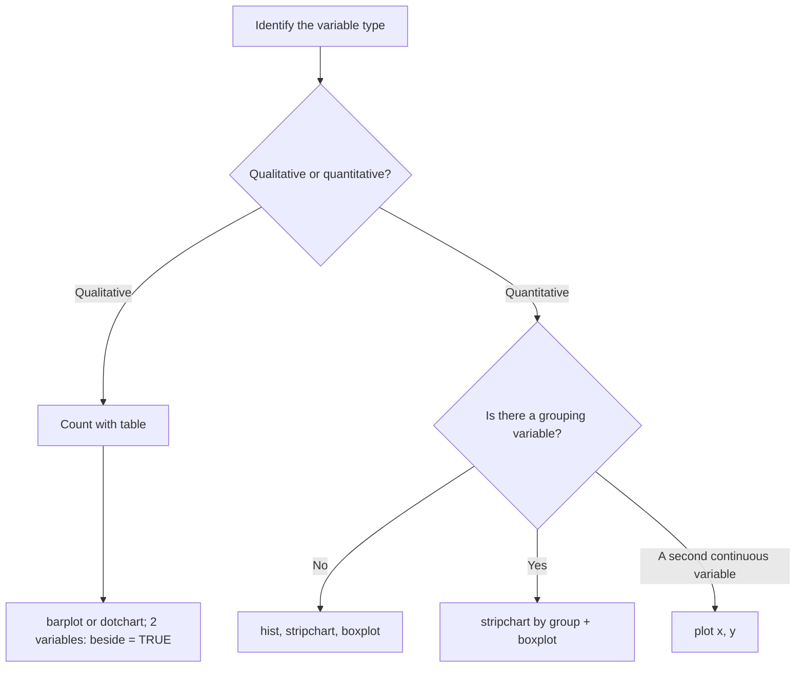

In a simulated dataset, the body weights of boys and girls were drawn from exactly the same distribution, yet a bar graph of the means shows boys nearly 4 kg heavier, with p = 0.024. This first article in the series *Introduction to Data Analysis in R* answers the question "what should I plot?" rather than just "which function do I call?": a mapping from variable type to base R chart, three bodies of evidence (graphical perception experiments, reviews of bar graphs in biology journals, and the cost of binning continuous variables), and a workflow that lets others redraw exactly the figure you made. Every code chunk in the article runs on R 4.4.3.

## 1. Introduction: a chart is a measurement made by eye

Calling `barplot()` or `pie()` in R takes seconds. The hard part is deciding what to draw, because every chart forces the reader to make a comparison by eye: the heights of two bars, two angles, or the positions of two clouds of points. Some of these comparisons the human eye makes quite accurately; others carry large errors. Some charts show every observation; others collapse a whole group into a single number.

Anscombe (1973) illustrated this with four small datasets whose means, variances, correlation coefficients and regression lines are almost identical but whose scatterplots look completely different. Matejka and Fitzmaurice (2017) used simulated annealing to morph one dataset into many very different shapes while the summary statistics barely changed. The shared lesson: you have to look at the data, and you have to choose a way of looking that does not hide it.

The article uses two datasets. The first is **simulated** data on 45 students, generated by the code below: sex (`gioi_tinh`, with values `"Nam"` for male and `"Nu"` for female), a math score on a 0–10 scale in steps of 0.5 (`diem_toan`), and body weight drawn from a normal distribution $N(50, 6^2)$ (`can_nang`). The variable names are Vietnamese because the numbers below depend on this exact code. These are illustrative data and describe no real students. The second is `mtcars`, built into R: 32 car models taken from *Motor Trend* magazine in 1974, which Henderson and Velleman (1981) used to illustrate how to build regression models; the article uses `wt` (weight, in units of 1,000 lbs) and `mpg` (miles per US gallon).

```r
set.seed(42)
gioi_tinh <- sample(c("Nam", "Nu"), 45, replace = TRUE)   # sex: male/female
diem_toan <- sample(seq(0, 10, 0.5), 45, replace = TRUE)  # math score
can_nang  <- rnorm(45, 50, 6)                             # weight (kg)
du_lieu   <- data.frame(gioi_tinh, diem_toan, can_nang)
str(du_lieu)
```

Note: `diem_toan` is drawn **uniformly** from the 21 values 0, 0.5, …, 10, so its distribution is flat, unlike real exam scores, which usually pile up in the middle. That is fine for teaching technique, but if you want simulated data to "look real" you have to simulate a plausible distribution. Every number in the article is computed from exactly this code on R 4.4.3.

## 2. The mapping table: which variable type, which chart

The first step is always to identify the variable type, because the type determines which comparisons make sense. The dataset above contains all four types. `gioi_tinh` is a nominal qualitative variable: its groups have no order. `xep_loai`, created in Section 5 by binning the score into four grades, is an ordinal qualitative variable: "Weak" < "Average" < "Good" < "Excellent", but the distances between grades are undefined. `diem_toan` is a discrete quantitative variable that only takes values 0.5 apart. `can_nang`, `wt` and `mpg` are continuous quantitative variables.

Table 1 is the backbone of the article. If you read only one section, read this one; the sections that follow explain why each row says what it says.

**Table 1.** Mapping variable types to base R charts

| Data | Main comparison | Recommended | Use sparingly |
| --- | --- | --- | --- |
| 1 qualitative variable | counts across groups | `barplot(table(x))`, `dotchart()` | `pie()` with many groups |
| 2 qualitative variables | one subgroup across main groups | `barplot(table(x, y), beside = TRUE)` | stacked bars, unless each bar's total is the main message |
| 1 continuous variable | shape of the distribution | `hist(breaks = ...)`, `stripchart()`, `boxplot()` | reporting only the mean |
| Continuous by group | distributions across groups | `stripchart(y ~ g, vertical = TRUE, method = "jitter")` with `boxplot(y ~ g)` | mean ± SD bars |
| 2 continuous variables | relationship between the two | `plot(x, y)` | `type = "l"` when the x-axis has no real order |

The first two rows are for count data: `table()` counts observations per group, or builds a contingency table when there are two variables, and then `barplot()` or `dotchart()` displays the counts; Section 3 explains why grouped bars are usually easier to read than stacked bars. The next three rows are for measured data: the chart has to show the **shape of the distribution** (skewed or symmetric, one peak or two, any values far from the rest), and Section 4 argues that when comparing groups, the default should be a strip chart (one point per observation) overlaid on a boxplot.

It is also worth separating bar charts from histograms, two kinds of figures that look alike but are fundamentally different (Bruce & Bruce, 2017). The x-axis of a bar chart holds discrete **groups**: bars can be reordered freely and have gaps between them. The x-axis of a histogram is a continuous **numeric scale** divided into intervals (bins): the bars touch and cannot be moved. Drawing `barplot()` for weight or `hist()` for sex is using the wrong tool.

Figure 1 shows the six chart types in the table, drawn from the article's two datasets.


*Figure 1. Six common base R chart types, drawn from the 45 simulated students and `mtcars`.*

The process of choosing a chart can be summarized in the following diagram.



Table 1 is not a hard rule. It summarizes one general principle: choose a chart so that the most important comparison is encoded as **position along a common scale**, and for measured data from small samples, let readers see every observation. For more on designing charts for an audience, see [principles of data visualization](/en/blog/share-data-through-the-art-of-visualization/) and visualization in R.

## 3. Evidence 1: Cleveland and McGill's accuracy ranking

### 3.1. Elementary perceptual tasks

Cleveland and McGill (1984) laid a foundation for chart choice with the concept of graphical perception: the visual decoding of quantitative information encoded on graphs. They proposed that when reading a chart, viewers carry out a set of "elementary perceptual tasks," and they ordered ten such tasks by accuracy, from most to least accurate:

1. Position along a common scale
2. Positions along nonaligned scales
3. Length, direction, angle
4. Area
5. Volume, curvature
6. Shading, color saturation

This ordering is a hypothesis; the authors tested part of it in experiments in which participants estimated the ratio between two marked values on a chart, and the results supported the parts that were tested. From this they derived a design principle: graphs should use tasks as high in the ordering as possible. Applying it to bar charts, divided bar charts and pie charts, they proposed replacements: dot charts, dot charts with grouping, and framed-rectangle charts (Cleveland & McGill, 1984).

Heer and Bostock (2010) replicated Cleveland and McGill's position–length experiment on Amazon Mechanical Turk, with 50 respondents per chart. The results did not match the original exactly, but the overall shape and the accuracy ranking of the position and length judgment types were preserved; position judgments along a common scale were still significantly more accurate than length judgments. The accuracy ranking is therefore not just an artifact of one laboratory in 1984.

### 3.2. Stacked versus grouped bars

Apply the ranking to the sex × grade contingency table. In a stacked bar chart, `barplot(bang)`, only the bottom segment of each bar sits on a common baseline. To compare the number of girls across grades when girls are the upper segment, the reader has to compare segments with misaligned bases, that is, compare lengths or positions along nonaligned scales. In a grouped bar chart, `barplot(bang, beside = TRUE)`, every bar stands on the same baseline, so the comparison becomes position along a common scale, the top of the ranking.

```r
du_lieu$xep_loai <- cut(du_lieu$diem_toan,
                        breaks = c(0, 5, 6.5, 8, 10),
                        labels = c("Weak", "Average", "Good", "Excellent"),
                        right = FALSE, include.lowest = TRUE)
bang <- table(du_lieu$gioi_tinh, du_lieu$xep_loai)
bang
barplot(bang, legend.text = TRUE)                 # stacked bars
barplot(bang, beside = TRUE, legend.text = TRUE)  # grouped bars
```


*Figure 2. The same sex × grade contingency table (n = 45) drawn as stacked bars (left) and grouped bars (right).*

In Figure 2, the question "in the Good grade, are there more boys or girls?" is answered at a glance on the right: three girls, no boys. On the left you have to estimate the length of the upper segment. Stacked bars still have their uses: when the **total** of each bar is the main message (total students per grade), when the bottom segment is the group that matters most, or when there are only two subgroups.

### 3.3. Pie charts: when to use them and when not to

`pie()` encodes values as angle and area, the third and fourth levels of the ranking. The direct replacement is `dotchart()` with groups sorted by count: each value is a point on a common scale, so you can read both the rank order and the gaps.

```r
tab <- sort(table(du_lieu$xep_loai))
dotchart(as.vector(tab), labels = names(tab), xlab = "Number of students")
pie(table(du_lieu$xep_loai))
```


*Figure 3. Grade distribution of the 45 simulated students: pie chart (left) and dot chart sorted by count (right).*

In the pie in Figure 3 it is hard to tell whether "Average" (4 students) or "Good" (3) is larger; in the dot chart it is obvious. Bruce and Bruce (2017) note that statisticians generally avoid pie charts because they are less visually informative than bar charts.

Even so, "never use a pie chart" is too strong a conclusion. In a series of experiments, Spence and Lewandowsky (1991) had participants read proportions from pie charts, bar charts and tables. Pie and bar charts performed about equally well; pies had a slight edge when the judgment was complex, for example estimating the sum of several components, and both kinds of chart beat tables. The two lines of research do not contradict each other; they answer different questions. Cleveland and McGill measured accuracy when comparing **two values with each other**; Spence and Lewandowsky measured reading **a part relative to the whole**. The practical rule: a pie is acceptable when you have two or three groups and the main message is "how much of the total is this part"; when readers need to compare groups, use a bar or dot chart.

## 4. Evidence 2: bar graphs hide the distribution

### 4.1. The problem in biology journals

Weissgerber and colleagues (2015) systematically reviewed 703 research articles in top physiology journals. Most papers presented continuous data as bar or line graphs, while scatterplots, box plots and histograms, the figures that let readers evaluate the data for themselves, were rare. The problem is that many different distributions can produce the same bar graph: one group may be symmetric, another may contain an extreme value, another may split into two clusters, and the full data may suggest different conclusions from the summary statistics. The authors recommended training researchers in data presentation and changing journal editorial policies.

Although many journals have since encouraged authors to stop using bar graphs for continuous data, in a review of top peripheral vascular disease journals, 47.7% of papers with data figures still used bar graphs to present continuous data (Weissgerber et al., 2019). That paper includes guidance on choosing figures by study design, sample size and variable type.

### 4.2. A false positive in simulated data

The 45 simulated students are a natural example of this problem. In the code in Section 1, the weights of **all 45 students** come from the same call, `rnorm(45, 50, 6)`, while sex is assigned at random and independently. By construction, there is no real difference between boys and girls. And yet:

```r
aggregate(can_nang ~ gioi_tinh, data = du_lieu,
          FUN = function(x) c(n = length(x), mean = mean(x), sd = sd(x)))
t.test(can_nang ~ gioi_tinh, data = du_lieu)   # Welch t-test by default
```

The boys' group has 22 students with a mean of 52.33 kg (SD 4.73); the girls' group has 23 students with a mean of 48.61 kg (SD 5.89). Welch's t-test gives t = 2.34, df ≈ 41.8, p = 0.024. If you plot only mean ± SD bars (left panel of Figure 4), readers see two bars almost 4 kg apart, plus p < 0.05, and can easily conclude that "boys are heavier."


*Figure 4. Weight by sex for the 45 simulated students, drawn three ways. The horizontal lines in the middle panel are group means. All 45 values come from the same distribution.*

The middle and right panels tell a different story. The two clouds of points overlap almost completely, roughly between 41 and 59 kg. The girls' group has a single value of 32.04 kg, well below all the others; in a boxplot of all 45 values, it is the only point beyond the whiskers. Removing it raises the girls' mean from 48.61 to 49.36 kg and p is still 0.044, so the result is not driven by one point alone. The simpler explanation: this is a **false positive**. When there is no real difference, about 5% of repeated experiments will give p < 0.05 purely by chance, and `set.seed(42)` happens to land in that group.

You can check this explanation by simulation: repeat the generation of 45 students 10,000 times in exactly the same way, running a t-test each time.

```r
set.seed(2026)
p <- replicate(10000, {
  g <- sample(c("Nam", "Nu"), 45, replace = TRUE)
  y <- rnorm(45, 50, 6)
  t.test(y ~ g)$p.value
})
mean(p < 0.05)   # 0.0461
```


*Figure 5. Distribution of p-values from 10,000 simulated datasets with no true difference. Red bar: p < 0.05.*

The result is that 4.61% of runs give p < 0.05, close to the theoretical 5%, and the p-values are spread almost uniformly from 0 to 1 (Figure 5). The lesson is not that the t-test is wrong, but that a summary number plus a p-value is not enough for readers to judge the data. Showing every data point lets readers see for themselves how much the two groups overlap, in the spirit of "reveal, don't conceal" (Weissgerber et al., 2019).

Base R code for the middle and right panels of Figure 4:

```r
stripchart(can_nang ~ gioi_tinh, data = du_lieu, vertical = TRUE,
           method = "jitter", pch = 19, col = c("#0072B2", "#E69F00"),
           ylab = "Weight (kg)")

boxplot(can_nang ~ gioi_tinh, data = du_lieu,
        outline = FALSE, ylab = "Weight (kg)")
stripchart(can_nang ~ gioi_tinh, data = du_lieu, vertical = TRUE,
           method = "jitter", pch = 19, add = TRUE)
```

`method = "jitter"` nudges points sideways so that close values do not sit on top of each other. When overlaying points on a boxplot, set `outline = FALSE` so the boxplot does not draw outliers separately; otherwise those points appear twice.

### 4.3. Reading a boxplot

The boxplot was introduced by Tukey and has many variants, including notches and box widths proportional to sample size (McGill et al., 1978); Krzywinski and Altman (2014) wrote a short piece explaining how to read box plots for life scientists. In R, the line inside the box is the median, the box edges are the two "hinges," and the whiskers extend to the most extreme value lying within 1.5 times the box length from the box (the `range = 1.5` argument of `boxplot()`); points beyond that are drawn individually.

One technical detail is worth knowing: the hinges computed by `boxplot()` come from `fivenum()`, which are close to, but not always equal to, the quartiles $Q_1$ and $Q_3$ that `quantile()` returns by default. For `wt` in `mtcars`, `quantile()` gives $Q_1$ = 2.581 and $Q_3$ = 3.610, while the two hinges are 2.5425 and 3.650. As a result, two ways of flagging outliers, computing the thresholds $Q_1 - 1.5\,IQR$ and $Q_3 + 1.5\,IQR$ yourself from `quantile()` versus taking `boxplot.stats()$out`, can give different results on the same data. The details of quantile definitions and outlier handling belong to the series' [article on descriptive statistics](/en/blog/data-exploration-using-descriptive-statistics/).

The numbers that accompany a figure come from `summary()` (min, $Q_1$, median, mean, $Q_3$, max; for `can_nang` these are 32.04, 46.74, 51.55, 50.43, 54.08, 59.08) or from `mean()`, `median()`, `var()` (dividing by $n - 1$) and `sd()`; the Excel version is in the [article on sample statistics](/en/blog/3-dac-trung-thong-ke-cua-mot-mau-va-uoc-luong-tham-so-cua-tong-the/).

### 4.4. Histograms and the `breaks` argument

A histogram depends on how the scale is divided. By default, `hist()` uses Sturges' rule; with n = 45, `nclass.Sturges()` suggests 7 classes, but R rounds the breakpoints to "pretty" values with `pretty()`, so you end up with 6 bins, 5 kg wide, from 30 to 60. One surprising consequence: when you pass a single number, say `breaks = 4`, R treats it only as a **suggestion**, and here it still produces the same 6 bins as the default. For exact control, pass a vector of breakpoints.

```r
hist(du_lieu$can_nang)                                 # Sturges: 6 bins
hist(du_lieu$can_nang, breaks = 4)                     # still 6 bins
hist(du_lieu$can_nang, breaks = seq(30, 60, by = 10))  # exactly 3 bins
hist(du_lieu$can_nang, breaks = 15)                    # 14 bins, 2 kg wide
```


*Figure 6. The same 45 weights; three binning choices give three different shapes.*

Three bins nearly erase the shape, six bins show a mildly left-skewed distribution, and fourteen bins give a noisy, jagged outline. With a few dozen observations, histograms are unstable; draw a strip chart alongside, or try several `breaks` values.

## 5. Evidence 3: `cut()` and the cost of binning

### 5.1. Which side of the interval is closed

The `cut()` function divides a continuous variable into intervals, for example splitting `diem_toan` into four grades at cut points 5, 6.5 and 8. The result depends on two easily overlooked arguments. The `right` argument decides which side of each interval is closed: the default `right = TRUE` creates the intervals (0, 5], (5, 6.5], (6.5, 8], (8, 10], so a score of 5.0 falls into the lower grade, as do 6.5 and 8.0. The `include.lowest` argument decides whether a value equal to the outermost break is included; with `right = TRUE` and without `include.lowest = TRUE`, a score of 0 lies outside (0, 5] and becomes `NA`.

```r
moc  <- c(0, 5, 6.5, 8, 10)                            # cut points
nhan <- c("Weak", "Average", "Good", "Excellent")      # grade labels
a <- cut(du_lieu$diem_toan, breaks = moc, labels = nhan)
b <- cut(du_lieu$diem_toan, breaks = moc, labels = nhan,
         right = FALSE, include.lowest = TRUE)
table(a, useNA = "ifany")
table(b, useNA = "ifany")
```

The simulated data contain one student with a score of 0, one with 5.0, two with 6.5 and three with 8.0, so the two ways of cutting give clearly different results (Table 2).

**Table 2.** Students per grade under two `cut()` conventions (n = 45)

| Convention | Weak | Average | Good | Excellent | `NA` |
| --- | --- | --- | --- | --- | --- |
| Default `right = TRUE` | 26 | 5 | 4 | 9 | 1 |
| `right = FALSE, include.lowest = TRUE` | 26 | 4 | 3 | 12 | 0 |

Under the second convention, each grade reads "from … up to but not including …": 5.0 up to 6.5 is Average, 8.0 and above is Excellent (the score of 10 is kept thanks to `include.lowest = TRUE`). The Excellent group goes from 9 to 12 students purely because of how the intervals are closed. Which convention is correct depends on the grading rule you are applying, so state that rule explicitly in your methods. Figure 7 shows which grade each student falls into under each convention.


*Figure 7. Math scores of the 45 simulated students, colored by grade. Top: default convention, the score of 0 becomes `NA` (gray). Bottom: intervals closed on the left. Dashed lines mark the cut points 5, 6.5 and 8.*

<div class="callout callout-warning">
<p class="callout-title"><code>cut()</code> does not complain when you misspell an argument</p>

`cut()` accepts extra arguments through `...`, so a misspelled argument, for example `include.lowertail = TRUE` instead of `include.lowest = TRUE`, is silently ignored with no warning. The call `cut(c(0, 5, 10), breaks = c(0, 5, 10), include.lowertail = TRUE)` still returns `NA` for the value 0. After every `cut()`, run `table(x, useNA = "ifany")` and compare the total with the original number of observations. A student who drops out of the contingency table drops out of every chart drawn from it, and nobody notices.

</div>

### 5.2. Binning throws away information

Cut points aside, binning always has a cost. The "Weak" grade lumps every score from 0 to 4.5 together: a student with 0.5 and a student with 4.5 become "the same," while students with 4.5 and 5.0 are split into two groups even though they are only half a point apart. Figure 7 makes this plain: 26 students spread over half of the score range are piled into a single bar.

In biomedical research, Altman and Royston (2006) called this "the cost of dichotomising continuous variables." Royston, Altman and Sauerbrei (2006) analyzed in detail the case of splitting a continuous variable into two groups: the simplicity comes at a cost, because dichotomizing may create problems rather than avoid them, notably a considerable loss of power and residual confounding, and choosing an "optimal" cut point from the data themselves leads to serious bias. They concluded that dichotomizing continuous data is unnecessary for statistical analysis and, in particular, should not be applied to explanatory variables in regression models.

Binning is still reasonable when the goal is **description** under an existing rule, such as reporting the share of students in each grade. In that case, keep the original variable, use the binned variable for descriptive tables and charts, and run every analysis on the original scale; fix the cut points in advance and state them clearly.

## 6. Customizing charts with a purpose

Base R plotting functions share the arguments `main` and `sub` (main title and subtitle), `xlab` and `ylab` (axis labels), `xlim` and `ylim` (axis limits), `col` (color; see `colors()`) and `pch` (point symbol); `legend()` adds a legend at given coordinates or at a keyword position such as `"topleft"`. Murrell (2018) describes R's graphics system in full; here are just five principles for using these arguments with a purpose.

First, **axis labels need units**. "can_nang" is not an axis label; "Weight (kg)" is. For `mtcars`, `wt` is in thousands of pounds, not tons or kilograms, and readers cannot guess that.

Second, **a bar chart's axis must start at 0**. Bar height encodes the value, so cutting the axis at 40 makes a 52 kg bar look twice as tall as a 48 kg bar. In scatterplots and strip charts, values are encoded by the position of the points, so the axis need not start at 0.

Third, **use color only when color carries information**. Coloring three bars of the same variable red, blue and green adds nothing except a legend the reader has to look up. Color is meaningful when it distinguishes another variable, like sex in Figures 2 and 4. In that case, choose colors that remain distinguishable for people with red–green color blindness (this article uses a blue–orange pair), and do not make color the only way to tell groups apart. Tufte (1983) called the ink used to show data "data-ink" and encouraged removing decoration that carries no data; it is a good guide, as long as you do not strip away labels and units.

Fourth, **prefer direct labels** over legends, and add `legend()` only when several data series share one chart.

```r
mau <- c(Nam = "#0072B2", Nu = "#E69F00")   # one color per sex
barplot(bang, beside = TRUE, col = mau, ylim = c(0, 16),
        ylab = "Number of students", xlab = "Grade")
legend("topright", legend = c("Male", "Female"), fill = mau, bty = "n")
```

Fifth, **connect points with lines only when the x-axis has a real order**. `plot(x, type = "l")` joins observations in row order. In `mtcars`, row order is the order of car names, which means nothing, so the connecting line is meaningless. Use `type = "l"` for time series, increasing doses or concentration levels.

It is also better to avoid `attach(mtcars)`: it puts the columns on R's search path, calling it repeatedly produces masking warnings, and it makes it easy to confuse variables. `with()` is cleaner:

```r
with(mtcars, plot(wt, mpg,
                  xlab = "Vehicle weight (1,000 lbs)",
                  ylab = "Fuel economy (miles per US gallon)",
                  main = "mtcars: weight and fuel economy",
                  pch = 19))
with(mtcars, cor(wt, mpg))   # -0.868
```


*Figure 8. Weight and fuel economy of the 32 car models in `mtcars`, with units on both axes. The Pearson correlation r = −0.87 is descriptive only.*

## 7. Reproducibility: from `set.seed(42)` to R Markdown

Simulated data are only useful if others can regenerate exactly the same data. `set.seed(42)` fixes the starting state of the random number generator, but it guarantees identical results only when the random number **algorithm** is the same. According to the `?RNGkind` help page, before R 3.6.0 `sample()` used `sample.kind = "Rounding"` by default, which made `sample()` noticeably non-uniform on large populations; since R 3.6.0 the default is `"Rejection"` (R Core Team, 2025). So the same `set.seed(42)` run on R 3.5 produces different sexes and scores from those in this article. To reproduce old results you can call `RNGkind(sample.kind = "Rounding")` before `set.seed()`, but the help page stresses that this should be used only to reproduce old results.

Sandve and colleagues (2013) proposed ten rules for reproducible computational research. Four relate directly to making charts: keep track of how every result was produced (Rule 1), avoid manual data manipulation steps (Rule 2), note the random seeds of any analysis that involves randomness (Rule 6), and always store the raw data behind plots (Rule 7).

R Markdown combines text, code and results (tables, figures) in a single document; when you knit it, every figure is redrawn from code, so there is no manual copying step (Xie et al., 2018). An `.Rmd` file for a lab exercise should end with three things: the versions of R and packages, the RNG kind, and a figure-export command with fixed dimensions.

```r
# Export the figure at a fixed size and resolution
png("figure-4-weight-by-sex.png", width = 1400, height = 900, res = 130)
stripchart(can_nang ~ gioi_tinh, data = du_lieu, vertical = TRUE,
           method = "jitter", pch = 19, ylab = "Weight (kg)")
dev.off()

# Record the computing environment at the end of the document
RNGkind()       # "Mersenne-Twister" "Inversion" "Rejection"
sessionInfo()   # R version, operating system, loaded packages
```

If you export PDFs with labels containing non-ASCII characters, such as Vietnamese diacritics, use `cairo_pdf()` instead of `pdf()`: the default `pdf()` device cannot convert characters like "ặ" or "ố" and reports conversion failures. Base R is enough for everything in this article, in line with R's original aim as a language for data analysis and graphics (Ihaka & Gentleman, 1996). Once you are comfortable, you can move to ggplot2, which is built on the grammar of graphics of Wilkinson (2005) and Wickham (2010); the chart-choice principles in this article stay the same.

## 8. Conclusion and checklist

Choosing a chart means choosing the comparison readers must make by eye. Comparing positions along a common scale is more accurate than comparing lengths, angles or areas (Cleveland & McGill, 1984; Heer & Bostock, 2010), although pies remain fine for reading a part relative to the whole (Spence & Lewandowsky, 1991). For continuous data and small samples, mean bar graphs hide the distribution (Weissgerber et al., 2015, 2019) and can turn a chance difference into a "finding." Binning continuous variables throws away information, so use it only for description.

An eight-step checklist before a chart goes into a report:

1. Identify the variable type: nominal, ordinal, discrete or continuous.
2. Write down the single most important comparison readers need to make.
3. Encode that comparison as position along a common scale (grouped bars, dot chart, strip chart).
4. For continuous data and small n, show every point; do not use mean ± SD bars.
5. After `cut()`, check `table(x, useNA = "ifany")` and state how the intervals are closed.
6. Put units on axis labels; start bar-chart axes at 0; use color only when it carries information.
7. Record the seed, `RNGkind()` and `sessionInfo()`; export figures from code at a fixed size.
8. Reread the chart as a stranger would: without your explanation, would they read it correctly?

The next article, [data manipulation in R](/en/blog/cac-thao-tac-voi-du-lieu-trong-r/), covers selecting, filtering and handling missing data; quantiles, hinges and outliers are in the [descriptive statistics article](/en/blog/data-exploration-using-descriptive-statistics/); and [data cleaning](/en/blog/process-data-from-dirty-to-clean/) is the step to take before drawing any chart at all.

## References

Altman, D. G., & Royston, P. (2006). The cost of dichotomising continuous variables. *BMJ, 332*(7549), 1080. https://doi.org/10.1136/bmj.332.7549.1080

Anscombe, F. J. (1973). Graphs in statistical analysis. *The American Statistician, 27*(1), 17–21. https://doi.org/10.1080/00031305.1973.10478966

Bruce, P., & Bruce, A. (2017). *Practical statistics for data scientists*. O'Reilly Media.

Cleveland, W. S., & McGill, R. (1984). Graphical perception: Theory, experimentation, and application to the development of graphical methods. *Journal of the American Statistical Association, 79*(387), 531–554. https://doi.org/10.1080/01621459.1984.10478080

Heer, J., & Bostock, M. (2010). Crowdsourcing graphical perception: Using Mechanical Turk to assess visualization design. In *Proceedings of the SIGCHI Conference on Human Factors in Computing Systems* (pp. 203–212). ACM. https://doi.org/10.1145/1753326.1753357

Henderson, H. V., & Velleman, P. F. (1981). Building multiple regression models interactively. *Biometrics, 37*(2), 391–411. https://doi.org/10.2307/2530428

Ihaka, R., & Gentleman, R. (1996). R: A language for data analysis and graphics. *Journal of Computational and Graphical Statistics, 5*(3), 299–314. https://doi.org/10.1080/10618600.1996.10474713

Krzywinski, M., & Altman, N. (2014). Visualizing samples with box plots. *Nature Methods, 11*(2), 119–120. https://doi.org/10.1038/nmeth.2813

Matejka, J., & Fitzmaurice, G. (2017). Same stats, different graphs: Generating datasets with varied appearance and identical statistics through simulated annealing. In *Proceedings of the 2017 CHI Conference on Human Factors in Computing Systems* (pp. 1290–1294). ACM. https://doi.org/10.1145/3025453.3025912

McGill, R., Tukey, J. W., & Larsen, W. A. (1978). Variations of box plots. *The American Statistician, 32*(1), 12–16. https://doi.org/10.1080/00031305.1978.10479236

Murrell, P. (2018). *R graphics* (3rd ed.). Chapman and Hall/CRC. https://doi.org/10.1201/9780429422768

R Core Team. (2025). *R: A language and environment for statistical computing* (Version 4.4.3). R Foundation for Statistical Computing. https://www.R-project.org/

Royston, P., Altman, D. G., & Sauerbrei, W. (2006). Dichotomizing continuous predictors in multiple regression: A bad idea. *Statistics in Medicine, 25*(1), 127–141. https://doi.org/10.1002/sim.2331

Sandve, G. K., Nekrutenko, A., Taylor, J., & Hovig, E. (2013). Ten simple rules for reproducible computational research. *PLOS Computational Biology, 9*(10), e1003285. https://doi.org/10.1371/journal.pcbi.1003285

Spence, I., & Lewandowsky, S. (1991). Displaying proportions and percentages. *Applied Cognitive Psychology, 5*(1), 61–77. https://doi.org/10.1002/acp.2350050106

Tufte, E. R. (1983). *The visual display of quantitative information*. Graphics Press.

Weissgerber, T. L., Milic, N. M., Winham, S. J., & Garovic, V. D. (2015). Beyond bar and line graphs: Time for a new data presentation paradigm. *PLOS Biology, 13*(4), e1002128. https://doi.org/10.1371/journal.pbio.1002128

Weissgerber, T. L., Winham, S. J., Heinzen, E. P., Milin-Lazovic, J. S., Garcia-Valencia, O., Bukumiric, Z., Savic, M. D., Garovic, V. D., & Milic, N. M. (2019). Reveal, don't conceal: Transforming data visualization to improve transparency. *Circulation, 140*(18), 1506–1518. https://doi.org/10.1161/CIRCULATIONAHA.118.037777

Wickham, H. (2010). A layered grammar of graphics. *Journal of Computational and Graphical Statistics, 19*(1), 3–28. https://doi.org/10.1198/jcgs.2009.07098

Wilkinson, L. (2005). *The grammar of graphics*. Springer. https://doi.org/10.1007/0-387-28695-0

Xie, Y., Allaire, J. J., & Grolemund, G. (2018). *R Markdown: The definitive guide*. Chapman and Hall/CRC. https://doi.org/10.1201/9781138359444
