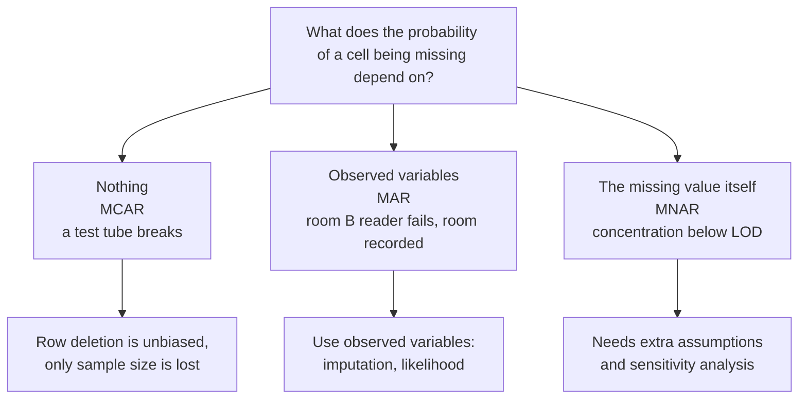

A single line of `na.omit()` can wipe an entire group of observations out of an analysis without raising a single error. This second article in the series *Introduction to Data Analysis with R* uses the BigMart retail dataset to diagnose the missing data mechanism (MCAR, MAR, MNAR) before choosing how to handle it, then compares row deletion, mean imputation, key-based filling and multiple imputation with `mice` in an experiment that masks known values and repeats 200 times. Two technical sections and a checklist for biology lab data close the article.

## 1. Introduction: missing data is not a typo

In the lab, an empty cell in a data sheet is rarely random. An ELISA well has an air bubble, so the reader returns nothing; a fish embryo dies before the heart-rate measurement; a concentration falls below the detection limit, so the instrument reports "< LOD". Each empty cell has a different cause, and each cause calls for a different treatment. An embryo that died before measurement was most likely the weakest one: dropping it makes the remaining group look healthier than it really is.

That is why handling missing data is an **analytical decision**, not a technical clean-up step. The two most common approaches among R beginners are deleting every row that contains an NA with `na.omit()` and replacing NAs with the mean; on the same dataset, they can give two different answers. This article asks: which approach is right, under what conditions, and how do you know which conditions you are in?

The running example is the BigMart dataset, released for a sales-prediction practice problem on the Analytics Vidhya platform (Analytics Vidhya, n.d.): 1,559 products sold across 10 stores, split into a training set (8,523 rows × 12 columns, including the sales column `Item_Outlet_Sales`) and a test set (5,681 rows × 11 columns, without sales). Product variables include the product code (`Item_Identifier`), weight (`Item_Weight`), fat content, the share of display area (`Item_Visibility`), product category and list price (`Item_MRP`); store variables include the store code, year of establishment, size, location tier and store type. It is unclear whether the data are real or were constructed for the competition, so any interpretation of "why a store did not record something" is a hypothesis. The article does not republish the raw data; it shows only summary figures and its own plots.

Section 2 defines the three missing data mechanisms, Section 3 runs the diagnosis, Sections 4–5 present and compare four handling methods, Sections 6–7 are two technical sections, and Section 8 is the checklist.

## 2. Rubin's three mechanisms: MCAR, MAR, MNAR

Rubin (1976) sorted missing data problems into three classes according to what the probability of a cell being missing depends on; the process that governs this probability is called the missing data mechanism (van Buuren, 2018, section 1.2).

**MCAR** (missing completely at random): the probability of being missing is the same for every observation, meaning the cause of missingness is unrelated to the data. Examples: a test tube drops and breaks, or the scale's battery dies halfway through weighing the mice. Beyond the loss of information, MCAR causes no further trouble, but van Buuren (2018) notes that it is often unrealistic for real data.

**MAR** (missing at random): the probability of being missing is the same only **within groups defined by the observed data**. Example: the plate reader in room B breaks down for a week, and the data sheet records which samples were measured in room B; across the whole sheet, room-B samples are missing more often, but within each room, missingness is random. The name is misleading: MAR is not "random" in the everyday sense, but a condition stating that the information explaining missingness is already in the data.

**MNAR** (missing not at random): the probability of being missing depends on the missing value itself or on information that is not in the table. The classic example is a concentration below the limit of detection (LOD): the value is missing precisely because it is small. The embryo that died before measurement is also close to MNAR if no variable records how weak the embryo was.



*Figure 1. The three missing data mechanisms and their consequences for handling.*

When data are MCAR, analysis of complete cases (complete-case analysis, or listwise deletion) gives unbiased estimates of means, variances and regression coefficients; the price is larger standard errors because of the lost sample size (van Buuren, 2018, section 1.3.1). When data are not MCAR, row deletion can severely bias means, regression coefficients and correlations, and the bias grows with the difference between the observed and the missing groups (Little & Rubin, 2019; Schafer & Graham, 2002). Under MAR, methods that use information from observed variables (multiple imputation, maximum likelihood) can give valid results; Rubin (1976) called the situation in which the missing data mechanism can be ignored for inference *ignorable*. Under MNAR, no method fixes the problem on its own without additional assumptions about the process that causes missingness.

Data can only help **reject** MCAR, for example with Little's (1988) test. MAR and MNAR differ in values that were never observed, so no test on the available data can tell them apart; the argument has to rest on knowledge of the data collection process: who measured, with what, and why cells were left blank.

## 3. Diagnosing missing data in BigMart

The diagnosis takes only a few lines of base R and `data.table`. The first step is to combine the training and test sets to see all 14,204 rows. The test set has no sales column, so that column must be created with NA values before combining; otherwise `rbind()` throws an error because the two tables have different numbers of columns.

```r
library(data.table)
train <- fread("Train_UWu5bXk.csv")      # relative path to the project folder
test  <- fread("Test_u94Q5KV.csv")
test[, Item_Outlet_Sales := NA]          # test has no labels; without this line rbind() fails
combi <- rbind(train, test)              # 14204 rows
colSums(is.na(combi))                    # Item_Weight 2439, Item_Outlet_Sales 5681
sum(combi$Outlet_Size == "")             # 4016 empty cells that is.na() does not see
sum(combi$Item_Visibility == 0)          # 879
table(combi$Item_Fat_Content)            # 5 labels for 2 levels
```

`Item_Weight` is missing in 2,439 cells (17.2%); this is genuine missing data. `Item_Outlet_Sales` is missing in 5,681 cells, exactly the number of test rows: sales are blank **by design** of the prediction problem, not missing data. Lumping the two into one "missing rate" leads to wrong conclusions.

### 3.1. Hidden missingness: cells that `is.na()` does not count

`is.na()` counts only NA values. Three other BigMart columns contain forms of missingness or errors that carry no NA label (Table 1).

| Column | Form | Cells (train + test) | Counted by `is.na()`? |
| --- | --- | --- | --- |
| `Item_Weight` | NA | 2439 | yes |
| `Item_Outlet_Sales` | NA because test has no labels | 5681 | yes (but not truly missing) |
| `Outlet_Size` | empty string `""` | 4016 | no |
| `Item_Visibility` | zero | 879 | no |
| `Item_Fat_Content` | 5 labels for 2 levels | 900 inconsistent cells | no |

*Table 1. Missing and hidden-missing values by column.*

`Outlet_Size` has 4,016 empty strings, because both `fread()` and `read.csv()` read empty cells in a character column as `""` rather than NA. The fix is to declare this when reading the file:

```r
train2 <- fread("Train_UWu5bXk.csv", na.strings = c("", "NA"))
sum(is.na(train2$Outlet_Size))           # 2410 cells in train, now NA
```

`Item_Visibility` equals 0 in 879 rows. A product with sales can hardly have zero display area, so these are most likely missing values coded as 0; that is a hypothesis, and confirming it requires asking whoever created the data. In lab data, the equivalents are -99, 999 or 0 in a concentration column.

`Item_Fat_Content` has five labels for two levels: `Low Fat` (8,485), `Regular` (4,824), `LF` (522), `reg` (195) and `low fat` (178). This is an inconsistency, not missingness, but the two often surface together; tidy data principles (Wickham, 2014) help catch them early, and label standardization is covered in the article on [data cleaning](/en/blog/process-data-from-dirty-to-clean/).

### 3.2. The cross-tabulation that decides everything

The most important step is a single line: cross-tabulate missingness status against a grouping variable.

```r
table(combi$Outlet_Identifier, is.na(combi$Item_Weight))
```

The result changes the whole story. All 2,439 missing `Item_Weight` cells sit in exactly two stores: OUT019 (880/880 rows) and OUT027 (1,559/1,559 rows). The other eight stores have no missing cells at all. Likewise, `Outlet_Size` is blank for all of three stores: OUT010, OUT017 and OUT045. Figure 2 shows these "blocks" of missingness.


*Figure 2. Share of missing cells by store in three columns (train + test, 14,204 rows). Missing `Item_Weight` and `Outlet_Size` values cluster in blocks by store; zeros in `Item_Visibility` are spread evenly at 5–7% across all stores.*

Table 2 places the missing blocks alongside store characteristics.

| Store | Year opened | Type | Rows | % missing `Item_Weight` |
| --- | --- | --- | --- | --- |
| OUT010 | 1998 | Grocery Store | 925 | 0 |
| OUT013 | 1987 | Supermarket Type1 | 1553 | 0 |
| OUT017 | 2007 | Supermarket Type1 | 1543 | 0 |
| OUT018 | 2009 | Supermarket Type2 | 1546 | 0 |
| OUT019 | 1985 | Grocery Store | 880 | 100 |
| OUT027 | 1985 | Supermarket Type3 | 1559 | 100 |
| OUT035 | 2004 | Supermarket Type1 | 1550 | 0 |
| OUT045 | 2002 | Supermarket Type1 | 1548 | 0 |
| OUT046 | 1997 | Supermarket Type1 | 1550 | 0 |
| OUT049 | 1999 | Supermarket Type1 | 1550 | 0 |

*Table 2. The ten BigMart stores (train + test).*

The two stores missing weights both opened in 1985, the earliest in the dataset; their record-keeping systems may differ from those of newer stores, but the data are not enough to say so.

In contrast, missingness is unrelated to product characteristics: missing rates by `Item_Type` are uniform (15.6–18.6%), and the mean list price of complete and missing rows is nearly identical (141.0 vs. 140.9). But the mean sales of rows missing weight are clearly higher (2,483.7 vs. 2,118.6 in train), because OUT027 is the **only Supermarket Type3**, the store type with the highest mean sales (3,694.0, compared with 2,316.2 for Type1, 1,995.5 for Type2 and 339.8 for Grocery Store).

```r
tapply(is.na(combi$Item_Weight), combi$Item_Type, mean)        # 0.156 - 0.186
tapply(combi$Item_MRP, is.na(combi$Item_Weight), mean)         # 141.0 and 140.9
tapply(train$Item_Outlet_Sales, is.na(train$Item_Weight), mean) # 2118.6 and 2483.7
```

Diagnostic conclusion: `Item_Weight` is missing **by store**. Conditional on `Outlet_Identifier`, the probability of being missing is 0 or 1 and does not depend on weight, so the mechanism is close to MAR and certainly not MCAR. Because missing rows differ from complete rows in sales, deleting them would bias the sample.

<div class="callout callout-note">
<p class="callout-title">Little's MCAR test in R</p>

The `naniar` package (version 1.1.0) provides `mcar_test()`, which implements Little's (1988) test. On the training set with four numeric variables, the test statistic is 196 (df = 3, p < 0.001, 2 missing patterns), so MCAR is rejected.
```r
library(naniar)
mcar_test(train[, .(Item_Weight, Item_MRP, Item_Visibility, Item_Outlet_Sales)])
```
Failing to reject MCAR does not mean the data are MCAR, and rejecting MCAR does not tell you whether the data are MAR or MNAR. In BigMart, the cross-tabulation by store says more than a p-value.

</div>

## 4. Four handling methods and their R code

### 4.1. Row deletion (complete-case)

```r
cc <- na.omit(train)
nrow(cc)                                 # 7060 of 8523 rows
table(train$Outlet_Type)
table(cc$Outlet_Type)                    # no Supermarket Type3 left
```

`na.omit(train)` shrinks the training set from 8,523 to 7,060 rows (a 17.2% loss), but the percentage hides something more important: all 935 Supermarket Type3 rows vanish, and Grocery Store keeps only 555 of 1,083 rows. A model fitted on `cc` cannot estimate anything for the best-selling store type. Just as Schafer and Graham (2002) warn, when data are not MCAR, row deletion does not merely lose sample size; it changes the very population the analysis describes.

### 4.2. Replacing with the column mean or median

```r
w_mean <- replace(combi$Item_Weight, is.na(combi$Item_Weight),
                  mean(combi$Item_Weight, na.rm = TRUE))
c(sd(combi$Item_Weight, na.rm = TRUE), sd(w_mean))   # 4.65 and 4.23
```

It takes one line of code and keeps every row, but all 2,439 cells receive the same value, 12.79, so the standard deviation shrinks from 4.65 to 4.23. According to van Buuren (2018, section 1.3.3), mean imputation underestimates the variance, distorts relationships between variables, biases almost every estimate other than the mean, and biases the mean too when data are not MCAR. Donders et al. (2006) add that every single-imputation method yields standard errors that are too small, because it treats imputed values as if they were real measurements.

### 4.3. Group-wise filling: the mean by `Item_Identifier`

A common approach with BigMart is to replace each missing cell with the mean weight of the **same product code** in other stores. Because each product is sold in 7–10 stores, almost every product has a recorded weight in at least one place.

```r
w <- combi$Item_Weight
for (i in which(is.na(w))) {
  w[i] <- mean(w[combi$Item_Identifier == combi$Item_Identifier[i]], na.rm = TRUE)
}
sum(is.na(w))                            # 0
```

Using the training set alone, there are 4 products whose training rows all belong to the two stores with missing weights; `mean()` on an empty vector returns `NaN`, so 4 cells remain unfilled. Combining train and test first gives every product at least one observed weight.

But one question deserves an answer before calling this an "estimate": does a product's weight vary across stores?

```r
rng <- tapply(combi$Item_Weight, combi$Item_Identifier,
              function(x) diff(range(x, na.rm = TRUE)))
summary(rng)                             # every value is 0
```

The within-group range is 0 for all 1,559 products: weight is a **fixed attribute of the product code**, like the molecular weight of a compound. In other words, `Item_Weight` is functionally dependent on `Item_Identifier`, and by tidy data principles the variable belongs in a separate product table (Wickham, 2014). The "group mean" here is really a **lookup of the correct value**, that is, deterministic imputation based on a functional dependency, not an estimate. Understanding the structure of the data can be worth more than any algorithm.

### 4.4. Multiple imputation with `mice`

Multiple imputation (MI) creates several complete datasets, each filling the missing cells with values drawn at random from a predictive distribution, analyzes each one, then pools the results. The `mice` package does this with chained equations: each incomplete variable is imputed from a regression model on the other variables, over many iterations (van Buuren & Groothuis-Oudshoorn, 2011). For continuous variables, the `mice()` default is predictive mean matching (`pmm`) with 5 donors: for each missing cell, the algorithm finds the 5 complete cases with the closest predicted values and randomly takes the observed value of one of them (van Buuren, 2018, section 3.4), so it never imputes a negative weight. Results are pooled with Rubin's rules (Rubin, 1987) via `pool()`.

```r
library(mice)
dat <- train[, .(Item_Weight, Item_MRP, Item_Visibility,
                 Item_Type = factor(Item_Type), Outlet_Type = factor(Outlet_Type),
                 Item_Outlet_Sales)]
imp <- mice(dat, m = 5, method = "pmm", seed = 2026, printFlag = FALSE)
head(imp$loggedEvents, 2)                # mice drops the Supermarket Type3 dummy
fit <- with(imp, lm(Item_Outlet_Sales ~ Item_Weight + Item_MRP + Outlet_Type))
summary(pool(fit))[2:3, 1:3]
```

Two details stand out. First, only the training set is used, because test-set sales are NA by design. Second, `imp$loggedEvents` shows that `mice` automatically removes the dummy variable `Outlet_TypeSupermarket Type3` from the imputation model for `Item_Weight`: the Type3 group has no observed weights, so this variable is useless. This is exactly the problem the cross-tabulation in Section 3.2 revealed, this time in the form of an easily overlooked technical warning. The pooled model gives an `Item_Weight` coefficient of −0.85 (SE 2.76) and an `Item_MRP` coefficient of 15.56 (SE 0.20).

Before using MI in a thesis, read the practical guide by White et al. (2011) on building the imputation model, choosing the number of imputations and the method's limits, along with Sterne et al. (2009) on using and reporting MI in epidemiological and clinical research.

## 5. Experiment: masking known values and recovering them

With genuinely missing data, the true values are unknown, so methods cannot be compared. The solution is a simulation experiment: mask some cells whose true weight is known according to a predefined mechanism, apply each method, then compare against the truth. The experiment follows the ADEMP framework of Morris et al. (2019): Aims, Data-generating mechanisms, Estimands, Methods and Performance measures.

### 5.1. Methods following ADEMP

**Aims.** Compare methods for handling missing `Item_Weight` in terms of imputation accuracy and inferential bias, under three missing data mechanisms.

**Data and masking mechanisms.** The base data are 11,765 rows (train + test) with true weights, of which 7,060 training rows have sales. Three scenarios:

- **A (MCAR):** randomly mask 20% of rows (2,353 cells, about 1,410 in train).
- **B (by store):** mask all of two stores, OUT046 and OUT049 (3,100 cells, 1,860 in train), mimicking exactly the missingness pattern diagnosed in Section 3.
- **C (simulated MNAR):** the probability of masking rises with the weight itself, $P(\text{mask}) = \operatorname{logit}^{-1}(z - 1.6)$ where $z$ is standardized weight, about 1,500 cells in train. The heavier the product, the more likely it is to be missing.

**Estimands.** (i) The value of each masked cell; (ii) the standard deviation and mean of `Item_Weight`; (iii) the coefficients of `Item_Weight` and `Item_MRP` in the model `lm(Item_Outlet_Sales ~ Item_Weight + Item_MRP + Outlet_Type)`. Reference values are the results on the 7,060 training rows before masking: mean 12.858, SD 4.643, `Item_Weight` coefficient −0.467 (SE 2.768), `Item_MRP` coefficient 15.244 (SE 0.206).

**Methods.** Six approaches: row deletion (`na.omit`), mean replacement, median replacement, lookup by `Item_Identifier`, `mice` pmm (m = 5) with the predictors from Section 4.4, and `mice` pmm with an added auxiliary variable: the known weight of the same product in rows that were not masked.

**Performance measures.** RMSE on masked cells; SD after imputation; bias of the mean; the mean coefficient and standard error. Each scenario is repeated 200 times, with Monte Carlo standard errors (MCSE) (Morris et al., 2019). Versions: R 4.4.3, data.table 1.18.4, mice 3.19.0.

The core of a single iteration:

```r
library(data.table); library(mice)
train <- fread("Train_UWu5bXk.csv"); test <- fread("Test_u94Q5KV.csv")
test[, Item_Outlet_Sales := NA]
base <- rbind(train, test)[!is.na(Item_Weight)]          # 11765 rows with true weights
base[, `:=`(Item_Type = factor(Item_Type), Outlet_Type = factor(Outlet_Type))]
truth <- base$Item_Weight
tr    <- !is.na(base$Item_Outlet_Sales)                    # 7060 training rows
fml   <- Item_Outlet_Sales ~ Item_Weight + Item_MRP + Outlet_Type

make_mask <- function(scenario) {
  n <- nrow(base)
  switch(scenario,
    A = seq_len(n) %in% sample(n, round(0.2 * n)),                 # MCAR 20%
    B = base$Outlet_Identifier %in% c("OUT046", "OUT049"),         # two whole stores
    C = runif(n) < plogis(as.numeric(scale(truth)) - 1.6))         # MNAR: heavier, more often missing
}

run_once <- function(scenario) {
  m <- make_mask(scenario)
  w <- replace(truth, m, NA)
  look <- ave(w, base$Item_Identifier, FUN = function(x) mean(x, na.rm = TRUE))
  look[is.nan(look)] <- NA                                  # product masked in every row
  filled <- list(mean   = replace(w, m, mean(w, na.rm = TRUE)),
                 median = replace(w, m, median(w, na.rm = TRUE)),
                 item   = replace(w, m, look[m]))
  dat <- base[tr, .(Item_Weight = w[tr], Item_MRP, Item_Visibility,
                    Item_Type, Outlet_Type, Item_Outlet_Sales)]
  imp     <- mice(dat, m = 5, method = "pmm", printFlag = FALSE)
  imp_aux <- mice(cbind(dat, aux = look[tr]), m = 5, method = "pmm",
                  printFlag = FALSE, remove.collinear = FALSE, eps = 0)
  list(mask = m[tr], filled = lapply(filled, `[`, tr), imp = imp, imp_aux = imp_aux,
       cc = lm(fml, data = base[tr][!m[tr]]))
}

set.seed(2026)
r <- run_once("A")
sqrt(mean((r$filled$mean[r$mask] - truth[tr][r$mask])^2))  # RMSE of mean imputation
summary(pool(with(r$imp, lm(Item_Outlet_Sales ~ Item_Weight + Item_MRP + Outlet_Type))))[2, 1:3]
```

`set.seed()` goes before every random call (`sample()`, `runif()`, `mice()`); without it, nobody can reproduce the numbers in the report.

### 5.2. Results

| Scenario | Method | RMSE | SD after imputation | Bias of the mean | `Item_Weight` coefficient (SE) | n fitted |
| --- | --- | --- | --- | --- | --- | --- |
| A | na.omit | — | 4.64 | 0.00 | −0.62 (3.09) | 5650 |
| A | mean | 4.64 | 4.16 | −0.01 | −0.63 (3.09) | 7060 |
| A | product lookup | 0.00 | 4.64 | 0.00 | −0.47 (2.77) | 7060 |
| A | mice pmm | 6.49 | 4.64 | 0.00 | −0.70 (3.15) | 7060 |
| A | mice pmm + auxiliary | 0.01 | 4.64 | 0.00 | −0.47 (2.77) | 7060 |
| B | na.omit | — | 4.64 | −0.01 | 2.96 (3.19) | 5200 |
| B | mean | 4.67 | 3.98 | −0.03 | 2.85 (3.23) | 7060 |
| B | product lookup | 0.00 | 4.64 | 0.00 | −0.47 (2.77) | 7060 |
| B | mice pmm | 6.49 | 4.62 | −0.03 | 2.81 (3.33) | 7060 |
| B | mice pmm + auxiliary | 0.00 | 4.64 | 0.00 | −0.47 (2.77) | 7060 |
| C | na.omit | — | 4.43 | −0.87 | 0.57 (3.27) | 5564 |
| C | mean | 5.72 | 3.93 | −0.88 | 0.58 (3.27) | 7060 |
| C | product lookup | 0.00 | 4.64 | −0.01 | −0.45 (2.77) | 7055 |
| C | mice pmm | 7.14 | 4.43 | −0.86 | 0.43 (3.33) | 7060 |
| C | mice pmm + auxiliary | 0.40 | 4.64 | −0.01 | −0.46 (2.77) | 7060 |

*Table 3. Experiment results, averaged over 200 iterations per scenario. Reference values: SD 4.643; mean 12.858; `Item_Weight` coefficient −0.467 (SE 2.768). "Bias of the mean" is the mean of `Item_Weight` after handling minus the reference value. In scenario C, an average of 5 cells per iteration belong to products masked in every row, so the lookup method leaves them blank and n fitted drops to 7,055.*

The MCSEs of RMSE and of the bias of the mean are all below 0.005; that of the `Item_Weight` coefficient is about 0.10–0.12 in scenarios A and C. Scenario B always masks the same two stores, so the deterministic methods give identical results in all 200 iterations. Median replacement gives results almost identical to mean replacement (RMSE 4.65 / 4.68 / 6.13 in A / B / C), so it is left out of the table.

Four results stand out: (1) product lookup recovers the values exactly in all three scenarios, including MNAR; (2) mean replacement shrinks the SD from 4.64 to 3.93–4.16 because more than 1,400 cells pile up at a single value (Figure 3); (3) `mice` pmm has the highest RMSE (6.49–7.14) but keeps the SD close to the truth in A and B; (4) with the known weight of the same product added as an auxiliary variable, `mice` recovers the values almost exactly.


*Figure 3. Distribution of `Item_Weight` in the masked cells of one scenario-A iteration (1,412 cells): true values, after mean replacement and after mice pmm (first imputed dataset). The middle panel has a different y-axis from the other two.*


*Figure 4. `Item_Weight` coefficient (mean of 200 iterations) ± 1.96 × SE by method and scenario. The dashed line is the reference value on the complete data.*

### 5.3. Discussion

**Why is the RMSE of pmm so high?** The predictors in the imputation model explain almost nothing about weight (the correlation between weight and sales is only r = 0.014), so pmm essentially takes the weight of a nearly random donor. The difference between two independent values from the same distribution has standard deviation $\sqrt{2}\,\sigma$, so the expected RMSE is about $\sqrt{2} \times 4.64 \approx 6.57$, close to the observed 6.49; this is a simple argument to make sense of the number, not a theorem from the literature. The key point: MI does not aim to bring each cell as close as possible to its true value, but to support valid inference, meaning unbiased estimates and confidence intervals with correct coverage (van Buuren, 2018, section 2.5). Mean replacement wins on RMSE precisely because it places every cell at the center of the distribution, which is also why it wrecks the variance. Judging MI by per-cell RMSE is using the wrong yardstick.

**Scenario B: the benefit of keeping rows.** When two whole stores are masked, every method that ignores product codes pushes the `Item_Weight` coefficient up to about 2.8–3.0, roughly one SE off: information about the weight–sales relationship now comes from only eight stores, and the weak predictors add nothing. The difference lies in the other coefficients: row deletion keeps 5,200 rows and the `Item_MRP` coefficient shifts from 15.24 to 14.91 (SE 0.24), while the imputation methods keep all 7,060 rows and leave `Item_MRP` nearly intact. The incomplete variable is not the only one affected when you delete rows.

**Scenario C: no MAR method fixes MNAR on its own.** When heavier products are more likely to be missing, the mean weight is pulled down by about 0.86–1.00 under row deletion, mean, median and even `mice` pmm, because pmm finds donors based on the observed variables, and those variables carry no information about weight. Only the two methods that use the product code escape the bias.

**The imputation model must contain variables that explain the missing values.** Same algorithm, one informative variable added, and RMSE drops from 6.5 to nearly 0. In biological data, an auxiliary variable might be the same individual's value at a previous measurement, a parallel measurement, or batch and instrument information. Choosing variables for the imputation model is central to the guidance of White et al. (2011).

**On standard errors.** The SE of the `Item_Weight` coefficient after mean replacement (3.09–3.27) is actually larger than the reference SE, because the predictor varies less. This does not contradict the observation that single imputation gives SEs that are too small (Donders et al., 2006): that observation concerns the uncertainty of the imputed values themselves, which mean replacement ignores entirely and MI incorporates through Rubin's rules (the SE of pmm is larger than that of mean replacement in every scenario). Because the weight coefficient is near 0 with a large SE, all coefficient differences in Table 3 fall within about one SE; assessing confidence interval coverage would require a more sensitive estimand.

**Limitations.** One dataset, one incomplete variable, a simulated MNAR mechanism, and regression as the only yardstick. The "lookup wins outright" result depends on weight being fixed by product code, a rare feature but always worth checking.

## 6. Recoding pitfalls: factors, `match()` and `cut()`

Recoding variables is where missing or wrong values appear without any error message. The examples below use R's built-in `mtcars` dataset (`am` = 0 is automatic, 1 is manual; 19 automatic cars, 13 manual).

**Factor to numeric must go through character.** A factor stores level codes (1, 2, 3…) in alphabetical order of the labels, so coercing it directly to numeric returns the level codes, not the values:

```r
f <- factor(c("10", "5", "20"))
levels(f)                        # "10" "20" "5"
as.numeric(f)                    # 1 3 2   (level codes)
as.numeric(as.character(f))      # 10 5 20 (correct values)
as.numeric(c("12.5", "n/a", "7"))  # 12.5 NA 7, with the warning NAs introduced by coercion
```

The last line is another source of hidden NAs: the label "n/a" becomes NA with only a warning, which is easy to miss when running a whole script.

**Five ways to recode `am` into labels.** The approaches below give the same frequency table when written correctly, but they differ in data type and in where they tend to go wrong.

```r
df <- mtcars
df$trans  <- factor(df$am, levels = c(0, 1), labels = c("Automatic", "Manual"))
df$trans2 <- factor(c("Automatic", "Manual"))[match(df$am, c(0, 1))]
df$trans3 <- replace(df$am, df$am == 1, "Manual")      # column becomes character: "0" and "Manual"
df$trans3 <- replace(df$trans3, df$am == 0, "Automatic")
table(df$trans, useNA = "ifany")                        # Automatic 19, Manual 13
identical(as.character(df$trans), df$trans3)            # TRUE
```

| Approach | Result | Pitfall |
| --- | --- | --- |
| `factor(levels, labels)` | factor, 19 / 13 | safest; unmatched levels become NA |
| `match()` + indexing | factor, 19 / 13 | `match(1, c("0","1"))` still returns 2 thanks to implicit coercion; write `c(0, 1)` |
| `replace()` on one level | character, `"0"` / `"Manual"` | the whole column becomes strings, `"0"` left behind |
| `replace()` on both levels | character, 19 / 13 | correct, but strings |
| conditional assignment | character | rows matching no condition stay NA |

*Table 4. Five ways to recode `am` in `mtcars`.*

**Conditional assignment leaves NAs behind.** When splitting horsepower `hp` into three groups with conditional assignments, forgetting one condition leaves NA in every row of that group:

```r
q <- rep(NA_character_, nrow(mtcars))
q[mtcars$hp < 96.5] <- "L"
q[mtcars$hp > 180]  <- "H"        # forgot group M
table(q, useNA = "ifany")         # H 7, L 8, <NA> 17
```

A habit worth building: always check recoding results with `table(..., useNA = "ifany")`.

**`cut()` and where the breakpoints fall.** `cut()` defaults to `right = TRUE`, meaning intervals are closed on the right: a value exactly equal to the 96.5 breakpoint falls into the lower group. The conditional assignment `96.5 <= hp & hp <= 180`, by contrast, puts 96.5 in group M.

```r
x <- c(96.5, 180, 180.5)
cut(x, breaks = c(-Inf, 96.5, 180, Inf), labels = c("L", "M", "H"))               # L M H
cut(x, breaks = c(-Inf, 96.5, 180, Inf), labels = c("L", "M", "H"), right = FALSE) # M H H
```

In `mtcars`, no car has `hp` exactly 96.5, so the two approaches give the same table (L 8, M 17, H 7), but the group definitions differ, and with other data they will give different results. State whether intervals are open or closed when reporting.

**Discretizing has a cost.** Splitting a continuous variable into L/M/H helps description, but when the groups enter an analysis, the information within each group is thrown away: cars with 97 and 180 horsepower are treated as the same. Altman and Royston (2006) analyze the cost of dichotomizing continuous variables, and Royston et al. (2006) conclude that dichotomizing predictors in multiple regression is a bad idea. Use `cut()` for descriptive tables and charts ([article 1 of the series](/en/blog/trinh-bay-va-mo-ta-du-lieu-thuc-hanh-r/)) and keep variables continuous in models.

## 7. Loops or vectorization?

The `for` loop that fills weights in Section 4.3 is correct, but it can be written more compactly and run faster with vectorization. The three approaches below give identical results (`all.equal` returns `TRUE`, no NAs left):

```r
w0 <- combi$Item_Weight; id <- combi$Item_Identifier
f_loop  <- function(w, id) {
  for (i in which(is.na(w))) w[i] <- mean(w[id == id[i]], na.rm = TRUE)
  w
}
f_ave   <- function(w, id) {
  m <- ave(w, id, FUN = function(x) mean(x, na.rm = TRUE))
  w[is.na(w)] <- m[is.na(w)]
  w
}
f_match <- function(w, id) {
  lookup <- tapply(w, id, mean, na.rm = TRUE)            # lookup table: one value per product
  miss <- is.na(w)
  w[miss] <- lookup[match(id[miss], names(lookup))]
  w
}
all.equal(f_loop(w0, id), f_ave(w0, id))                 # TRUE
all.equal(f_loop(w0, id), as.numeric(f_match(w0, id)))   # TRUE
median(replicate(20, system.time(f_loop(w0, id))["elapsed"]))
```

| Approach | Time (median of 20 runs) | Relative to the `for` loop |
| --- | --- | --- |
| `for` loop | 0.389 s | 1× |
| `ave()` | 0.016 s | about 24× faster |
| `tapply()` + `match()` | 0.011 s | about 35× faster |

*Table 5. Time to fill 2,439 cells in 14,204 rows (R 4.4.3, one personal computer; absolute numbers vary by machine, the ratios are what matter).*

The loop is slow here because each iteration compares `id == id[i]` across all 14,204 rows, about 2,439 × 14,204 ≈ 35 million comparisons in total. `ave()` and `tapply()` split the groups once, and `match()` looks up the table once for all missing cells; the third approach also expresses the true nature of the problem: weight is an attribute of the product code.

Two smaller vectorization examples. The sum $\sum (x_i^2 + y_i)$ needs only `sum(x^2 + y)` instead of an accumulating loop; on two 10-element vectors, both approaches give 585. A function computing $\sum x_i^{\,i}$ with a loop has a pitfall worth remembering:

```r
sum_pow_old <- function(x) { total <- 0; for (i in 1:length(x)) total <- total + x[i]^i; total }
sum_pow     <- function(x) { total <- 0; for (i in seq_along(x)) total <- total + x[i]^i; total }
sum_pow(c(2, 3, 4, 5))           # 700
sum(c(2, 3, 4, 5)^seq_along(c(2, 3, 4, 5)))  # 700, vectorized version
1:length(numeric(0))             # 1 0
sum_pow_old(numeric(0))          # numeric(0), not 0
sum_pow(numeric(0))              # 0
```

When `x` is empty, `1:length(x)` is `1:0`, so the loop runs twice, with `i = 1` and then `i = 0`, producing NA and then an empty vector. `seq_along(x)` returns an empty vector and the loop does not run. Similarly, `mean(numeric(0))` returns `NaN`, which is exactly the source of the 4 unfilled cells in Section 4.3 when only the training set is used.

Vectorization should not be idolized: for beginners, a `for` loop is easier to read and check, and 0.4 seconds is no problem for a lab report. Correct first, clear second, fast last, and always compare the fast version against the slow one with `all.equal()`.

## 8. Conclusion and a missing data checklist

The message of this article fits into one question: **where are the data missing, and why?** In BigMart, a one-line cross-tabulation shows that weights are missing by store, that `na.omit()` would delete the entire best-selling supermarket type, and that the "group mean" is really a lookup. The experiment shows that no method wins on every measure, and that no method built on the MAR assumption fixes MNAR on its own. What decides the outcome is the information you put in, not the name of the algorithm.

The checklist below applies to biology lab data as much as to retail data:

1. **Read data with appropriate `na.strings`** (`c("", "NA")`, `"-99"`, `"n/a"`), then look for hidden missingness: implausible zeros, empty strings, odd labels, "< LOD".
2. **Separate genuinely missing values from blanks by design** (test-set labels, variables that do not apply to the control group).
3. **Cross-tabulate missingness against every grouping variable**: batch, instrument, measurement date, operator, plate position.
4. **Ask the people who collected the data why values are missing** and record your MCAR, MAR or MNAR assumption; if MNAR is possible, plan a sensitivity analysis.
5. **Check for functional dependencies**: is the incomplete variable fixed by a key (product code, individual ID, sample ID)? If so, look it up first.
6. **Choose the method by mechanism**: delete rows only when close to MCAR and few rows are lost; avoid mean replacement for inference; use MI when MAR is plausible, with variables that explain both the missingness and the missing values in the imputation model (White et al., 2011), and read warnings such as `imp$loggedEvents`.
7. **Report fully**: row counts before and after, the method, the number of imputations, the variables in the imputation model, package versions and the seed (Sterne et al., 2009); use relative paths instead of `setwd()` to an absolute folder (Wilson et al., 2017; see also reproducible workflows).

The next articles in the series keep practicing these operations: [basic R exercises](/en/blog/bai-tap-r-co-ban-buoi-5-buoi-6-va-buoi-7/), regression on the Boston housing data and descriptive statistics with medians and outliers.

## References

Altman, D. G., & Royston, P. (2006). The cost of dichotomising continuous variables. *BMJ, 332*(7549), 1080. https://doi.org/10.1136/bmj.332.7549.1080

Analytics Vidhya. (n.d.). *Big Mart sales prediction* [Data set and practice problem]. https://www.analyticsvidhya.com/datahack/contest/big-mart-sales-prediction

Donders, A. R. T., van der Heijden, G. J. M. G., Stijnen, T., & Moons, K. G. M. (2006). Review: A gentle introduction to imputation of missing values. *Journal of Clinical Epidemiology, 59*(10), 1087–1091. https://doi.org/10.1016/j.jclinepi.2006.01.014

Little, R. J. A. (1988). A test of missing completely at random for multivariate data with missing values. *Journal of the American Statistical Association, 83*(404), 1198–1202. https://doi.org/10.1080/01621459.1988.10478722

Little, R. J. A., & Rubin, D. B. (2019). *Statistical analysis with missing data* (3rd ed.). Wiley. https://doi.org/10.1002/9781119482260

Morris, T. P., White, I. R., & Crowther, M. J. (2019). Using simulation studies to evaluate statistical methods. *Statistics in Medicine, 38*(11), 2074–2102. https://doi.org/10.1002/sim.8086

Royston, P., Altman, D. G., & Sauerbrei, W. (2006). Dichotomizing continuous predictors in multiple regression: A bad idea. *Statistics in Medicine, 25*(1), 127–141. https://doi.org/10.1002/sim.2331

Rubin, D. B. (1976). Inference and missing data. *Biometrika, 63*(3), 581–592. https://doi.org/10.1093/biomet/63.3.581

Rubin, D. B. (1987). *Multiple imputation for nonresponse in surveys*. Wiley. https://doi.org/10.1002/9780470316696

Schafer, J. L., & Graham, J. W. (2002). Missing data: Our view of the state of the art. *Psychological Methods, 7*(2), 147–177. https://doi.org/10.1037/1082-989X.7.2.147

Sterne, J. A. C., White, I. R., Carlin, J. B., Spratt, M., Royston, P., Kenward, M. G., Wood, A. M., & Carpenter, J. R. (2009). Multiple imputation for missing data in epidemiological and clinical research: Potential and pitfalls. *BMJ, 338*, b2393. https://doi.org/10.1136/bmj.b2393

van Buuren, S. (2018). *Flexible imputation of missing data* (2nd ed.). Chapman and Hall/CRC. https://doi.org/10.1201/9780429492259 (online edition: https://stefvanbuuren.name/fimd/)

van Buuren, S., & Groothuis-Oudshoorn, K. (2011). mice: Multivariate imputation by chained equations in R. *Journal of Statistical Software, 45*(3), 1–67. https://doi.org/10.18637/jss.v045.i03

White, I. R., Royston, P., & Wood, A. M. (2011). Multiple imputation using chained equations: Issues and guidance for practice. *Statistics in Medicine, 30*(4), 377–399. https://doi.org/10.1002/sim.4067

Wickham, H. (2014). Tidy data. *Journal of Statistical Software, 59*(10), 1–23. https://doi.org/10.18637/jss.v059.i10

Wilson, G., Bryan, J., Cranston, K., Kitzes, J., Nederbragt, L., & Teal, T. K. (2017). Good enough practices in scientific computing. *PLOS Computational Biology, 13*(6), e1005510. https://doi.org/10.1371/journal.pcbi.1005510
