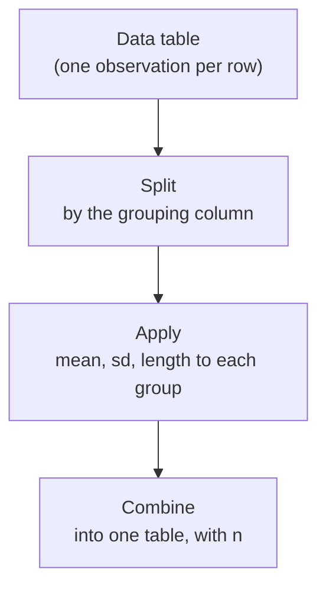

The same 20 numbers in R's `sleep` dataset can give p = 0.079 or p = 0.003, depending on whether you treat them as two groups of people or as ten people measured twice, and the right answer is already printed on the `?sleep` help page. This third article in the *Introduction to Data Analysis with R* series traces the origins of several familiar built-in datasets and one WHO data table, shows how provenance dictates the analysis, and then replaces group-by-group `for` loops with `tapply()`, `aggregate()` and `split()`. A six-step checklist closes the article.

## 1. Introduction: built-in data still has a history

The `datasets` package ships with every R installation. Because the data is already sitting in memory, learners tend to treat it as a "neutral" table of numbers for practicing syntax. In reality, each dataset is the product of a real experiment or survey with its own design: two measurements on the same person, the same chick weighed 12 times, or each chick randomly assigned to one feed and weighed once. That design determines which calculations are valid.

Every dataset in the `datasets` package has a help page (type `?sleep`) with **Description**, **Format**, **Details** and **Source** sections (R Core Team, 2025). The Source section is the data's provenance record; the Details section often states what you need to know before computing anything. Table 1 summarizes the records of the seven datasets used in this article, taken from the help pages of the `datasets` and `Stat2Data` packages (Cannon et al., 2019).

**Table 1.** Records of seven datasets according to their R help pages

| Dataset | Size | Unit of observation | Source given in help | Design |
| --- | --- | --- | --- | --- |
| `sleep` | 20 rows, 3 variables | one measurement on one patient | Cushny & Peebles (1905); Student (1908) | paired: 10 people, each given 2 drugs |
| `iris` | 150 rows, 5 variables | one flower | Fisher (1936); data collected by Edgar Anderson | observational, 50 flowers per species |
| `ChickWeight` | 578 rows, 4 variables | one weighing of one chick | Crowder & Hand (1990); Hand & Crowder (1996); Pinheiro & Bates (2000) | repeated measures: 50 chicks, 4 diets, some chicks lost partway through |
| `chickwts` | 71 rows, 2 variables | one chick | "Anonymous (1948) Biometrika 35, 214" | randomized, 6 feed types, weighed once |
| `AirPassengers` | 144 months | one month | Box, Jenkins and Reinsel, "Series G" | time series 1949–1960 |
| `BirdNest` | 84 rows, 12 variables | one bird species | project by Amy R. Moore, Grinnell College (1999) | compiled from the literature |
| `AHCAvote2017` | 430 rows, 11 variables | one representative | FiveThirtyEight, New York Times | observational |

Each dataset is treated as a case: origin, the usual summary, a reanalysis that respects the design, and the lesson. The three main problems are a paired design treated as two independent groups (Section 2), repeated-measures data with dropouts (Section 4), and missing values replaced by the median before grouping (Section 6); the technique running through all of them is split-apply-combine (Section 5). All numbers were computed with R 4.4.3.

## 2. sleep: the data behind the first t-test, and why it must be paired

### 2.1. Origin

In 1905, Cushny and Peebles published a trial of the sleep-inducing effects of the optical isomers of hyoscine in *The Journal of Physiology* (Cushny & Peebles, 1905). Three years later, William Sealy Gosset, writing as "Student," reused their numbers as an example in "The probable error of a mean" in *Biometrika* (Student, 1908), the paper that laid the foundation for the t distribution. Zabell (2008) revisited that paper a century later. Senn and Richardson (1994) reanalyzed what they called "the first t-test"; according to their abstract, the data from this *within-patient* trial (comparisons made within the same patient) were misquoted by both Student and Fisher.

The `?sleep` page describes the data as the effect of two soporific drugs (extra hours of sleep compared with control) on **10 patients**. The table has three columns: `extra` (extra hours of sleep), `group` (the drug given) and `ID` (patient ID). The Details section warns plainly that the variable name `group` may be misleading: these are measurements on 10 people, not two groups (R Core Team, 2025).

### 2.2. The usual summary and its problem

The quickest summary is the mean by `group`: drug 1 adds 0.75 hours, drug 2 adds 2.33 hours, a difference of 1.58 hours. If you look only at the `group` column, the next step is an independent two-sample t-test, and the `ID` column, along with the entire paired structure, is forgotten.

```r
with(sleep, tapply(extra, group, mean))
#    1    2
# 0.75 2.33

t.test(extra ~ group, data = sleep)              # Welch, treats them as 2 independent groups
x1 <- sleep$extra[sleep$group == 1]
x2 <- sleep$extra[sleep$group == 2]
t.test(x1, x2, paired = TRUE)                    # paired by patient
cor(x1, x2)                                      # 0.795
```

Pairing `x1` with `x2` by position is only correct when both vectors list patients in the same order; that holds for `sleep`, but a safer approach appears at the end of this section.

### 2.3. Reanalysis

Table 2 puts three t-tests side by side: the first two treat the 20 measurements as two independent samples, the third uses the actual design.

**Table 2.** Three ways to test the difference between drug 1 and drug 2 in `sleep`

| Test | t | df | p | 95% CI of the difference (hours) |
| --- | --- | --- | --- | --- |
| Welch (independent, unequal variances) | −1.861 | 17.78 | 0.0794 | −3.37 to 0.21 |
| Student (independent, equal variances) | −1.861 | 18 | 0.0792 | — |
| **Paired** | **−4.062** | **9** | **0.0028** | **−2.46 to −0.70** |

The point estimate of the difference is identical in every case: −1.58 hours. The difference lies in the standard error. For the independent (Welch) t-test, the standard error is computed from each group's variance:

$$SE_{\text{independent}} = \sqrt{\frac{s_1^2}{n_1} + \frac{s_2^2}{n_2}} = \sqrt{\frac{1.789^2}{10} + \frac{2.002^2}{10}} \approx 0.849$$

For the paired t-test, you compute the difference $d_i = x_{2i} - x_{1i}$ for each person and then run a one-sample t-test on the 10 differences:

$$t = \frac{\bar d}{s_d / \sqrt{n}} = \frac{1.58}{1.230 / \sqrt{10}} \approx 4.06$$

Why is $s_d$ so much smaller? The variance of a difference between two variables is $\operatorname{Var}(X_2 - X_1) = \sigma_1^2 + \sigma_2^2 - 2\rho\,\sigma_1\sigma_2$. Two measurements on the same person are very strongly correlated ($r = 0.795$): someone who sleeps much longer on drug 1 also tends to sleep much longer on drug 2. Plugging in the numbers, $1.789^2 + 2.002^2 - 2 \times 0.795 \times 1.789 \times 2.002 \approx 1.51$, so $s_d \approx 1.23$. The term $-2\rho\sigma_1\sigma_2$ is the between-subject variability that the paired design removes; the independent t-test does not know which two measurements belong to the same person, so it leaves that variability in the error.


**Figure 1.** The `sleep` data viewed according to its design. (a) Each line connects one patient's extra hours of sleep on drug 1 and drug 2. (b) The within-person differences: 9 of 10 people slept longer on drug 2, and the remaining person showed no change. Panel (b) is adapted from the example in `?sleep`.

Values across patients range from −1.6 to 5.5 hours, so the two "clouds" of points overlap, yet almost every line in Figure 1a slopes upward; the differences cluster around 1.3 hours (Figure 1b).

The safe way to pair is to reshape the table to wide format by `ID`, so that each row is one patient:

```r
sleep2 <- reshape(sleep, direction = "wide", idvar = "ID", timevar = "group")
head(sleep2, 3)
#   ID extra.1 extra.2
# 1  1     0.7     1.9
# 2  2    -1.6     0.8
# 3  3    -0.2     1.1
with(sleep2, t.test(extra.1, extra.2, paired = TRUE))$p.value   # 0.00283
```

### 2.4. Lesson

A design in which each person serves as their own control is used precisely because it removes variability between individuals. Analyzing it as two independent groups wastes exactly that information, and here it changes the conclusion from "a clear difference" to "not enough evidence." The telltale sign of a paired design: an identifier column (`ID`, `Chick`, `Subject`) that repeats across the levels of the grouping variable. Hypothesis testing in general is covered in more depth in the article on statistical hypothesis testing.

## 3. iris: Anderson's data, Fisher's paper, and the name of a journal

### 3.1. Two people, two roles

`iris` contains 150 flowers from three species, *Iris setosa*, *I. versicolor* and *I. virginica*, 50 flowers each, with the length and width of the sepals and petals of each flower measured in cm. It is often called "Fisher's iris data," but the `?iris` page is titled *Edgar Anderson's Iris Data* and states that the data were collected by the botanist Edgar Anderson; the help page cites Anderson's 1935 paper in the *Bulletin of the American Iris Society* (R Core Team, 2025). Ronald Fisher used those measurements in his 1936 paper "The use of multiple measurements in taxonomic problems," which introduced linear discriminant analysis (Fisher, 1936).

The Examples section of `?iris` restates Fisher's original research question: whether *I. versicolor*, judged by the combined measurements, differs from *I. setosa* twice as much as it differs from *I. virginica*. That is a genuine taxonomic question, not just data for drawing charts.

### 3.2. Versions of the data

Data copied over many decades may no longer match the original: Bezdek et al. (1999) showed that the versions of iris circulating in the literature and in software are not all identical. So state which version you used, from which package and which version; `sessionInfo()` and `citation()` do that in one line.

### 3.3. The journal's context

Fisher's 1936 paper appeared in the *Annals of Eugenics*, a journal whose very name tied it to the early twentieth-century eugenics movement. Fisher was one of the founders of modern statistics and population genetics and also held pro-eugenics views; Bodmer et al. (2021), a group of geneticists and statisticians, wrote a dedicated paper in *Heredity* discussing his views on eugenics and race. This article does not pass judgment on Fisher as a person; it is simply worth knowing the context in which the data you use first appeared.

### 3.4. Summarizing by species

The mean petal length (`Petal.Length`) of all 150 flowers is 3.758 cm, but the three species differ enormously: setosa 1.462 cm (SD 0.174), versicolor 4.260 (SD 0.470), virginica 5.552 (SD 0.552). Instead of filtering three times, one line is enough:

```r
tapply(iris$Petal.Length, iris$Species, mean)
#     setosa versicolor  virginica
#      1.462      4.260      5.552
tapply(iris$Petal.Length, iris$Species, sd)
#     setosa versicolor  virginica
#  0.1736640  0.4699110  0.5518947
```

The overall mean represents none of the species, so data with a group structure should be summarized by group first. The `pairs(iris[1:4], col = iris$Species)` example on the help page shows setosa completely separated from the other two species.

## 4. ChickWeight and chickwts: two chick experiments, two designs

### 4.1. ChickWeight: repeated measures on the same chick

`ChickWeight` has 578 rows from an experiment on the effect of diet on early growth in chicks: they were weighed at hatching, every second day until day 20, and once more on day 21, on four protein diets. The help page lists three sources: Crowder and Hand (1990), *Analysis of Repeated Measures*, example 5.3; Hand and Crowder (1996), *Practical Longitudinal Data Analysis*, table A.2; and Pinheiro and Bates (2000). The dataset originally belonged to the `nlme` package (R Core Team, 2025). A detail few people notice: `Chick` is an ordered factor in which chicks on the same diet are placed next to each other in order of final weight, from lightest to heaviest.

The unit of observation is **one weighing**, not one chick: the 578 rows come from 50 chicks.

```r
table(ChickWeight$Diet[ChickWeight$Time == 0])    # number of chicks at hatching
#  1  2  3  4
# 20 10 10 10
table(ChickWeight$Diet[ChickWeight$Time == 21])   # number of chicks still measured on day 21
#  1  2  3  4
# 16 10 10  9

last <- aggregate(Time ~ Chick + Diet, data = ChickWeight, FUN = max)
subset(last, Time < 21)                            # chicks without a day-21 measurement
#    Chick Diet Time
# 1     18    1    2
# 2     16    1   12
# 3     15    1   14
# 8      8    1   20
# 41    44    4   18
```

Two things stand out immediately: the design is unbalanced (diet 1 has 20 chicks, the other diets 10 each), and 5 chicks have no measurement on day 21: chicks 18, 16, 15 and 8 on diet 1 stop at days 2, 12, 14 and 20; chick 44 on diet 4 stops at day 18. On day 0, the mean weight of the 50 chicks is 41.06 g (variance 1.28), so the groups start out almost identical.

### 4.2. The day-21 mean is the mean of whom?

The day-21 summary table (mean ± SD, g) reads: diet 1: 177.8 ± 58.7 (n = 16); diet 2: 214.7 ± 78.1 (n = 10); diet 3: 270.3 ± 71.6 (n = 10); diet 4: 238.6 ± 43.3 (n = 9). Drop the n column and you would never know that the diet 1 mean covers only 16 of the original 20 chicks.

Are the chicks that lost measurements similar to the rest? If lighter chicks are more likely to drop out, the mean of those remaining is biased upward, a form of survivorship bias. You can check this directly by comparing each dropout's last recorded weight with that of the chicks on the same diet weighed on the same day. The result: chick 18 (35 g on day 2, versus a mean of 47.9 g for the others), chick 16 (54 g versus 111.6 g on day 12), chick 15 (68 g versus 126.6 g on day 14) and chick 44 (146 g versus 209.2 g on day 18) were each the **lightest** in their group at that point; chick 8 (125 g versus 173.2 g on day 20) ranked 5th from the bottom out of 17. The dataset does not record why measurements stopped, so you cannot say whether these chicks died or were removed for another reason, but the pattern is clear: the chicks that lost measurements were all among the light ones.

On diet 1, day 12, the mean of all chicks still being weighed is 108.5 g; counting only the 16 chicks with measurements through day 21, it is 114.4 g. The day-21 mean for diet 1 is therefore probably higher than what all 20 original chicks would have reached, and because this is the group that lost the most chicks, comparisons between diets on day 21 are not entirely fair.


**Figure 2.** Growth curves of the 50 chicks in `ChickWeight`, split by diet. Black lines ending in an x are chicks without a day-21 measurement; four of the five were the lightest in their group at their last weighing.

The appropriate approach is a model for repeated-measures data, such as a mixed-effects model, that uses every weighing rather than a day-21 slice (Pinheiro & Bates, 2000); that is beyond the scope of this article.

### 4.3. chickwts: randomized, weighed once

According to `?chickwts`, newly hatched chicks were **randomly allocated** to six groups, each given a different feed supplement, and weighed after six weeks: 71 chicks, one row each. The source given in the help page is "Anonymous (1948) *Biometrika* 35, 214" (R Core Team, 2025); a Crossref search finds no item in volume 35 starting on page 214, so the original paper has not yet been identified. The provenance of packaged data can also be hard to trace.

The overall mean weight is 261.3 g (variance 6095.5). By feed type (n; mean; SD, g): casein 12; 323.6; 64.4 · horsebean 10; 160.2; 38.6 · linseed 12; 218.8; 52.2 · meatmeal 11; 276.9; 64.9 · soybean 14; 246.4; 54.1 · sunflower 12; 328.9; 48.8.

Because each chick was measured once and randomly allocated, a one-way analysis of variance (one-way ANOVA) is a valid next step: F(5, 65) = 15.37, p ≈ 5.9 × 10⁻¹⁰.

```r
aggregate(weight ~ feed, data = chickwts,
          FUN = function(x) round(c(n = length(x), mean = mean(x), sd = sd(x)), 1))
summary(aov(weight ~ feed, data = chickwts))
#             Df Sum Sq Mean Sq F value   Pr(>F)
# feed         5 231129   46226   15.37 5.94e-10 ***
# Residuals   65 195556    3009
```

`ChickWeight` is repeated measures, with non-independent rows and dropouts; `chickwts` has one row per individual, randomly allocated. Both are "chick weight by diet," but the test that is valid for one is wrong for the other.

## 5. Method: from for loops to split-apply-combine

### 5.1. The concept

Every summary above follows the same template: split the data by group, apply a function to each group, then combine the results. Wickham (2011) called this the **split-apply-combine** strategy, a general way of thinking about most grouped-summary problems. The strategy works best when the data are tidy: each variable a column, each observation a row (Wickham, 2014), because then a "group" is just a column.



**Figure 3.** The split-apply-combine strategy, drawn from Wickham's (2011) description.

Base R has four tools: `tapply(X, INDEX, FUN)` applies `FUN` to the pieces of vector `X` split by factor `INDEX`; `aggregate()` takes a `y ~ group` formula and returns a data frame; `split()` breaks data into a list for use with `sapply()`; `by()` applies a function to each piece of a data frame (R Core Team, 2025). Grouped aggregation in R is introduced in the article on aggregating data.

### 5.2. Before and after

Table 3 sets the loop or manual-filter version next to the corresponding one-line version.

**Table 3.** Loop-based code versus split-apply-combine

| Task | Manual filtering, `for` loop | Split-apply-combine |
| --- | --- | --- |
| Number of chicks per diet | a counting function called 4 times, one per `Diet` | `table(ChickWeight$Diet[ChickWeight$Time == 0])` |
| Day-21 mean and SD by diet | a filter function `Diet == d & Time == 21`, called inside `for (d in 1:4)` | `aggregate(weight ~ Diet, data = subset(ChickWeight, Time == 21), FUN = ...)` |
| Variance by feed type | `for (f in feed_type)` with a hand-typed vector of names | `tapply(chickwts$weight, chickwts$feed, var)` |
| Petal length by species | 3 filter lines `iris$Species == "..."` | `tapply(iris$Petal.Length, iris$Species, mean)` |
| Mean life expectancy by country group | a function called 3 times, once per label | `tapply(who$LifeExpectancy, who$group, mean)` |

The two approaches give the same results, and you should verify that with `all.equal()` rather than by eye:

```r
feed_type <- c("horsebean", "linseed", "soybean", "sunflower", "meatmeal", "casein")
v_loop <- numeric(0)
for (f in feed_type) v_loop[f] <- var(chickwts$weight[chickwts$feed == f])

v_tap <- tapply(chickwts$weight, chickwts$feed, var)
all.equal(v_loop, c(v_tap[feed_type]))                         # TRUE

v_split <- sapply(split(chickwts$weight, chickwts$feed), var)
all.equal(v_split, c(v_tap))                                   # TRUE
```

### 5.3. Why split-apply-combine is safer

A hand-typed vector of group names such as `feed_type` can miss a group or contain a typo while the loop still runs, producing only `NA` or an empty group; `tapply()` takes the groups from the factor's `levels()`, so nothing is left out. More importantly, writing `aggregate(weight ~ Diet, ...)` forces you to state which column defines the "group" and what one row is, a question that leads straight to the problems in Sections 2 and 4.

The accompanying rule: **every grouped summary table includes an n column**; without n, the 16/10/10/9 counts on day 21 would never show up.

### 5.4. AirPassengers: totals, means and the unit of the question

`AirPassengers` is a series of monthly international airline passenger counts, 1949–1960, in thousands; the help page calls it the classic Box and Jenkins airline data, "Series G" (R Core Team, 2025). The help page gives the source as "Box, Jenkins and Reinsel (1976), Third Edition, Holden-Day," but the Open Library catalog shows these are two different editions: the 1976 Holden-Day book is the revised edition by Box and Jenkins, while the third edition, which adds Reinsel, was published by Prentice Hall in 1994 (Box & Jenkins, 1976; Box et al., 1994). Citations in software documentation also need checking before you copy them.

When you turn the series into a year × month matrix, three easily confused calculations need to be kept apart: `rowSums()` gives the **total** passengers for each year (12 numbers); `mean(rowSums())` gives **one** number, the average annual total (3,363.6 thousand); and the **monthly mean for each year** is `rowMeans()`. For a time series, `aggregate()` does this without building a matrix, and `cycle()` tells you which month each observation belongs to, so it can serve as the grouping factor for `tapply()`.

```r
data1 <- matrix(AirPassengers, ncol = 12, byrow = TRUE)   # 12 years x 12 months
round(rowMeans(data1), 1)                                 # monthly mean for each year
#  [1] 126.7 139.7 170.2 197.0 225.0 238.9 284.0 328.2 368.4 381.0 428.3 476.2
all.equal(rowMeans(data1), c(aggregate(AirPassengers, FUN = mean)))   # TRUE
round(tapply(AirPassengers, cycle(AirPassengers), mean), 1)           # by month
#     1     2     3     4     5     6     7     8     9    10    11    12
# 241.8 235.0 270.2 267.1 271.8 311.7 351.3 351.1 302.4 266.6 232.8 261.8
```

The monthly mean rises from 126.7 thousand passengers (1949) to 476.2 thousand (1960); seasonally, January averages 241.75 thousand, and the peak is July (351.3 thousand). The unit of the question determines which function to use.

## 6. WHO1.csv: when the median and homemade cutoffs redraw the world map

### 6.1. A file without a help page

Unlike the datasets above, the `WHO1.csv` table has no provenance record. The file covers 194 countries in 10 columns: WHO region, population, the share of the population under 15 and over 60, fertility rate, life expectancy, child mortality, literacy rate and GNI per capita. It does not state the data year, the original publication or the unit of GNI. Missing values: FertilityRate for 11 countries, LiteracyRate for 91 (47%), GNI for 32. GNI has a median of 7,870, a mean of 13,321 and a maximum of 86,440 (Qatar). Qatar's figure suggests that GNI here may be measured at purchasing power parity (PPP), but because the file gives no unit, that cannot be confirmed.

### 6.2. Replacing missing GNI with the median, then grouping

Suppose you split the countries into three groups at GNI cutoffs of 10,000 and 20,000 after replacing the 32 missing GNI values with the median. The code below does it both ways for comparison.

```r
who <- read.csv("WHO1.csv", check.names = FALSE)
names(who) <- c("Country", "Region", "Population", "Under15", "Over60", "FertilityRate",
                "LifeExpectancy", "ChildMortality", "LiteracyRate", "GNI")
colSums(is.na(who))[c("FertilityRate", "LiteracyRate", "GNI")]
# FertilityRate  LiteracyRate           GNI
#            11            91            32

miss   <- is.na(who$GNI)
breaks <- c(0, 10000, 20000, Inf)
labs   <- c("Low", "Middle", "High")
who$group_orig <- cut(who$GNI, breaks, labels = labs)
gni_imp        <- ifelse(miss, median(who$GNI, na.rm = TRUE), who$GNI)
who$group_imp  <- cut(gni_imp, breaks, labels = labs)

table(who$group_orig, useNA = "ifany")   # 93 / 32 / 37 / NA 32
table(who$group_imp)                     # 125 / 32 / 37
round(tapply(who$LifeExpectancy, who$group_orig, mean), 1)   # 64.8 73.4 79.0
round(tapply(who$LifeExpectancy, who$group_imp, mean), 1)    # 66.5 73.4 79.0
who$Country[miss]
```

The median of 7,870 sits below the 10,000 cutoff, so all 32 countries with missing GNI land in the lowest group. That list includes Andorra, Monaco, San Marino, New Zealand, Kuwait, Bahrain, Brunei Darussalam, Cyprus, Malta, Oman, the Bahamas, Trinidad and Tobago, along with Somalia, South Sudan, Zimbabwe, Myanmar, the Democratic People's Republic of Korea and several Pacific island nations. The countries missing GNI are not a random sample.

**Table 4.** Group sizes and mean life expectancy before and after replacing missing GNI with the median

| GNI group | n (NA dropped) | n (after median imputation) | Mean life expectancy (NA dropped) | Mean life expectancy (after median imputation) |
| --- | --- | --- | --- | --- |
| Low (≤ 10,000) | 93 | 125 | 64.8 | 66.5 |
| Middle (10,000–20,000] | 32 | 32 | 73.4 | 73.4 |
| High (> 20,000) | 37 | 37 | 79.0 | 79.0 |
| GNI missing | 32 | 0 | 71.2 | — |

The mean life expectancy of the 32 countries missing GNI is 71.2 years, well above the low group (64.8), so pushing them into that group pulls its mean up to 66.5. Median imputation both erases the "no data" group and distorts the profile of the group that absorbs the extra members.


**Figure 4.** GNI per capita by WHO region in `WHO1.csv`. Blue points are countries with data; red diamonds are the 32 countries missing GNI, all assigned the same median value of 7,870. Dashed lines mark the two cutoffs, 10,000 and 20,000.

Rubin (1976) showed that the mechanism causing missing data can be ignored in inference only if the missing data satisfy certain conditions, the core one being missing at random (MAR). Here, missing GNI is clearly related to country characteristics, so assigning one shared value is a very strong assumption; for LiteracyRate (91 countries missing) it is stronger still. Diagnosing the missingness mechanism (MCAR, MAR, MNAR) and better ways to handle it are covered in [article 02 of this series](/en/blog/cac-thao-tac-voi-du-lieu-trong-r/); the simple, honest approach is to keep a "no data" group and report its n. One more note: by default `cut()` uses right-closed intervals, `(0, 10000]`, so a country with GNI of exactly 10,000 falls into the low group; if your group is defined as "less than 10,000," add `right = FALSE`.

### 6.3. Homemade cutoffs versus the World Bank classification

The 10,000/20,000 cutoffs are homemade, and labels such as "developed, developing, underdeveloped" are not an official classification. The World Bank sorts economies into four income groups (low, lower-middle, upper-middle, high) based on GNI per capita in US dollars calculated with the **Atlas method**, and updates the thresholds every year (Metreau et al., 2024). For fiscal year 2027, based on 2025 GNI per capita, the thresholds are: low income ≤ US$1,175; lower-middle US$1,176–4,635; upper-middle US$4,636–14,375; high > US$14,375 (World Bank, n.d.; accessed November 12, 2026).

Because GNI in `WHO1.csv` has no stated year and may not use the Atlas method, its numbers should not be set against the World Bank thresholds to decide which country belongs where. Under the table's homemade cutoffs, China (8,390) and Viet Nam (3,250) both land in the low group, Mexico (15,390) in the middle group and Canada (39,660) in the high group. How you define the groups decides the story a summary table tells.

## 7. Two more datasets from Stat2Data: bird ecology and a vote

The `Stat2Data` package contains many short datasets with provenance records (Cannon et al., 2019). `BirdNest` covers 84 North American passerine species, compiled from existing literature by Amy R. Moore as a student at Grinnell College in 1999, with Ehrlich and colleagues' *The Birder's Handbook* as the reference. Cup nests account for 53 species and cavity nests for 17; the longest bird is Clark's Nutcracker (31.5 cm) and the shortest is the Golden-crowned Kinglet (9 cm). Total care time averages 27.73 days, computed over 83 species because one value is missing (`na.rm = TRUE`).

`AHCAvote2017` records the US House of Representatives vote on the AHCA health care bill on May 4, 2017, sourced from FiveThirtyEight and the New York Times. The table has 430 representatives, matching the 217–213 vote recorded in the help page, not 435 seats. Cross-tabulating the vote against the district's presidential election result: 203 yes votes came from districts Trump won and 14 from districts Clinton won; 190 no votes came from districts Clinton won and 23 from districts Trump won. The help page describes `uni2013` and `uni2015` as the "Percentage" of people without health insurance, but the actual values are proportions from 0 to 1: the 2013 maximum is 0.385 and the 2015 minimum is 0.019 (district MA-8). Always check units and actual row counts against the documentation with `range()` and `nrow()`, because documentation can be wrong too.

## 8. Checklist and conclusion

Take these six steps before summarizing any dataset, whether it is built into R or a CSV file someone sent you.

1. **Read the record.** Open `?dataset` and read the Source and Details sections. For a file without a help page, find the year, source and units; if they are not available, say so explicitly.
2. **Identify the unit of observation.** Is one row a person, a chick, a weighing or a country?
3. **Look for repeated IDs.** Is there an identifier column that repeats across levels of the grouping variable or over time? If so, the data are paired or repeated measures, and the rows are not independent.
4. **Count n by group and by time point.** `table()` by group, by time point, and by both.
5. **Check missing values and why they are missing.** `colSums(is.na())`, then see what the missing rows have in common before deciding how to handle them.
6. **Summarize with split-apply-combine, always with n.** Use `tapply()` or `aggregate()`, and verify with `all.equal()` when replacing old code.

R's "classic" datasets are not neutral tables of numbers. `sleep` is a 1905 within-patient trial; analyzing it as two independent groups throws away most of the information. `iris` is Anderson's measurements in Fisher's paper, and it exists in several versions. `ChickWeight` has chicks that lost measurements, and they turn out to be the lightest ones. A CSV file with no provenance, run through median imputation, can put Monaco alongside the lowest-income countries. The information needed to avoid these mistakes is already available, on the help page or in a single `table()` call. Data provenance is part of the analytical method, and tracing it should be the first step, not a footnote at the end. [The next article in the series](/en/blog/tieu-luan-van-dung-r-phan-tich-du-lieu-nha-o-boston/) applies the same approach to a larger dataset: Boston housing prices.

## References

Bezdek, J. C., Keller, J. M., Krishnapuram, R., Kuncheva, L. I., & Pal, N. R. (1999). Will the real iris data please stand up? *IEEE Transactions on Fuzzy Systems, 7*(3), 368–369. https://doi.org/10.1109/91.771092

Bodmer, W., Bailey, R. A., Charlesworth, B., Eyre-Walker, A., Farewell, V., Mead, A., & Senn, S. (2021). The outstanding scientist, R.A. Fisher: His views on eugenics and race. *Heredity, 126*(4), 565–576. https://doi.org/10.1038/s41437-020-00394-6

Box, G. E. P., & Jenkins, G. M. (1976). *Time series analysis: Forecasting and control* (Rev. ed.). Holden-Day.

Box, G. E. P., Jenkins, G. M., & Reinsel, G. C. (1994). *Time series analysis: Forecasting and control* (3rd ed.). Prentice Hall.

Cannon, A., Cobb, G., Hartlaub, B., Legler, J., Lock, R., Moore, T., Rossman, A., & Witmer, J. (2019). *Stat2Data: Datasets for Stat2* (R package version 2.0.0) [Computer software]. https://CRAN.R-project.org/package=Stat2Data

Crowder, M. J., & Hand, D. J. (1990). *Analysis of repeated measures*. Chapman and Hall.

Cushny, A. R., & Peebles, A. R. (1905). The action of optical isomers: II. Hyoscines. *The Journal of Physiology, 32*(5–6), 501–510. https://doi.org/10.1113/jphysiol.1905.sp001097

Fisher, R. A. (1936). The use of multiple measurements in taxonomic problems. *Annals of Eugenics, 7*(2), 179–188. https://doi.org/10.1111/j.1469-1809.1936.tb02137.x

Hand, D. J., & Crowder, M. J. (1996). *Practical longitudinal data analysis*. Chapman & Hall.

Metreau, E., Young, K. E., & Eapen, S. G. (2024, July 1). *World Bank country classifications by income level for 2024–2025*. World Bank Data Blog. https://blogs.worldbank.org/en/opendata/world-bank-country-classifications-by-income-level-for-2024-2025

Pinheiro, J. C., & Bates, D. M. (2000). *Mixed-effects models in S and S-PLUS*. Springer. https://doi.org/10.1007/b98882

R Core Team. (2025). *R: A language and environment for statistical computing* (Version 4.4.3) [Computer software]. R Foundation for Statistical Computing. https://www.R-project.org/

Rubin, D. B. (1976). Inference and missing data. *Biometrika, 63*(3), 581–592. https://doi.org/10.1093/biomet/63.3.581

Senn, S., & Richardson, W. (1994). The first t-test. *Statistics in Medicine, 13*(8), 785–803. https://doi.org/10.1002/sim.4780130802

Student. (1908). The probable error of a mean. *Biometrika, 6*(1). https://doi.org/10.2307/2331554

Wickham, H. (2011). The split-apply-combine strategy for data analysis. *Journal of Statistical Software, 40*(1), 1–29. https://doi.org/10.18637/jss.v040.i01

Wickham, H. (2014). Tidy data. *Journal of Statistical Software, 59*(10), 1–23. https://doi.org/10.18637/jss.v059.i10

World Bank. (n.d.). *World Bank country and lending groups*. World Bank Data Help Desk. Retrieved November 12, 2026, from https://datahelpdesk.worldbank.org/knowledgebase/articles/906519-world-bank-country-and-lending-groups

Zabell, S. L. (2008). On Student's 1908 article "The probable error of a mean". *Journal of the American Statistical Association, 103*(481), 1–7. https://doi.org/10.1198/016214508000000030
