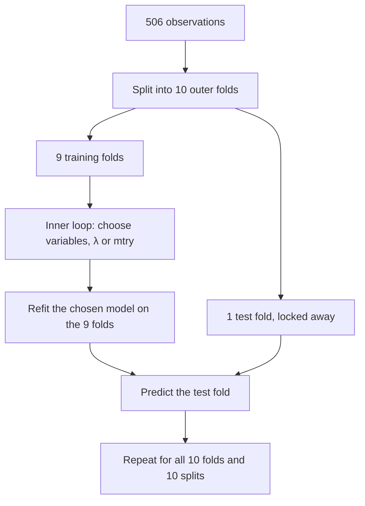

A single RMSE from one train/test split is not enough to claim that Random Forest beats linear regression. The fourth article in the *Introduction to Data Analysis with R* series uses the Boston housing data (506 neighborhoods, 14 variables) to compare nine models, from `lm(medv ~ lstat)` to Random Forest, on the same folds of 10 × 10-fold cross-validation, with checks for information leakage during variable selection, for the values capped at 50, and for residual diagnostics. The last part tells where the dataset came from and why scikit-learn dropped it: the variable `B` was built from the proportion of Black residents. All R and Python code in the article has been test-run.

## Summary

The Boston housing data (Harrison & Rubinfeld, 1978) is a classic regression exercise and also a place where a common evaluation mistake is easy to make: comparing the in-sample $R^2$ of one model with the test-set RMSE of another. This article compares nine models for predicting `medv`, from single-predictor regression to nested lasso and Random Forest, on the same folds of 10 × 10-fold CV. Random Forest has the lowest error (RMSE 3.64 thousand USD; $R^2_{\text{out}}$ = 0.843), but it beats the nested lasso by only 0.08 and the linear model with interactions by 0.23 thousand USD, while a single 80:20 split makes the RMSE of the same model swing by almost 2 thousand USD. A simulation on pure noise shows that selecting variables outside the CV loop produces a positive out-of-sample $R^2$ in 100 of 100 runs. Dropping the variable `B`, which encodes racial composition, does not reduce accuracy.

## 1. Introduction: why reanalyze a dataset everyone knows

In 1978, the economists David Harrison and Daniel Rubinfeld needed to answer a policy question: how much would people in the Boston area be willing to pay for cleaner air? They used a hedonic price model, which treats the price of a house as the sum of the values of its attributes, from the number of rooms and the distance to jobs to the concentration of nitric oxides in the air, and then estimated the part of the price tied to air quality (Harrison & Rubinfeld, 1978). The policy variable was `nox`; the other variables were there to control for everything else that moves house prices.

The dataset then took a different path. Belsley, Kuh and Welsch (1980) used it as an example in their book on regression diagnostics (StatLib, n.d.); the MASS package brought it to R as `Boston` (Venables & Ripley, 2002), and scikit-learn brought it to Python through the function `load_boston`. Since then, generations of students have learned `lm()` and Random Forest on these same 506 rows, as in [article 03](/en/blog/bai-tap-r-co-ban-buoi-5-buoi-6-va-buoi-7/) of this series.

Precisely because it is so familiar, Boston is often the stage for a flawed comparison: the linear model is reported with $R^2$ on the very data it was fitted to, Random Forest with RMSE on a test set split off once, each number from a different split, and the conclusion is "Random Forest is best". In-sample $R^2$ tells you how well a model fits the data it has already seen; out-of-sample RMSE tells you how far off it is on new data. Put side by side, they cannot answer which model predicts better.

Breiman (2001b) described two "cultures" of modeling: the data modeling culture assumes a specific stochastic model, such as linear regression, and interprets its parameters; the algorithmic modeling culture treats the data-generating mechanism as a black box and judges models by predictive accuracy, with Random Forest as a prime example (Breiman, 2001a). A fair comparison between the two cultures requires the same data, the same splits and the same out-of-sample metric (James et al., 2021; Kuhn, 2008).

This article is a reanalysis that follows exactly that principle. The main question: when every model shares the same folds and every variable-selection step sits inside the cross-validation loop, does Random Forest predict the median home value `medv` better than a linear model with quadratic and interaction terms, by how much, and with how much certainty? Five sub-questions:

1. **Q1**: how optimistic is in-sample $R^2$, and how much does the RMSE of a single 80:20 split vary?
2. **Q2**: does choosing a formula by looking at the full dataset create an unfair advantage over automatic variable selection run nested inside CV?
3. **Q3**: how do the 16 tracts with `medv` = 50 affect the coefficients and the error?
4. **Q4**: how should the `lstat` coefficient be read when there are interactions, and how should `rad` be encoded?
5. **Q5**: should the variable `B` be used, and what is lost by dropping it?

The article uses only `MASS::Boston`, discusses only the evaluation of predictive models, does not estimate the causal effect of any variable, and does not generalize to today's housing market.

## 2. Data and methods

### 2.1. Data

`MASS::Boston` has 506 rows, each one a census tract in the Boston metropolitan area, and 14 variables. Table 1 describes the variables according to the original StatLib file, with units; variable names in R are lowercase, and the variable `B` is called `black` in the MASS package.

**Table 1.** Variables in the Boston dataset (after StatLib, n.d.)

| Variable | Meaning | Note |
|---|---|---|
| `crim` | per capita crime rate by town | strongly right-skewed |
| `zn` | proportion of residential land zoned for lots over 25,000 ft² | |
| `indus` | proportion of non-retail business acres | |
| `chas` | dummy: 1 if the tract bounds the Charles River | 35/506 tracts (6.9%) |
| `nox` | nitric oxides concentration | parts per 10 million |
| `rm` | average number of rooms per dwelling | |
| `age` | proportion of owner-occupied units built before 1940 | |
| `dis` | weighted distance to five employment centers | |
| `rad` | index of accessibility to radial highways | values 1–8 and 24 |
| `tax` | full-value property tax rate | USD per $10,000 |
| `ptratio` | pupil–teacher ratio by town | |
| `black` (B) | $1000(B_k - 0.63)^2$, where $B_k$ is the proportion of Black residents | see section 4.4 |
| `lstat` | % lower-status population | |
| `medv` | median value of owner-occupied homes | thousand USD; capped at 50 |

Three features are worth knowing before fitting any model. First, 471/506 tracts (93.1%) do not bound the Charles River; mean `medv` is 22.09 thousand USD in this group and 28.44 in the riverside group. Second, `rad` is an ordinal index with values 1–8 and a jump to 24 (132 tracts); the gap between 8 and 24 has no meaning as a measurement. Third, exactly 16 tracts have `medv` = 50.0, the maximum value. A pile-up at a round number is a sign of right censoring: the true price is "50 or more". Gilley and Pace (1996) audited the data, published corrections and examined the censoring; the corrected version (variable `cmedv`, with coordinates added by Pace & Gilley, 1997) is available in the `mlbench` package as `BostonHousing2` (Leisch & Dimitriadou, 2026). This article uses the MASS version because it is the most widely used.

### 2.2. A single evaluation protocol

Every model is evaluated with repeated k-fold cross-validation: the data are split at random into 10 folds, each fold serves once as the test set, and the whole procedure is repeated 10 times with 10 different splits (seeds 2026–2035). The key point is that **every model uses exactly the same folds**, so the difference between two models on a given fold is a paired comparison that removes the variation due to the split.

For each repetition, the 506 out-of-fold predictions $\hat y_i$ are pooled to compute:

$$\text{RMSE} = \sqrt{\tfrac{1}{n}\sum_i (y_i - \hat y_i)^2}, \qquad \text{MAE} = \tfrac{1}{n}\sum_i |y_i - \hat y_i|, \qquad R^2_{\text{out}} = 1 - \frac{\sum_i (y_i - \hat y_i)^2}{\sum_i (y_i - \bar y)^2}.$$

RMSE and MAE are in thousand USD; RMSE penalizes large errors heavily. $R^2_{\text{out}}$ is negative when a model predicts worse than the mean. Results are the mean and standard deviation over the 10 repetitions. The article also runs 200 random 80:20 splits (405 train, 101 test) for three models to see how uncertain a single split is. The R code below (base R and MASS) runs the linear-model part:

```r
library(MASS)
data(Boston)
f4 <- medv ~ . - indus - age - zn - black + rm:lstat + rm:rad + lstat:rad

cv_lm <- function(formula, data, k = 10, reps = 5, seed = 2026) {
  set.seed(seed)
  res <- replicate(reps, {
    fold <- sample(rep(1:k, length.out = nrow(data)))
    pred <- numeric(nrow(data))
    for (i in 1:k) {
      fit <- lm(formula, data = data[fold != i, ])
      pred[fold == i] <- predict(fit, newdata = data[fold == i, ])
    }
    y <- data$medv
    c(RMSE = sqrt(mean((y - pred)^2)),
      MAE  = mean(abs(y - pred)),
      R2   = 1 - sum((y - pred)^2) / sum((y - mean(y))^2))
  })
  rowMeans(res)
}
round(cv_lm(f4, Boston), 3)          # RMSE 3.842  MAE 2.608  R2 0.825
round(cv_lm(medv ~ ., Boston), 3)    # RMSE 4.889  MAE 3.399  R2 0.717
```

The numbers differ slightly from Table 3 because this uses only 5 repetitions with R's random number generator.

### 2.3. Nine models

Table 2 lists the models. M0–M5 are fixed linear-regression formulas, from simple to complex. M4 is the kind of formula often seen in coursework: drop `indus`, `age`, `zn` and `black` because their p-values are large, and add three interactions, `rm:lstat`, `rm:rad` and `lstat:rad`, because they raise $R^2$. This formula was chosen by trial and error while looking at results on the full dataset, which makes it the subject of question Q2.

**Table 2.** Models compared

| Code | Model | How the structure is chosen |
|---|---|---|
| M0 | `medv ~ lstat` | fixed |
| M1 | all 13 variables | fixed |
| M2 | M1 without `indus`, `age` | fixed |
| M3 | M2 + $lstat^2$ | fixed |
| M4 | M2 without `zn`, `black` + `rm:lstat` + `rm:rad` + `lstat:rad` | hand-picked on the full dataset |
| M5 | M2 + $lstat^2$ + $rm^2$ | fixed |
| M6 | best subset over 15 candidates (13 variables + $lstat^2$ + $rm^2$) | chosen by BIC **within each fold** |
| M7 | lasso over 103 candidates (13 variables, 12 squares, 78 pairwise interactions) | λ chosen by 5-fold CV **within each fold** |
| M8 | Random Forest, 500 trees | `mtry` chosen by OOB error **within each fold** |

M6 examines all $2^{15} - 1 = 32,767$ subsets in each training fold and picks the one with the lowest BIC (James et al., 2021). M7 uses the lasso (Tibshirani, 1996): the penalty $\lambda \sum_j |\beta_j|$ pulls many coefficients to zero, so it estimates and selects variables at the same time; variables are standardized, and λ is chosen by 5-fold CV inside the training fold (Friedman et al., 2010). The wide candidate space gives the lasso a chance to find on its own what M4 found by hand.

M8 is Random Forest (Breiman, 2001a): each tree is grown on a bootstrap sample, and each split considers only `mtry` randomly chosen variables; the observations left out of the bootstrap sample (out-of-bag, OOB) allow error to be estimated without a test set. The R `randomForest` defaults for regression are `mtry` $= \lfloor p/3 \rfloor$ and a minimum terminal node size of 5 (Liaw & Wiener, 2002). Here `mtry` is chosen from {3, 4, 6, 9, 13} by OOB error **on the training fold only**.

### 2.4. Information leakage in model selection and nested cross-validation

Data leakage occurs when information that would not be available at prediction time slips into model building, making performance look better than it really is (Kaufman et al., 2012). A subtle form is **selecting the model on the full dataset and only then cross-validating**: if you look at p-values on all 506 observations to decide which variables to drop and which interactions to add, the test folds have already helped choose the model structure, and CV is left checking only the coefficient-estimation step.

The fix is nested cross-validation: every data-driven decision, including variable selection, the choice of λ and the choice of `mtry`, must be repeated from scratch inside each training fold (Varma & Simon, 2006). Figure 1 summarizes the procedure.



**Figure 1.** Nested cross-validation: the test fold takes no part in any modeling decision.

### 2.5. Diagnostics, sensitivity analyses and tools

M4 is refitted on the full dataset to plot residuals against fitted values and standardized residuals against leverage, with Cook's distance contours (Cook, 1977; Belsley et al., 1980). The effect of `lstat` in Random Forest is described with partial dependence: let `lstat` run over a grid, hold the other variables at their observed values, and average the predictions. The article does not rank variable importance, because that measure can be biased (Strobl et al., 2007).

The sensitivity analyses (5 × 10-fold CV, Random Forest with fixed `mtry` $= \lfloor p/3 \rfloor$) are: (a) dropping `black` from M1 and from Random Forest; (b) removing the 16 tracts with `medv` = 50, or computing error only on the uncensored tracts; (c) a Tobit model with a right-censoring threshold of 50 (Tobin, 1958); (d) encoding `rad` as binary (`rad` = 24) or as a factor.

Linear regression, Tobit (package `survival`) and the leakage simulation were run in R 4.4.3 with MASS 7.3.65; best subset, lasso and Random Forest were run in Python 3.13 with numpy and scikit-learn 1.9.0 on exactly the same folds, with the data exported from R via `write.csv()`. scikit-learn's Random Forest with `min_samples_leaf = 5` is close to, but not the same as, the `randomForest` defaults, so rerunning with `randomForest`, `leaps` and `glmnet` in R may give slightly different numbers.

## 3. Results

### 3.1. In-sample and out-of-sample $R^2$ (Q1)

Table 3 places the $R^2$ from fitting on the full dataset next to $R^2_{\text{out}}$ from CV. For the fixed models the gap is small (0.741 vs. 0.719 for M1; 0.842 vs. 0.826 for M4) because 506 observations are many relative to at most 13 coefficients. The gap grows quickly as the number of variables approaches the number of observations (section 3.4). But the two numbers answer two different questions, so a comparison table only makes sense when every row uses the same kind of number.

### 3.2. Main results

**Table 3.** Out-of-sample error of the nine models, 10 × 10-fold CV with shared folds (mean ± standard deviation over 10 repetitions; RMSE and MAE in thousand USD)

| Model | RMSE | MAE | $R^2_{\text{out}}$ | In-sample $R^2$ (n = 506) |
|---|---|---|---|---|
| M0 `lstat` | 6.24 ± 0.01 | 4.53 ± 0.01 | 0.540 | 0.544 |
| M1 all 13 variables | 4.87 ± 0.04 | 3.39 ± 0.02 | 0.719 | 0.741 |
| M2 without `indus`, `age` | 4.85 ± 0.04 | 3.38 ± 0.02 | 0.721 | 0.741 |
| M3 + $lstat^2$ | 4.40 ± 0.03 | 3.16 ± 0.02 | 0.771 | 0.787 |
| M4 interactions, hand-picked | 3.84 ± 0.05 | 2.60 ± 0.02 | 0.826 | 0.842 |
| M5 + $lstat^2$, $rm^2$ | 4.13 ± 0.04 | 2.77 ± 0.03 | 0.798 | 0.817 |
| M6 best subset, nested | 4.19 ± 0.05 | 2.82 ± 0.03 | 0.792 | — |
| M7 lasso, nested | 3.70 ± 0.13 | 2.44 ± 0.05 | 0.838 | — |
| M8 Random Forest | 3.64 ± 0.06 | 2.33 ± 0.03 | 0.843 | — |


**Figure 2.** Out-of-sample RMSE of the nine models. Small dots are individual repetitions; large dots and horizontal bars are the mean ± standard deviation. Orange marks M4, the model with a hand-picked formula; green is Random Forest.

There are three clear groups (Figure 2). The purely linear group (M1, M2) has an RMSE of about 4.85–4.87; dropping `indus` and `age` changes almost nothing. Adding curvature in `lstat` (M3) lowers RMSE by 0.45, and adding $rm^2$ (M5) lowers it by another 0.27. The best group consists of M4, the nested lasso (M7) and Random Forest (M8), with RMSE 3.64–3.84.

Random Forest has the lowest RMSE and MAE. In a paired comparison over the same 100 folds, it is on average 0.23 thousand USD below M4 (fold-level standard deviation 0.40), better in 74% of folds and in all 10/10 repetitions. Against the nested lasso M7, the difference is only 0.08 (standard deviation 0.67): Random Forest is better in 60% of folds, and the lasso wins in 2/10 repetitions. The lasso varies the most (± 0.13), partly because the number of nonzero coefficients changes from 26 to 68 across folds (median 60/103).

The nested best subset (M6) selects 11 or 12 of the 15 candidates in every fold and gives a result (4.19) close to M5 (4.13). Random Forest picks `mtry` = 6 in 88/100 folds; the OOB RMSE when fitted on the full dataset with `mtry` = 4 is 3.62, close to the CV RMSE.

The Python snippet below condenses the idea of shared folds (3 repetitions and a fixed `max_features`, so the numbers differ slightly from Table 3):

```python
import numpy as np, pandas as pd
from sklearn.model_selection import KFold
from sklearn.linear_model import LinearRegression
from sklearn.ensemble import RandomForestRegressor

d = pd.read_csv("boston.csv")            # write.csv(MASS::Boston, "boston.csv", row.names = FALSE)
y = d["medv"].to_numpy()
X_rf = d.drop(columns="medv")

# Design matrix for M4: drop indus, age, zn, black; add three interactions
X_m4 = d.drop(columns=["medv", "indus", "age", "zn", "black"]).copy()
X_m4["rm_lstat"] = d.rm * d.lstat
X_m4["rm_rad"] = d.rm * d.rad
X_m4["lstat_rad"] = d.lstat * d.rad

models = {
    "M4": (LinearRegression(), X_m4),
    "RF": (RandomForestRegressor(n_estimators=500, max_features=4,
                                 min_samples_leaf=5, random_state=1, n_jobs=-1), X_rf),
}
rows = []
for rep in range(3):                                  # 3 repetitions to keep it fast
    kf = KFold(n_splits=10, shuffle=True, random_state=2026 + rep)
    for fold, (tr, te) in enumerate(kf.split(d)):     # SAME folds for every model
        for name, (model, X) in models.items():
            pred = model.fit(X.iloc[tr], y[tr]).predict(X.iloc[te])
            rows.append({"rep": rep, "fold": fold, "model": name,
                         "rmse": np.sqrt(np.mean((y[te] - pred) ** 2))})

res = pd.DataFrame(rows).pivot_table(index=["rep", "fold"], columns="model", values="rmse")
print(res.mean().round(3))          # mean RMSE per fold: M4 3.729, RF 3.523
diff = res["RF"] - res["M4"]                          # paired difference per fold
print(f"RF - M4: mean {diff.mean():.3f}, RF better in {(diff < 0).mean():.0%} of folds")
# RF - M4: mean -0.205, RF better in 67% of folds
```

### 3.3. How much a single 80:20 split varies

Across 200 random 80:20 splits, the RMSE of M1 has a median of 4.88 (5th–95th percentile: 3.93–5.79), M4 3.80 (2.98–4.72), and Random Forest 3.73 (2.64–5.00) (Figure 3). Each interval is almost 2 thousand USD wide, many times the difference between the best models.


**Figure 3.** RMSE over 200 random 80:20 splits. Each dot is one split, and the red bar is the median; the dashed line marks an RMSE of 2.93 for comparison.

A number like RMSE = 2.93 is not rare: Random Forest reaches that level or lower in 13.5% of splits, M4 in 4%. Even with a shared test set, Random Forest beats M4 in only 63% of splits, and the RMSE difference ranges from −0.71 to +0.52 (5th–95th percentile). A single split gives you one point from this distribution without telling you where in it that point lies.

### 3.4. Leakage in model selection (Q2)

The M4 formula was hand-picked on the full dataset, so its RMSE of 3.84 should be optimistic. In fact, the nested lasso M7, which selects its own variables and interactions from 103 candidates inside each fold, reaches 3.70, which is even better. The signal M4 captured, especially the `rm`–`lstat` interaction, is real and can be recovered by a leak-free procedure. The optimism here is small, but you only learn that by running the nested procedure for comparison.

The R code below shows how dangerous leakage can be: $y$ is completely independent of 2,000 predictors and there are only 60 observations, much like a "many genes, few samples" setting. The wrong way picks the 5 variables most strongly correlated with $y$ on the full dataset and only then runs 5-fold CV; the right way repeats the selection inside each fold.

```r
set.seed(1)
n <- 60; p <- 2000
X <- matrix(rnorm(n * p), n, p)
y <- rnorm(n)                       # y has nothing to do with X
top <- function(X, y, m = 5) order(abs(cor(X, y)), decreasing = TRUE)[1:m]
fold <- sample(rep(1:5, length.out = n))
pred_leak <- pred_nest <- numeric(n)
sel_all <- top(X, y)                # WRONG: select variables on the full dataset
for (i in 1:5) {
  tr <- fold != i; te <- fold == i
  fit <- lm(y[tr] ~ X[tr, sel_all])
  pred_leak[te] <- cbind(1, X[te, sel_all]) %*% coef(fit)
  sel_i <- top(X[tr, ], y[tr])      # RIGHT: reselect inside each fold
  fit <- lm(y[tr] ~ X[tr, sel_i])
  pred_nest[te] <- cbind(1, X[te, sel_i]) %*% coef(fit)
}
r2 <- function(p) 1 - sum((y - p)^2) / sum((y - mean(y))^2)
round(c(leak = r2(pred_leak), nested = r2(pred_nest)), 2)
#   leak nested
#   0.42  -0.43
```

With this seed, the wrong way reports $R^2_{\text{out}}$ = 0.42 for a model that predicts pure noise; the right way gives −0.43, worse than guessing the mean, exactly as it should be. Repeated over 100 seeds, the wrong way gives a positive $R^2_{\text{out}}$ in 100/100 runs (median 0.39; 5th–95th percentile: 0.25–0.52), while the right way gives a median of −0.38 (−0.82 to −0.01).

### 3.5. Capped values and sensitivity analyses (Q3, Q5)

**Table 4.** Out-of-sample RMSE (thousand USD) in the sensitivity analyses

| Scenario | M1 | M4 | M8 Random Forest |
|---|---|---|---|
| Baseline (5 × 10-fold CV, fixed `mtry`) | 4.86 | 3.82 | 3.66 |
| Drop variable `black` | 4.91 | (not included) | 3.64 |
| Train on all, score error only on the 490 uncensored tracts* | 4.08 | 3.22 | 2.84 |
| Remove the 16 tracts with `medv` = 50 | 3.87 | 3.03 | 2.90 |
| `rad` as binary (`rad` = 24) | 4.89 | — | — |
| `rad` as a 9-level factor | 4.83 | — | — |

\* From the main 10 × 10-fold CV analysis with tuned `mtry`.

The censored tracts account for a large share of the error: scoring only the 490 uncensored tracts, the RMSE of every model drops sharply, and the gap between Random Forest and M4 widens from 0.19 to 0.38. Removing the 16 tracts altogether also lowers RMSE, but this cannot be compared with the baseline row because the hardest-to-predict tail has been cut off: it is a way of "prettifying" RMSE that must be reported clearly if used.

Censoring, on the other hand, barely biases the linear coefficients. A Tobit model for M3 gives coefficients almost identical to OLS: `lstat` −1.70 vs. −1.67, `rm` 3.34 vs. 3.23, `nox` −13.59 vs. −13.54, which makes sense when only 3.2% of observations are censored:

```r
library(MASS); library(survival)
f3 <- medv ~ crim + zn + chas + nox + rm + dis + rad + tax + ptratio + black +
              lstat + I(lstat^2)
ols <- lm(f3, data = Boston)
tob <- survreg(update(f3, Surv(medv, medv < 50, type = "right") ~ .),
               data = Boston, dist = "gaussian")
round(cbind(OLS = coef(ols), Tobit = coef(tob)[names(coef(ols))]), 3)
```

Dropping `black` raises the RMSE of M1 by 0.05 and does not make Random Forest worse (3.64 vs. 3.66): for prediction, this variable adds almost no information. Re-encoding `rad` changes the RMSE of M1 by no more than 0.04, less than the variation between repetitions.

### 3.6. Residual diagnostics and the shape of the effect (Q4)

In Figure 4A, the residuals of the censored tracts lie on a downward diagonal, because with $y$ fixed at 50 the residual is exactly $50 - \hat y$. Fifteen of these 16 tracts have positive residuals, averaging 8.9 thousand USD: the model systematically underpredicts at the top of the price range. The moving average also bends slightly at both ends.


**Figure 4.** Residual diagnostics for M4 (n = 506). A: residuals against fitted values; orange triangles are the 16 tracts with `medv` = 50. B: standardized residuals against leverage, with Cook's distance contours at 0.5 and 1.

In Figure 4B, tracts 372, 373 and 369 (all with `medv` = 50) have standardized residuals of 6.46, 6.02 and 5.66; under a normal distribution, values above 4 are already very rare, so the residual tails are clearly heavier than normal. Tract 365 has a leverage of 0.23 and a standardized residual of −4.47, giving a Cook's distance of 0.47, right next to the 0.5 contour: its average number of rooms is 8.78, among the highest, yet `medv` is only 21.9. All four tracts have `rad` = 24, where the interactions with `rad` act most strongly. A point near the threshold such as tract 365 deserves a closer look and a refit without it, rather than a conclusion that "there are no influential points" (Cook, 1977).


**Figure 5.** Partial dependence of `lstat`: Random Forest (solid line) and M3 with $lstat^2$ (dashed line), both fitted on the full dataset; gray dots are the data.

Figure 5 compares the shape of the `lstat` effect in the two modeling cultures. Both agree that prices fall quickly as `lstat` rises from 3% to 10%. On the right, Random Forest levels off at about 19.5 thousand USD once `lstat` passes roughly 20%, because trees do not extrapolate, while M3's quadratic curve falls to about 15.6 around `lstat` = 25% and then **rises** again, a consequence of the parabolic form rather than of the data. Putting the two curves side by side lets you see each model's assumptions.

## 4. Discussion

### 4.1. Why one RMSE is not enough to choose an algorithm

The results in section 3 show that "Random Forest is best" may be true on these data, but it cannot be concluded from an RMSE set next to an $R^2$, because of three flaws in the procedure, not in the algorithm:

- **Different metrics**: in-sample $R^2$ never decreases when variables are added and is generally more optimistic than out-of-sample $R^2$; more importantly, $R^2$ and RMSE are on different scales, so they cannot be ranked together.

- **Different data**: when two models are scored on two different test sets, the difference also mixes in how hard each test set is; the RMSE of the same M4 ranges from 2.98 to 4.72 across splits.

- **A single split**: Random Forest beats M4 in only 63% of splits, so roughly one split in three leads to the opposite conclusion. Repeated CV with shared folds reduces this noise.

<div class="callout callout-warning">
<p class="callout-title">randomForest's <code>rsq</code> is not test-set $R^2$</p>

In R's `randomForest` package, `fit$mse` is a vector of mean squared errors computed on the OOB predictions, one element for each number of trees from 1 to `ntree`, and `fit$rsq` is the corresponding "pseudo R-squared" $1 - \text{mse}/\text{Var}(y)$ (Liaw & Wiener, 2002). So `mean(fit$rsq)` is the average of a curve as the forest grows, dragged down by forests with only a few trees; the number to report is the last element, `tail(fit$rsq, 1)`, and even that is an OOB estimate on the training data, not $R^2$ on a test set. For out-of-sample $R^2$, compute $1 - \text{SSE}/\text{SST}$ from `predict(fit, newdata = test)`.

</div>

### 4.2. Leakage in variable selection: a lesson for biologists

The pure-noise experiment in section 3.4 reproduces, on a small scale, a mistake that once appeared in gene expression studies. Ambroise and McLachlan (2002) reanalyzed two published microarray datasets and showed that when gene selection was done on all samples and only the classification step was cross-validated, prediction rules using just a few genes were reported with error rates close to zero; once the selection bias was corrected by performing CV external to the gene-selection step, the CV error was no longer zero. They recommended 10-fold CV over leave-one-out in this setting. Varma and Simon (2006) showed by simulation that even just tuning a classifier's parameters by CV and then reporting the best CV error already biases the error estimate strongly: on "null" data, where the two groups do not differ at all, a tuned SVM had a CV error below 30% in 38% of simulated datasets, while on an independent test set it did no better than chance. Nested CV, with an inner loop for tuning and an outer loop for evaluation, gave estimates very close to the error on an independent test set.

For biology students this situation is close to home: picking the 50 genes that differ most between two groups on the full dataset and only then splitting into train and test; normalizing or imputing missing values with the mean of all samples. The general rule: **every step that learns from the data belongs inside the loop**. In R, `caret` or `tidymodels` let you bundle preprocessing and the model into a single workflow that is resampled together (Kuhn, 2008). See also the [article on machine learning in biology](/en/blog/machine-learning-va-ai-trong-sinh-hoc/).

On Boston, the leakage from hand-picking M4 has no major consequences because the signal is strong and there are few variables. When the number of variables far exceeds the number of samples, as in omics data, the gap between reported error and true error can be very large.

### 4.3. Interpreting coefficients when the model has interactions

In M4 fitted on the full dataset, the coefficient of `lstat` is +1.87. Read hastily, it would suggest that tracts with a higher share of lower-status residents have **higher** house prices, contrary to every scatter plot. But with the interactions `rm:lstat` (−0.331) and `lstat:rad` (−0.036) in the model, +1.87 is only the slope of `lstat` at `rm` = 0 and `rad` = 0, a house with no rooms in a tract with no accessibility index, which does not exist. The actual slope of `lstat` is

$$\frac{\partial\, \widehat{medv}}{\partial\, lstat} = 1.87 - 0.331 \cdot rm - 0.036 \cdot rad.$$

At the means `rm` = 6.28 and `rad` = 9.55, the slope is −0.56 thousand USD per percentage point of `lstat`; at the mean `rm`, the slope is −0.25 at `rad` = 1 and −1.08 at `rad` = 24. The right way to read a model with interactions is to report the effect at meaningful values of the other variable, or to center the variables before creating the interactions so that the main coefficient means "the slope at the mean". Background on multiple regression is in the [article on correlation and regression](/en/blog/tuong-quan-va-hoi-quy/) and the article on linear and logistic regression.

The interactions with `rad` are also questionable: multiplying `lstat` or `rm` by an ordinal index in which 24 is not "three times" 8 in any sense assumes that the slope changes linearly with a number that has no measurement scale. Re-encoding `rad` does not improve accuracy (section 3.5), but the issue here is interpretation.

The residuals of M4 are a reminder that a high $R^2$ does not mean the model is right: the tails are heavy, 15/16 censored tracts are underpredicted, and the Tobit model does not fix that because the problem lies in the functional form, not in the censoring. In addition, neighboring tracts have similar prices and characteristics; Pace and Gilley (1997) showed that a model accounting for spatial configuration estimates better than OLS on these very data, so the residuals of the models in this article are likely still spatially correlated, and random CV may be optimistic when neighboring tracts fall into both train and test.

### 4.4. Origins and ethics of the dataset

The Boston dataset was created to measure the value of clean air, not to teach machine learning (Harrison & Rubinfeld, 1978). Its variables are control variables in a 1970s economics study, chosen according to the authors' assumptions about what makes house prices change.

The variable `B` is the clearest example. It is not the proportion of Black residents $B_k$ but $1000(B_k - 0.63)^2$ (StatLib, n.d.), a parabola with its minimum at $B_k$ = 0.63, so two tracts with very different proportions can receive the same value of `B`. Anyone who uses `B` as a predictor inherits the assumption behind that functional form, usually without knowing it.

scikit-learn marked `load_boston` as deprecated in version 1.0 and announced its removal in version 1.2. The documentation states plainly that the dataset "has an ethical problem": the authors engineered a non-invertible variable `B` on the assumption that racial self-segregation has a positive effect on house prices, while the original study, which targeted air quality, did not adequately demonstrate that assumption. The documentation advises against using it unless the purpose is to study and educate about ethical issues in data science, and suggests the California housing or Ames housing datasets instead (scikit-learn developers, n.d.). The dataset is still in MASS, and its presence there is not the problem; the problem is using it without knowing anything about it.

Section 3.5 adds a practical argument: dropping `black` costs almost no accuracy. If the goal is prediction, the variable is not needed; if the goal is to understand housing discrimination, that calls for a serious research design, not a quadratic term. Advice for instructors: use Boston when the lesson **is** about data provenance, leakage and ethics, as in this article; for lessons on pure regression technique, pick another dataset. The question "where does this data come from, who collected it, and why" should come before the first `library()` line.

### 4.5. Limitations

This article has four limitations: 506 observations is a small sample, and the differences between the best models are of the same size as the variation between folds; Random Forest was tuned only on `mtry`, with no boosting or spatial models considered; random CV ignores spatial structure, and splitting folds by town might give higher errors; and the article uses the uncorrected MASS version, so repeating the analysis on `cmedv` would show whether data errors change the conclusions.

## 5. Conclusion

Three messages apply to any regression exercise. One, evaluate every model with **a single protocol**: the same data, the same folds, the same out-of-sample metric, with its variability. Two, **every variable-selection and tuning step belongs inside the CV loop**; otherwise, on data with many variables and few samples, pure noise can look like a useful model. Three, **know where your data come from before using them**: Boston was created to put a price on clean air, and it carries a variable that encodes race and a price ceiling at 50.

On these data, Random Forest predicts best, but its lead over the linear model with interactions or the nested lasso is much smaller than it seems when a flattering RMSE from one split is set next to an in-sample $R^2$; in exchange, the linear model gives readable coefficients, provided they are read correctly.

<div class="callout callout-note">
<p class="callout-title">An 8-item checklist for a regression analysis in R</p>

1. Call `set.seed()` at the top and record the seed.
2. Write the whole analysis in one R Markdown file that runs from start to finish.
3. Use one shared set of folds for every model being compared.
4. Report out-of-sample metrics (RMSE, MAE, $R^2_{\text{out}}$) with their variability, not just in-sample $R^2$.
5. Put every variable-selection, standardization and tuning step inside the CV loop (nested CV).
6. Look at the diagnostic plots and flag censored or unusual values.
7. Record `sessionInfo()` at the end of the file (or use `renv`).
8. Document the dataset's origin, its collection purpose and its ethical limits.

</div>

The next article returns to [descriptive statistics](/en/blog/data-exploration-using-descriptive-statistics/), where capped values such as `medv` = 50 should have been caught before any model was fitted. Project-level reproducibility is discussed in the [article on reproducible workflows](/en/blog/quy-trinh-tai-lap-workflow-container-hpc-va-cloud/).

## References

Ambroise, C., & McLachlan, G. J. (2002). Selection bias in gene extraction on the basis of microarray gene-expression data. *Proceedings of the National Academy of Sciences, 99*(10), 6562–6566. https://doi.org/10.1073/pnas.102102699

Belsley, D. A., Kuh, E., & Welsch, R. E. (1980). *Regression diagnostics: Identifying influential data and sources of collinearity*. Wiley. https://doi.org/10.1002/0471725153

Breiman, L. (2001a). Random forests. *Machine Learning, 45*(1), 5–32. https://doi.org/10.1023/A:1010933404324

Breiman, L. (2001b). Statistical modeling: The two cultures. *Statistical Science, 16*(3), 199–231. https://doi.org/10.1214/ss/1009213726

Cook, R. D. (1977). Detection of influential observation in linear regression. *Technometrics, 19*(1), 15–18. https://doi.org/10.1080/00401706.1977.10489493

Friedman, J., Hastie, T., & Tibshirani, R. (2010). Regularization paths for generalized linear models via coordinate descent. *Journal of Statistical Software, 33*(1), 1–22. https://doi.org/10.18637/jss.v033.i01

Gilley, O. W., & Pace, R. K. (1996). On the Harrison and Rubinfeld data. *Journal of Environmental Economics and Management, 31*(3), 403–405. https://doi.org/10.1006/jeem.1996.0052

Harrison, D., & Rubinfeld, D. L. (1978). Hedonic housing prices and the demand for clean air. *Journal of Environmental Economics and Management, 5*(1), 81–102. https://doi.org/10.1016/0095-0696(78)90006-2

James, G., Witten, D., Hastie, T., & Tibshirani, R. (2021). *An introduction to statistical learning: With applications in R* (2nd ed.). Springer. https://doi.org/10.1007/978-1-0716-1418-1

Kaufman, S., Rosset, S., Perlich, C., & Stitelman, O. (2012). Leakage in data mining: Formulation, detection, and avoidance. *ACM Transactions on Knowledge Discovery from Data, 6*(4), 1–21. https://doi.org/10.1145/2382577.2382579

Kuhn, M. (2008). Building predictive models in R using the caret package. *Journal of Statistical Software, 28*(5), 1–26. https://doi.org/10.18637/jss.v028.i05

Leisch, F., & Dimitriadou, E. (2026). *mlbench: Machine learning benchmark problems* (R package version 2.1-11) [Computer software]. https://CRAN.R-project.org/package=mlbench

Liaw, A., & Wiener, M. (2002). Classification and regression by randomForest. *R News, 2*(3), 18–22. https://CRAN.R-project.org/doc/Rnews/

Pace, R. K., & Gilley, O. W. (1997). Using the spatial configuration of the data to improve estimation. *The Journal of Real Estate Finance and Economics, 14*(3), 333–340. https://doi.org/10.1023/A:1007762613901

scikit-learn developers. (n.d.). *sklearn.datasets.load_boston* (Version 1.0 documentation). Retrieved November 17, 2026, from https://scikit-learn.org/1.0/modules/generated/sklearn.datasets.load_boston.html

StatLib. (n.d.). *Boston house-price data*. Carnegie Mellon University. Retrieved November 17, 2026, from https://lib.stat.cmu.edu/datasets/boston

Strobl, C., Boulesteix, A.-L., Zeileis, A., & Hothorn, T. (2007). Bias in random forest variable importance measures: Illustrations, sources and a solution. *BMC Bioinformatics, 8*, 25. https://doi.org/10.1186/1471-2105-8-25

Tibshirani, R. (1996). Regression shrinkage and selection via the lasso. *Journal of the Royal Statistical Society: Series B (Methodological), 58*(1), 267–288. https://doi.org/10.1111/j.2517-6161.1996.tb02080.x

Tobin, J. (1958). Estimation of relationships for limited dependent variables. *Econometrica, 26*(1), 24–36. https://doi.org/10.2307/1907382

Varma, S., & Simon, R. (2006). Bias in error estimation when using cross-validation for model selection. *BMC Bioinformatics, 7*, 91. https://doi.org/10.1186/1471-2105-7-91

Venables, W. N., & Ripley, B. D. (2002). *Modern applied statistics with S* (4th ed.). Springer. https://doi.org/10.1007/978-0-387-21706-2
